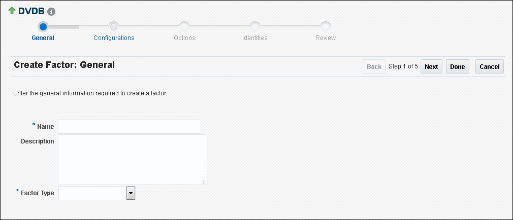
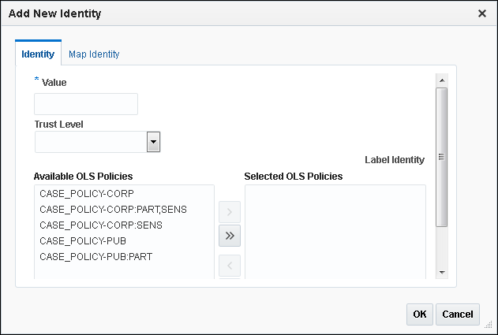
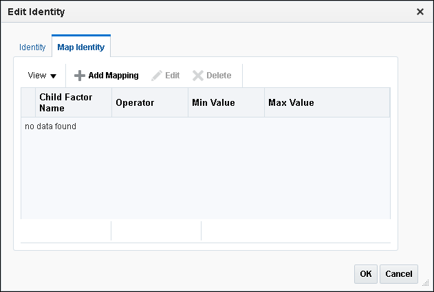
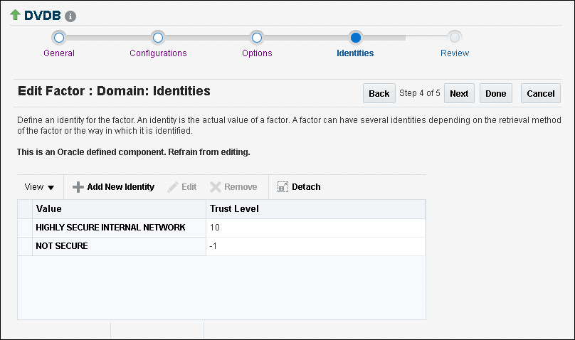

Factors allow you to create and use complex attributes through PL/SQL to make Oracle Database Vault authorization decisions.

- What Are Factors?
  A factor is a named variable or attribute, such as a database IP address, that Oracle Database Vault can recognize.
- Default Factors
  Oracle Database Vault provides a set of default factors.
- Creating a Factor
  In general, to create a factor, you first create the factor itself, and then you edit the factor to include its identity.
- Adding an Identity to a Factor
  After you create a new factor, you optionally can add an identity to it.
- Deleting a Factor
  Before you delete a factor, you must remove references to the factor.
- How Factors Work
  Oracle Database Vault processes factors when a session is established.
- Tutorial: Preventing Ad Hoc Tool Access to the Database
  This tutorial demonstrates how to use factors to prevent ad hoc tools (such as SQL\*Plus) from accessing the database.
- Tutorial: Restricting User Activities Based on Session Data
  This tutorial shows how to restrict user activities based on their session data, such as the domain the user is using.
- Guidelines for Designing Factors
  Oracle provides guidelines for designing factors.
- How Factors Affect Performance
  The complexity of factors affects the performance of your Oracle database instance.
- Factor Related Reports and Data Dictionary Views
  Oracle Database Vault provides reports and data dictionary views that display information about factors and their identities.

### 7.1 What Are Factors?

A factor is a named variable or attribute, such as a database IP address, that Oracle Database Vault can recognize.

You can use factors for activities such as authorizing database accounts to connect to the database or creating filtering logic to restrict the visibility and manageability of data.

Oracle Database Vault provides a selection of factors that lets you set controls on such components as the domain for your site, IP addresses, databases, and so on. You also can create custom factors, using your own PL/SQL retrieval methods. You also can create custom factors, using your own PL/SQL retrieval methods. However, for the vast majority of cases, you can use the `SYS_CONTEXT` PL/SQL function to create rules on the most commonly used factors that are readily available in the database. Such factors as Session_User, Proxy_User, Network_Protocol, and Module are available through the `SYS_CONTEXT` function.

Factors have powerful capabilities that are used in conjunction with Oracle Label Security and for other database attributes that are not already available through context parameters. Commonly available factors are listed in this section, but Oracle recommends that you use the `SYS_CONTEXT` function in the rule definitions for these factors. Only create and use factors that are not already available through `SYS_CONTEXT`.

Note the following:

- You can use factors in combination with rules in rule sets. The `DVF` factor functions are factor-specific functions that you can use in rule expressions.

- Factors have values (identities) and are further categorized by their factor types. See "Factor Type" in Completing the General Page for Factor Creation for information about factor types.

- You also can integrate factors with Oracle Label Security labels.

- You can run reports on the factors that you create in Oracle Database Vault. See for more information.

- In a multitenant environment, you only can create factors in a PDB, not in the CDB root or the application root.

This chapter explains how to configure factors by using Oracle Database Vault Administrator. Alternatively, you can use the Oracle Database Vault factor APIs to configure factors.

**Related Topics**

- [Creating a Rule to Add to a Rule Set](configuring-rule-sets.md)
- [Oracle Database SQL Language Reference](../sqlrf/SYS_CONTEXT.md)
- [Oracle Database Vault DVF PL/SQL Factor Functions](oracle-database-vault-factor-apis.md)
- [Oracle Database Vault Factor APIs](oracle-database-vault-factor-apis.md)

**Parent topic:** Configuring Factors

### 7.2 Default Factors

Oracle Database Vault provides a set of default factors.

For each of these factors, there is an associated function that retrieves the value of the factor.

You can create custom factors by using your own PL/SQL retrieval methods. A useful PL/SQL function you can use (which is used for many of the default factors) is the `SYS_CONTEXT` SQL function, which retrieves data about the user session. For example, you can use the `CLIENT_PROGRAM_NAME` attribute of `SYS_CONTEXT` to find the name of the program used for the database session. After you create the custom factor, you can query its values similar to the functions used to query the default factors.

The default factors are as follows:

- `Authentication_Method` is the method of authentication. In the list that follows, the type of user is followed by the method returned:

  - Password-authenticated enterprise user, local database user, user with the `SYSDBA` or `SYSOPER` administrative privilege using the password file; proxy with user name using password: `PASSWORD`

  - Kerberos-authenticated enterprise user or external user (with no administrative privileges): `KERBEROS`

  - Kerberos-authenticated enterprise user (with administrative privileges):` KERBEROS_GLOBAL`

  - Kerberos-authenticated external user (with administrative privileges): `KERBEROS_EXTERNAL`

  - Transport Layer Security (TLS)-authenticated enterprise or external user (with no administrative privileges): `SSL` (Transport Layer Security replaces Secure Sockets Layer, but SSL-related settings will work with Transport Layer Security.)

  - Transport Layer Security-authenticated enterprise user (with administrative privileges): `SSL_GLOBAL`

  - Transport Layer Security-authenticated external user (with administrative privileges): `SSL_EXTERNAL`

  - Radius-authenticated external user: `RADIUS`

  - OS-authenticated external user, or user with the `SYSDBA` or `SYSOPER` administrative privilege: `OS`

  - Proxy with certificate, DN, or username without using password: `NONE`

  - Background process (job queue secondary process): `JOB`

  - Parallel Query Slave (secondary) process: `PQ_SLAVE`

  For non-administrative connections, you can use the Identification_Type factor to distinguish between external and enterprise users when the authentication method is `PASSWORD`, `KERBEROS`, or `SSL`. For administrative connections, the Authentication_Method factor is sufficient for the `PASSWORD`, `SSL_EXTERNAL`, and `SSL_GLOBAL` authentication methods.

- `Client Identifier` is an identifier that is set by the application through the `DBMS_SESSION.SET_IDENTIFIER` procedure, the Oracle Call Interface (OCI) attribute `OCI_ATTR_CLIENT_IDENTIFIER`, or Oracle Dynamic Monitoring Service (DMS). Various Oracle Database components use this attribute to identify lightweight application users who authenticate as the same database user.

- `Client_IP` is the IP address of the machine from which the client is connected.

- `Database_Domain` is the domain of the database as specified in the `DB_DOMAIN` initialization parameter.

- `Database_Hostname` is the host name of the computer on which the instance is running.

- `Database_Instance` is the instance identification number of the current instance.

- `Database_IP` is the IP address of the computer on which the instance is running.

- `Database_Name` is the name of the database as specified in the `DB_NAME` initialization parameter.

- `DBlink_Info` is the source of a database link session. The string has this form:

  `SOURCE_GLOBAL_NAME=``dblink_src_global_name``, ``DBLINK_NAME=``dblink_name``,``SOURCE_AUDIT_SESSIONID=``dblink_src_audit_sessionid`

  In this specification:

  - `dblink_src_global_name` is the unique global name of the source database

  - `dblink_name` is the name of the database link on the source database

  - `dblink_src_audit_sessionid` source database that initiated source database that initiated the connection to the remote database using `dblink_name`

- `Domain` is a named collection of physical, configuration, or implementation-specific factors in the run-time environment (for example, a networked IT environment or subset of it) that operates at a specific sensitivity level. You can identify a domain using factors such as host name, IP address, and database instance names of the Database Vault nodes in a secure access path to the database. Each domain can be uniquely determined using a combination of the factor identifiers that identify the domain. You can use these identifying factors and possibly additional factors to define the Maximum Security Label within the domain. This restricts data access and commands, depending on the physical factors about the Database Vault session. Example domains of interest may be Corporate Sensitive, Internal Public, Partners, and Customers.

- `Enterprise_Identity` is the enterprise-wide identity for the user:

  - For enterprise users: the Oracle Internet Directory-distinguished name (DN).

  - For external users: the external identity (Kerberos principal name, Radius and DCE schema names, operating system user name, certificate DN).

  - For local users and `SYSDBA` and `SYSOPER` logins: NULL.

  The value of the attribute differs by proxy method:

  - For a proxy with DN: the Oracle Internet Directory DN of the client.

  - For a proxy with certificate: the certificate DN of the client for external users; the Oracle Internet Directory DN for global users.

  - For a proxy with user names: the Oracle Internet Directory DN if the client is an enterprise user; NULL if the client is a local database user.

- `Identification_Type` is the way the user schema was created in the database. Specifically, it reflects the `IDENTIFIED` clause in the `CREATE USER` and `ALTER USER` syntax. In the list that follows, the syntax used during schema creation is followed by the identification type returned:

  - `IDENTIFIED BY` `password`: `LOCAL`

  - `IDENTIFIED EXTERNALLY`: `EXTERNAL`

  - `IDENTIFIED GLOBALLY`: `GLOBAL SHARED`

  - `IDENTIFIED GLOBALLY` `AS DN`: `GLOBAL PRIVATE`

  - `GLOBAL EXCLUSIVE` for exclusive global user mapping

  - `GLOBAL SHARED` for shared user mapping

  - `NONE` when the schema is created with no authentication

- `Lang` is the ISO abbreviation for the language name, a shorter form than the existing `LANGUAGE` parameter.

- `Language` is the language and territory your session currently uses, along with the database character set, in the following form:

      language_territory.characterset

  For example:

      AMERICAN_AMERICA.WE8MSWIN1252

- `Machine` is the host name for the database client that established the current session. If you must find out whether the computer was used for a client or server session, then you can compare this setting with the `Database_Hostname` factor to make the determination.

- `Module` is the application name (module) that is set through the `DBMS_APPLICATION_INFO` PL/SQL package or OCI.

- `Network_Protocol` is the network protocol being used for communication, as specified in the `PROTOCOL=protocol` portion of the connect string.

- `Proxy_Enterprise_Identity` is the Oracle Internet Directory DN when the proxy user is an enterprise user.

- `Proxy_User` is the name of the database user who opened the current session on behalf of `SESSION_USER`.

- `Session_User` is the database user name by which the current user is authenticated. This value remains the same throughout the session.

**Related Topics**

- [Oracle Database Vault DVF PL/SQL Factor Functions](oracle-database-vault-factor-apis.md)
- [Oracle Database SQL Language Reference](../sqlrf/SYS_CONTEXT.md)
- [Oracle Database Globalization Support Guide](../nlspg/overview-of-globalization-support.md)

**Parent topic:** Configuring Factors

### 7.3 Creating a Factor

In general, to create a factor, you first create the factor itself, and then you edit the factor to include its identity.

- Accessing the Create Factors Page
  The Create Factors page enables you to create the factor, starting with a general definition of the factor that you want to create.
- Completing the General Page for Factor Creation
  In the General page, you must enter general identifying information for the factor, such as its name.
- Configurations Page for Factor Creation
  The Configurations page defines settings such as the factor's identification and the evaluation method.
- Options Page of Factor Creation
  The Options page assigns a rule set to a factor, sets error options, and for non-unified auditing, sets audit options.

**Parent topic:** Configuring Factors

#### 7.3.1 Accessing the Create Factors Page

The Create Factors page enables you to create the factor, starting with a general definition of the factor that you want to create.

1.  Log in to Oracle Database Vault Administrator from Cloud Control as a user who has been granted the `DV_OWNER` or `DV_ADMIN` role and the `SELECT ANY DICTIONARY` privilege. [Logging in to Oracle Database Vault from Oracle Enterprise Cloud Control](getting-started-with-oracle-database-vault.md) explains how to log in.
2.  In the Administration page, under Database Vault Components, click Factors.
3.  In the Factors page, click Create to display the Create Factor page.

    
    [Description of the illustration create_factor122.png](img_text/create_factor122.md)
4.  Starting with the General page, enter the following information, clicking Next to go to each subsequent page, and then clicking Done and Finish when the factor definition is complete.
    - Completing the General Page for Factor Creation

    - Configurations Page for Factor Creation

    - Options Page of Factor Creation

    - Creating and Configuring a Factor Identity

**Parent topic:** Creating a Factor

#### 7.3.2 Completing the General Page for Factor Creation

In the General page, you must enter general identifying information for the factor, such as its name.

- In the General page, enter the following information:

  - Name: Enter a name up to 28 characters in mixed-case, without spaces. Oracle Database Vault creates a valid Oracle identifier for the factor function to be created in the `DVF` schema based on the name of the factor chosen. For example, if you create a factor named `GetNetworkIP`, Oracle Database Vault creates the `DVF.F$GETNETWORKIP` function. This attribute is mandatory.

    Oracle suggests that you start the name with a noun and complete the name with a brief description of the derived value.

    [Oracle Database Vault DVF PL/SQL Factor Functions](oracle-database-vault-factor-apis.md) describes the `DVF` factor functions.

  - Description: Enter a text description of the factor. It can have up to 1024 characters in mixed-case. This attribute is optional.

  - Factor Type: From the list, select the type or category of the factor. This attribute is mandatory.

    Factor types have a name and description and are used only to help classify factors. A factor type is the category name used to classify the factor. The default physical factor types include authentication method, host name, host IP address, instance identifiers, database account information, and others. You can create user-defined factor types, such as application name, certificate information, and so on in addition to the installed factor types, such as time and authentication method.

    You can find the factors that are associated with a particular factor type by querying the `DBA_DV_FACTOR` data dictionary view. For example:

        SELECT NAME FROM DBA_DV_FACTOR
        WHERE FACTOR_TYPE_NAME='Authentication Method';

    The output is:

        NAME
        ------------------------------
        Network_Protocol
        Authentication_Method
        Identification_Type

**Parent topic:** Creating a Factor

#### 7.3.3 Configurations Page for Factor Creation

The Configurations page defines settings such as the factor's identification and the evaluation method.

- Setting the Factor Identification Information
  Under Factor Identification, you must select how to resolve the identity of a factor. This attribute is mandatory.
- How Factor Identities Work
  A factor identity is the actual value of a factor (for example, the IP address for a factor that uses the IP_Address type).
- Setting the Evaluation Information for a Factor
  Under Evaluation, you must select how you want the factor to be evaluated and assigned an identity.
- Setting the Oracle Label Security Labeling Information for a Factor
  Under Factor Labeling, you must select how you want the factor identity to retrieve an Oracle Label Security (OLS) label.
- Setting the Retrieval Method for a Factor
  Under Retrieval Method, you must enter a PL/SQL expression that retrieves the identity of a factor or a constant.
- How Retrieval Methods Work
  The Retrieval Method identifies factors where the factor identification is by method or constant.
- Setting the Validation Method for a Factor
  A validation method uses a PL/SQL expression to return a Boolean value to validate the identity of a factor.

**Parent topic:** Creating a Factor

##### 7.3.3.1 Setting the Factor Identification Information

Under Factor Identification, you must select how to resolve the identity of a factor. This attribute is mandatory.

- In the Configurations page, under Factor Identification, enter the following information:

  - By Constant: Resolves the factor identity by retrieving the constant value found in the Retrieval Method field.

  - By Method: Sets the factor identity by executing the PL/SQL expression specified in the Retrieval Method field.

    For example, suppose the expression retrieves the system date:

        to_char(sysdate,'yyyy-mm-dd')

    On December 15, 2015, the By Method option would return the following value:

        2015-12-15

  - By Factors: Determines the factor identity by mapping the identities of the child factor to its parent factor. A parent factor is a factor whose values are resolved based on a second factor, called a child factor. To establish their relationship, you map their identities. (You do not need to specify a Retrieval Method expression for this option.)

    See Using Identity Mapping to Configure an Identity to Use Other Factors for more information about mapping identities.

**Parent topic:** Configurations Page for Factor Creation

##### 7.3.3.2 How Factor Identities Work

A factor identity is the actual value of a factor (for example, the IP address for a factor that uses the IP_Address type).

A factor can have several identities depending on its retrieval method or its identity mapping logic. For example, a factor such as Database_Hostname could have multiple identities in an Oracle Real Application Clusters environment; a factor such as Client_IP can have multiple identities in any RDBMS environment. The retrieval method for these types of factors may return different values because the retrieval method is based on the database session. Several reports allow you to track the factor identity configuration.

You can configure the assignment of a factor in the following ways:

- Assign the factor at the time a database session is established.

- Configure individual requests to retrieve the identity of the factor.

With the Oracle Label Security integration, you can label identities with an Oracle Label Security label. You can also assign an identity trust levels, which are numbers that indicate the magnitude of trust relative to other identities for the same factor. In general, the higher the trust level number is set, the greater the trust. Negative trust levels are not trusted.

Within a database session, a factor assigned identity is available to Oracle Database Vault and any application with a publicly accessible PL/SQL function that exists in the `DVF` schema (which contains functions that retrieve factor values) as follows:

`dvf.f$``factor_name`

This allows the identifier for a factor to be accessed globally from within the Oracle database (using PL/SQL, SQL, Oracle Virtual Private Database, triggers, and so on). For example, in SQL\*Plus:

    CONNECT sec_admin_owen
    Enter password: password

    SELECT DVF.F$DATABASE_IP FROM DUAL;

Output similar to the following appears:

    SELECT DVF.F$DATABASE_IP FROM DUAL;

    F$DATABASE_IP
    -------------------------------------------------------------
    192.0.2.1

You can also use the `GET_FACTOR` function to find the identity of a factor that is made available for public access. For example:

    SELECT GET_FACTOR('DATABASE_IP') FROM DUAL;

The following output appears:

    GET_FACTOR('DATABASE_IP')
    -------------------------------------------------------------
    192.0.2.1

**Related Topics**

- Adding an Identity to a Factor
- Factor Related Reports and Data Dictionary Views

**Parent topic:** Configurations Page for Factor Creation

##### 7.3.3.3 Setting the Evaluation Information for a Factor

Under Evaluation, you must select how you want the factor to be evaluated and assigned an identity.

See How Factors Affect Performance for the performance effect of session factors. This attribute is mandatory.

- In the Configurations page, under Evaluation, enter the following information:

  - For Session: Evaluates the factor when a database session is created.

  - By Access: Evaluates the factor each time it is accessed (for example, referenced by an application) and when the database session is first created.

  - On Startup: Evaluates the factor when the database session starts.

**Parent topic:** Configurations Page for Factor Creation

##### 7.3.3.4 Setting the Oracle Label Security Labeling Information for a Factor

Under Factor Labeling, you must select how you want the factor identity to retrieve an Oracle Label Security (OLS) label.

This setting applies if you plan to use the Oracle Label Security integration. This attribute is mandatory if you want to use an OLS label.

- In the Configurations page, under Factor Labeling, enter the following information:

  - By Self: Labels the identities for the factor directly from the labels associated with an Oracle Label Security policy.

  - By Factors: If there are multiple child factor labels, then Oracle Database Vault merges the labels by using the Oracle Label Security algorithm that is associated with the applicable Oracle Label Security policy. For each applicable Oracle Label Security policy, a factor identity can have an assigned label.

**Related Topics**

- [Integrating Oracle Database Vault with Oracle Label Security](integrating-database-vault-with-other-oracle-products.md)

**Parent topic:** Configurations Page for Factor Creation

##### 7.3.3.5 Setting the Retrieval Method for a Factor

Under Retrieval Method, you must enter a PL/SQL expression that retrieves the identity of a factor or a constant.

- In the Configurations page, under Retrieval Method, enter a PL/SQL retrieval method. It can use up to 255 characters in mixed-case.

The following retrieval method sets a value of the DB_NAME factor by retrieving the database name (DB_NAME) from the `USERENV` namespace in a user's session.

    UPPER(SYS_CONTEXT('USERENV','DB_NAME'))

**Parent topic:** Configurations Page for Factor Creation

##### 7.3.3.6 How Retrieval Methods Work

The Retrieval Method identifies factors where the factor identification is by method or constant.

If the factor identification is by factors, Oracle Database Vault identifies it by its identity mappings. You can create your own PL/SQL retrieval methods, or use the functions supplied with Oracle Database Vault. See the following sections for factor-specific and general utility functions that you can use to build the retrieval method:

- [Oracle Database Vault DVF PL/SQL Factor Functions](oracle-database-vault-factor-apis.md)

- [DBMS_MACADM Factor Procedures and Functions](oracle-database-vault-factor-apis.md)

- [Oracle Database Vault Utility APIs](oracle-database-vault-utility-apis.md)

See also the default factors provided with Oracle Database Vault for examples of retrieval methods. Default Factors describes these factors.

The Retrieval Method field is mandatory if you have selected the following settings under Factor Identification:

- By Method: Enter a method in the Retrieval Method field.

- By Constant: Enter a constant in the Retrieval Method field.

The value returned as the factor identity must be a `VARCHAR2` string or otherwise convertible to one.

You can include any package function or standalone function in the expression. Ensure that the expression is a fully qualified function, such as `schema`.`function_name`. Do not include complete SQL statements. If you are using application packages or functions, you must provide `DVSYS` with the `EXECUTE` privilege on the object.

Write the function signature using the following format:

    FUNCTION GET_FACTOR RETURN VARCHAR2

**Parent topic:** Configurations Page for Factor Creation

##### 7.3.3.7 Setting the Validation Method for a Factor

A validation method uses a PL/SQL expression to return a Boolean value to validate the identity of a factor.

Under Validation Method, you must enter a PL/SQL expression that returns a Boolean value (`TRUE` or `FALSE`) to validate the identity of a factor being retrieved (with the `GET_FACTOR` function) or the value to be assigned to a factor (with the `SET_FACTOR` function).

If the method is evaluated to false for the value being retrieved or to be assigned, then the factor identity is set to null. This optional feature provides an additional level of assurance that the factor is properly retrieved and set. This field can have up to 255 characters in mixed-case.

You can include any package function or standalone function in the expression. Ensure that the expression is a fully qualified function, such as `schema`.`function_name`. Do not include complete SQL statements. If you are using application packages or functions, then you must provide `DVSYS` with the `EXECUTE` privilege on the object.

- In the Configurations page, under Validation method, create a function that uses any of the following formats:

  - `FUNCTION` `IS_VALID` `RETURN BOOLEAN`

    In this form, you can use the `DVF.F$``factor_name` function inside the function logic. This is more appropriate for factors that are evaluated by session.

  - `FUNCTION` `IS_VALID``(``p_factor_value` `VARCHAR2``) ``RETURN BOOLEAN`

    In this form, the factor value is passed to the validation function directly. This is more appropriate for factors that are evaluated by access. It is also valid for factors evaluated by session.

**Related Topics**

- [DBMS_MACADM Factor Procedures and Functions](oracle-database-vault-factor-apis.md)
- [Oracle Database Vault Run-Time PL/SQL Procedures and Functions](oracle-database-vault-factor-apis.md)
- [Oracle Database Vault DVF PL/SQL Factor Functions](oracle-database-vault-factor-apis.md)
- [Oracle Database Vault Utility APIs](oracle-database-vault-utility-apis.md)

**Parent topic:** Configurations Page for Factor Creation

#### 7.3.4 Options Page of Factor Creation

The Options page assigns a rule set to a factor, sets error options, and for non-unified auditing, sets audit options.

- Assigning a Rule Set to a Factor
  Under Assignment Rule Set, you select a rule set if you want to use a rule set to control setting a factor identity.
- Setting Error Options for a Factor
  Under Error Options, you set the processing that must occur when a factor identity cannot be resolved.
- Setting Audit Options for a Factor
  Under Audit Options, you can generate an audit trail if you are not using a unified audit environment.
- How Factor Auditing Works
  Whether you have unified auditing enabled affects how auditing is handled for factors.

**Parent topic:** Creating a Factor

##### 7.3.4.1 Assigning a Rule Set to a Factor

Under Assignment Rule Set, you select a rule set if you want to use a rule set to control setting a factor identity.

For example, you can use a rule set to determine when a database session originates from a known application server or program.

- In the Options page, from the Assignment Rule Set menu, select a rule set from the list.

This attribute is particularly useful for situations where database applications, such as a Web application using a JDBC connection pool, must dynamically set a factor identity for the current database session. For example, a Web application may want to assign the geographic location for a database account logging in to the Web application. To do so, the Web application can use the JDBC Callable Statement, or Oracle Data Provider for .NET (ODP.NET) to execute the PL/SQL function `SET_FACTOR`, for example:

    BEGIN
     SET_FACTOR('GEO_STATE','VIRGINIA');
    END;

Then you can create an assignment rule for the GEO_STATE factor to allow or disallow the setting of the GEO_STATE factor based on other factors or rule expressions.

**Related Topics**

- [Configuring Rule Sets](configuring-rule-sets.md)
- How Factors Are Set

**Parent topic:** Options Page of Factor Creation

##### 7.3.4.2 Setting Error Options for a Factor

Under Error Options, you set the processing that must occur when a factor identity cannot be resolved.

- In the Options page, under Error Options, select from the following values:

  - Show Error Message: Displays an error message to the database session.

  - Do Not Show Error Message: Does not display the error message.

    An advantage of selecting Do Not Show Error Message and then enabling auditing is that you can track the activities of a potential intruder. The audit report reveals the activities of the intruder, yet the intruder is unaware that you are doing this because he or she does not see any error messages.

After you have created a new factor, you are ready to configure its identity. To do so, edit the factor and then add its identity.

**Parent topic:** Options Page of Factor Creation

##### 7.3.4.3 Setting Audit Options for a Factor

Under Audit Options, you can generate an audit trail if you are not using a unified audit environment.

- In the Options page, under Audit Options, select from the following values:

  - Never: Does not audit.

  - Always: Always creates an audit record when a factor is evaluated. You can select from the conditions, described next.

  - Validation False: Creates an audit record when the validation method (if provided) returns `FALSE`.

  - Retrieval Error: Creates an audit record when the identity of a factor cannot be resolved and assigned, due to an error (such as `No data found` or `Too many rows`).

  - Trust Level NULL: Creates an audit record when the resolved identity of a factor has an assigned trust level of `NULL`.

    See Creating and Configuring a Factor Identity for more information about trust levels.

  - Trust Level Less Than Zero: Creates an audit record when the resolved identity of a factor has an assigned trust level less than zero.

  - Validation Error: Creates an audit record when the validation method (if provided) returns an error.

**Parent topic:** Options Page of Factor Creation

##### 7.3.4.4 How Factor Auditing Works

Whether you have unified auditing enabled affects how auditing is handled for factors.

In a non-unified auditing environment, Oracle Database Vault writes the audit trail to the `DVSYS.AUDIT_TRAIL$` table, described in [Auditing Oracle Database Vault](auditing-oracle-database-vault.md).

If you have enabled unified auditing, then this setting does not capture audit records. Instead, you can create audit policies to capture this information, as described in [Oracle Database Security Guide](../dbseg/configuring-audit-policies.md).

You can use the Factor Audit Report to display the generated audit records. (See Factor Related Reports and Data Dictionary Views for more information.) In addition, you can select multiple audit options at a time. Each option is converted to a bit mask and added to determine the aggregate behavior. Note that there is little performance impact in auditing, unless the factor has errors.

**Parent topic:** Options Page of Factor Creation

### 7.4 Adding an Identity to a Factor

After you create a new factor, you optionally can add an identity to it.

- About Factor Identities
  An identity is the actual value of a factor, such an IP_Address factor identity being 192.0.2.4.
- About Trust Levels
  Trust levels enable you to assign a numeric value to indicate the measure of trust allowed.
- About Label Identities
  You can assign You Oracle Label Security (OLS) labels to factor identities.
- Creating and Configuring a Factor Identity
  You can create and configure a factor identity in Oracle Database Vault Administrator.
- Deleting a Factor Identity
  If you want to delete a factor identity, you can locate references to it by querying the factor-related Oracle Database Vault views.
- Using Identity Mapping to Configure an Identity to Use Other Factors
  You can use identity mapping to use a group of factors to manage identity values.

**Parent topic:** Configuring Factors

#### 7.4.1 About Factor Identities

An identity is the actual value of a factor, such an IP_Address factor identity being 192.0.2.4.

A factor identity for a given database session is assigned at run time using the Factor Identification and Retrieval Method fields described in Creating a Factor. You can further configure the identity for the following reasons:

- To define the known identities for a factor

- To add a trust level to a factor identity

- To add an Oracle Label Security label to a factor identity

- To resolve a factor identity through its child factors, by using identity mapping

**Related Topics**

- Tutorial: Restricting User Activities Based on Session Data

**Parent topic:** Adding an Identity to a Factor

#### 7.4.2 About Trust Levels

Trust levels enable you to assign a numeric value to indicate the measure of trust allowed.

A trust value of 1 signifies some trust. A higher value indicates a higher level of trust. A negative value or zero indicates distrust. When the factor identity returned from a factor retrieval method is not defined in the identity, Oracle Database Vault automatically assigns the identity a negative trust level.

To determine the trust level of a factor identity at run time, you can use the `GET_TRUST_LEVEL` and `GET_TRUST_LEVEL_FOR_IDENTITY` functions in the `DVSYS` schema.

For example, suppose you have created a factor named Network. You can create the following identities for the Network factor:

- Intranet, with a trust level of 10

- VPN (virtual private network), with a trust level of 5

- Public, with a trust level of 1

You then can create rule expressions (or custom application code) that base policy decisions on the trust level. For example, you can use the `GET_TRUST_LEVEL` function to find trust levels greater than 5:

    GET_TRUST_LEVEL('Network') > 5

Or, you can use a `SELECT` statement on the `DBA_DV_IDENTITY` data dictionary view to find trust levels for the Network factor greater than or equal to 5:

    SELECT VALUE, TRUST_LEVEL FROM DBA_DV_IDENTITY
       WHERE TRUST_LEVEL >= 5
       AND FACTOR_NAME='Network'

Output similar to the following appears:

    F$NETWORK GET_TRUST_LEVEL('NETWORK')
    ------------------------------------
    VPN                                5
    INTRANET                          10

In the preceding example, Network factor identity for VPN is trusted (value equals 5), and the identity for the INTRANET domain is 10, which implies a greater trust.

**Related Topics**

- [Oracle Database Vault Realm APIs](oracle-database-vault-realm-apis.md)

**Parent topic:** Adding an Identity to a Factor

#### 7.4.3 About Label Identities

You can assign You Oracle Label Security (OLS) labels to factor identities.

In brief, a label acts as an identifier for a database table row to assign privileges to the row. The Factor Labeling attribute for a factor determines whether a factor is labeled By Self or By Factors. If you set the Factor Labeling attribute to By Self, then you can associate OLS labels with the factor identities. If you set the Factor Labeling attribute to By Factors, then Oracle Database Vault derives the factor identity labels from the labeling of child factor identities. When there are multiple child factor identities with labels, Oracle Database Vault merges the labels using the OLS algorithm associated with the applicable factor Oracle Label Security policy.

**See Also:**

[Oracle Label Security Administrator’s Guide](../olsag/understanding-data-labels-and-user-labels.md) for more information about labels

**Parent topic:** Adding an Identity to a Factor

#### 7.4.4 Creating and Configuring a Factor Identity

You can create and configure a factor identity in Oracle Database Vault Administrator.

1.  In the Select Identities page of the Create Factor pages, select Add New Identity.
    The Add New Identity window appears.

    
    [Description of the illustration factor_identity122.png](img_text/factor_identity122.md)
2.  In the Identity subpage, enter the following values:
    - Value: Enter the value of the identity, up to 1024 characters in mixed-case. This attribute is mandatory.

    - Trust Level: Select one of the following trust levels:

      - Very Trusted: Assigns a trust level value of 10

      - Trusted: Assigns a trust level value of 5

      - Somewhat Trusted: Assigns a trust level value of 1

      - Untrusted: Assigns a trust level value of -1

      - Trust Level Not Defined: Assigns a trust level value of `NULL` (default)

      See About Trust Levels for detailed information about trust levels.

    - Label Identity: Optionally, select from the list of available Oracle Label Security policies and then click the Move button to move them to the Selected OLS Policies list.

      The list shows data labels from the Oracle Label Security installation for your site. For more information, refer to [Oracle Label Security Administrator’s Guide](../olsag/understanding-data-labels-and-user-labels.md).

      See About Label Identities for detailed information about label identities.
3.  Click OK to return to the Create Factors : Identities page..
4.  Click Next to review the factor settings.
5.  Click Finish.

**Parent topic:** Adding an Identity to a Factor

#### 7.4.5 Deleting a Factor Identity

If you want to delete a factor identity, you can locate references to it by querying the factor-related Oracle Database Vault views.

1.  Log in to Oracle Database Vault Administrator from Cloud Control as a user who has been granted the `DV_OWNER` or `DV_ADMIN` role and the `SELECT ANY DICTIONARY` privilege. [Logging in to Oracle Database Vault from Oracle Enterprise Cloud Control](getting-started-with-oracle-database-vault.md) explains how to log in.
2.  In the Administration page, under Database Vault Components, click Factors.
3.  Select the factor whose identity you want to delete, and then click Edit.
4.  In the Edit Factor page, click Next until you reach the Identities page.
5.  Select the factor identity that you want to remove.
6.  Click Remove.
7.  Click Done, then click Finish.

**Related Topics**

- [Oracle Database Vault Data Dictionary Views](oracle-database-vault-data-dictionary-views.md)

**Parent topic:** Adding an Identity to a Factor

#### 7.4.6 Using Identity Mapping to Configure an Identity to Use Other Factors

You can use identity mapping to use a group of factors to manage identity values.

- About Identity Mapping
  While you are creating a factory identity, you can map it.
- Mapping an Identity to a Factor
  You can map an identity to a factor by creating a parent-child relationship with two factors.

**Parent topic:** Adding an Identity to a Factor

##### 7.4.6.1 About Identity Mapping

While you are creating a factory identity, you can map it.

Identity mapping is the process of identifying a factor by using other (child) factors. This is a way to transform combinations of factors into logical identities for a factor or to transform continuous identity values (for example, temperature) or large discrete identity values (for example, IP address ranges) into logical sets. To check configuration issues in the mapping for an identity, you can run the Identity Configuration Issues report.

You can map different identities of a parent factor to different identities of the contributing factor. For example, an INTRANET identity maps to an IP address range of 192.0.2.1 to 192.0.2.24. A REMOTE identity can map to an IP address range that excludes the address range 192.0.2.1 to 192.0.2.24.

Based on identity mapping, you can create a security policy. For example, you can define a reduced set of privileges for an employee connecting over VPN (with REMOTE), as opposed to an employee connecting from within the corporate network (with INTRANET).

**Related Topics**

- Tutorial: Restricting User Activities Based on Session Data

**Parent topic:** Using Identity Mapping to Configure an Identity to Use Other Factors

##### 7.4.6.2 Mapping an Identity to a Factor

You can map an identity to a factor by creating a parent-child relationship with two factors.

1.  Follow the instructions in Creating a Factor to create a parent factor and set the attribute Factor Identification to By Factors.

2.  In the Identities page, follow the instructions in Creating and Configuring a Factor Identity to create an identity for the parent factor.

3.  Map the factor-identity pair of the parent to the factor-identity pairs of its children. Use the following procedure:

    1.  In the Identities page, either select an existing identity and click Edit, or click Add New Identity to create a new identity.

    2.  In the Edit Identity window (or the Add New Identity window), ensure that at least the Value field is filled out in the Identity subpage.

    3.  Click the Map Identity tab.

        
        [Description of the illustration identity_mapping122.png](img_text/identity_mapping122.md)

    4.  Click Add Mapping.

    5.  Enter the following information:

        Child Factor Name: From the list, select the child factor name.

        Operator: Select the operator from the list.

        Min Value: Enter the minimum value.

        Max Value: Enter the maximum value.

        For example, consider a scenario where the Contributing Factor to the Factor Network is set to Client_IP, the Operator is set to `Between`, the Min Value is set to 192.0.2.1 and the Max Value is set to 192.0.2.24. This means that whenever the client IP address lies in the specified address range of 192.0.2.1 to 192.0.2.24, the parent factor evaluates to a predefined identity (for example, INTRANET).

    6.  Click OK to exit the Add New Identity Mapping window.

    7.  Click OK to exit the Add New Identity and Mapping window.

4.  Click Done, and then click Finish.

Repeat this process to add more contributing factors for a parent factor identity. For example, you can configure the Network factor to resolve to a value ACCOUNTING-SENSITIVE, when the Program factor resolves to "Oracle General Ledger" and the Client_IP is in between 192.0.2.1 and 192.0.2.24. So, if an authorized accounting financial application program, running on a client with IP address 192.0.2.12 accesses the database, then the Network factor is resolved to ACCOUNTING-SENSITIVE. A database session with the ACCOUNTING-SENSITIVE Network value would have more access privileges than one with the INTRANET Network value.

**Parent topic:** Using Identity Mapping to Configure an Identity to Use Other Factors

### 7.5 Deleting a Factor

Before you delete a factor, you must remove references to the factor.

You can find the various references to the factor and its identities by querying the factor-related Oracle Database Vault views. See [Oracle Database Vault Data Dictionary Views](oracle-database-vault-data-dictionary-views.md), for more information.

1.  Delete any references to the factor, such as rule sets, factor identities, and Oracle Label Security policy associations.
    To do so, edit the factor. You can find and remove the rule set from the Options page and the Oracle Label Security policies associations and identities from the Identities page.
2.  In the Oracle Database Vault Administration page, select Factors.
3.  In the Factors page, select the factor that you want to remove.
4.  Click Delete.
5.  In the Confirmation window, click Yes.

**Parent topic:** Configuring Factors

### 7.6 How Factors Work

Oracle Database Vault processes factors when a session is established.

- How Factors Are Processed When a Session Is Established
  Oracle Database Vault evaluates the factors based on when a session begins.
- How Factors Are Retrieved
  You can retrieve a factor in a database session at any time by using the `DVF` factor function or the `GET_FACTOR` function.
- How Factors Are Set
  You can assign a factor identity at any time during a database session, but only if the factor assignment rule set evaluates to true.

**Parent topic:** Configuring Factors

#### 7.6.1 How Factors Are Processed When a Session Is Established

Oracle Database Vault evaluates the factors based on when a session begins.

When a database session is established, the following actions occur:

1.  At the start of each database session, Oracle Database Vault begins to evaluate all default and user-created factors in the database instance.

    This evaluation occurs after the normal database authentication of the session and the initialization of the Oracle Label Security session information, if applicable.

2.  In the factor evaluation stage, the factor initialization process executes the retrieval method for all factors that are identified by methods or constants, to resolve the factor identity for the session.

    The factor error options setting has no effect on the factor initialization process.

3.  If a factor has a validation method defined, Oracle Database Vault validates the identity (value) of the factor by executing this validation method. If the validation method fails or returns false, the identity of the factor is undefined (`NULL`).

4.  If a factor has any identities defined for it, Oracle Database Vault resolves the trust level of the factor based on the identities defined. If an identity of the factor is defined in this list of defined identities, then Oracle Database Vault assigns the trust level as configured; otherwise it sets it to -1. If there are no identities defined for the factor, the trust level is undefined (`NULL`).

5.  Depending on the outcome of this factor evaluation, factor validation, and trust level resolution, Database Vault audits the details of the evaluation as dictated by the factor audit configuration.

6.  When the evaluation of all factors that are identified by method or constant completes, Oracle Database Vault resolves the factors that are identified by other factors by using the identity maps that are defined for the factor configured identities.

    The evaluation order of the factor-configured identities is by ASCII sort on the identity values: Oracle Database Vault uses the first alphabetically sorted identity mapping that it evaluates. For example, suppose factor TEST has identities X and Y. Furthermore, identities X and Y have identity maps that are dependent on identities for factors A, B, and C. The following mapping occurs:

    - X is mapped when A=1 and B=1

    - Y is mapped when A=1, B=1, and C=2

    In this case, the first one evaluated is X. Y is not evaluated, but what if its C mapping meets the criteria that is needed for the TEST factor's success? You would need to reverse the mapping, that is, map Y before X so that A, B, and C can be evaluated first. To reverse the mapping, rename Y to V (or some alphabetic value that sorts before X) so that it can be correctly resolved.

    This algorithm works if the ASCII sort ordering is correct and the identities map the same number factors at some level.

7.  When the factor initialization completes, the Oracle Database Vault integration with Oracle Label Security occurs.

After this process completes, Oracle Database Vault checks to see if a command rule is associated with the `CONNECT` event. If a rule set associated with the `CONNECT` event, then Oracle Database Vault evaluates the rule set. If the rule set evaluates to false or results in an error, then the session is terminated. Oracle Database Vault executes any auditing or call handlers associated with the rule set before the session is terminated.

**Note:**

Be careful about associating command rules with the `CONNECT` event, because you can inadvertently lock out other users from of the database. In general, if you create a command rule for `CONNECT`, set its evaluation option of the associated rule set to `Any True`.

If you do inadvertently lock out users, then you should temporarily disable Oracle Database Vault, disable the CONNECT command rule, reenable Oracle Database Vault, and then fix the factor code that is causing the problem. If the Test Fails provides an example of how to accomplish this.

**Parent topic:** How Factors Work

#### 7.6.2 How Factors Are Retrieved

You can retrieve a factor in a database session at any time by using the `DVF` factor function or the `GET_FACTOR` function.

To find a listing of available factors, query the `DBA_DV_FACTOR` data dictionary view, described in [DBA_DV_FACTOR View](oracle-database-vault-data-dictionary-views.md).

Example 7-1 shows an example of using the `GET_FACTOR` function.

Example 7-1 Using GET_FACTOR to Retrieve a Factor

    SELECT GET_FACTOR('client_ip') FROM DUAL;

You can use the factor values retrieved from the `DVF` factor function or the `GET_FACTOR` in the following ways:

- Oracle Database Vault rule expressions

- Custom application code that is available to all database sessions in an Oracle Database Vault environment

[Oracle Database Vault DVF PL/SQL Factor Functions](oracle-database-vault-factor-apis.md) describes `DVF` factor functions in detail.

If you had set the factor evaluation to By Session, then Oracle Database Vault retrieves the value from the session context established, as described under How Factors Are Processed When a Session Is Established.

If you had set the factor evaluation to By Access, then Oracle Database Vault performs Step 2 through Step 5 (or Step 6), as described under How Factors Are Processed When a Session Is Established, whenever the factor is retrieved.

If you had defined error options for the factor and if an error occurs, then Oracle Database Vault displays the error message.

**Parent topic:** How Factors Work

#### 7.6.3 How Factors Are Set

You can assign a factor identity at any time during a database session, but only if the factor assignment rule set evaluates to true.

You can do this in the application code by using the `SET_FACTOR` function. In Java code, you can use the JDBC class `java.sql.CallableStatement` to set this value. For example:

    java.sql.Connection connection ;
    ...
    java.sql.CallableStatement statement =
       connection.prepareCall("{call SET_FACTOR('FACTOR_X', ?)}");
    statement.setString(1, "MyValue");
    boolean result = statement.execute();
    ...

Applications that can execute Oracle PL/SQL functions can use this procedure (for example, applications written using Oracle Data Provider for .NET (ODP.NET)).

This concept is similar to the standard Oracle `DBMS_SESSION.SET_IDENTIFIER` procedure with an added feature that a rule set controls when a factor value can be set. If the rule set evaluates to true, Steps 2 through 5 under How Factors Are Processed When a Session Is Established occur.

If you have not associated a assignment rule set for the factor or if the rule set returns false (or returns errors), then Oracle Database Vault sends an error message if you attempt to set the factor using the `SET_FACTOR` function.

**Parent topic:** How Factors Work

### 7.7 Tutorial: Preventing Ad Hoc Tool Access to the Database

This tutorial demonstrates how to use factors to prevent ad hoc tools (such as SQL\*Plus) from accessing the database.

- About This Tutorial
  Many database applications contain features to explicitly control the actions of a user.
- Step 1: Enable the HR and OE User Accounts
  You must use the `HR` and `OE` accounts later on when you test the Oracle Database Vault components for this tutorial.
- Step 2: Create the Factor
  After you have ensured that the `HR` and `OE` accounts are active, you can create a factor.
- Step 3: Create the Rule Set and Rules
  After you have created the factor, you can create a rule set and rules to work with the factor.
- Step 4: Create the CONNECT Command Rule
  The CONNECT command rule controls the `CONNECT` SQL statement.
- Step 5: Test the Ad Hoc Tool Access Restriction
  You do not need to restart your SQL\*Plus session for the Oracle Database Vault changes to take effect.
- Step 6: Remove the Components for This Tutorial
  You can remove the components that you created for this tutorial if you no longer need them.

**Parent topic:** Configuring Factors

#### 7.7.1 About This Tutorial

Many database applications contain features to explicitly control the actions of a user.

However, an ad hoc query tool, such as SQL\*Plus, may not have these controls. As a result, a user could use an ad hoc tool to perform actions in the database that he or she would normally be prevented from performing in a database application. You can use a combination of Oracle Database Vault factors, rule sets, and command rules to prevent unauthorized access to the database by ad hoc query tools.

In the following tutorial, you prevent users HR and OE from using SQL\*Plus. To accomplish this, you must create a factor to find the applications on your system and a rule and rule set to limit SQL\*Plus to these four users. Then you create a command rule for the `CONNECT` SQL statement, which is associated with the rule set. This factor, Client_Prog_Name, uses the `CLIENT_PROGRAM_NAME` attribute of the `SYS_CONTEXT` SQL function `USERENV` namespace to find the names of the applications that are used to access the current instance of Oracle Database. The `SYS_CONTEXT` SQL function provides many useful methods for finding the state of a user session. `SYS_CONTEXT` is a valuable tool for creating custom factors.

**See Also:**

[Oracle Database SQL Language Reference](../sqlrf/SYS_CONTEXT.md) for more information about the `SYS_CONTEXT` function.

**Parent topic:** Tutorial: Preventing Ad Hoc Tool Access to the Database

#### 7.7.2 Step 1: Enable the HR and OE User Accounts

You must use the `HR` and `OE` accounts later on when you test the Oracle Database Vault components for this tutorial.

1.  Log into the database instance as a user who has been granted the `DV_ACCTMGR` role.
    For example:

        sqlplus accts_admin_ace
        Enter password: password

    In a multitenant environment, you must connect to the appropriate pluggable database (PDB).

    For example:

        sqlplus accts_admin_ace@hrpdb
        Enter password: password

    To find the available PDBs, run the `show pdbs` command. To check the current PDB, run the `show con_name` command.
2.  Check the status of the `HR` account.
        SELECT USERNAME, ACCOUNT_STATUS FROM DBA_USERS WHERE USERNAME = 'HR';
3.  If the `HR` account is expired and locked, then enter the following statement to make it active:
        ALTER USER HR ACCOUNT UNLOCK IDENTIFIED BY password;

    Follow the guidelines in [Oracle Database Security Guide](../dbseg/configuring-authentication.md) to replace `password` with a password that is secure.
4.  Repeat these steps for the `OE` account.

**Parent topic:** Tutorial: Preventing Ad Hoc Tool Access to the Database

#### 7.7.3 Step 2: Create the Factor

After you have ensured that the `HR` and `OE` accounts are active, you can create a factor.

1.  Connect as a user who has been granted the `DV_OWNER` or `DV_ADMIN` role.
    For example:

        CONNECT leo_dvowner --Or, CONNECT leo_dvowner@hrpdb
        Enter password: password
2.  Create the factor.
        BEGIN
         DBMS_MACADM.CREATE_FACTOR(
          factor_name       => 'Client_Prog_Name',
          factor_type_name  => 'Application',
          description       => 'Stores client program name that connects to database',
          rule_set_name     => NULL,
          validate_expr     => NULL,
          get_expr          => 'UPPER(SYS_CONTEXT(''USERENV'',''CLIENT_PROGRAM_NAME''))',
          identify_by       => DBMS_MACUTL.G_IDENTIFY_BY_METHOD,
          labeled_by        => DBMS_MACUTL.G_LABELED_BY_SELF,
          eval_options      => DBMS_MACUTL.G_EVAL_ON_SESSION,
          audit_options     => DBMS_MACUTL.G_AUDIT_ON_GET_ERROR,
          fail_options      => DBMS_MACUTL.G_FAIL_SILENTLY);
        END;
        /

    In this specification:

    - `factor_type_name` specifies that this is an application-based factor.

    - `get_expr` defines the expression for the factor. This expression calls the `SYS_CONTEXT` function, using the `USERENV` namespace and `CLIENT_PROGRAM_NAME` attribute, to find the programs that are logged into the Oracle database.

    - `identify_by` identifies the factor by method.

    - `labeled_by` labels the identities for the factor directly from the labels associated with an Oracle Label Security policy (default).

    - `eval_options` evaluates the factor when the database session is created.

    - `audit_options` audits if `get_expr` returns an error.

    - `fail_silently` does not show any error messages for the factor.

**Parent topic:** Tutorial: Preventing Ad Hoc Tool Access to the Database

#### 7.7.4 Step 3: Create the Rule Set and Rules

After you have created the factor, you can create a rule set and rules to work with the factor.

1.  Create the Limit SQL\*Plus Access rule set as follows:
        BEGIN
         DBMS_MACADM.CREATE_RULE_SET(
          rule_set_name    => 'Limit SQL*Plus Access',
          description      => 'Limits access to SQL*Plus for Apps Schemas',
          enabled          => DBMS_MACUTL.G_YES,
          eval_options     => DBMS_MACUTL.G_RULESET_EVAL_ANY,
          audit_options    => DBMS_MACUTL.G_RULESET_AUDIT_OFF,
          fail_options     => DBMS_MACUTL.G_RULESET_FAIL_SHOW,
          fail_message     => 'SQL*Plus access not allowed for Apps Schemas',
          fail_code        => 20461,
          handler_options  => DBMS_MACUTL.G_RULESET_HANDLER_OFF,
          handler          => NULL,
          is_static        => FALSE);
        END;
        /

    In this specification:

    - `fail_options` enables an error message, set by `fail_message`, and error code, set by `fail_code`, to appear if there are errors.

    - `is_static` evaluates the rule set once during the user session. After that, the value is re-used.
2.  Find the exact settings for the computer on which you want to apply the policy, based on what the `CLIENT_PROGRAM_NAME` attribute will return.
        SELECT SYS_CONTEXT('USERENV', 'CLIENT_PROGRAM_NAME') FROM DUAL;

    The output should be similar to the following:

        SYS_CONTEXT('USERENV','CLIENT_PROGRAM_NAME')
        ---------------------------------------------------------------
        sqlplus@nemosity (TNS V1-V3)

    For this tutorial, the name of the computer is `nemosity`. The `(TN V1-V3) `output refers to the version of the TNS connector.
3.  Create the following rules.
        BEGIN
         DBMS_MACADM.CREATE_RULE(
          rule_name  => 'Prevent Apps Schemas Access to SQL*Plus',
          rule_expr  =>'UPPER (DVF.F$CLIENT_PROG_NAME) != ''SQLPLUS@NEMOSITY (TNS V1-V3)'' AND DVF.F$SESSION_USER IN (''HR'', ''OE'')');
        END;
        /
        BEGIN
         DBMS_MACADM.CREATE_RULE(
          rule_name  => 'Allow Non-Apps Schemas Access to SQL*Plus',
          rule_expr  =>'DVF.F$SESSION_USER NOT IN (''HR'', ''OE'')');
        END;
        /

    The rules translate to the following: "Prevent users `HR` and `OE` from logging into SQL\*Plus, but allow other users access."
4.  Add the rules to the Limit SQL\*Plus Access rule set.
        BEGIN
         DBMS_MACADM.ADD_RULE_TO_RULE_SET(
          rule_set_name => 'Limit SQL*Plus Access',
          rule_name     => 'Prevent Apps Schemas Access to SQL*Plus',
          rule_order    => 1);
        END;
        /
        BEGIN
         DBMS_MACADM.ADD_RULE_TO_RULE_SET(
          rule_set_name => 'Limit SQL*Plus Access',
          rule_name     => 'Allow Non-Apps Schemas Access to SQL*Plus',
          rule_order    => 1);
        END;
        /

    The `rule_order` setting is required to enable the procedure to work.

**Parent topic:** Tutorial: Preventing Ad Hoc Tool Access to the Database

#### 7.7.5 Step 4: Create the CONNECT Command Rule

The CONNECT command rule controls the `CONNECT` SQL statement.

This command rule also applies to logging into SQL\*Plus from the command line or other tools your site may use to access SQL\*Plus.

- Create the CONNECT command rule as follows:

      BEGIN
       DBMS_MACADM.CREATE_COMMAND_RULE(
        command         => 'CONNECT',
        rule_set_name   => 'Limit SQL*Plus Access',
        object_owner    => '%',
        object_name     => '%',
        enabled         => DBMS_MACUTL.G_YES);
      END;
      /

In this specification:

- `rule_set_name` associates the Limit SQL\*Plus Access rule set with the CONNECT command rule.

- `object_owner` is set to `%` so that the command rule applies to all users.

- `object_name` is set to `%` so that the command rule applies to all objects.

- `enabled` enables the command rule so that it can be used right away.

**Parent topic:** Tutorial: Preventing Ad Hoc Tool Access to the Database

#### 7.7.6 Step 5: Test the Ad Hoc Tool Access Restriction

You do not need to restart your SQL\*Plus session for the Oracle Database Vault changes to take effect.

1.  In SQL\*Plus, try to connect as user `HR`:

        CONNECT HR --Or, CONNECT HR@hrpdb
        Enter password: password

    The following output should appear:

        ERROR:
        ORA-47306: 20461: Limit SQL*Plus Access rule set failed

    User `HR` should be prevented from using SQL\*Plus.

2.  Next, try to connect as user `OE`:

        CONNECT OE --Or, CONNECT OE@hrpdb
        Enter password: password

    The following output should appear:

        ERROR:
        ORA-47306: 20461: Limit SQL*Plus Access rule set failed

    User `OE` also should be prevented from using SQL\*Plus.

3.  Now try to connect as user `SYSTEM`:

        CONNECT SYSTEM --Or, CONNECT SYSTEM@hrpdb
        Enter password: password
        Connected.

    User `SYSTEM` should be able to log into the database instance. So should `SYS`, the Database Vault Owner account, and the Database Vault Account Manager account.

##### If the Test Fails

If you cannot log into the database instance as `SYSTEM` (or as any of the other administrative users listed in your rule expression), then you are prevented from using SQL\*Plus.

You can remedy the problem as follows:

1.  Log into the database instance as a user who has been granted the `DV_OWNER` or `DV_ADMIN` role.
    For example:

        CONNECT sec_admin_owen --Or, CONNECT sec_admin_owen@hrpdb for a PDB
        Enter password: password
2.  Enter the following statement to drop the CONNECT command rule.
        EXEC DBMS_MACADM.DELETE_COMMAND_RULE ('CONNECT', '%', '%');

    Even though you have disabled Oracle Database Vault, you still can use its PL/SQL packages and Database Vault Administrator.
3.  Check the policy components for any errors and then correct them. Recreate the CONNECT command rule, and then test it.

**Parent topic:** Tutorial: Preventing Ad Hoc Tool Access to the Database

#### 7.7.7 Step 6: Remove the Components for This Tutorial

You can remove the components that you created for this tutorial if you no longer need them.

1.  Remove the CONNECT command rule.
        EXEC DBMS_MACADM.DELETE_COMMAND_RULE ('CONNECT', '%', '%');
2.  Remove the Client_Prog_Name factor.
        EXEC DBMS_MACADM.DELETE_FACTOR('Client_Prog_Name');
3.  Remove the Limit SQL\*Plus Access rule set.
        EXEC DBMS_MACADM.DELETE_RULE_SET('Limit SQL*Plus Access');
4.  Remove the rules.
        EXEC DBMS_MACADM.DELETE_RULE('Prevent Apps Schemas Access to SQL*Plus');
        EXEC DBMS_MACADM.DELETE_RULE('Allow Non-Apps Schemas Access to SQL*Plus');
5.  If necessary, as a user who has been granted the `DBV_ACCTMGR` role, lock the `HR` and `OE` accounts.
        CONNECT accts_admin_ace --Or, CONNECT amalcolumn_dbacctmgr@hrpdb
        Enter password: password

        ALTER USER HR ACCOUNT LOCK;
        ALTER USER OE ACCOUNT LOCK;

**Parent topic:** Tutorial: Preventing Ad Hoc Tool Access to the Database

### 7.8 Tutorial: Restricting User Activities Based on Session Data

This tutorial shows how to restrict user activities based on their session data, such as the domain the user is using.

- About This Tutorial
  You can use factor identity mapping to set session-based user restrictions for database activities.
- Step 1: Create an Administrative User
  Before you can use this tutorial, you must create an administrative user.
- Step 2: Add Identities to the Domain Factor
  Next, you must add identities to the Domain factor, which is a default factor.
- Step 3: Map the Domain Factor Identities to the Client_IP Factor
  After you have added identities to the domain factory, you can map them to the Client_IP factor.
- Step 4: Create a Rule Set to Set the Hours and Select the Factor Identity
  You must create a rule set to work with the factor that you modified.
- Step 5: Create a Command Rule That Uses the Rule Set
  You must create a command rule that uses the rule set that you created.
- Step 6: Test the Factor Identity Settings
  Test the settings by resetting the system clock, logging in as the `mwaldron` administrative user, and then trying to create a table.
- Step 7: Remove the Components for This Tutorial
  You can remove the components that you created for this tutorial if you no longer need them.

**Parent topic:** Configuring Factors

#### 7.8.1 About This Tutorial

You can use factor identity mapping to set session-based user restrictions for database activities.

For example, suppose you wanted to restrict administrative access to a database using the following criteria:

- Ensure that the administrator is accessing the database from the correct IP address.

- Limit the database access to the standard business hours of the administrator.

This type of configuration is useful for restricting different types of administrators: not only local, internal administrators, but offshore and contract administrators as well.

In this tutorial, you modify the Domain factor to include identities for a secure and non-secure network access, which are based on the IP address of the computer the administrator is using. If the administrator tries to perform an action outside the standard working hours or from a different IP address, then Oracle Database Vault prevents him from doing so.

**Parent topic:** Tutorial: Restricting User Activities Based on Session Data

#### 7.8.2 Step 1: Create an Administrative User

Before you can use this tutorial, you must create an administrative user.

1.  In SQL\*Plus, log in as a user who has been granted the `DV_ACCTMGR` role, and then create the user account `mwaldron`.
    For example:

        sqlplus accts_admin_ace
        Enter password: password

        CREATE USER mwaldron IDENTIFIED BY password;

    Follow the guidelines in [Oracle Database Security Guide](../dbseg/configuring-authentication.md) to replace `password` with a password that is secure.

    In a multitenant environment, you must connect to the appropriate pluggable database (PDB).

    For example:

        sqlplus accts_admin_ace@hrpdb
        Enter password: password

    To find the available PDBs, query the `DBA_PDBS` data dictionary view. To check the current PDB, run the `show con_name` command.
2.  Connect as a user who privileges to grant the `CREATE SESSION` privilege and the `DBA` role, and then grant user `mwaldron` these privileges. This user must also be authorized as an owner of the Oracle System Privilege and Role Management realm.
    For example:

        CONNECT dba_psmith -- Or, CONNECT dba_psmith@hrpdb
        Enter password: password

        GRANT CREATE SESSION, DBA TO mwaldron;

**Parent topic:** Tutorial: Restricting User Activities Based on Session Data

#### 7.8.3 Step 2: Add Identities to the Domain Factor

Next, you must add identities to the Domain factor, which is a default factor.

1.  Log in to Oracle Database Vault Administrator from Cloud Control as a user who has been granted the `DV_OWNER` or `DV_ADMIN` role and the `SELECT ANY DICTIONARY` privilege. [Logging in to Oracle Database Vault from Oracle Enterprise Cloud Control](getting-started-with-oracle-database-vault.md) explains how to log in.
2.  In the Administration page, under Database Vault Components, click Factors.
    The Factors page appears.
3.  Select the Show Oracle defined Factors check box to display the default factors.
4.  Select the Domain factor and then select Edit.
    The Domain factor will be the parent factor.
5.  Click the Next button until you reach the Identities page.
6.  Select the Add New Identity button.
7.  In the Identity tab of the Add New Identity and Mapping page, enter the following information:
    - Value: Enter `HIGHLY SECURE INTERNAL NETWORK`

    - Trust Level: Select Very Trusted
8.  Click OK.
9.  Repeat these steps to create a second identity called `NOT SECURE`, and then set its trust level to Untrusted.

    
    [Description of the illustration add_identities_tutorial122.png](img_text/add_identities_tutorial122.md)

**Parent topic:** Tutorial: Restricting User Activities Based on Session Data

#### 7.8.4 Step 3: Map the Domain Factor Identities to the Client_IP Factor

After you have added identities to the domain factory, you can map them to the Client_IP factor.

The Client_IP factor is a default factor.

1.  In Identities page, select the HIGHLY SECURE INTERNAL NETWORK identity and then select Edit.
2.  In the Add New Identity and Mapping window, select the Map Identity subpage.
3.  Select the Map Identity tab, and then select Add Mapping.
4.  In the Add New Identity Mapping page, enter the following information:
    - Child Factor: Select Client_IP to be the child factor.

    - Operator: Select Equal.

    - Min Value: Enter the IP address for the Virtual Machine (for example, `192.0.2.12`). (This is the computer that user `mwaldron` uses. For this tutorial, you can enter the IP address of your own computer. If you are using Microsoft Windows, use the IP address assigned to the Loopback Adapter.)

    - Max Value: Leave this field empty.
5.  Click OK, and then click OK again to return to the Identities page.
6.  Create the following two identity maps for the NOT SECURE identity, by editing this identity:
    | Child Factor | Operator  | Min Value    | Max Value     |
    |:-------------|:----------|:-------------|:--------------|
    | `Client_IP`  | `Less`    | `192.0.2.5`  | (Leave blank) |
    | `Client_IP`  | `Greater` | `192.0.2.20` | (Leave blank) |

    The identity maps in the NOT SECURE identity are in a range of IP addresses outside the IP address that user `mwaldron` uses (192.0.2.12). The IP addresses here must be in any range outside `mwaldron`'s IP address.

    This identity mapping creates the following condition: If the user logs in from the correct IP address, then Oracle Database Vault decides that the connection is secure, through the HIGHLY SECURE INTERNAL NETWORK identity. However, if the user logs in from an IP address that is less than 192.0.2.5 or greater than 192.0.2.20, then the connection is deemed not secure, through the NO SECURE identity.
7.  Click OK.
8.  Click Done, and then click Finish.
9.  Test the factor identities.
    First, in SQL\*Plus, connect as user `mwaldron` but do not specify a database instance.

        CONNECT mwaldron -- Or, CONNECT mwaldron@hrpdb
        Enter password: password

        SELECT DVF.F$CLIENT_IP FROM DUAL;

    The following output should appear:

        F$CLIENT_IP
        -------------------------------------

    Next:

        SELECT DVF.F$DOMAIN FROM DUAL;

    The following output should appear:

        F$DOMAIN
        -------------------------------------
        NOT SECURE

    Because user `mwaldron` is not connecting directly to the database instance, Oracle Database Vault does not recognize the IP address from which he is connecting. In this case, Oracle Database uses the IPC protocol to perform the connection, which sets the IP value to null. Therefore, the identity for this connection is set to NOT SECURE.

    Now connect to SQL\*Plus by specifying the database instance (for example, `orcl`), and then check the factor identities again:

        CONNECT mwaldron@orcl
        Enter password: password

        SELECT DVF.F$CLIENT_IP FROM DUAL;

    The following output should appear:

        F$CLIENT_IP
        -------------------------------------
        192.0.2.12

    Next:

        SELECT DVF.F$DOMAIN FROM DUAL;

    The following output should appear:

        F$DOMAIN
        -------------------------------------
        HIGHLY SECURE INTERNAL NETWORK

    Now that user `mwaldron` is connecting to the `orcl` database instance, his IP address is recognized. This is because the database uses the TCP protocol, so now the host IP value can be populated appropriately. Because the IP address is within the correct range, the factor identity is set to HIGHLY SECURE INTERNAL NETWORK.

**Parent topic:** Tutorial: Restricting User Activities Based on Session Data

#### 7.8.5 Step 4: Create a Rule Set to Set the Hours and Select the Factor Identity

You must create a rule set to work with the factor that you modified.

1.  In the Administration page, under Database Vault Components, select Rule Sets.
2.  In the Rule Sets page, select Create.
3.  In the Create Rule Set page, enter the following settings:
    - Name: Enter `Internal DBA Standard Working Hours`.

    - Status: Select Enabled.

    - Evaluation Options: Select All True.

    Leave the remaining settings at their defaults.
4.  Click Next to display the Associate with Rule page.
5.  Select Create Rule.
6.  In the Create Rule window, enter the following settings:
    - Name: `Internal DBA`

    - Expression: `DVF.F$SESSION_USER='MWALDRON'`

      (When you create an expression with a user name, enter the user name in upper case letters, because that is how the database stores user names.)
7.  Click OK.
8.  Use the Create Rule page to create the following additional rules:
    - Name: `Internal Network Only`

      Rule Expression: `DVF.F$DOMAIN='HIGHLY SECURE INTERNAL NETWORK'`

    - Name: `Week Day`

      Rule Expression: `TO_CHAR(SYSDATE, 'D') BETWEEN '2' AND '6' `

    - Name: `Week Working Day Hours`

      Rule Expression: `TO_CHAR(SYSDATE, 'HH24') BETWEEN '08' AND '19'`
9.  Click Done, and then click Finish.

**Parent topic:** Tutorial: Restricting User Activities Based on Session Data

#### 7.8.6 Step 5: Create a Command Rule That Uses the Rule Set

You must create a command rule that uses the rule set that you created.

1.  In the Administration page, select Command Rules.
2.  In the Command Rules page, select Create.
3.  In the Create Command Rule page, enter the following settings:
    - Command: Select CREATE TABLE from the list.

    - Status: Select Enabled.

    - Applicable Object Owner: Ensure it is set to % (the default).

    - Applicable Object Name: Ensure it is set to % (the default).

    - Evaluating Rule Set: Select Internal DBA Standard Working Hours from the list.
4.  Click OK.

**Parent topic:** Tutorial: Restricting User Activities Based on Session Data

#### 7.8.7 Step 6: Test the Factor Identity Settings

Test the settings by resetting the system clock, logging in as the `mwaldron` administrative user, and then trying to create a table.

1.  Set the system time to 9 p.m.
    UNIX: Log in as root and use the `date` command to set the time. For example, assuming the date today is August 15, 2013, you would enter the following:

        su root
        Password: password

        date --set="15 AUG 2013 21:00:00"

    Windows: Double-click the clock icon, which is typically at the lower right corner of the screen. In the Date and Time Properties window, set the time to 9 p.m., and then click OK.
2.  In SQL\*Plus, connect as user `mwaldron` and try to create a table. In the following, replace `orcl` with the name of your database instance.
        CONNECT mwaldron@orcl
        Enter password: password

        CREATE TABLE TEST (num number);

    The following output should appear:

        ORA-47400: Command Rule violation for create table on MWALDRON.TEST

    Because user `mwaldron` is create a table outside working hours, Database Vault prevents him.
3.  Reset the system time back to the local time.
4.  In SQL\*Plus, as user `mwaldron`, try to create the table again.
        CREATE TABLE TEST (num number);

        Table created.

        DROP TABLE TEST;
        Table dropped.

    Now that user `mwaldron` is working during his local hours and from the IP address associated with the HIGHLY SECURE INTERNAL NETWORK identity, he can create tables.
5.  Reconnect as user `mwaldron` but without adding the database instance name to the connection command, and then try to create the table again.
        CONNECT mwaldron -- Or, CONNECT mwaldron@hrpdb
        Enter password: password

        CREATE TABLE TEST (num number);

    The following output should appear:

        ORA-47400: Command Rule violation for create table on MWALDRON.TEST

    Even though user `mwaldron` is trying to create a table during the correct time, he cannot because is not directly logged in to the `orcl` database instance. Oracle Database Vault deems him to be using the NOT SECURE identity, and then denies him access.

**Parent topic:** Tutorial: Restricting User Activities Based on Session Data

#### 7.8.8 Step 7: Remove the Components for This Tutorial

You can remove the components that you created for this tutorial if you no longer need them.

1.  Log into the database instance as the `DV_ACCTMGR` user and drop user `mwaldron`.
        sqlplus accts_admin_ace -- Or, CONNECT accts_admin_ace@hrpdb
        Enter password: password

        DROP USER mwaldron CASCADE;
2.  Remove the CREATE TABLE command rule.
    Return the Administration page and select Command Rules. Select the CREATE TABLE command rule and then click Delete. In the Confirmation window, select Yes.
3.  Remove the Internal DBA Standard Working Hours rule set.
    Select Rule Sets in the Administration page. In the Rule Sets page, select the Internal DBA Standard Working Hours rule set, and then select Delete. In the Confirmation window, select the Remove rules associated with the rule set check box, and then select Yes.
4.  Remove the rules that were associated with the Internal DBA Standard Working Hours rule set.
    Select Rules in the Administration page. In the Rules page, select the Internal DBA, Internal Network Only, Week Day, and Week Day Working Hours rules, and then select Delete. Select Yes in the Confirmation window.
5.  Remove the HIGHLY SECURE INTERNAL NETWORK and NOT SECURE factor identities from the Domain factor.
    In the Administration page and select Factors. Select the Domain factor, select Edit. Click Next until you reach the Identities page. Select the HIGHLY SECURE INTERNAL NETWORK and NOT SECURE factor identities and click Remove to remove each one. (Hold the Control key down to select multiple items.) In the Confirmation window, select Yes. Click Done, and then click Finish.

**Parent topic:** Tutorial: Restricting User Activities Based on Session Data

### 7.9 Guidelines for Designing Factors

Oracle provides guidelines for designing factors.

- You can use the Oracle utility packages such as `UTL_TCP`, `UTL_HTTP`, `DBMS_LDAP`, and `DBMS_PIPE` to integrate security or other contextual information about the session from external systems.

- Do not specify a retrieval method if the factor identification is set to Identified By Factors. Retrieval methods are only needed if you set the factor to By Method or By Constant.

- Consider using a validation method if a factor has an assignment rule set. Doing so helps to verify that invalid identities are not submitted.

- Use the client-supplied factors such as Program, OS User, and others with caution, because the values that are supplied can only be trusted when the client software is trusted and the communications channel from the client software is known to be secure.

- Only specify an evaluation option of By Access if the value returned by the retrieval method could change from one invocation to the next in the same session (for example, time-based factors).

- Optimize the internal logic of a function used for the factor retrieval method using traditional SQL and PL/SQL optimization techniques. For more information about performance and optimization, see [Oracle Database SQL Tuning Guide](../tgsql/introduction-to-sql-tuning.md).

- If the discrete values returned by the retrieval method are known, be sure to define identities for each value so that you can assign trust levels for them. Trust levels add value to factors as you also can use the trust level in application logic based on factors.

- A security policy based on more factors is generally considered stronger than one based on fewer factors. You can create a new factor that is identified by other factors to store combinations of factors into logical grouping using identity maps. This also makes it easier to label the parent factor when you integrate the factors with the Oracle Label Security labels. (See [Integrating Oracle Database Vault with Oracle Label Security](integrating-database-vault-with-other-oracle-products.md) for more information.)

- It is generally easier to configure and debug a factor that is labeled By Self than one labeled By Factors when integrating the Oracle Label Security.

- You can design a database client application to pass one or more security, end-user, or environmental attributes so that they are available to an associated database session. To do this, create a single factor for each attribute and then use an assignment rule set to control when these attributes can be assigned (for example only when using a specific Web application on specified named application server computers). Oracle Database Vault factors used in this fashion are very much like the Oracle procedure `DBMS_SESSION.SET_IDENTIFIER` but also include a capability to control when they can be set. For more information about the `DBMS_SESSION` package, see [Oracle Database PL/SQL Packages and Types Reference](../arpls/DBMS_SESSION.md) .

**Parent topic:** Configuring Factors

### 7.10 How Factors Affect Performance

The complexity of factors affects the performance of your Oracle database instance.

Each factor has elements that are processed, such as its validation method, trust level, and so on. For factors that are evaluated by the session, such as Database_Hostname and `Proxy_User`, Oracle Database Vault performs this processing during session initialization, and then caches the results for subsequent requests for that value.

The default factors listed in Default Factors are cached because they are likely candidates for a typical security policy. However, if you only use five factors (for example, in rule sets or other components), then the other factors consume resources that could otherwise be used elsewhere. In this case, you should remove the unnecessary factors by deleting them. (Oracle Database Vault does not use any of these factors internally, so you can remove them if you do not need them.)

If you have a large number of users or if your application server frequently must create and destroy connections, the resources used can affect system performance. You can delete the unnecessary factors.

You can check system performance by running tools such as Oracle Enterprise Manager (including Oracle Enterprise Manager Cloud Control, which is installed by default with Oracle Database), Automatic Workload Repository (AWR), and `TKPROF`.

**See Also:**

- [Oracle Database Performance Tuning Guide](../tgdba/performance-tuning-overview.md) to learn how to monitor database performance

- [Oracle Database SQL Tuning Guide](../tgsql/performing-application-tracing.md) to monitor the performance of individual SQL and PL/SQL statements

**Parent topic:** Configuring Factors

### 7.11 Factor Related Reports and Data Dictionary Views

Oracle Database Vault provides reports and data dictionary views that display information about factors and their identities.

Table 7-1 lists the Oracle Database Vault reports. See [Oracle Database Vault Reports](oracle-database-vault-reports.md), for information about how to run these reports.

Table 7-1 Reports Related to Factors and Their Identities

| Report                                                                   | Description                                                                                                         |
|:-------------------------------------------------------------------------|:--------------------------------------------------------------------------------------------------------------------|
| [Factor Audit Report](oracle-database-vault-reports.md)                  | Audits factors (for example, to find factors that failed to be evaluated)                                           |
| [Factor Configuration Issues Report](oracle-database-vault-reports.md)   | Lists configuration issues, such as disabled or incomplete rule sets, or to audit issues that may affect the factor |
| [Factor Without Identities Report](oracle-database-vault-reports.md)     | Lists factors that have had no identities assigned yet                                                              |
| [Identity Configuration Issues Report](oracle-database-vault-reports.md) | Lists factors that have invalid label identities or no map for the identity                                         |
| [Rule Set Configuration Issues Report](oracle-database-vault-reports.md) | Lists rule sets that have no rules defined or enabled, which may affect the factors that use them                   |

Table 7-2 lists data dictionary views that provide information about existing factors and factor identities.

Table 7-2 Data Dictionary Views Used for Factors and Factor Identities

| Data Dictionary View                                                       | Description                                                                                             |
|:---------------------------------------------------------------------------|:--------------------------------------------------------------------------------------------------------|
| [DBA_DV_FACTOR View](oracle-database-vault-data-dictionary-views.md)       | Lists the existing factors in the current database instance                                             |
| [DBA_DV_FACTOR_LINK View](oracle-database-vault-data-dictionary-views.md)  | Shows the relationships of each factor whose identity is determined by the association of child factors |
| [DBA_DV_FACTOR_TYPE View](oracle-database-vault-data-dictionary-views.md)  | Lists the names and descriptions of factor types used in the system                                     |
| [DBA_DV_IDENTITY View](oracle-database-vault-data-dictionary-views.md)     | Lists the identities for each factor                                                                    |
| [DBA_DV_IDENTITY_MAP View](oracle-database-vault-data-dictionary-views.md) | Lists the mappings for each factor identity                                                             |

**Parent topic:** Configuring Factors
