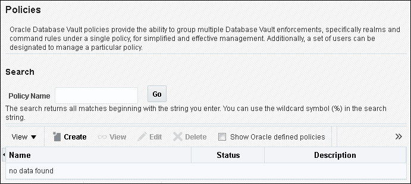
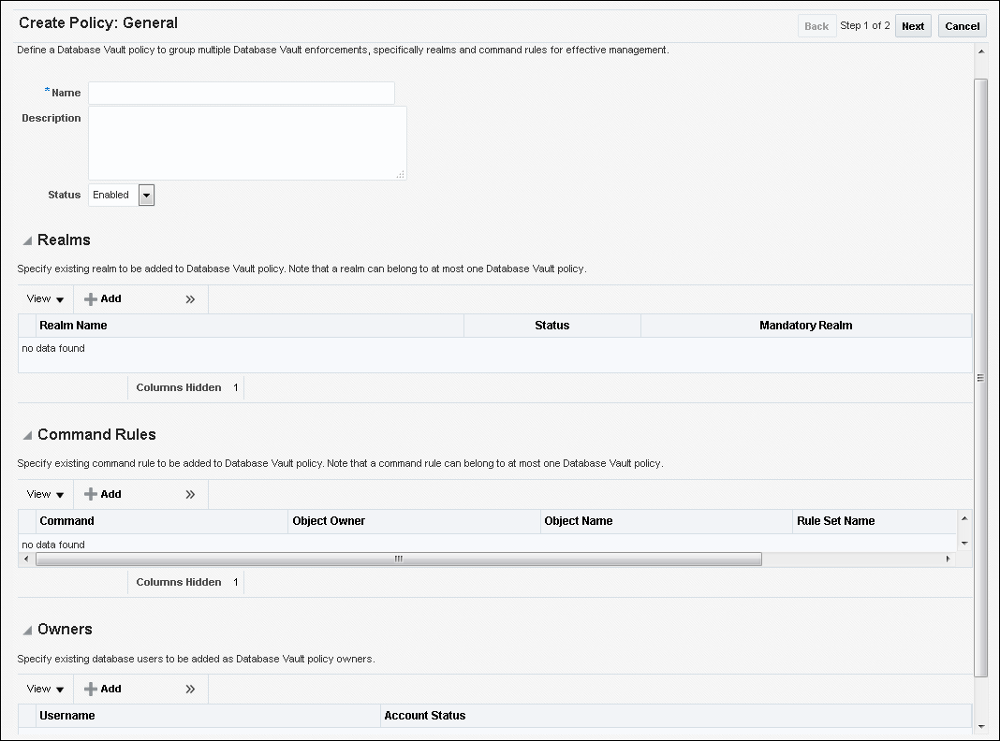

You can use Oracle Database Vault policies to implement frequently used realm and command rule settings.

- What Are Database Vault Policies?
  An Oracle Database Vault policy groups local realms and command rules into a named policy that you can enable or disable as necessary.
- Default Oracle Database Vault Policies
  Oracle Database Vault provides two default policies that you can use to better secure user accounts and system privileges.
- Creating an Oracle Database Policy
  To create an Oracle Database Vault policy, you create a container policy that specifies the realms and command rules that encompass the policy.
- Modifying an Oracle Database Vault Policy
  You can use Enterprise Manager Cloud Control to modify an Oracle Database Vault policy.
- Deleting an Oracle Database Vault Policy
  You can use Enterprise Manager Cloud Control to delete Oracle Database Vault policies.
- Related Data Dictionary Views
  Oracle Database Vault provides data dictionary views that are useful for analyzing Database Vault policies.

### 9.1 What Are Database Vault Policies?

An Oracle Database Vault policy groups local realms and command rules into a named policy that you can enable or disable as necessary.

- About Oracle Database Vault Policies
  Oracle Database Vault policies can group realm and command rule definitions into one policy, which then can be collectively enabled or disabled.
- Oracle Database Vault Policies in a Multitenant Environment
  Oracle Database Vault policies are only local to the pluggable database (PDB) in which they were created.

**Parent topic:** Configuring Oracle Database Vault Policies

#### 9.1.1 About Oracle Database Vault Policies

Oracle Database Vault policies can group realm and command rule definitions into one policy, which then can be collectively enabled or disabled.

Database Vault policies enable you to delegate limited realm administration privileges to database users without giving them the powerful privileges that the `DVADM` and `DVOWNER` roles provide. Oracle Database Vault provides default policies.

For example, suppose you have a set of Oracle Database Vault objects that are related to a particular application, such as a realm and several command rules. You can use a Database Vault policy to group these objects into one policy. You then can designate a policy administrator to manage adding users to a realm for this application and for enabling or disabling the policy. If there is only one primary application, then it can be used for manageability where a user can enable, disable, or simulate (use simulation mode) all related objects with one command rather than issuing a command for each included Database Vault object.

How the enablement of the individual realms and command rules works depends on how you set the policy state of the policy, as follows:

- Full enabled mode (`DBMS_MACADM.G_ENABLED`) sets the policy to take precedence over the individual enablement settings of the associated realms and command rules. For example, if the associated objects of a policy are individually disabled, then they will be enabled if the policy is enabled. (Conversely, you can set `DBMS_MACADM.G_PARTIAL` to allow the embedded security objects to set their own enabled, disabled, or simulation mode.)

- Partial enabled mode (`DBMS_MACADM.G_PARTIAL`) enables the associated realms and command rules to have different status settings (`ENABLED`, `DISABLED`, and `SIMULATION`). The other policy status choices force all associated controls to the same status dictated by the policy. Setting the policy status to partial allows each realm and command rule to change status as required.

- Simulation mode (`DBMS_MACACM.G.SIMULATION`) enables the policy but writes violations to realms or command rules to a designated log table with information about the type of violation, such as a user name or the SQL statement that was used. Simulation forces every security object in the policy to be in simulation mode.

- Disabled mode (`DBMS_MACADM.G_DISABLED`) disables the policy after you create it.

In general, to create a Database Vault policy, you perform the following steps:

1.  Create the necessary realms and command rules to use in the policy.

2.  Create the Database Vault policy.

    You can use the `DBMS_MACADM.CREATE_POLICY` procedure to create the policy.

3.  Add one or more realms to the policy.

    You can use the `DBMS_MACADM.ADD_REALM_TO_POLICY` procedure to add realms to the policy.

4.  Add one or more command rules to the policy.

    You can use the `DBMS_MACADM.ADD_CMD_TO_POLICY` procedure to add command rules to the policy.

5.  Add one or more database users as owners of the policy.

    You can use the `DBMS_MACADM.ADD_OWNER_TO_POLICY` procedure to add users to the policy. Afterward, grant this user the `DV_POLICY_OWNER` role. This user will be able to perform a limited set of tasks: changing the policy state, adding or removing authorization from a realm, and having the `SELECT` privilege for a set of the `DVSYS.POLICY_OWNER`\* data dictionary views. By default, the `DVOWNER` user owns the policy.

After the policy is created, it can be used right away.

This section explains how to configure policies by using the Oracle Database Vault Administrator pages in Oracle Enterprise Manager Cloud Control. To configure policies by using the PL/SQL interfaces and packages provided by Oracle Database Vault, you must use the `DBMS_MACADM` PL/SQL package.

**Related Topics**

- Default Oracle Database Vault Policies
- [Oracle Database Vault Policy APIs](oracle-database-vault-policy-apis.md)
- [DV_POLICY_OWNER Database Vault Owner Role](oracle-database-vault-schemas-roles-and-accounts.md)

**Parent topic:** What Are Database Vault Policies?

#### 9.1.2 Oracle Database Vault Policies in a Multitenant Environment

Oracle Database Vault policies are only local to the pluggable database (PDB) in which they were created.

That is, if you created the policy in a PDB, then only local realms and command rules can be added to it. You cannot create Database Vault policies that can have common realms or common command rules.

**Parent topic:** What Are Database Vault Policies?

### 9.2 Default Oracle Database Vault Policies

Oracle Database Vault provides two default policies that you can use to better secure user accounts and system privileges.

You can use the default policies in your own security configurations. If you do not need them, then you can remove them because they are not needed for internal use by Oracle Database Vault.

The default policies are as follows:

- Oracle Account Management Controls enforces controls over user-related operations within Oracle Database Vault. It is used to prevent ad hoc user account creation, user deletions, and other user account-related operations by unauthorized privileged users. It includes the Database Vault Account Management realm and user account management command rules for SQL statements such as `CREATE USER`.

- Oracle System Protection Controls enforces controls on important database schemas, privileges, and roles that are associated with the default Oracle Database environment. It includes the realms such as Oracle Default Schema Protection Realm and command rules for the system management SQL statement `ALTER SYSTEM`.

**Related Topics**

- [DBA_DV_POLICY_OBJECT View](oracle-database-vault-data-dictionary-views.md)

**Parent topic:** Configuring Oracle Database Vault Policies

### 9.3 Creating an Oracle Database Policy

To create an Oracle Database Vault policy, you create a container policy that specifies the realms and command rules that encompass the policy.

You can enable the policy during creation time, or enable it later on.

1.  Log in to Oracle Database Vault Administrator from Cloud Control as a user who has been granted the `DV_OWNER` or `DV_ADMIN` role and the `SELECT ANY DICTIONARY` privilege. [Logging in to Oracle Database Vault from Oracle Enterprise Cloud Control](getting-started-with-oracle-database-vault.md) explains how to log in.
2.  Create the realms and command rules that you want to associate with the policy, using [Creating a Realm](configuring-realms.md) and [Creating a Rule Set](configuring-rule-sets.md).
3.  In the Administration page, under Database Vault Components, click Policies to display the Policies page.
    
    [Description of the illustration policies_home_page.png](img_text/policies_home_page.md)
4.  In the Policies page, click Create to display the Create Policy page.
    
    [Description of the illustration create_policy122.png](img_text/create_policy122.md)
5.  In the Create Policy page, under General, enter the following settings:
    - Name: Enter a policy name, up to 128 characters.

    - Description: Enter a description of the policy, up to 4000 characters.

    - Status: Select from the following:

      - Enabled enables the policy after you create it.

      - Disabled disables the policy after you create it.

      - Simulation sets the policy to simulation mode. In simulation mode, any violations to realms or command rules used in the policy are logged in a designated log table with sufficient information to describe the error, such as the user name or SQL statement used.

      - Partial enables the enforcement state of realms or command rules associated with the policy to be changed individually.
6.  Under Realms, click Add to select a realm to add to the policy. Then click OK.
7.  Under Command Rules, click Add to select a command rule to add to the policy. Then click OK.
8.  Under Owners, click Add to add an owner to the policy. Then click OK.
9.  Click Next.
10. In the Review page, click Finish.
11. So that the Database Vault policy owner can query policy related views and execute the allowed procedures, grant this user the `DV_POLICY_OWNER` role.
    For example:
        GRANT DV_POLICY_OWNER TO psmith;

**Parent topic:** Configuring Oracle Database Vault Policies

### 9.4 Modifying an Oracle Database Vault Policy

You can use Enterprise Manager Cloud Control to modify an Oracle Database Vault policy.

1.  Log in to Oracle Database Vault Administrator from Cloud Control as a user who has been granted the `DV_OWNER` or `DV_ADMIN` role and the `SELECT ANY DICTIONARY` privilege. [Logging in to Oracle Database Vault from Oracle Enterprise Cloud Control](getting-started-with-oracle-database-vault.md) explains how to log in.
2.  In the Administration page, under Database Vault Components, click Policies.
3.  Select the row for the policy that you want to change.
4.  Click Edit.
5.  In the Edit Policy page, modify the settings as necessary.
6.  Click Next, and then click Finish.

**Parent topic:** Configuring Oracle Database Vault Policies

### 9.5 Deleting an Oracle Database Vault Policy

You can use Enterprise Manager Cloud Control to delete Oracle Database Vault policies.

When you delete an Oracle Database Vault policy, the underlying realms and command rules are preserved, and they retain their individual enablement status.

1.  Log in to Oracle Database Vault Administrator from Cloud Control as a user who has been granted the `DV_OWNER` or `DV_ADMIN` role and the `SELECT ANY DICTIONARY` privilege. [Logging in to Oracle Database Vault from Oracle Enterprise Cloud Control](getting-started-with-oracle-database-vault.md) explains how to log in.
2.  In the Administration page, under Database Vault Components, click Policies.
3.  Select the row for the policy that you want to delete, click Delete, and then click Yes in the confirmation dialog box.

**Parent topic:** Configuring Oracle Database Vault Policies

### 9.6 Related Data Dictionary Views

Oracle Database Vault provides data dictionary views that are useful for analyzing Database Vault policies.

Table 9-1 lists data dictionary views that provide information about existing Oracle Database Vault policies.

Table 9-1 Data Dictionary Views Used for Oracle Database Vault Policies

| Data Dictionary View                                                                    | Description                                                                                                                                                                                                                                             |
|:----------------------------------------------------------------------------------------|:--------------------------------------------------------------------------------------------------------------------------------------------------------------------------------------------------------------------------------------------------------|
| [DBA_DV_POLICY View](oracle-database-vault-data-dictionary-views.md)                    | Lists the Database Vault policies, a description, and their state                                                                                                                                                                                       |
| [DBA_DV_POLICY_OBJECT View](oracle-database-vault-data-dictionary-views.md)             | Provides detailed information about the policies, such as the associated realms and command rules                                                                                                                                                       |
| [DBA_DV_POLICY_OWNER View](oracle-database-vault-data-dictionary-views.md)              | Lists the owners of Database Vault policies                                                                                                                                                                                                             |
| [DBA_DV_REALM_AUTH View](oracle-database-vault-data-dictionary-views.md)                | Enables users who have been granted the `DV_POLICY_OWNER` role to find information about the authorization that was granted to realms that have been associated with Database Vault policies, such as the realm name, grantee, and associated rule set. |
| [DVSYS.POLICY_OWNER_COMMAND_RULE View](oracle-database-vault-data-dictionary-views.md)  | Enbles users who have been granted the `DV_POLICY_OWNER` role to find information about the command rules that have been associated with Database Vault policies, such as the command rule name.                                                        |
| [DVSYS.POLICY_OWNER_POLICY View](oracle-database-vault-data-dictionary-views.md)        | Enbles users who have been granted the `DV_POLICY_OWNER` role to find information such as the names, descriptions, and states of existing policies in the current database instance, including policies created by other policy owners                  |
| [DVSYS.POLICY_OWNER_POLICY View](oracle-database-vault-data-dictionary-views.md)        | Eenables users who have been granted the `DV_POLICY_OWNER` role to find information such as the names, descriptions, and states of existing policies in the current database instance, including policies created by other policy owners                |
| [DVSYS.POLICY_OWNER_REALM View](oracle-database-vault-data-dictionary-views.md)         | Eenables users who have been granted the `DV_POLICY_OWNER` role to find information about the realms that have been associated with Database Vault policies, such as the realm name, audit options, or type                                             |
| [DVSYS.POLICY_OWNER_REALM_OBJECT View](oracle-database-vault-data-dictionary-views.md)  | Enables users who have been granted the `DV_POLICY_OWNER` role to find information about the objects that have been added to realms that are associated with Database Vault policies, such as the realm name, grantee, and associated rule set          |
| [DVSYS.POLICY_OWNER_RULE View](oracle-database-vault-data-dictionary-views.md)          | Enables users who have been granted the `DV_POLICY_OWNER` role to find information about the rules that have been associated with rule sets in Database Vault policies, such as the rule name and its expression                                        |
| [DVSYS.POLICY_OWNER_RULE_SET View](oracle-database-vault-data-dictionary-views.md)      | Enables users who have been granted the `DV_POLICY_OWNER` role to find information about the rule sets that have been associated with Database Vault policies, such as the rule set name, its handler information, and whether it is enabled            |
| [DVSYS.POLICY_OWNER_RULE_SET_RULE View](oracle-database-vault-data-dictionary-views.md) | Enables users who have been granted the `DV_POLICY_OWNER` role to find information about the rule sets that contain rules used in Database Vault policies, such as the rule set name and whether it is enabled                                          |

**Parent topic:** Configuring Oracle Database Vault Policies
