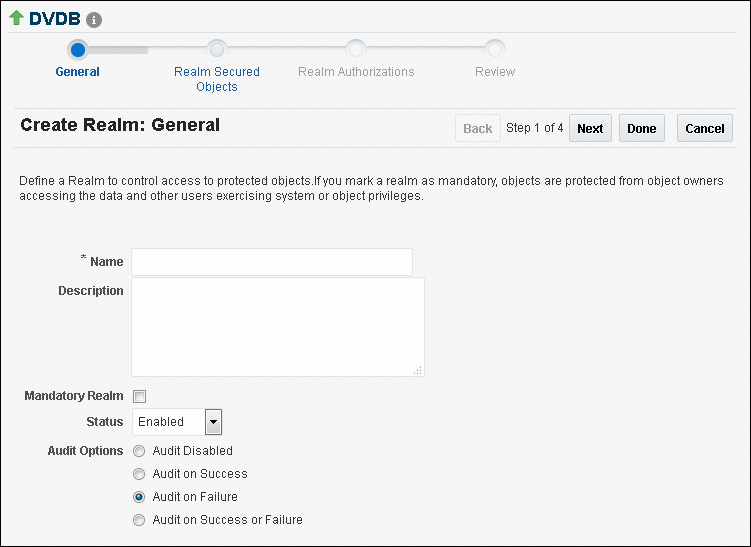
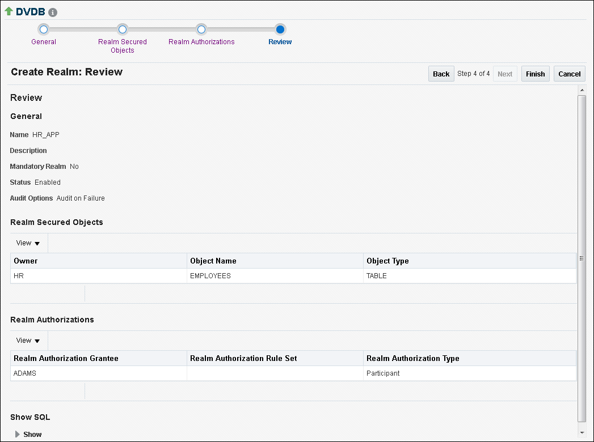
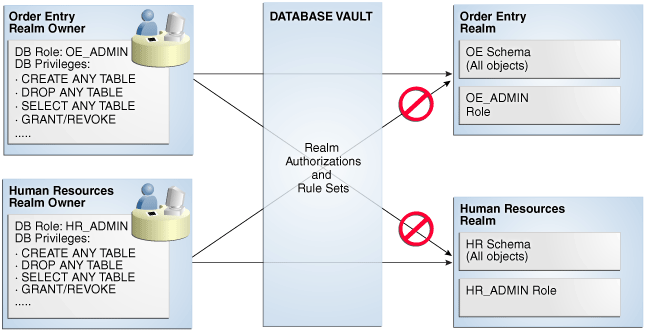

You can create a realm around database objects to protect them, and then set authorizations to control user access to this data.

- What Are Realms?
  Realms enable you to protect database objects, including specific object types.
- Default Realms
  Oracle Database Vault provides default realms to protect Database Vault and `SYS`-related schemas, system and object privileges, roles, and audit-related objects.
- Creating a Realm
  To enable realm protection, you create the realm and configure it to include realm-secured objects, roles, and authorizations.
- About Realm-Secured Objects
  Realm-secured objects define the territory—a set of schema and database objects and roles—that a realm protects.
- About Realm Authorization
  Realm authorizations establish the set of database accounts and roles that manage or access objects protected in realms.
- Realm Authorizations in a Multitenant Environment
  In a multitenant environment, the rules and behavior for common realm authorizations are similar to the authorizations for other common objects.
- Modifying the Enablement Status of a Realm
  You can disable or enable a realm, or set the realm to use simulation mode, from Enterprise Manager Cloud Control.
- Deleting a Realm
  You can use Enterprise Manager Cloud Control to delete realms.
- How Realms Work
  When an appropriately privileged database account issues a SQL statement that affects an object within a realm, a special set of activities occur.
- How Authorizations Work in a Realm
  Realm authorizations prevent users from performing activities if the users do not have the correct privileges.
- Access to Objects That Are Protected by a Realm
  You can protect an object by a realm, but still enable access to objects that are part of this realm-protected object.
- Example of How Realms Work
  Realms can provide protection in which two users who each have the same privileges must have separate access levels for an object.
- How Realms Affect Other Oracle Database Vault Components
  Realms have no effect on factors, identities, or rule sets, but they do affect command rules.
- Guidelines for Designing Realms
  Oracle provides a set of guidelines for designing realms.
- How Realms Affect Performance
  Realms can affect database performance in a variety situations, such as with DDL and DML operations.
- Realm Related Reports and Data Dictionary Views
  Oracle Database Vault provides reports and data dictionary views that are useful for analyzing realms.

### 4.1 What Are Realms?

Realms enable you to protect database objects, including specific object types.

- About Realms
  A realm is a grouping of database schemas, database objects, and database roles that must be secured for a given application.
- Mandatory Realms to Restrict User Access to Objects within a Realm
  By default, users who own or have object privileges are allowed to access realm-protected objects without explicit realm authorization.
- Realms in a Multitenant Environment
  In a multitenant environment, you can create a realm to protect common objects in the application root.
- Object Types That Realms Can Protect
  You can create realms around all objects in a schema of certain object types.

**Parent topic:** Configuring Realms

#### 4.1.1 About Realms

A realm is a grouping of database schemas, database objects, and database roles that must be secured for a given application.

Think of a realm as zone of protection for your database objects. A schema is a logical collection of database objects such as tables, views, and packages, and a role is a collection of privileges. By arranging schemas and roles into functional groups, you can control the ability of users to use system privileges against these groups and prevent unauthorized data access by the database administrator or other powerful users with system privileges. Oracle Database Vault does not replace the discretionary access control model in the existing Oracle database. It functions as a layer on top of this model for both realms and command rules.

Oracle Database Vault provides two types of realms: regular and mandatory. Both realm types can protect either an entire schema, individual database roles or crucial objects within a schema selectively, such as tables and indexes. With a regular realm, an object owner or users who has been granted object privileges can perform queries or DML operations without realm authorization but must have realm authorization to perform DDL operations. A mandatory realm provides stronger protection for objects within a realm. Mandatory realms block both object privilege and system privilege access and will not allow users with object privileges to perform queries, DML, or DDL operations without realm authorization. In other words, if the objects are protected by mandatory realms, even the object owner cannot access their own objects without proper realm authorization.

For example, you can create a realm to protect the database schemas that are used by an accounting department's application. The realm will prohibit any user from using their system privileges (for example, `SELECT ANY TABLE`) from accessing the realm-protected schema objects. When an entire schema is realm protected, all existing and new objects are protected. This includes tables, indexes, procedures, views, packages, and more. Users with direct object grant on objects protected by a regular realm are still allowed to use their grants. For example, if you are granted `SELECT` on `HR.EMPLOYEES`, you can perform the `SELECT` command on objects protected by a regular realm. However, if that object is protected by a mandatory realm, you will not be allowed to perform the `SELECT` command unless you are a member of the realm authorization list. Mandatory realms require the granted user to be an authorized participant in the mandatory realm.

Note the following:

- You can run reports on realms that you create in Oracle Database Vault. Realms can be enabled, disabled, or placed in simulation mode where violations of the realm will be logged but the action will not be blocked. This enables you to quickly test applications using Database Vault realms.

- You can configure realms by using the Oracle Database Vault Administrator pages in Oracle Enterprise Manager Cloud Control. Alternatively, you can configure realms by using the PL/SQL interfaces and packages provided by Oracle Database Vault.

**Parent topic:** What Are Realms?

#### 4.1.2 Mandatory Realms to Restrict User Access to Objects within a Realm

By default, users who own or have object privileges are allowed to access realm-protected objects without explicit realm authorization.

You optionally can configure the realm to prevent these users' access by configuring it to be a mandatory realm. Mandatory realms block system privilege-based access as well as object privilege-based access. This means that even the object owner cannot have access if he or she is not authorized to access the realm. Users can access secured objects in the mandatory realm only if the user or role is authorized to do so.

Mandatory realms have the following additional characteristics:

- As with regular realm, if a role is protected by a mandatory realm, then no privileges can be granted to or revoked from the protected role except by the realm owner.

- You can update regular realms that you created in earlier releases to be mandatory realms. This way, you can block owner access and object-privileged users from accessing the realm-protected objects.

Mandatory realms have the following benefits:

- Mandatory realms can block object owners and object privileged users. In previous releases, blocking these users could only be done by defining complicated command rules.

- Mandatory realms provide more flexible configurations for access control. For example, suppose you want to enable a user to access an object with certain conditions, such as in a specific time range during the day. You cannot grant object privileges to that user because realms do not block object privileges. You only can grant system privileges to the user and then authorize this user to the realm with a rule, or make a command rule on the command directly. These solutions are either very expensive in terms of computational cost or undesirable because they entail the excessive granting of privileges such as system privileges to the user. With a mandatory realm, you only need to grant object privileges to the user, with a rule for specific conditions, and then authorize this user to be a realm owner or participant. Thus, with mandatory realms, Oracle Database Vault policies have more flexibility without granting users excessive privileges.

- You can use mandatory realms to secure tables during runtime. During runtime, application data can be stored in many tables. It is better to have a single user such as a runtime schema to access these tables so that you can maintain the integrity and correctness of the data. If the application data is scattered in many different schemas, then schema owners and users with object privileges can change the data if they log into the database directly. To insure that users cannot update these tables without going through the runtime schema's procedures, you can use mandatory realms to protect the tables so that only the authorized user's procedures can access them. Because a regular realm does not block object owners and object-privileged users, you can use mandatory realms to block them. This way, only authorized users can access these tables during runtime.

If there are multiple mandatory realms on the same object, then you must authorize the user or role on all the mandatory realms before they can access the protected object.

**Related Topics**

- [CREATE_REALM Procedure](oracle-database-vault-realm-apis.md)
- [UPDATE_REALM Procedure](oracle-database-vault-realm-apis.md)

**Parent topic:** What Are Realms?

#### 4.1.3 Realms in a Multitenant Environment

In a multitenant environment, you can create a realm to protect common objects in the application root.

The advantage of creating a realm in the application root instead of creating a large number objects and realms around these objects within individual pluggable databases (PDBs) is that you can create them in one place, the application root. This way, you can manage them centrally.

You cannot create a common realm in the CDB root.

A Database Vault common realm can be either a regular realm or a mandatory realm. The realm protects only objects within the application root, not local objects in a PDB. The CDB root, application root, and any affected PDBs all must be Database Vault enabled.

To configure a common realm, you must be commonly granted the `DV_OWNER` or `DV_ADMIN` role. To grant common authorizations for a common realm, you must be in the application root. To propagate the realm to the PDBs that are associated with the application root, you must synchronize the application root. For example, to synchronize an application called `saas_sales_app`

    ALTER PLUGGABLE DATABASE APPLICATION saas_sales_app SYNC;

**Related Topics**

- About Realm Authorization

**Parent topic:** What Are Realms?

#### 4.1.4 Object Types That Realms Can Protect

You can create realms around all objects in a schema of certain object types.

These object types are as follows:

| Object Types C-J  | Object Types L-P        | Object Types R-V |
|:------------------|:------------------------|:-----------------|
| `CLUSTER`         | `LIBRARY`               | `ROLE`           |
| `DIMENSION`       | `MATERIALIZED VIEW`     | `SEQUENCE`       |
| `FUNCTION`        | `MATERIALIZED VIEW LOG` | `SYNONYM`        |
| `INDEX`           | `OPERATOR`              | `TABLE`          |
| `INDEX PARTITION` | `PACKAGE`               | `TRIGGER`        |
| `INDEXTYPE`       | `PROCEDURE`             | `TYPE`           |
| `JOB`             | `PROGRAM`               | `VIEW`           |

**Parent topic:** What Are Realms?

### 4.2 Default Realms

Oracle Database Vault provides default realms to protect Database Vault and `SYS`-related schemas, system and object privileges, roles, and audit-related objects.

You can add users to realms so that the user can perform tasks that are protected by the default realms.

- Oracle Database Vault Realm
  The Oracle Database Vault realm protects configuration and role information in the Oracle Database Vault `DVSYS`, `DVF`, and `LBACSYS` schemas.
- Database Vault Account Management Realm
  The Database Vault Account Management realm defines the realm for the administrators who manage and create database accounts and database profiles.
- Oracle Enterprise Manager Realm
  Oracle Database Vault provides a realm specifically for Oracle Enterprise Manager monitoring accounts.
- Oracle Default Schema Protection Realm
  Oracle Default Schema Protection Realm protects roles and schemas that are used with Oracle features such as Oracle Text.
- Oracle System Privilege and Role Management Realm
  Oracle System Privilege and Role Management Realm protects all Oracle-supplied roles in an Oracle database.
- Oracle Default Component Protection Realm
  Oracle Default Component Protection Realm protects the `SYSTEM` and `OUTLN` schemas.

**Parent topic:** Configuring Realms

#### 4.2.1 Oracle Database Vault Realm

The Oracle Database Vault realm protects configuration and role information in the Oracle Database Vault `DVSYS`, `DVF`, and `LBACSYS` schemas.

The owners of all three of the `DVSYS`, `DVF`, and `LBACSYS` schemas are owners of this realm.

To find the objects that this realm protects, perform the following query:

    SELECT OWNER, OBJECT_NAME, OBJECT_TYPE
    FROM DBA_DV_REALM_OBJECT
    WHERE REALM_NAME = 'Oracle Database Vault Realm'
    ORDER BY OWNER, OBJECT_NAME;

To find the realm-authorized users, their role as participant or owner, and if an Oracle Database Vault rule set is applied to the authorized user, perform the following query:

    SELECT GRANTEE, AUTH_OPTIONS, AUTH_RULE_SET_NAME
    FROM DBA_DV_REALM_AUTH
    WHERE REALM_NAME = 'Oracle Database Vault Realm'
    ORDER BY GRANTEE;

**Related Topics**

- [Oracle Database Vault Schemas](oracle-database-vault-schemas-roles-and-accounts.md)

**Parent topic:** Default Realms

#### 4.2.2 Database Vault Account Management Realm

The Database Vault Account Management realm defines the realm for the administrators who manage and create database accounts and database profiles.

The owner of this realm can grant or revoke the `CREATE SESSION` privilege to or from a user.

To find the objects that this realm protects, perform the following query:

    SELECT OWNER, OBJECT_NAME, OBJECT_TYPE
    FROM DBA_DV_REALM_OBJECT
    WHERE REALM_NAME = 'Database Vault Account Management'
    ORDER BY OWNER, OBJECT_NAME;

To find the realm-authorized users, their role as participant or owner, and if an Oracle Database Vault rule set is applied to the authorized user, perform the following query:

    SELECT GRANTEE, AUTH_OPTIONS, AUTH_RULE_SET_NAME
    FROM DBA_DV_REALM_AUTH
    WHERE REALM_NAME = 'Database Vault Account Management'
    ORDER BY GRANTEE;

**Related Topics**

- [DV_ACCTMGR Database Vault Account Manager Role](oracle-database-vault-schemas-roles-and-accounts.md)

**Parent topic:** Default Realms

#### 4.2.3 Oracle Enterprise Manager Realm

Oracle Database Vault provides a realm specifically for Oracle Enterprise Manager monitoring accounts.

The Oracle Enterprise Manager realm protects Oracle Enterprise Manager accounts that are used for monitoring and management (`DBSNMP` user and the `OEM_MONITOR` role).

To find the objects that this realm protects, perform the following query:

    SELECT OWNER, OBJECT_NAME, OBJECT_TYPE
    FROM DBA_DV_REALM_OBJECT
    WHERE REALM_NAME = 'Oracle Enterprise Manager'
    ORDER BY OWNER, OBJECT_NAME;

To find the realm-authorized users, their role as participant or owner, and if an Oracle Database Vault rule set is applied to the authorized user, perform the following query:

    SELECT GRANTEE, AUTH_OPTIONS, AUTH_RULE_SET_NAME
    FROM DBA_DV_REALM_AUTH
    WHERE REALM_NAME = 'Oracle Enterprise Manager'
    ORDER BY GRANTEE;

**Related Topics**

- [Using Oracle Database Vault with Oracle Enterprise Manager](dba-operations-in-an-oracle-database-vault-environment.md)

**Parent topic:** Default Realms

#### 4.2.4 Oracle Default Schema Protection Realm

Oracle Default Schema Protection Realm protects roles and schemas that are used with Oracle features such as Oracle Text.

The advantage of this grouping is that Oracle Spatial schemas (`MDSYS`, `MDDATA`) are used extensively with Oracle Text (`CTXSYS`), and Oracle OLAP is an application rather than a core Oracle Database kernel feature.

Oracle Default Schema Protection Realm protects several roles and schemas.

- To find the objects that this realm protects, perform the following query:

      SELECT OWNER, OBJECT_NAME, OBJECT_TYPE
      FROM DBA_DV_REALM_OBJECT
      WHERE REALM_NAME = 'Oracle Default Schema Protection Realm'
      ORDER BY OWNER, OBJECT_NAME;

- To find the realm-authorized users, their role as participant or owner, and if an Oracle Database Vault rule set is applied to the authorized user, perform the following query:

      SELECT GRANTEE, AUTH_OPTIONS, AUTH_RULE_SET_NAME
      FROM DBA_DV_REALM_AUTH
      WHERE REALM_NAME = 'Oracle Default Schema Protection Realm'
      ORDER BY GRANTEE;

- Schemas that are protected by default: `CTXSYS`, `EXFSYS`, `MDDATA`, `MDSYS`

- Roles that are recommended for protection: `APEX_ADMINISTRATOR_ROLE`, `SPATIAL_CSW_ADMIN`, `WFS_USR_ROLE`, `CSW_USR_ROLE`, `SPATIAL_WFS_ADMIN`, `WM_ADMIN_ROLE`

- Schemas that are recommended for protection: `APEX_030200`, `OWBSYS`, `WMSYS`

The `SYS`, `CTXSYS`, and `EXFSYS` users are the default owners of Oracle Default Schema Protection Realm. These users can grant the roles protected by this realm to other users, and grant permissions on its schemas to other users as well.

**Parent topic:** Default Realms

#### 4.2.5 Oracle System Privilege and Role Management Realm

Oracle System Privilege and Role Management Realm protects all Oracle-supplied roles in an Oracle database.

This realm also contains authorizations for users who must grant system privileges.

User `SYS` is the only default owner of this realm. Any user who is responsible for managing system privileges should be authorized as an owner to this realm. These users can grant the roles that are protected by this realm to other users.

Examples of roles that the Oracle System Privilege and Role Management Realm protects are `DBA`, `IMP_FULL_DATABASE`, `SELECT_CATALOG_ROLE`, and `SCHEDULER_ADMIN`.

To find the objects that this realm protects, perform the following query:

    SELECT OWNER, OBJECT_NAME, OBJECT_TYPE
    FROM DBA_DV_REALM_OBJECT
    WHERE REALM_NAME = 'Oracle System Privilege and Role Management Realm'
    ORDER BY OWNER, OBJECT_NAME;

To find the realm-authorized users, their role as participant or owner, and if an Oracle Database Vault rule set is applied to the authorized user, perform the following query:

    SELECT GRANTEE, AUTH_OPTIONS, AUTH_RULE_SET_NAME
    FROM DBA_DV_REALM_AUTH
    WHERE REALM_NAME = 'Oracle System Privilege and Role Management Realm'
    ORDER BY GRANTEE;

**Parent topic:** Default Realms

#### 4.2.6 Oracle Default Component Protection Realm

Oracle Default Component Protection Realm protects the `SYSTEM` and `OUTLN` schemas.

The authorized users of this realm are users `SYS` and `SYSTEM`.

To find the objects that this realm protects, perform the following query:

    SELECT OWNER, OBJECT_NAME, OBJECT_TYPE
    FROM DBA_DV_REALM_OBJECT
    WHERE REALM_NAME = 'Oracle Default Component Protection Realm'
    ORDER BY OWNER, OBJECT_NAME;

To find the realm-authorized users, their role as participant or owner, and if an Oracle Database Vault rule set is applied to the authorized user, perform the following query:

    SELECT GRANTEE, AUTH_OPTIONS, AUTH_RULE_SET_NAME
    FROM DBA_DV_REALM_AUTH
    WHERE REALM_NAME = 'Oracle Default Component Protection Realm'
    ORDER BY GRANTEE;

**Parent topic:** Default Realms

### 4.3 Creating a Realm

To enable realm protection, you create the realm and configure it to include realm-secured objects, roles, and authorizations.

1.  Log in to Oracle Database Vault Administrator from Cloud Control as a user who has been granted the `DV_OWNER` or `DV_ADMIN` role and the `SELECT ANY DICTIONARY` privilege. [Logging in to Oracle Database Vault from Oracle Enterprise Cloud Control](getting-started-with-oracle-database-vault.md) explains how to log in.
2.  In the Administration page, under Database Vault Components, click Realms.
3.  In the Realms page, click Create to display the Create Realm page.

    
    [Description of the illustration create_realm122.png](img_text/create_realm122.md)
4.  In the Create Realm page, enter the following settings:
    - Name: Enter a name for the realm. It can contain up to 90 characters in mixed-case. This attribute is mandatory.

      Oracle suggests that you use the name of the protected application as the realm name (for example, `hr_app` for an human resources application).

    - Description: Enter a brief description of the realm. The description can contain up to 1024 characters in mixed-case. This attribute is optional.

      You may want to include a description for the business objective of the given application protection and document all other security policies that compliment the realm's protection. Also document who is authorized to the realm, for what purpose, and any possible emergency authorizations.

    - Mandatory Realm: Select this check box to create the realm as a mandatory realm. See Mandatory Realms to Restrict User Access to Objects within a Realm for more information about mandatory realms.

    - Status: Select either Enabled, Disabled, or Simulation. This attribute is mandatory.

    - Audit Options: Select one of the following:

      - Audit Disabled: Does not create an audit record.

      - Audit on Success: Creates an audit record for authorized activities.

      - Audit on Failure: Creates an audit record when a realm violation occurs (for example, when an unauthorized user tries to modify an object that is protected by the realm).

      - Audit on Success or Failure: Creates an audit record for any activity that occurs in the realm, including both authorized and unauthorized activities.

      In a non-unified auditing environment, Oracle Database Vault writes the audit trail to the `DVSYS.AUDIT_TRAIL$` table. See [Auditing Oracle Database Vault](auditing-oracle-database-vault.md) for more information. If you have enabled unified auditing, then this setting does not capture audit records. Instead, you must create audit policies to capture this information, as described in [Oracle Database Security Guide](../dbseg/configuring-audit-policies.md). Oracle Database also provides a default policy, `ORA_DV_AUDPOL`, that audits all actions that are performed on the Oracle Database Vault `DVSYS` and `DVF` schema objects and the Oracle Label Security `LBACSYS` schema objects.
5.  Click Next to display the Realm secured objects page.
    See About Realm-Secured Objects for conceptual information about the settings for this page.
6.  Click the Add button, and in the Add Secured Object dialog box, enter the following information:
    - Object Owner: From the list, select the name of the database schema owner. You can enter the `%` character if the object you want to secure with the realm is a role. This attribute is mandatory.

    - Object Type: From the list, select the type of the database object, such as `TABLE`, `INDEX`, or `ROLE`. This attribute is mandatory.

      You can add as many objects of any type as you want to the realm.

      By default, the Object Type box contains the % wildcard character to include all object types for the specified Object Owner. However, it does not include roles, which do not have specific schema owners in the database and must be specified explicitly.

    - Object Name: Enter the name of the object in the database that the realm must protect, or enter `%` to specify all objects (except roles) for the object owner that you have specified. If you enter `%`, then it can encompass all objects in the schema if `%` is also used for the Object Type setting. But if Object Type is set to Tables, then using `%` for the Object Name refers to all tables in the schema. This attribute is mandatory.

      By default, the Object Name field contains the % wildcard character to encompass the entire schema specified for Object Type and Object Owner. Note that the % wildcard character applies to objects that do not yet exist and currently existing objects.

      If you enter `%` in the Object Name field, then it encompasses all objects in the schema if you also enter `%` in the Object Type field. However, if you set Object Type to a specific object type, such as Tables, then the setting of `%` in Object Type refers to all objects of that type (in this case, tables) in the schema.
7.  Click Next to display the Realm authorizations page.
    See About Realm Authorization for conceptual information about the settings for this page.
8.  Click the Add button, and in the Add Authorizations dialog box, enter the following information:
    - Realm Authorization Grantee: From the list, select the database account or role to whom you want to grant the realm authorization.

      This list shows all accounts and roles in the system, not just accounts with system privileges.

    - Realm Authorization Type: Select either of the following settings. This attribute is mandatory.

      - Participant: This account or role can exercise system privileges to access, manipulate, and create objects protected by the realm, provided that these privileges have been granted using the standard Oracle Database privilege grant process. A realm can have multiple participants.

      - Owner: This account or role has the same rights as the realm participant, plus the authorization to grant or revoke realm-secured database roles. The realm owner can grant or revoke privileges on realm-protected objects to other users. A realm can have multiple owners.

    - Realm Authorization Rule Set: Select from the available rule sets that have been created for your site. You can select only one rule set, but the rule set can have multiple rules.

      See [Creating a Rule to Add to a Rule Set](configuring-rule-sets.md) for more information about defining rules to govern the realm authorization.

      Any auditing and custom event handling associated with the rule set occurs as part of the realm authorization processing.
9.  Click Next to display the Review page.
10. In the Review page, check the settings you have created.
    For example:

    
    [Description of the illustration realm_creation122.png](img_text/realm_creation122.md)
11. Click Finish to complete the realm creation.

**Related Topics**

- About Realm-Secured Objects
- About Realm Authorization
- [Propagating Oracle Database Vault Configurations to Other Databases](dba-operations-in-an-oracle-database-vault-environment.md)

**Parent topic:** Configuring Realms

### 4.4 About Realm-Secured Objects

Realm-secured objects define the territory—a set of schema and database objects and roles—that a realm protects.

You can create the following types of protections:

- Objects from multiple database accounts or schemas can be under the same realm.

- One object can belong to multiple realms.

  If an object belongs to multiple realms, then Oracle Database Vault checks the realms for the proper authorization. For `SELECT`, DDL, and DML statements, as long as a user is a participant in one of the realms, and if the command rules permit it, then the commands that the user enters are allowed. For `GRANT` and `REVOKE` operations of a database role in multiple realms, the person performing the `GRANT` or `REVOKE` operation must be the realm owner. Schema owners can perform DML operations on objects that are protected by multiple regular realms.

  If one of the realms is a mandatory realm, then the user who wants to access the object must be a realm owner or participant in the mandatory realm. During the authorization checking process, the non-mandatory realms are ignored. If there are multiple mandatory realms that protect the object, then the user who wants to access the object must be authorized in all of the mandatory realms.

- `SYS`-owned objects are already protected by data dictionary protection and are not protected separately by Oracle Database Vault.

**Parent topic:** Configuring Realms

### 4.5 About Realm Authorization

Realm authorizations establish the set of database accounts and roles that manage or access objects protected in realms.

You can grant a realm authorization to an account or role to allow the use of its system privileges in the following situations:

- When the user must create or access realm-secured objects

- When a user must grant or revoke realm-secured roles

A user who has been granted realm authorization as either a realm owner or a realm participant can use its system privileges to access secured objects in the realm.

Note the following:

- Realm owners cannot add other users to their realms as owners or participants. Only users who have the `DV_OWNER` or `DV_ADMIN` role are allowed to add users as owners or participants to a realm.

- Users who have been granted the `DV_OWNER` role can add themselves to a realm authorization.

- A realm owner, but not a realm participant, can grant or revoke realm secured roles or grant or revoke object privileges on realm secured objects to anyone.

- A user can be granted either as a realm owner or a realm participant, but not both. However, you can update the authorization types of existing realm authorizations.

Use the Edit Realm page to manage realm authorizations. You can create, edit, and remove realm authorizations.

**Related Topics**

- [Realm Authorization Configuration Issues Report](oracle-database-vault-reports.md)

**Parent topic:** Configuring Realms

### 4.6 Realm Authorizations in a Multitenant Environment

In a multitenant environment, the rules and behavior for common realm authorizations are similar to the authorizations for other common objects.

Local Authorization for a Common Realm

The local authorization for a common realm refers to the authorization a user has for the PDB that this user is accessing.

The rules for the local authorization for a common realm are as follows:

- A user who has been commonly granted the `DV_OWNER` or `DV_ADMIN` role can grant local authorization to common users, common roles, local users, and local roles. The common `DV_OWNER` or `DV_ADMIN` user can also remove local authorization from a common realm in a PDB.

- A local Database Vault administrator can authorize locally (that is, grant local authorizations to both local and common users) within the PDB. A common Database Vault administrator can also grant authorizations in each PDB. A common realm authorization can only be granted by a common Database Vault administrator in the application root.

- The common Database Vault administrator can both add or remove local authorization to and from a common realm from within the PDB.

- If a common user has only local authorization for a common realm, then this user cannot access the common realm in any other PDB than this local authorization.

- A common user or a common role can have both the local authorization and the common authorization to a common realm at the same time. Removing a common user’s local authorization from a common realm does not affect the common user’s common authorization. Removing a common user’s common authorization from a common realm does not affect the common user’s local authorization.

Common Authorization for a Common Realm

The common authorization for a common realm refers to the authorization a common user or a common role has in the application root while the authorization takes effect in every container that is Database Vault enabled.

The rules for the local authorization for a common realm are as follows:

- A user who has been commonly granted the `DV_OWNER` or `DV_ADMIN` role can grant common realm authorization to common users or roles in the application root. This common Database Vault administrator can perform the removal of common authorizations while in the application root.

- This common authorization applies to the containers that have been Database Vault enabled in the CDB.

- If a common user is authorized to a common realm in the application root, then this user has access to the objects protected by the common realm in the application root and any application PDBs.

- Any rule sets that are associated with a common realm must be common rule sets. The rules that are added to a common rule set that is associated with common authorization cannot involve any local objects.

How the Authorization of a Realm Works in Both the Application Root and in an Individual PDB

During the Database Vault enforcement in a container, a common realm performs the same enforcement behaviors as the same realm when it is used locally in a PDB.

**Parent topic:** Configuring Realms

### 4.7 Modifying the Enablement Status of a Realm

You can disable or enable a realm, or set the realm to use simulation mode, from Enterprise Manager Cloud Control.

If the realm is managed by a policy, and if the policy status is set to partial, then you can modify the enablement status of the realm. If the policy is set to enabled, disabled, or simulation mode, then you cannot modify the enablement status of the realm.

1.  In the Oracle Database Vault Administration page, select Realms.
2.  In the Realms page, select the realm you want to disable or enable, and then select Edit.
3.  In the Edit Realm page, under Status in the General section, select either Disabled, Enabled, or Simulation.
4.  Click Done, and then click Finished.

**Parent topic:** Configuring Realms

### 4.8 Deleting a Realm

You can use Enterprise Manager Cloud Control to delete realms.

1.  Locate the various references to the realm that you want to delete by querying the realm-related Oracle Database Vault data dictionary views.
2.  If the Realm is part of a policy, then remove the realm from the policy.
    1.  In the Oracle Database Vault Administration page, select Policies.
    2.  Select the policy that contains the realm and then click Edit.
    3.  Expand the Realms area.
    4.  Select the realm and then click Remove.
    5.  Click Next, then Finish.
3.  In the Administration page, under Database Vault Components, select Realms.
4.  In the Realms page, select the realm you want to delete, and then select Remove.
5.  In the Confirmation window, click Yes.
    Oracle Database Vault deletes the configuration for the realm, including realm authorizations. It does not delete the rule sets used for realm authorizations.

**Related Topics**

- [Oracle Database Vault Data Dictionary Views](oracle-database-vault-data-dictionary-views.md)

**Parent topic:** Configuring Realms

### 4.9 How Realms Work

When an appropriately privileged database account issues a SQL statement that affects an object within a realm, a special set of activities occur.

These privileges include DDL, DML, `EXECUTE`, `GRANT`, `REVOKE,` or `SELECT` privileges.

1.  Are the user's object privileges correct?

    Oracle Database Vault first checks the user's privileges before allowing the user to continue. If the user does not have the correct privileges, then grant these to the user. If the user's privileges are correct, then go to Step 2. Realm authorization does not implicitly grant additional privileges to the user.

2.  Does the SQL statement affect objects secured by a realm?

    If yes, then go to Step 3. If no, then realms do not affect the SQL statement. Go to Step 8. If the object affected by the command is not secured in any realms, then realms do not affect the SQL statement being attempted.

3.  Is the realm a mandatory realm or regular realm?

    If yes, then go to Step 5. If it is regular realm, then go to Step 4.

4.  Is the database account using a system privilege to execute the SQL statement?

    If yes, then go to Step 5. If no, then go to Step 7. If the session has object privileges on the object in question for `SELECT`, `EXECUTE`, and DML statements only, then the realm protection is not enforced. Realms protect against the use of any system privilege on objects or roles protected by the realm. Even users with object privileges for objects that are protected by regular realms are prevented from performing DDL operations.

5.  Is the database account a realm owner or realm participant?

    If yes, then go to Step 6. Otherwise, a realm violation occurs and the statement is not allowed to succeed. If the command is a `GRANT` or `REVOKE` of a role that is protected by the realm, or the `GRANT` or `REVOKE` of an object privilege on an object protected by the realm, then the session must be authorized as the realm owner directly or indirectly through roles.

6.  Is the realm authorization for the database account conditionally based on a rule set?

    If yes, then go to Step 7. If no, then go to Step 8.

7.  Does the rule set evaluate to `TRUE`?

    If yes, then go to Step 8. If no, then there is a realm violation, so the SQL statement is not allowed to succeed.

8.  Does a command rule prevent the command from executing?

    If yes, then there is a command rule violation and the SQL statement fails. If no, then there is no realm or command rule violation, so the command succeeds.

    For example, the `HR` account may have the `DROP ANY TABLE` privilege and may be the owner of the `HR` realm, but a command rule can prevent `HR` from dropping any tables in the `HR` schema unless it is during its monthly maintenance window. Command rules apply to the use of the `ANY` system privileges and object privileges and are evaluated after the realm checks.

In addition, because a session is authorized in a realm, it does not mean the account has full control on objects protected by the realm. Realm authorization does not implicitly grant extra privileges to the account. The account still must have system privileges or object privileges to access the objects. For example, an account or role may have the `SELECT ANY` table privilege and be a participant in the `HR` realm. This means the account or the account granted the role could query the `HR.EMPLOYEES` table. Being a participant in the realm does not mean the account or role can `DROP` the `HR.EMPLOYEES` table. Oracle Database Vault does not replace the discretionary access control model in the existing Oracle database. It functions as a layer on top of this model for both realms and command rules.

Note the following:

- Protecting a table in a realm does not protect the view by default. Any view that must be protected should be added to the realm regardless of whether the view was created before or after the table was added to the realm.

- For invoker's right procedures that access realm protected objects, the invoker of the procedure must be authorized to the realm.

- Be aware that realm protection does not protect a table if access to the table has been granted to `PUBLIC`. For example, if `SELECT ON` `table_name` is granted to `PUBLIC`, then every user has access to `table_name` (unless the table is protected by a mandatory realm), even if this table is protected by a realm. As a best practice, revoke unnecessary privileges from `PUBLIC`.

**Parent topic:** Configuring Realms

### 4.10 How Authorizations Work in a Realm

Realm authorizations prevent users from performing activities if the users do not have the correct privileges.

- About Authorizations in a Realm
  Realms protect data from access through system privileges.
- Examples of Realm Authorizations
  You can create realms that protect objects from users who have system privileges and other powerful privileges, for example.

**Parent topic:** Configuring Realms

#### 4.10.1 About Authorizations in a Realm

Realms protect data from access through system privileges.

Realms do not give additional privileges to the data owner or participants.

The realm authorization provides a run-time mechanism to check logically if a user's command should be allowed or denied to access objects specified in the command and to proceed with its execution.

System privileges are sweeping database privileges such as `CREATE ANY TABLE` and `DELETE ANY TABLE`. These privileges typically apply across schemas and bypass the need for object privileges. Data dictionary views such as `DBA_SYS_PRIVS`, `USER_SYS_PRIVS`, and `ROLE_SYS_PRIVS` list the system privileges for database accounts and roles. Database authorizations work normally for objects not protected by a realm. However, a user must be authorized as a realm owner or participant to successfully use his or her system privileges on objects secured by the realm. A realm violation prevents the use of system privileges and can be audited.

Mandatory realms block both object privileged-based access and system privilege-based access. This means that even the object owner cannot have access if he or she is not authorized to access the realm. Users can access secured objects in the mandatory realm only if the user or role is authorized to do so.

**Parent topic:** How Authorizations Work in a Realm

#### 4.10.2 Examples of Realm Authorizations

You can create realms that protect objects from users who have system privileges and other powerful privileges, for example.

- Example: Unauthorized User Trying to Create a Table
  The `ORA-47401` error appears when unauthorized users try to create tables.
- Example: Unauthorized User Trying to Use the DELETE ANY TABLE Privilege
  An `ORA-01031: insufficient privileges` error appears for unauthorized user access.
- Example: Authorized User Performing DELETE Operation
  Authorized users are allowed to perform the activities for which they are authorized.

**Parent topic:** How Authorizations Work in a Realm

##### 4.10.2.1 Example: Unauthorized User Trying to Create a Table

The `ORA-47401` error appears when unauthorized users try to create tables.

Example 4-1 shows what happens when an unauthorized user who has the `CREATE ANY TABLE` system privilege tries to create a table in a realm where the `HR` schema is protected by a realm.

Example 4-1 Unauthorized User Trying to Create a Table

    CREATE TABLE HR.demo2 (col1 NUMBER(1));

The following output should appear

    ORA-47401: Realm violation for CREATE TABLE on HR.DEMO2

As you can see, the attempt by the unauthorized user fails. Unauthorized use of system privileges such as `SELECT ANY TABLE`, `CREATE ANY TABLE`, `DELETE ANY TABLE`, `UPDATE ANY TABLE`, `INSERT ANY TABLE`, `CREATE ANY INDEX`, and others results in failure.

**Parent topic:** Examples of Realm Authorizations

##### 4.10.2.2 Example: Unauthorized User Trying to Use the DELETE ANY TABLE Privilege

An `ORA-01031: insufficient privileges` error appears for unauthorized user access.

Example 4-2 shows what happens when an unauthorized database account tries to use his `DELETE ANY TABLE` system privilege to delete an existing record, the database session returns the following error.

Example 4-2 Unauthorized User Trying to Use the DELETE ANY TABLE Privilege

    DELETE FROM HR.EMPLOYEES WHERE EMPNO = 8002;

The following output should appear:

    ERROR at line 1:
    ORA-01031: insufficient privileges

Realms do not affect direct privileges on objects. For example, a user granted delete privileges to the `HR.EMPLOYEES` table can successfully delete records without requiring realm authorizations. Therefore, realms should minimally affect normal business application usage for database accounts.

**Parent topic:** Examples of Realm Authorizations

##### 4.10.2.3 Example: Authorized User Performing DELETE Operation

Authorized users are allowed to perform the activities for which they are authorized.

Example 4-3 shows how an authorized user can perform standard tasks allowed within the realm.

Example 4-3 Authorized User Performing DELETE Operation

    DELETE FROM HR.EMPLOYEES WHERE EMPNO = 8002;

    1 row deleted.

**Parent topic:** Examples of Realm Authorizations

### 4.11 Access to Objects That Are Protected by a Realm

You can protect an object by a realm, but still enable access to objects that are part of this realm-protected object.

For example, suppose you create a realm around a specific table. However, you want users to be able to create an index on this table. You can accomplish this as follows, depending on the following scenarios.

- The user does not have the CREATE ANY INDEX privilege. As the realm owner of the table, grant the `CREATE INDEX ON` `table` privilege to the user who must create the index.

- The user has the CREATE ANY INDEX privilege. In this case, create another realm and make all index types as the secured objects and grant that user participant authorization to the realm. (Remember that having the `CREATE ANY INDEX` privilege alone is not sufficient for a non-realm participant to create an index in a realm-protected table.)

- You want all of your database administrators to be able to create an index and they have the CREATE ANY INDEX privilege. In your data protection realm, specify all object types to be protected except the index types. This permits all of your administrators to create indexes for the protected table.

**Parent topic:** Configuring Realms

### 4.12 Example of How Realms Work

Realms can provide protection in which two users who each have the same privileges must have separate access levels for an object.

Figure 4-1 illustrates how data within a realm is protected.

In this scenario, two users, each in charge of a different realm, have the same system privileges. The owner of a realm can be either a database account or a database role. As such, each of the two roles, `OE_ADMIN` and `HR_ADMIN`, can be protected by a realm as a secured object and be configured as the owner of a realm.

Further, only a realm owner, such as `OE_ADMIN`, can grant or revoke database roles that are protected by the realm. The realm owner cannot manage roles protected by other realms such as the `DBA` role created by `SYS` in the Oracle System Privilege and Role Management realm. Any unauthorized attempt to use a system privilege to access realm-protected objects raises a realm violation, which can be audited. The powers of each realm owner are limited within the realm itself. For example, `OE_ADMIN` has no access to the Human Resources realm, and `HR_ADMIN` has no access to the Order Entry realm.

Figure 4-1 How Authorizations Work for Realms and Realm Owners

[Description of "Figure 4-1 How Authorizations Work for Realms and Realm Owners"](img_text/dvadm_vm_004b.md)

**Related Topics**

- [Quick Start Tutorial: Securing a Schema from DBA Access](getting-started-with-oracle-database-vault.md)

**Parent topic:** Configuring Realms

### 4.13 How Realms Affect Other Oracle Database Vault Components

Realms have no effect on factors, identities, or rule sets, but they do affect command rules.

With command rules, Oracle Database Vault evaluates the realm authorization first when processing SQL statements.

How Realms Work explains the steps that Oracle Database Vault takes to process SQL statements that affect objects in a realm. [How Command Rules Work](configuring-command-rules.md) describes how command rules are processed.

**Parent topic:** Configuring Realms

### 4.14 Guidelines for Designing Realms

Oracle provides a set of guidelines for designing realms.

- Create realms based on the schemas and roles that form a database application.

  Define database roles with the minimum and specific roles and system privileges required to maintain the application objects and grant the role to named accounts. You then can add the role as an authorized member of the realm. For object-level privileges on objects protected by the realm and required by an application, create a role and grant these minimum and specific object-level privileges to the role, and then grant named accounts this role. In most cases, these types of roles do not need to be authorized in the realm unless `ANY`-style system privileges are already in use. A model using the principle of least privilege is ideal for any database application.

- A database object can belong to multiple realms and an account or role can be authorized in multiple realms.

  To provide limited access to a subset of a database schema (for example, just the `EMPLOYEES` table in the `HR` schema), or roles protected by a realm, create a new realm with just the minimum required objects and authorizations.

- If you want to add a role to a realm as a grantee, create a realm to protect the role. Doing so prevents users who have been granted the `GRANT ANY ROLE` system privilege, such as the `SYSTEM` user account, from granting the role to themselves.

- If you want to add the `SYS` user account to a realm authorization, you must add user `SYS` explicitly and not through a role (such as the `DBA` role).

- Be mindful of the privileges currently allowed to a role that you plan to add as a realm authorization.

  Realm authorization of a role can be accidentally granted and not readily apparent if an account such as `SYS` or `SYSTEM` creates a role for the first time and the Oracle Database Vault administrator adds this role as a realm authorization. This is because the account that creates a role is implicitly granted the role when it is created.

- Sometimes you must temporarily relax realm protections for an administrative task. Rather than disabling the realm, have the Security Manager (`DV_ADMIN` or `DV_OWNER`) log in, add the named account to the authorized accounts for the realm, and set the authorization rule set to Enabled. Then in the enabled rule set, turn on all auditing for the rule set. You can remove the realm authorization when the administrative task is complete.

- If you want to grant `ANY` privileges to new users, Oracle recommends that you add a database administrative user to the Oracle System Privilege and Role Management realm so that this user can grant other users `ANY` privileges, if they need them. For example, using a named account to perform the `GRANT` of the `ANY` operations enables you to audit these operations, which creates an audit trail for accountability.

- If you drop a table, index, or role that has been protected by a realm and then recreate it using the same name, the realm protection is not restored. You must re-create the realm protection for the new table, index, or role. However, you can automatically enforce protection for all future tables, indexes, and roles within a specified schema. For example, to enforce protection for all future tables:

      BEGIN
       DBMS_MACADM.ADD_OBJECT_TO_REALM('realm_name', 'schema_name', '%', 'TABLE');
      END;
      /

- You can test the development phase of a realm by using simulation mode, which enables the realm without enforcing the restrictions. Simulation mode writes detailed information about violations, allowing you to see the activities that have been enforced. A user who has the `DV_OWNER` or `DV_ADMIN` role can view the simulation log by querying the `DBA_DV_SIMULATION_LOG` data dictionary view.

**Related Topics**

- [Using Simulation Mode for Logging Realm and Command Rule Activities](using-training-mode-to-log-realm-and-command-rule-activities.md)

**Parent topic:** Configuring Realms

### 4.15 How Realms Affect Performance

Realms can affect database performance in a variety situations, such as with DDL and DML operations.

- DDL and DML operations on realm-protected objects do not have a measurable effect on Oracle Database. Oracle recommends that you create the realm around the entire schema, and then authorize specific users to perform only specific operations related to their assigned tasks. For finer-grained control, you can define realms around individual tables and authorize users to perform certain operations on them, and also have a realm around the entire schema to protect the entire application. Note that this type of configuration (that is, multiple realms protecting the same objects) does not result in significant performance degradation, and it does enable you to grant realm authorization to some of the objects in a schema.

- Auditing affects performance. To achieve the best performance, Oracle recommends that you use fine-grained auditing rather than auditing all operations.

- Periodically check the system performance. You can do so by running tools such as Oracle Enterprise Manager (including Oracle Enterprise Manager Cloud Control, which is installed by default with Oracle Database), Automatic Workload Repository (AWR), and `TKPROF`.

**See Also:**

- [Oracle Database Performance Tuning Guide](../tgdba/performance-tuning-overview.md) to learn how to monitor database performance

- [Oracle Database SQL Tuning Guide](../tgsql/performing-application-tracing.md) to monitor the performance of individual SQL and PL/SQL statements

**Parent topic:** Configuring Realms

### 4.16 Realm Related Reports and Data Dictionary Views

Oracle Database Vault provides reports and data dictionary views that are useful for analyzing realms.

Table 4-1 lists the Oracle Database Vault reports. See [Oracle Database Vault Reports](oracle-database-vault-reports.md), for information about how to run these reports.

Table 4-1 Reports Related to Realms

| Report                                                                              | Purpose                                                                                                                                              |
|:------------------------------------------------------------------------------------|:-----------------------------------------------------------------------------------------------------------------------------------------------------|
| [Realm Audit Report](oracle-database-vault-reports.md)                              | Audits records generated by the realm protection and realm authorization operations                                                                  |
| [Realm Authorization Configuration Issues Report](oracle-database-vault-reports.md) | Lists authorization configuration information, such as incomplete or disabled rule sets, or nonexistent grantees or owners that may affect the realm |
| [Rule Set Configuration Issues Report](oracle-database-vault-reports.md)            | Lists rule sets that do not have rules defined or enabled, which may affect the realms that use them                                                 |
| [Object Privilege Reports](oracle-database-vault-reports.md)                        | Lists object privileges that the realm affects                                                                                                       |
| [Privilege Management - Summary Reports](oracle-database-vault-reports.md)          | Provides information about grantees and owners for a realm                                                                                           |
| [Sensitive Objects Reports](oracle-database-vault-reports.md)                       | Lists objects that the command rule affects                                                                                                          |

Table 4-2 lists data dictionary views that provide information about existing realms.

Table 4-2 Data Dictionary Views Used for Realms

| Data Dictionary View                                                       | Description                                                                                                                         |
|:---------------------------------------------------------------------------|:------------------------------------------------------------------------------------------------------------------------------------|
| [DBA_DV_REALM View](oracle-database-vault-data-dictionary-views.md)        | Lists the realms created in the current database instance.                                                                          |
| [DBA_DV_REALM_AUTH View](oracle-database-vault-data-dictionary-views.md)   | lists the authorization of a named database user account or database role (`GRANTEE`) to access realm objects in a particular realm |
| [DBA_DV_REALM_OBJECT View](oracle-database-vault-data-dictionary-views.md) | Lists the database schemas, or subsets of schemas with specific database objects contained therein, that are secured by the realms  |

**Parent topic:** Configuring Realms
