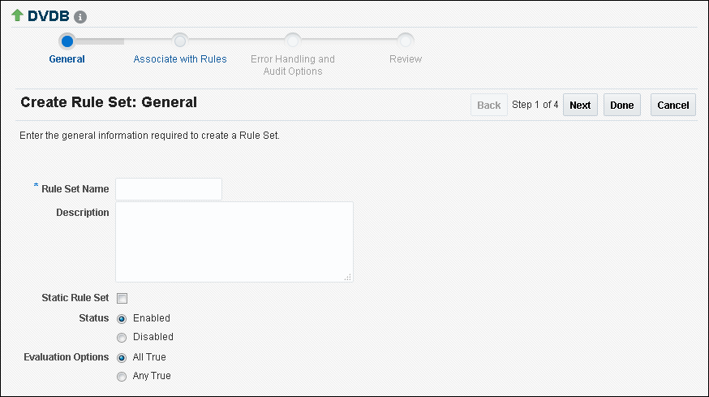

Rule sets group one or more rules together; the rules determine whether a user can perform an action on an object.

- What Are Rule Sets?
  A rule set is a collection of one or more rules.
- Rule Sets and Rules in a Multitenant Environment
  In a multitenant environment, you can create a rule set and its associated rules in a PDB or an application root.
- Default Rule Sets
  Oracle Database Vault provides a set of default rules sets that you can customize for your needs.
- Creating a Rule Set
  To create a rule set, you first create the rule set itself, and then you can edit the rule set to associate it with one or more rules.
- Creating a Rule to Add to a Rule Set
  A rule defines the behavior that you want to control; a rule set is a named collection of rules.
- Removing Rule Set References to Oracle Database Vault Components
  Before you remove a rule set, you should remove the rule set references to Oracle Database Vault components.
- Deleting a Rule Set
  You can use Enterprise Manager Cloud Control to find reference to the rule set and then delete the rule set.
- How Rule Sets Work
  Understanding how rule sets work helps to create more effective rule sets.
- Tutorial: Creating an Email Alert for Security Violations
  This tutorial demonstrates how to use the `UTL_MAIL` PL/SQL package and an access control list to create an email alert for security violations.
- Tutorial: Configuring Two-Person Integrity, or Dual Key Security
  This tutorial demonstrates how to use Oracle Database Vault to control the authorization of two users.
- Guidelines for Designing Rule Sets
  Oracle provides guidelines for designing rule sets.
- How Rule Sets Affect Performance
  The number and complexity of rules can slow database performance.
- Default Rules and Rule Sets from Releases Earlier Than Release 12.2
  Many default rules and rule sets from earlier releases are no longer supported, but may be in use in your current Oracle Database installation.
- Rule Set and Rule Related Reports and Data Dictionary Views
  Oracle Database Vault provides reports and data dictionary views that are useful for analyzing rule sets and the rules within them.

### 5.1 What Are Rule Sets?

A rule set is a collection of one or more rules.

You can associate the rule set with a realm authorization, factor assignment, command rule, or secure application role.

The rule set evaluates to true or false based on the evaluation of each rule it contains and the evaluation type (All True or Any True). A rule within a rule set is a PL/SQL expression that evaluates to true or false. You can create a rule and add the rule to multiple rule sets.

You can use rule sets to accomplish the following activities:

- As a further restriction to realm authorization, to define the conditions under which realm authorization is active

- To define when to allow a command rule

- To enable a secure application role

- To define when to assign the identity of a factor

When you create a rule set, Oracle Database Vault makes it available for selection when you configure the authorization for a realm, command rule, factor, or secure application role.

**Related Topics**

- Rule Set and Rule Related Reports and Data Dictionary Views
- [Oracle Database Vault Rule Set APIs](oracle-database-vault-rule-set-apis.md)

**Parent topic:** Configuring Rule Sets

### 5.2 Rule Sets and Rules in a Multitenant Environment

In a multitenant environment, you can create a rule set and its associated rules in a PDB or an application root.

A common realm must use a common rule set when the associated realm or command rule is evaluated by Database Vault. The common rule set and its rules can only be created in the application root. After the common rule set is created, it exists in every container that is associated with the root where the common rule set is created. The common rule set can only include common rules.

To configure a common rule set and its rules, you must be commonly granted the `DV_OWNER` or `DV_ADMIN` role.

**Related Topics**

- [Command Rules in a Multitenant Environment](configuring-command-rules.md)

**Parent topic:** Configuring Rule Sets

### 5.3 Default Rule Sets

Oracle Database Vault provides a set of default rules sets that you can customize for your needs.

You can find a full list of rule sets by querying the `DBA_DV_RULE_SET` data dictionary view. To find rules that are associated with a rule set, query the `DBA_DV_RULE_SET_RULE` data dictionary view.

The default rule sets are as follows:

- Allow Dumping Datafile Header: This rule set prevents the dumping of data blocks.

- Allow Fine Grained Control for Alter System: This rule set enables you to control the ability of users to set initialization parameters using the `ALTER SYSTEM` SQL statement.

- Allow Fine Grained Control of System Parameters: Note: This rule set has been deprecated.

  This rule set provides a very flexible, fine-grained control over initialization parameters that manage system security, dump or destination location, backup and restore settings, optimizer settings, PL/SQL debugging, and security parameters. It affects the following initialization parameters, based on the associated rules of this rule set:

  - Are Backup Restore Parameters Allowed rule: Cannot set `RECYCLEBIN` (but does not prevent disabling the recycle bin)

  - Are Database File Parameters Allowed rule: Cannot set `CONTROL_FILES`

  - Are Optimizer Parameters Allowed rule: Can set `OPTIMIZER_SECURE_VIEW_MERGING = FALSE` (but `TRUE` not allowed)

  - Are PL-SQL Parameters Allowed rule: Can set `PLSQL_DEBUG = FALSE` (but `TRUE` not allowed).

  - Are Security Parameters Allowed rule: Cannot set the following:

    | Parameters A-A                  | Parameters O-S           |
    |:--------------------------------|:-------------------------|
    | `AUDIT_SYS_OPERATIONS = FALSE`  | `OS_ROLES = TRUE`        |
    | `AUDIT_TRAIL = NONE` or `FALSE` | `REMOTE_OS_ROLES = TRUE` |
    | `AUDIT_SYSLOG_LEVEL`            | `SQL92_SECURITY = FALSE` |

  See [Oracle Database Reference](../refrn/initialization-parameters.md) for detailed information about initialization parameters.

- Allow Sessions: Controls the ability to create a session in the database. This rule set enables you to add rules to control database logins using the CONNECT command rule. The CONNECT command rule is useful to control or limit `SYSDBA` access to programs that require its use. This rule set is not populated.

- Can Grant VPD Administration: Controls the ability to grant the `GRANT EXECUTE` or `REVOKE EXECUTE` privileges on the Oracle Virtual Private Database `DBMS_RLS` package, with the `GRANT` and `REVOKE` statements.

- Can Maintain Accounts/Profiles: Controls the roles that manage user accounts and profiles, through the `CREATE USER`, `DROP USER`, `CREATE PROFILE`, `ALTER PROFILE`, or `DROP PROFILE` statements.

- Can Maintain Own Account: Allows the accounts with the `DV_ACCTMGR` role to manage user accounts and profiles with the `ALTER USER` statement. Also allows individual accounts to change their own password using the `ALTER USER` statement. See [DV_ACCTMGR Database Vault Account Manager Role](oracle-database-vault-schemas-roles-and-accounts.md) for more information about the `DV_ACCTMGR` role.

- Disabled: Convenience rule set to quickly disable security configurations like realms, command rules, factors, and secure application roles.

- Enabled: Convenience rule set to quickly enable system features.

- Not allow to set AUDIT_SYS_OPERATIONS to False: Prevents the `AUDIT_SYS_OPERATIONS` initialization parameter from being set to `FALSE`. If unified auditing is enabled, then the `AUDIT_SYS_OPERATIONS` parameter has no effect.

- Not allow to set OPTIMIZER_SECURE_VIEW_MERGING to True: Prevents the `OPTIMIZER_SECURE_VIEW_MERGING` initialization parameter from being set to `TRUE`.

- Not allow to set OS_ROLES to True: Prevents the `OS_ROLES` initialization parameter from being set to `TRUE`.

- Not allow to set PLSQL_DEBUG to True: Prevents the `PLSQL_DEBUG` initialization parameter from being set to `TRUE`.

- Not allow to set REMOTE_OS_ROLES to True: Prevents the `REMOTE_OS_ROLES` initialization parameter from being set to `TRUE`.

- Not allow to set SQL92_SECURITY to False: Prevents the `SQL92_SECURITY` from being set to `FALSE`.

- Not allow to turn off AUDIT_TRAIL: Prevents the `AUDIT_TRAIL` initialization parameter from being turned off. If unified auditing is enabled, then the `AUDIT_TRAIL` parameter has no effect.

**Parent topic:** Configuring Rule Sets

### 5.4 Creating a Rule Set

To create a rule set, you first create the rule set itself, and then you can edit the rule set to associate it with one or more rules.

You can associate a new rule with the rule set, add existing rules to the rule set, or delete a rule association from the rule set.

1.  Log in to Oracle Database Vault Administrator from Cloud Control as a user who has been granted the `DV_OWNER` or `DV_ADMIN` role and the `SELECT ANY DICTIONARY` privilege. [Logging in to Oracle Database Vault from Oracle Enterprise Cloud Control](getting-started-with-oracle-database-vault.md) explains how to log in.
2.  In the Administration page, under Database Vault Components, click Rule Sets.
3.  In the Rule Sets page, click Create to display the Create Rule Sets page.

    
    [Description of the illustration create_rulesets122.png](img_text/create_rulesets122.md)
4.  In the General page, enter the following information:
    - Name: Enter a name for the rule set. It can contain up to 90 characters in mixed-case. Spaces are allowed. This attribute is mandatory.

      Oracle suggests that you start the name with a verb and complete it with the realm or command rule name to which the rule set is attached. For example:

          Limit SQL*Plus access

    - Description: Enter a description of the functionality for the rule set. It can have up to 1024 characters in mixed-case. This attribute is optional.

      You may want to document the business requirement of the rule set. For example:

          Rule to limit access to SQL*Plus

    - Static Rule Set: You can control how often the rule set is evaluated when it is accessed during a user session. A static rule set is evaluated once when accessed for the first time in a user session. After that, the evaluated value is re-used in the user session. On the other hand, a non-static rule set is evaluated every time it is accessed.

    - Status: Select either Enabled or Disabled to enable or disable the rule set during run time. This attribute is mandatory.

    - Evaluation Options: If you plan to assign multiple rules to a rule set, then select one of the following settings:

      - All True: All rules in the rule set must evaluate to true for the rule set itself to evaluate to true.

      - Any True: At least one rule in the rule set must evaluate to true for the rule set itself to evaluate to true.
5.  Click Next to display the Associate with Rules page.
6.  Select one of the following options:
    - Add Existing Rule: Double-click from the list of available rules to move them to the Selected Rules list, and then click OK.

    - Create Rule: Enter a name and `WHERE` clause expression that evaluates to true or false. Click OK. See Creating a Rule to Add to a Rule Set for more information.
7.  Click Next to display the Error handling and Audit options page.
8.  Enter the following information:
    - Error Handling: Select either Show Error Message or Do Not Show Error Message.

      An advantage of selecting Do Not Show Error Message and then enabling auditing is that you can track the activities of a potential intruder. The audit report reveals the activities of the intruder, yet the intruder is unaware that you are doing this because he or she does not see any error messages.

    - Fail Code: Enter a number in the ranges of -20000 to -20999 or 20000 to 20999. The error code is displayed with the Fail Message (created next) when the rule set evaluates to false or one of the associated rules contains an invalid PL/SQL expression. If you omit this setting, then Oracle Database Vault displays a generic error code.

    - Fail Message: Enter a message, up to 80 characters in mixed-case, to associate with the fail code you specified under Fail Code. The error message is displayed when the rule set evaluates to false or one of the associated rules contains an invalid PL/SQL expression. If you do not specify an error message, then Oracle Database Vault displays a generic error message.

    - Custom Event Handler Option: Select one of the following options to determine when to run the Custom Event Handler Logic (created next).

      - Handler Disabled: Does not run any custom event method.

      - Execute On Failure: Runs the custom event method when the rule set evaluates to false or one of the associated rules contains an invalid PL/SQL expression.

      - Execute On Success: Runs the custom event method when the rule set evaluates to true.

      You can create a custom event method to provide special processing outside the standard Oracle Database Vault rule set auditing features. For example, you can use an event handler to initiate a workflow process or send event information to an external system.

    - Custom Event Handler Logic: Enter a PL/SQL expression up to 255 characters in mixed-case. An expression may include any package procedure or standalone procedure. You can create your own expression or use the PL/SQL interfaces described in [Oracle Database Vault Rule Set APIs](oracle-database-vault-rule-set-apis.md).

      Write the expression as a fully qualified procedure (such as `schema`.`procedure_name`). Do not include any other form of SQL statements. If you are using application package procedures or standalone procedures, you must provide `DVSYS` with the `EXECUTE` privilege on the object. The procedure signature can be in one of the following two forms:

      - `PROCEDURE` `my_ruleset_handler(``p_ruleset_name`` IN VARCHAR2,` `p_ruleset_rules` `IN BOOLEAN)`: Use this form when the name of the rule set and its return value are required in the handler processing.

      - `PROCEDURE` `my_ruleset_handler`: Use this form when the name of the rule set and its return value are not required in the handler processing.

      Be aware that you cannot use invoker's rights procedures as event handlers. Doing so can cause the rule set evaluation to fail unexpectedly. Only use definer's rights procedures as event handlers.

      Use the following syntax:

          myschema.my_ruleset_handler

    - Audit Options: Select from the following options to generate an audit record for the rule set in a non-unified auditing environment. Oracle Database Vault writes the audit trail to the `DVSYS.AUDIT_TRAIL$` table. (If you have enabled unified auditing, then this setting does not capture audit records. Instead, you must create unified audit policies to capture this information.)

      - Audit Disabled: Does not create an audit record under any circumstances.

      - Audit on Success: Creates an audit record when the rule set evaluates to true.

      - Audit On Failure: Creates an audit record when the rule set evaluates to false or one of the associated rules contains an invalid PL/SQL expression.

      - Audit On Success or Failure: Creates an audit record whenever a rule set is evaluated.
9.  Click Next to display the Review page.
10. Review the settings, and if they are satisfactory, click Finish.

**See Also:**

- [Auditing Oracle Database Vault](auditing-oracle-database-vault.md) for more information about audit records in the `DVSYS.AUDIT_TRAIL$` table

- [Oracle Database Security Guide](../dbseg/configuring-audit-policies.md) for information about creating unified audit policies for Database Vault

**Parent topic:** Configuring Rule Sets

### 5.5 Creating a Rule to Add to a Rule Set

A rule defines the behavior that you want to control; a rule set is a named collection of rules.

- What Are Rules?
  A rule is an expression that checks if a particular condition is true or false.
- Default Rules
  Default rules are rules that have commonly used behavior, such as checking if an action evaluates to true or false.
- Creating a New Rule
  You can create a new rule in Enterprise Manager Cloud Control.
- Adding Existing Rules to a Rule Set
  After you have created one or more rules, you can use Enterprise Manager Cloud Control to add to a rule set.
- Removing a Rule from a Rule Set
  Before you remove a rule from a rule set, you can locate the various references to it using Cloud Control.

**Parent topic:** Configuring Rule Sets

#### 5.5.1 What Are Rules?

A rule is an expression that checks if a particular condition is true or false.

This expression enables Oracle Database Vault to perform an action based on the result of the rule evaluation during runtime. For example, the `Is Database Administrator` default rule checks if the session user is `SYS` or has the `DBA` role enabled or granted. You can create an Oracle Database Vault rule set that includes the rule to prevent users who fail this rule check from accessing a realm that should only be accessed by users with the `DBA` role. In addition, you can create Oracle Database Vault command rules that prevent users who fail a rule check from executing critical SQL commands that should only be used by users with the `DBA` role or `SYS`.

The expression that you use to define the rule must be a PL/SQL Boolean expression. You can use standard Oracle Database functions to build the expression, such as the `SYS_CONTEXT` function. An example of a rule expression using the `SYS_CONTEXT` function is as follows:

    SYS_CONTEXT('USERENV',SESSION_USER') = 'RLAYTON'

This rule expression translates to "Check if the currently logged in user is user `RLAYTON`."

When you create a rule, you can define a scope for it, that is, whether the rule is created in a PDB or in an application root.

You can create rules during the rule set creation process, or independently of it. After you create the rule, you can associate a rule set with one or more additional rules.

If you create a new rule during the rule set creation process, the rule is automatically added to the current rule set. You also can add existing rules to the rule set. Alternatively, you can omit adding rules to the rule set and use it as a template for rule sets you may want to create in the future.

You can add as many rules that you want to a rule set, but for better design and performance, you should keep the rule sets simple. Oracle provides guidelines for designing rule sets.

The rule set evaluation depends on the evaluation of its rules using the Evaluation Options (All True or Any True). If a rule set is disabled, then Oracle Database Vault evaluates the rule set to true without evaluating its rules.

**Related Topics**

- How Rule Sets Work
- Guidelines for Designing Rule Sets

**Parent topic:** Creating a Rule to Add to a Rule Set

#### 5.5.2 Default Rules

Default rules are rules that have commonly used behavior, such as checking if an action evaluates to true or false.

You can find a full list of rules by querying the `DBA_DV_RULE` data dictionary view.Table 5-1 lists the current default Oracle Database rules.

Table 5-1 Current Default Oracle Database Vault Rules

| Rule                                        | Description                                                                                                                                                                                                                                                                                                                                                                                                                                                                                                                                                                                                                                                                                                                                                                                                                                                                                                                                                                                                                     |
|:--------------------------------------------|:--------------------------------------------------------------------------------------------------------------------------------------------------------------------------------------------------------------------------------------------------------------------------------------------------------------------------------------------------------------------------------------------------------------------------------------------------------------------------------------------------------------------------------------------------------------------------------------------------------------------------------------------------------------------------------------------------------------------------------------------------------------------------------------------------------------------------------------------------------------------------------------------------------------------------------------------------------------------------------------------------------------------------------|
| Are Backup Restore Parameters Allowed       | Note: This default rule has been deprecated. Checks if the current SQL statement attempts to turn on the `RECYCLEBIN` parameter                                                                                                                                                                                                                                                                                                                                                                                                                                                                                                                                                                                                                                                                                                                                                                                                                                                                                              |
| Are Database File Parameters Allowed        | Note: This default rule has been deprecated. Checks if the current SQL statement attempts to alter control file related configuration                                                                                                                                                                                                                                                                                                                                                                                                                                                                                                                                                                                                                                                                                                                                                                                                                                                                                        |
| Are Dump Parameters Allowed                 | Checks if the current SQL statement attempts to alter initialization parameters related to the destination of a dump                                                                                                                                                                                                                                                                                                                                                                                                                                                                                                                                                                                                                                                                                                                                                                                                                                                                                                            |
| Are Dest Parameters Allowed                 | Checks if the current SQL statement attempts to alter initialization parameters related to the size limit of a dump                                                                                                                                                                                                                                                                                                                                                                                                                                                                                                                                                                                                                                                                                                                                                                                                                                                                                                             |
| Are Dump or Dest Parameters Allowed         | Note: This default rule has been deprecated. Checks if the current SQL statement attempts to alter initialization parameters related to the size limit or destination of dump                                                                                                                                                                                                                                                                                                                                                                                                                                                                                                                                                                                                                                                                                                                                                                                                                                                |
| Are Optimizer Parameters Allowed            | Note: This default rule has been deprecated. Checks if the current SQL statement attempts to alter the setting for the `OPTIMIZER_SECURE_VIEW_MERGING` parameter                                                                                                                                                                                                                                                                                                                                                                                                                                                                                                                                                                                                                                                                                                                                                                                                                                                             |
| Are PL-SQL Parameters Allowed               | Note: This default rule has been deprecated. Checks if the current SQL statement attempts to alter the `PLSQL_DEBUG` initialization parameter.                                                                                                                                                                                                                                                                                                                                                                                                                                                                                                                                                                                                                                                                                                                                                                                                                                                                               |
| Are Security Parameters Allowed             | Note: This default rule has been deprecated. Checks if there is an attempt to disable the following initialization parameters: • `AUDIT_SYS_OPERATIONS` • `AUDIT_TRAIL` • `AUDIT_SYSLOG_LEVEL` • `SQL92_SECURITY` Note that if you have enabled unified auditing, then the `AUDIT_SYS_OPERATIONS`, `AUDIT_TRAIL`, and `AUDIT_SYSLOG_LEVEL` parameters have no effect. This rule prevents any attempt to enable the following parameters: • `OS_ROLES` • `REMOTE_OS_ROLES`                                                                                                                                                                                                                                                                                                                                                                                                                                                                                                                            |
| Are System Security Parameters Allowed      | Note: This default rule has been deprecated. Prevents modification of the following parameters: • `DYNAMIC_RLS_POLICIES` • `_SYSTEM_TRIG_ENABLED`                                                                                                                                                                                                                                                                                                                                                                                                                                                                                                                                                                                                                                                                                                                                                                                                                                                                      |
| False                                       | Evaluates to `FALSE`                                                                                                                                                                                                                                                                                                                                                                                                                                                                                                                                                                                                                                                                                                                                                                                                                                                                                                                                                                                                            |
| Is Alter DVSYS Allowed                      | Note: This default rule has been deprecated. Checks if the logged-in user can execute the `ALTER USER` statement on other users successfully                                                                                                                                                                                                                                                                                                                                                                                                                                                                                                                                                                                                                                                                                                                                                                                                                                                                                 |
| Is Database Administrator                   | Checks if a user has been granted the `DBA` role                                                                                                                                                                                                                                                                                                                                                                                                                                                                                                                                                                                                                                                                                                                                                                                                                                                                                                                                                                                |
| Is Drop User Allowed                        | Checks if the logged in user can drop users                                                                                                                                                                                                                                                                                                                                                                                                                                                                                                                                                                                                                                                                                                                                                                                                                                                                                                                                                                                     |
| Is Dump of Block Allowed                    | Checks if the dumping of blocks is allowed                                                                                                                                                                                                                                                                                                                                                                                                                                                                                                                                                                                                                                                                                                                                                                                                                                                                                                                                                                                      |
| Is First Day of Month                       | Checks if the specified date is the first day of the month                                                                                                                                                                                                                                                                                                                                                                                                                                                                                                                                                                                                                                                                                                                                                                                                                                                                                                                                                                      |
| Is Label Administrator                      | Checks if the user has been granted the `LBAC_DBA` role                                                                                                                                                                                                                                                                                                                                                                                                                                                                                                                                                                                                                                                                                                                                                                                                                                                                                                                                                                         |
| Is Last Day of Month                        | Checks if the specified date is the last day of the month                                                                                                                                                                                                                                                                                                                                                                                                                                                                                                                                                                                                                                                                                                                                                                                                                                                                                                                                                                       |
| Is \_dynamic_rls_init Parameters Allowed    | Note: This default rule has been deprecated. Prevent modification of the `DYNAMIC_RLS_POLICIES` parameter                                                                                                                                                                                                                                                                                                                                                                                                                                                                                                                                                                                                                                                                                                                                                                                                                                                                                                                    |
| Is Parameter Value False                    | Checks if a specified parameter value has been set to `FALSE`                                                                                                                                                                                                                                                                                                                                                                                                                                                                                                                                                                                                                                                                                                                                                                                                                                                                                                                                                                   |
| Is Parameter Value None                     | Checks if a specified parameter value has been set to `NONE`                                                                                                                                                                                                                                                                                                                                                                                                                                                                                                                                                                                                                                                                                                                                                                                                                                                                                                                                                                    |
| Is Parameter Value Not False                | Checks if a specified parameter value has been set to `<> FALSE`                                                                                                                                                                                                                                                                                                                                                                                                                                                                                                                                                                                                                                                                                                                                                                                                                                                                                                                                                                |
| Is Parameter Value Not None                 | Checks if a specified parameter value has been set to `<> NONE`                                                                                                                                                                                                                                                                                                                                                                                                                                                                                                                                                                                                                                                                                                                                                                                                                                                                                                                                                                 |
| Is Parameter Value Not Off                  | Checks if a specified parameter value has been set to `<> OFF`                                                                                                                                                                                                                                                                                                                                                                                                                                                                                                                                                                                                                                                                                                                                                                                                                                                                                                                                                                  |
| Is Parameter Value Not On                   | Checks if a specified parameter value has been set to `<> ON`                                                                                                                                                                                                                                                                                                                                                                                                                                                                                                                                                                                                                                                                                                                                                                                                                                                                                                                                                                   |
| Is Parameter Value Not True                 | Checks if a specified parameter value has been set to `<> TRUE`                                                                                                                                                                                                                                                                                                                                                                                                                                                                                                                                                                                                                                                                                                                                                                                                                                                                                                                                                                 |
| Is Parameter Value Off                      | Checks if a specified parameter value has been set to `OFF`                                                                                                                                                                                                                                                                                                                                                                                                                                                                                                                                                                                                                                                                                                                                                                                                                                                                                                                                                                     |
| Is Parameter Value On                       | Checks if a specified parameter value has been set to `ON`                                                                                                                                                                                                                                                                                                                                                                                                                                                                                                                                                                                                                                                                                                                                                                                                                                                                                                                                                                      |
| Is Parameter Value True                     | Checks if a specified parameter value has been set to `TRUE`                                                                                                                                                                                                                                                                                                                                                                                                                                                                                                                                                                                                                                                                                                                                                                                                                                                                                                                                                                    |
| Is SYS or SYSTEM User                       | Checks if the user is `SYS` or `SYSTEM`                                                                                                                                                                                                                                                                                                                                                                                                                                                                                                                                                                                                                                                                                                                                                                                                                                                                                                                                                                                         |
| Is Security Administrator                   | Checks if a user has been granted the `DV_ADMIN` role                                                                                                                                                                                                                                                                                                                                                                                                                                                                                                                                                                                                                                                                                                                                                                                                                                                                                                                                                                           |
| Is Security Owner                           | Checks if a user has been granted the `DV_OWNER` role                                                                                                                                                                                                                                                                                                                                                                                                                                                                                                                                                                                                                                                                                                                                                                                                                                                                                                                                                                           |
| Is User Manager                             | Checks if a user has been granted the `DV_ACCTMGR` role                                                                                                                                                                                                                                                                                                                                                                                                                                                                                                                                                                                                                                                                                                                                                                                                                                                                                                                                                                         |
| Is \_system_trig_enabled Parameters Allowed | Note: This default rule has been deprecated. Checks if the user tries to modify the following system parameters, but in database recovery operations, this rule permits these parameters to be changed. • `AUDIT_SYS_OPERATIONS`: Prevents users from setting it to `FALSE` • `AUDIT_TRAIL`: Prevents users from setting it to `NONE` or `FALSE` • `AUDIT_SYSLOG_LEVEL`: Blocks all operations on this parameter • `CONTROL_FILES`: Blocks all operations • `OPTIMIZER_SECURE_VIEW_MERGING`: Prevents users from setting it to `TRUE` • `OS_ROLES`: Prevents users from setting it to `TRUE` • `PLSQL_DEBUG`: Prevents users from setting it to `ON` • `RECYCLEBIN`: Prevents users from setting it to `ON` • `REMOTE_OS_ROLES`: Prevents users from setting it to `TRUE` • `SQL92_SECURITY`: Prevents users from setting it to `FALSE` Note that if you have enabled unified auditing, then the `AUDIT_SYS_OPERATIONS`, `AUDIT_TRAIL`, and `AUDIT_SYSLOG_LEVEL` parameters have no effect. |
| Login User Is Object User                   | Checks if the logged in user is the same as the user about to be altered by the current SQL statement                                                                                                                                                                                                                                                                                                                                                                                                                                                                                                                                                                                                                                                                                                                                                                                                                                                                                                                           |
| No Exempt Access Policy Role                | Checks if the user has been granted the `EXEMPT ACCESS POLICY` role or is user `SYS`                                                                                                                                                                                                                                                                                                                                                                                                                                                                                                                                                                                                                                                                                                                                                                                                                                                                                                                                            |
| Not Export Session                          | Obsolete                                                                                                                                                                                                                                                                                                                                                                                                                                                                                                                                                                                                                                                                                                                                                                                                                                                                                                                                                                                                                        |
| True                                        | Evaluates to `TRUE`                                                                                                                                                                                                                                                                                                                                                                                                                                                                                                                                                                                                                                                                                                                                                                                                                                                                                                                                                                                                             |

**Parent topic:** Creating a Rule to Add to a Rule Set

#### 5.5.3 Creating a New Rule

You can create a new rule in Enterprise Manager Cloud Control.

1.  Log in to Oracle Database Vault Administrator from Cloud Control as a user who has been granted the `DV_OWNER` or `DV_ADMIN` role and the `SELECT ANY DICTIONARY` privilege. [Logging in to Oracle Database Vault from Oracle Enterprise Cloud Control](getting-started-with-oracle-database-vault.md) explains how to log in.
2.  In the Administration page, under Database Vault Components, click Rules.
3.  Click the Create button.
4.  In the Create Rule page, enter the following settings:
    - Name: Enter a name for the rule. Use up to 90 characters in mixed-case.

      Oracle suggests that you start the name with a verb and complete the name with the purpose of the rule. For example:

          Prevent non-admin access to SQL*Plus

      Because rules do not have a Description field, make the name explicit but be sure to not exceed over 90 characters.

    - Rule Expression: Enter a PL/SQL expression that fits the following requirements:

      - It is valid in a SQL `WHERE` clause.

      - It can be a freestanding and valid PL/SQL Boolean expression such as the following:

            TO_CHAR(SYSDATE,'HH24') = '12'

      - It must evaluate to a Boolean (`TRUE` or `FALSE`) value.

      - It must be no more than 1024 characters long.

      - It can contain existing and compiled PL/SQL functions from the current database instance. Ensure that these are fully qualified functions (such as `schema`. `function_name`). Do not include any other form of SQL statements.

        Be aware that you cannot use invoker's rights procedures with rule expressions. Doing so will cause the rule evaluation to fail unexpectedly. Only use definer's rights procedures with rule expressions.

        If you want to use application package functions or standalone functions, you must grant the `DVSYS` account the `EXECUTE` privilege on the function. Doing so reduces the chances of errors when you add new rules.

      - Ensure that the rule works. You can test the syntax by running the following statement in SQL\*Plus:

            SELECT rule_expression FROM DUAL;

        For example, suppose you have created the following the rule expression:

            SYS_CONTEXT('USERENV','SESSION_USER') != 'TSMITH'

        You could test this expression as follows:

            SELECT SYS_CONTEXT('USERENV','SESSION_USER') FROM DUAL;

        For the Boolean example listed earlier, you would enter the following:

            SELECT TO_CHAR(SYSDATE,'HH24')FROM DUAL;
5.  Click OK.

**Related Topics**

- [Oracle Database Vault PL/SQL Rule Set Functions](oracle-database-vault-rule-set-apis.md)
- [DBMS_MACADM Rule Set Procedures](oracle-database-vault-rule-set-apis.md)
- [Oracle Database Vault Utility APIs](oracle-database-vault-utility-apis.md)

**Parent topic:** Creating a Rule to Add to a Rule Set

#### 5.5.4 Adding Existing Rules to a Rule Set

After you have created one or more rules, you can use Enterprise Manager Cloud Control to add to a rule set.

1.  Log in to Oracle Database Vault Administrator from Cloud Control as a user who has been granted the `DV_OWNER` or `DV_ADMIN` role and the `SELECT ANY DICTIONARY` privilege. [Logging in to Oracle Database Vault from Oracle Enterprise Cloud Control](getting-started-with-oracle-database-vault.md) explains how to log in.
2.  In the Administration page, under Database Vault Components, click Rule Sets.
3.  Select the rule set to which you want to add an existing rule, and then click Edit.
4.  Click Next until you reach the Associate with Rules page.
5.  Click Add Existing Rule to display the Add Existing Rules dialog box.
6.  In the Add Existing Rules page, select the rules you want, and then click Move (or Move All, if you want all of them) to move them to the Selected Rules list.
    You can select multiple rules by holding down the Ctrl key as you click each rule.
7.  Click OK.
8.  Click Done, then click Finish.

**Parent topic:** Creating a Rule to Add to a Rule Set

#### 5.5.5 Removing a Rule from a Rule Set

Before you remove a rule from a rule set, you can locate the various references to it using Cloud Control.

1.  Log in to Oracle Database Vault Administrator from Cloud Control as a user who has been granted the `DV_OWNER` or `DV_ADMIN` role and the `SELECT ANY DICTIONARY` privilege. [Logging in to Oracle Database Vault from Oracle Enterprise Cloud Control](getting-started-with-oracle-database-vault.md) explains how to log in.
2.  In the Administration page, under Database Vault Components, click Rule Sets.
    If you are not sure which rule set contains that rule that you want to remove, then select Rules from Database Vault Components, select the rule that you want to remove, and then select the View option (but not the View menu). The rule sets that are associated with the rule are listed in Rule Set Usages.
3.  Select the rule set to which you want to add an existing rule, and then click Edit.
4.  Click Next until you reach the Associate with Rules page.
5.  Select the rule you want to delete and click Remove.
6.  Click Done, then click Finish.

After you remove the rule from the rule set, the rule still exists. If you want, you can associate it with other rule sets. If you want to delete the rule, then you can do so from the Rules page.

**Parent topic:** Creating a Rule to Add to a Rule Set

### 5.6 Removing Rule Set References to Oracle Database Vault Components

Before you remove a rule set, you should remove the rule set references to Oracle Database Vault components.

1.  Log in to Oracle Database Vault Administrator from Cloud Control as a user who has been granted the `DV_OWNER` or `DV_ADMIN` role and the `SELECT ANY DICTIONARY` privilege. [Logging in to Oracle Database Vault from Oracle Enterprise Cloud Control](getting-started-with-oracle-database-vault.md) explains how to log in.
2.  Find the references to the rule set that you want to delete.
    In the Rule Sets page, select the rule set and then click the View button (but not the View menu). In the View Rule Set page, check the Ruleset Usages area for the references to the rule set that you want to remove. Click OK.
3.  In the Administration page, under Database Vault Components, select the component that contains the reference to the rule set (such as Realms).
4.  Select the object, and then click Edit.
5.  Click Next until you reach the authorizations page.
6.  Select the authorization with the rule set and then click Edit, and then remove the referenced object.
7.  Click Done, then click Finish.

**Parent topic:** Configuring Rule Sets

### 5.7 Deleting a Rule Set

You can use Enterprise Manager Cloud Control to find reference to the rule set and then delete the rule set.

1.  Log in to Oracle Database Vault Administrator from Cloud Control as a user who has been granted the `DV_OWNER` or `DV_ADMIN` role and the `SELECT ANY DICTIONARY` privilege. [Logging in to Oracle Database Vault from Oracle Enterprise Cloud Control](getting-started-with-oracle-database-vault.md) explains how to log in.
2.  Remove references to the rule set.
3.  Select the rule set that you want to remove and click Delete.
4.  In the Confirmation window, click Yes.
    The rule set is deleted. Optionally, you can choose to remove the existing associations with rules before deleting the rule set.

**Related Topics**

- Removing Rule Set References to Oracle Database Vault Components

**Parent topic:** Configuring Rule Sets

### 5.8 How Rule Sets Work

Understanding how rule sets work helps to create more effective rule sets.

- How Oracle Database Vault Evaluates Rules
  Oracle Database Vault evaluates the rules within a rule set as a collection of expressions.
- Nested Rules within a Rule Set
  You can nest one or more rules within the rule set.
- Creating Rules to Apply to Everyone Except One User
  You can also create rules to apply to everyone except one user (for example, a privileged user).

**Parent topic:** Configuring Rule Sets

#### 5.8.1 How Oracle Database Vault Evaluates Rules

Oracle Database Vault evaluates the rules within a rule set as a collection of expressions.

If you have set Evaluation Options to All True and if a rule evaluates to false, then the evaluation stops at that point, instead of attempting to evaluate the rest of the rules in the rule set. Similarly, if Evaluation Options is set to Any True and if a rule evaluates to true, the evaluation stops at that point. If a rule set is disabled, Oracle Database Vault evaluates it to true without evaluating its rules.

**Parent topic:** How Rule Sets Work

#### 5.8.2 Nested Rules within a Rule Set

You can nest one or more rules within the rule set.

For example, suppose you want to create a nested rule, Is Corporate Network During Maintenance, that performs the following two tasks:

- It limits table modifications only when the database session originates within the corporate network.

- It restricts table modifications during the system maintenance window scheduled between 10:00 p.m. and 10:59 p.m.

The rule definition would be as follows:

    DVF.F$NETWORK = 'Corporate' AND TO_CHAR(SYSDATE,'HH24') between '22' AND '23'

**Related Topics**

- [Oracle Database Vault DVF PL/SQL Factor Functions](oracle-database-vault-factor-apis.md)
- [Configuring Factors](configuring-factors.md)

**Parent topic:** How Rule Sets Work

#### 5.8.3 Creating Rules to Apply to Everyone Except One User

You can also create rules to apply to everyone except one user (for example, a privileged user).

- To create a rule that excludes specific users, user the `SYS_CONTEXT` function.

For example:

    SYS_CONTEXT('USERENV','SESSION_USER') = 'SUPERADMIN_USER' OR additional_rule

If the current user is a privileged user, then the system evaluates the rule to true without evaluating `additional_rule`. If the current user is not a privileged user, then the evaluation of the rule depends on the evaluation of `additional_rule`.

**Parent topic:** How Rule Sets Work

### 5.9 Tutorial: Creating an Email Alert for Security Violations

This tutorial demonstrates how to use the `UTL_MAIL` PL/SQL package and an access control list to create an email alert for security violations.

- About This Tutorial
  In tutorial, you create an email alert that is sent when a user attempts to alter a table outside a maintenance period.
- Step 1: Install and Configure the UTL_MAIL PL/SQL Package
  The `UTL_MAIL` PL/SQL package, which you must manually install, has procedures to manage email notifications.
- Step 2: Create an Email Security Alert PL/SQL Procedure
  User `leo_dvowner` can use the `CREATE PROCEDURE` statement to create the email security alert.
- Step 3: Configure an Access Control List File for Network Services
  Before you can use `UTL_MAIL`, you must configure an access control list (ACL) to enable fine-grained access to external network services.
- Step 4: Create a Rule Set and a Command Rule to Use the Email Security Alert
  To create the rule set and command rule, you can use `DBMS_MACADM` PL/SQL package.
- Step 5: Test the Email Security Alert
  After the alert has been created, it is ready to be tested.
- Step 6: Remove the Components for This Tutorial
  You can remove the components that you created for this tutorial if you no longer need them.

**Parent topic:** Configuring Rule Sets

#### 5.9.1 About This Tutorial

In tutorial, you create an email alert that is sent when a user attempts to alter a table outside a maintenance period.

To do this, you must create a rule to set the maintenance period hours, attach this rule to a rule set, and then create a command rule to allow the user to alter the table. You then associate the rule set with this command rule, which then sends the email alert when the user attempts to use the `ALTER TABLE` SQL statement outside the maintenance period.

**Note:**

To complete this tutorial, you must use a database that has an SMTP server.

**Parent topic:** Tutorial: Creating an Email Alert for Security Violations

#### 5.9.2 Step 1: Install and Configure the UTL_MAIL PL/SQL Package

The `UTL_MAIL` PL/SQL package, which you must manually install, has procedures to manage email notifications.

1.  Log into the database instance as `SYS` using the `SYSDBA` administrative privilege.
        sqlplus sys as sysdba
        Enter password: password
2.  In a multitenant environment, connect to the appropriate pluggable database (PDB).
    For example:

        CONNECT SYS@my_pdb AS SYSDBA
        Enter password: password

    To find the available PDBs, run the `show pdbs` command. To check the current PDB, run the `show con_name` command.
3.  Install the `UTL_MAIL` package.
        @$ORACLE_HOME/rdbms/admin/utlmail.sql
        @$ORACLE_HOME/rdbms/admin/prvtmail.plb

    The `UTL_MAIL` package enables you to manage email. See [Oracle Database PL/SQL Packages and Types Reference](../arpls/UTL_MAIL.md) for more information about `UTL_MAIL`. However, be aware that currently, the `UTL_MAIL` PL/SQL package do not support SSL servers.
4.  Check the current value of the `SMTP_OUT_SERVER` parameter, and make a note of this value so that you can restore it when you complete this tutorial.
    For example:

        SHOW PARAMETER SMTP_OUT_SERVER

    Output similar to the following appears:

        NAME                    TYPE              VALUE
        ----------------------- ----------------- ----------------------------------
        SMTP_OUT_SERVER         string            some_value.example.com
5.  Issue the following `ALTER SYSTEM` statement:
        ALTER SYSTEM SET SMTP_OUT_SERVER="imap_mail_server.example.com";

    Replace `imap_mail_server.example.com` with the name of your SMTP server, which you can find in the account settings in your email tool. Enclose these settings in double quotation marks. For example:

        ALTER SYSTEM SET SMTP_OUT_SERVER="my_imap_mail_server.example.com"
6.  Connect as `SYS` using the `SYSOPER` privilege and then restart the database.
        CONNECT SYS AS SYSOPER -- Or, CONNECT SYS@hrpdb AS SYSOPER
        Enter password: password

        SHUTDOWN IMMEDIATE
        STARTUP
7.  Ensure that the `SMTP_OUT_SERVER` parameter setting is correct.
        CONNECT SYS AS SYSDBA -- Or, CONNECT SYS@hrpdb AS SYSDBA
        Enter password: password

        SHOW PARAMETER SMTP_OUT_SERVER

    Output similar to the following appears:

        NAME                    TYPE              VALUE
        ----------------------- ----------------- ----------------------------------
        SMTP_OUT_SERVER         string            my_imap_mail_server.example.com

**Parent topic:** Tutorial: Creating an Email Alert for Security Violations

#### 5.9.3 Step 2: Create an Email Security Alert PL/SQL Procedure

User `leo_dvowner` can use the `CREATE PROCEDURE` statement to create the email security alert.

1.  Ensure that you are connected as a user who has privileges to perform the grants described in this step, and then grant these privileges to a user who has been granted the `DV_OWNER` role. You should also be authorized as an owner of the Oracle System Privilege and Role Management realm.
    (Alternatively, you can select a user who has been granted the `DV_ADMIN` role, but for this tutorial, you will select a user who has the `DV_OWNER` role.)

    For example:

        CONNECT dba_psmith -- Or, CONNECT dba_psmith@hrpdb
        Enter password: password

        GRANT CREATE PROCEDURE, DROP ANY PROCEDURE TO leo_dvowner;
        GRANT EXECUTE ON UTL_TCP TO leo_dvowner;
        GRANT EXECUTE ON UTL_SMTP TO leo_dvowner;
        GRANT EXECUTE ON UTL_MAIL TO leo_dvowner;
        GRANT EXECUTE ON DBMS_NETWORK_ACL_ADMIN TO leo_dvowner;

    The `UTL_TCP`, `UTL_SMTP`, `UTL_MAIL`, and `DBMS_NETWORK_ACL_ADMIN` PL/SQL packages will be used by the email security alert that you create.
2.  Connect to SQL\*Plus as the `DV_OWNER` user.
    For example:

        CONNECT leo_dvowner -- Or, CONNECT leo_dvowner@hrpdb
        Enter password: password
3.  Create the following procedure:
        CREATE OR REPLACE PROCEDURE email_alert AS
        msg varchar2(20000) := 'Realm violation occurred for the ALTER TABLE Command Security Policy rule set. The time is: ';
        BEGIN
          msg := msg||to_char(SYSDATE, 'Day DD MON, YYYY HH24:MI:SS');
        UTL_MAIL.SEND (
            sender      => 'youremail@example.com',
            recipients  => 'recipientemail@example.com',
            subject     => 'Table modification attempted outside maintenance!',
            message     => msg);
        END email_alert;
        /

    Replace `youremail@example.com` with your email address, and `recipientemail@example.com` with the email address of the person you want to receive the notification.
4.  Grant the `EXECUTE` permission on this procedure to `DVSYS`.
        GRANT EXECUTE ON email_alert TO DVSYS;

**Parent topic:** Tutorial: Creating an Email Alert for Security Violations

#### 5.9.4 Step 3: Configure an Access Control List File for Network Services

Before you can use `UTL_MAIL`, you must configure an access control list (ACL) to enable fine-grained access to external network services.

For detailed information about fine-grained access to external network services, see [Oracle Database Security Guide](../dbseg/managing-fine-grained-access-in-pl-sql-packages-and-types.md).

1.  As the `DV_OWNER` user, in SQL\*Plus, configure the following access control setting and its privilege definitions.
        BEGIN
         DBMS_NETWORK_ACL_ADMIN.APPEND_HOST_ACE(
          host       => 'SMTP_OUT_SERVER_setting',
          lower_port => 25,
          ace        =>  xs$ace_type(privilege_list => xs$name_list('smtp'),
                                     principal_name => 'LEO_DVOWNER,
                                     principal_type => xs_acl.ptype_db));
        END;
        /

    In this example:

    - `lower_port`: Enter the port number that your email tool specifies for its outgoing server. Typically, this setting is 25. Enter this value for both the `lower_port` and `upper_port` settings. (Currently, the `UTL_MAIL` package does not support SSL. If your mail server is an SSL server, then enter 25 for the port number, even if the mail server uses a different port number.)

    - `principal_name`: Replace `LEO_DVOWNER` with the name of the `DV_OWNER` user.

    - `host`: For the `SMTP_OUT_SERVER_setting`, enter the `SMTP_OUT_SERVER` setting that you set for the `SMTP_OUT_SERVER` parameter in Step 1: Install and Configure the UTL_MAIL PL/SQL Package. This setting should match exactly the setting that your email tool specifies for its outgoing server.
2.  Commit your changes to the database.
        COMMIT;
3.  Test the settings that you have created so far.
        EXEC EMAIL_ALERT;
        COMMIT;

    SQL\*Plus should display a `PL/SQL procedure successfully completed` message, and in a moment, depending on the speed of your email server, you should receive the email alert.

    If you receive an `ORA-24247: network access denied by access control list (ACL)` error followed by `ORA-06512: at` `string``line` `string` errors, then check the settings in the access control list file.

**Parent topic:** Tutorial: Creating an Email Alert for Security Violations

#### 5.9.5 Step 4: Create a Rule Set and a Command Rule to Use the Email Security Alert

To create the rule set and command rule, you can use `DBMS_MACADM` PL/SQL package.

1.  As the `DV_OWNER` user, create the following rule set:
        BEGIN
         DBMS_MACADM.CREATE_RULE_SET(
          rule_set_name    => 'ALTER TABLE Command Security Policy',
          description      => 'This rule set allows ALTER TABLE only during the
                               maintenance period.',
          enabled          => DBMS_MACUTL.G_YES,
          eval_options     => DBMS_MACUTL.G_RULESET_EVAL_ALL,
          audit_options    => DBMS_MACUTL.G_RULESET_AUDIT_FAIL,
          fail_options     => DBMS_MACUTL.G_RULESET_FAIL_SILENT,
          fail_message     => '',
          fail_code        => NULL,
          handler_options  => DBMS_MACUTL.G_RULESET_HANDLER_FAIL,
          handler          => 'leo_dvowner.email_alert');
        END;
        /
2.  Create a rule similar to the following.
    For now, set the rule expression to be during the time you test it. For example, if you want to test it between 2 p.m. and 3 p.m., create the rule as follows:

        BEGIN
         DBMS_MACADM.CREATE_RULE(
          rule_name  => 'Restrict Access to Maintenance Period',
          rule_expr  => 'TO_CHAR(SYSDATE,''HH24'') BETWEEN ''14'' AND ''15''');
        END;
        /

    Ensure that you use two single quotation marks instead of double quotation marks for `HH24`, `14`, and `15`.

    You can check the system time on your computer by issuing the following SQL statement:

        SELECT TO_CHAR(SYSDATE,'HH24') FROM DUAL;

    Output similar to the following appears:

        TO
        --
        14

    Later on, when you are satisfied that the rule works, you can update it to a time when your site typically performs maintenance work (for example, between 7 p.m. and 10 p.m), as follows:

        BEGIN
         DBMS_MACADM.UPDATE_RULE(
          rule_name  => 'Restrict Access to Maintenance Period',
          rule_expr  => 'TO_CHAR(SYSDATE,''HH24'') BETWEEN ''16'' AND ''22''');
        END;
        /
3.  Add the Restrict Access to Maintenance Period rule to the ALTER TABLE Command Security Policy rule set.
        BEGIN
         DBMS_MACADM.ADD_RULE_TO_RULE_SET(
          rule_set_name => 'ALTER TABLE Command Security Policy',
          rule_name     => 'Restrict Access to Maintenance Period');
        END;
        /
4.  Create the following command rule:
        BEGIN
         DBMS_MACADM.CREATE_COMMAND_RULE(
          command         => 'ALTER TABLE',
          rule_set_name   => 'ALTER TABLE Command Security Policy',
          object_owner    => 'SCOTT',
          object_name     => '%',
          enabled         => DBMS_MACUTL.G_YES);
        END;
        /
5.  Commit these updates to the database.
        COMMIT;

**Parent topic:** Tutorial: Creating an Email Alert for Security Violations

#### 5.9.6 Step 5: Test the Email Security Alert

After the alert has been created, it is ready to be tested.

1.  Connect to SQL\*Plus as user `SCOTT`.
    For example:

        CONNECT SCOTT -- Or, CONNECT SCOTT@hrpdb
        Enter password: password

    If the `SCOTT` account is locked and expired, then a user with the `DV_ACCTMGR` role can unlock this account and create a new password as follows:

        ALTER USER SCOTT ACCOUNT UNLOCK IDENTIFIED BY password;

    Follow the guidelines in [Oracle Database Security Guide](../dbseg/configuring-authentication.md) to replace `password` with a password that is secure.
2.  As the user `SCOTT`, create a test table.
        CREATE TABLE mytest (col1 number);
3.  Change the system time on your computer to a time when the ALTER TABLE Command Security Policy rule set takes place.
    For example, if you set the test period time to between 2 p.m. and 3 p.m., do the following:

    UNIX: Log in as root and use the `date` command to set the time. For example, assuming the date today is August 15, 2012, you would enter the following:

        $ su root
        Password: password

        $ date -s "08/15/2012 14:48:00"

    Windows: Double-click the clock icon, which is typically at the lower right corner of the screen. In the Date and Time Properties window, set the time to 2 p.m., and then click OK.
4.  Try altering the `my_test` table.
        ALTER TABLE mytest ADD (col2 number);

        Table altered.

    `SCOTT` should be able to alter the `mytest` table during this time.
5.  Reset the system time to a time outside the Restrict Access to Maintenance Period time.
6.  Log in as `SCOTT` and try altering the `my_test` table again.
        CONNECT SCOTT -- Or, CONNECT SCOTT@hrpdb
        Enter password: password

        ALTER TABLE mytest ADD (col3 number);

    The following output should appear:

        ORA-47400: Command Rule violation for ALTER TABLE on SCOTT.MYTEST

    `SCOTT` cannot alter the `mytest` table. In a moment, you should receive an email with the subject header `Table modification attempted outside maintenance!` and with a message similar to the following:

        Realm violation occurred for the ALTER TABLE Command Security Policy rule set. The time is: Wednesday 15 AUG, 2012 14:24:25
7.  Reset the system time to the correct time.

**Parent topic:** Tutorial: Creating an Email Alert for Security Violations

#### 5.9.7 Step 6: Remove the Components for This Tutorial

You can remove the components that you created for this tutorial if you no longer need them.

1.  Connect to SQL\*Plus as the `DV_OWNER` user.
        CONNECT sec_admin_owen -- Or, CONNECT sec_admin_owen@hrpdb
        Enter password: password
2.  In the order shown, drop the Oracle Database Vault rule components.
        EXEC DBMS_MACADM.DELETE_RULE_FROM_RULE_SET('ALTER TABLE Command Security Policy', 'Restrict Access to Maintenance Period');
        EXEC DBMS_MACADM.DELETE_RULE('Restrict Access to Maintenance Period');
        EXEC DBMS_MACADM.DELETE_COMMAND_RULE('ALTER TABLE', 'SCOTT', '%');
        EXEC DBMS_MACADM.DELETE_RULE_SET('ALTER TABLE Command Security Policy');
3.  Drop the `email_alert` PL/SQL procedure.
        DROP PROCEDURE email_alert;
4.  Connect as user `SCOTT` and remove the `mytest` table.
        CONNECT SCOTT -- Or, CONNECT SCOTT@hrpdb
        Enter password: password

        DROP TABLE mytest;
5.  Connect as a user who has privileges to revoke privileges from other users.
    For example:

        CONNECT accts_admin_ace -- Or, CONNECT accts_admin_ace@hrpdb
        Enter password: password
6.  Revoke the `EXECUTE` privilege on the `UTL_TCP`, `UTL_SMTP`, and `UTL_MAIL` PL/SQL packages from the `DV_OWNER` user.
    For example:

        REVOKE EXECUTE ON UTL_TCP FROM leo_dvowner;
        REVOKE EXECUTE ON UTL_SMTP FROM leo_dvowner;
        REVOKE EXECUTE ON UTL_MAIL FROM leo_dvowner;
        REVOKE EXECUTE ON DBMS_NETWORK_ACL_ADMIN FROM leo_dvowner;
7.  Set the `SMTP_OUT_SERVER` parameter to its original value.
    For example:

        ALTER SYSTEM SET SMTP_OUT_SERVER="some_value.example.com";
8.  Connect as `SYS` with the `SYSOPER` administrative privilege and then restart the database.
        CONNECT SYS AS SYSOPER -- Or, CONNECT SYS@hrpdb AS SYSOPER
        Enter password: password

        SHUTDOWN IMMEDIATE
        STARTUP

**Parent topic:** Tutorial: Creating an Email Alert for Security Violations

### 5.10 Tutorial: Configuring Two-Person Integrity, or Dual Key Security

This tutorial demonstrates how to use Oracle Database Vault to control the authorization of two users.

- About This Tutorial
  In this tutorial, you configure a rule set that defines two-person integrity (TPI).
- Step 1: Create Users for This Tutorial
  You must create two users for this tutorial, `patch_boss` and `patch_user.`
- Step 2: Create a Function to Check if User patch_boss Is Logged In
  The behavior of the Database Vault settings will be determined by the function.
- Step 3: Create Rules, a Rule Set, and a Command Rule to Control User Access
  Next, you must create two rules, a rule set to which you will add them, and a command rule.
- Step 4: Test the Users' Access
  After the rules have been created, they are ready to be tested.
- Step 5: Remove the Components for This Tutorial
  You can remove the components that you created for this tutorial if you no longer need them.

**Parent topic:** Configuring Rule Sets

#### 5.10.1 About This Tutorial

In this tutorial, you configure a rule set that defines two-person integrity (TPI).

This feature is also called dual key security, dual key connection, and two-man rule security. In this type of security, two users are required to authorize an action instead of one user.

The idea is that one user provides a safety check for the other user before that user can proceed with a task. Two-person integrity provides an additional layer of security for actions that potentially can be dangerous. This type of scenario is often used for tasks such as database patch updates, which is what this tutorial will demonstrate. One user, `patch_user` must log into perform a database patch upgrade, but the only way that he can do this is if his manager, `patch_boss` is already logged in. You will create a function, rules, a rule set, and a command rule to control `patch_user`'s ability to log in.

**Parent topic:** Tutorial: Configuring Two-Person Integrity, or Dual Key Security

#### 5.10.2 Step 1: Create Users for This Tutorial

You must create two users for this tutorial, `patch_boss` and `patch_user.`

- `patch_boss` acts in a supervisory role: If `patch_boss` is not logged in, then the `patch_user` user cannot log in.

- `patch_user` is the user who is assigned to perform the patch upgrade. However, for this tutorial, user `patch_user` does not actually perform a patch upgrade. He only attempts to log in.

To create the users:

1.  Log into the database instance as a user who has been granted the `DV_ACCTMGR` role.
    For example:

        sqlplus accts_admin_ace
        Enter password: password

    In a multitenant environment, you must log in to the appropriate pluggable database (PDB). For example:

        sqlplus accts_admin_ace@hrpdb
        Enter password: password

    To find the available PDBs, query the `DBA_PDBS` data dictionary view. To check the current PDB, run the `show con_name` command.
2.  Create the following users and grant them the `CREATE SESSION` privilege.
        GRANT CREATE SESSION TO patch_boss IDENTIFIED BY password;
        GRANT CREATE SESSION TO patch_user IDENTIFIED BY password;

    Follow the guidelines in [Oracle Database Security Guide](../dbseg/configuring-authentication.md) to replace `password` with a password that is secure.
3.  Connect as user `SYS` with the `SYSDBA` administrative privilege.
        CONNECT SYS AS SYSDBA -- Or, CONNECT SYS@hrpdb AS SYSDBA
        Enter password: password
4.  Grant the following privileges to the `DV_OWNER` or `DV_ADMIN` user.
    For example:

        GRANT CREATE PROCEDURE TO sec_admin_owen;
        GRANT SELECT ON V_$SESSION TO sec_admin_owen;

    The `V_$SESSION` table is the underlying table for the `V$SESSION` dynamic view.

In a real-world scenario, you also would log in as the `DV_OWNER` user and grant the `DV_PATCH_ADMIN` role to user `patch_user` (but not to `patch_boss`). But because you are not really going to perform a database patch upgrade in this tutorial, you do not need to grant this role to user `patch_user`.

**Parent topic:** Tutorial: Configuring Two-Person Integrity, or Dual Key Security

#### 5.10.3 Step 2: Create a Function to Check if User patch_boss Is Logged In

The behavior of the Database Vault settings will be determined by the function.

The function that you must create, `check_boss_logged_in`, does just that: When user `patch_user` tries to log into the database instance, it checks if user `patch_boss` is already logged in by querying the `V$SESSION` data dictionary view.

1.  Connect as a user who has been granted the `DV_OWNER` or `DV_ADMIN` role.
    For example:

        CONNECT sec_admin_owen -- Or, CONNECT sec_admin_owen@hrpdb
        Enter password: password
2.  Create the `check_boss_logged_in` function as follows:
        CREATE OR REPLACE FUNCTION check_boss_logged_in
        return varchar2
        authid definer as

        v_session_number number := 0;
        v_allow varchar2(10)    := 'TRUE';
        v_deny varchar2(10)     := 'FALSE';

        BEGIN
          SELECT COUNT(*) INTO v_session_number
          FROM SYS.V_$SESSION
          WHERE USERNAME = 'PATCH_BOSS'; -- Enter the user name in capital letters.

         IF v_session_number > 0
          THEN RETURN v_allow;
         ELSE
          RETURN v_deny;
         END IF;
        END check_boss_logged_in;
        /
3.  Grant the `EXECUTE` privilege on the `check_boss_logged_in` function to the `DVSYS` schema.
        GRANT EXECUTE ON check_boss_logged_in to DVSYS;

**Parent topic:** Tutorial: Configuring Two-Person Integrity, or Dual Key Security

#### 5.10.4 Step 3: Create Rules, a Rule Set, and a Command Rule to Control User Access

Next, you must create two rules, a rule set to which you will add them, and a command rule.

The rule set triggers the `check_boss_logged_in` function when user `patch_user` tries to logs in to the database.

1.  Connect as a user who has been granted the `DV_OWNER` or `DV_ADMIN` role.
    For example:

        CONNECT sec_admin_owen -- Or, CONNECT sec_admin_owen@hrpdb
        Enter password: password
2.  Create the Check if Boss Is Logged In rule, which checks that the `patch_user` user is logged in to the database. In the definition, replace `sec_admin_owen` with the name of the `DVOWNER` or `DV_ADMIN` user who created the `check_boss_logged_in` function.
    If the `check_boss_logged_in` function returns `TRUE` (that is, `patch_boss` is logged in to another session), then `patch_user` can log in.

        BEGIN
          DBMS_MACADM.CREATE_RULE(
           rule_name => 'Check if Boss Is Logged In',
           rule_expr => 'SYS_CONTEXT(''USERENV'',''SESSION_USER'') = ''PATCH_USER'' and sec_admin_owen.check_boss_logged_in =  ''TRUE'' ');
        END;
        /

    Enter the user name, `PATCH_USER`, in upper-case letters, which is how the `SESSION_USER` parameter stores it.
3.  Create the Allow Connect for Other Database Users rule, which ensures that the user logged in (`patch_user`) is not user `patch_boss`. It also enables all other valid users to log in.
        BEGIN
         DBMS_MACADM.CREATE_RULE(
          rule_name => 'Allow Connect for Other Database Users',
          rule_expr => 'SYS_CONTEXT(''USERENV'',''SESSION_USER'') != ''PATCH_USER''');
        END;
        /
        COMMIT;
4.  Create the Dual Connect for Boss and Patch rule set, and then add the two rules to it.
        BEGIN
            DBMS_MACADM.CREATE_RULE_SET(
             rule_set_name     => 'Dual Connect for Boss and Patch',
             description       => 'Checks if both boss and patch users are logged in.',
             enabled           => DBMS_MACUTL.G_YES,
             eval_options      => 2,
             audit_options     => DBMS_MACUTL.G_RULESET_AUDIT_FAIL,
             fail_options      => DBMS_MACUTL.G_RULESET_FAIL_SILENT,
             fail_message      =>'',
             fail_code         => NULL,
             handler_options   => DBMS_MACUTL.G_RULESET_HANDLER_OFF,
             handler           => ''
             );
        END;
        /

        BEGIN
            DBMS_MACADM.ADD_RULE_TO_RULE_SET(
             rule_set_name     => 'Dual Connect for Boss and Patch',
             rule_name         => 'Check if Boss Is Logged In'
           );
        END;
        /

        BEGIN
            DBMS_MACADM.ADD_RULE_TO_RULE_SET(
             rule_set_name     => 'Dual Connect for Boss and Patch',
             rule_name         => 'Allow Connect for Other Database Users'
           );
        END;
        /
5.  Create the following CONNECT command rule, which permits user `patch_user` to connect to the database only if `patch_boss` is already logged in.
        BEGIN
           DBMS_MACADM.CREATE_COMMAND_RULE(
            command            => 'CONNECT',
            rule_set_name      => 'Dual Connect for Boss and Patch',
            object_owner       => '%',
            object_name        => '%',
            enabled            => DBMS_MACUTL.G_YES);
        END;
        /
        COMMIT;

**Parent topic:** Tutorial: Configuring Two-Person Integrity, or Dual Key Security

#### 5.10.5 Step 4: Test the Users' Access

After the rules have been created, they are ready to be tested.

1.  Exit SQL\*Plus.
        EXIT
2.  Create a second shell, for example:
        xterm &
3.  In the first shell, try to log in as user `patch_user`.
        sqlplus patch_user -- Or, sqlplus patch_user@hrpdb
        Enter password: password

        ERROR:
        ORA-47400: Command Rule violation for CONNECT on LOGON

        Enter user-name:

    User `patch_user` cannot log in until user `patch_boss` is already logged in. (Do not try the `Enter user-name` prompt yet.)
4.  In the second shell and then log in as user `patch_boss`.
        sqlplus patch_boss -- Or, sqlplus patch_boss@hrpdb
        Enter password: password
        Connected.

    User `patch_boss` can log in.
5.  Go back to the first shell, and then try logging in as user `patch_user` again.
        Enter user_name: patch_user
        Enter password: password

    This time, user `patch_user` is deemed a valid user, so now he can log in.

**Parent topic:** Tutorial: Configuring Two-Person Integrity, or Dual Key Security

#### 5.10.6 Step 5: Remove the Components for This Tutorial

You can remove the components that you created for this tutorial if you no longer need them.

1.  In the session for the user `patch_boss`, exit SQL\*Plus and then close the shell.
        EXIT
2.  In the first shell, connect the `DV_ACCTMGR` user and remove the users you created.
        CONNECT accts_admin_ace -- Or, CONNECT accts_admin_ace@hrpdb
        Enter password: password

        DROP USER patch_boss;
        DROP USER patch_user;
3.  Connect as a user `SYS` with the `SYSDBA` administrative privilege and revoke the privileges that you had granted to the `DV_OWNER` or `DV_ADMIN` user.
        CONNECT SYS AS SYSDBA -- Or, CONNECT SYS@hrpdb AS SYSDBA
        Enter password: password

        REVOKE CREATE PROCEDURE FROM sec_admin_owen;
        REVOKE SELECT ON V_$SESSION FROM sec_admin_owen;
4.  Connect as the `DV_OWNER` or `DV_ADMIN` user and drop the rules, rule set, and command rule, in the order shown.
        CONNECT sec_admin_owen -- Or, CONNECT leo_dvowner@hrpdb
        Enter password: password

        DROP FUNCTION check_boss_logged_in;
        EXEC DBMS_MACADM.DELETE_COMMAND_RULE('CONNECT', '%', '%');
        EXEC DBMS_MACADM.DELETE_RULE_FROM_RULE_SET('Dual Connect for Boss and Patch', 'Check if Boss Is Logged In');
        EXEC DBMS_MACADM.DELETE_RULE_FROM_RULE_SET('Dual Connect for Boss and Patch', 'Allow Connect for Other Database Users');
        EXEC DBMS_MACADM.DELETE_RULE('Check if Boss Is Logged In');
        EXEC DBMS_MACADM.DELETE_RULE('Allow Connect for Other Database Users');
        EXEC DBMS_MACADM.DELETE_RULE_SET('Dual Connect for Boss and Patch');
        COMMIT;

**Parent topic:** Tutorial: Configuring Two-Person Integrity, or Dual Key Security

### 5.11 Guidelines for Designing Rule Sets

Oracle provides guidelines for designing rule sets.

- You can share rules among multiple rule sets. This lets you develop a library of reusable rule expressions. Oracle recommends that you design such rules to be discrete, single-purpose expressions.

- You can design a rule set so that its evaluation is static, that is, it is evaluated only once during a user session. Alternatively, it can be evaluated each time the rule set is accessed. If the rule set is evaluated only once, then the evaluated value is reused throughout the user session each time the rule set is accessed. Using static evaluation is useful in cases where the rule set must be accessed multiple times but the conditions on which the rule set depend do not change during that session. An example would be a SELECT command rule associated with a rule set when the same `SELECT` statement occurs multiple times and if the evaluated value is acceptable to use again, rather than evaluating the rule set each time the `SELECT` occurs.

  To control the static evaluation of the rule set, set the `is_static` parameter of the `CREATE_RULE_SET` or `UPDATE_RULE_SET` procedures of the `DBMS_MACADM` PL/SQL package. See [DBMS_MACADM Rule Set Procedures](oracle-database-vault-rule-set-apis.md) for more information.

- Use Oracle Database Vault factors in your rule expressions to provide reusability and trust in the values used by your rule expressions. Factors can provide contextual information to use in your rules expressions.

- You can use custom event handlers to extend Oracle Database Vault security policies to integrate external systems for error handling or alerting. Using Oracle utility packages such as `UTL_TCP`, `UTL_HTTP`, `UTL_MAIL`, `UTL_SMTP`, or `DBMS_AQ` can help you to achieve this type of integration.

- Test rule sets thoroughly for various accounts and scenarios either on a test database or on a test realm or command rule for nonsensitive data before you apply them to realms and command rules that protect sensitive data. You can test rule expressions directly with the following SQL statement:

      SQL> SELECT SYSDATE from DUAL where rule expression

- You can nest rule expressions inside a single rule. This helps to achieve more complex situations where you would need a logical `AND` for a subset of rules and a logical `OR` with the rest of the rules. See the definition for the Is Corporate Network During Maintenance rule set under Tutorial: Creating an Email Alert for Security Violations for an example.

- You cannot use invoker's rights procedures with rule expressions. Only use definer's rights procedures with rule expressions.

**Parent topic:** Configuring Rule Sets

### 5.12 How Rule Sets Affect Performance

The number and complexity of rules can slow database performance.

Rule sets govern the performance for execution of certain operations. For example, if you have a very large number of rules in a rule set governing a `SELECT` statement, performance could degrade significantly.

If you have rule sets that require many rules, performance improves if you move all the rules to logic defined in a single PL/SQL standalone or package function. However, if a rule is used by other rule sets, there is little performance effect on your system.

If possible, consider setting the rule set to use static evaluation, assuming this is compatible with the associated command rule's usage. See Guidelines for Designing Rule Sets for more information.

You can check system performance by running tools such as Oracle Enterprise Manager (including Oracle Enterprise Manager Cloud Control, which is installed by default with Oracle Database), Automatic Workload Repository (AWR), and `TKPROF`.

**See Also:**

- [Oracle Database Performance Tuning Guide](../tgdba/performance-tuning-overview.md) to learn how to monitor database performance

- [Oracle Database SQL Tuning Guide](../tgsql/performing-application-tracing.md) to monitor the performance of individual SQL and PL/SQL statements

**Parent topic:** Configuring Rule Sets

### 5.13 Default Rules and Rule Sets from Releases Earlier Than Release 12.2

Many default rules and rule sets from earlier releases are no longer supported, but may be in use in your current Oracle Database installation.

If you use default rules and rule sets from releases earlier than Oracle Database release 12.2, Oracle Database does not remove them during an upgrade in case you have customized them for your own use. If you customized these rules and rule sets, or use these older default rule sets, Oracle recommends that you re-implement the customized rules and rule sets by using the ALTER SYSTEM and ALTER SESSION command rules, and then disable and drop the old rules and rule sets. If you have not customized these rules and rule sets, or otherwise use them, you should drop these earlier rules and rule sets because the same functionality is available in later default command rules.

**Note:**

See the release 12.2 version of [Oracle Database Vault Administrator’s Guide](https://docs.oracle.com/en/database/oracle/oracle-database/12.2/dvadm/release-changes.html#GUID-A4DCA810-2702-42EC-8A5B-5913221F8A9E) for a full listing of the rules and rule sets that may be affected.

**Parent topic:** Configuring Rule Sets

### 5.14 Rule Set and Rule Related Reports and Data Dictionary Views

Oracle Database Vault provides reports and data dictionary views that are useful for analyzing rule sets and the rules within them.

Table 5-2 lists the Oracle Database Vault reports. See [Oracle Database Vault Reports](oracle-database-vault-reports.md) for information about how to run these reports.

Table 5-2 Reports Related to Rule Sets

| Report                                                                             | Description                                                               |
|:-----------------------------------------------------------------------------------|:--------------------------------------------------------------------------|
| [Rule Set Configuration Issues Report](oracle-database-vault-reports.md)           | Lists rule sets that have no rules defined or enabled                     |
| [Secure Application Configuration Issues Report](oracle-database-vault-reports.md) | Lists secure application roles that have incomplete or disabled rule sets |
| [Command Rule Configuration Issues Report](oracle-database-vault-reports.md)       | Lists rule sets that are incomplete or disabled                           |

Table 5-3 lists data dictionary views that provide information about existing rules and rule sets.

Table 5-3 Data Dictionary Views Used for Rules and Rule Sets

| Data Dictionary View                                                        | Description                                             |
|:----------------------------------------------------------------------------|:--------------------------------------------------------|
| [DBA_DV_RULE View](oracle-database-vault-data-dictionary-views.md)          | Lists the rules that have been defined                  |
| [DBA_DV_RULE_SET View](oracle-database-vault-data-dictionary-views.md)      | Lists the rule sets that have been created              |
| [DBA_DV_RULE_SET_RULE View](oracle-database-vault-data-dictionary-views.md) | Lists rules that are associated with existing rule sets |

**Parent topic:** Configuring Rule Sets
