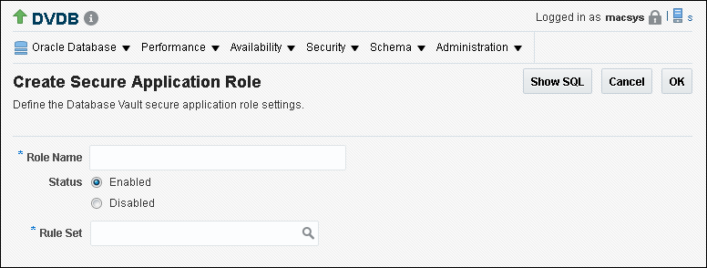

Secure application roles enable you to control how much access users have to an application.

- What Are Secure Application Roles in Oracle Database Vault?
  In Oracle Database Vault, you can create a secure application role that you enable with an Oracle Database Vault rule set.
- Creating an Oracle Database Vault Secure Application Role
  You can create a Database Vault secure application role in Database Vault Administrator.
- Enabling Oracle Database Secure Application Roles to Work with Oracle Database Vault
  You can modify an existing secure application role only if it has been created in Oracle Database Vault.
- Security for Oracle Database Vault Secure Application Roles
  Users who have database administrative privileges may try to use the `DROP ROLE` statement to delete Oracle Database Vault secure application roles.
- Deleting an Oracle Database Vault Secure Application Role
  You can delete Oracle Database Vault secure application roles in Oracle Database Vault Administrator.
- How Oracle Database Vault Secure Application Roles Work
  The process flow for an Oracle Database Vault secure application role begins after you create and set the secure application role.
- Tutorial: Granting Access with Database Vault Secure Application Roles
  This tutorial demonstrates how to create a secure application role to control user access to the `OE.ORDERS` table during work hours.
- How Secure Application Roles Affect Performance
  You can check system performance by Oracle Enterprise Manager Cloud Control.
- Secure Application Role Related Reports and Data Dictionary View
  Oracle Database Vault provides reports and a data dictionary view that you can use to analyze Oracle Database Vault secure application roles.

### 8.1 What Are Secure Application Roles in Oracle Database Vault?

In Oracle Database Vault, you can create a secure application role that you enable with an Oracle Database Vault rule set.

Regular Oracle Database secure application roles are enabled by custom PL/SQL procedures. You use secure application roles to prevent users from accessing data from outside an application. This forces users to work within the framework of the application privileges that have been granted to the role.

In a multitenant environment, you only can create a secure application role in a PDB, not in the CDB root or the application root.

The advantage of basing database access for a role on a rule set is that you can store database security policies in one central place, as opposed to storing them in all your applications. Basing the role on a rule set provides a consistent and flexible method to enforce the security policies that the role provides. In this way, if you must update the security policy for the application role, you do it in one place, the rule set. Furthermore, no matter how the user connects to the database, the result is the same, because the rule set is bound to the role. All you need to do is to create the role and then associate it with a rule set. The associated rule set validates the user who is trying to enable the role.

**Related Topics**

- [Oracle Database Vault Secure Application Role APIs](oracle-database-vault-secure-application-role-apis.md)

**Parent topic:** Configuring Secure Application Roles for Oracle Database Vault

### 8.2 Creating an Oracle Database Vault Secure Application Role

You can create a Database Vault secure application role in Database Vault Administrator.

1.  Log in to Oracle Database Vault Administrator from Cloud Control as a user who has been granted the `DV_OWNER` or `DV_ADMIN` role and the `SELECT ANY DICTIONARY` privilege. [Logging in to Oracle Database Vault from Oracle Enterprise Cloud Control](getting-started-with-oracle-database-vault.md) explains how to log in.
2.  Create a rule set that contains at least one rule to set the conditions for allowing or disallowing the user to enable the role.
    When you create the underlying rule for the rule set, remember that the rule should validate the user who is trying to enable the role.
3.  In the Administration page, under Database Vault Components, click Secure Application Roles.
4.  In the Secure Application Role page, click Create.

    
    [Description of the illustration create_secure_app_role122.png](img_text/create_secure_app_role122.md)
5.  In the Create Secure Application Role page, enter the following settings:
    - Role Name: Enter the name using no more than 30 characters, with no spaces. Ensure that this name follows the standard Oracle naming conventions for role creation using the `CREATE ROLE` statement, described in [Oracle Database SQL Language Reference](../sqlrf/CREATE-ROLE.md). This attribute is mandatory.

    - Status: Select either Enabled or Disabled to enable or disable the secure application role during run time. This attribute is mandatory.

      - Enabled: Enables the role to be available for use. That is, users are allowed to call the `DBMS_MACSEC_ROLES.SET_ROLE` function to try to enable the role. Note that whether or not the role will be enabled depends on the evaluation result of the associated rule set.

      - Disabled: Disables the role from being available for use. The `DBMS_MACSEC_ROLES.SET_ROLE` function will not be able to enable the role.

    - Rule Set: From the list, select the rule set that you want to associate with the secure application role. This attribute is mandatory.

      When calling `DBMS_MACSEC_ROLES.SET_ROLE`, if the rule set evaluates to true, then Oracle Database Vault enables the role for the database session. If the rule set evaluates to false, then the role is not enabled.
6.  Click OK.

**Related Topics**

- [Configuring Rule Sets](configuring-rule-sets.md)
- [SET_ROLE Procedure](oracle-database-vault-secure-application-role-apis.md)
- [Propagating Oracle Database Vault Configurations to Other Databases](dba-operations-in-an-oracle-database-vault-environment.md)

**Parent topic:** Configuring Secure Application Roles for Oracle Database Vault

### 8.3 Enabling Oracle Database Secure Application Roles to Work with Oracle Database Vault

You can modify an existing secure application role only if it has been created in Oracle Database Vault.

You cannot modify secure application roles or database roles that have been created outside of Oracle Database Vault. However, you can enable non-Oracle Database Vault roles to work with Oracle Database Vault.

1.  Connect to the database as a user who has been granted the `DV_OWNER` or `DV_ADMIN` role.
    For example:
        CONNECT sec_admin_owen
        Enter password: password

    In a multitenant environment, connect the PDB. For example:

        CONNECT sec_admin_owen@pdb_name
        Enter password: password

    To find the available PDBs, query the `PDB_NAME` column of the `DBA_PDBS` data dictionary view. To check the current container, run the `show con_name` command.
2.  Create a new secure application role in Oracle Database Vault and then grant the existing role to the secure application role.
    For example:
        GRANT myExistingDBrole TO myDVrole;
3.  Modify your code to use this new role.
    You can use `DBMS_MACSEC_ROLES.SET_ROLE` in your application code to accomplish this.

**Related Topics**

- [SET_ROLE Procedure](oracle-database-vault-secure-application-role-apis.md)

**Parent topic:** Configuring Secure Application Roles for Oracle Database Vault

### 8.4 Security for Oracle Database Vault Secure Application Roles

Users who have database administrative privileges may try to use the `DROP ROLE` statement to delete Oracle Database Vault secure application roles.

Whenever an Oracle Database Vault secure application role has been created, Database Vault adds the secure application role to the Oracle Database Vault realm. This prevents database administrator from deleting the secure application role using the `DROP ROLE` statement.

**Parent topic:** Configuring Secure Application Roles for Oracle Database Vault

### 8.5 Deleting an Oracle Database Vault Secure Application Role

You can delete Oracle Database Vault secure application roles in Oracle Database Vault Administrator.

1.  Log in to Oracle Database Vault Administrator from Cloud Control as a user who has been granted the `DV_OWNER` or `DV_ADMIN` role and the `SELECT ANY DICTIONARY` privilege. [Logging in to Oracle Database Vault from Oracle Enterprise Cloud Control](getting-started-with-oracle-database-vault.md) explains how to log in.
2.  If necessary, locate the various references to the secure application roles by querying the role-related Oracle Database Vault views.
3.  Check and modify any applications that may be using the secure application role that you want to delete.
4.  In the Administration page, under Database Vault Components, click Secure Application Roles.
5.  In the Secure Application Roles page, select the role that you want to remove.
6.  Click Delete.
7.  In the Confirmation window, click Yes.

**Related Topics**

- [Oracle Database Vault Data Dictionary Views](oracle-database-vault-data-dictionary-views.md)

**Parent topic:** Configuring Secure Application Roles for Oracle Database Vault

### 8.6 How Oracle Database Vault Secure Application Roles Work

The process flow for an Oracle Database Vault secure application role begins after you create and set the secure application role.

1.  Create or update the role either in Oracle Database Vault Administrator or by using the secure application role-specific functions in the `DBMS_MACADM` package.

    See [DBMS_MACADM Secure Application Role Procedures](oracle-database-vault-secure-application-role-apis.md) for more information.

2.  Modify your application to call the role, by using the `DBMS_MACSEC_ROLES.SET_ROLE` function.

    See [SET_ROLE Procedure](oracle-database-vault-secure-application-role-apis.md) for more information.

3.  Oracle Database Vault then evaluates the rule set associated with the secure application role.

    If the rule set evaluates to true, then Oracle Database Vault enables the role for the current session. If the rule set evaluates to false, the role is not enabled. In either case, Oracle Database Vault processes the associated auditing and custom event handlers for the rule set associated with the secure application role.

**Parent topic:** Configuring Secure Application Roles for Oracle Database Vault

### 8.7 Tutorial: Granting Access with Database Vault Secure Application Roles

This tutorial demonstrates how to create a secure application role to control user access to the `OE.ORDERS` table during work hours.

- About This Tutorial
  In this tutorial, you restrict the `SELECT` statement on the `ORDERS` table in the `OE` schema to a specific set of users.
- Step 1: Create Users for This Tutorial
  First, you must create users for the tutorial.
- Step 2: Enable the OE User Account
  The `OE` schema will be used for this tutorial.
- Step 3: Create the Rule Set and Its Rules
  The rule set and rules will restrict who can modify orders in the `OE.ORDERS` table.
- Step 4: Create the Database Vault Secure Application Role
  The Database Vault secure application role will be set when the rule set conditions are satisfied.
- Step 5: Grant the SELECT Privilege to the Secure Application Role
  The secure application role must be granted the `SELECT` privilege.
- Step 6: Test the Database Vault Secure Application Role
  With all the components in place, you can test the Database Vault secure application role.
- Step 7: Remove the Components for This Tutorial
  You can remove the components that you created for this tutorial if you no longer need them.

**Parent topic:** Configuring Secure Application Roles for Oracle Database Vault

#### 8.7.1 About This Tutorial

In this tutorial, you restrict the `SELECT` statement on the `ORDERS` table in the `OE` schema to a specific set of users.

Furthermore, these users can only perform these statements on the `OE.ORDERS` table from within the office, not from a remote connection. To accomplish this, you create an Oracle Database Vault secure application role that is enabled for the user only if the user passes the checks enforced by the rule set that you associate with the secure application role.

**Parent topic:** Tutorial: Granting Access with Database Vault Secure Application Roles

#### 8.7.2 Step 1: Create Users for This Tutorial

First, you must create users for the tutorial.

1.  Log in to SQL\*Plus as a user who has been granted the `DV_ACCTMGR` role.
    For example:

        sqlplus accts_admin_ace
        Enter password: password

    In a multitenant environment, you must connect to the appropriate pluggable database (PDB).

    For example:

        sqlplus accts_admin_ace@hrpdb
        Enter password: password

    To find the available PDBs, query the `DBA_PDBS` data dictionary view. To check the current PDB, run the `show con_name` command.
2.  Create the following user accounts:
        GRANT CREATE SESSION TO eabel IDENTIFIED BY password;
        GRANT CREATE SESSION TO ahutton IDENTIFIED BY password;
        GRANT CREATE SESSION TO ldoran IDENTIFIED BY password;

    Follow the guidelines in [Oracle Database Security Guide](../dbseg/configuring-authentication.md) to replace `password` with a password that is secure.

**Parent topic:** Tutorial: Granting Access with Database Vault Secure Application Roles

#### 8.7.3 Step 2: Enable the OE User Account

The `OE` schema will be used for this tutorial.

1.  In SQL\*Plus, connect as the `DV_ACCTMGR` user.
    For example:

        CONNECT accts_admin_ace -- Or, CONNECT accts_admin_ace@hrpdb
        Enter password: password
2.  Check the account status of the `OE` account.
        SELECT USERNAME, ACCOUNT_STATUS FROM DBA_USERS WHERE USERNAME = 'OE';
3.  If the `OE` account is locked and expired, unlock it and assign it a new password.
        ALTER USER OE ACCOUNT UNLOCK IDENTIFIED BY password;

**Parent topic:** Tutorial: Granting Access with Database Vault Secure Application Roles

#### 8.7.4 Step 3: Create the Rule Set and Its Rules

The rule set and rules will restrict who can modify orders in the `OE.ORDERS` table.

1.  Log in to Oracle Database Vault Administrator from Cloud Control as a user who has been granted the `DV_OWNER` or `DV_ADMIN` role and the `SELECT ANY DICTIONARY` privilege. [Logging in to Oracle Database Vault from Oracle Enterprise Cloud Control](getting-started-with-oracle-database-vault.md) explains how to log in.
2.  In the Administration page, select Rule Sets.
    The Rule Sets page appears.
3.  Click Create.
    The Create Rule Set page appears.
4.  Enter the following information:
    - Name: Enter `Can Modify Orders`.

    - Description: Enter `Rule set to control who can modify orders in the OE.ORDERS table`.

    - Status: Select Enabled.

    - Evaluation Options: Select All True.
5.  Leave the remaining settings and their defaults, and then click Next to go to the Associate with Rules page.
6.  Click Create Rule and in the Create Rule dialog box, enter the following settings:
    - Name: `Check IP Address`

    - Expression: `DVF.F$CLIENT_IP = '``your_IP_address``'`

    For the Check IP Address rule, replace `your_IP_address` with the IP address for your computer. In a real-world scenario, you would create an expression that includes all the IP addresses for the users who should be allowed access.

    This rule uses the default factor Client_IP. If this factor has been removed, then you can use the following rule expression instead:

        UPPER(SYS_CONTEXT('USERENV','IP_ADDRESS')) = 'your_IP_address'
7.  Click OK.
8.  Click Create Rule again and in the Create Rule dialog box, enter the following settings:
    - Name: `Check Session User`

    - Expression: `DVF.F$SESSION_USER IN ('EABEL','AHUTTON')`

    This rule uses the default factor Session_User. If this factor have been removed or modified, you can use the following rule expression instead:

        UPPER(SYS_CONTEXT('USERENV','SESSION_USER')) IN ('EABEL','AHUTTON')
9.  Click OK.
10. Click Done, then click Finish.

**Parent topic:** Tutorial: Granting Access with Database Vault Secure Application Roles

#### 8.7.5 Step 4: Create the Database Vault Secure Application Role

The Database Vault secure application role will be set when the rule set conditions are satisfied.

1.  In Oracle Database Vault, return to the Administration page.
2.  Under Administration, select Secure Application Roles.
    The Secure Application Roles page appears.
3.  Click Create.
    The Create Role page appears.
4.  In the Role box, enter `ORDERS_MGMT` to name the role.
5.  Under Rule Set, select Can Modify Orders.
6.  Click OK.

At this stage, the Database Vault secure application role and its associated rule set are created, though the role does not yet have any privileges.

**Parent topic:** Tutorial: Granting Access with Database Vault Secure Application Roles

#### 8.7.6 Step 5: Grant the SELECT Privilege to the Secure Application Role

The secure application role must be granted the `SELECT` privilege.

1.  In SQL\*Plus, connect as user `OE`.
        CONNECT OE -- Or, CONNECT OE@hrpdb
        Enter password: password
2.  Grant the `SELECT` privilege to the `ORDERS_MGMT` Database Vault Secure application role.
        GRANT SELECT ON ORDERS TO ORDERS_MGMT;

**Parent topic:** Tutorial: Granting Access with Database Vault Secure Application Roles

#### 8.7.7 Step 6: Test the Database Vault Secure Application Role

With all the components in place, you can test the Database Vault secure application role.

1.  In SQL\*Plus, connect directly to the database as user `eabel`.
        connect eabel@orcl
        Enter password: password

    Replace `orcl` with the name of your database instance.
2.  Set the `ORDERS_MGMT` role.
        EXEC DBMS_MACSEC_ROLES.SET_ROLE('ORDERS_MGMT');

    Typically, you would embed this call in the application that the user logs in to.
3.  Select from the `OE.ORDERS` table.
        SELECT COUNT(*) FROM OE.ORDERS;

    The following output should appear:

          COUNT(*)
        ----------
               105

    Because user `eabel` is logging directly into the database from the correct IP address and is listed as a valid session user, she can select from the `OE.ORDERS` table. If user `ahutton` logs in to SQL\*Plus in the same manner, she also can select from the `OE.ORDERS` table.
4.  Reconnect as user `eabel` without specifying the database instance, and then try to select from the `OE.ORDERS` table again.
        CONNECT eabel
        Enter password: password

        EXEC DBMS_MACSEC_ROLES.SET_ROLE('ORDERS_MGMT');

    The following output should appear:

        Error at line 1:
        ORA-47305: Rule Set Violation on SET ROLE (Can Modfiy Orders)
        ...

    Next:

        SELECT COUNT(*) FROM OE.ORDERS;

    The following output should appear:

        ERROR at line 1:
        ORA-00942: table or view does not exist

    Even though user `eabel` is a valid user, she has violated the Check IP Address rule in the rule set, so she cannot enable the `ORDERS_MGMT` role. The only way for the IP address to be recognized is to connect by specifying the database instance, as user `eabel` did in Step 1. (For an explanation about how this works, see Step [9](configuring-factors.md) in [Step 3: Map the Domain Factor Identities to the Client_IP Factor](configuring-factors.md), in [Configuring Factors](configuring-factors.md).)
5.  Connect as user `ldoran`.
        CONNECT ldoran -- Or, CONNECT ldoran@hrpdb
        Enter password: password
6.  Enter the following statements:
        EXEC DBMS_MACSEC_ROLES.SET_ROLE('ORDERS_MGMT');
        SELECT COUNT(*) FROM OE.ORDERS;

    Because user `ldoran` is not a valid user, she cannot enable the `ORDERS_MGMT` role. Therefore, she cannot select from the `OE.ORDERS` table.

**Parent topic:** Tutorial: Granting Access with Database Vault Secure Application Roles

#### 8.7.8 Step 7: Remove the Components for This Tutorial

You can remove the components that you created for this tutorial if you no longer need them.

1.  Log in to Oracle Database Vault Administrator from Cloud Control as a user who has been granted the `DV_OWNER` or `DV_ADMIN` role and the `SELECT ANY DICTIONARY` privilege. [Logging in to Oracle Database Vault from Oracle Enterprise Cloud Control](getting-started-with-oracle-database-vault.md) explains how to log in.
2.  Delete the `ORDERS_MGMT` secure application role: From the Secure Application Roles page, select the `ORDERS_MGMT` secure application role, and then click Delete, and then Yes in the Confirmation dialog box.
3.  Select the Rule Sets page, select the Can Modify Orders rule set, and then click Delete.
4.  In the Confirmation dialog box, select Yes to remove the rule set.
5.  Select the Rules page, select the Check IP Address and Check Session User rules, and then select Delete. Select Yes in the Confirmation box.
    Hold the Control key down to select multiple rules.
6.  In SQL\*Plus, connect as the Database Vault Account Manager and drop the users.
    For example:

        CONNECT bea_dvacctmgr -- Or, CONNECT bea_dvacctmgr@hrpdb
        Enter password: password

        DROP USER eabel;
        DROP USER ahutton;
        DROP USER ldoran;
7.  If unnecessary, lock and expire the `OE` user account.
        ALTER USER OE ACCOUNT LOCK PASSWORD EXPIRE;

**Parent topic:** Tutorial: Granting Access with Database Vault Secure Application Roles

### 8.8 How Secure Application Roles Affect Performance

You can check system performance by Oracle Enterprise Manager Cloud Control.

Other tools that you can use are Automatic Workload Repository (AWR) and `TKPROF`.

**See Also:**

- [Oracle Database Performance Tuning Guide](../tgdba/performance-tuning-overview.md) to learn how to monitor database performance

- [Oracle Database SQL Tuning Guide](../tgsql/performing-application-tracing.md) to monitor the performance of individual SQL and PL/SQL statements

**Parent topic:** Configuring Secure Application Roles for Oracle Database Vault

### 8.9 Secure Application Role Related Reports and Data Dictionary View

Oracle Database Vault provides reports and a data dictionary view that you can use to analyze Oracle Database Vault secure application roles.

Table 8-1 lists the Oracle Database Vault reports. See [Oracle Database Vault Reports](oracle-database-vault-reports.md) for information about how to run these reports.

Table 8-1 Reports Related to Secure Application Roles

| Report                                                                             | Description                                                                                                                                                                                                 |
|:-----------------------------------------------------------------------------------|:------------------------------------------------------------------------------------------------------------------------------------------------------------------------------------------------------------|
| [Secure Application Role Audit Report](oracle-database-vault-reports.md)           | Lists audit records generated by the Oracle Database Vault secure application role-enabling operation. To generate this type of audit record, enable auditing for the rule set associated with the role. |
| [Secure Application Configuration Issues Report](oracle-database-vault-reports.md) | Lists secure application roles that have nonexistent database roles, or incomplete or disabled rule sets                                                                                                    |
| [Rule Set Configuration Issues Report](oracle-database-vault-reports.md)           | Lists rule sets that have no rules defined or enabled, which may affect the secure application roles that use them                                                                                          |
| [Powerful Database Accounts and Roles Reports](oracle-database-vault-reports.md)   | Provides information about powerful database accounts and roles                                                                                                                                             |

You can use the `DBA_DV_ROLE` data dictionary view to find the Oracle Database Vault secure application roles used in privilege management. See [DBA_DV_ROLE View](oracle-database-vault-data-dictionary-views.md) for more information.

**Parent topic:** Configuring Secure Application Roles for Oracle Database Vault
