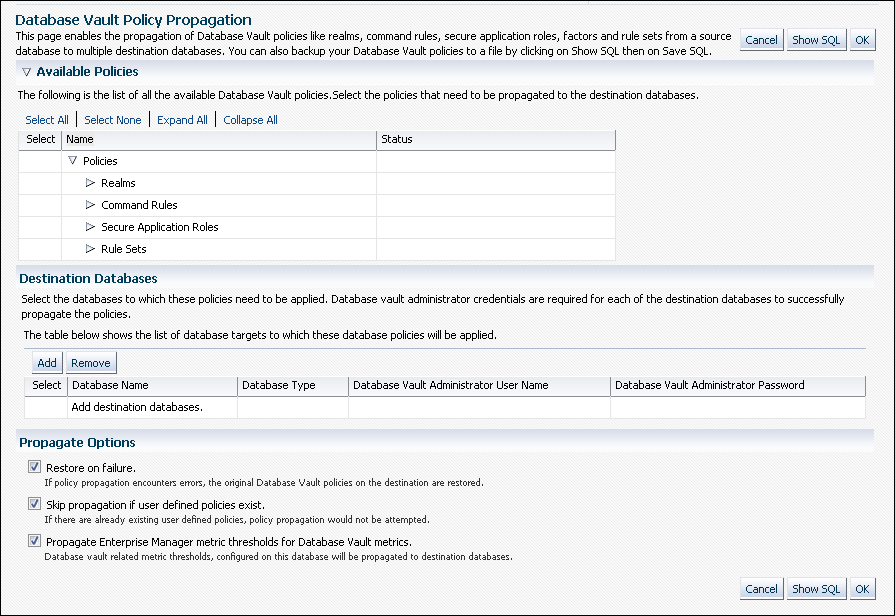

Database administrators can perform operations in an Oracle Database Vault environment, such as using Database Vault with products such as Oracle Data Pump.

- Handling Role Grants in Oracle Database Vault
  Oracle Database Vault protects default roles such as `RESOURCE`, `DBA`, `AUDIT_ADMIN`, and `PDB_DBA`, which are created when you install Oracle Database. This feature protects the system and object privileges that are granted to these roles
- Performing DDL Operations in Oracle Database Vault
  Data Definition Language (DDL) operations in Oracle Database Vault can be affected by situations such as schema ownership and patch upgrades.
- Using Oracle Database Vault with Oracle Enterprise Manager
  Oracle Database Vault administrators can perform tasks in Oracle Enterprise Manager Cloud Control such as propagating polices to other databases.
- Using Oracle Data Pump with Oracle Database Vault
  Database administrators can authorize Oracle Data Pump users to work in a Database Vault environment.
- Using Oracle Scheduler with Oracle Database Vault
  Users who are responsible for scheduling database jobs must have Oracle Database Vault-specific authorization.
- Using Information Lifecycle Management with Oracle Database Vault
  Users who perform Information Lifecycle Management operations on an Oracle Database Vault-enabled database must be granted authorization to perform these operations.
- Using Oracle Database Replay with Oracle Database Vault
  Database administrators can authorize Oracle Database Replay users to work in a Database Vault environment.
- Executing Preprocessor Programs with Oracle Database Vault
  Users who execute preprocessor programs through external tables must have Oracle Database Vault-specific authorization.
- Using Database Vault Operations Control to Restrict Multitenant Common User Access to Local PDB Data
  You can control PDB access by CDB root common users, such as infrastructure database administrators.
- Oracle Recovery Manager and Oracle Database Vault
  You can use Recovery Manager (RMAN) in an Oracle Database Vault environment.
- Privileges for Using XStream with Oracle Database Vault
  If you want to use XStream in an Oracle Database Vault environment, then you must have the appropriate privileges.
- Privileges for Using Oracle GoldenGate with Oracle Database Vault
  If you want to use Oracle GoldenGate in an Oracle Database Vault environment, then you must have the appropriate privileges.
- Using Data Masking in an Oracle Database Vault Environment
  You must have the correct authorization to perform data masking in an Oracle Database Vault environment.
- Converting a Standalone Oracle Database to a PDB and Plugging It into a CDB
  You can convert a standalone Oracle Database Release 12c or later database to a PDB, and then plug this PDB into a CDB.
- Using the ORADEBUG Utility with Oracle Database Vault
  The `ORADEBUG` utility is used primarily by Oracle Support to diagnose problems that may arise with an Oracle database.
- Performing Patch Operations in an Oracle Database Vault Environment
  User `SYS` must have the `DV_PATCH_ADMIN` role to perform a patch operations on an Oracle Database Vault-enabled database.

### 12.1 Handling Role Grants in Oracle Database Vault

Oracle Database Vault protects default roles such as `RESOURCE`, `DBA`, `AUDIT_ADMIN`, and `PDB_DBA`, which are created when you install Oracle Database. This feature protects the system and object privileges that are granted to these roles

- Identifying Roles That Are Protected by a Realm
  As a user who has been granted the `DV_OWNER` or `DV_ADMIN` role, you can identify which roles are protected by which realm.
- Identifying Roles That Are Not Protected by a Realm
  As a user who has been granted the `DV_OWNER` or `DV_ADMIN` role, you can identify which roles are not protected by realms.
- Handling Protected Role Grants for Named Users
  If you are using named accounts, which Oracle recommends, and you must grant a protected role to another user, then you must authorize each named account by adding it to the appropriate realm as a realm owner.
- Identifying Realms and Roles Protected by a Realm to Which SYS Has Authorization
  As a user who has been granted the `DV_OWNER` or `DV_ADMIN` role, you can identify the Oracle Database Vault realms and roles that are protected by a realm to which `SYS` has authorization.

**Parent topic:** DBA Operations in an Oracle Database Vault Environment

#### 12.1.1 Identifying Roles That Are Protected by a Realm

As a user who has been granted the `DV_OWNER` or `DV_ADMIN` role, you can identify which roles are protected by which realm.

Perform the following query:

    COLUMN "ROLE PROTECTED BY A DV REALM" FORMAT A35
    SELECT REALM_NAME, OBJECT_NAME
    AS "ROLE PROTECTED BY A DV REALM"
    FROM DBA_DV_REALM_OBJECT
    WHERE OBJECT_TYPE = 'ROLE'
    ORDER BY 1, 2;

**Parent topic:** Handling Role Grants in Oracle Database Vault

#### 12.1.2 Identifying Roles That Are Not Protected by a Realm

As a user who has been granted the `DV_OWNER` or `DV_ADMIN` role, you can identify which roles are not protected by realms.

Perform the following query:

    COLUMN "ROLE NOT PROTECTED BY A DV REALM" FORMAT A40
    SELECT ROLE AS "ROLE NOT PROTECTED BY A DV REALM"
    FROM DBA_ROLES
    WHERE ROLE NOT IN (SELECT OBJECT_NAME FROM DBA_DV_REALM_OBJECT WHERE OBJECT_TYPE = 'ROLE')
    ORDER BY 1;

**Parent topic:** Handling Role Grants in Oracle Database Vault

#### 12.1.3 Handling Protected Role Grants for Named Users

If you are using named accounts, which Oracle recommends, and you must grant a protected role to another user, then you must authorize each named account by adding it to the appropriate realm as a realm owner.

For example, if `dba_debra` wants to grant the `PDB_DBA` role to `dba_harvey`, then the following error will occur if the realm authorizations are not in place for `dba_debra`:

    GRANT PDB_DBA TO DBA_HARVEY;

    ERROR at line 1: ORA-47410: Insufficient realm privileges to GRANT on PDB_DBA.

As a user with the `DV_OWNER` or `DV_ADMIN` role, identify the Database Vault realm that is protecting the `PDB_DBA` role by performing the following query. This example uses the `PDB_DBA` role in its query.

    SELECT REALM_NAME FROM DBA_DV_REALM_OBJECT
    WHERE OBJECT_NAME = 'PDB_DBA' AND OBJECT_TYPE = 'ROLE';

Output similar to the following appears:

    REALM_NAME
    --------------------------------------------------
    Oracle System Privilege and Role Management Realm

As that same user, add `dba_debra` to the `Oracle System Privilege and Role Management Realm` as an owner.

    BEGIN
      DBMS_MACADM.ADD_AUTH_TO_REALM (
       REALM_NAME    => 'Oracle System Privilege and Role Management Realm',
       GRANTEE       => 'DBA_DEBRA',
       RULE_SET_NAME => NULL,
       AUTH_OPTIONS  => DBMS_MACUTL.G_REALM_AUTH_OWNER);
    END;
    /

Now, when `dba_debra` attempts to grant the `PDB_DBA` role to another user, the role grant will succeed:

    GRANT PDB_DBA TO DBA_HARVEY;

    Grant succeeded.

To revoke the authorization from `dba_debra`:

    BEGIN
      DBMS_MACADM.DELETE_AUTH_FROM_REALM (
       REALM_NAME   => 'Oracle System Privilege and Role Management Realm',
       GRANTEE      => 'DBA_DEBRA');
    END;
    /

Note that `SYS` has been granted owner authorization on many of the default Database Vault realms. You can use `SYS` to perform the `GRANT` commands. Oracle recommends that you create named accounts (for example, `pfitch`, `cabramowitz`) for each user instead of relying on shared accounts such as `SYS` or `SYSTEM`. Named users will also make it easier to identify who performed an action in the Oracle database.

**Parent topic:** Handling Role Grants in Oracle Database Vault

#### 12.1.4 Identifying Realms and Roles Protected by a Realm to Which SYS Has Authorization

As a user who has been granted the `DV_OWNER` or `DV_ADMIN` role, you can identify the Oracle Database Vault realms and roles that are protected by a realm to which `SYS` has authorization.

Perform the following query:

    SELECT REALM_NAME, OBJECT_NAME
    FROM DBA_DV_REALM_OBJECT
    WHERE OBJECT_TYPE = 'ROLE' AND REALM_NAME IN (SELECT REALM_NAME FROM DBA_DV_REALM_AUTH WHERE GRANTEE = 'SYS')
    ORDER BY 1,2;

To identify only the realms, you can perform a query similar to the following:

    SELECT DISTINCT REALM_NAME
    FROM DBA_DV_REALM_OBJECT
    WHERE OBJECT_TYPE = 'ROLE' AND REALM_NAME IN (SELECT REALM_NAME FROM DBA_DV_REALM_AUTH WHERE GRANTEE = 'SYS')
    ORDER BY 1;

To identify the realms in that `SYS` does not have authorization for, you can perfrom a query similar to the following:

    SELECT DISTINCT REALM_NAME
    FROM DBA_DV_REALM_OBJECT
    WHERE OBJECT_TYPE = 'ROLE' AND REALM_NAME NOT IN (SELECT REALM_NAME FROM DBA_DV_REALM_AUTH WHERE GRANTEE = 'SYS')
    ORDER BY 1;

**Parent topic:** Handling Role Grants in Oracle Database Vault

### 12.2 Performing DDL Operations in Oracle Database Vault

Data Definition Language (DDL) operations in Oracle Database Vault can be affected by situations such as schema ownership and patch upgrades.

- Restrictions on Performing DDL Operations in Oracle Database Vault
  Depending on the Oracle Database Vault configuration, DDL operations may be restricted and require DDL authorizations in an Oracle Database Vault environment.
- Impact of the DV_PATCH_ADMIN Role on DDL Operations
  Object owners and users who have been granted the `DV_PATCH_ADMIN` role are exempt from the DDL authorization requirement.

**Parent topic:** DBA Operations in an Oracle Database Vault Environment

#### 12.2.1 Restrictions on Performing DDL Operations in Oracle Database Vault

Depending on the Oracle Database Vault configuration, DDL operations may be restricted and require DDL authorizations in an Oracle Database Vault environment.

Specifically, a user is required to have DDL authorization to perform DDL operations on a schema that has any of the following characteristics:

- The schema is an owner of objects that are protected by enabled realms.
- The schema is authorized to any enabled realm directly or through roles.
- The schema is granted object privileges directly or through roles on objects that are protected by enabled realms.
- The schema is granted any Oracle Database Vault roles directly or through roles.

Object owners and users who have granted the `DV_PATCH_ADMIN` role are exempt from the DDL authorization requirement. You can authorize a user to perform DDL operations on a specific schema by using the `DBMS_MACADM.AUTHORIZE_DDL` procedure. Note, however, that DDL authorization does not enable the grantee to perform DDL operations on a realm protected object or schema. To enable such operations, you must authorize the user to the realm. To find information about users who have been granted this authorization, query the `DBA_DV_DDL_AUTH` data dictionary view.

If Oracle Database Vault is upgraded from a previous release older than Oracle Database 21c, then the default DDL authorization of (`%`, `%`) may exist, and it would enable users to perform DDL operations on any schema without explicit DDL authorizations. For better security, Oracle recommends that you remove the default DDL authorization by running `DBMS_MACADM.UNAUTHORIZE_DDL('%', '%')` and grant required DDL authorizations only to users who need to perform DDL operations.

**Related Topics**

- [AUTHORIZE_DDL Procedure](oracle-database-vault-general-administrative-apis.md)

**Parent topic:** Performing DDL Operations in Oracle Database Vault

#### 12.2.2 Impact of the DV_PATCH_ADMIN Role on DDL Operations

Object owners and users who have been granted the `DV_PATCH_ADMIN` role are exempt from the DDL authorization requirement.

You can authorize a user to perform DDL operations on a specific schema by using the `DBMS_MACADM.AUTHORIZE_DDL` procedure. Note, however, that DDL authorization does not allow the grantee to perform DDL operations on a realm-protected object or schema. To allow such operations, you must authorize the user for the realm. To find information about users who have been granted this authorization, query the `DBA_DV_DDL_AUTH` data dictionary view.

**Related Topics**

- [AUTHORIZE_DDL Procedure](oracle-database-vault-general-administrative-apis.md)

**Parent topic:** Performing DDL Operations in Oracle Database Vault

### 12.3 Using Oracle Database Vault with Oracle Enterprise Manager

Oracle Database Vault administrators can perform tasks in Oracle Enterprise Manager Cloud Control such as propagating polices to other databases.

- Propagating Oracle Database Vault Configurations to Other Databases
  You can propagate Database Vault configurations (such as a realm configuration) to other Database Vault-protected databases.
- Enterprise Manager Cloud Control Alerts for Oracle Database Vault Policies
  To view Oracle Database Vault alerts, you must be granted the `DV_OWNER`, `DV_ADMIN`, or `DV_SECANALYST` role.
- Oracle Database Vault-Specific Reports in Enterprise Manager Cloud Control
  From the Database Vault home page, you can find information about violations.

**Parent topic:** DBA Operations in an Oracle Database Vault Environment

#### 12.3.1 Propagating Oracle Database Vault Configurations to Other Databases

You can propagate Database Vault configurations (such as a realm configuration) to other Database Vault-protected databases.

1.  Log in to Oracle Database Vault Administrator from Cloud Control as a user who has been granted the `DV_OWNER` or `DV_ADMIN` role and the `SELECT ANY DICTIONARY` privilege. [Logging in to Oracle Database Vault from Oracle Enterprise Cloud Control](getting-started-with-oracle-database-vault.md) explains how to log in.

2.  In the Database Vault home page, under Database Vault Policy Propagation, select Database Vault Policy Propagation.

    The Available Policies area in the Policy Propagation subpage lists a summary of the Oracle Database Vault configurations that were created for the current database: that is, configurations that were created for realms, command rules, rule sets, and secure application roles. It does not list the Oracle Database Vault policies that were introduced in Oracle Database release 12c (12.2). From here, you can propagate these configurations to another database.

3.  Under Available Policies, select each configuration that you want to propagate to another database.

    
    [Description of the illustration policy_propagation122.png](img_text/policy_propagation122.md)

4.  Under Destination Databases, click the Add button.

5.  Under Search and Select: Database Vault Enabled Destination Databases, search for the destination databases, and then select each database to which you want to propagate the configurations. Then click the Select button.

6.  Under Destination Databases, do the following:

    1.  Under Apply credentials across destination database(s), enter the user name and password of the administrator of the Database Vault database that contains the configurations you want to propagate.

        This feature applies the Database Vault administrator's user name and password to all of the selected destination databases.

    2.  Select each database to which you want to propagate the configurations.

    3.  Enter the Database Vault administrator user name and password for each database.

    4.  Click the Apply button.

7.  In the Propagate Options page, select from the following options.

    Any changes made to the seeded realms, command rules, rule sets, and so on will not be propagated to the destination databases. Only custom-created data are propagated.

    - Restore on failure: If the propagation operations encounters errors, then the propagation is rolled back. That is, the original policies on the destination database are restored. If you do not select this option, then the policy propagation on the destination database continues and ignores any errors.

    - Skip propagation if user defined policies exist: If the destination databases already have the user-defined configurations, then the propagation operation is not attempted. If you do not select this option, then regardless of whether user-defined policies exist on the destination database, all the existing configurations are cleared, and the configurations from the source database are applied to the destination database.

    - Propagate Enterprise Manager metric thresholds for database vault metrics: If the source database has Oracle Database Vault metric thresholds set, then these thresholds are also propagated to the destination databases. If you do not select this option, then only configurations are propagated and not the Oracle Database Vault thresholds.

8.  Click the OK button.

9.  In the Confirmation window, click OK.

    A message indicating success or failure appears. If the propagation succeeds, then the configurations are active right away in their destination databases.

**Parent topic:** Using Oracle Database Vault with Oracle Enterprise Manager

#### 12.3.2 Enterprise Manager Cloud Control Alerts for Oracle Database Vault Policies

To view Oracle Database Vault alerts, you must be granted the `DV_OWNER`, `DV_ADMIN`, or `DV_SECANALYST` role.

The alerts are as follows:

- Database Vault Attempted Realm Violations. This alert helps the Oracle Database Vault security analyst (`DV_SECANALYST` role) to monitor violation attempts on the Database Vault database. This user can select the realms to be affected by the alert and filter these realms based on the different types of attempts by using error codes. You can enable this metric from the Metrics and Policy Settings page. By default, the attempted realm violations are collected every 24 hours.

- Database Vault Attempted Command Rule Violations. The functionality for this alert is the same as for Database Vault Attempted Realm Violations, except that it focuses on violations on command rules.

- Database Vault Realm Configuration Issues. This metric tracks and raises an alert if users misconfigure realms. This metric is enabled when you install Oracle Database vault, and by default it collects data every one hour.

- Database Vault Command Rule Configuration Issues. This functionality for this alert is that same as Database Vault Realm Configuration Issues, except that it focuses on configuration changes to command rules.

- Database Vault Policy Changes. This metric raises an alert on any change to any Database Vault policy, such as policies for realms and command rules. It provides a detailed policy changes report.

**Parent topic:** Using Oracle Database Vault with Oracle Enterprise Manager

#### 12.3.3 Oracle Database Vault-Specific Reports in Enterprise Manager Cloud Control

From the Database Vault home page, you can find information about violations.

These violations are as follows:

- Top five attempted violations on realm and command rule

- Top five attempted violations by database users and client host

- Time series-based graphical reports on attempted violations for more detailed analysis

To have full access to the Database Vault reports, you must log into Database Vault Administrator as a user who has been granted the `DV_OWNER`, `DV_ADMIN`, or `DV_SECANALYST` role.

**Related Topics**

- [Oracle Database Vault Reports](oracle-database-vault-reports.md)

**Parent topic:** Using Oracle Database Vault with Oracle Enterprise Manager

### 12.4 Using Oracle Data Pump with Oracle Database Vault

Database administrators can authorize Oracle Data Pump users to work in a Database Vault environment.

- About Using Oracle Data Pump with Oracle Database Vault
  Oracle Data Pump is used to unload data and metadata into a set of operating system files and dump files. Oracle Database Vault enables you to control which privileged users are authorized to perform Data Pump imports or exports.
- Authorizing Users or Roles for Data Pump Regular Export and Import Operations
  You can use different authorization types for administrators who perform Oracle Data Pump export and import operations in a Database Vault environment.
- Authorizing Users or Roles for Data Pump Transportable Export and Import Operations
  You can grant authorization levels for users who must perform Oracle Data Pump transportable operations, either directly or through a role.
- Guidelines for Exporting or Importing Data in a Database Vault Environment
  After you grant the Oracle Data Pump database administrator the proper authorization, this user can perform any export or import operations that are necessary.

**Parent topic:** DBA Operations in an Oracle Database Vault Environment

#### 12.4.1 About Using Oracle Data Pump with Oracle Database Vault

Oracle Data Pump is used to unload data and metadata into a set of operating system files and dump files. Oracle Database Vault enables you to control which privileged users are authorized to perform Data Pump imports or exports.

This type of user must have Database Vault privileges in addition to the standard Oracle Data Pump privileges. If these users want to perform Oracle Data Pump transportable tablespace operations, then they must have special authorization. You can check a user's authorizations for using Data Pump in an Oracle Database Vault environment by querying the `DBA_DV_DATAPUMP_AUTH` data dictionary view. You can grant this authorization to either individual users or to database roles.

**Parent topic:** Using Oracle Data Pump with Oracle Database Vault

#### 12.4.2 Authorizing Users or Roles for Data Pump Regular Export and Import Operations

You can use different authorization types for administrators who perform Oracle Data Pump export and import operations in a Database Vault environment.

- About Authorizing Users or Roles for Oracle Data Pump Regular Operations
  Users who have Oracle Data Pump authorization can perform regular Oracle Data Pump operations in a Database Vault environment.
- Levels of Database Vault Authorization for Oracle Data Pump Regular Operations
  Oracle Database Vault provides several levels of authorization required for Oracle Data Pump regular operations in a Database Vault environment.
- Authorizing Users or Roles for Oracle Data Pump Regular Operations in Database Vault
  You can authorize a database administrator or a role to use Data Pump for regular operations in an Oracle Database Vault environment.
- Revoking Oracle Data Pump Authorization from Users or Roles
  You can revoke authorization from the database administrator or role who is using Oracle Data Pump for regular operations.

**Parent topic:** Using Oracle Data Pump with Oracle Database Vault

##### 12.4.2.1 About Authorizing Users or Roles for Oracle Data Pump Regular Operations

Users who have Oracle Data Pump authorization can perform regular Oracle Data Pump operations in a Database Vault environment.

You can perform the following types of Oracle Data Pump authorizations:

- Authorizing the user or role to be able to import protected schemas and objects
- Authorizing the user or role to be able to perform following activities that can take place during the import operation: the creation of users, the grant of Oracle Database Vault-protected roles and system privileges, the grant of specific Oracle Database roles, and the grant of Oracle Database system privileges

**Note:**

Full level Data Pump authorization enables these users to perform transportable export and import operations as well.

**Related Topics**

- Authorizing Users or Roles for Data Pump Transportable Export and Import Operations

**Parent topic:** Authorizing Users or Roles for Data Pump Regular Export and Import Operations

##### 12.4.2.2 Levels of Database Vault Authorization for Oracle Data Pump Regular Operations

Oracle Database Vault provides several levels of authorization required for Oracle Data Pump regular operations in a Database Vault environment.

Table 12-1 describes these levels.

Table 12-1 Levels of Authorization for Oracle Data Pump Regular Operations

| Scenario                                                                                                   | Authorization Required                                                                                                                                                                                                                                                                                                                                                                                                                                                                         |
|:-----------------------------------------------------------------------------------------------------------|:-----------------------------------------------------------------------------------------------------------------------------------------------------------------------------------------------------------------------------------------------------------------------------------------------------------------------------------------------------------------------------------------------------------------------------------------------------------------------------------------------|
| A database administrator wants to import data into another schema.                                         | You must grant this user (or a role) the `BECOME USER` system privilege and the `IMP_FULL_DATABASE` role.Foot 1 To find the privileges a user has been granted, query the `USER_SYS_PRIVS` data dictionary view.                                                                                                                                                                                                                                                                    |
| A database administrator wants to export or import data in a schema that has no Database Vault protection. | You only need to grant this user (or a role) the standard Oracle Data Pump privileges, which are the `EXP_FULL_DATABASE` and `IMP_FULL_DATABASE` roles. If the user wants to import data, grant this user the `BECOME USER` system privilege.                                                                                                                                                                                                                                                  |
| A database administrator wants to export or import data in a protected schema.                             | In addition to the `EXP_FULL_DATABASE` and `IMP_FULL_DATABASE` roles, you must grant this user (or a role) Database Vault-specific authorization by using the `DBMS_MACADM.AUTHORIZE_DATAPUMP_USER` procedure. This authorization applies to both the `EXPDP` and `IMPDP` utilities. Later on, you can revoke this authorization by using the `DBMS_MACADM.UNAUTHORIZE_DATAPUMP_USER` procedure. If the user wants to import data, also grant this user the `BECOME USER` system privilege. |
| A database administrator wants to export or import the contents of an entire database.                     | In addition to the `EXP_FULL_DATABASE` and `IMP_FULL_DATABASE` roles and the authorization granted by the `DBMS_MACADM.AUTHORIZE_DATAPUMP_USER` procedure, you must grant this user (or a role) the `DV_OWNER` role. If the user wants to import data, grant this user the `BECOME USER` system privilege.                                                                                                                                                                                     |

Footnote 1

The `BECOME USER` privilege is part of the `IMP_FULL_DATABASE` role by default, but in an Oracle Database Vault environment, this privilege is revoked.

**Parent topic:** Authorizing Users or Roles for Data Pump Regular Export and Import Operations

##### 12.4.2.3 Authorizing Users or Roles for Oracle Data Pump Regular Operations in Database Vault

You can authorize a database administrator or a role to use Data Pump for regular operations in an Oracle Database Vault environment.

1.  Log into the database instance as a user who has been granted the `DV_OWNER` or `DV_ADMIN` role.
2.  Ensure that the user or role to whom you want to grant authorization has been granted the `EXP_FULL_DATABASE` and `IMP_FULL_DATABASE` roles, which are required for using Oracle Data Pump.
        SELECT GRANTEE, GRANTED_ROLE FROM DBA_ROLE_PRIVS WHERE GRANTED_ROLE LIKE '%FULL%';
3.  Grant this user or role Oracle Database Vault authorization to import protected schemas and objects.
    For example, to authorize the Data Pump user `DP_MGR` to export and import objects for the database table `EMPLOYEES`:

        EXEC DBMS_MACADM.AUTHORIZE_DATAPUMP_USER('DP_MGR', 'HR', 'EMPLOYEES');

    To restrict `DP_MGR`'s activities to a specific schema, you would enter the following procedure:

        EXEC DBMS_MACADM.AUTHORIZE_DATAPUMP_USER('DP_MGR', 'HR');

    To authorize users who have been granted the `DP_MGR_ROLE` role to export and import objects for the entire database, enter the following:

        EXEC DBMS_MACADM.AUTHORIZE_DATAPUMP_USER('DP_MGR_ROLE');

    After you run the `DBMS_MACADM.AUTHORIZE_DATAPUMP_USER` procedure, you can check the authorization of the user or role by querying the `DBA_DV_DATAPUMP_AUTH` data dictionary view.

    If you granted the user or role full authorization (using `%` for the `schema`, `object`, `type`, and `action` parameters), then you can bypass the next step. However, if the authorization is only for a specific schema (for example, `schema` is set to `HR` and the remaining parameters are still set to `%`), then you must perform the next step.
4.  If necessary, grant the user or role authorization to perform the following activities during the import operation:
    1.  Creating users during the import. For example:
            EXEC DBMS_MACADM.AUTH_DATAPUMP_CREATE_USER('DP_MGR');
    2.  Granting Oracle Database Vault-protected roles and system privileges during the import. For example:
            EXEC DBMS_MACADM.AUTH_DATAPUMP_GRANT('DP_MGR');
    3.  Granting a specific role during the import. For example:
            EXEC DBMS_MACADM.AUTH_DATAPUMP_GRANT_ROLE('DP_MGR', 'DBA');
    4.  Granting system privileges during the import. For example:
            EXEC DBMS_MACADM.AUTH_DATAPUMP_GRANT_SYSPRIV('DP_MGR');
5.  If the user or role must export the entire database, then grant them the `DV_OWNER` role.
    For example, for a role:
        GRANT DV_OWNER TO DP_MGR_ROLE;

**Related Topics**

- [AUTHORIZE_DATAPUMP_USER Procedure](oracle-database-vault-general-administrative-apis.md)
- [DBA_DV_DATAPUMP_AUTH View](oracle-database-vault-data-dictionary-views.md)

**Parent topic:** Authorizing Users or Roles for Data Pump Regular Export and Import Operations

##### 12.4.2.4 Revoking Oracle Data Pump Authorization from Users or Roles

You can revoke authorization from the database administrator or role who is using Oracle Data Pump for regular operations.

1.  If you granted the user or role the `DV_OWNER` role, then optionally revoke the `DV_OWNER` role.
        REVOKE DV_OWNER FROM DP_MGR;
2.  Query the `DBA_DV_DATAPUMP_AUTH` data dictionary view to find the users or roles that have been granted Oracle Data Pump authorizations.
        SELECT GRANTEE, SCHEMA, OBJECT FROM DBA_DV_DATAPUMP_AUTH;
3.  Use the information you gathered from the preceding step to build the `DBMS_MACADM.UNAUTHORIZE_DATAPUMP_USER` command.
    For example:

        EXEC DBMS_MACADM.UNAUTHORIZE_DATAPUMP_USER('DP_MGR', 'HR', 'EMPLOYEES');

    Ensure that this unauthorization complements the original authorization action. In other words, if you originally gave `DP_MGR` authorization over the entire database, then the following commands will not work:

        EXEC DBMS_MACADM.UNAUTHORIZE_DATAPUMP_USER('DP_MGR', 'HR');
        EXEC DBMS_MACADM.UNAUTHORIZE_DATAPUMP_USER('DP_MGR', 'HR', 'EMPLOYEES');
4.  If you authorized the user or role to perform user creation or other activities during the import operation, then revoke these.
    For example:
        EXEC DBMS_MACADM.UNAUTH_DATAPUMP_CREATE_USER('DP_MGR');
        EXEC DBMS_MACADM.UNAUTH_DATAPUMP_GRANT('DP_MGR');
        EXEC DBMS_MACADM.UNAUTH_DATAPUMP_GRANT_ROLE('DP_MGR', 'DBA');
        EXEC DBMS_MACADM.UNAUTH_DATAPUMP_GRANT_SYSPRIV('DP_MGR');

    You can find the user's authorizations by querying the `DBA_DV_DATAPUMP_AUTH` data dictionary view.

**Related Topics**

- [UNAUTHORIZE_DATAPUMP_USER Procedure](oracle-database-vault-general-administrative-apis.md)
- [DBA_DV_DATAPUMP_AUTH View](oracle-database-vault-data-dictionary-views.md)

**Parent topic:** Authorizing Users or Roles for Data Pump Regular Export and Import Operations

#### 12.4.3 Authorizing Users or Roles for Data Pump Transportable Export and Import Operations

You can grant authorization levels for users who must perform Oracle Data Pump transportable operations, either directly or through a role.

- About Authorizing Users for Oracle Data Pump Transportable Operations
  You can grant users (either directly or through a role) different levels of transportable operation authorization.
- Levels of Database Vault Authorization for Data Pump Transportable Operations
  Oracle Database Vault provides levels of authorization required for users who must perform export and import transportable operations in a Database Vault environment.
- Authorizing Users or Roles for Data Pump Transportable Operations in Database Vault
  You can authorize users or roles to perform Oracle Data Pump transportable export or import operations in a Database Vault environment.
- Revoking Transportable Tablespace Authorization from Users or Roles
  You can revoke authorization from the database administrator who is using Data Pump.

**Parent topic:** Using Oracle Data Pump with Oracle Database Vault

##### 12.4.3.1 About Authorizing Users for Oracle Data Pump Transportable Operations

You can grant users (either directly or through a role) different levels of transportable operation authorization.

If you want users to only have the authorization to perform transportable export and import operations, then you must grant users or roles the correct authorization, based on their tasks.

**Related Topics**

- Authorizing Users or Roles for Data Pump Regular Export and Import Operations

**Parent topic:** Authorizing Users or Roles for Data Pump Transportable Export and Import Operations

##### 12.4.3.2 Levels of Database Vault Authorization for Data Pump Transportable Operations

Oracle Database Vault provides levels of authorization required for users who must perform export and import transportable operations in a Database Vault environment.

Table 12-2 describes these levels.

Table 12-2 Levels of Authorization for Oracle Data Pump Transporatable Operations

| Scenario                                                                                                                                                                                                                                                                    | Authorization Required                                                                                                                                                                                                                                                                                                                                                                                                                                                                                                                                                                                                                              |
|:----------------------------------------------------------------------------------------------------------------------------------------------------------------------------------------------------------------------------------------------------------------------------|:----------------------------------------------------------------------------------------------------------------------------------------------------------------------------------------------------------------------------------------------------------------------------------------------------------------------------------------------------------------------------------------------------------------------------------------------------------------------------------------------------------------------------------------------------------------------------------------------------------------------------------------------------|
| A database administrator wants to transportable export a tablespace or table that has no Database Vault protection.                                                                                                                                                         | You only need to grant this user (or a role) the standard Oracle Data Pump privileges, which are the `EXP_FULL_DATABASE` and `IMP_FULL_DATABASE` roles.                                                                                                                                                                                                                                                                                                                                                                                                                                                                                             |
| A database administrator wants to transportable export a tablespace where there is Database Vault protection (for example, realm or command rule for a table object residing on that tablespace).                                                                           | In addition to the `EXP_FULL_DATABASE` and `IMP_FULL_DATABASE` roles, you must grant this user (or a role) Database Vault-specific transportable tablespace authorization by using the `DBMS_MACADM.AUTHORIZE_TTS_USER` procedure. Later on, you can revoke this authorization by using the `DBMS_MACADM.UNAUTHORIZE_TTS_USER` procedure. Remember that users who have been granted full database level Oracle Data Pump authorization (through the `DBMS_MACADM.AUTHORIZE_DATAPUMP_USER` procedure) can perform these operations as well.                                                                                                       |
| A database administrator wants to transportable export a table within a tablespace where there is Database Vault protection (for example, a realm or command rule for a table object residing on the tablespace that contains the table to be exported).                    | In addition to the `EXP_FULL_DATABASE` and `IMP_FULL_DATABASE` roles, you must grant this user (or a role) Database Vault-specific transportable tablespace authorization for the tablespace that contains the table to be exported by using the `DBMS_MACADM.AUTHORIZE_TTS_USER` procedure. Remember that users who have been granted full database level Oracle Data Pump authorization (from the `DBMS_MACADM.AUTHORIZE_DATAPUMP_USER` procedure) can perform these operations as well.                                                                                                                                                       |
| A database administrator wants to transportable export the contents of an entire database.                                                                                                                                                                                  | In addition to the `DV_OWNER`, `EXP_FULL_DATABASE`, and `IMP_FULL_DATABASE` roles, you must grant this user (or a role) Database Vault-specific full database level Oracle Data Pump authorization by using the `DBMS_MACADM.AUTHORIZE_DATAPUMP_USER` procedure. You do not need to run the `DBMS_MACADM.AUTHORIZE_TTS_USER` procedure for this user.                                                                                                                                                                                                                                                                                               |
| A database administrator wants to use a network link to transportable import a tablespace or a table that has no Database Vault protection.                                                                                                                                 | In addition to the `EXP_FULL_DATABASE` and `IMP_FULL_DATABASE` roles for both the database administrator and the connecting user, you must grant the connecting user (or a role) specified in the network link the `DV_DATAPUMP_NETWORK_LINK` role.                                                                                                                                                                                                                                                                                                                                                                                                 |
| A database administrator wants to use a network link to transportable import a tablespace where there is Database Vault protection (for example, realm or command rule for a table object residing on that tablespace)                                                      | In addition to the `EXP_FULL_DATABASE` and `IMP_FULL_DATABASE` roles, you must grant the connecting user (or a role) specified in the network link the Database Vault-specific transportable tablespace authorization for that tablespace by using the `DBMS_MACADM.AUTHORIZE_TTS_USER` procedure. You must also grant the connecting user the `DV_DATAPUMP_NETWORK_LINK` role. Remember that users that have been granted Database Vault-specific full database level Oracle Data Pump authorization (through the `DBMS_MACADM.AUTHORIZE_DATAPUMP_USER` procedure) can perform these operations.                                                |
| A database administrator wants to use a network link to import a table within a transportable tablespace where there is Database Vault protection (for example, realm or command rule for a table object residing on the tablespace that contains the table to be exported) | In addition to the `EXP_FULL_DATABASE` and `IMP_FULL_DATABASE` roles, you must grant the connecting user (or a role) the Database Vault-specific transportable tablespace authorization for the tablespace that contains the table to be exported by using the `DBMS_MACADM.AUTHORIZE_TTS_USER` procedure. You also must grant the connecting user (or a role) specified in the network link the `DV_DATAPUMP_NETWORK_LINK` role. Remember that users who have been granted Database Vault-specific full database level Oracle Data Pump authorization (through the `DBMS_MACADM.AUTHORIZE_DATAPUMP_USER` procedure) can perform the operations. |
| A database administrator wants to use a network link to transportable import the contents of an entire database.                                                                                                                                                            | In addition to the `DV_OWNER` role, you must grant the connecting user (or a role) Database Vault-specific full database level Oracle Data Pump authorization by using the `DBMS_MACADM.AUTHORIZE_DATAPUMP_USER` procedure. You do not need to run the `DBMS_MACADM.AUTHORIZE_TTS_USER` procedure for this user. You must also grant the connecting user (or a role) who is specified in the network link the `DV_DATAPUMP_NETWORK_LINK` role.                                                                                                                                                                                                      |

**Parent topic:** Authorizing Users or Roles for Data Pump Transportable Export and Import Operations

##### 12.4.3.3 Authorizing Users or Roles for Data Pump Transportable Operations in Database Vault

You can authorize users or roles to perform Oracle Data Pump transportable export or import operations in a Database Vault environment.

1.  Log into the database instance as a user who has been granted the `DV_OWNER` or `DV_ADMIN` role.
2.  Ensure that the user or role to whom you want to grant authorization has been granted the `EXP_FULL_DATABASE` and `IMP_FULL_DATABASE` roles, which are required for using Oracle Data Pump.
        SELECT GRANTEE, GRANTED_ROLE FROM DBA_ROLE_PRIVS
         WHERE GRANTED_ROLE LIKE '%FULL%';
3.  If the user wants to transportable export or use a network link to transportable import the contents of an entire database, then grant the full database level Oracle Data Pump authorization to the user or role by using the `DBMS_MACADM.AUTHORIZE_DATAPUMP_USER` procedure. Otherwise, bypass this step.
    For example:

        EXEC DBMS_MACADM.AUTHORIZE_DATAPUMP_USER('DP_MGR');
4.  If the user must have Database Vault-specific transportable tablespace authorization only, then grant this user or role this authorization.
    For example:

        EXEC DBMS_MACADM.AUTHORIZE_TTS_USER('DP_MGR', 'HR_TS');
5.  If the user who wants to perform a transportable import operation wants to use a network link to perform the operation, then grant this user or role the `DV_DATAPUMP_NETWORK_LINK` role.
    For example:

        GRANT DV_DATAPUMP_NETWORK_LINK TO DP_MGR;
6.  If the user wants to perform a transportable export or use a network link to transportable import the entire database, then grant this user or role the `DV_OWNER` role.
        GRANT DV_OWNER TO DP_MGR;

**Related Topics**

- [AUTHORIZE_TTS_USER Procedure](oracle-database-vault-general-administrative-apis.md)
- [AUTHORIZE_DATAPUMP_USER Procedure](oracle-database-vault-general-administrative-apis.md)
- [DV_DATAPUMP_NETWORK_LINK Data Pump Network Link Role](oracle-database-vault-schemas-roles-and-accounts.md)

**Parent topic:** Authorizing Users or Roles for Data Pump Transportable Export and Import Operations

##### 12.4.3.4 Revoking Transportable Tablespace Authorization from Users or Roles

You can revoke authorization from the database administrator who is using Data Pump.

1.  If you granted the user or role the `DV_OWNER` role, then optionally revoke this role.
        REVOKE DV_OWNER FROM DP_MGR;
2.  Query the `DBA_DV_TTS_AUTH` data dictionary view to find the users and roles that have been granted Oracle Data Pump authorizations.
        SELECT GRANTEE, TSNAME FROM DBA_DV_TTS_AUTH;
3.  Use the information you gathered from the preceding step to build the `DBMS_MACADM.UNAUTHORIZE_TTS_USER` statement.
    For example:

        EXEC DBMS_MACADM.UNUTHORIZE_TTS_USER('DP_MGR', 'HR_TS');
4.  If the user had transportable exported or used a network link to transportable import the contents of an entire database, then revoke the full database level Oracle Data Pump authorization from the user or role.
    For example:

        EXEC DBMS_MACADM.UNAUTHORIZE_DATAPUMP_USER('DP_MGR');
5.  If the user who had performed a transportable import operation used a network link to perform the operation, then revoke the `DV_DATAPUMP_NETWORK_LINK` role from the user or role.
    For example:

        REVOKE DV_DATAPUMP_NETWORK_LINK FROM DP_MGR;

**Related Topics**

- [UNAUTHORIZE_TTS_USER Procedure](oracle-database-vault-general-administrative-apis.md)
- [UNAUTHORIZE_DATAPUMP_USER Procedure](oracle-database-vault-general-administrative-apis.md)
- [DV_DATAPUMP_NETWORK_LINK Data Pump Network Link Role](oracle-database-vault-schemas-roles-and-accounts.md)

**Parent topic:** Authorizing Users or Roles for Data Pump Transportable Export and Import Operations

#### 12.4.4 Guidelines for Exporting or Importing Data in a Database Vault Environment

After you grant the Oracle Data Pump database administrator the proper authorization, this user can perform any export or import operations that are necessary.

Before this user begins work, he or she should follow these guidelines:

- Create a full backup of the database datafiles. This way, if you or other users do not like the newly-imported data, then you easily can revert the database to its previous state. This guideline is especially useful if an intruder had managed to modify Oracle Data Pump exported data to use his or her own policies.

- Decide how to handle exporting and importing multiple schemas or tables. You cannot specify multiple schemas or tables in the `DBMS_MACADM.AUTHORIZE_DATAPUMP_USER` procedure, but you can use either of the following methods to accomplish this task:

  - Run the `DBMS_MACADM.AUTHORIZE_DATAPUMP_USER` procedure for each schema or table, and then specify the list of these objects in the `SCHEMAS` or `TABLES` parameter of the `EXPDP` and `IMPDP` utilities.

  - Perform a full database export or import operation. If so, see the next guideline.

- When performing an export or import operation for an entire database, set the EXPDP or IMPDP FULL option to Y. Remember that this setting will capture the `DVSYS` schema, so ensure that the user or role has that you have authorized been granted the `DV_OWNER` role.

Note the following:

- You cannot use the legacy `EXP` and `IMP` utilities with the direct path option (`direct=y`) if Oracle Database Vault is enabled.

- Users, either through a direct grant or a role grant, that have been granted Database Vault-specific Oracle Data Pump authorization through the `DBMS_MACADM.AUTHORIZE_DATAPUMP_USER` procedure or transportable tablespace authorization through the `DBMS_MACADM.AUTHORIZE_TTS_USER` procedure can export and import database objects, but they cannot perform other activities, such as `SELECT` queries on schema tables to which they normally do not have access. Similarly, users are not permitted to perform Data Pump operations on objects outside the designated data objects.

- You must grant the `DV_OWNER` role to users who must export or import an entire database, because a full database export requires access to the `DVSYS` schema, which stores the Oracle Database Vault policies. However, you cannot export the `DVSYS` schema itself. Data Pump only exports the protection definitions. The target database must have the `DVSYS` schema in it and Database Vault enabled before you can begin the import process.) Conversely, for a Data Pump import operation to apply the imported policies to the target database, it internally uses the `DBMS_MACADM` PL/SQL package, which in turn requires the Data Pump user to have the `DV_OWNER` role.

**See Also:**

[Oracle Database Utilities](../sutil/oracle-data-pump-overview.md) for detailed information about Oracle Data Pump

**Parent topic:** Using Oracle Data Pump with Oracle Database Vault

### 12.5 Using Oracle Scheduler with Oracle Database Vault

Users who are responsible for scheduling database jobs must have Oracle Database Vault-specific authorization.

- About Using Oracle Scheduler with Oracle Database Vault
  Oracle Database Vault can control access to sensitive data from Oracle Scheduler jobs and protect Scheduler jobs from being modified maliciously or accidentally.
- Granting a Job Scheduling Administrator Authorization for Database Vault
  You can authorize a user to schedule database jobs in a Database Vault environment.
- Revoking Authorization from Job Scheduling Administrators
  You can revoke authorization from a user for scheduling database jobs.

**Parent topic:** DBA Operations in an Oracle Database Vault Environment

#### 12.5.1 About Using Oracle Scheduler with Oracle Database Vault

Oracle Database Vault can control access to sensitive data from Oracle Scheduler jobs and protect Scheduler jobs from being modified maliciously or accidentally.

The level of authorization that you must grant depends on the schema in which the administrator wants to perform a task. Possible scenarios are as follows:

- An administrator wants to schedule a job in his or her own schema. An administrator who has been granted privileges to schedule database jobs can continue to do so without any Oracle Database Vault-specific authorizations, unless this schema is protected by a realm. In that case, ensure that this user is authorized to access the realm.

- An administrator wants to run a job in another schema, but this job does not access any Oracle Database Vault realm or command rule protected object. In this case, this user only needs job related system privileges, not the Oracle Database Vault privileges.

- An administrator wants to run a job under the schema of another user, including any schema in the database or a remote database. If this job accesses an Oracle Database Vault realm or command rule protected object, then you must grant this user Database Vault-specific authorization by using the `DBMS_MACADM.AUTHORIZE_SCHEDULER_USER` procedure. This authorization applies to both background and foreground jobs. For background jobs, the authorization applies to the last user who created or modified the job. In addition, ensure that the schema owner (the protected schema in which the job is created) authorized to the realm.

  Later on, you can revoke this authorization by using the `DBMS_MACADM.UNAUTHORIZE_SCHEDULER_USER` procedure. If the schema is not protected by a realm, then you do not need to run the `DBMS_MACADM.AUTHORIZE_SCHEDULER_USER` procedure for the user.

Before you can enable or disable an Oracle Scheduler job that is protected by a realm, you must be authorized for that realm (using `DBMS_MACADM.ADD_AUTH_TO_REALM`), or you should have Oracle Scheduler authorization for the job owner schema (using `DBMS_MACADM.AUTHORIZE_SCHEDULER_USER`).

**Related Topics**

- [About Realm Authorization](configuring-realms.md)

**Parent topic:** Using Oracle Scheduler with Oracle Database Vault

#### 12.5.2 Granting a Job Scheduling Administrator Authorization for Database Vault

You can authorize a user to schedule database jobs in a Database Vault environment.

1.  Log into the database instance as a user who has been granted the `DV_OWNER` or `DV_ADMIN` role.
    Only a user who has been granted either of these roles can grant the necessary authorization.
2.  Ensure that the user to whom you want to grant authorization has been granted system privileges to schedule database jobs.
    These privileges include any of the following: `CREATE JOB`, `CREATE ANY JOB`, `CREATE EXTERNAL JOB`, `EXECUTE ANY PROGRAM`, `EXECUTE ANY CLASS`, `MANAGE SCHEDULER`. The `DBA` and `SCHEDULER_ADMIN` roles provide these privileges; however, when Oracle Database Vault is enabled, the privileges are revoked from these roles.

    For example:

        SELECT GRANTEE, PRIVILEGE FROM DBA_SYS_PRIVS
         WHERE PRIVILEGE IN ('CREATE JOB', 'CREATE ANY JOB');
3.  Grant this user Oracle Database Vault authorization.
    For example, to authorize the user `job_mgr` to schedule jobs for any schema in the database:

        EXEC DBMS_MACADM.AUTHORIZE_SCHEDULER_USER('JOB_MGR');

    Optionally, you can restrict `job_mgr`'s activities to a specific schema, as follows:

        EXEC DBMS_MACADM.AUTHORIZE_SCHEDULER_USER('JOB_MGR', 'HR');
4.  Ensure that the user has been authorized by querying the `DBA_DV_JOB_AUTH` data dictionary view as follows:
        SELECT GRANTEE,SCHEMA FROM DBA_DV_JOB_AUTH WHERE GRANTEE = 'user_name';

**Related Topics**

- [AUTHORIZE_SCHEDULER_USER Procedure](oracle-database-vault-general-administrative-apis.md)
- [DBA_DV_JOB_AUTH View](oracle-database-vault-data-dictionary-views.md)

**Parent topic:** Using Oracle Scheduler with Oracle Database Vault

#### 12.5.3 Revoking Authorization from Job Scheduling Administrators

You can revoke authorization from a user for scheduling database jobs.

1.  Query the `DBA_DV_JOB_AUTH` data dictionary view to find the user's authorization.
        SELECT GRANTEE, SCHEMA FROM DBA_DV_JOB_AUTH WHERE GRANTEE='username';
2.  Use the information you gathered from the preceding step to build the `DBMS_MACADM.UNAUTHORIZE_SCHEDULER_USER` command.
    For example:

        EXEC DBMS_MACADM.UNAUTHORIZE_SCHEDULER_USER('JOB_MGR');

    Ensure that this unauthorization complements the original authorization action. In other words, if you originally gave `job_mgr` authorization over the entire database, then the following command will not work:

        EXEC DBMS_MACADM.UNAUTHORIZE_SCHEDULER_USER('JOB_MGR', 'HR');

**Related Topics**

- [UNAUTHORIZE_SCHEDULER_USER Procedure](oracle-database-vault-general-administrative-apis.md)

**Parent topic:** Using Oracle Scheduler with Oracle Database Vault

### 12.6 Using Information Lifecycle Management with Oracle Database Vault

Users who perform Information Lifecycle Management operations on an Oracle Database Vault-enabled database must be granted authorization to perform these operations.

- About Using Information Lifecycle Management with Oracle Database Vault
  You can grant authorization to and from users who are responsible for performing Information Lifecycle Management (ILM) operations on Oracle Database Vault realm- and command rule-protected objects.
- Authorizing Users for ILM Operations in Database Vault
  You can authorize a user to perform Information Lifecycle Management (ILM) operations in an Oracle Database Vault environment.
- Revoking Information Lifecycle Management Authorization from Users
  You can revoke authorization from users so that they cannot perform Information Lifecycle Management (ILM) operations in an Oracle Database Vault environment.

**Parent topic:** DBA Operations in an Oracle Database Vault Environment

#### 12.6.1 About Using Information Lifecycle Management with Oracle Database Vault

You can grant authorization to and from users who are responsible for performing Information Lifecycle Management (ILM) operations on Oracle Database Vault realm- and command rule-protected objects.

You must first authorize users before they can perform the following SQL statements for ILM operations in a Database Vault-enabled database:

- `ALTER TABLE`

  - `ILM`

  - `FLASHBACK ARCHIVE`

  - `NO FLASHBACK ARCHIVE`

- `ALTER TABLESPACE`
  - `FLASHBACK MODE`

**Parent topic:** Using Information Lifecycle Management with Oracle Database Vault

#### 12.6.2 Authorizing Users for ILM Operations in Database Vault

You can authorize a user to perform Information Lifecycle Management (ILM) operations in an Oracle Database Vault environment.

1.  Log into the database instance as a user who has been granted the `DV_OWNER` or `DV_ADMIN` role.
    Only a user who has been granted either of these roles can grant the necessary authorization.
2.  Use the `DBMS_MACADM.AUTHORIZE_MAINTENANCE_USER` to authorize the user.
    For example, to grant a user authorization to perform ILM operations on the `HR.EMPLOYEES` table:
        EXEC DBMS_MACADM.AUTHORIZE_MAINTENANCE_USER ('PSMITH', 'HR', 'EMPLOYEES', 'TABLE', 'ILM');

    If you wanted to grant user `psmith` ILM authorizations for the entire database, you would enter a procedure similar to the following:

        EXEC DBMS_MACADM.AUTHORIZE_MAINTENANCE_USER ('PSMITH', '%', '%', '%', '%');
3.  Ensure that the user has been authorized by querying the `DBA_DV_MAINTENANCE_AUTH` data dictionary view.

**Related Topics**

- [AUTHORIZE_MAINTENANCE_USER Procedure](oracle-database-vault-general-administrative-apis.md)
- [DBA_DV_MAINTENANCE_AUTH View](oracle-database-vault-data-dictionary-views.md)

**Parent topic:** Using Information Lifecycle Management with Oracle Database Vault

#### 12.6.3 Revoking Information Lifecycle Management Authorization from Users

You can revoke authorization from users so that they cannot perform Information Lifecycle Management (ILM) operations in an Oracle Database Vault environment.

1.  Log into the database instance as a user who has been granted the `DV_OWNER` or `DV_ADMIN` role.
    Only a user who has been granted either of these roles can grant the necessary authorization.
2.  Query the `DBA_DV_MAINTENANCE_AUTH` data dictionary view to find the kind of authorization that was granted to the ILM user.
3.  Use the `DBMS_MACADM.UNAUTHORIZE_MAINTENANCE_USER` to revoke the authorization from the user.
    For example:
        EXEC DBMS_MACADM.UNAUTHORIZE_MAINTENANCE_USER ('PSMITH', 'HR', '%', 'TABLE', 'ILM');

**Related Topics**

- [DBA_DV_MAINTENANCE_AUTH View](oracle-database-vault-data-dictionary-views.md)
- [UNAUTHORIZE_MAINTENANCE_USER Procedure](oracle-database-vault-general-administrative-apis.md)

**Parent topic:** Using Information Lifecycle Management with Oracle Database Vault

### 12.7 Using Oracle Database Replay with Oracle Database Vault

Database administrators can authorize Oracle Database Replay users to work in a Database Vault environment.

- About Using Database Replay with Oracle Database Vault
  You can grant Oracle Database Vault authorizations for users to perform both workload capture and workload replay operations with Oracle Database Replay.
- Authorizing Users for Database Replay Operations
  You can authorize Oracle Database Replay users for both workload capture and workload replay operations.
- Revoking Database Replay Authorization from Users
  You can remove authorization for both Oracle Database Replay workload capture and workload replay operations.

**Parent topic:** DBA Operations in an Oracle Database Vault Environment

#### 12.7.1 About Using Database Replay with Oracle Database Vault

You can grant Oracle Database Vault authorizations for users to perform both workload capture and workload replay operations with Oracle Database Replay.

Oracle Database Replay can capture a workload on the production system and replay it on a test system with the exact timing, concurrency, and transaction characteristics of the original workload. Because the workload may contain sensitive information, Oracle Database Vault enables you to control which privileged users can perform reply and capture operations.

**Parent topic:** Using Oracle Database Replay with Oracle Database Vault

#### 12.7.2 Authorizing Users for Database Replay Operations

You can authorize Oracle Database Replay users for both workload capture and workload replay operations.

- Authorizing Users for Workload Capture Operations
  You can authorize a user to perform Oracle Database Replay workload capture operations in an Oracle Database Vault environment.
- Authorizing Users for Workload Replay Operations
  You can authorize a user to perform Oracle Database Replay workload replay operations in an Oracle Database Vault environment.

**Parent topic:** Using Oracle Database Replay with Oracle Database Vault

##### 12.7.2.1 Authorizing Users for Workload Capture Operations

You can authorize a user to perform Oracle Database Replay workload capture operations in an Oracle Database Vault environment.

1.  Log into the database instance as a user who has been granted the `DV_OWNER` or `DV_ADMIN` role.
    Only a user who has been granted either of these roles can grant this authorization.
2.  Use the `DBMS_MACADM.AUTHORIZE_DBCAPTURE` procedure to authorize the user.
    For example:
        EXEC DBMS_MACADM.AUTHORIZE_DBCAPTURE ('PFITCH');
3.  Ensure that the user has been authorized by querying the `DBA_DV_DBCAPTURE_AUTH` data dictionary view.

**Related Topics**

- [AUTHORIZE_DBCAPTURE Procedure](oracle-database-vault-general-administrative-apis.md)
- [DBA_DV_DBCAPTURE_AUTH View](oracle-database-vault-data-dictionary-views.md)

**Parent topic:** Authorizing Users for Database Replay Operations

##### 12.7.2.2 Authorizing Users for Workload Replay Operations

You can authorize a user to perform Oracle Database Replay workload replay operations in an Oracle Database Vault environment.

1.  Log into the database instance as a user who has been granted the `DV_OWNER` or `DV_ADMIN` role.
    Only a user who has been granted either of these roles can grant this authorization.
2.  Use the `DBMS_MACADM.AUTHORIZE_DBREPLAY` procedure to authorize the user.
    For example:
        EXEC DBMS_MACADM.AUTHORIZE_DBREPLAY ('PFITCH');
3.  Ensure that the user has been authorized by querying the `DBA_DV_DBREPLAY_AUTH` data dictionary view.

**Related Topics**

- [AUTHORIZE_DBREPLAY Procedure](oracle-database-vault-general-administrative-apis.md)
- [DBA_DV_DBREPLAY View](oracle-database-vault-data-dictionary-views.md)

**Parent topic:** Authorizing Users for Database Replay Operations

#### 12.7.3 Revoking Database Replay Authorization from Users

You can remove authorization for both Oracle Database Replay workload capture and workload replay operations.

- Revoking Workload Capture Privileges
  You can revoke authorization from users so that they cannot perform Oracle Database Replay workload capture operations in an Oracle Database Vault environment.
- Revoking Workload Replay Privileges
  You can revoke authorization from users so that they cannot perform Oracle Database Replay workload replay operations in an Oracle Database Vault environment.

**Parent topic:** Using Oracle Database Replay with Oracle Database Vault

##### 12.7.3.1 Revoking Workload Capture Privileges

You can revoke authorization from users so that they cannot perform Oracle Database Replay workload capture operations in an Oracle Database Vault environment.

1.  Log into the database instance as a user who has been granted the `DV_OWNER` or `DV_ADMIN` role.
    Only a user who has been granted either of these roles can grant this authorization.
2.  Query the `DBA_DV_DBCAPTURE_AUTH` data dictionary view to find users whose workload capture authorization you want to revoke.
3.  Use the `DBMS_MACADM.UNAUTHORIZE_DBCAPTURE` procedure to revoke authorizization from the user.
    For example:
        EXEC DBMS_MACADM.UNAUTHORIZE_DBCAPTURE ('PFITCH');

**Related Topics**

- [DBA_DV_DBCAPTURE_AUTH View](oracle-database-vault-data-dictionary-views.md)
- [UNAUTHORIZE_DBCAPTURE Procedure](oracle-database-vault-general-administrative-apis.md)

**Parent topic:** Revoking Database Replay Authorization from Users

##### 12.7.3.2 Revoking Workload Replay Privileges

You can revoke authorization from users so that they cannot perform Oracle Database Replay workload replay operations in an Oracle Database Vault environment.

1.  Log into the database instance as a user who has been granted the `DV_OWNER` or `DV_ADMIN` role.
    Only a user who has been granted either of these roles can grant this authorization.
2.  Query the `DBA_DV_DBREPLAY_AUTH` data dictionary view to find users whose workload replay authorization you want to revoke.
3.  Use the `DBMS_MACADM.UNAUTHORIZE_DBDBREPLAY` procedure to revoke authorization from the user.
    For example:
        EXEC DBMS_MACADM.UNAUTHORIZE_DBREPLAY ('PFITCH');

**Related Topics**

- [DBA_DV_DBREPLAY View](oracle-database-vault-data-dictionary-views.md)
- [UNAUTHORIZE_DBREPLAY Procedure](oracle-database-vault-general-administrative-apis.md)

**Parent topic:** Revoking Database Replay Authorization from Users

### 12.8 Executing Preprocessor Programs with Oracle Database Vault

Users who execute preprocessor programs through external tables must have Oracle Database Vault-specific authorization.

- About Executing Preprocessor Programs with Oracle Database Vault
  You can grant and revoke Database Vault authorizations for users to execute preprocessor programs through external tables.
- Authorizing Users to Execute Preprocessor Programs
  The `DBMS_MACADM.AUTHORIZE_PREPROCESSOR` procedure grants users authorization to execute preprocessor programs through external tables.
- Revoking Execute Preprocessor Authorization from Users
  The `DBMS_MACADM.UNAUTHORIZE_PREPROCESSOR` procedure revokes authorization from users so that they cannot execute preprocessor programs through external tables in an Oracle Database Vault environment.

**Parent topic:** DBA Operations in an Oracle Database Vault Environment

#### 12.8.1 About Executing Preprocessor Programs with Oracle Database Vault

You can grant and revoke Database Vault authorizations for users to execute preprocessor programs through external tables.

**Parent topic:** Executing Preprocessor Programs with Oracle Database Vault

#### 12.8.2 Authorizing Users to Execute Preprocessor Programs

The `DBMS_MACADM.AUTHORIZE_PREPROCESSOR` procedure grants users authorization to execute preprocessor programs through external tables.

1.  Log into the database instance as a user who has been granted the `DV_OWNER` or `DV_ADMIN` role.
    Only a user who has been granted either of these roles can grant this authorization.
2.  Use the `DBMS_MACADM.AUTHORIZE_PREPROCESSOR` procedure to authorize the user.
    For example:
        EXEC DBMS_MACADM.AUTHORIZE_PREPROCESSOR ('PFITCH');
3.  Ensure that the user has been authorized by querying the `DBA_DV_PREPROCESSOR_AUTH` data dictionary view.

**Parent topic:** Executing Preprocessor Programs with Oracle Database Vault

#### 12.8.3 Revoking Execute Preprocessor Authorization from Users

The `DBMS_MACADM.UNAUTHORIZE_PREPROCESSOR` procedure revokes authorization from users so that they cannot execute preprocessor programs through external tables in an Oracle Database Vault environment.

1.  Log into the database instance as a user who has been granted the `DV_OWNER` or `DV_ADMIN` role.
    Only a user who has been granted either of these roles can grant this authorization.
2.  Use the `DBMS_MACADM.UNAUTHORIZE_PREPROCESSOR` procedure to revoke the authorization from the user.
    For example:
        EXEC DBMS_MACADM.UNAUTHORIZE_PREPROCESSOR ('PFITCH');
3.  Query the `DBA_DV_PREPROCESSOR_AUTH` data dictionary view to ensure that the user is no longer authorized.

**Parent topic:** Executing Preprocessor Programs with Oracle Database Vault

### 12.9 Using Database Vault Operations Control to Restrict Multitenant Common User Access to Local PDB Data

You can control PDB access by CDB root common users, such as infrastructure database administrators.

- About Using Database Vault Operations Control
  You can automatically restrict common users from accessing pluggable database (PDB) local data in autonomous, regular Cloud, or on-premises environments.
- How the Addition of Common Users and Packages to an Exception List Works
  Before you add a common user or package to an exception list, they must fulfill special requirements.
- Enabling Database Vault Operations Control
  To enable Database Vault operations control, use the `DBMS_MACADM.ENABLE_APP_PROTECTION` PL/SQL procedure.
- Adding Common Users and Packages to an Exception List
  Common users and applications that must access PDB local data can be added to an exception list.
- Deleting Common Users and Packages from an Exception List
  Users and applications that no longer need to access PDB local data can be removed from the exception list.
- Disabling Database Vault Operations Control
  To disable Database Vault operations control, use the `DBMS_MACADM.DISABLE_APP_PROTECTION` PL/SQL procedure.

**Parent topic:** DBA Operations in an Oracle Database Vault Environment

#### 12.9.1 About Using Database Vault Operations Control

You can automatically restrict common users from accessing pluggable database (PDB) local data in autonomous, regular Cloud, or on-premises environments.

To accomplish this, you can use Oracle Database Vault operations control, which applies to CDB common users.

Database Vault operations control is useful for situations where a database administrator must log in to the CDB root as a highly privileged user, but still not be able to access PDB customer data. Database operations control does not block PDB database administrators. To block these users, enable Oracle Database Vault in the PDB and then use the Database Vault features such as realm control to block these users. (Note that when operations control is enabled, common users cannot proxy as local users into the PDB.)

Operations Control is designed to block common users from access PDB local data (that is, data owned by the local PDB user). But the assumption when using Operations Control is that common users will still need to access data in the common user's objects that are located in the application root, application PDB, and regular PDBs, as well as run common operations.

When Operations Control is enabled and if the `ALLOW_COMMON_OPERATION` parameter is not available in your Oracle Database installation, then common users are blocked from accessing local data in PDBs, the application root, or application PDBs. However, in these three containers, unless they are default Database Vault realms and command rules, Database Vault realms and command rules that are not created commonly in the CDB will be ignored in the following scenarios that take place in non-`CDB$ROOT` containers (the application root, application PDBs, and regular PDBs):

- A CDB common user accesses an object owned by a CDB common user.
- A CDB common user connects to the PDB, application root, or application PDB.
- A CDB common user executes the `ALTER SYSTEM` or `ALTER SESSION` statements.

A later Oracle Database patch includes the `ALLOW_COMMON_OPERATION` parameter, which controls whether common users will be able to access common user objects in the PDB and run common commands. `ALLOW_COMMON_OPERATION` separates out Operations Control and the ability to access common user's objects and common operation commands so that users will have more flexibility in controlling whether to enforce local Database Vault controls on common operations.

The `ALLOW_COMMON_OPERATION` parameter was added as a patch to Oracle Database release 19c. If you have the `DV_MONITOR` role or `DV_SECANALYST` role, then you can check if it is in your installation by executing the following query:

    SELECT * FROM DVSYS.DBA_DV_COMMON_OPERATION_STATUS;

If the `ALLOW_COMMON_OPERATION` parameter does not exist, then the result is an `ORA-00942: table or view does not exist` error. If `ALLOW_COMMON_OPERATION` does exist and is set to `FALSE`, then Operations Control will respect (not ignore) any Database Vault controls. In such a case, the PDB Database Vault controls may block common users from accessing common users' objects, and may also block common operations.

You can create an exception list for Database Vault operations control of common users and packages for situations where a common user or application must perform tasks that must access local data on a PDB. An example of the type of common user that you would specify for the exception list is the `CTXSYS` application account, which is responsible for Oracle Text. Specifying a package in an exception list enables you to apply more fine-grained control instead of providing full access to a user in an exception list.

The general process for using Database Vault operations control is as follows:

1.  Enable Database Vault operations control and keep it enabled for the production environment.
2.  At this stage Database Vault operations control applies to all PDBs in the environment, regardless of whether the PDB has enabled Database Vault or not.
3.  To enable specific users and packages to have access to the local schemas of the PDBs, add them to an exception list. When the user or package no longer needs access, then you can remove them from the exception list. For example, if the database is using Oracle Text, then you can add the `CTXSYS` administrative user account and the package to the exception list.

**Parent topic:** Using Database Vault Operations Control to Restrict Multitenant Common User Access to Local PDB Data

#### 12.9.2 How the Addition of Common Users and Packages to an Exception List Works

Before you add a common user or package to an exception list, they must fulfill special requirements.

You can add a user package to the exception list if the package is the only object in the user account that needs access to the PDB local data. This allows for fine grained control over what is put into the exception list. The kinds of common users and packages that you would add to the exception list are ones that are necessary for the functioning of the PDB. For example, if you are using Oracle Spatial, then you should add the `MDSYS` account to the exception list. `MDSYS` requires access to customer PDB data for Oracle Spatial functions.

A PL/SQL procedure on the Ops Control exception list can be run by any common user, as long as the common user has system or direct object privileges to run the PL/SQL procedure. (Only definer’s rights procedures can be added to the exception list, not invoker’s rights.)

Only users on the operations control exception list (user, `%` exception) can modify PL/SQL procedures on an exception list and only if they have the privileges to modify the PL/SQL procedures. For example, User X cannot modify his or her own User X PL/SQL procedure if the procedure is on the operations control exception list, but User X is not on the exception list. User Y can modify User X procedures if User Y is on the exception list (Y, `%`) and if User Y has privileges to modify User X procedures.

To add a common user and a package to the Database Vault operations control exception list, you can use the `DBMS_MACADM.ADD_APP_EXCEPTION` PL/SQL procedure. To find existing exceptions, you can query the `DBA_DV_APP_EXCEPTION` data dictionary view.

**Parent topic:** Using Database Vault Operations Control to Restrict Multitenant Common User Access to Local PDB Data

#### 12.9.3 Enabling Database Vault Operations Control

To enable Database Vault operations control, use the `DBMS_MACADM.ENABLE_APP_PROTECTION` PL/SQL procedure.

Oracle recommends that if you elect to use Database Vault operations control for your multitenant production server, then you should keep Database Vault operations control enabled full time.

In most cases, you will enable Database Operations control for the entire CDB, not just a specific PDB. If you need to disable it for a specific PDB (for example, for troubleshooting purposes), then you can execute the `DBMS_MACADM.DISABLE_APP_PROTECTION` procedure on the PDB. When you are finished troubleshooting the PDB, re-enable it for Database Vault operations control, as shown in the example in this topic.

Before you enable Database Vault operations control, Database Vault must be enabled and configured in the CDB root. However, Database Vault does not need to be enabled in the PDBs.

1.  Log in to the CDB root as a common user who has been granted the `DV_OWNER` role.
    For example:
        sqlplus c##sec_admin_owen_root
        Enter password: password
2.  Execute the `DBMS_MACADM.ENABLE_APP_PROTECTION` procedure.
    - To enable Database Vault operations control for all PDBs in the CDB environment:

          EXEC DBMS_MACADM.ENABLE_APP_PROTECTION;

    - The operations control for a specific PDB may have been disabled for troubleshooting reasons. To re-enable Database Vault operations control for a specific PBB (for example, `HRPDB`):

          EXEC DBMS_MACADM.ENABLE_APP_PROTECTION ('HRPDB');

At this stage, one or all of the PDBs are enabled for Database Vault operations control. You can confirm by connecting as user `SYS` with the `SYSDBA` administrative privilege and then executing the `SELECT * FROM DBA_DV_STATUS;` query. If specific trusted common users or packages must have access to the local schemas of these PDBs to perform special operations, then you can use the `DBMS_MACADM.ADD_APP_EXCEPTION` procedure to add the user or package to an exception list for Database Vault operations control.

**Related Topics**

- Adding Common Users and Packages to an Exception List

**Parent topic:** Using Database Vault Operations Control to Restrict Multitenant Common User Access to Local PDB Data

#### 12.9.4 Adding Common Users and Packages to an Exception List

Common users and applications that must access PDB local data can be added to an exception list.

1.  Log in to the CDB root as a common user who has been granted the `DV_OWNER` role.
    For example:
        sqlplus c##sec_admin_owen_root
        Enter password: password
2.  Ensure that the package that you will specify for the common user meets the following requirements:
    - The package must be owned by the common user.
    - A user-created package must be created with definer's rights procedures.

    You can find more information about user-created packages by querying the `DBA_OBJECTS` data dictionary view.
3.  Execute the `DBMS_MACADM.ADD_APP_EXCEPTION` procedure.
    For example:
        DBMS_MACADM.ADD_APP_EXCEPTION ('MDSYS', 'PATCH_APP');

**Parent topic:** Using Database Vault Operations Control to Restrict Multitenant Common User Access to Local PDB Data

#### 12.9.5 Deleting Common Users and Packages from an Exception List

Users and applications that no longer need to access PDB local data can be removed from the exception list.

To remove a common user and a package from the Database Vault operations control exception list, you can use the `DBMS_MACADM.DELETE_APP_PROTECTION` PL/SQL procedure. To find existing exceptions, you can query the `DBA_DV_APP_EXCEPTION` data dictionary view.

1.  Log in to the CDB root as a common user who has been granted the `DV_OWNER` role.
    For example:
        sqlplus c##sec_admin_owen_root
        Enter password: password
2.  Execute the `DBMS_MACADM.DELETE_APP_EXCEPTION` procedure.
    For example:
        DBMS_MACADM.DELETE_APP_EXCEPTION ('MDSYS', 'PATCH_APP');

**Parent topic:** Using Database Vault Operations Control to Restrict Multitenant Common User Access to Local PDB Data

#### 12.9.6 Disabling Database Vault Operations Control

To disable Database Vault operations control, use the `DBMS_MACADM.DISABLE_APP_PROTECTION` PL/SQL procedure.

In most cases, you should keep Database Vault operations control enabled. If troubleshooting requires that a PDB be dropped from Database Vault operations control, then Oracle recommends that you temporarily disable Database Vault operations control for the PDB (and maintain operations control for the rest of the PDBs). After the troubleshooting is complete, then you should re-enable Database Vault operations control.

1.  Log in to the CDB root as a common user who has been granted the `DV_OWNER` role.
    For example:
        sqlplus c##sec_admin_owen_root
        Enter password: password
2.  Execute the `DBMS_MACADM.DISABLE_APP_PROTECTION` procedure.
    - To disable Database Vault operations control for all PDBs in the CDB environment:

          EXEC DBMS_MACADM.DISABLE_APP_PROTECTION;

    - To disable Database Vault operations control for a specific PBB (for example, `HRPDB`):

          EXEC DBMS_MACADM.DISABLE_APP_PROTECTION ('HRPDB');

**Parent topic:** Using Database Vault Operations Control to Restrict Multitenant Common User Access to Local PDB Data

### 12.10 Oracle Recovery Manager and Oracle Database Vault

You can use Recovery Manager (RMAN) in an Oracle Database Vault environment.

The functionality of RMAN with Oracle Database Vault is almost the same as its functionality in a standard Oracle Database environment. However, be aware that the RMAN recover table and table partitions features do not work with realm-protected tables when you attempt an export operation. To perform an export operation, you must perform a full table recovery and then have a Database Vault authorized user perform the export of the real-protected protected table.

Be aware that the RMAN recover table and table partitions features do not work with realm-protected tables when you attempt to recover the table. To recover the table, you must perform a full database recovery and then have a Database Vault authorized user perform the export of the realm-protected table to import into the existing database.

**Related Topics**

- [Oracle Database Backup and Recovery User’s Guide](../bradv/introduction-backup-recovery.md)
- [Oracle Database Backup and Recovery Reference](../rcmrf/about-rman-commands.md)

**Parent topic:** DBA Operations in an Oracle Database Vault Environment

### 12.11 Privileges for Using XStream with Oracle Database Vault

If you want to use XStream in an Oracle Database Vault environment, then you must have the appropriate privileges.

These privileges are as follows:

- You must be granted the `DV_XSTREAM_ADMIN` role in order to configure the XStream.

- Before you can apply changes to any tables that are protected by a realm, you must be authorized to have access to that realm. For example:

      EXEC DBMS_MACADM.ADD_AUTH_TO_REALM('realm_name','username');

- Before you can run the `DBMS_XSTREAM_AUTH.GRANT_ADMIN_PRIVILEGE` procedure, you must be granted the `DV_ACCTMGR` role.

**Related Topics**

- [DV_XSTREAM_ADMIN XStream Administrative Role](oracle-database-vault-schemas-roles-and-accounts.md)
- [ADD_AUTH_TO_REALM Procedure](oracle-database-vault-realm-apis.md)

**Parent topic:** DBA Operations in an Oracle Database Vault Environment

### 12.12 Privileges for Using Oracle GoldenGate with Oracle Database Vault

If you want to use Oracle GoldenGate in an Oracle Database Vault environment, then you must have the appropriate privileges.

These privileges are as follows:

- The user must be granted the `DV_GOLDENGATE_ADMIN` role in order to configure the Oracle GoldenGate.

- The user must be granted the `DV_GOLDENGATE_REDO_ACCESS` role if the user must use the Oracle GoldenGate `TRANLOGOPTIONS DBLOGREADER` method to access redo logs.

  For example, to grant the `DV_GOLDENGATE_ADMIN` and `DV_GOLDENGATE_REDO_ACCESS` roles to a user named `gg_admin`:

      GRANT DV_GOLDENGATE_ADMIN, DV_GOLDENGATE_REDO_ACCESS TO gg_admin;

- The user must be granted the `DV_ACCTMGR` role before this user can create users on the replicated side.

- The user must perform extract operations in triggerless mode before attempting to perform procedural replication.

- Before users can apply changes to any tables that are protected by a realm, they must be authorized to have access to that realm. For example:

      EXEC DBMS_MACADM.ADD_AUTH_TO_REALM('realm_name','username');

- The `SYS` user must be authorized to perform Data Definition Language (DDL) operations in the `SYSTEM` schema, as follows:

      EXECUTE DVSYS.DBMS_MACADM.AUTHORIZE_DDL('SYS', 'SYSTEM');

- The user must be granted authorization to the Oracle Default Component Protection Realm. For example, to grant this realm authorization to a user named `gg_admin`:

      BEGIN
       DVSYS.DBMS_MACADM.ADD_AUTH_TO_REALM(
         REALM_NAME    => 'Oracle Default Component Protection Realm',
         GRANTEE       => 'gg_admin',
         AUTH_OPTIONS  => 1);
      END;
      /

**Note:**

Oracle GoldenGate queries, updates, and manages objects in the `SYS`, `SYSTEM` and GoldenGate-related schemas. If any of the schemas are protected by an Oracle Database Vault realm, then the GoldenGate Extract operation can fail. Oracle Database Vault protects dictionary related objects with the Oracle Default Component Protection Realm and recommends that you do not protect default schemas, such as `SYS` and `SYSTEM`, with any custom Oracle Database Vault realms or custom Oracle Database Vault command rules.

**Related Topics**

- [DV_GOLDENGATE_ADMIN GoldenGate Administrative Role](oracle-database-vault-schemas-roles-and-accounts.md)
- [DV_GOLDENGATE_REDO_ACCESS GoldenGate Redo Log Role](oracle-database-vault-schemas-roles-and-accounts.md)
- [ADD_AUTH_TO_REALM Procedure](oracle-database-vault-realm-apis.md)

**Parent topic:** DBA Operations in an Oracle Database Vault Environment

### 12.13 Using Data Masking in an Oracle Database Vault Environment

You must have the correct authorization to perform data masking in an Oracle Database Vault environment.

- About Data Masking in an Oracle Database Vault Enabled Database
  In an Oracle Database Vault-enabled database, only users who have Database Vault authorizations can mask data in Database Vault-protected database objects.
- Adding Data Masking Users to the Data Dictionary Realm Authorizations
  You can add data masking users to the Oracle Default Component Protection realm to give them data dictionary realm authorizations.
- Giving Users Access to Tables or Schemas That They Want to Mask
  To give users access to tables or schemas that they want to mask, you must authorize them for the appropriate realm.
- Creating a Command Rule to Control Data Masking Privileges
  You must have privileges to manage tables, packages, and triggers before you can use data masking in an Oracle Database Vault environment.

**Parent topic:** DBA Operations in an Oracle Database Vault Environment

#### 12.13.1 About Data Masking in an Oracle Database Vault Enabled Database

In an Oracle Database Vault-enabled database, only users who have Database Vault authorizations can mask data in Database Vault-protected database objects.

In a non-Database Vault environment, users who have been granted the `SELECT_CATALOG_ROLE` and `DBA` roles can perform data masking. However, with Database Vault, users must have additional privileges. This section describes three ways that you can use to enable users to mask data in Database Vault-protected objects.

If users do not have the correct privileges, then the following errors can occur while creating the masking definition or when the job is executing:

    ORA-47400: Command Rule violation for string on string

    ORA-47401: Realm violation for string on string.

    ORA-47408: Realm violation for the EXECUTE command

    ORA-47409: Command Rule violation for the EXECUTE command

    ORA-01301: insufficient privileges

**Parent topic:** Using Data Masking in an Oracle Database Vault Environment

#### 12.13.2 Adding Data Masking Users to the Data Dictionary Realm Authorizations

You can add data masking users to the Oracle Default Component Protection realm to give them data dictionary realm authorizations.

The Oracle Data Dictionary controls access to the Oracle Database catalog schemas, such as `SYS` and `SYSTEM`. (See [Default Realms](configuring-realms.md) for a full list of these schemas.) It also controls the ability to grant system privileges and database administrator roles. If you add users to the Oracle Default Component Protection realm, and assuming these users already have the privileges associated with the Oracle Data Dictionary, then these users will have these same privileges in a Database Vault environment. Therefore, if you do add a user to this realm, ensure that this user is a trusted user.

- To add a user to the Oracle Default Component Protection realm, use the `DBMS_MACADM.ADD_AUTH_TO_REALM` procedure.

For example:

    BEGIN
     DBMS_MACADM.ADD_AUTH_TO_REALM(
      realm_name   => 'Oracle Default Component Protection Realm',
      grantee      => 'DBA_JSMITH',
      auth_options => DBMS_MACUTL.G_REALM_AUTH_PARTICIPANT);
    END;
    /

**Parent topic:** Using Data Masking in an Oracle Database Vault Environment

#### 12.13.3 Giving Users Access to Tables or Schemas That They Want to Mask

To give users access to tables or schemas that they want to mask, you must authorize them for the appropriate realm.

If the table or schema of a table that is to be data masked is in a realm, then you must add the user responsible for data masking to the realm authorization as a participant or owner. If the table or schema has dependent objects that are in other realm-protected tables, then you must grant the user participant or owner authorization for those realms as well.

- To authorize users for data masking to a realm that protects the objects they want to data mask, use the `DBMS_MACADM.ADD_AUTH_TO_REALM` procedure.

The following example shows how to grant user `DBA_JSMITH` authorization for the `HR.EMPLOYEES` table, which is protected by a realm called Business Apps Realm:

    BEGIN
     DBMS_MACADM.ADD_AUTH_TO_REALM(
      realm_name   => 'Business Apps Realm',
      grantee      => 'DBA_JSMITH',
      auth_options => DBMS_MACUTL.G_REALM_AUTH_PARTICIPANT;
    END;
    /

**Parent topic:** Using Data Masking in an Oracle Database Vault Environment

#### 12.13.4 Creating a Command Rule to Control Data Masking Privileges

You must have privileges to manage tables, packages, and triggers before you can use data masking in an Oracle Database Vault environment.

For data masking, users must have the `CREATE TABLE`, `SELECT TABLE`, `ALTER TABLE`, and `DROP TABLE` privileges for the masking objects and if there are any dependent objects to be created, the user must have the appropriate privileges such as `CREATE PACKAGE`, `CREATE TRIGGER`, and so on.

You can create command rules to control data masking privileges at a granular level. To do so, create a command rule that can either prevent or allow the user access to objects that must have to be data masked. For example, you can create a command rule called Allow Data Masking that checks if the user is in a list of users who are responsible for data masking. If the user logging in is one of these users, then the command rule evaluates to true and the user is permitted to create the data mask for the protected object.

To create a command rule that controls data masking privileges:

1.  Create the rule set rule.
    For example:

        BEGIN
         DBMS_MACADM.CREATE_RULE(
          rule_name  => 'Is HDRISCOLL or DBA_JSMITH User',
          rule_expr  =>'USER IN(''HDRISCOLL'',''DBA_JSMITH'')';
        END;
        /
2.  Create a rule set and then add the rule to it:
        BEGIN
         DBMS_MACADM.CREATE_RULE_SET(
          rule_set_name    => 'Allow Data Masking',
          description      => 'Allows users HDRISCOLL and DBA_JSMITH access',
          enabled          => 'Y',
          eval_options     => 1,
          audit_options    => 1,
          fail_options     => 1,
          fail_message     => 'You do not have access to this object.',
          fail_code        => 20461,
          handler_options  => 0,
          is_static        => TRUE);
        END;
        /
        BEGIN
         DBMS_MACADM.ADD_RULE_TO_RULE_SET(
          rule_set_name => 'Allow Data Masking',
          rule_name     => 'Is HDRISCOLL or DBA_JSMITH User'),
          rule_order    => 1);
        END;
        /
3.  Create a command rule and then add this rule to it:
        BEGIN
         DBMS_MACADM.CREATE_COMMAND_RULE(
          command         => 'CREATE TABLE',
          rule_set_name   => 'Allow Data Masking',
          object_owner    => 'HR',
          object_name     => 'EMPLOYEES',
          enabled         => DBMS_MACUTL.G_YES);
        END;
        /

**Parent topic:** Using Data Masking in an Oracle Database Vault Environment

### 12.14 Converting a Standalone Oracle Database to a PDB and Plugging It into a CDB

You can convert a standalone Oracle Database Release 12c or later database to a PDB, and then plug this PDB into a CDB.

1.  Connect to the root as a user who has been granted the `DV_OWNER` role.
    For example:

        sqlplus c##sec_admin
        Enter password: password
2.  Grant the `DV_PATCH_ADMIN` role to user `SYS` with `CONTAINER = CURRENT`.
        GRANT DV_PATCH_ADMIN TO SYS CONTAINER = CURRENT;
3.  In the root, connect as user `SYS` with the `SYSOPER` system privilege.
    For example:

        CONNECT SYS AS SYSOPER
        Enter password: password
4.  Restart the database in read-only mode.
    For example:

        SHUTDOWN IMMEDIATE
        STARTUP MOUNT
        ALTER DATABASE OPEN READ ONLY
5.  Connect to the Database Vault-enabled database as a user who has the `DV_OWNER` role.
    For example:

        CONNECT sec_admin@pdb_name
6.  Grant the `DV_PATCH_ADMIN` role to user `SYS` on this database.
        GRANT DV_PATCH_ADMIN TO SYS;
7.  Optionally, run the `DBMS_PDB.CHECK_PLUG_COMPATIBILITY` function to determine whether the unplugged PDB is compatible with the CDB.
    When you run the function, set the following parameters:

    - `pdb_descr_file`: Set this parameter to the full path to the XML file that will contain a description of the PDB.

    - `store_report`: Set this parameter to indicate whether you want to generate a report if the PDB is not compatible with the CDB. Set it to `TRUE` to generate a report or `FALSE` to not generate a report. A generated report is stored in the `PDB_PLUG_IN_VIOLATIONS` temporary table and is generated only if the PDB is not compatible with the CDB.

    For example, to determine whether a PDB described by the `/disk1/usr/dv_db_pdb.xml` file is compatible with the current CDB, run the following PL/SQL block:

        SET SERVEROUTPUT ON
        DECLARE
          compatible CONSTANT VARCHAR2(3) :=
            CASE DBMS_PDB.CHECK_PLUG_COMPATIBILITY(
                   pdb_descr_file => '/disk1/usr/dv_db_pdb.xml',
                   store_report   => TRUE)
            WHEN TRUE THEN 'YES'
            ELSE 'NO'
        END;
        BEGIN
          DBMS_OUTPUT.PUT_LINE(compatible);
        END;
        /

    If the output is `YES`, then the PDB is compatible, and you can continue with the next step.

    If the output is `NO`, then the PDB is not compatible. You can check the `PDB_PLUG_IN_VIOLATIONS` temporary table to see why it is not compatible.
8.  Create an XML file that describes the PDB.
    For example:

        BEGIN
          DBMS_PDB.DESCRIBE(
            pdb_descr_file => '/disk1/oracle/dv_db.xml');
        END;
        /
9.  Run the `CREATE PLUGGABLE DATABASE` statement, and specify the XML file in the `USING` clause. Specify other clauses when they are required.
    For example:

        CREATE PLUGGABLE DATABASE pdb_name AS CLONE USING 'dv_db.xml' NOCOPY;
10. Connect to the PDB that you just created as user `SYS` with the `SYSDBA` administrative privilege.
        CONNECT SYS@pdb_name AS SYSDBA
11. Execute the `noncdb_to_pdb.sql` script.
        @$ORACLE_HOME/rdbms/admin/noncdb_to_pdb.sql
12. Open this PDB in a read/write restricted mode.
        ALTER PLUGGABLE DATABASE pdb_name OPEN READ WRITE RESTRICTED;
13. Run the following procedure to synchronize the PDB:
        EXECUTE DBMS_PDB.SYNC_PDB;
14. Connect to the root as a user who has been granted the `DV_OWNER` role.
        sqlplus c##sec_admin
        Enter password: password
15. Revoke the `DV_PATCH_ADMIN` role from user `SYS` with `CONTAINER = CURRENT`.
        REVOKE DV_PATCH_ADMIN FROM SYS CONTAINER = CURRENT;
16. Connect to the legacy Database Vault-enabled database as user `SYS` with the `SYSOPER` system privilege.
        CONNECT SYS@pdb_name AS SYSOPER
17. Restart this database.
    For example:

        SHUTDOWN IMMMEDIATE
        STARUP
18. Revoke the `DV_PATCH_ADMIN` role from user `SYS`.
        REVOKE DV_PATCH_ADMIN FROM SYS;

**Parent topic:** DBA Operations in an Oracle Database Vault Environment

### 12.15 Using the ORADEBUG Utility with Oracle Database Vault

The `ORADEBUG` utility is used primarily by Oracle Support to diagnose problems that may arise with an Oracle database.

You can control whether users can run the `ORADEBUG` utility in an Oracle Database Vault-enabled environment. In a traditional auditing environment, you can audit the use of `ORADEBUG` by setting the `AUDIT_SYS_OPERATIONS` initialization parameter to `TRUE`. In a unified auditing environment, `ORADBUG` commands are mandatorily audited. This control does not apply to a privileged OS user, which is the OS user with the same OS user ID as the Oracle server process. This exception is made because such a user can completely control and examine the Oracle process using other means (for example, with a debugger).

1.  Log into the database instance as a user who has been granted the `DV_OWNER` or `DV_ADMIN` role.
2.  If necessary, find out if `ORADEBUG` is already disabled or enabled.
        SELECT * FROM DBA_DV_ORADEBUG;
3.  Run one of the following procedures:
    - To disable the use of `ORADEBUG`:

          EXEC DBMS_MACADM.DISABLE_ORADEBUG;

    - To enable the use of `ORADEBUG`:

          EXEC DBMS_MACADM.ENABLE_ORADEBUG;

**Related Topics**

- [DBA_DV_ORADEBUG View](oracle-database-vault-data-dictionary-views.md)
- [DISABLE_ORADEBUG Procedure](oracle-database-vault-general-administrative-apis.md)
- [ENABLE_ORADEBUG Procedure](oracle-database-vault-general-administrative-apis.md)

**Parent topic:** DBA Operations in an Oracle Database Vault Environment

### 12.16 Performing Patch Operations in an Oracle Database Vault Environment

User `SYS` must have the `DV_PATCH_ADMIN` role to perform a patch operations on an Oracle Database Vault-enabled database.

Users who have been granted the `DV_PATCH_ADMIN` can also view data.

1.  Connect to the CDB or the application root as a user who has been granted the `DV_OWNER` or `DV_ADMIN` role.
2.  Temporarily grant the `SYS` user the `DV_PATCH_ADMIN` role.
        GRANT DV_PATCH_ADMIN TO SYS CONTAINER=ALL;

    If you are applying a patch to a single PDB, then you do not need to grant `DV_PATCH_ADMIN` to `SYS` on all containers.
3.  After the `SYS` user has performed the patch operation, carefully following the instructions in the patch readme file, then revoke `DV_PATCH_ADMIN` from user `SYS`.
        REVOKE DV_PATCH_ADMIN FROM SYS CONTAINER=ALL;

**Parent topic:** DBA Operations in an Oracle Database Vault Environment
