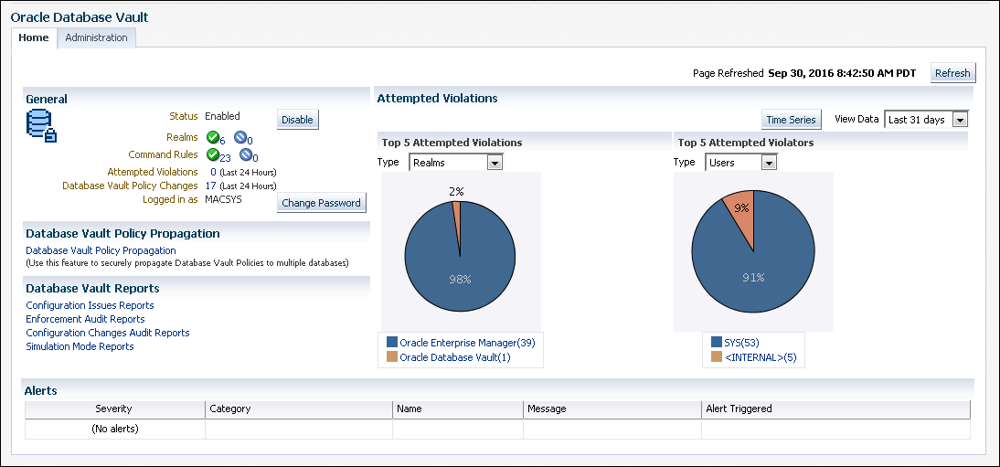

Before you can start using Oracle Database Vault, you must configure and enable it with the Oracle database.

- About Configuring and Enabling Oracle Database Vault in Oracle Database
  Oracle Database includes Database Vault when you choose to include a default database in the installation process, but you must configure and enable it before you can use it.
- Configuring and Enabling Oracle Database Vault with an Oracle Database in a Multitenant Environment
  You can configure and enable Oracle Database Vault in a multitenant environment based on several scenarios.
- Registering Oracle Database Vault in a Non-Multitenant Environment
  After you register the users, you should create a profile to protect these accounts.
- Configuring and Enabling Oracle Database Vault in an Oracle Real Application Clusters Environment
  You can configure Oracle Database Vault for an Oracle Real Application Clusters (Oracle RAC) environment, including each Oracle RAC node.
- Verifying That Database Vault Is Configured and Enabled
  The `DBA_DV_STATUS`, `CDB_DV_STATUS`, `DBA_OLS_STATUS`, and `CDB_OLS_STATUS` data dictionary views verify if Oracle Database is configured and enabled.
- Logging in to Oracle Database Vault from Oracle Enterprise Cloud Control
  Oracle Enterprise Manager Cloud Control (Cloud Control) provides pages for managing Oracle Database Vault.
- Quick Start Tutorial: Securing a Schema from DBA Access
  This tutorial shows how to create a realm around the `HR` schema.

### 3.1 About Configuring and Enabling Oracle Database Vault in Oracle Database

Oracle Database includes Database Vault when you choose to include a default database in the installation process, but you must configure and enable it before you can use it.

Oracle Database includes Database Vault when you choose to include a default database in the installation process, but you must register it before you can use it. If you create a custom database, then you can use DBCA to install and enable Database Vault for it. The registration process enables Oracle Label Security if it is not already enabled. Oracle Label Security is required for Oracle Database Vault but it does not require a separate license unless you begin using Oracle Label Security separately and create Oracle Label Security policies. This procedure applies to the CDB root, application root, and the current pluggable database (PDB), as well as to both single-instance and Oracle Real Application Clusters (Oracle RAC) installations. In a multitenant database, Database Vault must be configured with the CDB root before any of the PDBs can configure Database Vault.

As part of the configuration process, you created the Database Vault administrative accounts. These are accounts that hold the Database Vault roles `DV_OWNER` and `DV_ACCTMGR`. Use these accounts initially to provision the roles to named users with administrative privileges. Maintaining a backup account will allow you to recover from the named user losing or somehow misplacing their credentials because `SYS` will not be able to reset these passwords for users with these roles.

You can register Oracle Database in both multitenant and non-multitenant environments. For multitenant environments, you have several methods to choose from for the registration.

**Note:**

If you have upgraded from a release earlier than Oracle Database 12c, and if the earlier Oracle Database Vault had been enabled in that earlier release, then after the upgrade process is complete, you must enable Oracle Database Vault by using the `DBMS_MACADM.ENABLE_DV` procedure.

In a multitenant environment, if you are migrating a non-Database Vault registered Oracle database from a release earlier than release 12c, then you must perform a manual installation of Database Vault.

**Related Topics**

- Verifying That Database Vault Is Configured and Enabled

**Parent topic:** Getting Started with Oracle Database Vault

### 3.2 Configuring and Enabling Oracle Database Vault with an Oracle Database in a Multitenant Environment

You can configure and enable Oracle Database Vault in a multitenant environment based on several scenarios.

- About Configuring and Enabling Database Vault in a Multitenant Environment
  You must configure and enable Oracle Database Vault in the CDB root before you can perform the same action in any of the associated PDBs.
- Configuring and Enabling Database Vault in the CDB Root
  You can configure and enable Oracle Database Vault with common users who will use the Database Vault administrative roles from the CDB root.
- Registering Database Vault Common Users to Manage Specific PDBs
  In a multitenant environment, you must register Oracle Database Vault in the CDB root first, then in the PDBs afterward.
- Configuring and Enabling Database Vault Local Users to Manage Specific PDBs
  In a multitenant environment, you must configure and enable Oracle Database Vault in the root first, and then in the PDBs afterward.
- Creating a Profile to Protect the DV_OWNER and DV_ACCTMGR Users
  A profile provides additional protection for users who have been granted the `DV_OWNER` and `DV_ACCTMGR` roles.
- Plugging in a Database Vault-Enabled PDB
  From SQL\*Plus, in a multitenant environment, you can plug in a database that already has Database Vault enabled.
- Manually Installing Oracle Database Vault in a Multitenant Environment
  Under certain conditions, for a multitenant environment, you must manually install Oracle Database Vault. For example, a release 11g Oracle database without Database Vault is upgraded to release 12c, then converted to a PDB to be plugged into a 12c Database Vault-enabled database.

**Parent topic:** Getting Started with Oracle Database Vault

#### 3.2.1 About Configuring and Enabling Database Vault in a Multitenant Environment

You must configure and enable Oracle Database Vault in the CDB root before you can perform the same action in any of the associated PDBs.

The common users who have been assigned the `DV_OWNER` and `DV_ACCTMGR` roles in the CDB root can also have the same role in the PDBs. PDBs can have Database Vault configured and enabled using the same common users or use separate PDB local users. The `DV_ACCTMGR` role is granted commonly to the common user in the CDB root. You can grant `DV_OWNER` locally or commonly to the CDB root common user when you configure and register Database Vault with the CDB root. Granting `DV_OWNER` locally to the common user prevents the common `DV_OWNER` user from using this role in any PDB.

**Parent topic:** Configuring and Enabling Oracle Database Vault with an Oracle Database in a Multitenant Environment

#### 3.2.2 Configuring and Enabling Database Vault in the CDB Root

You can configure and enable Oracle Database Vault with common users who will use the Database Vault administrative roles from the CDB root.

1.  In a multitenant environment, log into the CDB root of the database instance as a user who has privileges to create users and grant the `CREATE SESSION` and `SET CONTAINER` privileges.
    For example:

        sqlplus c##dba_debra
        Enter password: password
2.  Select user accounts (or create new users) that will be used for the Database Vault Owner (`DV_OWNER` role) and Database Vault Account Manager (`DV_ACCTMGR` role) accounts.
    Prepend the names of these accounts with `c##` or `C##`. For example:

        GRANT CREATE SESSION, SET CONTAINER TO c##sec_admin_owen
          IDENTIFIED BY password CONTAINER = ALL;
        GRANT CREATE SESSION, SET CONTAINER TO c##dbv_owner_root_backup
          IDENTIFIED BY password CONTAINER = ALL;
        GRANT CREATE SESSION, SET CONTAINER TO c##accts_admin_ace
          IDENTIFIED BY password CONTAINER = ALL;
        GRANT CREATE SESSION, SET CONTAINER TO c##dbv_acctmgr_root_backup
          IDENTIFIED BY password CONTAINER = ALL;

    This specification grants two system privileges, creates the accounts if they do not exist, assigns a password, and does this so all the users have access to the CDB and all PDB databases.

    - Create the primary accounts (`c##sec_admin_owen` and` c##accts_admin_ace`) if these do not already exist for the new roles, `DV_ADMIN` and `DV_ACCTMGR`.
    - Replace `password` with a password that is secure.
3.  Connect to the CDB root as user `SYS` with the `SYSDBA` administrative privilege
        CONNECT SYS AS SYSDBA
        Enter password: password
4.  Configure the two backup Database Vault user accounts.
    For example:
        BEGIN
         CONFIGURE_DV (
           dvowner_uname         => 'c##dbv_owner_root_backup',
           dvacctmgr_uname       => 'c##dbv_acctmgr_root_backup',
           force_local_dvowner   => FALSE);
         END;
        /

    In this example, setting `force_local_dvowner` to `FALSE` enables the common users to have `DV_OWNER` privileges for the PDBs that are associated with this CDB root. Setting it to `TRUE` restricts the common `DV_OWNER` user to have the `DV_OWNER` role privileges for the CDB root only. If you grant `DV_OWNER` locally to the CDB root common user, then that user cannot grant the `DV_OWNER` role commonly to any other user.
5.  Run the `utlrp.sql` script to recompile invalidated objects in the root.
        @?/rdbms/admin/utlrp.sql

    If the script provides instructions, follow them, and then run the script again. If the script terminates abnormally without giving any instructions, then run it again.
6.  Connect to the root as the primary Database Vault Owner user that you just configured.
    For example:

        CONNECT c##dbv_owner_root_backup
        Enter password: password
7.  Enable Oracle Database Vault using one of the following commands:
    - To enable Oracle Database Vault to use regular mode:

          EXEC DBMS_MACADM.ENABLE_DV;

    - If every associated PDB will need to have Database Vault enabled in this database, then use the following command. (You will need to enable each of these PDBs after you complete this procedure.) PDBs that do not have Database Vault enabled will be in restricted mode after the database is restarted and until Database Vault is enabled in the PDB:

          EXEC DBMS_MACADM.ENABLE_DV (strict_mode => 'y');
8.  Connect with the `SYSOPER` administrative privilege.
        CONNECT / AS SYSOPER
9.  Restart the database.
    For a single-instance database:
        SHUTDOWN IMMEDIATE
        STARTUP

    If you are in an Oracle Real Application Clusters (Oracle RAC) environment, then you can perform an Oracle RAC rolling enablement.
10. Connect with the `SYSDBA` administrative privilege.
        CONNECT / AS SYSDBA
11. Verify that Oracle Database Vault and Oracle Label Security are installed and enabled.
        SELECT * FROM CDB_DV_STATUS;
        SELECT * FROM CDB_OLS_STATUS;
12. Connect as the backup `DV_OWNER` user and then grant the `DV_OWNER` role, including the `WITH ADMIN OPTION` clause, to the primary `DV_OWNER` user that you created earlier.
    For example:

        CONNECT c##dbv_owner_root_backup
        Enter password: password

        GRANT DV_OWNER TO c##sec_admin_owen WITH ADMIN OPTION;
13. Connect as the backup `DV_ACCTMGR` user and then grant the `DV_ACCTMGR` role, including the `WITH ADMIN OPTION` clause, to the backup `DV_ACCTMGR` user.
    For example:

        CONNECT c##dbv_acctmgr_root_backup
        Enter password: password

        GRANT DV_ACCTMGR TO c##accts_admin_ace WITH ADMIN OPTION
        CONTAINER=ALL;
14. Store the two backup account passwords in a safe location such as a privileged account management (PAM) system in case they are needed in the future.

**Related Topics**

- Verifying That Database Vault Is Configured and Enabled
- [Oracle Database Vault Roles](oracle-database-vault-schemas-roles-and-accounts.md)
- Logging in to Oracle Database Vault from Oracle Enterprise Cloud Control
- [DV_PATCH_ADMIN Database Vault Database Patch Role](oracle-database-vault-schemas-roles-and-accounts.md)
- [CONFIGURE_DV General System Maintenance Procedure](oracle-database-vault-general-administrative-apis.md)
- Configuring and Enabling Oracle Database Vault in an Oracle Real Application Clusters Environment

**Parent topic:** Configuring and Enabling Oracle Database Vault with an Oracle Database in a Multitenant Environment

#### 3.2.3 Registering Database Vault Common Users to Manage Specific PDBs

In a multitenant environment, you must register Oracle Database Vault in the CDB root first, then in the PDBs afterward.

If you try to register in a PDB first, then an `ORA-47503: Database Vault is not enabled on CDB$ROOT` error appears.

1.  If you have not already done so, then identify or create named common user accounts to be used as the Database Vault accounts along with associated backup accounts.
2.  Ensure that you have configured and enabled Oracle Database Vault in the CDB root and that the `DV_OWNER` role was granted commonly to the common user.
3.  Connect to the PDB as an administrator who is local to the PDB.
    For example:
        CONNECT dba_debra@pdb_name
        Enter password: password

    To find the available PDBs, query the `DBA_PDBS` data dictionary view. To check the current PDB, run the `show con_name` command.
4.  Grant the `CREATE SESSION` and `SET CONTAINER` privileges to the users for this PDB.
    For example:
        GRANT CREATE SESSION, SET CONTAINER TO c##sec_admin_owen CONTAINER = CURRENT;
        GRANT CREATE SESSION, SET CONTAINER TO c##accts_admin_ace CONTAINER = CURRENT;
5.  Connect as user `SYS` with the `SYSDBA` administrative privilege
        CONNECT SYS@pdb_name AS SYSDBA
        Enter password: password
6.  While still in the PDB, configure the two backup Database Vault user accounts.
        BEGIN
         CONFIGURE_DV (
           dvowner_uname         => 'c##dbv_owner_root_backup',
           dvacctmgr_uname       => 'c##dbv_acctmgr_root_backup');
         END;
        /

    In this example, the `force_local_dvowner` parameter is omitted because it is unnecessary. All common users who are configured within a PDB are restricted to the scope of the PDB.
7.  Run the `utlrp.sql` script to recompile invalidated objects in this PDB.
        @?/rdbms/admin/utlrp.sql

    If the script provides instructions, follow them, and then run the script again. If the script terminates abnormally without giving any instructions, then run it again.
8.  Connect to the PDB as the backup Database Vault Owner user that you just configured.
    For example:
        CONNECT c##dbv_owner_root_backup@pdb_name
        Enter password: password
9.  Enable Oracle Database Vault in this PDB.
        EXEC DBMS_MACADM.ENABLE_DV;
10. Connect to the CDB with the `SYSDBA` administrative privilege.
        CONNECT / AS SYSDBA
11. Close and reopen the PDB.
    For example:
        ALTER PLUGGABLE DATABASE pdb_name CLOSE IMMEDIATE;
        ALTER PLUGGABLE DATABASE pdb_name OPEN;
12. Verify that the PDB is configured and enabled for Database Vault.
        SELECT * FROM DBA_DV_STATUS;
13. Connect as the backup `DV_OWNER` user and then grant the `DV_OWNER` role, including the `WITH ADMIN OPTION` clause, to the primary `DV_OWNER` user that you created earlier.
    For example:

        CONNECT c##dbv_owner_root_backup@pdb_name
        Enter password: password

        GRANT DV_OWNER TO c##sec_admin_owen WITH ADMIN OPTION;
14. Connect as the backup `DV_ACCTMGR` user and then grant the `DV_ACCTMGR` role, including the `WITH ADMIN OPTION` clause, to the primary `DV_ACCTMGR` user.
    For example:

        CONNECT c##dbv_acctmgr_root_backup@pdb_name
        Enter password: password

        GRANT DV_ACCTMGR TO c##accts_admin_ace WITH ADMIN OPTION;
15. Store the two backup account passwords in a safe location such as a privileged account management (PAM) system in case they are needed in the future.

**Related Topics**

- Verifying That Database Vault Is Configured and Enabled
- [Oracle Database Vault Roles](oracle-database-vault-schemas-roles-and-accounts.md)
- Logging in to Oracle Database Vault from Oracle Enterprise Cloud Control
- [DV_PATCH_ADMIN Database Vault Database Patch Role](oracle-database-vault-schemas-roles-and-accounts.md)
- [CONFIGURE_DV General System Maintenance Procedure](oracle-database-vault-general-administrative-apis.md)
- Configuring and Enabling Database Vault in the CDB Root

**Parent topic:** Configuring and Enabling Oracle Database Vault with an Oracle Database in a Multitenant Environment

#### 3.2.4 Configuring and Enabling Database Vault Local Users to Manage Specific PDBs

In a multitenant environment, you must configure and enable Oracle Database Vault in the root first, and then in the PDBs afterward.

If you try to configure and enable in a PDB first, then an `ORA-47503: Database Vault is not enabled on CDB$ROOT` error appears.

1.  In a multitenant environment, log into the PDB as a user who has privileges to create users and to grant the `CREATE SESSION` and `SET CONTAINER` privileges.
    For example:
        sqlplus sec_admin@pdb_name
        Enter password: password
2.  If you are not using existing local user named accounts for the new Database Vault roles, create new named local user accounts.
    In both cases, you must create backup accounts to hold the Database Vault roles in case the named user loses or forgets their password.
        GRANT CREATE SESSION, SET CONTAINER TO sec_admin_owen
          IDENTIFIED BY password;
        GRANT CREATE SESSION, SET CONTAINER TO dbv_owner_backup
          IDENTIFIED BY password;
        GRANT CREATE SESSION, SET CONTAINER TO accts_admin_ace
          IDENTIFIED BY password;
        GRANT CREATE SESSION, SET CONTAINER TO dbv_acctmgr_backup
          IDENTIFIED BY password;
3.  Ensure that you have configured and enabled Oracle Database Vault in the CDB root.
    Temporarily connect to the root and then query the `DBA_DV_STATUS` view.
        SELECT * FROM SYS.DBA_DV_STATUS;
4.  Connect to the PDB as user `SYS` with the `SYSDBA` administrative privilege.
        CONNECT SYS@pdb_name AS SYSDBA
        Enter password: password
5.  While still in the PDB, configure the two backup Database Vault user accounts.
        BEGIN
         CONFIGURE_DV (
           dvowner_uname     => 'dbv_owner_backup',
           dvacctmgr_uname   => 'dbv_acctmgr_backup');
         END;
        /

    In this example, the `force_local_dvowner` parameter is omitted because it is unnecessary. Database Vault roles are granted locally when configured in a PDB.
6.  Run the `utlrp.sql` script to recompile invalidated objects in this PDB.
        @?/rdbms/admin/utlrp.sql

    If the script provides instructions, follow them, and then run the script again. If the script terminates abnormally without giving any instructions, run it again.
7.  Connect to the PDB as the backup Database Vault Owner user that you just configured.
    For example:
        CONNECT dbv_owner_backup@pdb_name
        Enter password: password
8.  Enable Oracle Database Vault in this PDB.
        EXEC DBMS_MACADM.ENABLE_DV;
9.  Connect to the CDB with the `SYSDBA` administrative privilege.
        CONNECT / AS SYSDBA
10. Close and reopen the PDB.
        ALTER PLUGGABLE DATABASE pdb_name CLOSE IMMEDIATE;
        ALTER PLUGGABLE DATABASE pdb_name OPEN;
11. Verify that the PDB is configured and enabled for Database Vault.
        CONNECT SYS@pdb_name AS SYSDBA
        Enter password: password

        SELECT * FROM DBA_DV_STATUS;
12. Connect as the backup `DV_OWNER` user and then grant the `DV_OWNER` role, including the `WITH ADMIN OPTION` clause, to the primary `DV_OWNER` user that you created earlier.
    For example:

        CONNECT dbv_owner_backuppdb_name
        Enter password: password

        GRANT DV_OWNER TO sec_admin_owen WITH ADMIN OPTION;
13. Connect as the backup `DV_ACCTMGR` user and then grant the `DV_ACCTMGR` role, including the `WITH ADMIN OPTION` clause, to the backup `DV_ACCTMGR` user.
    For example:

        CONNECT dbv_acctmgr_backup@pdb_name
        Enter password: password

        GRANT DV_ACCTMGR TO accts_admin_ace WITH ADMIN OPTION;
14. Store the two backup account passwords in a safe location such as a privileged account management (PAM) system in case they are needed in the future.

**Related Topics**

- Verifying That Database Vault Is Configured and Enabled
- [Oracle Database Vault Roles](oracle-database-vault-schemas-roles-and-accounts.md)
- Configuring and Enabling Database Vault in the CDB Root
- Logging in to Oracle Database Vault from Oracle Enterprise Cloud Control

**Parent topic:** Configuring and Enabling Oracle Database Vault with an Oracle Database in a Multitenant Environment

#### 3.2.5 Creating a Profile to Protect the DV_OWNER and DV_ACCTMGR Users

A profile provides additional protection for users who have been granted the `DV_OWNER` and `DV_ACCTMGR` roles.

Database users who have been granted the `DV_OWNER` or `DV_ACCTMGR` roles are considered critical, privileged, accounts. Typically, these accounts should be considered service accounts and exempt from password lockout requirements. Oracle recommends that you create a custom profile that prevents the account from being locked. In addition, you should audit failed login attempts for these Database Vault-related accounts.

1.  Log into the database instance as a user who has the `CREATE PROFILE` system privilege.
    - For common `DV_OWNER` and `DV_ACCTMGR` users: Log in to the root of the database instance.
    - For local `DV_OWNER` and `DV_ACCTMGR` users: Log in to the PDB in which you created the users.
2.  Create a profile similar to the following:
    - For common `DV_OWNER` and `DV_ACCTMGR` users: In the root, create the profile similar to the following:

          CREATE PROFILE c##dv_profile limit
          FAILED_LOGIN_ATTEMPTS UNLIMITED
          PASSWORD_VERIFY_FUNCTION ORA12C_VERIFY_FUNCTION
          PASSWORD_LOCK_TIME UNLIMITED
          CONTAINER=ALL;

    - For local `DV_OWNER` and `DV_ACCTMGR` users: In the PDB, create the profile similar to the following:

          CREATE PROFILE dv_profile limit
          FAILED_LOGIN_ATTEMPTS UNLIMITED
          PASSWORD_VERIFY_FUNCTION ORA12C_VERIFY_FUNCTION
          PASSWORD_LOCK_TIME UNLIMITED
          CONTAINER=CURRENT;
3.  Update the `DV_OWNER` and `DV_ACCTMGR` user accounts to use this profile.
    - For common `DV_OWNER` and `DV_ACCTMGR` users:

          ALTER USER c##dvowner PROFILE c##dv_profile CONTAINER = ALL;
          ALTER USER c##dvowner_backup PROFILE c##dv_profile CONTAINER = ALL;
          ALTER USER c##dvacctmgr PROFILE c##dv_profile CONTAINER = ALL;
          ALTER USER c##dvacctmgr_backup PROFILE c##dv_profile CONTAINER = ALL;

    - For local `DV_OWNER` and `DV_ACCTMGR` users:

          ALTER USER dvowner PROFILE dv_profile CONTAINER = CURRENT;
          ALTER USER dvowner_backup PROFILE dv_profile CONTAINER = CURRENT;
          ALTER USER dvacctmgr PROFILE dv_profile CONTAINER = CURRENT;
          ALTER USER dvacctmgr_backup PROFILE dv_profile CONTAINER = CURRENT;
4.  Connect as a user who has been granted the `AUDIT_ADMIN` role.
5.  Create and enable a unified audit policy to track failed logins by any user who has been granted the `DV_OWNER` or `DV_ACCTMGR` role.
    - For common `DV_OWNER` and `DV_ACCTMGR` users: In the root, create a policy similar to the following:

          CREATE AUDIT POLICY c##dv_logins ACTIONS LOGON;
          AUDIT POLICY c##dv_logins BY USERS WITH GRANTED ROLES DV_OWNER, DV_ACCTMGR
          WHENEVER NOT SUCCESSFUL;

    - For local `DV_OWNER` and `DV_ACCTMGR` users: In the PDB, create a policy similar to the following:

          CREATE AUDIT POLICY dv_logins ACTIONS LOGON;
          AUDIT POLICY dv_logins BY USERS WITH GRANTED ROLES DV_OWNER, DV_ACCTMGR
          WHENEVER NOT SUCCESSFUL;

**Related Topics**

- [Oracle Database SQL Language Reference](../sqlrf/CREATE-PROFILE.md)
- [Oracle Database Security Guide](../dbseg/configuring-audit-policies.md)

**Parent topic:** Configuring and Enabling Oracle Database Vault with an Oracle Database in a Multitenant Environment

#### 3.2.6 Plugging in a Database Vault-Enabled PDB

From SQL\*Plus, in a multitenant environment, you can plug in a database that already has Database Vault enabled.

In this scenario, the plugged in database has its own local Database Vault accounts. Be aware that if you plug a Database Vault-enabled database into a CDB that is not Database Vault enabled, then the PDB will remain in restricted mode until you enable Database Vault in the CDB and then restart the CDB. If you plug a non-Database Vault-enabled PDB into a CDB that is Database Vault enabled, then the PDB remains in restricted mode until you enable Database Vault in the PDB and then restart the PDB. This plugged in non-Database Vault enabled PDB can still be used. However, if the CDB is Database Vault enabled with the strict option set, then the PDB must be Database Vault enabled.

Before you plug in a Database Vault-enabled PDB and if the Database Vault roles are granted to common users, ensure that you understand fully how plugging in PDBs affect common users.

**Related Topics**

- [Oracle Database Security Guide](../dbseg/managing-security-for-oracle-database-users.md)

**Parent topic:** Configuring and Enabling Oracle Database Vault with an Oracle Database in a Multitenant Environment

#### 3.2.7 Manually Installing Oracle Database Vault in a Multitenant Environment

Under certain conditions, for a multitenant environment, you must manually install Oracle Database Vault. For example, a release 11g Oracle database without Database Vault is upgraded to release 12c, then converted to a PDB to be plugged into a 12c Database Vault-enabled database.

You must manually install Oracle Database Vault (and Oracle Label Security) in a PDB if this PDB does not have these products when the PDB has been plugged into a CDB where Database Vault and Label Security are installed.

1.  As user who has been granted the `SYSDBA` administrative privilege, log in to the PDB in which you want to install Oracle Database Vault.
    For example, to log in to a PDB named `hr_pdb`:

        sqlplus sec_admin@hr_pdb as sysdba
        Enter password: password

    To find the available PDBs, run the `show pdbs` command. To check the current PDB, run the `show con_name` command.
2.  If necessary, check if Oracle Database Vault and Oracle Label Security are already installed on this PDB.
    If the `DVSYS` and `DVF` accounts (for Database Vault) and the ` LBACSYS` account (for Label Security) exist, then Database Vault and Label Security exist on the PDB.
        SELECT USERNAME FROM DBA_USERS WHERE USERNAME IN ('DVSYS', 'DVF', 'LBACSYS');
3.  If neither Database Vault nor Label Security have been installed, then install Oracle Label Security by executing the `catols.sql` script.
        @$ORACLE_HOME/rdbms/admin/catols.sql

    Oracle Label Security must be installed before you can install Oracle Database Vault.
4.  Install Oracle Database Vault by executing the `catmac.sql` script.
        @$ORACLE_HOME/rdbms/admin/catmac.sql
5.  At the `Enter value for 1` prompt, enter `SYSTEM` as the tablespace to install `DVSYS`.
6.  At the `Enter value for 2` prompt, enter the temporary tablespace for the PDB.

After the installation is complete, you can configure and enable Oracle Database Vault in the PDB. If Database Vault is not configured and enabled in the CDB already, then you must close the PDB before you can configure and enable Database Vault in the CDB root. Database Vault must be configured and enabled in CDB root before it can be configured and enabled in the PDB. After Database Vault is configured and enabled in the CDB root and the database has been restarted, then you can open the PDB and configure and enable Database Vault.

**Related Topics**

- Configuring and Enabling Oracle Database Vault with an Oracle Database in a Multitenant Environment

**Parent topic:** Configuring and Enabling Oracle Database Vault with an Oracle Database in a Multitenant Environment

### 3.3 Registering Oracle Database Vault in a Non-Multitenant Environment

After you register the users, you should create a profile to protect these accounts.

- Registering Database Vault Users
  You can register Oracle Database Vault using SQL\*Plus.
- Creating a Profile to Protect the DV_OWNER and DV_ACCTMGR Users
  A profile provides additional protection for users who have been granted the `DV_OWNER` and `DV_ACCTMGR` roles.

**Parent topic:** Getting Started with Oracle Database Vault

#### 3.3.1 Registering Database Vault Users

You can register Oracle Database Vault using SQL\*Plus.

1.  Log into the database instance as a user who has privileges to create user accounts and grant the `CREATE SESSION` privilege to other users.
    For example:

        sqlplus sec_admin
        Enter password: password
2.  Identify (or create new named user accounts if necessary) named user accounts to be used for the Database Vault Owner (`DV_OWNER` role) and Database Vault Account Manager (`DV_ACCTMGR` role) accounts.
    Oracle strongly recommends that you create two accounts for each role. One account, the primary named user account, will be used on a day-to-day basis and the other account will be used as a backup account in case the password of the primary account is lost and must be reset.

    For example:

        GRANT CREATE SESSION TO sec_admin_owen IDENTIFIED BY password;
        GRANT CREATE SESSION TO dbv_owner_backup IDENTIFIED BY password;
        GRANT CREATE SESSION TO accts_admin_ace IDENTIFIED BY password;
        GRANT CREATE SESSION TO dbv_acctmgr_backup IDENTIFIED BY password;

    Follow the guidelines in [Oracle Database Security Guide](../dbseg/configuring-authentication.md) to replace `password` with a password that is secure.
3.  Connect with the `SYSDBA` administrative privilege.
        CONNECT / AS SYSDBA
        Enter password: password
4.  Configure Database Vault using the two backup user accounts.
        BEGIN
         CONFIGURE_DV (
           dvowner_uname         => 'dbv_owner_backup',
           dvacctmgr_uname       => 'dbv_acctmgr_backup');
         END;
        /

    Do not enter the names `DV_OWNER`, `DV_ACCTMGR`, or the names of any other Database Vault roles for these user accounts.
5.  Run the `utlrp.sql` script to recompile invalidated objects.
        @?/rdbms/admin/utlrp.sql

    If the script gives you any instructions, follow them, and then run the script again. If the script terminates abnormally without giving any instructions, run it again.
6.  Connect as the backup Database Vault Owner user that you just configured.
    For example:

        CONNECT dbv_owner_backup
        Enter password: password
7.  Enable Oracle Database Vault.
        EXEC DBMS_MACADM.ENABLE_DV;
8.  Connect with the `SYSDBA` administrative privilege.
        CONNECT / AS SYSDBA
9.  Restart the database.
        SHUTDOWN IMMEDIATE
        STARTUP
10. Connect as the backup `DV_OWNER` user and then grant the `DV_OWNER` role to the primary `DV_OWNER` user that you created earlier.
    For example:

        CONNECT dbv_owner_backup
        Enter password: password

        GRANT DV_OWNER TO sec_admin_owen WITH ADMIN OPTION;
11. Connect as the backup `DV_ACCTMGR` user and then grant the `DV_ACCTMGR` role to the primary `DV_ACCTMGR` user.
    For example:

        CONNECT dbv_acctmgr_backup
        Enter password: password

        GRANT DV_ACCTMGR TO accts_admin_ace WITH ADMIN OPTION;
12. Verify that the configuration was successful.
        CONNECT / AS SYSDBA

        SELECT * FROM SYS.DBA_DV_STATUS;
        SELECT * FROM DBA_OLS_STATUS;
13. Store the two backup account passwords in a safe location such as a privileged account management (PAM) system in case they are needed in the future.

**Related Topics**

- Verifying That Database Vault Is Configured and Enabled
- [Oracle Database Vault Roles](oracle-database-vault-schemas-roles-and-accounts.md)
- Logging in to Oracle Database Vault from Oracle Enterprise Cloud Control

**Parent topic:** Registering Oracle Database Vault in a Non-Multitenant Environment

#### 3.3.2 Creating a Profile to Protect the DV_OWNER and DV_ACCTMGR Users

A profile provides additional protection for users who have been granted the `DV_OWNER` and `DV_ACCTMGR` roles.

Database users who have been granted the `DV_OWNER` or `DV_ACCTMGR` roles are considered critical, privileged, accounts. Typically, these accounts should be considered service accounts and exempt from password lockout requirements. Oracle recommends that you create a custom profile that prevents the account from being locked. In addition, you should audit failed login attempts for these Database Vault-related accounts.

1.  Log into the database instance as a user who has the `CREATE PROFILE` system privilege.
2.  Create a profile similar to the following:
        CREATE PROFILE dv_profile limit
        FAILED_LOGIN_ATTEMPTS UNLIMITED
        PASSWORD_VERIFY_FUNCTION ORA12C_VERIFY_FUNCTION
        PASSWORD_LOCK_TIME UNLIMITED
        CONTAINER=CURRENT;
3.  Update the `DV_OWNER` and `DV_ACCTMGR` user accounts to use this profile.
    For example:
        ALTER USER sec_admin_owen PROFILE dv_profile;
        ALTER USER dbv_owner_backup PROFILE dv_profile;
        ALTER USER accts_admin_ace PROFILE dv_profile;
        ALTER USER dbv_acctmgr_backup PROFILE dv_profile;
4.  Connect as a user who has been granted the `AUDIT_ADMIN` role.
5.  Create and enable a unified audit policy to track failed logins by any user who has been granted the `DV_OWNER` or `DV_ACCTMGR` role.
    For example:
        CREATE AUDIT POLICY dv_logins ACTIONS LOGON;
        AUDIT POLICY dv_logins BY USERS WITH GRANTED ROLES DV_OWNER, DV_ACCTMGR WHENEVER NOT SUCCESSFUL;

**Related Topics**

- [Oracle Database SQL Language Reference](../sqlrf/CREATE-PROFILE.md)
- [Oracle Database Security Guide](../dbseg/configuring-audit-policies.md)

**Parent topic:** Registering Oracle Database Vault in a Non-Multitenant Environment

### 3.4 Configuring and Enabling Oracle Database Vault in an Oracle Real Application Clusters Environment

You can configure Oracle Database Vault for an Oracle Real Application Clusters (Oracle RAC) environment, including each Oracle RAC node.

To configure Oracle Database vault for an Oracle RAC environment, you must configure and enable Oracle Database Vault on one node, then restart each of the instance nodes to enable it everywhere. The following procedure assumes that you have a separate Oracle home for each node.

1.  Configure and enable Oracle Database Vault in the CDB root.
2.  Log into the database instance as user `SYS` with the `SYSDBA` administrative privilege.
        sqlplus sys as sysdba
        Enter password: password
3.  Run the following `ALTER SYSTEM` statements on either of the Oracle RAC nodes:
        ALTER SYSTEM SET AUDIT_SYS_OPERATIONS=TRUE SCOPE=SPFILE; -- For non-unified auditing environments
        ALTER SYSTEM SET OS_ROLES=FALSE SCOPE=SPFILE;
        ALTER SYSTEM SET RECYCLEBIN='OFF' SCOPE=SPFILE;
        ALTER SYSTEM SET REMOTE_LOGIN_PASSWORDFILE='EXCLUSIVE' SCOPE=SPFILE;
        ALTER SYSTEM SET SQL92_SECURITY=TRUE SCOPE=SPFILE;
4.  Restart Oracle Database.
        CONNECT / AS SYSOPER
        Enter password: password

        SHUTDOWN IMMEDIATE
        STARTUP

**Related Topics**

- Configuring and Enabling Database Vault in the CDB Root

**Parent topic:** Getting Started with Oracle Database Vault

### 3.5 Verifying That Database Vault Is Configured and Enabled

The `DBA_DV_STATUS`, `CDB_DV_STATUS`, `DBA_OLS_STATUS`, and `CDB_OLS_STATUS` data dictionary views verify if Oracle Database is configured and enabled.

In addition to Oracle Database Vault administrators, the Oracle Database `SYS` user and users who have been granted the `DBA` role can query these views.

- For Database Vault:

  - If you want to find the Database Vault status for a non-multitenant database, or in a multitenant environment for the root only or an individual PDB, then depending on who you are connected to the database as, query the `DBA_DV_STATUS` or `SYS.DBA_DV_STATUS` view. Examples are as follows:

    - If you are connected as a user who has the `DBA` role or the `SYSDBA` administrative privilege:

          SELECT * FROM DBA_DV_STATUS;

    - If you are connected as a user who has the `DV_OWNER` or `DV_ADMIN` role:

          SELECT * FROM SYS.DBA_DV_STATUS;

    Output similar to the following appears:

        NAME                 STATUS
        -------------------- -----------
        DV_APP_PROTECTION    NOT CONFIGURED
        DV_CONFIGURE_STATUS  TRUE
        DV_ENABLE_STATUS     TRUE

    `DV_APP_PROTECTION` refers to operations control, which automatically restricts common users from accessing PDB local data in autonomous, regular Cloud, or on-premises environments.

  - If you want to find the Database Vault status of all PDBs in a multitenant environment, as a common user with administrative privileges, then query `CDB_DV_STATUS`, which provides the addition of a container ID (`CON_ID`) field.

- For Oracle Label Security, query the following data dictionary views, which are similar to their Database Vault equivalent views:

  - `DBA_OLS_STATUS`

  - `CDB_OLS_STATUS`

**Related Topics**

- [Using Database Vault Operations Control to Restrict Multitenant Common User Access to Local PDB Data](dba-operations-in-an-oracle-database-vault-environment.md)

**Parent topic:** Getting Started with Oracle Database Vault

### 3.6 Logging in to Oracle Database Vault from Oracle Enterprise Cloud Control

Oracle Enterprise Manager Cloud Control (Cloud Control) provides pages for managing Oracle Database Vault.

Only Oracle Enterprise Manager Cloud Control is supported, not Oracle EM Express. The Oracle Database Vault pages can be used to administer and monitor Database Vault-protected databases from a centralized console. This console enables you to automate alerts, view Database Vault reports, and propagate Database Vault policies to other Database Vault-protected databases.

Before you try to log in, ensure that you have configured the Cloud Control target databases that you plan to use with Database Vault by following the Oracle Enterprise Manager online help. Oracle Database Vault must also be configured and enabled with the Oracle database.

1.  Log in to Oracle Enterprise Manager Cloud Control with the credentials that were provided by your Cloud Control administrator.
2.  In the Cloud Control home page, from the Targets menu, select Databases.
3.  In the Databases page, select the link for the Oracle Database Vault-protected database to which you want to connect.
    The Database home page appears.
4.  From the Security menu, select Database Vault.
    The Database Login page appears.
5.  Enter the following information:
    - Username: Enter the name of a user who has been granted the appropriate Oracle Database Vault role:

      - Creating and propagating Database Vault policies: `DV_OWNER` or `DV_ADMIN` role, `SELECT ANY DICTIONARY` privilege

      - Viewing Database Vault alerts and reports: `DV_OWNER`, `DV_ADMIN`, or `DV_SECANALYST` role, `SELECT ANY DICTIONARY` privilege

    - Password: Enter your password.

    - Role: Select NORMAL from the list.

    - Save as: Select this check box if you want these credentials to be automatically filled in for you the next time that this page appears. The credentials are stored in Enterprise Manager in a secure manner. Access to these credentials depends on the user who is currently logged in.

    The Database Vault home page appears.

    
    [Description of the illustration em_dv_home_page.png](img_text/em_dv_home_page.md)

**Related Topics**

- [About Oracle Database Vault Roles](oracle-database-vault-schemas-roles-and-accounts.md)
- [Using Oracle Database Vault with Oracle Enterprise Manager](dba-operations-in-an-oracle-database-vault-environment.md)

**Parent topic:** Getting Started with Oracle Database Vault

### 3.7 Quick Start Tutorial: Securing a Schema from DBA Access

This tutorial shows how to create a realm around the `HR` schema.

- About This Tutorial
  In this tutorial, you create a realm around for the `HR` sample database schema by using the Oracle Database Vault PL/SQL packages.
- Step 1: Log On as SYSTEM to Access the HR Schema
  You must enable the `HR` schema for this tutorial.
- Step 2: Create a Realm
  Realms can protect one or more schemas, individual schema objects, and database roles.
- Step 3: Create the SEBASTIAN User Account
  At this stage, there are no database accounts or roles authorized to access or otherwise manipulate the database objects the realm will protect.
- Step 4: Have User SEBASTIAN Test the Realm
  At this stage, user `SEBASTIAN` can test the realm by trying to query the `HR.EMPLOYEES` table.
- Step 5: Create an Authorization for the Realm
  Next, user `SEBASTIAN` must be granted authorization to the HR Apps realm, so that he can access the `HR.EMPLOYEES` table.
- Step 6: Test the Realm
  To test the realm, you must try to access the `EMPLOYEES` table as a user other than `HR`.
- Step 7: If Unified Auditing Is Not Enabled, Then Run a Report
  Because you enabled auditing on failure for the HR Apps realm, you can generate a report to find any security violations.
- Step 8: Remove the Components for This Tutorial
  You can remove the components that you created for this tutorial if you no longer need them.

**Parent topic:** Getting Started with Oracle Database Vault

#### 3.7.1 About This Tutorial

In this tutorial, you create a realm around for the `HR` sample database schema by using the Oracle Database Vault PL/SQL packages.

In the `HR` schema, the `EMPLOYEES` table has information such as salaries that should be hidden from most employees in the company, including those with administrative access. To accomplish this, you add the `HR` schema to the secured objects of the protection zone, which in Oracle Database Vault is called a realm, inside the database. Then you grant limited authorizations to this realm. Afterward, you test the realm to make sure it has been properly secured. And finally, to see how Oracle Database Vault provides an audit trail on suspicious activities like the one you will try when you test the realm, you will run a report.

**Parent topic:** Quick Start Tutorial: Securing a Schema from DBA Access

#### 3.7.2 Step 1: Log On as SYSTEM to Access the HR Schema

You must enable the `HR` schema for this tutorial.

Before you begin this tutorial, ensure that the `HR` sample schema is installed. [Oracle Database Sample Schemas](../comsc/introduction-to-sample-schemas.md) describes how to install the sample schemas.

1.  Log into the database instance as a user who has been granted the `DBA` role, and then access the `HR` schema.
    For example:

        sqlplus system
        Enter password: password
2.  In a multitenant environment, connect to the appropriate PDB.
    For example:

        CONNECT SYSTEM@my_pdb
        Enter password: password

    To find the available PDBs, run the `show pdbs` command. To check the current PDB, run the `show con_name` command.
3.  Query the `HR.EMPLOYEES` table as follows.
        SELECT FIRST_NAME, LAST_NAME, SALARY FROM HR.EMPLOYEES WHERE ROWNUM < 10;

    Output similar to the following appears:

        FIRST_NAME           LAST_NAME                     SALARY
        -------------------- ------------------------- ----------
        Steven               King                           24000
        Neena                Kochhar                        17000
        Lex                  De Haan                        17000
        Alexander            Hunold                          9000
        Bruce                Ernst                           6000
        David                Austin                          4800
        Valli                Pataballa                       4800
        Diana                Lorentz                         4200
        Nancy                Greenberg                      12008

        9 rows selected.
4.  If the `HR` schema is locked and expired, log into the database instance as the `DV_ACCTMGR` user and unlock and unexpire the account. For example:
        sqlplus accts_admin_ace -- For a multitenant environment, sqlplus bea_dvacctmgr@hrpdb
        Enter password: password

        ALTER USER HR ACCOUNT UNLOCK IDENTIFIED BY password

    Follow the guidelines in [Oracle Database Security Guide](../dbseg/configuring-authentication.md) to replace `password` with a password that is secure.

    As you can see, `SYSTEM` has access to the salary information in the `EMPLOYEES` table of the `HR` schema. This is because `SYSTEM` is automatically granted the `DBA` role, which includes the `SELECT ANY TABLE` system privilege.
5.  Do not exit SQL\*Plus.

**Parent topic:** Quick Start Tutorial: Securing a Schema from DBA Access

#### 3.7.3 Step 2: Create a Realm

Realms can protect one or more schemas, individual schema objects, and database roles.

Once you create a realm, you can create security restrictions that apply to the schemas and their schema objects within the realm. You will need to create a realm for the `HR` schema.

1.  Log in to Oracle Database Vault Administrator from Cloud Control as a user who has been granted the `DV_OWNER` or `DV_ADMIN` role and the `SELECT ANY DICTIONARY` privilege. Logging in to Oracle Database Vault from Oracle Enterprise Cloud Control explains how to log in.
2.  In the Administration page, under Database Vault Components, click Realms.
3.  In the Realms page of Oracle Database Vault Administrator, click Create.
4.  In the Create Realm page, under General, enter `HR Apps` after Name.
5.  In the Description field, enter `Realm to protect the HR schema`.
6.  Leave the Mandatory Realm check box unchecked.
7.  After Status, ensure that Enabled is selected so that the realm can be used.
8.  Under Audit Options, ensure that Audit On Failure is selected so that you can create an audit trial later on.
9.  Click Next to display the Realm secured objects page.
10. Click the Add button and in the Add Secured Object dialog box, enter the following information:
    - Owner: Enter `HR` to select the `HR` schema.

    - Object Type: Enter `TABLE`.

    - Object Name: Enter `EMPLOYEES`.
11. Click OK.
    The `HR.EMPLOYEES` table is added to the Create Realm : Realm Secured Objects page.
12. Click Done, and then click Finish.

At this stage, you have created the realm but you have not assigned any authorizations to it. You will take care of that later on in this tutorial.

**Parent topic:** Quick Start Tutorial: Securing a Schema from DBA Access

#### 3.7.4 Step 3: Create the SEBASTIAN User Account

At this stage, there are no database accounts or roles authorized to access or otherwise manipulate the database objects the realm will protect.

So, the next step is to authorize database accounts or database roles so that they can have access to the schemas within the realm. You will create the `SEBASTIAN` user account.

1.  In SQL\*Plus, connect as the Database Vault Account Manager, who has the `DV_ACCTMGR` role, and create the local user `SEBASTIAN`.
    For example:

        CONNECT accts_admin_ace -- Or, CONNECT accts_admin_ace@hrpdb
        Enter password: password

        GRANT CREATE SESSION TO SEBASTIAN IDENTIFIED BY password;

    Replace `password` with a password that is secure. See [Oracle Database Security Guide](../dbseg/configuring-authentication.md) for the minimum requirements for creating passwords.
2.  Connect as `SYS` with the `SYSDBA` privilege, and then grant `SEBASTIAN` the following additional privilege.
        CONNECT SYS AS SYSDBA -- Or, CONNECT SYS@hrpdb AS SYSDBA
        Enter password: password

        GRANT READ ANY TABLE TO SEBASTIAN;

Do not exit SQL\*Plus; you will need it for Step 6: Test the Realm, when you test the realm.

**Parent topic:** Quick Start Tutorial: Securing a Schema from DBA Access

#### 3.7.5 Step 4: Have User SEBASTIAN Test the Realm

At this stage, user `SEBASTIAN` can test the realm by trying to query the `HR.EMPLOYEES` table.

1.  Connect as user `SEBASTIAN`.
        CONNECT sebastian
        Enter password: password
2.  Query the `HR.EMPLOYEES` table.
        SELECT COUNT(*) FROM HR.EMPLOYEES;

    The following output should appear:

        ERROR at line 1:
        ORA-01031: insufficient privileges

Even though user `SEBASTIAN` has the `READ ANY TABLE` system privilege, he cannot query the `HR.EMPLOYEES` table, because the HR Apps realm takes precedence over the `READ ANY TABLE` system privilege.

**Parent topic:** Quick Start Tutorial: Securing a Schema from DBA Access

#### 3.7.6 Step 5: Create an Authorization for the Realm

Next, user `SEBASTIAN` must be granted authorization to the HR Apps realm, so that he can access the `HR.EMPLOYEES` table.

This authorization allows `SEBASTIAN` to use the `READ ANY TABLE` system privilege on the `HR.EMPLOYEES` table that is protected by this realm.

1.  In the Realms page of Database Vault Administrator, select the HR Apps in the list of realms, and then click Edit.
2.  Click the Next button until you reach the Realm authorizations page.
3.  Click Add and then enter the following information in the Add Authorizations dialog box:
    - Realm Authorization Grantee: Enter `SEBASTIAN`.

    - Realm Authorization Type: Select Participant from the list.

    - Realm Authorization Ruleset: Leave this field blank.
4.  Click OK.
    The Participant authorization allows the user `SEBASTIAN` in the HR Apps realm to manage access, manipulate, and create objects protected by the HR Apps realm. In this case, the `HR` user and `SEBASTIAN` are the only users allowed to view the `EMPLOYEES` table.
5.  Click Done, and then Finish.

**Parent topic:** Quick Start Tutorial: Securing a Schema from DBA Access

#### 3.7.7 Step 6: Test the Realm

To test the realm, you must try to access the `EMPLOYEES` table as a user other than `HR`.

The `SYSTEM` account normally has access to all objects in the `HR` schema because it has the `SELECT ANY TABLE` privilege, but now that you have safeguarded the `EMPLOYEES` table with Oracle Database Vault, this is no longer the case.

1.  In SQL\*Plus, connect as `SYSTEM`.
        CONNECT SYSTEM -- Or, CONNECT SYSTEM@hrpdb
        Enter password: password
2.  Try querying any of the rows in the `EMPLOYEES` table again.
    For example:
        SELECT FIRST_NAME, LAST_NAME, SALARY FROM HR.EMPLOYEES WHERE ROWNUM <10;

    The following output should appear:

        Error at line 1:
        ORA-01031: insufficient privileges

    `SYSTEM` no longer has access to the `EMPLOYEES` table. (In fact, even user `SYS` does not have any access to this table.) However, user `SEBASTIAN` does have access to this information because `SEBASTIAN` is an authorized participant in the HR Apps realm.
3.  Connect as user `SEBASTIAN`.
        CONNECT sebastian -- Or, CONNECT sebastian@hrpdb
        Enter password: password
4.  Perform the following query:
        SELECT FIRST_NAME, LAST_NAME, SALARY FROM HR.EMPLOYEES WHERE ROWNUM <10;

    Output similar to the following appears:

        FIRST_NAME           LAST_NAME                     SALARY
        -------------------- ------------------------- ----------
        Steven               King                           24000
        Neena                Kochhar                        17000
        Lex                  De Haan                        17000
        Alexander            Hunold                          9000
        Bruce                Ernst                           6000
        David                Austin                          4800
        Valli                Pataballa                       4800
        Diana                Lorentz                         4200
        Nancy                Greenberg                      12008

        9 rows selected.

**Parent topic:** Quick Start Tutorial: Securing a Schema from DBA Access

#### 3.7.8 Step 7: If Unified Auditing Is Not Enabled, Then Run a Report

Because you enabled auditing on failure for the HR Apps realm, you can generate a report to find any security violations.

For example, you could generate a report for the violation that you attempted in Step 6: Test the Realm.

1.  In SQL\*Plus, connect as user `SYSTEM` and ensure that unified auditing is not enabled.
        CONNECT SYSTEM -- Or, CONNECT SYSTEM@hrpdb
        Enter password: password

        SQL> SELECT VALUE FROM V$OPTION WHERE PARAMETER = 'Unified Auditing';

    If `VALUE` returns `TRUE`, then you cannot complete this section. Go to Step 8: Remove the Components for This Tutorial.

    If unified auditing is enabled, then you must create a unified audit policy to capture events. See [Oracle Database Security Guide](../dbseg/configuring-audit-policies.md) for information about how to create unified audit policies for Oracle Database Vault.
2.  In the Database Vault Administrator page, click Home to display the home page.
3.  In the Database Vault Home page, under Reports, select Database Vault Reports.
4.  In the Database Vault Reports page, select Database Vault Enforcement Audit Report.
5.  From the Database Vault Audit Report list, select Realm Audit Report.
6.  In the Search area, from the Command menu, select Equals and in the text field, enter `SELECT`. Then click Search.
    The report appears in the table that follows the Search region.
7.  Click OK to exit the report.

Oracle Database Vault generates a report listing the type of violation (in this case, the `SELECT` statement entered in the previous section), when and where it occurred, the login account who tried the violation, and what the violation was.

**Parent topic:** Quick Start Tutorial: Securing a Schema from DBA Access

#### 3.7.9 Step 8: Remove the Components for This Tutorial

You can remove the components that you created for this tutorial if you no longer need them.

1.  Drop user `SEBASTIAN`.

    In SQL\*Plus, log on as the Oracle Database Vault account manager (for example, `accts_admin_ace`) and then drop `SEBASTIAN` as follows:

        sqlplus accts_admin_ace -- Or, CONNECT bea_dvacctmgr@hrpdb
        Enter password: password

        DROP USER SEBASTIAN;

2.  Delete the HR Apps realm.

    1.  In Cloud Control, ensure that you are logged in as a user who has the `DV_OWNER` role.

    2.  In the Database Vault Home page, click Administration.

    3.  In the Realms page, select `HR Apps` from the list of realms.

    4.  Click Delete, and in the Confirmation window, click Yes.

3.  If necessary, in SQL\*Plus, lock and expire the `HR` account.

    1.  Connect as a user who has the `DV_ACCTMGR` role (for example, user `accts_admin_ace`).

    2.  Execute the following `ALTER USER` statement:

            ALTER USER HR ACCOUNT LOCK PASSWORD EXPIRE;

**Parent topic:** Quick Start Tutorial: Securing a Schema from DBA Access
