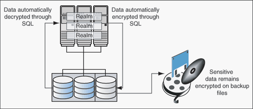
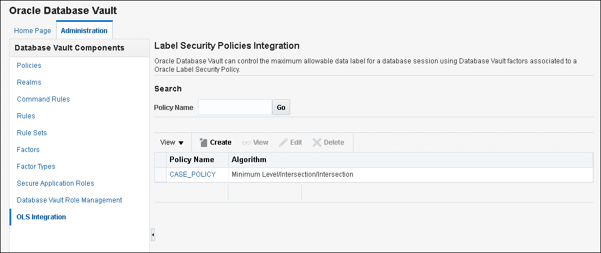

You can integrate Oracle Database Vault with other Oracle products, such as Oracle Enterprise User Security.

- Integrating Oracle Database Vault with Enterprise User Security
  You can integrate Oracle Database Vault with Oracle Enterprise User Security.
- Integrating Oracle Database Vault with Transparent Data Encryption
  Transparent Data Encryption complements Oracle Database Vault in that it provides data protection when the data leaves the secure perimeter of the database.
- Integrating Oracle Database Vault with Oracle Label Security
  You can integrate Oracle Database Vault with Oracle Label Security, and check the integration with reports and data dictionary views.
- Integrating Oracle Database Vault with Oracle Data Guard
  Oracle Database Vault can protect your Oracle Data Guard environments, providing additional security for your high availability and disaster recovery architecture.
- Configuring Oracle Internet Directory Using Oracle Database Configuration Assistant
  You can use Oracle Internet Directory in an Oracle Database Vault-enabled database.
- Integrating Oracle Database Vault with Oracle APEX
  You can integrate Oracle Database Vault with Oracle APEX.

### 11.1 Integrating Oracle Database Vault with Enterprise User Security

You can integrate Oracle Database Vault with Oracle Enterprise User Security.

- About Integrating Oracle Database Vault with Enterprise User Security
  Enterprise User Security centrally manages database users and authorizations in one place.
- Configuring an Enterprise User Authorization
  To configure an Enterprise User authorization, you must create an Oracle Database Vault rule set to control the user access.
- Configuring Oracle Database Vault Accounts as Enterprise User Accounts
  You can configure existing Oracle Database Vault user accounts as enterprise user accounts.

**Parent topic:** Integrating Oracle Database Vault with Other Oracle Products

#### 11.1.1 About Integrating Oracle Database Vault with Enterprise User Security

Enterprise User Security centrally manages database users and authorizations in one place.

It is combined with Oracle Identity Management and is available in Oracle Database Enterprise Edition.

In general, to integrate Oracle Database Vault with Oracle Enterprise User Security, you configure the appropriate realms to protect the data that you want to protect in the database.

After you define the Oracle Database Vault realms as needed, you can create a rule set for the Enterprise users to allow or disallow their access.

**See Also:**

[Oracle Database Enterprise User Security Administrator's Guide](../dbimi/introducing-enterprise-user-security.md) for more information about Enterprise User Security

**Parent topic:** Integrating Oracle Database Vault with Enterprise User Security

#### 11.1.2 Configuring an Enterprise User Authorization

To configure an Enterprise User authorization, you must create an Oracle Database Vault rule set to control the user access.

1.  Create a rule to allow or disallow user access.
    Follow the instructions in [Creating a Rule to Add to a Rule Set](configuring-rule-sets.md) to create a new rule. In the Create Rule page, enter the following PL/SQL in the Rule Expression field:

        SYS_CONTEXT('USERENV','AUTHENTICATED_IDENTITY') = 'user_domain_name'

    Replace `user_domain_name` with the domain, for example:

        SYS_CONTEXT('USERENV','AUTHENTICATED_IDENTITY') = 'myserver.us.example.com'
2.  Add this rule to a new rule set.
    [Creating a Rule Set](configuring-rule-sets.md) explains how to create a new rule set, including how to add an existing rule to it.
3.  Add this rule set to the realm authorization for the data that you want to protect.
    [About Realm Authorization](configuring-realms.md) explains how to create realm authorizations. In the Authorization Rule Set list, select the rule set that you created in Step 2. Afterward, the realm authorization applies to all users.

**Parent topic:** Integrating Oracle Database Vault with Enterprise User Security

#### 11.1.3 Configuring Oracle Database Vault Accounts as Enterprise User Accounts

You can configure existing Oracle Database Vault user accounts as enterprise user accounts.

1.  Log into the database instance as a user who has been granted the `CREATE ROLE` system privilege.
    For example:

        sqlplus system
        Enter password: password
2.  In a multitenant environment, connect to the appropriate pluggable database (PDB).
    For example:

        CONNECT SYSTEM@hrpdb
        Enter password: password

    To find the available PDBs, query the `DBA_PDBS` data dictionary view. To check the current PDB, run the `show con_name` command.
3.  Create a global role for the `DV_OWNER` role and a global role for the `DV_ACCTMGR` role.
    For example:

        CREATE ROLE g_dv_owner IDENTIFIED GLOBALLY;
        CREATE ROLE g_dv_acctmgr IDENTIFIED GLOBALLY;
4.  Connect as a user who has been granted the `DV_OWNER` role.
    For example:

        CONNECT sec_admin_owen -- Or, CONNECT sec_admin_owen@hrpdb
        Enter password: password
5.  Grant the `DV_OWNER` role to the global `DV_OWNER` role.
        GRANT DV_OWNER TO g_dv_owner;
6.  Connect as a user who has been granted the `DV_ACCTMGR` role.
    For example:

        CONNECT dbv_acctmgr -- Or, CONNECT dbv_acctmgr@hrpdb
        Enter password: password
7.  Grant the `DV_ACCTMGR` role to the global `DV_ACCTMGR` role.
        GRANT DV_ACCTMGR TO g_dv_acctmgr;
8.  Connect as user `SYS` with the `SYSDBA` administrative privilege.
        CONNECT SYS AS SYSDBA -- Or, CONNECT SYS@hrpdb AS SYSDBA
        Enter password: password
9.  Temporarily grant the `DV_ACCTMGR` user who will import the Database Vault users into OID the `CREATE TABLE` privilege and the `SELECT_CATALOG_ROLE` role.
        GRANT CREATE TABLE, SELECT_CATALOG_ROLE TO dbv_acctmgr;
10. From the command line, run the User Migration Utility (`UMU`) to import the Database Vault accounts into Oracle Internet Directory (OID).
    The following example imports the Database Vault accounts `leo_dvowner` and `bea_dvacctmgr` into OID. The `DV_ACCTMGR` user is specified for the `DBADMIN` setting.

        $ORACLE_HOME/rdbms/bin/umu PHASE=ONE
        DBADMIN=dbv_acctmgr:password
        ENTADMIN=cn=jane_ent_admin,dc=example,dc=com:password
        USERS= LIST
        DBLOCATION=example.com:7777:orcl
        DIRLOCATION=example.com:636
        USERSLIST=leo_dvowner:bea_dvacctmgr
        MAPSCHEMA=PRIVATE
        CONTEXT=CONTEXT="c=Users, c=us"
        KREALM=EXAMPLE.COM

        $ORACLE_HOME/rdbms/bin/umu PHASE=TWO
        DBADMIN=dbv_acctmgr:password
        ENTADMIN=cn=jane_ent_admin,dc=example,dc=com:password
        DBLOCATION=example.com:7777:orcl
        DIRLOCATION=example.com:636

    By default, errors are written to the `$ORACLE_HOME/network/log/umu.log` file.
11. From the Oracle Internet Directory Self Service Console (`http://``hostname``:``port``/oiddas/`), grant the global `DV_OWNER` and `DV_ACCTMGR` roles (for example, `g_dv_owner` and `g_dv_acctmgr`) to the enterprise user Database Vault accounts.
    See the example of creating enterprise users in [Oracle Database Enterprise User Security Administrator's Guide](../dbimi/getting-started-with-enterprise-user-security.md) for a demonstration of creating an enterprise role from a global role and then granting this role to a user.
12. From SQL\*Plus, as user `SYS` with the `SYSDBA` administrative privilege, revoke the `CREATE TABLE` and `SELECT_CATALOG_ROLE` role from the `DV_ACCTMGR` user.
        REVOKE CREATE TABLE, SELECT_CATALOG_ROLE FROM dbv_acctmgr;

**See Also:**

[Oracle Database Enterprise User Security Administrator's Guide](../dbimi/using-the-user-migration-utility.md) for detailed information about the User Migration Utility

**Parent topic:** Integrating Oracle Database Vault with Enterprise User Security

### 11.2 Integrating Oracle Database Vault with Transparent Data Encryption

Transparent Data Encryption complements Oracle Database Vault in that it provides data protection when the data leaves the secure perimeter of the database.

With Transparent Data Encryption, a database administrator or database security administrator can simply encrypt columns with sensitive content in application tables, or encrypt entire application tablespaces, without any modification to the application.

If a user passes the authentication and authorization checks, Transparent Data Encryption automatically encrypts and decrypts information for the user. This way, you can implement encryption without having to change your applications.

Once you have granted the Transparent Data Encryption user the appropriate privileges, then Transparent Data Encryption can be managed as usual and be used complimentary to Database Vault.

Figure 11-1 shows how Oracle Database Vault realms handle encrypted data.

Figure 11-1 Encrypted Data and Oracle Database Vault

[Description of "Figure 11-1 Encrypted Data and Oracle Database Vault"](img_text/tde.md)

**See Also:**

[Oracle Database Advanced Security Guide](../asoag/asopart1.md) for detailed information about Transparent Data Encryption

**Parent topic:** Integrating Oracle Database Vault with Other Oracle Products

### 11.3 Integrating Oracle Database Vault with Oracle Label Security

You can integrate Oracle Database Vault with Oracle Label Security, and check the integration with reports and data dictionary views.

- How Oracle Database Vault Is Integrated with Oracle Label Security
  An Oracle Database Vault-Oracle Label Security integration enables you to assign an OLS label to a Database Vault factor identity.
- Requirements for Using Oracle Database Vault with Oracle Label Security
  You must fulfill specific requirements in place before you use Oracle Database Vault with Oracle Label Security.
- Using Oracle Database Vault Factors with Oracle Label Security Policies
  To enhance security, you can integrate Oracle Database Vault factors with Oracle Label Security policies.
- Tutorial: Integrating Oracle Database Vault with Oracle Label Security
  An Oracle Database Vault-Oracle Label Security integration can grant different levels of access to two administrative users who have the same privileges.
- Related Reports and Data Dictionary Views
  Oracle Database Vault provides reports and data dictionary views that list information about the Oracle Database Vault-Oracle Label Security integration.

**Parent topic:** Integrating Oracle Database Vault with Other Oracle Products

#### 11.3.1 How Oracle Database Vault Is Integrated with Oracle Label Security

An Oracle Database Vault-Oracle Label Security integration enables you to assign an OLS label to a Database Vault factor identity.

In Oracle Label Security, you can restrict access to rows in database tables or PL/SQL programs. For example, Mary may be able to see data protected by the `HIGHLY SENSITIVE` label, an Oracle Label Security label on the `EMPLOYEE` table that includes records that should have access limited to certain managers. Another label can be `PUBLIC`, which allows more open access to this data.

In Oracle Database Vault, you can create a factor called `Network`, for the network on which the database session originates, with the following identities:

- Intranet: Used for when an employee is working on site within the intranet for your company.

- Remote: Used for when the employee is working at home from a VPN connection.

You then assign a maximum session label to both. For example:

- Assign the Intranet identity to the `HIGHLY SENSITIVE` Oracle Label Security label.

- Assign the Remote identity to the `PUBLIC` label.

This means that when Mary is working at home using their VPN connection, she have access only to the limited table data protected under the `PUBLIC` identity. But when she is in the office, she has access to the `HIGHLY SENSITIVE` data, because she is using the Intranet identity.

In a traditional auditing environment, you can audit the integration with Oracle Label Security by using the Label Security Integration Audit Report. Oracle Database Vault writes the audit trail to the `DVSYS.AUDIT_TRAIL$` table. If unified auditing is enabled, then you can create audit policies to capture this information. Be aware that as of Oracle Database release 21c, traditional auditing is deprecated.

**Related Topics**

- Tutorial: Integrating Oracle Database Vault with Oracle Label Security
- [Oracle Database Vault Oracle Label Security APIs](oracle-database-vault-oracle-label-security-apis.md)
- [Oracle Label Security Administrator’s Guide](../olsag/understanding-data-labels-and-user-labels.md)

**Parent topic:** Integrating Oracle Database Vault with Oracle Label Security

#### 11.3.2 Requirements for Using Oracle Database Vault with Oracle Label Security

You must fulfill specific requirements in place before you use Oracle Database Vault with Oracle Label Security.

- Oracle Label Security is licensed separately. Ensure that you have purchased a license to use it.

- Before you install Oracle Database Vault, you must have already installed Oracle Label Security.

- The installation process for Oracle Label Security creates the `LBACSYS` user account. As a user who has been granted the `DV_ACCTMGR` role, unlock this account and grant it a new password. For example:

      sqlplus accts_admin_ace -- Or, sqlplus accts_admin_ace@hrpdb for a PDB
      Enter password: password

      ALTER USER LBACSYS ACCOUNT UNLOCK IDENTIFIED BY password;

  Follow the guidelines in [Oracle Database Security Guide](../dbseg/configuring-authentication.md) to replace `password` with a password that is secure.

- If you plan to use the `LBACSYS` user account in Oracle Enterprise Manager, then log into Enterprise Manager as user `SYS` with the `SYSDBA` administrative privilege, and grant this user the `SELECT ANY DICTIONARY` and `SELECT_CATALOG_ROLE` system privileges.

- Ensure that you have the appropriate Oracle Label Security policies defined. For more information, see [Oracle Label Security Administrator’s Guide](../olsag/creating-an-oracle-label-security-policy.md).

- If you plan to integrate an Oracle Label Security policy with a Database Vault policy, then ensure that the policy name for Oracle Label Security is less than 24 characters. You can check the names of Oracle Label Security policies by querying the `POLICY_NAME` column of the `ALL_SA_POLICIES` data dictionary view.

**Parent topic:** Integrating Oracle Database Vault with Oracle Label Security

#### 11.3.3 Using Oracle Database Vault Factors with Oracle Label Security Policies

To enhance security, you can integrate Oracle Database Vault factors with Oracle Label Security policies.

- About Using Oracle Database Vault Factors with Oracle Label Security Policies
  And Oracle Database Vault-Oracle Label Security integration enables you to control the maximum security clearance for a database session.
- Configuring Factors to Work with an Oracle Label Security Policy
  You can define factors that contribute to the maximum allowable data label of an Oracle Label Security policy.

**Parent topic:** Integrating Oracle Database Vault with Oracle Label Security

##### 11.3.3.1 About Using Oracle Database Vault Factors with Oracle Label Security Policies

And Oracle Database Vault-Oracle Label Security integration enables you to control the maximum security clearance for a database session.

Oracle Database Vault controls the maximum security clearance for a database session by merging the maximum allowable data for each label in a database session by merging the labels of Oracle Database Vault factors that are associated to an Oracle Label Security policy.

In brief, a label acts as an identifier for the access privileges of a database table row. A policy is a name associated with the labels, rules, and authorizations that govern access to table rows.

**See Also:**

[Oracle Label Security Administrator’s Guide](../olsag/understanding-data-labels-and-user-labels.md) for more information about row labels and policies

**Parent topic:** Using Oracle Database Vault Factors with Oracle Label Security Policies

##### 11.3.3.2 Configuring Factors to Work with an Oracle Label Security Policy

You can define factors that contribute to the maximum allowable data label of an Oracle Label Security policy.

1.  Log in to Oracle Database Vault Administrator from Cloud Control as a user who has been granted the `DV_OWNER` or `DV_ADMIN` role and the `SELECT ANY DICTIONARY` privilege. [Logging in to Oracle Database Vault from Oracle Enterprise Cloud Control](getting-started-with-oracle-database-vault.md) explains how to log in.
2.  Make the user `LBACSYS` account an owner of the realm that contains the schema to which a label security policy has been applied.
    This enables the `LBACSYS` account to have access to all the protected data in the realm, so that it can properly classify the data.

    The `LBACSYS` account is created in Oracle Label Security using the Oracle Universal Installer custom installation option. Before you can create an Oracle Label Security policy for use with Oracle Database Vault, you must make `LBACSYS` an owner for the realm you plan to use. See [About Realm Authorization](configuring-realms.md) for more information.
3.  Authorize the schema owner (on which the label security policy has been applied) as either a realm participant or a realm owner.
4.  In the Administration page, under Database Vault Components, click OLS Integration.

    
    [Description of the illustration ols_policies_integration122.png](img_text/ols_policies_integration122.md)
5.  In the Label Security Policies Integration page:
    - To register a new label security policy with Database Vault, click Create.

    - To edit an existing label security policy that has been registered with Database Vault, select it from the list and then click Edit.
6.  Enter the following settings:
    - Label Security Policy: From the list, select the Oracle Label Security policy that you want to use.

    - Algorithm: Optionally change the label-merging algorithm for cases when Oracle Label Security has merged two labels. In most cases, you may want to select LII - Minimum Level/Intersection/Intersection. This setting is the most commonly used method that Oracle Label Security administrators use when they want to merge two labels. This setting provides optimum flexibility when your applications must determine the resulting label that is required when combining two data sets that have different labels. It is also necessary for situations in which you must perform queries using joins on rows with different data labels.

      If you want to use the `DBMS_MACADM` package to specify a merge algorithm, see [Table 19-2](oracle-database-vault-oracle-label-security-apis.md) for a full listing of possible merge algorithms.

    - Label Security Policy Factors: In the Available Factors list under Label Security Policy Factors, select the factor that you want to associate with the Oracle Label Security policy. Then click Move to move the factor to the Selected Factors list. You can select multiple factors by holding down the Ctrl key as you click each factor that you want to select.
7.  Click OK.
    The policy is listed in the Label Security Policies Integration page.
8.  Label the factor identities using the labels for the policy.
    [Adding an Identity to a Factor](configuring-factors.md) provides detailed information.

**Note:**

If you do not associate an Oracle Label Security policy with factors, then Oracle Database Vault maintains the default Oracle Label Security behavior for the policy.

**Parent topic:** Using Oracle Database Vault Factors with Oracle Label Security Policies

#### 11.3.4 Tutorial: Integrating Oracle Database Vault with Oracle Label Security

An Oracle Database Vault-Oracle Label Security integration can grant different levels of access to two administrative users who have the same privileges.

- About This Tutorial
  You can use Oracle Database Vault factors with Oracle Label Security and Oracle Virtual Private Database (VPD) to restrict sensitive data access.
- Step 1: Create Users for This Tutorial
  You must create two administrative users for this tutorial.
- Step 2: Create the Oracle Label Security Policy
  Next, you can create the Oracle Label Security policy and grant users the appropriate privileges for it.
- Step 3: Create Oracle Database Vault Rules to Control the OLS Authorization
  After you create the Oracle Label Security policy, you can create Database Vault rules to work with it.
- Step 4: Update the ALTER SYSTEM Command Rule to Use the Rule Set
  Before the rule set can be used, you must update the ALTER SYSTEM command rule, which is a default command rule.
- Step 5: Test the Authorizations
  With all the components in place, you are ready to test the authorization.
- Step 6: Remove the Components for This Tutorial
  You can remove the components that you created for this tutorial if you no longer need them.

**Parent topic:** Integrating Oracle Database Vault with Oracle Label Security

##### 11.3.4.1 About This Tutorial

You can use Oracle Database Vault factors with Oracle Label Security and Oracle Virtual Private Database (VPD) to restrict sensitive data access.

You can restrict this data so that it is only exposed to a database session when the correct combination of factors exists, defined by the security administrator, for any given database session.

**Parent topic:** Tutorial: Integrating Oracle Database Vault with Oracle Label Security

##### 11.3.4.2 Step 1: Create Users for This Tutorial

You must create two administrative users for this tutorial.

1.  Log into the database instance as a user who has been granted the `DV_ACCTMGR` role.
    For example:

        sqlplus accts_admin_ace
        Enter password: password

    In a multitenant environment, you must connect to the appropriate pluggable database (PDB).

    For example:

        sqlplus accts_admin_ace@hrpdb
        Enter password: password

    To find the available PDBs, query the `DBA_PDBS` data dictionary view. To check the current PDB, run the `show con_name` command.
2.  Create the following local users:
        GRANT CREATE SESSION TO mdale IDENTIFIED BY password CONTAINER = CURRENT;
        GRANT CREATE SESSION TO jsmith IDENTIFIED BY password CONTAINER = CURRENT;

    Follow the guidelines in [Oracle Database Security Guide](../dbseg/configuring-authentication.md) to replace `password` with a password that is secure.
3.  Connect as a user who can grant system privileges and who has been granted the owner authorization for the Oracle System Privilege and Role Management realm, and then grant administrative privileges to users `mdale` and `jsmith`.
        CONNECT dba_psmith -- Or, CONNECT dba_psmith@hrpdb
        Enter password: password

        GRANT DBA TO mdale, jsmith;

    At this stage, users `mdale` and `jsmith` have identical administrative privileges.

**Parent topic:** Tutorial: Integrating Oracle Database Vault with Oracle Label Security

##### 11.3.4.3 Step 2: Create the Oracle Label Security Policy

Next, you can create the Oracle Label Security policy and grant users the appropriate privileges for it.

1.  In SQL\*Plus, connect as the Oracle Label Security administrator, `LBACSYS`.
        CONNECT LBACSYS -- Or, CONNECT LBACSYS@hrpdb
        Enter password: password

    If user `LBACSYS` is locked and expired, connect as the Database Vault Account Manager, unlock and unexpire the `LBACSYS` account, and then log back in as `LBACSYS`.

    For example:

        CONNECT accts_admin_ace -- Or, CONNECT bea_dvaccmgr@hrpdb
        Enter password: password

        ALTER USER LBACSYS ACCOUNT UNLOCK IDENTIFIED BY password;

        CONNECT LBACSYS
        Enter password: password
2.  Create a new Oracle Label Security policy:
        EXEC SA_SYSDBA.CREATE_POLICY('PRIVACY','PRIVACY_COLUMN','NO_CONTROL');
3.  Create the following levels for the `PRIVACY` policy:
        EXEC SA_COMPONENTS.CREATE_LEVEL('PRIVACY',2000,'S','SENSITIVE');
        EXEC SA_COMPONENTS.CREATE_LEVEL('PRIVACY',1000,'C','CONFIDENTIAL');
4.  Create the PII compartment.
        EXEC SA_COMPONENTS.CREATE_COMPARTMENT('PRIVACY',100,'PII','PERS_INFO');
5.  Grant users `mdale` and `jsmith` the following labels:
        EXEC SA_USER_ADMIN.SET_USER_LABELS('PRIVACY','mdale','S:PII');
        EXEC SA_USER_ADMIN.SET_USER_LABELS('PRIVACY','jsmith','C');

    User `mdale` is granted the more sensitive label, Sensitive, which includes the PII compartment. User `jsmith` gets the Confidential label, which is less sensitive.

**Parent topic:** Tutorial: Integrating Oracle Database Vault with Oracle Label Security

##### 11.3.4.4 Step 3: Create Oracle Database Vault Rules to Control the OLS Authorization

After you create the Oracle Label Security policy, you can create Database Vault rules to work with it.

1.  Connect to SQL\*Plus as the Database Vault Owner.
    For example:

        CONNECT sec_admin_owen -- Or, CONNECT leo_dvowner@hrpdb
        Enter password: password
2.  Create the following rule set:
        EXEC DBMS_MACADM.CREATE_RULE_SET('PII Rule Set', 'Protect PII data from privileged users','Y',1,0,2,NULL,NULL,0,NULL);
3.  Create a rule for the PII Rule Set.
        EXEC DBMS_MACADM.CREATE_RULE('Check OLS Factor',  'dominates(sa_utl.numeric_label(''PRIVACY''),  char_to_label(''PRIVACY'',''S:PII'')) = ''1''');

    Ensure that you use single quotes, as shown in this example, and not double quotes.
4.  Add the Check OLS Factor rule to the PII Rule Set.
        EXEC DBMS_MACADM.ADD_RULE_TO_RULE_SET('PII Rule Set', 'Check OLS Factor');

**Parent topic:** Tutorial: Integrating Oracle Database Vault with Oracle Label Security

##### 11.3.4.5 Step 4: Update the ALTER SYSTEM Command Rule to Use the Rule Set

Before the rule set can be used, you must update the ALTER SYSTEM command rule, which is a default command rule.

1.  As the Database Vault Owner, check the current value of the ALTER SYSTEM command rule, which is one of the default command rules when you install Oracle Database Vault.
        SELECT * FROM DBA_DV_COMMAND_RULE WHERE COMMAND = 'ALTER SYSTEM';
2.  Make a note of these settings so that you can revert them to their original values later on.
    In a default installation, the ALTER SYSTEM command rule uses the Allow Fine Grained Control of System Parameters rule set, and is enabled.
3.  Update the ALTER SYSTEM command rule to be associated with the PII Rule Set.
        EXEC DBMS_MACADM.UPDATE_COMMAND_RULE('ALTER SYSTEM', 'PII Rule Set', '%', '%', 'Y');

    This command adds the PII Rule Set to the ALTER SYSTEM command rule, applies it to all object owners and object names, and enables the command rule.

**Parent topic:** Tutorial: Integrating Oracle Database Vault with Oracle Label Security

##### 11.3.4.6 Step 5: Test the Authorizations

With all the components in place, you are ready to test the authorization.

1.  In SQL\*Plus, log on as user `mdale`.
        CONNECT mdale -- Or, CONNECT mdale@hrpdb
        Enter password: password
2.  Check the current setting for the `AUDIT_TRAIL` initialization parameter.
        SHOW PARAMETER AUDIT_TRAIL

        NAME                                 TYPE        VALUE
        ------------------------------------ ----------- ----------------------
        audit_trail                          string      DB

    Make a note of this setting, so that you can revert it to its original setting later on.
3.  As user `mdale`, use the `ALTER SYSTEM` statement to modify the `CPU_COUNT` parameter.
        ALTER SYSTEM SET CPU_COUNT = 4;
        System altered.

    Because user `mdale` was assigned the Sensitive label with the PII compartment, he can use the `ALTER SYSTEM` statement to modify the `AUDIT_TRAIL` system parameter.
4.  Set the `CPU_COUNT` parameter back to its original value.
    For example:

        ALTER SYSTEM SET CPU_COUNT = 2;
5.  Log in as user `jsmith` and then issue the same `ALTER SYSTEM` statement:
        CONNECT jsmith -- Or, CONNECT jsmith@hrpdb
        Enter password: password

        ALTER SYSTEM SET CPU_COUNT = 14;

    The following output should appear:

        ERROR at line 1:
        ORA-01031: insufficient privileges

    Because user `jsmith` was assigned only the Confidential label, he cannot perform the `ALTER SYSTEM` statement.

**Parent topic:** Tutorial: Integrating Oracle Database Vault with Oracle Label Security

##### 11.3.4.7 Step 6: Remove the Components for This Tutorial

You can remove the components that you created for this tutorial if you no longer need them.

1.  Connect as the Oracle Label Security administrator and remove the label policy and its components.
        CONNECT LBACSYS -- Or, CONNECT LBACSYS@hrpdb
        Enter password: password

        EXEC SA_SYSDBA.DROP_POLICY('PRIVACY', TRUE);
2.  Connect as the Oracle Database Vault Owner and issue the following commands in the order shown, to set the ALTER SYSTEM command rule back to its previous setting and remove the rule set.
    For example:

        CONNECT accts_admin_ace
        Enter password: password

        EXEC DBMS_MACADM.UPDATE_COMMAND_RULE('ALTER SYSTEM', 'Allow System Parameters','%', '%', 'Y');
        EXEC DBMS_MACADM.DELETE_RULE_FROM_RULE_SET('PII Rule Set', 'Check OLS Factor');
        EXEC DBMS_MACADM.DELETE_RULE('Check OLS Factor');
        EXEC DBMS_MACADM.DELETE_RULE_SET('PII Rule Set');
        COMMIT;
3.  Connect as the Database Vault Account Manager and remove users `mdale` and `jsmith`.
        CONNECT accts_admin_ace -- Or, CONNECT accts_admin_ace@hrpdb
        Enter password: password

        DROP USER mdale;
        DROP USER jsmith;

**Parent topic:** Tutorial: Integrating Oracle Database Vault with Oracle Label Security

#### 11.3.5 Related Reports and Data Dictionary Views

Oracle Database Vault provides reports and data dictionary views that list information about the Oracle Database Vault-Oracle Label Security integration.

Table 11-1 lists the Oracle Database Vault reports. See [Oracle Database Vault Reports](oracle-database-vault-reports.md) , for information about how to run these reports.

Table 11-1 Reports Related to Database Vault and Oracle Label Security Integration

| Report                                                                   | Description                                                                                                                                                                                                                                                                          |
|:-------------------------------------------------------------------------|:-------------------------------------------------------------------------------------------------------------------------------------------------------------------------------------------------------------------------------------------------------------------------------------|
| [Factor Configuration Issues Report](oracle-database-vault-reports.md)   | Lists factors in which the Oracle Label Security policy does not exist.                                                                                                                                                                                                              |
| [Identity Configuration Issues Report](oracle-database-vault-reports.md) | Lists invalid label identities (the Oracle Label Security label for this identity has been removed and no longer exists).                                                                                                                                                            |
| [Security Policy Exemption Report](oracle-database-vault-reports.md)     | Lists accounts and roles that have the `EXEMPT ACCESS POLICY` system privilege granted to them. Accounts that have this privilege can bypass all Virtual Private Database policy filters and any Oracle Label Security policies that use Oracle Virtual Private Database indirectly. |

Table 11-2 lists data dictionary views that provide information about existing Oracle Label Security policies used with Oracle Database Vault.

Table 11-2 Data Dictionary Views Used for Oracle Label Security

| Data Dictionary View                                                            | Description                                                                                                    |
|:--------------------------------------------------------------------------------|:---------------------------------------------------------------------------------------------------------------|
| [DBA_DV_MAC_POLICY View](oracle-database-vault-data-dictionary-views.md)        | Lists the Oracle Label Security policies defined                                                               |
| [DBA_DV_MAC_POLICY_FACTOR View](oracle-database-vault-data-dictionary-views.md) | Lists the factors that are associated with Oracle Label Security policies                                      |
| [DBA_DV_POLICY_LABEL View](oracle-database-vault-data-dictionary-views.md)      | Lists the Oracle Label Security label for each factor identifier in the `DBA_DV_IDENTITY` view for each policy |

**Parent topic:** Integrating Oracle Database Vault with Oracle Label Security

### 11.4 Integrating Oracle Database Vault with Oracle Data Guard

Oracle Database Vault can protect your Oracle Data Guard environments, providing additional security for your high availability and disaster recovery architecture.

- Step 1: Configure the Primary Database
  An Oracle Database Vault-Oracle Data Guard integration requires first, the primary database configuration, then the standby database configuration.
- Step 2: Configure the Standby Database
  You can perform the standby database configuration within the database to be used for the standby database.
- How Auditing Works After an Oracle Database Vault-Oracle Active Data Guard Integration
  After you have integrated Oracle Database Vault with Oracle Active Data Guard, how auditing is configured affects how audit records are generated.
- Disabling Oracle Database Vault in an Oracle Data Guard Environment
  If you want to disable Oracle Database Vault in an Oracle Data Guard environment, you must perform the procedures first on the primary database, and then on the standby database.

**Parent topic:** Integrating Oracle Database Vault with Other Oracle Products

#### 11.4.1 Step 1: Configure the Primary Database

An Oracle Database Vault-Oracle Data Guard integration requires first, the primary database configuration, then the standby database configuration.

1.  For Linux and UNIX systems, ensure there is an `/etc/oratab` entry for the database on the node in which you are installing Oracle Database Vault.

2.  If you are using Data Guard Broker, then from the command prompt, disable the configuration as follows:

        dgmgrl sys
        Enter password: password

        DGMGRL> disable configuration;

3.  Configure and enable Oracle Database Vault on the primary server.

    By default, Oracle Database Vault is installed as part of Oracle Database. You can check the registration status by querying the `DBA_DV_STATUS` data dictionary view.

4.  Log into the database instance as user `SYS` with the `SYSDBA` administrative privilege.

        sqlplus sys as sysdba
        Enter password: password

5.  Run the following `ALTER SYSTEM` statements:

        ALTER SYSTEM SET AUDIT_SYS_OPERATIONS=TRUE SCOPE=SPFILE;
        ALTER SYSTEM SET OS_ROLES=FALSE SCOPE=SPFILE;
        ALTER SYSTEM SET RECYCLEBIN='OFF' SCOPE=SPFILE;
        ALTER SYSTEM SET REMOTE_LOGIN_PASSWORDFILE='EXCLUSIVE' SCOPE=SPFILE;
        ALTER SYSTEM SET SQL92_SECURITY=TRUE SCOPE=SPFILE;
        ALTER SYSTEM SET REMOTE_OS_AUTHENT=FALSE SCOPE=SPFILE;
        ALTER SYSTEM SET REMOTE_OS_ROLES=FALSE SCOPE=SPFILE;

6.  Run the `ALTER SYSTEM` statement on each database instance to set the parameters as shown in Step 5.

7.  Restart each database instance.

        CONNECT SYS AS SYSOPER
        Enter password: password

        SHUTDOWN IMMEDIATE
        STARTUP

**Related Topics**

- [Getting Started with Oracle Database Vault](getting-started-with-oracle-database-vault.md)

**Parent topic:** Integrating Oracle Database Vault with Oracle Data Guard

#### 11.4.2 Step 2: Configure the Standby Database

You can perform the standby database configuration within the database to be used for the standby database.

1.  Log into the database instance as user `SYS` with the `SYSDBA` administrative privilege.
        sqlplus sys as sysdba
        Enter password: password
2.  In a multitenant environment, connect to the appropriate PDB.
    For example:

        CONNECT bea_dvacctmgr@hrpdb
        Enter password: password

    To find the available PDBs, run the `show pdbs` command. To check the current PDB, run the `show con_name` command.
3.  Mount a standby database instance.
        ALTER DATABASE MOUNT STANDBY DATABASE;
4.  Run the following `ALTER SYSTEM` statements:
        ALTER SYSTEM SET AUDIT_SYS_OPERATIONS=TRUE SCOPE=SPFILE;
        ALTER SYSTEM SET OS_ROLES=FALSE SCOPE=SPFILE;
        ALTER SYSTEM SET RECYCLEBIN='OFF' SCOPE=SPFILE;
        ALTER SYSTEM SET REMOTE_LOGIN_PASSWORDFILE='EXCLUSIVE' SCOPE=SPFILE;
        ALTER SYSTEM SET SQL92_SECURITY=TRUE SCOPE=SPFILE;
        ALTER SYSTEM SET REMOTE_OS_AUTHENT=FALSE SCOPE=SPFILE;
        ALTER SYSTEM SET REMOTE_OS_ROLES=FALSE SCOPE=SPFILE;
5.  Restart or mount the database instance.
    For example:

        SHUTDOWN IMMEDIATE
        STARTUP
6.  Mount the next standby instance.
7.  Restart the managed recovery as follows:
        ALTER DATABASE RECOVER MANAGED STANDBY DATABASE;
8.  If you are using Data Guard Broker, then from the command line, re-enable the configuration.
        dgmgrl sys
        Enter password: password

        DGMGRL> enable configuration;

    This command applies the changes to the physical standby database made by the Oracle Database Vault installation on the primary database.
9.  Repeat the physical standby installation process on each physical standby database. For example, if there are three physical standby databases, then run these procedures or each standby database.

**Parent topic:** Integrating Oracle Database Vault with Oracle Data Guard

#### 11.4.3 How Auditing Works After an Oracle Database Vault-Oracle Active Data Guard Integration

After you have integrated Oracle Database Vault with Oracle Active Data Guard, how auditing is configured affects how audit records are generated.

If you want to use the Active Data Guard physical standby database for read-only queries, then you must use pure unified auditing, not mixed mode. If mixed mode is used, then any query in the Active Data Guard physical standby that generates Oracle Database Vault audit records will be blocked. Oracle Database Vault cannot write to the traditional Database Vault audit table (`DVSYS.AUDIT_TRAILS$`). Unified auditing will ensure that the Database Vault audit data is written into the operating system log files in an Oracle Active Data Guard physical standby database. You can move the data in these log files to the unified audit trail. Remember that to audit Database Vault activities, you must create unified audit policies, because the Database Vault traditional audit settings do not apply to unified auditing.

**Parent topic:** Integrating Oracle Database Vault with Oracle Data Guard

#### 11.4.4 Disabling Oracle Database Vault in an Oracle Data Guard Environment

If you want to disable Oracle Database Vault in an Oracle Data Guard environment, you must perform the procedures first on the primary database, and then on the standby database.

Perform the disablement of Oracle Database Vault on the primary and standby databases in the following order:

1.  Disable Oracle Database Vault on the primary database.
2.  Disable Oracle Database Vault on the secondary database.
3.  Restart the primary database.
4.  Restart each standby database.

**Related Topics**

- [Step 1: Disable Oracle Database Vault](disabling-and-enabling-oracle-database-vault.md)

**Parent topic:** Integrating Oracle Database Vault with Oracle Data Guard

### 11.5 Configuring Oracle Internet Directory Using Oracle Database Configuration Assistant

You can use Oracle Internet Directory in an Oracle Database Vault-enabled database.

However, if you want to configure Oracle Internet Directory (OID) using Oracle Database Configuration Assistant (DBCA), then you must first disable Oracle Database Vault.

**Related Topics**

- [Disabling and Enabling Oracle Database Vault](disabling-and-enabling-oracle-database-vault.md)

**Parent topic:** Integrating Oracle Database Vault with Other Oracle Products

### 11.6 Integrating Oracle Database Vault with Oracle APEX

You can integrate Oracle Database Vault with Oracle APEX.

- About Integrating Oracle Database Vault with Oracle APEX
  Oracle APEX is Oracle's primary tool for developing Web applications with SQL and PL/SQL.
- Installing or Upgrading Oracle APEX with Oracle Database Vault Enabled
  When Oracle Database Vault is enabled, additional privileges are required to install or upgrade Oracle APEX.
- Authorizing the Oracle APEX Schema for Oracle Database Vault Activities
  You must add the Oracle APEX schema (for example, `APEX_SCHEMA`) to Oracle Database Vault realms and authorizations that are required by Oracle APEX.
- Authorizing Oracle APEX to Use Oracle Scheduler
  Oracle APEX uses Oracle Scheduler and must be authorized to continue to do so.
- Authorizing Oracle APEX to Perform DDL Tasks
  You must authorize the Oracle APEX schema to use its DDL privileges on objects that it has access to but may be subject to additional Oracle Database Vault controls
- Authorizing Oracle APEX to Perform Information Lifecycle Maintenance Tasks
  You must authorize the Oracle APEX schema to perform maintenance tasks.
- Authorizing Oracle APEX to Proxy Users for Oracle Rest Data Services
  If you use Oracle Rest Data Services (ORDS), then you must authorize proxy users.
- Oracle APEX and Application Objects Protected by Oracle Database Vault
  Objects that are protected by Oracle Database Vault realms and command rules are still protected after you have integrated Oracle APEX.
- Troubleshooting the Oracle APEX and Database Vault Integration
  If you have problems with the integration of Oracle APEX and Database Vault, then you can diagnose these problems using tracing and Oracle Database Vault simulation mode.

**Parent topic:** Integrating Oracle Database Vault with Other Oracle Products

#### 11.6.1 About Integrating Oracle Database Vault with Oracle APEX

Oracle APEX is Oracle's primary tool for developing Web applications with SQL and PL/SQL.

You can configure and enable Oracle Database Vault to protect applications that have been developed using Oracle APEX. Oracle Database Vault can provide the same controls to Oracle APEX that are available to other applications, including custom and enterprise applications. Because Oracle APEX has its own web-based user interface to create and manage applications, as well as Oracle APEX workspaces and users, there are certain steps that you must follow so that Oracle APEX can work an Oracle database that has Oracle Database Vault enabled.

**Parent topic:** Integrating Oracle Database Vault with Oracle APEX

#### 11.6.2 Installing or Upgrading Oracle APEX with Oracle Database Vault Enabled

When Oracle Database Vault is enabled, additional privileges are required to install or upgrade Oracle APEX.

1.  Log in to the root of the Oracle Database Vault-enabled database as a user with the `DV_OWNER` role.
2.  Grant the `DV_PATCH_ADMIN` role to `SYS` in all pluggable databases (PDBs).
        GRANT DV_PATCH_ADMIN TO SYS CONTAINER=ALL;
3.  Complete the installation of Oracle APEX as directed by [Oracle Application Express Installation Guide](https://docs.oracle.com/pls/topic/lookup?ctx=en/database/oracle/oracle-database/19/dvadm&id=HTMIG-GUID-EA165C61-C987-47F6-91D9-C44353207E1B).
    If this installation includes Oracle Rest Data Services (ORDS), then see Authorizing Oracle APEX to Proxy Users for Oracle Rest Data Services.
4.  As a user with the `DV_OWNER` role, in the container database revoke the `DV_PATCH_ADMIN` role from `SYS` from all PDBs.
        REVOKE DV_PATCH_ADMIN FROM SYS CONTAINER=ALL;

**Parent topic:** Integrating Oracle Database Vault with Oracle APEX

#### 11.6.3 Authorizing the Oracle APEX Schema for Oracle Database Vault Activities

You must add the Oracle APEX schema (for example, `APEX_SCHEMA`) to Oracle Database Vault realms and authorizations that are required by Oracle APEX.

1.  Connect to the pluggable database (PDB) of the Oracle Database Vault-enabled database as a user with the `DV_OWNER` role.
2.  Authorize the Oracle APEX schema for the following realms, policies, and rules.
    For example, for an Oracle APEX schema called `APEX_SCHEMA`:
        BEGIN
         DBMS_MACADM.ADD_AUTH_TO_REALM(
         REALM_NAME      => 'Oracle Default Schema Protection Realm',
         GRANTEE         => 'APEX_SCHEMA',
         RULE_SET_NAME   => NULL,
         AUTH_OPTIONS    => DBMS_MACUTL.G_REALM_AUTH_OWNER);
        END;
        /

        BEGIN
         DBMS_MACADM.ADD_AUTH_TO_REALM(
         REALM_NAME      => 'Oracle System Privilege and Role Management Realm',
         GRANTEE         => 'APEX_SCHEMA',
         RULE_SET_NAME   => NULL,
         AUTH_OPTIONS    => DBMS_MACUTL.G_REALM_AUTH_OWNER);
        END;
        /

        BEGIN
         DBMS_MACADM.ADD_AUTH_TO_REALM(
         REALM_NAME     => 'Oracle Default Component Protection Realm',
         GRANTEE        => 'APEX_SCHEMA',
         RULE_SET_NAME  => NULL,
         AUTH_OPTIONS   => DBMS_MACUTL.G_REALM_AUTH_OWNER);
        END;
        /

        BEGIN
         DBMS_MACADM.ADD_AUTH_TO_REALM(
         REALM_NAME     => 'Database Vault Account Management',
         GRANTEE        => 'APEX_SCHEMA',
         RULE_SET_NAME  => NULL,
         AUTH_OPTIONS   => DBMS_MACUTL.G_REALM_AUTH_OWNER);
        END;
        /

        EXEC DBMS_MACADM.UPDATE_POLICY_STATE('Oracle Account Management Controls',DBMS_MACADM.G_PARTIAL);
        BEGIN
         DBMS_MACADM.UPDATE_RULE('Is User Manager'
        ,'DVSYS.DBMS_MACUTL.USER_HAS_ROLE_VARCHAR(''DV_ACCTMGR'',SYS_CONTEXT(''userenv'',''current_user'')) = ''Y''');
        END;
        /

        BEGIN
         DBMS_MACADM.UPDATE_RULE('Is Alter DVSYS Allowed'
        ,'DVSYS.DBMS_MACADM.IS_ALTER_USER_ALLOW_VARCHAR(SYS_CONTEXT(''userenv'',''current_user'')) = ''Y''');
        END;
        /

**Parent topic:** Integrating Oracle Database Vault with Oracle APEX

#### 11.6.4 Authorizing Oracle APEX to Use Oracle Scheduler

Oracle APEX uses Oracle Scheduler and must be authorized to continue to do so.

1.  Connect the pluggable database (PDB) of the Oracle Database Vault-enabled database as a user with the `DV_OWNER` role.
2.  Authorize the `SYS` user to use its scheduler privileges on the Oracle APEX schema.
    For example, for an Oracle APEX schema named `APEX_SCHEMA`:
        EXEC DBMS_MACADM.AUTHORIZE_SCHEDULER_USER('SYS','APEX_SCHEMA');
3.  Authorize the Oracle APEX user to use its job scheduler privileges.
        EXEC DBMS_MACADM.AUTHORIZE_SCHEDULER_USER('APEX_SCHEMA','%');

**Related Topics**

- [Using Oracle Scheduler with Oracle Database Vault](dba-operations-in-an-oracle-database-vault-environment.md)

**Parent topic:** Integrating Oracle Database Vault with Oracle APEX

#### 11.6.5 Authorizing Oracle APEX to Perform DDL Tasks

You must authorize the Oracle APEX schema to use its DDL privileges on objects that it has access to but may be subject to additional Oracle Database Vault controls

1.  Connect the pluggable database (PDB) of the Oracle Database Vault-enabled database as a user with the `DV_OWNER` role.
2.  Authorize the Oracle APEX schema to use its DDL privileges
    For example, for an Oracle APEX schema named `APEX_SCHEMA`:
        EXEC DBMS_MACADM.AUTHORIZE_DDL('APEX_SCHEMA','%');

**Related Topics**

- [Performing DDL Operations in Oracle Database Vault](dba-operations-in-an-oracle-database-vault-environment.md)

**Parent topic:** Integrating Oracle Database Vault with Oracle APEX

#### 11.6.6 Authorizing Oracle APEX to Perform Information Lifecycle Maintenance Tasks

You must authorize the Oracle APEX schema to perform maintenance tasks.

1.  Connect the pluggable database (PDB) of the Oracle Database Vault-enabled database as a user with the `DV_OWNER` role.
2.  Authorize the Oracle APEX schema to use its DDL privileges.
    For example, for an Oracle APEX schema named `APEX_SCHEMA`:
        EXEC DBMS_MACADM.AUTHORIZE_MAINTENANCE_USER('APEX_SCHEMA','%');

**Related Topics**

- [Using Information Lifecycle Management with Oracle Database Vault](dba-operations-in-an-oracle-database-vault-environment.md)

**Parent topic:** Integrating Oracle Database Vault with Oracle APEX

#### 11.6.7 Authorizing Oracle APEX to Proxy Users for Oracle Rest Data Services

If you use Oracle Rest Data Services (ORDS), then you must authorize proxy users.

1.  Connect the pluggable database (PDB) of the Oracle Database Vault-enabled database as a user with the `DV_OWNER` role.
2.  Find the existing proxy users and database users that they can proxy as.
        SELECT PROXY, CLIENT FROM PROXY_USERS;
3.  Authorize the proxying of users.
        EXEC DBMS_MACADM.AUTHORIZE_PROXY_USER('proxy','client');
4.  Repeat this step for each of the combinations listed in the `PROXY_USERS` query that you performed.

**Related Topics**

- [Using Information Lifecycle Management with Oracle Database Vault](dba-operations-in-an-oracle-database-vault-environment.md)

**Parent topic:** Integrating Oracle Database Vault with Oracle APEX

#### 11.6.8 Oracle APEX and Application Objects Protected by Oracle Database Vault

Objects that are protected by Oracle Database Vault realms and command rules are still protected after you have integrated Oracle APEX.

The same privileges and authorizations must be met before Oracle Database Vault will grant access to these objects. For example, if you create an Oracle APEX workspace that requires access to the `HR` schema objects, and there is an Oracle Database Vault realm protected the `HR` schema objects, then the workspace will be required to have authorization to access the realm.

**Related Topics**

- [Configuring Realms](configuring-realms.md)
- [Configuring Command Rules](configuring-command-rules.md)

**Parent topic:** Integrating Oracle Database Vault with Oracle APEX

#### 11.6.9 Troubleshooting the Oracle APEX and Database Vault Integration

If you have problems with the integration of Oracle APEX and Database Vault, then you can diagnose these problems using tracing and Oracle Database Vault simulation mode.

- Tracing: Trace files enable you to track the Oracle Database Vault database instance for server and background process events. Use trace file to find out if the Oracle Database Vault policy authorization succeeded or failed. They are also useful for resolving issues such as bugs and other unexpected behavior.
- Simulation mode: You can use simulation mode to capture violations in a simulation log instead of blocking SQL execution by Oracle Database Vault realms and command rules. Oracle Database Vault stores these errors in a central location so that you can easily analyze them.

**Related Topics**

- [Using Trace Files to Diagnose Oracle Database Vault Events](troubleshooting-oracle-database-vault.md)
- [Using Simulation Mode for Logging Realm and Command Rule Activities](using-training-mode-to-log-realm-and-command-rule-activities.md)

**Parent topic:** Integrating Oracle Database Vault with Oracle APEX
