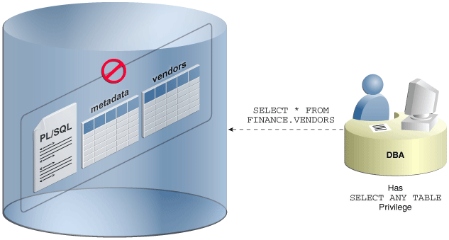
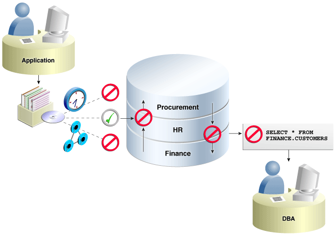

Oracle Database Vault enables you to control administrative access to your data.

- What Is Oracle Database Vault?
  Oracle Database Vault provides controls to prevent unauthorized privileged users from accessing sensitive data and to prevent unauthorized database changes.
- What Privileges Do You Need to Use Oracle Database Vault?
  Oracle Database Vault provides database roles that enable different users to perform specific tasks, based on separation-of-duty guidelines.
- Components of Oracle Database Vault
  Oracle Database Vault has a set of components that include PL/SQL packages and other special tools.
- How Oracle Database Vault Addresses Compliance Regulations
  One of the biggest side benefits resulting from regulatory compliance has been security awareness.
- How Oracle Database Vault Protects Privileged User Accounts
  Many security breaches, both external and internal, target privileged database user accounts to steal data from databases.
- How Oracle Database Vault Allows for Flexible Security Policies
  Oracle Database Vault helps you design flexible security policies for your database.
- How Oracle Database Vault Addresses Database Consolidation Concerns
  Consolidation and cloud environments reduce cost but can expose sensitive application data to those without a true need-to-know.
- How Oracle Database Vault Works in a Multitenant Environment
  You can implement three different configuration strategies when you use Oracle Databases Vault in a multitenant environment.

### 1.1 What Is Oracle Database Vault?

Oracle Database Vault provides controls to prevent unauthorized privileged users from accessing sensitive data and to prevent unauthorized database changes.

- About Oracle Database Vault
  The Oracle Database Vault security controls protect application data from unauthorized access, and helps you to comply with privacy and regulatory requirements.
- Controls for Privileged Accounts
  Privileged database accounts are one of the most commonly used pathways for gaining access to sensitive applications data in the database.
- Controls for Database Configuration
  Common audit findings are unauthorized changes to database entitlements and grants of the `DBA` role to too many users.
- Enterprise Applications Protection Policies
  Application-specific Oracle Database Vault protection policies and guidelines are available for major enterprise applications.

**Parent topic:** Introduction to Oracle Database Vault

#### 1.1.1 About Oracle Database Vault

The Oracle Database Vault security controls protect application data from unauthorized access, and helps you to comply with privacy and regulatory requirements.

Oracle Database Vault is a licensable option of Oracle Database Enterprise Edition. Its purpose is to mitigate the potential impact of privileged account abuse, misuse, insider and external threats, and human error on your sensitive data.

Privileged accounts can be administrator accounts, such as database administrators, or application administrators, application owners, or data analysts. Most users with these type of accounts have far more privileges and access than they need on a daily basis.

Oracle Database Vault is built into the kernel of the Oracle database and makes decisions after system or object privileges are verified. If the command is authorized by a system or object privilege, then Oracle Database Vault then determines if the command is controlled by an Oracle Database Vault realm or command rule. The realm or command rule controls are determined by you. Oracle Database Vault does not replace your existing existing grants or roles but augments them by allowing you to decide when, where, why, and how object or system privileges or roles are used by the grantee.

For example, any user who is granted the `SELECT ANY TABLE` system privilege can use their privilege to query virtually any table in the database, including tables you consider sensitive or important. Oracle Database Vault can restrict the `SELECT ANY TABLE` system privilege usage on your sensitive tables or other database objects. In addition, Oracle Database Vault can restrict privileged users and the object owner from performing destructive commands on objects. For example, `DROP TABLE` or `DROP INDEX` commands are rarely, or never, used on a production schema and should be disabled to prevent mistakes.

Oracle Database Vault helps you increase the security of existing applications through transparent controls that are determined by your requirements.

**Parent topic:** What Is Oracle Database Vault?

#### 1.1.2 Controls for Privileged Accounts

Privileged database accounts are one of the most commonly used pathways for gaining access to sensitive applications data in the database.

While their broad and unrestricted access facilitates database maintenance, the same access also creates a point of attack for gaining access to large amounts of data. Oracle Database Vault realms around application schemas, sensitive tables, and stored procedures provide controls to prevent privileged accounts from being exploited by intruders and insiders to access sensitive application data.

Figure 1-1 Oracle Database Vault Realm Blocking DBA Access to Data

[Description of "Figure 1-1 Oracle Database Vault Realm Blocking DBA Access to Data"](img_text/dvadm_vm_003.md)

**Parent topic:** What Is Oracle Database Vault?

#### 1.1.3 Controls for Database Configuration

Common audit findings are unauthorized changes to database entitlements and grants of the `DBA` role to too many users.

Preventing unauthorized changes to production environments is important not only for security, but also for compliance as such changes can weaken security and open doors to intruders, violating privacy and compliance regulations. Oracle Database Vault SQL command rules enable you to control operations inside the database, including commands such as `CREATE TABLE`, `TRUNCATE TABLE`, and `DROP TABLE`. Various out-of-the-box factors such as IP address, authentication method, and program name help implement trusted path authorization to deter attacks leveraging stolen passwords. These controls prevent accidental configuration changes and also prevent hackers and malicious insiders from tampering with applications.

The Oracle Database Vault realms with the mandatory mode enables you to seal off access to application objects, even to those with direct object grants, including the object owner. With mandatory realms, you do not need to analyze who has access because this is clear from the list of authorized users.

**Parent topic:** What Is Oracle Database Vault?

#### 1.1.4 Enterprise Applications Protection Policies

Application-specific Oracle Database Vault protection policies and guidelines are available for major enterprise applications.

These enterprise applications include Oracle Fusion Applications, Oracle E-Business Suit, Oracle PeopleSoft, Oracle Siebel, Oracle Financial Services (i-Flex), Oracle Primavera, SAP, and Finacle from Infosys. Because Oracle Database Vault does not modify the application nor require changes to the client, you can use it with most off-the-shelf and custom applications.

**Parent topic:** What Is Oracle Database Vault?

### 1.2 What Privileges Do You Need to Use Oracle Database Vault?

Oracle Database Vault provides database roles that enable different users to perform specific tasks, based on separation-of-duty guidelines.

The most commonly used roles are as follows:

- `DV_OWNER` and `DV_ADMIN` enable you to create and manage Database Vault policies.

- `DV_ACCTMGR` enables you to manage user accounts.

When you configure and enable Oracle Database Vault, the `DV_OWNER` role is granted to a user who must exist before you begin the configuration process, and the `DV_ACCTMGR` role is granted to a second, optional user, who must also exist before configuration. You can grant the Database Vault roles to other users, but ensure that these users are trusted.

During the registration process, you must create backup accounts for the `DV_OWNER` and `DV_ACCTMGR` users. As a best practice, Oracle strongly recommends that you keep and maintain these backup accounts.

**Related Topics**

- [Oracle Database Vault Roles](oracle-database-vault-schemas-roles-and-accounts.md)
- [Backup Oracle Database Vault Accounts](oracle-database-vault-schemas-roles-and-accounts.md)

**Parent topic:** Introduction to Oracle Database Vault

### 1.3 Components of Oracle Database Vault

Oracle Database Vault has a set of components that include PL/SQL packages and other special tools.

- Oracle Database Vault Access Control Components
  Oracle Database Vault enables you to create a set of components to manage security for your database instance.
- Oracle Database Vault DVSYS and DVF Schemas
  Oracle Database Vault database objects and public functions are stored in the `DVSYS` and `DVF` schemas, respectively.
- Oracle Database Vault PL/SQL Interfaces and Packages
  Oracle Database Vault provides PL/SQL interfaces and packages for security managers or application developers to configure access control policies.
- Oracle Database Vault Reporting and Monitoring Tools
  Oracle Enterprise Manager generates and maintains the Oracle Database Vault reports.
- Oracle Enterprise Manager Cloud Control Database Vault Administrator Pages
  Oracle Database Vault is pre-installed by default and can be enabled easily.

**Parent topic:** Introduction to Oracle Database Vault

#### 1.3.1 Oracle Database Vault Access Control Components

Oracle Database Vault enables you to create a set of components to manage security for your database instance.

These components are as follows:

- Realms. A realm is a protection zone inside the database where database schemas, objects, and roles can be secured. For example, you can secure a set of schemas, objects, and roles that are related to accounting, sales, or human resources. After you have secured these into a realm, you can use the realm to control the use of system and object privileges to specific accounts or roles. This enables you to provide fine-grained access controls for anyone who wants to use these schemas, objects, and roles [Configuring Realms](configuring-realms.md), discusses realms in detail. See also [Oracle Database Vault Realm APIs](oracle-database-vault-realm-apis.md).

- Command rules. A command rule is a special security policy that you can create to control how users can run almost any SQL statement, including `SELECT`, `ALTER SYSTEM`, database definition language (DDL), and data manipulation language (DML) statements. Command rules use rule sets to determine whether the statement is allowed. [Configuring Command Rules](configuring-command-rules.md), discusses command rules in detail. See also [Oracle Database Vault Command Rule APIs](oracle-database-vault-command-rule-apis.md).

- Rule sets. A rule set is a collection of one or more rules that you can associate with a realm authorization, command rule, factor assignment, or secure application role. The rule set evaluates to true or false based on the evaluation of each rule it contains and the evaluation type (All True or Any True). Rule sets can be associated with zero, one, or multiple realm authorizations, command rules, or secure application roles. [Configuring Rule Sets](configuring-rule-sets.md), discusses rule sets in detail. See also [Oracle Database Vault Rule Set APIs](oracle-database-vault-rule-set-apis.md).

- Rules. A rule is a PL/SQL expression that evaluates to true or false. You can use the same rule in multiple rule sets. For more information, see [How Rule Sets Work](configuring-rule-sets.md).

- Factors. A factor is a named variable or attribute, such as a user location, database IP address, or session user, which Oracle Database Vault can recognize and use as a trusted path. You can use factors in rules to control activities such as authorizing database accounts to connect to the database or the execution of a specific database command to restrict the visibility and manageability of data. Each factor can have one or more identities. An identity is the actual value of a factor. A factor can have several identities depending on the factor retrieval method or its identity mapping logic. [Configuring Factors](configuring-factors.md), discusses factors in detail. See also [Oracle Database Vault Factor APIs](oracle-database-vault-factor-apis.md).

- Secure application roles. A secure application role is a special Oracle Database role that can be enabled based on the evaluation of an Oracle Database Vault rule set. [Configuring Secure Application Roles for Oracle Database Vault](configuring-secure-application-roles-for-oracle-database-vault.md), discusses secure application roles in detail. See also [Oracle Database Vault Secure Application Role APIs](oracle-database-vault-secure-application-role-apis.md).

To augment these components, Oracle Database Vault provides a set of PL/SQL interfaces and packages. Oracle Database Vault PL/SQL Interfaces and Packages provides an overview.

In general, the first step you take is to create a realm composed of the database schemas or database objects that you want to secure. You can further secure the realm by creating rules, command rules, factors, identities, rule sets, and secure application roles. In addition, you can run reports on the activities these components monitor and protect. [Getting Started with Oracle Database Vault](getting-started-with-oracle-database-vault.md), provides a simple tutorial that will familiarize you with basic Oracle Database Vault functionality. Later chapters provide more advanced tutorials. [Oracle Database Vault Reports](oracle-database-vault-reports.md), provides more information about how you can run reports to check the configuration and other activities that Oracle Database Vault performs.

**Parent topic:** Components of Oracle Database Vault

#### 1.3.2 Oracle Database Vault DVSYS and DVF Schemas

Oracle Database Vault database objects and public functions are stored in the `DVSYS` and `DVF` schemas, respectively.

Oracle Database Vault provides a schema, `DVSYS`, which stores the database objects needed to process Oracle data for Oracle Database Vault. This schema contains the roles, views, accounts, functions, and other database objects that Oracle Database Vault uses. The `DVF` schema contains public functions to retrieve (at run time) the factor values set in the Oracle Database Vault access control configuration. The `DVSYS` and `DVF` schemas must exist in the container database and in any pluggable databases in which you want to use Oracle Database Vault. Both of these schemas are authenticated as schema-only accounts. They do not have authentication privileges, nor do they have passwords. These accounts are locked by default and should remain locked unless you are directed otherwise by Oracle Support.

**Related Topics**

- [Configuring and Enabling Oracle Database Vault with an Oracle Database in a Multitenant Environment](getting-started-with-oracle-database-vault.md)
- [Oracle Database Vault Schemas, Roles, and Accounts](oracle-database-vault-schemas-roles-and-accounts.md)

**Parent topic:** Components of Oracle Database Vault

#### 1.3.3 Oracle Database Vault PL/SQL Interfaces and Packages

Oracle Database Vault provides PL/SQL interfaces and packages for security managers or application developers to configure access control policies.

The PL/SQL procedures and functions allow the general database account to operate within the boundaries of access control policy in the context of a given database session.

See [Oracle Database Vault Realm APIs](oracle-database-vault-realm-apis.md) through [Oracle Database Vault API Reference](oracle-database-vault-api-reference.md) for more information.

**Parent topic:** Components of Oracle Database Vault

#### 1.3.4 Oracle Database Vault Reporting and Monitoring Tools

Oracle Enterprise Manager generates and maintains the Oracle Database Vault reports.

Oracle Database Vault provides database views that enable you to retrieve information about Oracle Database Vault configuration settings, including status and component information.

In addition, you can monitor policy changes, security violation attempts, and Oracle Database Vault configuration and structure changes through the Oracle Database unified audit trail by using Oracle Enterprise Manager, Oracle Audit Vault and Database Firewall, or Oracle Data Safe.

**Related Topics**

- [Oracle Database Vault Reports](oracle-database-vault-reports.md)
- [Monitoring Oracle Database Vault](monitoring-oracle-database-vault.md)

**Parent topic:** Components of Oracle Database Vault

#### 1.3.5 Oracle Enterprise Manager Cloud Control Database Vault Administrator Pages

Oracle Database Vault is pre-installed by default and can be enabled easily.

Oracle Database Vault administration is fully integrated with Oracle Enterprise Manager Cloud Control, providing security administrators with a streamlined and centralized interface to manage Oracle Database Vault.

Oracle Enterprise Manager Cloud Control provides a graphical user interface you can use to view and configure Oracle Database Vault policies and view Oracle Database Vault alerts and reports. Oracle Database Vault Administrator provides an extensive collection of security-related reports that assist in understanding the baseline security configuration. These reports also help point out deviations from this baseline.

[Getting Started with Oracle Database Vault](getting-started-with-oracle-database-vault.md) through [DBA Operations in an Oracle Database Vault Environment](dba-operations-in-an-oracle-database-vault-environment.md) explain how to use the Oracle Database Vault Administrator pages to configure access control policy defined in realms, command rules, factors, rule sets, secure application roles, and how to integrate Oracle Database Vault with other Oracle products. [Monitoring Oracle Database Vault](monitoring-oracle-database-vault.md) explains how to use these pages to monitor Database Vault activity, and [Oracle Database Vault Reports](oracle-database-vault-reports.md), explains Oracle Database Vault reporting.

**Parent topic:** Components of Oracle Database Vault

### 1.4 How Oracle Database Vault Addresses Compliance Regulations

One of the biggest side benefits resulting from regulatory compliance has been security awareness.

Historically, the focus of the information technology (IT) department has been on high availability and performance. The focus on regulatory compliance has required everyone to take a step back and look at their IT infrastructure, databases, and applications from a security angle. Common questions include:

- Where is the sensitive information stored?

- Who has access to this information?

Regulations such as the Sarbanes-Oxley Act, Health Insurance Portability and Accountability Act (HIPAA), International Convergence of Capital Measurement and Capital Standards: a Revised Framework (Basel II), Japan Privacy Law, Payment Card Industry Data Security Standard (PCI DSS), and the European Union Directive on Privacy and Electronic Communications have common themes that include internal controls, separation of duty, and access control.

While most changes required by regulations such as Sarbanes-Oxley and HIPAA are procedural in nature, the remainder may require technology investments. A common security requirement found in regulations is stringent internal controls. The degree to which Oracle Database Vault helps an organization achieve compliance varies with the regulation. In general, Oracle Database Vault realms, command rules, factors and separation of duty features, help reduce the overall security risks that regulation provisions worldwide address.

Table 1-1 lists regulations that address potential security threats.

Table 1-1 Regulations That Address Potential Security Threats

| Regulation                                                          | Potential Security Threat                        |
|:--------------------------------------------------------------------|:-------------------------------------------------|
| Sarbanes-Oxley Section 302                                          | Unauthorized changes to data                     |
| Sarbanes-Oxley Section 404                                          | Modification to data, unauthorized access        |
| Sarbanes-Oxley Section 409                                          | Denial of service, unauthorized access           |
| Gramm-Leach-Bliley                                                  | Unauthorized access, modification, or disclosure |
| Health Insurance Portability and Accountability Act (HIPAA) 164.306 | Unauthorized access to data                      |
| HIPAA 164.312                                                       | Unauthorized access to data                      |
| Basel II – Internal Risk Management                                 | Unauthorized access to data                      |
| CFR Part 11                                                         | Unauthorized access to data                      |
| Japan Privacy Law                                                   | Unauthorized access to data                      |
| EU Directive on Privacy and Electronic Communications               | Unauthorized access to data                      |
| Payment Card Industry Data Security Standard (PCI DSS)              | Unauthorized changes to data                     |

**Parent topic:** Introduction to Oracle Database Vault

### 1.5 How Oracle Database Vault Protects Privileged User Accounts

Many security breaches, both external and internal, target privileged database user accounts to steal data from databases.

Oracle Database Vault helps to protect against compromised privilege user account attacks by using realms, factors, and command rules. Combined, these provide powerful security tools to help secure access to databases, applications, and sensitive information. You can combine rules and factors to control the conditions under which commands in the database are allowed to execute, and to control access to data protected by a realm. For example, you can create rules and factors to control access to data based on IP addresses, the time of day, and specific program, such as JDBC, SQL Developer, or SQL\*Plus. These can limit access to only those connections that pass these conditions. This can prevent unauthorized access to application data and access to the database by unauthorized applications. For example, you could define a rule to limit execution of the `DROP TABLE` statement to a specific IP address and host name.

**Parent topic:** Introduction to Oracle Database Vault

### 1.6 How Oracle Database Vault Allows for Flexible Security Policies

Oracle Database Vault helps you design flexible security policies for your database.

For example, any database user who has the `DBA` role can use the `DROP ANY TABLE` system privilege granted to that role. Suppose an inexperienced administrator believes they are on a non-production database when they execute a `DROP TABLE` command and is instead on the production system and drops a critical application table. This will probably cause an application outage, data loss, and hours to recover from. With Oracle Database Vault, you can create a command rule to prevent this user from making such modifications by limiting their usage of the `DROP TABLE` statement. Furthermore, you can attach rule sets to the command rule to restrict activity further, such as limiting the statement's execution in the following ways:

- By time (for example, only outside of business hours of 8 a.m. to 6 p.m., Monday through Friday)

- By local access only, that is, not remotely

- Require two database users to authorize an action instead of one user

- If the user has an Oracle Database Vault secure application role enabled

- By host name or IP address (for example, the host name could be `%appserver%` or match an IP address of 192.0.2.150

You can customize Oracle Database Vault separation of duties to fit the requirements of business of any size. For example, large customers with dedicated IT staff and some out sourced back end operations can further fine tune separation of duties to control what out sourced database administrators can do. For smaller organizations with some users handling multiple responsibilities, separation of duties can be tuned down and these users can create separate dedicated accounts for each responsibility. This helps such users keep track of all actions made and prevents intruders from exploiting compromised privileged database accounts to steal sensitive data. In addition, it helps auditors verify compliance.

**Parent topic:** Introduction to Oracle Database Vault

### 1.7 How Oracle Database Vault Addresses Database Consolidation Concerns

Consolidation and cloud environments reduce cost but can expose sensitive application data to those without a true need-to-know.

Data from one country may be hosted in an entirely different country, but access to that data must be restricted based on regulations of the country to which the data belongs. Oracle Database Vault controls provide increased security for these environments by preventing database administrators from accessing the applications data. In addition, controls can be used to help block application bypass and enforce a trusted-path from the application tier to the application data.

Oracle Database Vault provides four distinct separation of duty controls for security administration:

- Day-to-day database administrator tasks using the default Oracle Database `DBA` role

- Security administrator tasks using the `DV_OWNER` and `DV_ADMIN` roles

- Account administrator tasks using the `DV_ACCTMGR` role

- Grants of roles and privileges by a named trusted user

Oracle Database Vault separation of duty controls can be customized and organizations with limited resources can assign multiple Oracle Database Vault responsibilities to the same administrator, but using separate accounts for each separation-of-duty role to minimize damage to the database if any one account is stolen and leveraged.

Oracle customers today still have hundreds and even thousands of databases distributed throughout the enterprise and around the world. However, for database consolidation as a cost-saving strategy in the coming years to be effective, the physical security provided by the distributed database architecture must be available in the consolidated environment. Oracle Database Vault addresses the primary security concerns of database consolidation.

Figure 1-2 illustrates how Oracle Database Vault addresses the following database security concerns:

- Administrative privileged account access to application data: In this case, Oracle Database Vault prevents the database administrator from accessing the schemas that are protected by the Finance realm. Although the database administrator is the most powerful and trusted user, this administrator does not need access to application data residing within the database.

- Separation of duties for application data access: In this case, the `HR` realm owner has access to the `HR` realm schemas but not `Procurement` or `Finance`.

Figure 1-2 Oracle Database Vault Security

[Description of "Figure 1-2 Oracle Database Vault Security"](img_text/dvadm_vm_002.md)

Database consolidation can result in multiple powerful user accounts residing in a single database. This means that in addition to the overall database administrator, individual application schema owners also may have powerful privileges. Revoking some privileges may adversely affect existing applications. Using Oracle Database Vault realms, you can enforce access to applications through a trusted application path, preventing the application schema user name and password from being used by anyone other than the application itself. For example, a database administrator who has the `SELECT ANY TABLE` system privilege can be prevented from using that privilege to view other application data residing in the same database.

**Parent topic:** Introduction to Oracle Database Vault

### 1.8 How Oracle Database Vault Works in a Multitenant Environment

You can implement three different configuration strategies when you use Oracle Databases Vault in a multitenant environment.

- About How Oracle Database Vault Works in a Multitenant Environment
  Using Oracle Database Vault in a multitenant environment increases security for database consolidation.
- Oracle Database Vault Configured and Enabled in One or More PDBs
  The use of Oracle Database Vault is optional in the pluggable databases (PDBs) that are associated with an enabled container database (CDB).
- Operations Control Enabled in the CDB without Enabling Oracle Database Vault in a PDB
  Oracle Database Vault operations control can separate application data in the pluggable database (PDB) from the common privileged users in the container database (CDB).
- Oracle Database Vault and Oracle Operations Control Enabled Together
  Oracle Database Vault and operations control in a multitenant environment can easily work together.
- Oracle Database Vault in Regular or Strict Mode in a Multitenant Environment
  You can configure regular or strict mode when you enable Oracle Database Vault in the container database (CDB).
- Oracle Database Vault Common Objects in a Multitenant Environment
  When you configure a pluggable database (PDB) that has Database Vault enabled, the `DVSYS` schema is a common user schema that is stored in container database (CDB) root.
- Oracle Database Vault in an Application Containers Environment
  Oracle Database Vault can protect the data and metadata in the application container root and in each clone of the application container.

**Parent topic:** Introduction to Oracle Database Vault

#### 1.8.1 About How Oracle Database Vault Works in a Multitenant Environment

Using Oracle Database Vault in a multitenant environment increases security for database consolidation.

To use Oracle Database Vault in an Oracle multitenant environment, you must first configure and enable it in the container database. Afterward, you can use Oracle Database Vault in any of the following different configuration strategies:

- Configure and enable Oracle Database Vault in one or more pluggable databases (PDBs).

- Enable Oracle Database Vault operations control in the container database without enabling Oracle Database Vault in a PDB.

- Enable both Oracle Database Vault and Oracle operations control together.

A multitenant environment affects Oracle Database Vault in the following additional ways:

- How you enable regular or strict mode

- How common objects are treated

- How application containers affect Oracle Database Vault

**Related Topics**

- [Realms in a Multitenant Environment](configuring-realms.md)
- [Rule Sets and Rules in a Multitenant Environment](configuring-rule-sets.md)
- [Command Rules in a Multitenant Environment](configuring-command-rules.md)
- [Converting a Standalone Oracle Database to a PDB and Plugging It into a CDB](dba-operations-in-an-oracle-database-vault-environment.md)

**Parent topic:** How Oracle Database Vault Works in a Multitenant Environment

#### 1.8.2 Oracle Database Vault Configured and Enabled in One or More PDBs

The use of Oracle Database Vault is optional in the pluggable databases (PDBs) that are associated with an enabled container database (CDB).

You can enable Oracle Database Vault on none, a select few, or all PDBs. You must configure and enable Oracle Database Vault on each of the PDBs that yoyu want to use it on. Doing so enables you to enforce the separation of responsibilities through database roles, realms, command rules, and authorizations that Oracle Database Vault provides.

**Parent topic:** How Oracle Database Vault Works in a Multitenant Environment

#### 1.8.3 Operations Control Enabled in the CDB without Enabling Oracle Database Vault in a PDB

Oracle Database Vault operations control can separate application data in the pluggable database (PDB) from the common privileged users in the container database (CDB).

After you configure and enable Oracle Database in the CDB, you can enable operations control from the CDB so that you can protect all associated PDBs. One of the benefits of operations control is it does not require Oracle Database Vault to be enabled in the PDBs, but it separates the container users, and container privileged users, from accessing non-Oracle-maintained schema data in all PDBs. In a multitenant environment, this enables you to enforce separation of duties from the CDB without changing the way the PDB is maintained. This use case can be very important in organizations providing database-as-a-service (DBaaS) where the database infrastructure, including the CDB, is centrally maintained but each of the PDBs have their own database administrators or application administrators.

**Related Topics**

- [DBA Operations in an Oracle Database Vault Environment](dba-operations-in-an-oracle-database-vault-environment.md)

**Parent topic:** How Oracle Database Vault Works in a Multitenant Environment

#### 1.8.4 Oracle Database Vault and Oracle Operations Control Enabled Together

Oracle Database Vault and operations control in a multitenant environment can easily work together.

After both Oracle Database Vault and operations control are enabled in the container database (CDB), you can enable Oracle Database Vault on any or no pluggable databases (PDBs).

As in the use case in which you only enabled operations control in the CDB without enabling Oracle Database Vault in the PDB, operations control will prevent the container-based privileged users from accessing application data in any of the pluggable databases. In addition, with Oracle Database Vault enabled in a PDB, the benefits of separation of duties, roles, realms, command rules, and authorizations protect the application data from privileged users in the PDB.

The combination of operations control and Oracle Database Vault proivide the security, and flexibility, to separate container administrators from application data in PDBs and protect that application data from misuse, abuse, curious insiders, or human errors.

**Parent topic:** How Oracle Database Vault Works in a Multitenant Environment

#### 1.8.5 Oracle Database Vault in Regular or Strict Mode in a Multitenant Environment

You can configure regular or strict mode when you enable Oracle Database Vault in the container database (CDB).

Either of the following command will enable regular mode:

    EXEC DBMS_MACADM.ENABLE_DV;

    EXEC DBMS_MACADM.ENABLE_DV (strict_mode => 'n');

To enable strict mode, you run the following command:

    EXEC DBMS_MACADM.ENABLE_DV (strict_mode => 'y');

If you choose the default, non-strict, mode, then PDBs with Oracle Database Vault enabled, or disabled, continue to function normally as long as Oracle Database Vault is enabled in the CDB. If you enable Oracle Database Vault using strict mode, then the PDBs with Oracle Database Vault disabled will operate in restricted mode.

Before the PDBs can be opened in read/write mode, Oracle Database Vault must be configured and enabled in the PDB or strict mode must be disabled in the CDB.

**Parent topic:** How Oracle Database Vault Works in a Multitenant Environment

#### 1.8.6 Oracle Database Vault Common Objects in a Multitenant Environment

When you configure a pluggable database (PDB) that has Database Vault enabled, the `DVSYS` schema is a common user schema that is stored in container database (CDB) root.

This means that all the objects within the `DVSYS` schema (tables, data dictionary views, user accounts, PL/SQL packages, default policies, and so on) are subject to the common privileges available for this schema. In other words, you can create realms, factors, and so on in the root to protect the schema in the CDB root. Ensure that you configure Oracle Database Vault in the CDB root first before you configure it in the associated PDBs.

**Parent topic:** How Oracle Database Vault Works in a Multitenant Environment

#### 1.8.7 Oracle Database Vault in an Application Containers Environment

Oracle Database Vault can protect the data and metadata in the application container root and in each clone of the application container.

A container database (CDB) includes zero or more application containers. Within an application container, an application is the named, versioned set of common data and metadata stored in the application root. You can, for example, create multiple sales-related PDBs within one application container, with these pluggable databases (PDBs) sharing an application that consists of a set of common tables and table definitions. You can store multiple human resources-related PDBs within a separate application container, with their own common tables and table definitions.

By combining Oracle Database Vault and application containers, you can configure common realms in the application root only, but you can create common rule sets and command rules in either the application root or the container database root. A common command rule in the application root applies to its associated pluggable databases, and common command rules in the container root apply to all pluggable databases in the container database environment. The ability to create common realms and command rules enables you to create policies that use a shared set of realms, rule sets, or command rules throughout the container databases, rather than having to create these same components for every pluggable database in the multitenant environment.

You can create individual local policies for each PDB. When you use Oracle Database Vault to protect an object, Oracle Database Vault subjects common privileges for common objects to the same enforcement rules as local system privileges.

**Parent topic:** How Oracle Database Vault Works in a Multitenant Environment
