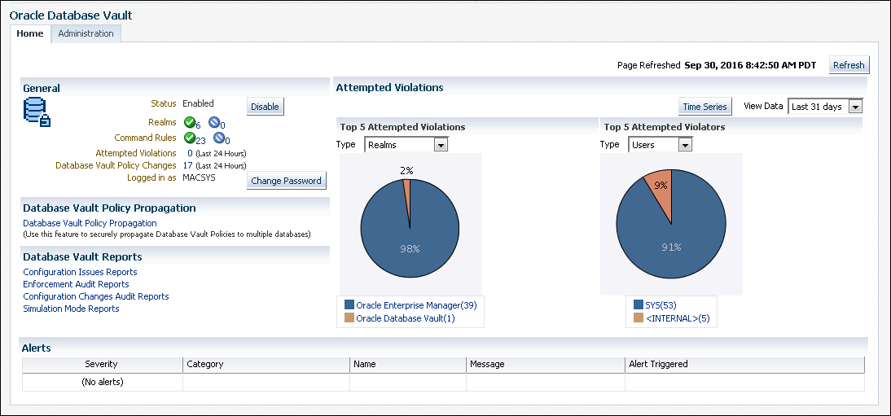

You can monitor Oracle Database Vault by checking for violations to the Database Vault configurations and by tracking changes to policies.

- About Monitoring Oracle Database Vault
  You can use the Database Vault home page in Oracle Enterprise Manager Cloud Control to monitor a Database Vault-enabled database.
- Monitoring Security Violations and Configuration Changes
  A user who has been granted the appropriate role can use Oracle Database Vault Administrator to monitor security violations and configuration changes.

### 25.1 About Monitoring Oracle Database Vault

You can use the Database Vault home page in Oracle Enterprise Manager Cloud Control to monitor a Database Vault-enabled database.

This feature displays the top five attempted violations and who the top five attempted violators are. The attempted violations cover violations to realms and to command rules. The attempted violators is categorized into users and client hosts. By clicking the Oracle Database Vault link under Top 5 Attempted Violations, you can find details such as the type of violation, when it occurred, who the user was, and so on. Similarly, if you click the user link (for example, SYS) under Top 5 Attempted Violators, you can find detailed information about each violator, such as the action they performed, the client host name where the action originated, and when the violation occurred. You can manually refresh the data, and restrict the data view, such as within the last 24 hours. This page also shows a table listing all alerts that have been generated.

Before you can view these events, if you have not migrated your database to unified auditing, then you must ensure that the `AUDIT_TRAIL` initialization parameter is set to `DB` or `DB, EXTENDED`. If you have migrated your database to use unified auditing, then you do not need to configure any additional settings. You are ready to check for security violations.

**Related Topics**

- [Oracle Database Vault Reports](oracle-database-vault-reports.md)

**Parent topic:** Monitoring Oracle Database Vault

### 25.2 Monitoring Security Violations and Configuration Changes

A user who has been granted the appropriate role can use Oracle Database Vault Administrator to monitor security violations and configuration changes.

1.  Log in to Oracle Database Vault Administrator from Cloud Control as a user who has been granted the `DV_OWNER`, `DV_ADMIN`, or `DV_SECANALYST` role and the `SELECT ANY DICTIONARY` privilege. [Logging in to Oracle Database Vault from Oracle Enterprise Cloud Control](getting-started-with-oracle-database-vault.md) explains how to log in.
2.  Select the Home tab.
    A page similar to the following appears:

    
    [Description of the illustration em_dv_home_page.png](img_text/em_dv_home_page.md)
3.  To find attempted violations for a specific time, such as the last 7 days, select from the menu under the Time Series button in the upper right corner.
    You also can change the pie chart to a graph by clicking the Time Series button.
4.  To find the Configuration Issues Reports, Enforcement Audit Reports, Configuration Changes Audit Reports, and Simulation Mode Reports, select the appropriate link under Database Vault reports.
    See [Oracle Database Vault Reports](oracle-database-vault-reports.md) for detailed information about the Database Vault reports.

**Parent topic:** Monitoring Oracle Database Vault
