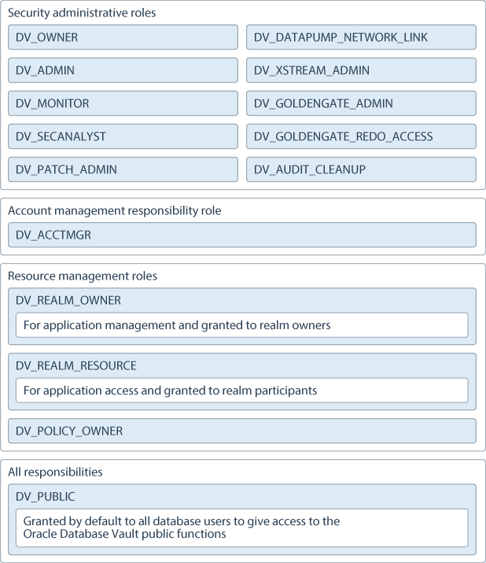
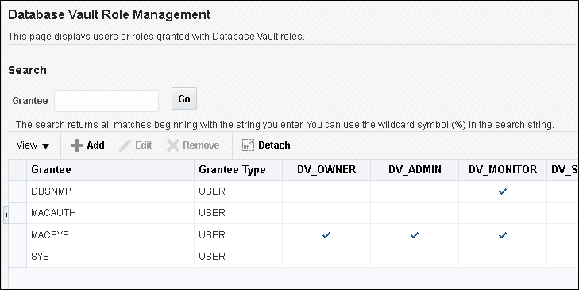
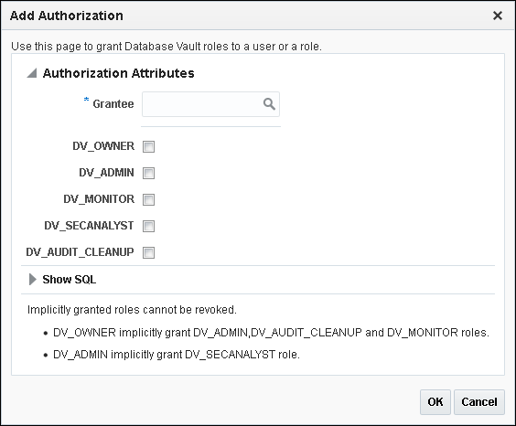

Oracle Database Vault provides schemas that contain Database Vault objects, roles that provide separation of duty for specific tasks, and default user accounts.

- Oracle Database Vault Schemas
  The Oracle Database Vault schemas, `DVSYS` and `DVF`, support the administration and run-time processing of Oracle Database Vault.
- Oracle Database Vault Roles
  Oracle Database Vault provides default roles that are based on specific user tasks and adhere to separation of duty concepts.
- Oracle Database Vault Accounts Created During Registration
  You must create accounts for the Oracle Database Vault Owner and Oracle Database Vault Account Manager during the registration process.
- Backup Oracle Database Vault Accounts
  As a best practice, you should maintain backup accounts for the `DV_OWNER` and `DV_ACCTMGR` roles.

### 13.1 Oracle Database Vault Schemas

The Oracle Database Vault schemas, `DVSYS` and `DVF`, support the administration and run-time processing of Oracle Database Vault.

- DVSYS Schema
  The `DVSYS` schema contains Oracle Database Vault database objects.
- DVF Schema
  The `DVF` schema is the owner of the Oracle Database Vault `DBMS_MACSEC_FUNCTION` PL/SQL package.

**Parent topic:** Oracle Database Vault Schemas, Roles, and Accounts

#### 13.1.1 DVSYS Schema

The `DVSYS` schema contains Oracle Database Vault database objects.

These objects store Oracle Database Vault configuration information and support the administration and run-time processing of Oracle Database Vault.

In a default installation, the `DVSYS` schema is locked. The `DVSYS` schema also owns the `AUDIT_TRAIL$` table.

In a multitenant environment, the `DVSYS` schema is considered a common schema, which means that the objects within `DVSYS` (tables, views, PL/SQL packages, and so on) are automatically available to any child pluggable databases (PDBs). In addition, the `DVSYS` schema account cannot switch to other containers using the `ALTER SESSION` statement.

Oracle Database Vault secures the `DVSYS` schema by using a protected schema design. A protected schema design guards the schema against improper use of system privileges (for example, `SELECT ANY TABLE`, `CREATE ANY VIEW`, or `DROP ANY`).

Oracle Database Vault protects and secures the `DVSYS` schema in the following ways:

- The `DVSYS` protected schema and its administrative roles cannot be dropped. By default, the `DVSYS` account is locked.

- By default, users cannot directly log into the `DVSYS` account. To control the ability of users to directly log into this account, you can run the `DBMS_MACADM.DISABLE_DV_DICTIONARY_ACCTS` procedure to prevent users from logging in and the `DBMS_MACADM.ENABLE_DV_DICTIONARY_ACCTS` procedure to allow users to log in.

- Statements such as `CREATE USER`, `ALTER USER`, `DROP USER`, `CREATE PROFILE`, `ALTER PROFILE`, and `DROP PROFILE` can only be issued by a user with the `DV_ACCTMGR` role. A user logged in with the `SYSDBA` administrative privilege can issue these statements only if it is allowed to do so by modifying the Can Maintain Accounts/Profiles rule set.

- The powerful `ANY` system privileges for database definition language (DDL) and data manipulation language (DML) commands are blocked in the protected schema. This means that the objects in the `DVSYS` schema must be created by the schema account itself. Also, access to the schema objects must be authorized through object privilege grants.

- Object privileges in the `DVSYS` schema can only be granted to Database Vault administrative roles in the schema. This means that users can access the protected schema only through predefined administrative roles.

- Only the protected schema account `DVSYS` can issue `ALTER ROLE` statements on Database Vault predefined administrative roles of the schema. Oracle Database Vault Roles describes Oracle Database Vault predefined administrative roles in detail.

- The `SYS.DBMS_SYS_SQL.PARSE_AS_USER` procedure cannot be used to run SQL statements on behalf of the protected schema `DVSYS`.

**Note:**

Database users can grant additional object privileges and roles to the Oracle Database Vault administrative roles (`DV_ADMIN` and `DV_OWNER`, for example) provided they have sufficient privileges to do so.

**Parent topic:** Oracle Database Vault Schemas

#### 13.1.2 DVF Schema

The `DVF` schema is the owner of the Oracle Database Vault `DBMS_MACSEC_FUNCTION` PL/SQL package.

This package contains the functions that retrieve factor identities. After you install Oracle Database Vault, the installation process locks the `DVF` account to better secure it. When you create a new factor, Oracle Database Vault creates a new retrieval function for the factor and saves it in this schema.

In a multitenant environment, the `DVF` user cannot switch to other containers using the `ALTER SESSION` statement.

By default, users cannot directly log into the `DVF` account. To control the ability of users to directly log into this account, you can run the `DBMS_MACADM.DISABLE_DV_DICTIONARY_ACCTS` procedure to prevent users from logging in and the `DBMS_MACADM.ENABLE_DV_DICTIONARY_ACCTS` procedure to allow users to log in.

**Parent topic:** Oracle Database Vault Schemas

### 13.2 Oracle Database Vault Roles

Oracle Database Vault provides default roles that are based on specific user tasks and adhere to separation of duty concepts.

- About Oracle Database Vault Roles
  Oracle Database Vault provides a set of roles that are required for managing Oracle Database Vault.
- Privileges of Oracle Database Vault Roles
  The Oracle Database Vault roles are designed to provide the maximum benefits of separation of duty.
- Granting Oracle Database Vault Roles to Users
  You can use Enterprise Manager Cloud Control to grant Oracle Database Vault roles to users.
- DV_OWNER Database Vault Owner Role
  The `DV_OWNER` role enables you to manage the Oracle Database Vault roles and its configuration.
- DV_ADMIN Database Vault Configuration Administrator Role
  The `DV_ADMIN` role controls the Oracle Database Vault PL/SQL packages.
- DV_MONITOR Database Vault Monitoring Role
  The `DV_MONITOR` role is used for monitoring Oracle Database Vault.
- DV_SECANALYST Database Vault Security Analyst Role
  The `DV_SECANALYST` role enables users to analyze activities.
- DV_AUDIT_CLEANUP Audit Trail Cleanup Role
  The `DV_AUDIT_CLEANUP` role is used for purge operations.
- DV_DATAPUMP_NETWORK_LINK Data Pump Network Link Role
  The `DV_DATAPUMP_NETWORK_LINK` role is used for Data Pump import operations.
- DV_XSTREAM_ADMIN XStream Administrative Role
  The `DV_XSTREAM_ADMIN` role is used for Oracle XStream.
- DV_GOLDENGATE_ADMIN GoldenGate Administrative Role
  The `DV_GOLDENGATE_ADMIN` role is used with Oracle GoldenGate.
- DV_GOLDENGATE_REDO_ACCESS GoldenGate Redo Log Role
  The `DV_GOLDENGATE_REDO_ACCESS` role is used with Oracle GoldenGate.
- DV_PATCH_ADMIN Database Vault Database Patch Role
  The `DV_PATCH_ADMIN` role is used for patching operations.
- DV_ACCTMGR Database Vault Account Manager Role
  The `DV_ACCTMGR` role is a powerful role, used for accounts management.
- DV_REALM_OWNER Database Vault Realm DBA Role
  The `DV_REALM_OWNER` role is used for realm management.
- DV_REALM_RESOURCE Database Vault Application Resource Owner Role
  The `DV_REALM_RESOURCE` role is use for the management of realm resources.
- DV_POLICY_OWNER Database Vault Owner Role
  The `DV_POLICY_OWNER` role enables database users to manage to a limited degree Oracle Database Vault policies.
- DV_PUBLIC Database Vault PUBLIC Role
  The `DV_PUBLIC` role is no longer used.

**Parent topic:** Oracle Database Vault Schemas, Roles, and Accounts

#### 13.2.1 About Oracle Database Vault Roles

Oracle Database Vault provides a set of roles that are required for managing Oracle Database Vault.

The following illustration shows how these roles are designed to implement the first level of separation of duties within the database. How you use these roles depends on the requirements that your company has in place.

Figure 13-1 How Oracle Database Vault Roles Are Categorized

[Description of "Figure 13-1 How Oracle Database Vault Roles Are Categorized"](img_text/dvadm_vm_001b-19c.md)

**Note:**

You can grant additional object privileges and roles to the Oracle Database Vault roles to extend their scope of privileges. For example, a user logged in with the `SYSDBA` administrative privilege can grant object privileges to an Oracle Database Vault role as long as the object is not in the `DVSYS` schema or realm.

**Related Topics**

- [Separation of Duty Guidelines](oracle-database-vault-security-guidelines.md)
- [Managing Oracle Database Administrative Accounts](oracle-database-vault-security-guidelines.md)

**Parent topic:** Oracle Database Vault Roles

#### 13.2.2 Privileges of Oracle Database Vault Roles

The Oracle Database Vault roles are designed to provide the maximum benefits of separation of duty.

The `DV_PATCH_ADMIN`, `DV_XSTREAM`, `DV_GOLDENGATE_ADMIN`, and `DV_GOLDENGATE_REDO_ACCESS` roles are not included in the following sections because they have no system privileges.

##### DVSYS Schema, EXECUTE Privilege

Roles that can use this privilege:

- `DV_ADMIN` (includes the `EXECUTE` privilege on all Oracle Database Vault PL/SQL packages)
- `DV_OWNER` (includes the `EXECUTE` privilege on all Oracle Database Vault PL/SQL packages)
- `DV_POLICY_OWNER` (on some `DBMS_MACADM` procedures)

Roles that are denied this privilege:

- `DV_ACCTMGR`
- `DV_AUDIT_CLEANUP`
- `DV_MONITOR`
- `DV_PUBLIC`
- `DV_REALM_OWNER`
- `DV_REALM_RESOURCE`
- `DV_SECANALYST`

##### DVSYS Schema, SELECT Privilege

Roles that can use this privilege:

- `DV_ADMIN`
- `DV_AUDIT_CLEANUP` (on some Database Vault tables and views; can perform `SELECT` statements on the `AUDIT_TRAIL$` table, and the `DV$ENFORCEMENT_AUDIT` and `DV$CONFIGURATION_AUDIT` views)
- `DV_MONITOR`
- `DV_OWNER`
- `DV_POLICY_OWNER` (on some `DBMS_MACADM` procedures and on `POLICY_OWNER`\* views only)
- `DV_SECANALYST` (on some Database Vault views: `DV_SECANALYST` can query `DVSYS` schema objects through Oracle Database Vault-supplied views)

Roles that are denied this privilege:

- `DV_ACCTMGR`
- `DV_PUBLIC`
- `DV_REALM_OWNER`
- `DV_REALM_RESOURCE`

##### DVSYS Schema, DELETE Privilege

Roles that can use this privilege:

- `DV_AUDIT_CLEANUP` (can perform `DELETE` on some Database Vault tables and views, on the `AUDIT_TRAIL$` table, and the `DV$ENFORCEMENT_AUDIT` and `DV$CONFIGURATION_AUDIT` views)
- `DV_OWNER` (can perform `DELETE` on some Database Vault tables and views, on the `AUDIT_TRAIL$` table, and the `DV$ENFORCEMENT_AUDIT` and `DV$CONFIGURATION_AUDIT` views)

Roles that are denied this privilege:

- `DV_ACCTMGR`
- `DV_ADMIN`
- `DV_MONITOR`
- `DV_POLICY_OWNER`
- `DV_PUBLIC`
- `DV_REALM_OWNER`
- `DV_REALM_RESOURCE`
- `DV_SECANALYST`

##### DVSYS Schema, Grant Privileges on Objects

Roles that can use this privilege: None

Roles that are denied this privilege:

- `DV_ACCTMGR`
- `DV_ADMIN`
- `DV_AUDIT_CLEANUP`
- `DV_MONITOR`
- `DV_OWNER`
- `DV_POLICY_OWNER`
- `DV_PUBLIC`
- `DV_SECANALYST`
- `DV_REALM_OWNER`
- `DV_REALM_RESOURCE`

##### DVF Schema, EXECUTE Privilege

Roles that can use this privilege:

- `DV_OWNER`

Roles that are denied this privilege:

- `DV_ACCTMGR`
- `DV_ADMIN`
- `DV_AUDIT_CLEANUP`
- `DV_MONITOR`
- `DV_OWNER`
- `DV_POLICY_OWNER`
- `DV_PUBLIC`
- `DV_REALM_OWNER`
- `DV_REALM_RESOURCE`
- `DV_SECANALYST`

##### DVF Schema, SELECT Privilege

Roles that can use this privilege:

- `DV_OWNER`
- `DV_SECANALYST`

Roles that are denied this privilege:

- `DV_ACCTMGR`
- `DV_ADMIN`
- `DV_AUDIT_CLEANUP`
- `DV_MONITOR`
- `DV_POLICY_OWNER`
- `DV_PUBLIC`
- `DV_REALM_OWNER`
- `DV_REALM_RESOURCE`

##### Monitor Database Vault Privilege

Roles that can use this privilege:

- `DV_ADMIN`
- `DV_OWNER`
- `DV_MONITOR`
- `DV_SECANALYST`

Roles that are denied this privilege:

- `DV_ACCTMGR`
- `DV_AUDIT_CLEANUP`
- `DV_POLICY_OWNER`
- `DV_PUBLIC`
- `DV_REALM_OWNER`
- `DV_REALM_RESOURCE`

##### Run Database Vault Reports Privilege

Roles that can use this privilege:

- `DV_ADMIN`
- `DV_OWNER`
- `DV_SECANALYST`

Roles that are denied this privilege:

- `DV_ACCTMGR`
- `DV_AUDIT_CLEANUP`
- `DV_MONITOR`
- `DV_POLICY_OWNER`
- `DV_PUBLIC`
- `DV_REALM_OWNER`
- `DV_REALM_RESOURCE`

##### SYS Schema, SELECT Privilege

Roles that can use this privilege:

- `DV_MONITOR`
- `DV_OWNER`
- `DV_SECANALYST` (on the same system views as `DV_OWNER` and `DV_ADMIN`)

Roles that are denied this privilege:

- `DV_ACCTMGR`
- `DV_ADMIN`
- `DV_AUDIT_CLEANUP`
- `DV_POLICY_OWNER`
- `DV_PUBLIC`
- `DV_REALM_OWNER`
- `DV_REALM_RESOURCE`

##### SYSMAN Schema, SELECT Privilege

Roles that can use this privilege:

- `DV_OWNER` (portions of `SYSMAN`)
- `DV_SECANALYST` (portions of `SYSMAN`)

Roles that are denied this privilege:

- `DV_ACCTMGR`
- `DV_ADMIN`
- `DV_AUDIT_CLEANUP`
- `DV_MONITOR`
- `DV_POLICY_OWNER`
- `DV_PUBLIC`
- `DV_REALM_OWNER`
- `DV_REALM_RESOURCE`

##### CREATE , ALTER , DROP User Accounts and Profiles Privilege

This privilege does not include the ability to drop or alter the `DVSYS` account, nor change the `DVSYS` password.

Role that can use this privilege:

- `DV_ACCTMGR`

Roles that are denied this privilege:

- `DV_ADMIN`
- `DV_AUDIT_CLEANUP`
- `DV_MONITOR`
- `DV_OWNER`
- `DV_POLICY_OWNER`
- `DV_PUBLIC`
- `DV_REALM_OWNER`
- `DV_REALM_RESOURCE`
- `DV_SECANALYST`

##### Manage Objects in Schemas that Define a Realm

This privilege includes `ANY` privileges, such as `CREATE ANY` , `ALTER ANY` , and `DROP ANY`.

Role that can use this privilege:

- `DV_REALM_OWNER` (The user with this role also must be the realm participant or owner to exercise his or her system privileges.)

Roles that are denied this privilege:

- `DV_ACCTMGR`
- `DV_AUDIT_CLEANUP`
- `DV_ADMIN`
- `DV_MONITOR`
- `DV_OWNER` (portions of `SYSMAN`)
- `DV_POLICY_OWNER`
- `DV_PUBLIC`
- `DV_REALM_RESOURCE`
- `DV_SECANALYST` (portions of `SYSMAN`)

##### RESOURCE Role Rrivileges

The `RESOURCE` role provides the following system privileges: `CREATE CLUSTER` , `CREATE INDEXTYPE` , `CREATE OPERATOR` , `CREATE PROCEDURE` , `CREATE SEQUENCE` , `CREATE TABLE` , `CREATE TRIGGER`, `CREATE TYPE`.

Role that can use this privilege:

- `DV_REALM_RESOURCE`

Roles that are denied this privilege:

- `DV_ACCTMGR`
- `DV_ADMIN`
- `DV_AUDIT_CLEANUP`
- `DV_MONITOR`
- `DV_OWNER` (portions of `SYSMAN`)
- `DV_POLICY_OWNER`
- `DV_PUBLIC`
- `DV_REALM_OWNER`
- `DV_SECANALYST` (portions of `SYSMAN`)

**Parent topic:** Oracle Database Vault Roles

#### 13.2.3 Granting Oracle Database Vault Roles to Users

You can use Enterprise Manager Cloud Control to grant Oracle Database Vault roles to users.

1.  From Cloud Control, log into Oracle Database Vault Administrator as a user who has been granted the `DV_OWNER` role and the `SELECT ANY DICTIONARY` privilege..
    [Logging in to Oracle Database Vault from Oracle Enterprise Cloud Control](getting-started-with-oracle-database-vault.md) explains how to log in.

    Refer to the role descriptions to find the requirements for who can grant roles to other users.
2.  In the Administration page, under Database Vault Components, click Database Vault Role Management.
    The Database Vault Role Management page appears.
    
    [Description of the illustration em_role_grant2.png](img_text/em_role_grant2.md)
3.  Do one of the following:
    - To add a new user or role for a grant, click the Add button to display the Add Authorization dialog box. Enter the grantee in the Grantee field, and then select the roles for the grant. Then click OK.
      
      [Description of the illustration em_role_grant1.png](img_text/em_role_grant1.md)

    <!-- -->

    - To grant different roles or modify role grants for a user or role listed in the Database Vault Role Management page, select the user or role, click Edit, and then modify the role grants as necessary. Then click OK.

**Parent topic:** Oracle Database Vault Roles

#### 13.2.4 DV_OWNER Database Vault Owner Role

The `DV_OWNER` role enables you to manage the Oracle Database Vault roles and its configuration.

In this guide, the example account that uses this role is `sec_admin_owen`.

##### Privileges Associated with the DV_OWNER Role

The `DV_OWNER` role has the administrative capabilities that the `DV_ADMIN` role provides, and the reporting capabilities the `DV_SECANALYST` role provides.

This role also provides privileges for monitoring Oracle Database Vault. It is created when you install Oracle Database Vault, and has the most privileges on the `DVSYS` schema. It also has the `DV_ADMIN` role.

To find the full list of system and object privileges associated with the `DV_OWNER` role, you can log into the database instance and enter the following queries:

    SELECT TABLE_NAME, OWNER, PRIVILEGE FROM DBA_TAB_PRIVS WHERE GRANTEE = 'DV_OWNER';
    SELECT PRIVILEGE FROM DBA_SYS_PRIVS WHERE GRANTEE = 'DV_OWNER';

When you configure and enable Oracle Database Vault, the `DV_OWNER` account is created. The user who is granted this role is also granted the `ADMIN` option and can grant any Oracle Database Vault roles (except `DV_ACCTMGR`) to any account. Users granted this role also can run Oracle Database Vault reports and monitor Oracle Database Vault.

**Tip:**

Oracle strongly recommends that you create separate, named account for the `DV_OWNER` user. This way, if the user is no longer available (for example, he or she left the company), then you can easily recreate this user account and then grant this user the `DV_OWNER` role.

##### How Are GRANT and REVOKE Operations Affected by DV_OWNER?

Anyone with the `DV_OWNER` role can grant the `DV_OWNER` and `DV_ADMIN` roles to another user.

The account granted this role can revoke any granted Database Vault role from another account. Accounts such as `SYS` or `SYSTEM`, with the `GRANT ANY ROLE` system privilege alone (directly granted or indirectly granted using a role) do not have the right to grant or revoke the `DV_OWNER` role to or from any other database account. Note also that a user with the `DV_OWNER` role cannot grant or revoke the `DV_ACCTMGR` role.

##### Managing Password Changes for Users Who Have the DV_OWNER Role

Before you can change the password for another user who has been granted the `DV_OWNER` role, you must revoke the `DV_OWNER` role from that user account.

However, be cautious about revoking the `DV_OWNER` role. At least one user on your site must have this role granted. If another `DV_OWNER` user has been granted this role and needs to have his or her password changed, then you can temporarily revoke `DV_OWNER` from that user. Note also that if you have been granted the `DV_OWNER` role, then you can change your own password without having to revoke the role from yourself.

To change the `DV_OWNER` user password:

1.  Log into the database instance using an account that has been granted the `DV_OWNER` role.

2.  Revoke the `DV_OWNER` role from the user account whose password needs to change.

3.  Connect as a user who has been granted the `DV_ACCTMGR` role and then change the password for this user.

4.  Connect as the `DV_OWNER` user and then grant the `DV_OWNER` role back to the user whose password you changed.

##### DV_OWNER Status When Oracle Database Vault Security Is Disabled

The protection of all Oracle Database Vault roles is enforced only if Oracle Database Vault is enabled.

If Oracle Database Vault is disabled, then any account with the `GRANT ANY ROLE` system privilege can perform `GRANT` and `REVOKE` operations on protected Database Vault roles.

**Related Topics**

- [Disabling and Enabling Oracle Database Vault](disabling-and-enabling-oracle-database-vault.md)

**Parent topic:** Oracle Database Vault Roles

#### 13.2.5 DV_ADMIN Database Vault Configuration Administrator Role

The `DV_ADMIN` role controls the Oracle Database Vault PL/SQL packages.

These packages are the underlying interface for the Database Vault Administrator user interface in Oracle Enterprise Manager Cloud Control.

##### Privileges Associated with the DV_ADMIN Role

The `DV_ADMIN` role has the `EXECUTE` privilege on the `DVSYS` packages (`DBMS_MACADM` and `DBMS_MACUTL`).

`DV_ADMIN` also has the capabilities provided by the `DV_SECANALYST` role, which allow the user to run Oracle Database Vault reports and monitor Oracle Database Vault. During installation, the `DV_ADMIN` role is granted to the `DV_OWNER` role with the `ADMIN OPTION`.

In addition, the `DV_ADMIN` role provides the `SELECT` privilege on the `DBA_DV_POLICY`, `DBA_DV_POLICY_OWNER`, and `DBA_DV_POLICY_OBJECT` data dictionary views.

To find the full list of system and object privileges associated with the `DV_ADMIN` role, log into the database instance with sufficient privileges and then enter the following queries:

    SELECT TABLE_NAME, OWNER, PRIVILEGE FROM DBA_TAB_PRIVS WHERE GRANTEE = 'DV_ADMIN';
    SELECT PRIVILEGE FROM DBA_SYS_PRIVS WHERE GRANTEE = 'DV_ADMIN';

##### How Are GRANT and REVOKE Operations Affected by DV_ADMIN?

Accounts such as `SYS` or `SYSTEM`, with the `GRANT ANY ROLE` system privilege alone do not have the rights to grant or revoke `DV_ADMIN` from any other database account.

The user with the `DV_OWNER` role can grant or revoke this role to and from any database account.

##### Managing Password Changes for Users Who Have the DV_ADMIN Role

Before you can change the password for a user who has been granted the `DV_ADMIN` role, you must revoke the `DV_ADMIN` role from this account.

If you have been granted the `DV_ADMIN` role, then you can change your own password without having to revoke the role from yourself.

To change the `DV_ADMIN` user password:

1.  Log into the database instance using an account that has been granted the `DV_OWNER` role.

2.  Revoke the `DV_ADMIN` role from the user account whose password needs to change.

3.  Connect as a user who has been granted the `DV_ACCTMGR` role and then change the password for this user.

4.  Connect as the `DV_OWNER` user and then grant the `DV_ADMIN` role back to the user whose password you changed.

##### DV_ADMIN Status When Oracle Database Vault Security Is Disabled

The protection of all Oracle Database Vault roles is enforced only if Oracle Database Vault is enabled.

If Oracle Database Vault is disabled, then any account with the `GRANT ANY ROLE` system privilege can perform `GRANT` and `REVOKE` operations on protected Database Vault roles.

**Related Topics**

- [Disabling and Enabling Oracle Database Vault](disabling-and-enabling-oracle-database-vault.md)

**Parent topic:** Oracle Database Vault Roles

#### 13.2.6 DV_MONITOR Database Vault Monitoring Role

The `DV_MONITOR` role is used for monitoring Oracle Database Vault.

The `DV_MONITOR` role enables the Oracle Enterprise Manager Cloud Control agent to monitor Oracle Database Vault for attempted violations and configuration issues with realm or command rule definitions.

This role enables Cloud Control to read and propagate realm definitions and command rule definitions between databases.

##### Privileges Associated with the DV_MONITOR Role

There are no system privileges associated with the `DV_MONITOR` role, but it does have the `SELECT` privilege on `SYS` and `DVSYS` objects.

In addition, the `DV_MONITOR` role provides the `SELECT` privilege on the `DBA_DV_POLICY`, `DBA_DV_POLICY_OWNER`, and `DBA_DV_POLICY_OBJECT` data dictionary views.

To find the full list of `DV_MONITOR` object privileges, log into the database instance with sufficient (such as `DV_OWNER`) privileges and then enter the following query:

    SELECT TABLE_NAME, OWNER, PRIVILEGE FROM DBA_TAB_PRIVS WHERE GRANTEE = 'DV_MONITOR';

##### How Are GRANT and REVOKE Operations Affected by DV_MONITOR?

By default, the `DV_MONITOR` role is granted to the `DV_OWNER` role and the `DBSNMP` user.

Only a user who has been granted the `DV_OWNER` role can grant or revoke the `DV_MONITOR` role to another user.

##### DV_MONITOR Status When Oracle Database Vault Security Is Disabled

The protection of all Oracle Database Vault roles is enforced only if Oracle Database Vault is enabled.

If Oracle Database Vault is disabled, then any account with the `GRANT ANY ROLE` system privilege can perform `GRANT` and `REVOKE` operations on protected Database Vault roles.

**Related Topics**

- [Monitoring Oracle Database Vault](monitoring-oracle-database-vault.md)
- [Auditing Oracle Database Vault](auditing-oracle-database-vault.md)
- [Disabling and Enabling Oracle Database Vault](disabling-and-enabling-oracle-database-vault.md)

**Parent topic:** Oracle Database Vault Roles

#### 13.2.7 DV_SECANALYST Database Vault Security Analyst Role

The `DV_SECANALYST` role enables users to analyze activities.

Use the `DV_SECANALYST` role to run Oracle Database Vault reports and monitor Oracle Database Vault.

This role is also used for database-related reports. In addition, this role enables you to check the `DVSYS` configuration by querying the `DVSYS` views described in [Oracle Database Vault Data Dictionary Views](oracle-database-vault-data-dictionary-views.md).

##### Privileges Associated with the DV_SECANALYST Role

There are no system privileges associated with the `DV_SECANALYST` role, but it does have the `SELECT` privilege for some `DVSYS` schema objects and portions of the `SYS` and `SYSMAN` schema objects for reporting on `DVSYS`- and `DVF`-related entities.

In addition, the `DV_SECANALYST` role provides the `SELECT` privilege on the `DBA_DV_POLICY`, `DBA_DV_POLICY_OWNER`, and `DBA_DV_POLICY_OBJECT` data dictionary views.

To find the full list of `DV_SECANALYST` object privileges, log into the database instance with sufficient privileges and then enter the following query:

    SELECT TABLE_NAME, OWNER, PRIVILEGE FROM DBA_TAB_PRIVS WHERE GRANTEE = 'DV_SECANALYST';

##### How Are GRANT and REVOKE Operations Affected by DV_SECANALYST?

Any account, such as `SYS` or `SYSTEM`, with the `GRANT ANY ROLE` system privilege alone does not have the rights to grant this role to or revoke this role from any other database account.

Only the user with the `DV_OWNER` role can grant or revoke this role to and from another user.

##### DV_SECANALYST Status When Oracle Database Vault Security Is Disabled

The protection of all Oracle Database Vault roles is enforced only if Oracle Database Vault is enabled.

If Oracle Database Vault is disabled, then any account with the `GRANT ANY ROLE` system privilege can perform `GRANT` and `REVOKE` operations on protected Database Vault roles.

**Related Topics**

- [Disabling and Enabling Oracle Database Vault](disabling-and-enabling-oracle-database-vault.md)

**Parent topic:** Oracle Database Vault Roles

#### 13.2.8 DV_AUDIT_CLEANUP Audit Trail Cleanup Role

The `DV_AUDIT_CLEANUP` role is used for purge operations.

Grant the `DV_AUDIT_CLEANUP` role to any user who is responsible for purging the Database Vault audit trail in a non-unified auditing environment.

[Archiving and Purging the Oracle Database Vault Audit Trail](auditing-oracle-database-vault.md) explains how to use this role to complete a purge operation.

##### Privileges Associated with the DV_AUDIT_CLEANUP Role

The `DV_AUDIT_CLEANUP` role has `SELECT` and `DELETE` privileges for three Database Vault-related auditing views.

- `SELECT` and `DELETE` on the `DVSYS.AUDIT_TRAIL$` table

- `SELECT` and `DELETE` on the `DVSYS.DV$ENFORCEMENT_AUDIT` view

- `SELECT` and `DELETE` on the `DVSYS.DV$CONFIGURATION_AUDIT` view

##### How Are GRANT and REVOKE Operations Affected by DV_AUDIT_CLEANUP?

By default, this role is granted to the `DV_OWNER` role with the `ADMIN OPTION`.

Only a user who has been granted the `DV_OWNER` role can grant or revoke the `DV_AUDIT_CLEANUP` role to another user.

##### DV_AUDIT_CLEANUP Status When Oracle Database Vault Security Is Disabled

The protection of all Oracle Database Vault roles is enforced only if Oracle Database Vault is enabled.

If Oracle Database Vault is disabled, then any account with the `GRANT ANY ROLE` system privilege can perform `GRANT` and `REVOKE` operations on protected Database Vault roles.

**Related Topics**

- [Disabling and Enabling Oracle Database Vault](disabling-and-enabling-oracle-database-vault.md)

**Parent topic:** Oracle Database Vault Roles

#### 13.2.9 DV_DATAPUMP_NETWORK_LINK Data Pump Network Link Role

The `DV_DATAPUMP_NETWORK_LINK` role is used for Data Pump import operations.

Grant the `DV_DATAPUMP_NETWORK_LINK` role to any user who is responsible for conducting the `NETWORK_LINK` transportable Data Pump import operation in an Oracle Database Vault environment.

This role enables the management of the Oracle Data Pump `NETWORK_LINK` transportable import processes to be tightly controlled by Database Vault, but does not change or restrict the way you would normally conduct Oracle Data Pump operations.

##### Privileges Associated with the DV_DATAPUMP_NETWORK_LINK Role

There are no system privileges associated with the `DV_DATAPUMP_NETWORK_LINK` role, but it does have the `EXECUTE` privilege on `DVSYS` objects.

To find the full list of `DV_DATAPUMP_NETWORK_LINK` object privileges, log into the database instance with sufficient privileges and then enter the following query:

    SELECT TABLE_NAME, OWNER, PRIVILEGE FROM DBA_TAB_PRIVS WHERE GRANTEE = 'DV_DATAPUMP_NETWORK_LINK';

Be aware that the `DV_DATAPUMP_NETWORK_LINK` role does not provide a sufficient set of database privileges to conduct `NETWORK_LINK` transportable Data Pump import operation. Rather, the `DV_DATAPUMP_NETWORK_LINK` role is an additional requirement (that is, in addition to the privileges that Oracle Data Pump currently requires) for database administrators to conduct `NETWORK_LINK` transportable Data Pump import operations in an Oracle Database Vault environment.

##### How Are GRANT and REVOKE Operations Affected by DV_DATAPUMP_NETWORK_LINK?

Only users who have been granted the `DV_OWNER` role can grant or revoke the `DV_DATAPUMP_NETWORK_LINK` role to or from other users.

##### DV_DATAPUMP_NETWORK_LINK Status When Oracle Database Vault Security Is Disabled

The protection of all Oracle Database roles is enforced only if Oracle Database Vault is enabled.

If Oracle Database Vault is disabled, then any account with the `GRANT ANY ROLE` system privilege can perform `GRANT` and `REVOKE` operations on protected Database Vault roles.

**Related Topics**

- [Using Oracle Data Pump with Oracle Database Vault](dba-operations-in-an-oracle-database-vault-environment.md)
- [Disabling and Enabling Oracle Database Vault](disabling-and-enabling-oracle-database-vault.md)

**Parent topic:** Oracle Database Vault Roles

#### 13.2.10 DV_XSTREAM_ADMIN XStream Administrative Role

The `DV_XSTREAM_ADMIN` role is used for Oracle XStream.

Grant the `DV_XSTREAM_ADMIN` role to any user who is responsible for configuring Oracle XStream in an Oracle Database Vault environment.

This enables the management of XStream processes to be tightly controlled by Database Vault, but does not change or restrict the way an administrator would normally configure XStream.

##### Privileges Associated with the DV_XSTREAM_ADMIN Role

There are no privileges associated with the `DV_XSTREAM_ADMIN` role.

Be aware that the `DV_XSTREAM_ADMIN` role does not provide a sufficient set of database privileges for configuring XStream. Rather, the `DV_XSTREAM_ADMIN` role is an additional requirement (that is, in addition to the privileges that XStream currently requires) for database administrators to configure XStream in an Oracle Database Vault environment.

##### How Are GRANT and REVOKE Operations Affected by DV_XSTREAM_ADMIN?

Only users who have been granted the `DV_OWNER` role can grant or revoke the `DV_XSTREAM_ADMIN` role to or from other users.

##### DV_XSTREAM_ADMIN Status When Oracle Database Vault Security Is Disabled

The protection of all Oracle Database roles is enforced only if Oracle Database Vault is enabled.

If Oracle Database Vault is disabled, then any account with the `GRANT ANY ROLE` system privilege can perform `GRANT` and `REVOKE` operations on protected Database Vault roles.

**Related Topics**

- [Disabling and Enabling Oracle Database Vault](disabling-and-enabling-oracle-database-vault.md)
- [Privileges for Using XStream with Oracle Database Vault](dba-operations-in-an-oracle-database-vault-environment.md)

**Parent topic:** Oracle Database Vault Roles

#### 13.2.11 DV_GOLDENGATE_ADMIN GoldenGate Administrative Role

The `DV_GOLDENGATE_ADMIN` role is used with Oracle GoldenGate.

Grant this role to any user who is responsible for configuring Oracle GoldenGate in an Oracle Database Vault environment.

This enables the management of Oracle GoldenGate processes to be tightly controlled by Database Vault, but does not change or restrict the way an administrator would normally configure Oracle GoldenGate.

##### Privileges Associated with the DV_GOLDENGATE_ADMIN Role

There are no privileges associated with the `DV_GOLDENGATE_ADMIN` role.

Be aware that the `DV_GOLDENGATE_ADMIN` role does not provide a sufficient set of database privileges for configuring Oracle GoldenGate. Rather, the `DV_GOLDENGATE_ADMIN` role is an additional requirement (that is, in addition to the privileges that Oracle GoldenGate currently requires) for database administrators to configure Oracle GoldenGate in an Oracle Database Vault environment.

##### How Are GRANT and REVOKE Operations Affected by DV_GOLDENGATE_ADMIN?

Only users who have been granted the `DV_OWNER` role can grant or revoke the `DV_GOLDENGATE_ADMIN` role to or from other users.

##### DV_GOLDENGATE_ADMIN Status When Oracle Database Vault Security Is Disabled

The protection of all Oracle Database roles is enforced only if Oracle Database Vault is enabled.

If Oracle Database Vault is disabled, then any account with the `GRANT ANY ROLE` system privilege can perform `GRANT` and `REVOKE` operations on protected Database Vault roles.

**Related Topics**

- [Disabling and Enabling Oracle Database Vault](disabling-and-enabling-oracle-database-vault.md)
- [Privileges for Using Oracle GoldenGate with Oracle Database Vault](dba-operations-in-an-oracle-database-vault-environment.md)

**Parent topic:** Oracle Database Vault Roles

#### 13.2.12 DV_GOLDENGATE_REDO_ACCESS GoldenGate Redo Log Role

The `DV_GOLDENGATE_REDO_ACCESS` role is used with Oracle GoldenGate.

Grant the `DV_GOLDENGATE_REDO_ACCESS` role to any user who is responsible for using the Oracle GoldenGate `TRANLOGOPTIONS DBLOGREADER` method to access redo logs in an Oracle Database Vault environment.

This enables the management of Oracle GoldenGate processes to be tightly controlled by Database Vault, but does not change or restrict the way an administrator would normally configure Oracle GoldenGate.

##### Privileges Associated with the DV_GOLDENGATE_REDO_ACCESS Role

There are no privileges associated with the `DV_GOLDENGATE_REDO_ACCESS` role.

Be aware that the `DV_GOLDENGATE_REDO_ACCESS` role does not provide a sufficient set of database privileges for configuring Oracle GoldenGate. Rather, the `DV_GOLDENGATE_REDO_ACCESS` role is an additional requirement (that is, in addition to the privileges that Oracle GoldenGate currently requires) for database administrators.

##### How Are GRANT and REVOKE Operations Affected by DV_GOLDENGATE_REDO_ACCESS?

You cannot grant the `DV_GOLDENGATE_REDO_ACCESS` role with `ADMIN OPTION`.

Only users who have been granted the `DV_OWNER` role can grant or revoke the `DV_GOLDENGATE_REDO_ACCESS` role to or from other users.

##### DV_GOLDENGATE_REDO_ACCESS Status When Oracle Database Vault Security Is Disabled

The protection of all Oracle Database roles is enforced only if Oracle Database Vault is enabled.

If Oracle Database Vault is disabled, then any account with the `GRANT ANY ROLE` system privilege can perform `GRANT` and `REVOKE` operations on protected Database Vault roles.

**Related Topics**

- [Disabling and Enabling Oracle Database Vault](disabling-and-enabling-oracle-database-vault.md)
- [Privileges for Using Oracle GoldenGate with Oracle Database Vault](dba-operations-in-an-oracle-database-vault-environment.md)

**Parent topic:** Oracle Database Vault Roles

#### 13.2.13 DV_PATCH_ADMIN Database Vault Database Patch Role

The `DV_PATCH_ADMIN` role is used for patching operations.

In order to generate all Database Vault-related audit records in accordance with the audit policies specified in the Database Vault metadata as well as Database Vault unified audit policies, execute the `DBMS_MACADM.ENABLE_DV_PATCH_ADMIN_AUDIT` procedure as a user who has been granted the `DV_ADMIN` role before using the `DV_PATCH_ADMIN` role.

Temporarily grant the `DV_PATCH_ADMIN` role to any database administrator who is responsible for performing database patching. Before this administrator performs the patch operation, run the `DBMS_MACADM.ENABLE_DV_PATCH_ADMIN_AUDIT` procedure. This procedure enables realm, command rule, and rule set auditing of the actions by users who have been granted the `DV_PATCH_ADMIN` role, in accordance with the existing audit configuration. If you have mixed-mode auditing, then this user's actions are written to the `AUDIT_TRAIL$` table. If you have pure unified auditing enabled, then you should create a unified audit policy to capture this user's actions.

After the patch operation is complete, do not immediately disable the auditing of users who are responsible for performing database patch operations. This way, you can track the actions of the `DV_PATCH_ADMIN` role users. For backwards compatibility, this type of auditing is disabled by default.

##### Privileges Associated with the DV_PATCH_ADMIN Role

The `DV_PATCH_ADMIN` role does not provide access to any secured data. The common `DV_PATCH_ADMIN` grant is required for database upgrades, and Oracle recommends that this role not be used for any other database administration purpose.

The `DV_PATCH_ADMIN` role a special Database Vault role that does not have any object or system privilege. It is designed to allow the database administrator or the user `SYS` to patch Database Vault enabled databases (for example, applying a database patch without disabling Database Vault). It also enables the database administrator to create users, because some patches may require the need to create new schemas.

Follow these guidelines for managing the `DV_PATCH_ADMIN` role:

- Do not grant the `DV_PATCH_ADMIN` role unless it is required (for example, for a database upgrade).

- Revoke the `DV_PATCH_ADMIN` role grant when the role is no longer needed.

- Review the audit records to monitor activities while the `DV_PATCH_ADMIN` role was granted.

##### How Are GRANT and REVOKE Operations Affected by DV_PATCH_ADMIN?

Only a user who has the `DV_OWNER` role can grant or revoke the `DV_PATCH_ADMIN` role to and from another user.

##### DV_PATCH_ADMIN Status When Oracle Database Vault Security Is Disabled

The protection of all Oracle Database roles is enforced only if Oracle Database Vault is enabled.

If Oracle Database Vault is disabled, then any account with the `GRANT ANY ROLE` system privilege can perform `GRANT` and `REVOKE` operations on protected Database Vault roles.

##### Guidance for Configuring and Enabling Database Vault When Patching in Multitenant Environments

The `DV_OWNER` user can be configured locally or commonly to a common user in CDB root. When `DV_PATCH_ADMIN` must be granted to patch the database, there is no difference in what a locally granted `DV_OWNER` user has to do. By its structure, `DV_PATCH_ADMIN` acts as the user has `DV_PATCH_ADMIN` in every PDB to complete the patch, even if granted by a locally granted `DV_OWNER` common user in the CDB root.

**Related Topics**

- [Introduction to Auditing](../dbseg/introduction-to-auditing.md)
- [Disabling and Enabling Oracle Database Vault](disabling-and-enabling-oracle-database-vault.md)

**Parent topic:** Oracle Database Vault Roles

#### 13.2.14 DV_ACCTMGR Database Vault Account Manager Role

The `DV_ACCTMGR` role is a powerful role, used for accounts management.

Use the `DV_ACCTMGR` role to create and maintain database accounts and database profiles. In this manual, the example `DV_ACCTMGR` role is assigned to a user named `bea_dvacctmgr`.

##### Privileges Associated with the DV_ACCTMGR Role

A user who has been granted this role can use the `CREATE`, `ALTER`, and `DROP` statements for user accounts or profiles, including users who have been granted the `DV_SECANALYST`, `DV_AUDIT_CLEANUP`, and `DV_MONITOR` roles.

This user also can grant the `CREATE SESSION` privilege to other users. However, a person who has been granted the `DV_ACCTMGR` role cannot perform the following operations:

- `ALTER` or `DROP` statements on the `DVSYS` account

- `ALTER` or `DROP` statements on users who have been granted the `DV_ADMIN` or `DV_OWNER` role

- Change passwords for users who have been granted the `DV_ADMIN` or `DV_OWNER` role

A common user who has been granted the `DV_ACCTMGR` role in the CDB root can alter a common user or a common profile in the CDB root even if the common `DV_ACCTMGR` user does not have the `SET CONTAINER` privilege or the `DV_ACCTMGR` role in any PDB.

To find the full list of system and object privileges associated with the `DV_ACCTMGR` role, log into the database instance with sufficient privileges and then enter the following queries:

    SELECT TABLE_NAME, OWNER, PRIVILEGE FROM DBA_TAB_PRIVS WHERE GRANTEE = 'DV_ACCTMGR';
    SELECT PRIVILEGE FROM DBA_SYS_PRIVS WHERE GRANTEE = 'DV_ACCTMGR';

**Tips:**

- If you want the `DV_ACCTMGR` user to be able to grant or revoke the `ANY` privileges for other users, then log in as user `SYS` with the `SYSDBA` privilege and grant this user the `GRANT ANY PRIVILEGE` and `REVOKE ANY PRIVILEGE` privileges. Then add this user to the Oracle System Privilege and Role Management Realm as an owner.

- Oracle strongly recommends that you create a separate, named account for the `DV_ACCTMGR` user. This way, if this user forgets his or her password, you can log in as the original `DV_ACCTMGR` account and reset the user's password. Otherwise, you must disable Oracle Database Vault, log in as `SYS` or `SYSTEM` to recreate the password, and then re-enable Database Vault.

##### How Are GRANT and REVOKE Operations Affected by DV_ACCTMGR?

Any account, such as `SYS` or `SYSTEM`, with the `GRANT ANY ROLE` system privilege alone does not have the rights to grant this role to or revoke this role from any other database account.

The account with the `DV_ACCTMGR` role and the `ADMIN OPTION` can grant this role to any given database account and revoke this role from another account.

##### DV_ACCTMGR Status When Oracle Database Vault Security Is Disabled

The protection of all Oracle Database roles is enforced only if Oracle Database Vault is enabled.

If Oracle Database Vault is disabled, then any account with the `GRANT ANY ROLE` system privilege can perform `GRANT` and `REVOKE` operations on protected Database Vault roles.

**Related Topics**

- [Disabling and Enabling Oracle Database Vault](disabling-and-enabling-oracle-database-vault.md)

**Parent topic:** Oracle Database Vault Roles

#### 13.2.15 DV_REALM_OWNER Database Vault Realm DBA Role

The `DV_REALM_OWNER` role is used for realm management.

Use the `DV_REALM_OWNER` role to manage database objects in multiple schemas that define a realm.

Grant this role to the database account who is responsible for managing one or more schema database accounts within a realm and the roles associated with the realm.

##### Privileges Associated with the DV_REALM_OWNER Role

A user who has been granted this role can use powerful system privileges like `CREATE ANY`, `ALTER ANY`, and `DROP ANY` within the realm.

However, before this user can exercise these privileges, you must make this user either a participant or an owner for the realm. See [About Realm Authorization](configuring-realms.md) for instructions.

There are no object privileges granted to the `DV_REALM_OWNER` role, but it does have some system privileges. To find the full list of `DV_REALM_OWNER` system privileges, log into the database instance with sufficient privileges and enter the following query:

    SELECT PRIVILEGE FROM DBA_SYS_PRIVS WHERE GRANTEE = 'DV_REALM_OWNER';

##### How Are GRANT and REVOKE Operations Affected by DV_REALM_OWNER?

The realm owner of the Oracle System Privilege and Role Management realm, such as `SYS`, can grant this role to any given database account or role.

Note that though this role has powerful system privileges, it does not have any Oracle Database Vault roles such as the `DV_OWNER` or `DV_ADMIN` roles.

If you want to attach this role to a specific realm, then you must assign it to an account or business-related role, then authorize that account or role in the realm.

##### DV_REALM_OWNER Status When Oracle Database Vault Security Is Disabled

The protection of all Oracle Database roles is enforced only if Oracle Database Vault is enabled.

If Oracle Database Vault is disabled, then any account with the `GRANT ANY ROLE` system privilege can perform `GRANT` and `REVOKE` operations on protected Database Vault roles.

**Related Topics**

- [Disabling and Enabling Oracle Database Vault](disabling-and-enabling-oracle-database-vault.md)

**Parent topic:** Oracle Database Vault Roles

#### 13.2.16 DV_REALM_RESOURCE Database Vault Application Resource Owner Role

The `DV_REALM_RESOURCE` role is use for the management of realm resources.

Use the `DV_REALM_RESOURCE` role for operations such as creating tables, views, triggers, synonyms, and other objects that a realm would typically use.

##### Privileges Associated with the DV_REALM_RESOURCE Role

The `DV_REALM_RESOURCE` role provides the same system privileges as the Oracle `RESOURCE` role. In addition, both `CREATE SYNONYM` and `CREATE VIEW` are granted to this role.

There are no object privileges granted to the `DV_REALM_RESOURCE` role, but it does have some system privileges. To find the full list of `DV_REALM_RESOURCE` system privileges, log into the database instance with sufficient privileges and enter the following query:

    SELECT PRIVILEGE FROM DBA_SYS_PRIVS WHERE GRANTEE = 'DV_REALM_RESOURCE';

Though this role has powerful system privileges, it does not have any Oracle Database Vault roles such as the `DV_OWNER` or `DV_ADMIN` roles.

##### How Are GRANT and REVOKE Operations Affected by DV_REALM_RESOURCE?

You can grant the `DV_REALM_RESOURCE` role to a database account that owns database tables, objects, triggers, views, procedures, and so on that are used to support any database application.

This is a role designed for a schema type database account. The realm owner of the Oracle System Privilege and Role Management realm, such as `SYS`, can grant this role to any database account or role.

##### DV_REALM_RESOURCE Status When Oracle Database Vault Security Is Disabled

The protection of all Oracle Database roles is enforced only if Oracle Database Vault is enabled.

If Oracle Database Vault is disabled, then any account with the `GRANT ANY ROLE` system privilege can perform `GRANT` and `REVOKE` operations on protected Database Vault roles.

**Related Topics**

- [Disabling and Enabling Oracle Database Vault](disabling-and-enabling-oracle-database-vault.md)

**Parent topic:** Oracle Database Vault Roles

#### 13.2.17 DV_POLICY_OWNER Database Vault Owner Role

The `DV_POLICY_OWNER` role enables database users to manage to a limited degree Oracle Database Vault policies.

##### Privileges Associated with the DV_POLICY_OWNER Role

The `DV_POLICY_OWNER` role provides non-Database Vault administrative users the sufficient privileges to enable or disable a Database Vault policy, add or remove authorization to or from a realm, and use the `SELECT` privilege for the following database views:

- `DVSYS.POLICY_OWNER_COMMAND_RULE`

- `DVSYS.POLICY_OWNER_POLICY`

- `DVSYS.POLICY_OWNER_REALM`

- `DVSYS.POLICY_OWNER_REALM_AUTH`

- `DVSYS.POLICY_OWNER_REALM_OBJECT`

- `DVSYS.POLICY_OWNER_RULE_SET`

- `DVSYS.POLICY_OWNER_RULE`

- `DVSYS.POLICY_OWNER_RULE_SET_RULE`

Only the `DV_POLICY_OWNER` can query these views. Even users who have the `DV_OWNER` and `DV_ADMIN` roles cannot query these views.

The `DV_POLICY_OWNER` role does not have any system privileges. To find the full list of object privileges that are associated with the `DV_POLICY_OWNER` role, you can log into the database instance enter the following query:

    SELECT TABLE_NAME, OWNER, PRIVILEGE FROM DBA_TAB_PRIVS WHERE GRANTEE = 'DV_POLICY_OWNER';

##### How Are GRANT and REVOKE Operations Affected by DV_POLICY_OWNER?

Users who have been granted `DV_POLICY_OWNER` role cannot grant or revoke this role to or from other users.

##### DV_POLICY_OWNER Status When Oracle Database Vault Security Is Disabled

The protection of all Oracle Database Vault roles is enforced only if Oracle Database Vault is enabled.

If Oracle Database Vault is disabled, then any account with the `GRANT ANY ROLE` system privilege can perform `GRANT` and `REVOKE` operations on protected Database Vault roles.

**Related Topics**

- [Disabling and Enabling Oracle Database Vault](disabling-and-enabling-oracle-database-vault.md)

**Parent topic:** Oracle Database Vault Roles

#### 13.2.18 DV_PUBLIC Database Vault PUBLIC Role

The `DV_PUBLIC` role is no longer used.

The `DV_PUBLIC` role is still created during installation, but it is not granted any roles or privileges. All privileges that were granted to `DV_PUBLIC` in previous releases are now granted directly to the `PUBLIC` role.

**Parent topic:** Oracle Database Vault Roles

### 13.3 Oracle Database Vault Accounts Created During Registration

You must create accounts for the Oracle Database Vault Owner and Oracle Database Vault Account Manager during the registration process.

You must supply an account name and password for the Oracle Database Vault Owner accounts during installation. Creating an Oracle Database Vault Account Manager is optional but strongly recommended for better separation of duty.

The Oracle Database Vault Owner account is granted the `DV_OWNER` role. This account can manage Oracle Database Vault roles and configuration.

The Oracle Database Vault Account Manager account is granted the `DV_ACCTMGR` role. This account is used to manage database user accounts to facilitate separation of duties.

If you choose not to create the Oracle Database Vault Account Manager account during installation, then both the `DV_OWNER` and `DV_ACCTMGR` roles are granted to the Oracle Database Vault Owner user account.

Table 13-1 lists the Oracle Database Vault database accounts that are needed in addition to the accounts that you create during installation.

Table 13-1 Database Accounts Used by Oracle Database Vault

| Database Account | Roles and Privileges                                                                                                                                                                                                                                                                                                                                                                                                                                                                                                                                      | Description                                                                                 |
|:-----------------|:----------------------------------------------------------------------------------------------------------------------------------------------------------------------------------------------------------------------------------------------------------------------------------------------------------------------------------------------------------------------------------------------------------------------------------------------------------------------------------------------------------------------------------------------------------|:--------------------------------------------------------------------------------------------|
| `DVSYS`          | Several system and object privileges are provided to support Oracle Database Vault. The ability to create a session with this account is revoked at the end of the installation, and the account is locked.                                                                                                                                                                                                                                                                                                                                               | Owner of Oracle Database Vault schema and related objects                                   |
| `DVF`            | A limited set of system privileges are provided to support Oracle Database Vault. The ability to create a session with this account is revoked at the end of the installation, and the account is locked.                                                                                                                                                                                                                                                                                                                                                 | Owner of the Oracle Database Vault functions that are created to retrieve factor identities |
| `LBACSYS`        | This account is created when you install Oracle Label Security by using the Oracle Universal Installer custom installation option. (It is not created when you install Oracle Database Vault.) Do not drop or re-create this account. If you plan to integrate a factor with an Oracle Label Security policy, you must assign this user as the owner of the realm that uses this factor. See [Using Oracle Database Vault Factors with Oracle Label Security Policies](integrating-database-vault-with-other-oracle-products.md) for more information. | Owner of the Oracle Label Security schema                                                   |

You can create different database accounts to implement the separation of duties requirements for Oracle Database Vault. Table 13-2 lists some model database accounts that can act as a guide. (The accounts listed in Table 13-2 serve as a guide to implementing Oracle Database Vault roles. These are not actual accounts that are created during installation.)

Table 13-2 Model Oracle Database Vault Database Accounts

| Database Account | Roles and Privileges                             | Description                                                                                                                                                                                                                                                                                                                                                                                                                                                                                                          |
|:-----------------|:-------------------------------------------------|:---------------------------------------------------------------------------------------------------------------------------------------------------------------------------------------------------------------------------------------------------------------------------------------------------------------------------------------------------------------------------------------------------------------------------------------------------------------------------------------------------------------------|
| `EBROWN`         | `DV_OWNER` (with `DV_ADMIN` and `DV_SECANALYST`) | Account that is the realm owner for the Oracle Database Vault realm. This account can: • Execute `DVSYS` packages • Grant privileges on the `DVSYS` schema objects • Select objects in the `DVSYS` schema • Monitor Oracle Database Vault activity • Run reports on the Oracle Database Vault configuration                                                                                                                                                                                           |
| `JGODFREY`       | `DV_ACCTMGR`                                     | Account for administration of database accounts and profiles. This account can: • Create, alter, and drop users • Create, alter, and drop profiles • Grant and revoke the `CREATE SESSION` privilege • Grant and revoke the `DV_ACCTMGR` role, but only if this account was created during the Database Vault installation (this account is created with the `ADMIN` option) • Grant and revoke the `CONNECT` role Note: This account cannot create roles, or grant the `RESOURCE` or `DBA` roles. |
| `RLAYTON`        | `DV_ADMIN` (with `DV_SECANALYST`)                | Account to serve as the access control administrator. This account can: • Execute `DVSYS` packages • Monitor Oracle Database Vault activity • Run reports on the Oracle Database Vault configuration Note: This account cannot directly update the `DVSYS` tables.                                                                                                                                                                                                                                       |
| `PSMYTHE`        | `DV_SECANALYST`                                  | Account for running Oracle Database Vault reports                                                                                                                                                                                                                                                                                                                                                                                                                                                                    |

**Related Topics**

- [Configuring Oracle Database Vault Accounts as Enterprise User Accounts](integrating-database-vault-with-other-oracle-products.md)
- Backup Oracle Database Vault Accounts

**Parent topic:** Oracle Database Vault Schemas, Roles, and Accounts

### 13.4 Backup Oracle Database Vault Accounts

As a best practice, you should maintain backup accounts for the `DV_OWNER` and `DV_ACCTMGR` roles.

The Oracle Database Vault registration process entails creating both day-to-day and backup accounts for the `DV_OWNER` and `DV_ACCTMGR` roles. You should keep and maintain these accounts as a safety measure in case a user who has been granted one of these roles forgets his or her password or leaves the organization. Then you can log in to the backup account to recover the password or grant the role to a new account. These should be only used as a backup account kept safe in a privileged account management system or an organization break-glass (or emergency password recovery) system. When you grant a user one of these roles, include the `WITH ADMIN OPTION` clause in the `GRANT` statement.

Because of the strong separation of duty that Oracle Database Vault implements, loss of access to the `DV_OWNER` account will force you to rebuild the database. The `SYS` account cannot override the `DV_OWNER` account

**Related Topics**

- [Resetting Oracle Database Vault Account Passwords](troubleshooting-oracle-database-vault.md)

**Parent topic:** Oracle Database Vault Schemas, Roles, and Accounts
