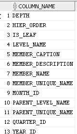
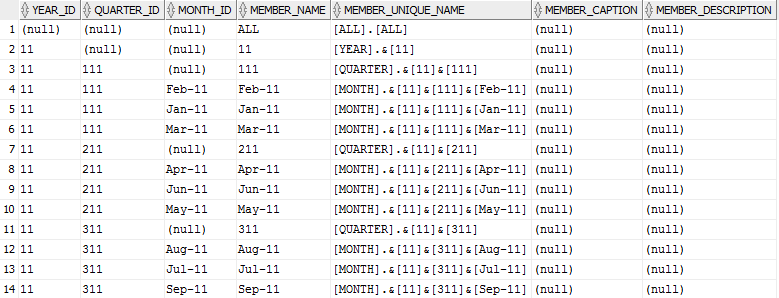
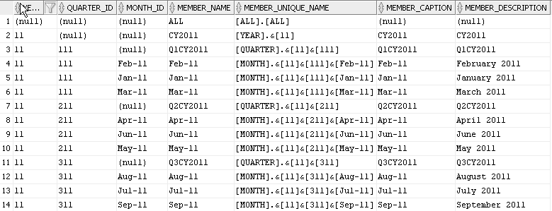
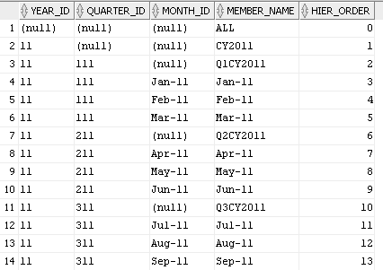
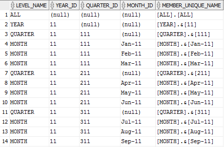

Attribute dimensions reference data sources and specify attributes and levels; hierarchies organize levels hierarchically.

Attribute dimensions and hierarchies are described in the following topics:

- About Attribute Dimensions and Hierarchies

- Attributes and Hierarchical Attributes

- Order Levels

- Level Keys

- Determine Attribute Relationships

### 25.1 About Attribute Dimensions and Hierarchies

An attribute dimension specifies a data source, attributes, and levels; a hierarchy organizes the levels hierarchically.

An attribute dimension specifies the data source it is using and specifies columns of that source as its attributes. It specifies levels for some or all of the attributes and determines attribute relationships between levels.

A hierarchy defines the hierarchical relationships between the levels of an attribute dimension. Attribute dimensions and hierarchies provide the dimension members for analytic view objects.

Most metadata related to dimensions and hierarchies is defined in the attribute dimension. A hierarchy inherits all of the metadata of the attribute dimension it uses. This allows the metadata for attributes and levels to be reused in many hierarchies, promoting consistency and simplifying the definition of the hierarchy.

#### About Attribute Dimensions

An attribute dimension has the following characteristics:

- A data source, which is typically a star schema or snowflake schema dimension table but may be a denormalized table, a view or an external or remote table; each column of the dimension table may be presented in a hierarchy

- A dimension type, which is either `STANDARD` or `TIME`

- Attributes, which are columns from the data source

- Levels, which represent groups of values that are all at the same level of aggregation

- Hierarchical attributes, which are used by hierarchies to describe hierarchical relationships between levels

- An implicit ALL level with only one member, which is the highest level in any hierarchy that uses the attribute dimension

- Can be used by any number of hierarchies

An attribute dimension also has the following optional characteristics:

- Can specify sharing its metadata or its metadata and data with an application container

- Can specify the ordering of level members

- Can specify classifications for the attribute dimension itself, its attributes, some of its hierarchical attributes, its levels, and the ALL member; the classifications provide metadata that an application can use in queries and in presenting query results

The attributes determined by the included levels specify the attributes that become columns in the hierarchy, and, therefore, of any analytic view that references the hierarchy.

#### About Attribute Dimension and Level Types

An attribute dimension can be either a `STANDARD` or a `TIME` type. Functionally, the `STANDARD` and `TIME` type attribute dimensions are the same. However, each level of a `TIME` type attribute dimension must specify a level type, even though the values of the level members are not necessarily of that type. For example, a `TIME` type attribute dimension could have a level named SEASON that has a level type of `QUARTERS`, even though its values are the names of seasons. You can use the level types for whatever purpose you choose.

The levels of a `STANDARD` type attribute dimension are of type `STANDARD`. You do not need to specify a level type for the levels of a `STANDARD` type attribute dimension.

The levels of a `TIME` type attribute dimension must be one of the following level types:

- `YEARS`

- `HALF_YEARS`

- `QUARTERS`

- `MONTHS`

- `WEEKS`

- `DAYS`

- `HOURS`

- `MINUTES`

- `SECONDS`

#### About Hierarchies

A hierarchy has the following characteristics:

- An attribute dimension

- A hierarchical ordering of levels of the attribute dimension

- Columns for each attribute, including determined attributes, of the levels

- Columns for its hierarchical attributes

- A row for each member of each level of the hierarchy and a row for an implicit ALL level, which represents a single top-level aggregate value

- Metadata it inherits from the attribute dimension

- May be used in the `FROM` clause of a SQL `SELECT` statement.

A hierarchy also has the following optional characteristics:

- Can specify sharing its metadata or its metadata and data with an application container

- Can specify classifications for itself and for its hierarchical attributes

Example 25-1 A Simple Attribute Dimension

An attribute dimension may be as simple as a list of attributes and levels defined only with key attributes. This example creates an attribute dimension that specifies as attributes only the YEAR_ID, QUARTER_ID, and MONTH_ID columns from the TIME_DIM table.

    CREATE OR REPLACE ATTRIBUTE DIMENSION time_attr_dim
    DIMENSION TYPE TIME
    USING time_dim       -- References the TIME_DIM table
    ATTRIBUTES           -- A list of table columns to be used as attributes
     (year_id,
      quarter_id,
      month_id)
    LEVEL MONTH          -- A level
      LEVEL TYPE MONTHS  -- The level type
      KEY month_id       -- Attribute with unique values
    LEVEL QUARTER
      LEVEL TYPE QUARTERS
      KEY quarter_id
    LEVEL YEAR
      LEVEL TYPE YEARS
      KEY year_id;

For a description of the TIME_DIM table, see [About the Data and Scripts for Examples](overview-analytic-views.md).

Each of the \_ID columns in the TIME_DIM table is included in the attribute list. By default, the name of the attribute is the dimension table column name. You can provide a different name for the attribute by using the `AS` `alias` clause in the definition.

Levels are created for each attribute using the `KEY` property, which is the only required property for a level.

Example 25-2 A Simple Hierarchy

    CREATE OR REPLACE HIERARCHY time_hier  -- Hierarchy name
    USING time_attr_dim      -- Refers to the TIME_ATTR_DIM attribute dimension
     (month CHILD OF         -- Levels in the attribute dimension
      quarter CHILD OF
      year);

The hierarchy has columns for each attribute of the attribute dimension and for its hierarchical attributes.

    SELECT column_name from ALL_HIER_COLUMNS WHERE HIER_NAME = 'TIME_HIER';

[Description of the illustration time_hier_columns.png](img_text/time_hier_columns.md)

The following selects the attribute columns and some of the hierarchical columns from TIME_HIER when TIME_ATTR_DIM is the attribute dimension defined in Example 25-1.

    SELECT year_id, quarter_id, month_id,
           member_name, member_unique_name
           member_caption, member_description
      FROM time_hier
      ORDER BY hier_order;

An excerpt from the query results are:

[Description of the illustration time_hier_col_subset.png](img_text/time_hier_col_subset.md)

### 25.2 Attributes and Hierarchical Attributes

Attribute dimension attributes typically reference columns from a source table or view. Hierarchical attributes provide information about the members of a hierarchy.

In an attribute dimension, attributes specify the columns of the source table or view to reference. The default name of the attribute is the name of the table column. You may provide a different name for an attribute by using syntax similar to SQL `SELECT` clause aliases. You define levels using attributes and you define the relationships between attributes using levels. Attributes appear as columns in hierarchies, depending on the levels that the hierarchy includes and on the defined attribute relationships of the levels.

The hierarchical attributes are the following:

- `DEPTH` is the level depth of the hierarchy member; the ALL level is at depth 0 (zero)

- `HIER_ORDER` is the order of the member in the hierarchy

- `IS_LEAF` is a boolean value that indicates whether the member is at the lowest (leaf) level of the hierarchy

- `LEVEL_NAME` is the name of the level in the definition of the attribute dimension

- `MEMBER_NAME` is the name of the member in the definition of the attribute dimension

- `MEMBER_CAPTION` is `NULL` unless you specify values for it in the definition of the attribute dimension or the hierarchy

- `MEMBER_DESCRIPTION` is `NULL` unless you specify values for it in the definition of the attribute dimension or the hierarchy

- `MEMBER_UNIQUE_NAME` is a name that is guaranteed to be unique in the hierarchy; it is a concatenation of level name, ancestors, and key attribute values

- `PARENT_LEVEL_NAME` is the name of level that is the parent of the current member

- `PARENT_UNIQUE_NAME` is the `MEMBER_UNIQUE_NAME` of the parent of the current member

The hierarchical attribute value is composed of the level and the lineage. The lineage includes the member’s key value. Each component of the lineage is enclosed in square brackets, and the components are separated by periods. If a component value contains a right square bracket, it is represented using two right square brackets.

Example 25-3 Providing Values for Some Hierarchical Attributes

This is the excerpt from the results of the query of the hierarchy based on the simple attribute dimension in About Attribute Dimensions and Hierarchies.

[Description of the illustration time_hier_col_subset.png](img_text/time_hier_col_subset.md)

While this hierarchy is functional, it lacks some important features. Note that the MEMBER_NAME column might not be easily readable, and the MEMBER_CAPTION and MEMBER_DESCRIPTION columns do not return data.

This new definition of the time_attr_dim attribute dimension includes the \_NAME columns from the TIME_DIM table. In the definitions of the levels, it specifies attributes that contain values for the hierarchical attributes `MEMBER_NAME`, `MEMBER_CAPTION`, and `MEMBER_DESCRIPTION`. This definition provides a hierarchy that uses the attribute dimension with descriptive values for the level members.

    CREATE OR REPLACE ATTRIBUTE DIMENSION time_attr_dim
    DIMENSION TYPE TIME
    USING time_dim
    ATTRIBUTES
     (year_id,
      year_name,
      quarter_id,
      quarter_name,
      month_id,
      month_name,
      month_long_name)
    LEVEL MONTH
      LEVEL TYPE MONTHS
      KEY month_id
      MEMBER NAME month_name
      MEMBER CAPTION month_name
      MEMBER DESCRIPTION month_long_name
    LEVEL QUARTER
      LEVEL TYPE QUARTERS
      KEY quarter_id
      MEMBER NAME quarter_name
      MEMBER CAPTION quarter_name
      MEMBER DESCRIPTION quarter_name
    LEVEL YEAR
      LEVEL TYPE YEARS
      KEY year_id
      MEMBER NAME year_name
      MEMBER CAPTION year_name
      MEMBER DESCRIPTION year_name;

This statement selects the attribute columns and some of the hierarchical columns from the TIME_HIER hierarchy.

    SELECT year_id, quarter_id, month_id,
           member_name, member_unique_name,
           member_caption, member_description
      FROM time_hier
      ORDER BY hier_order;

An excerpt from the query results are:

[Description of the illustration time_hier_col_subset_hier_attrs.png](img_text/time_hier_col_subset_hier_attrs.md)

The ordering of time periods is not yet correct for reporting on time series calculations; for example, February comes before January. For an example of specifying a sort order for a level, see Order Levels.

### 25.3 Order Levels

You can specify the order of attribute dimension level members.

You may use the `ORDER` `BY` clause of an attribute dimension level definition to specify an order for members of the level. By default, values of an attribute dimension level are sorted alphabetically by the `MEMBER_NAME` value. If you do not specify a member name, the level is ordered by its `KEY` attribute value.

The `ORDER` `BY` clause also specifies whether `NULL` values are first or last in the order. You may specify `MIN` or `MAX` expression if the attribute is not determined by the level, with the default being `MIN`.

Example 25-4 Add End Dates

This example adds end date attributes to the definition of the time_attr_dim attribute dimension.

    CREATE OR REPLACE ATTRIBUTE DIMENSION time_attr_dim
    DIMENSION TYPE TIME
    USING time_dim
    ATTRIBUTES
     (year_id,
      year_name,
      year_end_date,
      quarter_id,
      quarter_name,
      quarter_end_date,
      month_id,
      month_name,
      month_long_name,
      month_end_date)
    LEVEL MONTH
      KEY month_id
      MEMBER NAME month_name
      MEMBER CAPTION month_name
      MEMBER DESCRIPTION month_long_name
      ORDER BY month_end_date
    LEVEL QUARTER
      KEY quarter_id
      MEMBER NAME quarter_name
      MEMBER CAPTION quarter_name
      MEMBER DESCRIPTION quarter_name
      ORDER BY quarter_end_date
    LEVEL YEAR
      KEY year_id
      MEMBER NAME year_name
      MEMBER CAPTION year_name
      MEMBER DESCRIPTION year_name
      ORDER BY year_end_date;

This is the definition of the time_hier hierarchy.

    CREATE OR REPLACE HIERARCHY time_hier
    USING time_attr_dim
     (month CHILD OF
      quarter CHILD OF
      year);

This query includes the hierarchy order attribute.

    SELECT year_id,
      quarter_id,
      month_id,
      member_name,
      hier_order
    FROM time_hier
    ORDER BY hier_order;

This is an excerpt from the query results.

[Description of the illustration time_hier_col_subset_orderby.png](img_text/time_hier_col_subset_orderby.md)

The level members are now sorted by end dates.

### 25.4 Level Keys

A level key attribute specifies the data source of the level members.

An attribute dimension level specifies key and optional alternate key attributes that provide the members of the level.

A level must have a key, which is defined by a single attribute, or by multiple attributes for a compound key. Each distinct value for the key defines an attribute dimension member at that level.

A level can also have one or more alternate keys. An alternate key must have a one-to-one relationship with the level key: an attribute specified as an alternate key must have a unique value for every member of the level key attribute.

Example 25-5 Create the PRODUCT_ATTR_DIM Attribute Dimension

This example creates the product_attr_dim attribute dimension. The level clauses specify keys and alternate keys.

    CREATE OR REPLACE ATTRIBUTE DIMENSION product_attr_dim
    USING product_dim
    ATTRIBUTES
     (department_id,
      department_name,
      category_id,
      category_name)
    LEVEL DEPARTMENT
      KEY department_id
      ALTERNATE KEY department_name
      MEMBER NAME department_name
      MEMBER CAPTION department_name
      ORDER BY department_name
    LEVEL CATEGORY
      KEY category_id
      ALTERNATE KEY category_name
      MEMBER NAME category_name
      MEMBER CAPTION category_name
      ORDER BY category_name
      DETERMINES(department_id)
    ALL MEMBER NAME 'ALL PRODUCTS';

### 25.5 Determine Attribute Relationships

You can specify that an attribute of a level determines the values of other attributes.

You can use the `DETERMINES` clause of an attribute dimension level definition to specify a relationship between the level key attribute and other attributes. When there is only one value of an attribute for each value of another attribute, the value of one attribute determines the value of another. For example, there is only one value of QUARTER_ID for each value of MONTH_ID; MONTH_ID determines QUARTER_ID.

An attribute determined by a level is included in a hierarchy that uses the attribute dimension. An attribute specified in a `DETERMINES` clause can have the same value for different level members. A level implicitly determines its key and alternate key attributes, although, unlike the attributes in a `DETERMINES` clause, those attributes must have unique values.

The relationships specified by a `DETERMINES` clause can do the following:

- Change the number of rows returned by a hierarchy

- Control whether certain attributes return data for certain rows

- Simplify the SQL that is generated when an analytic view is queried

Specifying determined attributes helps a hierarchy or analytic view to determine a unique value for a member. If an attribute is determined by a level, you do not need to explicitly specify in a query the attribute value that identifies the relationship of the determined attribute to the hierarchy member. For example, a `QUALIFY` calculation requires a uniquely identified hierarchy member. If you omit attributes from a `DETERMINES` clause, then in an analytic view measure that uses a `QUALIFY` calculation, you must explicitly specify those attributes to identify the unique member.

The relationship of determined attributes to key and alternate key attributes is not validated or enforced in an attribute dimension or in a hierarchy that uses the attribute dimension. To validate the relationship, use the PL/SQL procedure `DBMS_HIERARCHY.VALIDATE_HIERARCHY`, which inspects the data in the source table or view.

#### Usage Notes

When using a `DETERMINES` clause, consider the following:

- Include in a `DETERMINES` clause the `KEY` attribute of a parent level in a hierarchy whenever the key of the lower level determines the value of the parent level. Lower levels inherit the determined attributes of ancestor levels; therefore, it is a good practice to include the key attribute value of the parent level in the `DETERMINES` clause of the lower level.

- Values of the `MEMBER` `NAME`, `MEMBER` `CAPTION`, `MEMBER` `DESCRIPTION`, and `ORDER` `BY` properties are assumed to be determined by the `KEY` attribute value. You do not need to include attributes for those properties in a `DETERMINES` clause. You should be sure, however, that the data for those attributes has only one value for each value of the `KEY` attribute.

Example 25-6 Add DETERMINES Clauses

This example adds the `DETERMINES` clause to the levels of time_attr_dim.

    CREATE OR REPLACE ATTRIBUTE DIMENSION time_attr_dim
    DIMENSION TYPE TIME
    USING time_dim
    ATTRIBUTES
     (year_id,
      year_name,
      year_end_date,
      quarter_id,
      quarter_name,
      quarter_end_date,
      month_id,
      month_name,
      month_long_name,
      month_end_date)
    LEVEL MONTH
      LEVEL TYPE MONTHS
      KEY month_id
      MEMBER NAME month_name
      MEMBER CAPTION month_name
      MEMBER DESCRIPTION month_long_name
      ORDER BY month_end_date
      DETERMINES (quarter_id)
    LEVEL QUARTER
      LEVEL TYPE QUARTERS
      KEY quarter_id
      MEMBER NAME quarter_name
      MEMBER CAPTION quarter_name
      MEMBER DESCRIPTION quarter_name
      ORDER BY quarter_end_date
      DETERMINES (year_id)
    LEVEL YEAR
      LEVEL TYPE YEARS
      KEY year_id
      MEMBER NAME year_name
      MEMBER CAPTION year_name
      MEMBER DESCRIPTION year_name
      ORDER BY year_end_date;

Select the LEVEL_NAME, \_ID, and MEMBER_UNIQUE_NAME columns from the TIME_HIER hierarchy.

    SELECT level_name,
      year_id,
      quarter_id,
      month_id,
      member_unique_name
    FROM time_hier
    ORDER BY hier_order;

The hierarchy now knows the relationship between the months, quarters, and years attributes, as shown in the following results of the preceding query. The `MEMBER_UNIQUE_NAME` values are now created from only the level name and the `KEY` attribute value; they no longer must include the full lineage as seen in Example 25-3.

[Description of the illustration time_hier_col_subset_determines.png](img_text/time_hier_col_subset_determines.md)
