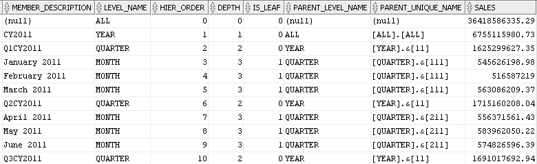
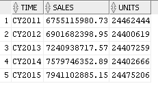
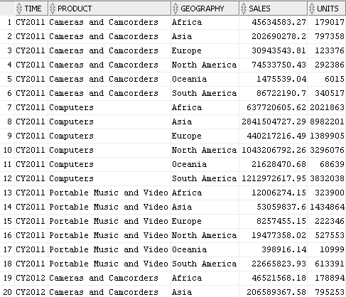
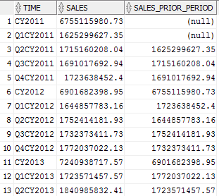
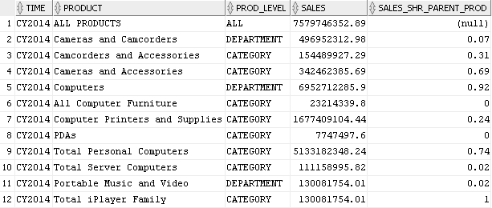
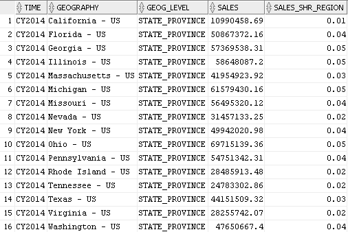
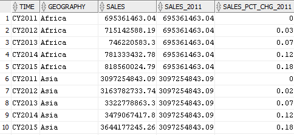
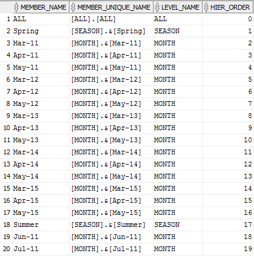
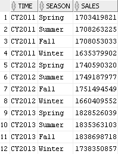

An analytic view is a type of view that you can use to easily extend the content of a star schema, snowflake schema, or a flat (denormalized) fact table with aggregated data, measure calculations and descriptive metadata, and to simplify the SQL needed to access data.

Analytic views are described in the following topics.

- About Analytic Views

- Measures of Analytic Views

- Create Analytic Views

- Examples of Calculated Measures

- Attribute Reporting

- Analytic View Queries with Filtered Facts and Added Measures

### 26.1 About Analytic Views

Analytic views layer a hierarchical/dimensional model over data.

Analytic views are defined over the dimension tables and the fact table of a star or snowflake schema. You can also define an analytic view over a denormalized table, in which dimension attributes and fact data are in the same table. Hierarchies are defined over dimension tables. An analytic view references hierarchies and a fact table.

Even though an analytic view is defined over data modeled as a star schema, the data does not need to be stored in a star schema. You can use views to represent other forms of stored data to an analytic view. Generally, if the tables or views perform well with a star style query they work well with analytic views. Smaller data sets might work well with views. Larger data sets might perform better with tables in a star schema. The most performant schema is a star schema loaded into the in-memory column store, using the Oracle Database In-Memory Option.

When used with the in-memory column store, analytic views optimize the SQL execution plan to take advantage of In-Memory Aggregation (that is, the vector transform execution plan). Analytic views can take advantage of materialized views to further accelerate aggregate level queries (note that materialized views can be loaded into the in-memory column store).

The minimum requirements for an analytic view include the following:

- A dimension table (or view). This table should have a primary key that provides a unique list of values and that joins to the fact table.

- A fact table with at least one fact (measure) column and a key column that joins to the primary key of the dimension table.

More typically, an analytic view has the following characteristics:

- Is defined over using two or more dimension tables, which enables the ability to slice and dice data.

- One or more of the dimension tables contain data at different levels of aggregation (for example: days, months, quarters, and years).

Analytic views comprise three types of objects: attribute dimensions, hierarchies, and analytic views.

An attribute dimension is a metadata object that references tables or views and organizes columns into higher-level objects such as attributes and levels. Most metadata related to dimensions and hierarchies is defined in the attribute dimension object.

A hierarchy is a type of view. Hierarchies reference attribute dimension objects. Hierarchies organize data using hierarchical relationships between the hierarchy members. Queries of a hierarchy return detail and aggregate-level keys ("hierarchy values") and attributes of those values.

An analytic view is a type of view that returns fact data. Analytic views reference both fact tables and hierarchies. Both hierarchy and measure data is selected from analytic views.

### 26.2 Measures of Analytic Views

Analytic view measures specify fact data and the calculations or other operations to perform on the data.

In an analytic view definition, you may specify one or more base measures and calculated measures.

#### Base Measures

A base measure is a reference to a column in a fact table. You may optionally specify a `meas_aggregate_clause`, which overrides the default aggregation method of the analytic view. Each base measure may specify a default aggregation. The aggregation may be a simple operation like `SUM` or `AVG`, or a complex nesting of operations that vary by attribute dimension.

You can use the `default_aggregate_clause` to specify a default aggregation method for base measures that don't have a `meas_aggregate_clause`. The default value of the `default_aggregate_clause` is `SUM`.

#### Calculated Measures

A calculated measure is an expression that can be a user-defined expression or one of the many pre-defined analytic calculations. A calculated measure expression may include other measures, row functions, and hierarchy functions. Hierarchy functions allow computations based on identifying and processing related members in a hierarchy. The expression may reference other measures in the analytic view, but may not reference fact columns. Because a calculation can refer to other measures, you can easily build complex calculations through nesting.

In defining a calculated measure expression, you may use any other measure in the analytic view, irrespective of the order in which you defined the measures of the analytic view. The only restriction is that no cycles may be introduced in the calculations.

In addition to using calculated measures in the definition of an analytic view, you can add calculated measures in a `SELECT` statement that queries an analytic view. To do so, you use the `ADD` `MEASURES` keywords in the `WITH` or `FROM` clauses of the statement. The syntax of a calculated measure is the same whether it is in the definition of the analytic view or in a `SELECT` statement.

Categories of calculated measure expressions are the following:

- Analytic view measure expressions

- Analytic view hierarchical expressions

- Simple expressions

- Single row function expressions

- Compound expressions

- Datetime expressions

- Interval expressions

Analytic view measure expressions include the following operations:

- Lead and lag

- Qualified data reference (QDR)

- Rank

- Related member

- Share of

- Window calculations

**Related Topics**

- Analytic View Query with Added Measures

### 26.3 Create Analytic Views

In creating an analytic view, you specify one or more hierarchies and a fact table that has at least one measure column that can join to each hierarchy.

#### Create a Simple Analytic View

An analytic view must have a reference to a fact table and a measure that can join to a hierarchy.

Example 26-1 Creating a Simple Analytic View

This analytic view uses the TIME_HIER hierarchy and the SALE_FACT table. It contains a single measure, SALES.

    CREATE OR REPLACE ANALYTIC VIEW sales_av
    USING sales_fact                      -- Refers to the SALES_FACT table
    DIMENSION BY                          -- List of attribute dimensions
      (time_attr_dim                      -- TIME_ATTR_DIM attribute dimension
        KEY month_id REFERENCES month_id  -- Dimension key joins to fact column
        HIERARCHIES (                     -- List of hierarchies that use
          time_hier DEFAULT))             -- the attribute dimension
    MEASURES                              -- List of measures
     (sales FACT sales)                   -- SALES measure references SALES column
    DEFAULT MEASURE SALES;                -- Default measure of the analytic view

A query that selects from an analytic view that does not include filters has the potential of returning large numbers of rows. However, in this query, the SALES_AV analytic view includes a single hierarchy that returns only 86 rows.

    SELECT *
      FROM sales_av HIERARCHIES(time_hier)
      ORDER BY time_hier.hier_order;

This is a excerpt of the returned values.

[Description of the illustration simple_av_sel.png](img_text/simple_av_sel.md)

#### Add Another Base Measure

To add another base measure to an analytic view, include the measure in the `MEASURES` list.

Example 26-2 Adding a Base Measure to an Analytic View

    CREATE OR REPLACE ANALYTIC VIEW sales_av
    USING sales_fact
    DIMENSION BY
      (time_attr_dim
        KEY month_id REFERENCES month_id
        HIERARCHIES (
          time_hier DEFAULT))
    MEASURES
     (sales FACT sales,
      units FACT units)                   -- Add the UNITS base measure
    DEFAULT MEASURE SALES;

Because a query of the analytic view could return a great many rows, a query typically uses filters to limit the results. In the `WHERE` clause, this query filters the time periods to those in the YEAR level, so it returns only SALES and UNITS data at that level.

    SELECT time_hier.member_name as TIME,
     sales,
     units
    FROM
     sales_av HIERARCHIES(time_hier)
    WHERE time_hier.level_name = 'YEAR'
    ORDER BY time_hier.hier_order;

These are the returned values.

[Description of the illustration av_sel_2measures.png](img_text/av_sel_2measures.md)

#### Add Hierarchies to an Analytic View

Typically, an analytic view has more than one hierarchy using one or more attribute dimensions.

Example 26-3 Adding Hierarchies to an Analytic View

This example adds attribute dimensions and hierarchies to the `DIMENSION` `BY` list of the analytic view.

    CREATE OR REPLACE ANALYTIC VIEW sales_av
    USING sales_fact
    DIMENSION BY
      (time_attr_dim
        KEY month_id REFERENCES month_id
        HIERARCHIES (
          time_hier DEFAULT),
       product_attr_dim
        KEY category_id REFERENCES category_id
        HIERARCHIES (
          product_hier DEFAULT),
       geography_attr_dim
        KEY state_province_id
        REFERENCES state_province_id
        HIERARCHIES (
          geography_hier DEFAULT)
       )
    MEASURES
     (sales FACT sales,
      units FACT units
      )
    DEFAULT MEASURE sales;

The following query adds the PRODUCT_HIER and GEOGRAPHY_HIER hierarchies to the `HIERARCHIES` phrase of the `FROM` clause.

    SELECT time_hier.member_name AS Time,
     product_hier.member_name AS Product,
     geography_hier.member_name AS Geography,
     sales,
     units
    FROM
     sales_av HIERARCHIES (time_hier, product_hier, geography_hier)
    WHERE time_hier.level_name in ('YEAR')
      AND product_hier.level_name in ('DEPARTMENT')
      AND geography_hier.level_name in ('REGION')
    ORDER BY time_hier.hier_order,
      product_hier.hier_order,
      geography_hier.hier_order;

The query returns 50 rows. The following image shows only the first 20 rows.

[Description of the illustration av_sel_all_hiers.png](img_text/av_sel_all_hiers.md)

You can view and run SQL scripts that create the tables, the analytic view component objects, and the queries used in the examples from the Oracle Live SQL website at <https://livesql.oracle.com/apex/livesql/file/index.html>.

### 26.4 Examples of Calculated Measures

Calculated measures are expressions you add to a `MEASURES` clause of an analytic view in the form of `measure_name` `AS` `(``expression``)`.

#### Add a LAG Expression

This example adds a calculated measure that uses a `LAG` operation to the SALES_AV analytic view.

Example 26-4 Adding a LAG Expression

    CREATE OR REPLACE ANALYTIC VIEW sales_av
    USING sales_fact
    DIMENSION BY
      (time_attr_dim
        KEY month_id REFERENCES month_id
        HIERARCHIES (
          time_hier DEFAULT),
       product_attr_dim
        KEY category_id REFERENCES category_id
        HIERARCHIES (
          product_hier DEFAULT),
       geography_attr_dim
        KEY state_province_id REFERENCES state_province_id
        HIERARCHIES (
          geography_hier DEFAULT)
       )
    MEASURES
     (sales FACT sales,
      units FACT units,
      sales_prior_period AS       -- Add a calculated measure.
        (LAG(sales) OVER (HIERARCHY time_hier OFFSET 1))
      )
    DEFAULT MEASURE SALES;

Select the SALES and SALES_PRIOR_PERIOD measures at the YEAR and QUARTER levels.

    SELECT time_hier.member_name as TIME,
     sales,
     sales_prior_period
    FROM
     sales_av HIERARCHIES(time_hier)
    WHERE time_hier.level_name IN ('YEAR','QUARTER')
    ORDER BY time_hier.hier_order;

In this excerpt from the query results, note that the `LAG` expression returns prior periods within the same level.

[Description of the illustration av_calc_meas_lag.png](img_text/av_calc_meas_lag.md)

#### SHARE OF Expressions

Share of measures calculate the ratio of a current row to a parent row, ancestor row, or all rows in the current level; for example, the ratio of a geography member to the parent of the member. Share of measures are specified using the `SHARE` `OF` expression.

Example 26-5 Using SHARE OF Expressions

This example adds calculated measures that use `SHARE` `OF` operations to the SALES_AV analytic view.

    CREATE OR REPLACE ANALYTIC VIEW sales_av
    USING sales_fact
    DIMENSION BY
      (time_attr_dim
        KEY month_id REFERENCES month_id
        HIERARCHIES (
          time_hier DEFAULT),
       product_attr_dim
        KEY category_id REFERENCES category_id
        HIERARCHIES (
          product_hier DEFAULT),
       geography_attr_dim
        KEY state_province_id REFERENCES state_province_id
        HIERARCHIES (
          geography_hier DEFAULT)
       )
    MEASURES
     (sales FACT sales,
      units FACT units,
      -- Share of calculations
     sales_shr_parent_prod AS
       (SHARE_OF(sales HIERARCHY product_hier PARENT)),
     sales_shr_parent_geog AS
       (SHARE_OF(sales HIERARCHY geography_hier PARENT)),
     sales_shr_region AS
       (SHARE_OF(sales HIERARCHY geography_hier LEVEL REGION))
      )
    DEFAULT MEASURE SALES;

The SALES_SHR_PARENT_PROD measure calculates the ratio of a SALES value at the CATEGORY or DEPARTMENT level to SALES of the parent in the PRODUCT_HIER hierarchy, such as the ratio of SALES for Total Server Computers to Computers.

This query selects SALES and SALES_SHR_PARENT_PROD measure for CY2014 at each level of the PRODUCT_HIER hierarchy.

    SELECT time_hier.member_name AS Time,
     product_hier.member_name    AS Product,
     product_hier.level_name     AS Prod_Level,
     sales,
     ROUND(sales_shr_parent_prod,2) AS sales_shr_parent_prod
    FROM
     sales_av HIERARCHIES (time_hier, product_hier)
    WHERE time_hier.year_name = 'CY2014'
    AND time_hier.level_name = 'YEAR'
    ORDER BY product_hier.hier_order;

The results of the query are:

[Description of the illustration av_calc_meas_share.png](img_text/av_calc_meas_share.md)

The SALE_SHR_REGION measure calculates the share of SALES at the STATE or COUNTRY levels to SALES at the REGION level, for example, the ratio of SALES for California – US to SALES for North America.

This query returns the values for the SALES and SALES_SHR_REGION measures for year CY2014 and states in the United States.

    SELECT time_hier.member_name AS Time,
     geography_hier.member_name  AS Geography,
     geography_hier.level_name   AS Geog_Level,
     sales,
     ROUND(sales_shr_region,2)   AS sales_shr_region
    FROM
     sales_av HIERARCHIES (time_hier, geography_hier)
    WHERE time_hier.year_name = 'CY2014'
    AND time_hier.level_name = 'YEAR'
    AND geography_hier.country_name = 'United States'
    AND geography_hier.level_name = 'STATE_PROVINCE'
    ORDER BY geography_hier.hier_order;

This is the result of the query.

[Description of the illustration av_calc_meas_share_region.png](img_text/av_calc_meas_share_region.md)

#### QDR Expressions

A `qdr_expression` uses the `QUALIFY` keyword to limit the values of a measure to those for a single dimension member. An example is Sales for the year CY2011 or the percent difference in SALES between the current time period and CY2011. The `QUALIFY` expression refers to a `KEY` attribute value.

Example 26-6 Using QUALIFY Expressions

Create the SALES_AV analytic view with the SALES_2011 and SALES_PCT_CHG_2011 measures.

    CREATE OR REPLACE ANALYTIC VIEW sales_av
    USING sales_fact
    DIMENSION BY
      (time_attr_dim
        KEY month_id REFERENCES month_id
        HIERARCHIES (
          time_hier DEFAULT),
       product_attr_dim
        KEY category_id REFERENCES category_id
        HIERARCHIES (
          product_hier DEFAULT),
       geography_attr_dim
        KEY state_province_id REFERENCES state_province_id
        HIERARCHIES (
          geography_hier DEFAULT)
       )
    MEASURES
     (sales FACT sales,
      units FACT units,
     -- Sales for CY2011
     sales_2011 AS
        (QUALIFY (sales, time_hier = year['11'])),
      -- Sales percent change from 2011.
      sales_pct_chg_2011 AS
        ((sales - (QUALIFY (sales, time_hier = year['11']))) /
        (QUALIFY (sales, time_hier = year['11'])))
      )
    DEFAULT MEASURE SALES;

Regardless of filters in the query, the SALES_2011 measure always returns data for the year CY2011. The SALES_PCT_CHG_2011 measure calculates the percent difference between the current time period and CY2011.

This query selects SALES, SALES_2011 and SALES_PCT_CHG_2011 at the YEAR and REGION levels.

    SELECT time_hier.member_name   AS Time,
     geography_hier.member_name    AS Geography,
     sales,
     sales_2011,
     ROUND(sales_pct_chg_2011,2) as sales_pct_chg_2011
    FROM
     sales_av HIERARCHIES (time_hier, geography_hier)
    WHERE time_hier.level_name = 'YEAR'
    AND geography_hier.level_name = 'REGION'
    ORDER BY geography_hier.hier_order,
     time_hier.hier_order;

This is an excerpt from the query results. Note that for each row SALES_2011 returns SALES for CY2011.

[Description of the illustration av_calc_meas_qualify.png](img_text/av_calc_meas_qualify.md)

### 26.5 Attribute Reporting

You can use any attribute of an attribute dimension in a hierarchy and aggregate data for it in an analytic view.

You can use attributes to filter data or to display in a report. You can also break out (aggregate) data by an attribute. You can create calculated measures in an analytic view using the attribute; the analytic view then provides the aggregate rows for the attribute.

Example 26-7 Using the SEASON Attribute

This example first creates an attribute dimension that has SEASON and SEASON_ORDER as attributes. This allows a hierarchy and an analytic view to reuse some metadata of those attributes and to relate the attributes to other levels. For example, SEASON is determined by MONTH values.

    -- Create a time attribute dimension with a SEASON attribute.
    CREATE OR REPLACE ATTRIBUTE DIMENSION time_attr_dim
    DIMENSION TYPE TIME
    USING time_dim
    ATTRIBUTES
     (year_id,
      year_name,
      year_end_date,
      quarter_id,
      quarter_name,
      quarter_end_date,
      month_id,
      month_name,
      month_long_name,
      month_end_date,
      season,
      season_order)
    LEVEL month
      LEVEL TYPE MONTHS
      KEY month_id
      MEMBER NAME month_name
      MEMBER CAPTION month_name
      MEMBER DESCRIPTION month_long_name
      ORDER BY month_end_date
      DETERMINES (quarter_id, season, season_order)
    LEVEL quarter
      LEVEL TYPE QUARTERS
      KEY quarter_id
      MEMBER NAME quarter_name
      MEMBER CAPTION quarter_name
      MEMBER DESCRIPTION quarter_name
      ORDER BY quarter_end_date
      DETERMINES (year_id)
    LEVEL year
      LEVEL TYPE YEARS
      KEY year_id
      MEMBER NAME year_name
      MEMBER CAPTION year_name
      MEMBER DESCRIPTION year_name
      ORDER BY year_end_date
    LEVEL season
      LEVEL TYPE QUARTERS
      KEY season
      MEMBER NAME season
      MEMBER CAPTION season
      MEMBER DESCRIPTION season
      ORDER BY season_order;

Create a hierarchy in which MONTH is a child of SEASON.

    CREATE OR REPLACE HIERARCHY time_season_hier
    USING time_attr_dim
      (month CHILD OF
       season);

Select data from the TIME_SEASON_HIER hierarchy.

    SELECT member_name,
      member_unique_name,
      level_name,
      hier_order
    FROM time_season_hier
    ORDER BY hier_order;

In the results of the query, the TIME_SEASON_HIER hierarchy returns rows for the ALL level, SEASONS, and MONTHS. This image captures the first twenty of the rows returned.

[Description of the illustration av_calc_meas_attr_report.png](img_text/av_calc_meas_attr_report.md)

The example next creates an analytic view that provides aggregate data for SEASON.

    CREATE OR REPLACE ANALYTIC VIEW sales_av
    USING sales_fact
    DIMENSION BY
      (time_attr_dim
        KEY month_id REFERENCES month_id
        HIERARCHIES (
          time_hier DEFAULT,
          time_season_hier),
       product_attr_dim
        KEY category_id REFERENCES category_id
        HIERARCHIES (
          product_hier DEFAULT),
       geography_attr_dim
        KEY state_province_id
        REFERENCES state_province_id
        HIERARCHIES (
          geography_hier DEFAULT)
       )
    MEASURES
     (sales FACT sales,
      units FACT units
      )
    DEFAULT MEASURE SALES;

You can now select SALES by YEAR and SEASON directly from the analytic view. This query selects from the TIME_HIER and TIME_SEASON_HIER hierarchies at the YEAR and SEASON levels.

    SELECT  time_hier.member_name      AS Time,
     time_season_hier.member_name      AS Season,
     ROUND(sales)                      AS Sales
    FROM sales_av HIERARCHIES (time_hier, time_season_hier)
    WHERE time_hier.level_name = 'YEAR'
      AND time_season_hier.level_name = 'SEASON'
    ORDER BY time_hier.hier_order,
      time_season_hier.hier_order;

This excerpt from the query results shows the first twelve rows returned.

[Description of the illustration av_calc_meas_season_sales.png](img_text/av_calc_meas_season_sales.md)

You can view and run the SQL scripts that create the tables, the analytic view component objects, and the queries used in the examples from the Oracle Live SQL website at <https://livesql.oracle.com/apex/livesql/file/index.html>.

### 26.6 Analytic View Queries with Filtered Facts and Added Measures

Queries that `SELECT` from analytic views may include the `FILTER` `FACT` keywords to filter the fact data accessed by the analytic view prior to any calculations and the `ADD` `MEASURES` keywords to define additional calculated measures for the query.

**Related Topics**

- Analytic View Query with Filtered Facts
- Analytic View Query with Added Measures
- Analytic View Query with Filtered Facts and Multiple Added Measures

#### 26.6.1 Analytic View Query with Filtered Facts

In a query of an analytic view, you can filter the fact data before the analytic view aggregates the data for higher-level hierarchy members.

The values of aggregate records returned by an analytic view are determined by the hierarchies of the analytic view, the aggregation operators, and the rows contained in the fact table. A predicate in a `SELECT` statement that queries an analytic view restricts the rows returned by the analytic view but does not affect the computation of aggregate records.

By using the `FILTER` `FACT` keywords in a `SELECT` statement, you can filter fact records before the data is aggregated by the analytic view, which produces aggregate values only for the specified hierarchy members.

Example 26-8 Queries With and Without Filter-Before Aggregation Predicates

The following query selects hierarchy member names and sales values from the sales_av analytic view. The query predicate limits the hierarchy members to those in the YEAR level. The filtering does not affect the aggregation of the measure values.

    SELECT time_hier.member_name, TO_CHAR(sales, '999,999,999,999') AS sales
      FROM sales_av HIERARCHIES(time_hier)
      WHERE time_hier.level_name = 'YEAR'
      ORDER BY time_hier.hier_order;

The result of the query is the following. The result includes the aggregated measure values for hierarchy members at the YEAR level.

    MEMBER_NAME          SALES
    -----------  -------------
    CY2011       6,755,115,981
    CY2012       6,901,682,399
    CY2013       7,240,938,718
    CY2014       7,579,746,353
    CY2015       7,941,102,885

The following query defines an inline analytic view that the filters the hierarchy members before aggregation.

    SELECT time_hier.member_name, TO_CHAR(sales, '999,999,999,999') AS sales
      FROM ANALYTIC VIEW (                      -- inline analytic view
      USING sales_av HIERARCHIES(time_hier)
      FILTER FACT (time_hier TO level_name = 'MONTH'
                   AND TO_CHAR(month_end_date, 'Q') IN (1, 2)
                   )
      )
      WHERE time_hier.level_name = 'YEAR')
      ORDER BY time_hier.hier_order;

The result of the query is the following. The `FILTER FACT` clause of the inline analytic view filters out all but the months that are in the first two quarters. The result includes the aggregated values at the YEAR level for those quarters. The aggregations do not include the third and fourth quarter values.

    MEMBER_NAME          SALES
    -----------  -------------
    CY2011       3,340,459,835
    CY2012       3,397,271,965
    CY2013       3,564,557,290
    CY2014       3,739,283,051
    CY2015       3,926,231,605

**Related Topics**

- Analytic View Query with Filtered Facts and Multiple Added Measures

#### 26.6.2 Analytic View Query with Added Measures

With the `ADD` `MEASURES` keywords, you can add measure calculations to a query of an analytic view.

Example 26-9 Calculation Adding a Measure in the FROM Clause

This example has an inline analytic view that adds the calculated measure share_sales to a query using the sales_av analytic view.

    SELECT time_hier.member_name AS "Member",
           TO_CHAR(sales, '999,999,999,999') AS "Sales",
           ROUND(share_sales, 2) AS "Share of Sales"
      FROM ANALYTIC VIEW (
        USING sales_av HIERARCHIES (time_hier)
        ADD MEASURES (
          share_sales as (SHARE_OF(sales HIERARCHY time_hier PARENT))
        )
      )
      WHERE time_hier.level_name IN ('ALL', 'YEAR')
      ORDER BY time_hier.hier_order;

The following is the result of the query.

    Member          Sales   Share of Sales
    ------  --------------  --------------
    ALL     36,418,586,336
    CY2011   6,755,115,981            0.19
    CY2012   6,901,682,399            0.19
    CY2013   7,240,938,718            0.2
    CY2014   7,579,746,353            0.21
    CY2015   7,941,102,885            0.22

Example 26-10 Calculation Adding a Measure in the WITH Clause

This example defines the same analytic view as in the previous example but it does so in the `WITH` clause of the `SELECT` statement.

    WITH my_av ANALYTIC VIEW AS (
      USING sales_av HIERARCHIES (time_hier)
      ADD MEASURES (
        share_sales as (SHARE_OF(sales HIERARCHY time_hier PARENT))
      )
    )
    SELECT time_hier.member_name AS "Member",
           TO_CHAR(sales, '999,999,999,999') AS "Sales",
           ROUND(share_sales, 2) AS "Share of Sales"
      FROM my_av
      WHERE time_hier.level_name IN ('ALL', 'YEAR')
      ORDER BY time_hier.hier_order;

The result of the query are the same as the previous example.

    Member          Sales   Share of Sales
    ------  --------------  --------------
    ALL     36,418,586,336
    CY2011   6,755,115,981            0.19
    CY2012   6,901,682,399            0.19
    CY2013   7,240,938,718            0.2
    CY2014   7,579,746,353            0.21
    CY2015   7,941,102,885            0.22

**Related Topics**

- Analytic View Query with Filtered Facts and Multiple Added Measures

#### 26.6.3 Analytic View Query with Filtered Facts and Multiple Added Measures

In a query of an analytic view, you can specify pre-aggregation filters and added measures.

Example 26-11 Query Using Filter Facts and Multiple Calculated Measures

The analytic view in the `WITH` clause in this query is based on the sales_av analytic view. The my_av analytic view filters the time_hier hierarchy members to the first and second quarters of the QUARTER level and the geography_hier hierarchy members to the countries Mexico and Canada of the COUNTRY level. It adds calculated measures that compute sales for the prior period and the percent change of the difference between sales and the prior period sales.

    WITH my_av ANALYTIC VIEW AS (
      USING sales_av HIERARCHIES (time_hier, geography_hier)
      FILTER FACT (time_hier TO level_name = 'QUARTER'
                   AND (quarter_name LIKE 'Q1%' OR quarter_name LIKE 'Q2%'),
                   geography_hier TO level_name = 'COUNTRY'
                   AND country_name IN ('Mexico', 'Canada'))
      ADD MEASURES (sales_pp AS
                      (LAG(sales) OVER (HIERARCHY time_hier OFFSET 1)),
                    sales_pp_pct_change AS
                      (LAG_DIFF_PERCENT(sales) OVER (HIERARCHY time_hier OFFSET 1)))
      )
     SELECT time_hier.member_name AS time,
       geography_hier.member_name AS geography,
       sales,
       sales_pp,
       ROUND(sales_pp_pct_change,3) AS "Change"
     FROM my_av HIERARCHIES (time_hier, geography_hier)
     WHERE time_hier.level_name IN ('YEAR') AND
            geography_hier.level_name = 'REGION'
     ORDER BY time_hier.hier_order;

The result is the following.

    TIME    GEOGRAPHY           SALES    SALES_PP     Change
    ------  -------------  ------------  -----------  ------
    CY2011  North America  229,884,616
    CY2012  North America  233,688,485   229,884,616    .017
    CY2013  North America  245,970,470   233,688,485    .053
    CY2014  North America  256,789,511   245,970,470    .044
    CY2015  North America  270,469,199   256,789,511    .053

**Related Topics**

- Analytic View Query with Filtered Facts
- Analytic View Query with Added Measures
