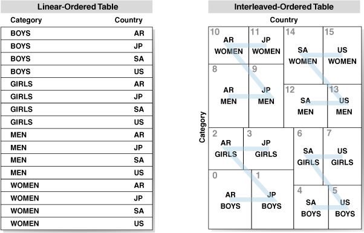

Attribute clustering is a table-level directive that clusters data in close physical proximity based on the content of certain columns. Storing data that logically belongs together in close physical proximity can greatly reduce the amount of data to be processed and can lead to better performance of certain queries in the workload.

This chapter includes the following sections:

- About Attribute Clustering

- Attribute Clustering Operations

- Viewing Attribute Clustering Information

### 13.1 About Attribute Clustering

An attribute-clustered table stores data in close proximity on disk in an ordered way based on the values of a certain set of columns in the table or a set of columns in the other tables.

You can cluster according to the linear order of specified columns or by using a function that permits multi-dimensional clustering (also known as interleaved clustering). Attribute clustering improves the effectiveness of zone maps, Exadata Storage Indexes, and In-memory min/max pruning. Queries that qualify clustered columns will access only the clustered regions. When attribute clustering is defined on a partitioned table, the clustering applies to all partitions.

Attribute clustering is a directive property of a table. It is not enforced for every DML operation, but only affects direct-path insert operations, data movement, or table creation. Conventional DML operations on the table are not affected by attribute clustering. This means that whatever is done to cluster the data is an operation that is only done on the current working data set. This is in contrast to a manually-applied `ORDER` `BY` command, such as what occurs as part of a CTAS operation.

This section contains the following topics:

- Methods of Clustering Data

- Types of Attribute Clustering

- Example: Attribute Clustered Table

- Guidelines for Using Attribute Clustering

- Advantages of Attribute-Clustered Tables

- About Defining Attribute Clustering for Tables

- About Specifying When Attribute Clustering Must be Performed

#### 13.1.1 Methods of Clustering Data

You can cluster data using the following methods:

- Clustering based on one or more columns of the table on which attribute clustering is defined.

- Clustering based on one or more columns that are joined with the table on which attribute clustering is defined. Clustering based on joined columns is called join attribute clustering. The tables should be connected through a primary key-foreign key relationship but foreign keys do not have to be enforced.

  Because star queries typically qualify dimension hierarchies, it can be beneficial if fact tables are clustered based on columns (attributes) of one or more dimension tables. With join attribute clustering, you can join one or more dimension tables with a fact table and then cluster the fact table data by dimension hierarchy columns. To cluster a fact table on columns from one or more dimension tables, the join to the dimension tables must be on a primary or unique key of the dimension tables. Join attribute clustering in the context of star queries is also known as hierarchical clustering because the table data is clustered by dimension hierarchies, each made up of an ordered list of hierarchical columns (for example, the `nation`, `state`, and `city` columns forming a `location` hierarchy).

  Note: In contrast with Oracle Table Clusters, join attribute clustered tables do not store data from a group of tables in the same database blocks. For example, consider an attribute clustered table `sales` joined with a dimension table `products`. The `sales` table will only contain rows from the `sales` table, but the ordering of the rows will be based on the values of columns joined from `products` table. The appropriate join will be executed during data movement, direct path insert and CTAS operations.

#### 13.1.2 Types of Attribute Clustering

Attribute clustering is a user-defined table directive that provides data clustering on one or more columns in a table. The directives can be specified when the table is created or modified.

Oracle Database provides the following types of attribute clustering:

- Attribute Clustering with Linear Ordering

- Attribute Clustering with Interleaved Ordering

Regardless of the type of attribute clustering used, you can either cluster data based on a single table or by joining multiple tables (join attribute clustering).

##### 13.1.2.1 Attribute Clustering with Linear Ordering

Linear ordering stores the data according to the order of specified columns. This is the default type of clustering. For example, linear ordering on the `(prod_id, channel_id)` columns of the table `SALES` sorts the data by `prod_id` first and then by `channel_id`. The sorted data is stored on disk with the data for clustered columns being in close proximity.

Linear ordering can be defined on single tables or multiple tables that are connected through a primary key-foreign key relationship.

Use the `CLUSTERING` `...` `BY` `LINEAR` `ORDER` directive to perform attribute clustering based on the order of specified columns.

Attribute clustering based on linear ordering of columns is best used in the following scenarios:

- Queries specify the prefix of columns included in the `CLUSTERING` clause in a single table

  For example, if queries on `sales` often specify either a customer ID or a combination of customer ID and product ID, then you could cluster data in the table using the column order `cust_id`, `prod_id`.

- Columns used in the `CLUSTERING` clause have an acceptable level of cardinality

  The potential data reduction that can be obtained in the scenarios described in "Advantages of Attribute-Clustered Tables" increases in direct proportion to the data reduction obtained from a predicate on a column.

Linear clustering combined with zone maps is very effective in I/O reduction.

##### 13.1.2.2 Attribute Clustering with Interleaved Ordering

Interleaved ordering uses a special multidimensional clustering technique based on Z-order curve fitting. It maps multiple column attribute values (multidimensional data points) to a single one-dimensional value while preserving the multidimensional locality of column values (data points). Interleaved ordering is supported on single tables or multiple tables. Unlike linear ordering, this method does not require the leading columns of the clustering definition to be present to achieve I/O pruning benefits for the scenarios described in "Advantages of Attribute-Clustered Tables".

Columns can be used individually or grouped together into column groups. Each individual column or column group will be used to constitute one of the multidimensional data points in the cluster. Grouped columns are bracketed by '('..')', and must follow the dimensional hierarchy from the coarsest to the finest level of granularity. For example, (`product_category`, `product_subcategory`).

Use the `CLUSTERING` `...` `BY` `INTERLEAVED` `ORDER` directive to perform clustering by interleaved ordering.

Interleaved clustering is most beneficial for SQL operations with varying predicates on multiple columns. This is often the case for star queries against a dimensional model, where the query predicates are on dimension tables and the number of predicates vary. Using interleaved join attribute clustering is most common in environments where the fact table is clustered based on columns from the dimension tables. The columns from a dimension table will likely contain a hierarchy, for example, the hierarchy of a product category and sub-category. In this case, clustering of the fact table would occur on dimension columns forming a hierarchy. This is the reason join attribute clustering for star schemas is sometimes referred to as hierarchical clustering. For example, if queries on `sales` specify columns from different dimensions, then you could cluster data in the `sales` table according to columns in these dimensions.

Interleaved clustering combined with zone maps is very effective in I/O pruning for star schema queries. In addition, it enables you to provide a very efficient I/O pruning for queries using zone maps, and enhances compression because the same column values are close to each other and can be easily compressed.

#### 13.1.3 Example: Attribute Clustered Table

An example of how a clustered table looks is illustrated in Figure 13-1. Assume you have a table `sales` with columns `(category, country)`. The table on the left is clustered using linear ordering, and the table on the right is clustered using interleaved ordering. Observe that, in the interleaved-ordered table, there are contiguous regions on disk that contain data with a given category and country.

Figure 13-1 Attribute-Clustered Tables

[Description of "Figure 13-1 Attribute-Clustered Tables"](img_text/dwhsg136.md)

#### 13.1.4 Guidelines for Using Attribute Clustering

The following are some considerations when defining an attribute clustered table:

- Use attribute clustering in combination with zone maps to facilitate zone pruning and its associated I/O reduction.

- Consider large tables that are frequently queried with predicates on medium to low cardinality columns.

- Consider fact tables that are frequently queried by dimensional hierarchies.

- For a partitioned table, consider including columns that correlate with partition keys (to facilitate zone map partition pruning).

- For linear ordering, list columns in prefix-to-suffix order.

- Group together columns that form a dimensional hierarchy. This constitutes a column group. Within each column group, list columns in order of coarsest to finest granularity.

- If there are more than four dimension tables, include the dimensions that are most commonly specified with filters. Limit the number of dimensions to two or three for better clustering effect.

- Consider using attribute clustering instead of indexes on low to medium cardinality columns.

- If the primary key of a dimension table is composed of dimension hierarchy values (for example, the primary key is made up of year, quarter, month, day values), make the corresponding foreign key as clustering column instead of dimension hierarchy.

#### 13.1.5 Advantages of Attribute-Clustered Tables

- Eliminates storage costs associated with using indexes

- Enables the accessing of clustered regions rather than performing random I/O or full table scans when used in conjunction with zone maps

- Provides I/O reduction when used in conjunction with any of the following:

  - Oracle Exadata Storage Indexes

  - Oracle In-memory min/max pruning

  - Zone maps

  Attribute clustering provides data clustering based on the attributes that are used as filter predicates. Because both Exadata Storage Indexes and Oracle In-memory min/max pruning track the minimum and maximum values of columns stored in each physical region, clustering reduces the I/O required to access data.

  I/O pruning using zone maps can significantly reduce I/O costs and CPU cost of table scans and index scans.

- Enables clustering of fact tables based on dimension columns in star schemas

  Techniques such as traditional table clusters do not provide for ordering by columns of other tables. In star schemas, most queries qualify dimension tables and not fact tables, so clustering by fact table columns is not effective. Oracle Database supports clustering on columns in dimension tables.

- Improves data compression ratios and in this way indirectly improves table scan costs

  Compression can be improved because, with clustering, there is a high probability that clustered columns with the same values are close to each other on disk, hence the database can more easily compress them.

- Minimizes table lookup and single block I/O operations for index range scan operations when the attribute clustering is on the index selection criteria.

- Enables I/O reduction in OLTP applications for queries that qualify a prefix in and use attribute clustering with linear order

- Enables I/O reduction on a subset of the clustering columns for attribute clustering with interleaved ordering

  If table data is ordered on multiple columns, as in an index-organized table, then a query must specify a prefix of the columns to gain I/O savings. In contrast, a `BY` `INTERLEAVED` table permits queries to benefit from I/O pruning when they specify columns from multiple tables in a non-prefix order.

#### 13.1.6 About Defining Attribute Clustering for Tables

Attribute clustering information is part of the table metadata. You can define attribute clustering for a table either when table is first created or subsequently, by altering the table definition.

Use the `CLUSTERING` clause of the `CREATE TABLE` statement to define attribute clustering for a table. The type of attribute clustering is specified by including `BY LINEAR ORDER` or `BY INTERLEAVED ORDER`.

**See Also:**

- "Creating Attribute-Clustered Tables with Linear Ordering"

- "Creating Attribute-Clustered Tables with Interleaved Ordering"

If attribute clustering was not defined when the table was created, you can modify the table definition and add clustering. Use the `ALTER TABLE ... ADD CLUSTERING` statement to define attribute clustering for an existing table.

**See Also:**

"Adding Attribute Clustering to an Existing Table"

#### 13.1.7 About Specifying When Attribute Clustering Must be Performed

Performing clustering may be expensive because it involves reorganization of the table and clustering data during DML operations. Oracle Database does not enforce the clustering of data on conventional DML, conventional insert, update, and merge.

Clustering can be performed in two ways. The first is to automatically perform clustering for certain DML operations on the table. This is done by defining, as part of the table metadata, the operations for which clustering is triggered. The second is to explicitly specify that clustering must be performed as described in "Using Hints to Control Attribute Clustering for DML Operations" and "Overriding Table-level Settings for Attribute Clustering During DDL Operations". In this case, you can perform clustering for a table even if its metadata definition does not include clustering.

As part of the table definition, you can specify that attribute clustering must be performed when the following operations are triggered:

- Direct-path insert operations

  Set the `ON LOAD` option to `YES` to specify that attribute clustering must be performed during direct-path insert operations.

- Data movement operations

  Set the `ON DATA MOVEMENT` option to `YES` to specify clustering must be performed during data movement operations. This includes online table redefinition and the following partition operations: `MOVE`, `MERGE`, `SPLIT`, and `COALESCE`.

The `ON LOAD` and `ON DATA MOVEMENT` options can be included in a `CREATE TABLE` or `ALTER TABLE` statement. If neither `YES` `ON` `LOAD` nor `YES` `ON` `DATA` `MOVEMENT` is specified, then clustering is not enforced automatically.

It will serve only as metadata defining natural clustering of the table that may be used later for zone map creation. In this case, it is up to the user to enforce clustering during loads.

**See Also:**

"Adding Attribute Clustering to an Existing Table" for an example on using the `ON LOAD` and `ON DATA MOVEMENT` options

### 13.2 Attribute Clustering Operations

This section describes common tasks involving attribute clustering and includes:

- Privileges for Attribute-Clustered Tables

- Creating Attribute-Clustered Tables with Linear Ordering

- Creating Attribute-Clustered Tables with Interleaved Ordering

- Maintaining Attribute Clustering

#### 13.2.1 Privileges for Attribute-Clustered Tables

To define attribute clustering for a table, you must have the `CREATE` or `ALTER` privilege on the table. Additionally, for join attribute clustering, you must also have the `SELECT` or `READ` privilege on the joined table or tables.

**See Also:**

[Oracle Database SQL Language Reference](../sqlrf/CREATE-TABLE.md) for syntax and semantics of the `CLUSTERING` clause of `CREATE` `TABLE`

#### 13.2.2 Creating Attribute-Clustered Tables with Linear Ordering

Linear ordering stores the data according to the order of specified columns, equivalent to an `ORDER BY` clause. Linear ordering is supported on columns of a single table or multiple tables in a star schema. Examples of Attribute Clustering with Linear Ordering contains examples of attribute-clustered tables with linear ordering.

**See Also:**

[Oracle Database SQL Language Reference](../sqlrf/CREATE-TABLE.md) for information about attribute clustering restrictions

##### 13.2.2.1 Examples of Attribute Clustering with Linear Ordering

Example 13-1 and Example 13-2 illustrate linear ordering.

Example 13-1 Creating a Table with Linear Ordering

Assume that queries on `sales` often specify either a customer ID or a combination of a customer ID and product ID. You can create an attribute-clustered table so that such queries benefit from I/O reduction for the scenarios described in "Advantages of Attribute-Clustered Tables".

The following statement creates the `sales` table with linear ordering:

    CREATE TABLE sales (
      prod_id        NUMBER(6) NOT NULL,
      cust_id        NUMBER NOT NULL,
      time_id        DATE NOT NULL,
      channel_id     CHAR(1) NOT NULL,
      promo_id       NUMBER(6) NOT NULL,
      quantity_sold  NUMBER(3) NOT NULL,
      amount_sold    NUMBER(10,2) NOT NULL
    )
    CLUSTERING
      BY LINEAR ORDER (cust_id, prod_id);

This clustered table is useful for queries containing a predicate on `cust_id` or predicates on both `cust_id` and `prod_id`.

Example 13-2 Creating a Table with Linear Ordering and a Join

Assume that the `products` dimension table has a unique key or primary key on the `prod_id` column. Other columns in this table include, but are not limited to, `prod_name`, `prod_desc`, `prod_category`, `prod_subcategory`, and `prod_status`. Queries on the `my_sales` fact table often contain one of the following:

- a predicate on `cust_id`

- predicates on `cust_id` and `prod_category`

- predicates on `cust_id`, `prod_category`, and `prod_subcategory`

Defining attribute clustering for the `my_sales` table is useful for queries that contain the predicates included in the `CLUSTERING` clause.

    CREATE TABLE my_sales (
      prod_id        NUMBER(6) NOT NULL,
      cust_id        NUMBER NOT NULL,
      time_id        DATE NOT NULL,
      channel_id     CHAR(1) NOT NULL,
      promo_id       NUMBER(6) NOT NULL,
      quantity_sold  NUMBER(3) NOT NULL,
      amount_sold    NUMBER(10,2) NOT NULL
    )
    CLUSTERING
      my_sales JOIN products ON (my_sales.prod_id = products.prod_id)
      BY LINEAR ORDER (cust_id, prod_category, prod_subcategory);

**See Also:**

[Oracle Database SQL Language Reference](../sqlrf/CREATE-TABLE.md) for syntax and semantics of the `BY` `LINEAR` `ORDER` clause

#### 13.2.3 Creating Attribute-Clustered Tables with Interleaved Ordering

Interleaved ordering uses a special multidimensional clustering technique similar to a Z-order sort. It is especially beneficial when you have a specific set of predicates that are commonly used most of the time, but do not always use all of them. Interleaved ordering is useful for dimensional hierarchies of star schemas in a data warehouse. "Examples of Attribute Clustering with Interleaved Ordering" contains examples of attribute-clustered tables with interleaved ordering.

**See Also:**

[Oracle Database SQL Language Reference](../sqlrf/CREATE-TABLE.md) for information about attribute clustering restrictions

##### 13.2.3.1 Examples of Attribute Clustering with Interleaved Ordering

Example 13-3 and Example 13-4 illustrate interleaved ordering.

You can also create an attribute clustered table so that queries benefit from pruning with zone maps. "[Creating Zone Maps with Attribute Clustering](using-zone-maps.md)" contains examples of defining zone maps with attribute clustering.

Example 13-3 Creating a Table with Interleaved Ordering

Assume that queries on `sales` often specify either a time ID or a combination of time ID and product ID. You can create `sales` with interleaved attribute clustering using the following command:

    CREATE TABLE sales (
      prod_id        NUMBER(6) NOT NULL,
      cust_id        NUMBER NOT NULL,
      time_id        DATE NOT NULL,
      channel_id     CHAR(1) NOT NULL,
      promo_id       NUMBER(6) NOT NULL,
      quantity_sold  NUMBER(3) NOT NULL,
      amount_sold    NUMBER(10,2) NOT NULL
    )
    CLUSTERING
      BY INTERLEAVED ORDER (time_id, prod_id);

This clustered table is useful for queries containing one of the following:

- a predicate on `time_id`

- a predicate on `prod_id`

- predicates on `time_id` and `prod_id`

Example 13-4 Creating a Table with Interleaved Ordering and a Join

Large data warehouses frequently organize data in star schemas. A dimension table uses a parent-child hierarchy and is connected to a fact table by a foreign key. Clustering a fact table with interleaved ordering enables the database to use a special function to skip values in dimension columns during table scans. Note that clustering does not require an enforced foreign key relationship. However, Oracle Database does require primary or unique keys on the dimension tables.

The following command defines attribute clustering using interleaved ordering for the `sales` fact table:

    CREATE TABLE sales (
      prod_id        NUMBER(6) NOT NULL,
      cust_id        NUMBER NOT NULL,
      time_id        DATE NOT NULL,
      channel_id     CHAR(1) NOT NULL,
      promo_id       NUMBER(6) NOT NULL,
      quantity_sold  NUMBER(3) NOT NULL,
      amount_sold    NUMBER(10,2) NOT NULL
    )
    CLUSTERING
      sales JOIN products ON (sales.prod_id = products.prod_id)
      BY INTERLEAVED ORDER ((time_id), (prod_category, prod_subcategory));

This clustered table is useful for queries containing one of the following:

- a predicate on `time_id`

- a predicate on `prod_category`

- predicates on `prod_category` and `prod_subcategory`

- predicates on `time_id` and `prod_category`

- predicates on `time_id`, `prod_category`, and `prod_subcategory`

**See Also:**

[Oracle Database SQL Language Reference](../sqlrf/CREATE-TABLE.md) for information on the `CREATE TABLE` statement and `CLUSTERING` clause

#### 13.2.4 Maintaining Attribute Clustering

You can add, drop, and update the attribute clustering definition of a table at any point in time. The modified definition does not affect existing table data, but can only be used as directive for future operations.

The following maintenance operations modify table metadata:

- Adding Attribute Clustering to an Existing Table

- Modifying Attribute Clustering Definitions

- Dropping Attribute Clustering for an Existing Table

You can also override the attribute clustering definitions on a table at runtime. The maintenance operations that influence attribute clustering behavior at runtime are:

- Using Hints to Control Attribute Clustering for DML Operations

- Overriding Table-level Settings for Attribute Clustering During DDL Operations

- Clustering Table Data During Online Table Redefinition

##### 13.2.4.1 Adding Attribute Clustering to an Existing Table

When you create a table with clustering, it is created with a zone map by default. You can, however, explicitly prevent this by using `WITHOUT` `ZONEMAP`. This could be done for several reasons, such as wanting to create a zone map on clustering columns plus additional columns that correlate to clustering columns, or to use specific zone map storage options instead of the defaults.

Use the `ALTER TABLE ... ADD CLUSTERING` command to add attribute clustering to an existing table that does not currently use attribute clustering.

The following command adds attribute clustering to the `SALES` fact table. The modified table will use interleaved clustering that is based on the joined dimension tables `CUSTOMERS` and `PRODUCTS`.

    ALTER TABLE sales
    ADD CLUSTERING sales JOIN customers ON (sales.cust_id = customers.cust_id)
                         JOIN products ON (sales.prod_id = products.prod_id)
        BY INTERLEAVED ORDER ((prod_category, prod_subcategory),
                              (country_id, cust_state_province, cust_city))
        YES ON LOAD YES ON DATA MOVEMENT
        WITHOUT MATERLALIZED ZONEMAP;

When you add clustering to a table, the existing data is not clustered. To force the existing data to be clustered, you need to move the content of the table using an `ALTER TABLE...MOVE` statement. You can do this partition by partition.

The following command clusters data in the `sales` table:

    ALTER TABLE sales MOVE PARTITION sales_1995 UPDATE INDEXES ALLOW CLUSTERING;

For more information about zone maps, see "[About Zone Maps](using-zone-maps.md)".

##### 13.2.4.2 Modifying Attribute Clustering Definitions

Use the `ALTER TABLE ... MODIFY CLUSTERING` statement to modify when attribute clustering is triggered for a table. Modifying clustering definitions does not affect the existing table data. The modified definitions are applicable only to future data movement or direct-path insert operations.

The following command modifies the clustering definition of the `SALES` table and enables clustering during data movement.

    ALTER TABLE sales MODIFY CLUSTERING YES ON DATA MOVEMENT;

You can also modify a table definition and create or drop a zone map that is based on the attribute clustering. The following statement modifies the definition of the `SALES` table and adds a zone map:

    ALTER TABLE sales MODIFY CLUSTERING WITH MATERIALIZED ZONEMAP;

Use the following statement to modify the definition of the attribute-clustered table `SALES` and remove zone maps.

    ALTER TABLE sales MODIFY CLUSTERING WITHOUT MATERIALIZED ZONEMAP;

##### 13.2.4.3 Dropping Attribute Clustering for an Existing Table

If attribute clustering is defined for an existing table, use the `ALTER TABLE ... DROP CLUSTERING` statement to remove attribute clustering. Dropping a clustering definition does not have any impact on the existing table data.

The following command removes attribute clustering for the `SALES` table:

    ALTER TABLE sales DROP CLUSTERING;

##### 13.2.4.4 Using Hints to Control Attribute Clustering for DML Operations

You can use hints to enforce the use of clustering or to prevent its use during direct-path insert operations. Use the `CLUSTERING` hint to enforce clustering for a table and `NO_CLUSTERING` hint to prevent the use of clustering.

The following command disables attribute clustering while inserting data into the `SALES` table. This table was created with the `YES ON LOAD` option.

    INSERT /*+ APPEND NO_CLUSTERING */ INTO sales SELECT * FROM external_sales;

See "[Controlling the Use of Zone Maps](using-zone-maps.md)" for more information about hints.

##### 13.2.4.5 Overriding Table-level Settings for Attribute Clustering During DDL Operations

You can override the attribute clustering definition during data movement DDL operations such as partition maintenance that creates new data segments (split or merge operations) or moving a table, partition, or subpartition. For example, if a table was defined using the `NO ON DATA MOVEMENT` option, then you can cluster data for this table during a data movement operation by using the `ALTER TABLE ... ALLOW CLUSTERING` statement.

The following command allows clustering during data movement for the `sales_2010` partition of the `SALES` tables that was defined using the `NO ON DATA MOVEMENT` option:

    ALTER TABLE sales MOVE PARTITION sales_2010 UPDATE INDEXES ALLOW CLUSTERING;

Similarly, you can disable clustering during data movement for a table that was defined using the `YES ON DATA MOVEMENT` option by including the `DISALLOW CLUSTERING` clause in the `ALTER TABLE` command that is used to move data.

##### 13.2.4.6 Clustering Table Data During Online Table Redefinition

Online table redefinition enables you to modify the logical or physical structure of a table without significantly affecting its availability. The table is accessible to both queries and DML during much of the redefinition process.

You can redefine a table online and add attribute clustering to a table that did not previously use attribute clustering. The `DBMS_REDEFINITION` package enables you redefine tables online and add attribute clustering to them.

**See Also:**

[Oracle Database PL/SQL Packages and Types Reference](../arpls/DBMS_REDEFINITION.md) for more information about the `DBMS_REDEFINITION` package

Example 13-5 Redefining an Attribute-Clustered Table Online

Assume that you want to redefine the `sales` table to change the data type of `amount_sold` from a number to a float, add attribute clustering to the table, and cluster the data during online redefinition.

Use the following steps to redefine the `sales` table in the `SH` schema and cluster its data during online table redefinition:

1.  Verify that the table can be redefined online by invoking the `CAN_REDEF_TABLE` procedure of the `DBMS_REDEFINITION` package.

    The following command verifies that the `sales` table can be redefined online:

        exec DBMS_REDEFINITION.CAN_REDEF_TABLE('SH','SALES');

2.  Create the interim table in the `SH` schema with the desired physical and logical attributes that you want to use for the redefined table.

    The following command creates the interim table `sales_interim`. The data type of the `amount_sold` column is `binary_double` and the `CLUSTERING` clause specifies how attribute clustering must be performed.

        CREATE TABLE sales_interim
        (
         PROD_ID        NUMBER(6) PRIMARY KEY,
         CUST_ID        NUMBER NOT NULL,
         TIME_ID        DATE NOT NULL,
         CHANNEL_ID     CHAR(1) NOT NULL,
         PROMO_ID       NUMBER(6),
         QUANTITY_SOLD  NUMBER(3) NOT NULL,
         AMOUNT_SOLD    binary_double
        )
        CLUSTERING sales_interim JOIN customers ON
                  (sales_interim.cust_id = customers.cust_id)
                         JOIN products ON (sales_interim.prod_id = products.prod_id)
            BY INTERLEAVED ORDER ( (prod_category, prod_subcategory),
                                    (country_id, cust_state_province, cust_city));

3.  Start the online table redefinition process using the `DBMS_REDEFINITON.START_REDEF_TABLE` procedure. The `sales` table is available for queries and DML during this process.

    The following command starts the redefinition process for the `sales` table:

        exec DBMS_REDEFINITION.START_REDEF_TABLE(uname => 'SH',orig_table  => 'SALES', int_table => 'SALES_INTERIM', options_flag => DBMS_REDEFINITION.CONS_USE_ROWID);

4.  Optionally synchronize the interim table with the original table.

    Synchronization is recommended if a large number of DML statements may have been executed on the original table after the redefinition was started. This step reduces the time taken to finish the redefinition process.

    The following command synchronizes the `sales_interim` table with the original `sales` table:

        exec DBMS_REDEFINITION.SYNC_INTERIM_TABLE('SH', 'SALES', 'SALES_INTERIM');

5.  Complete the online table redefinition using the `DBMS_REDEFINITION.FINISH_REDEF_TABLE` procedure.

    The following command completes the online redefinition of the `sales` table:

        exec DBMS_REDEFINITION.FINISH_REDEF_TABLE('SH', 'SALES', 'SALES_INTERIM');

### 13.3 Viewing Attribute Clustering Information

Oracle Database provides a set of data dictionary views that contain information about attribute clustering. This section describes how you can use these views to obtain information about attribute clustering.

This section contains the following topics:

- Determining if Attribute Clustering is Defined for Tables

- Viewing Attribute-Clustering Information for Tables

- Viewing Information About the Columns on Which Attribute Clustering is Performed

- Viewing Information About Dimensions and Joins on Which Attribute Clustering is Performed

#### 13.3.1 Determining if Attribute Clustering is Defined for Tables

The `CLUSTERING` column in the views `DBA_TABLES`, `USER_TABLES`, and `ALL_TABLES` specifies if attribute clustering is defined for the tables. The `CLUSTERING` column displays `YES` if attribute clustering is defined for the table and `NO` otherwise.

The following query displays the names of tables in the `SH` schema and indicates if they use attribute clustering.

    SELECT TABLE_NAME, CLUSTERING FROM DBA_TABLES WHERE OWNER='SH';

    TABLE_NAME      CLUSTERING
    -----------    ------------
    SALES             YES
    PRODUCTS          NO
    MY_SALES          YES

#### 13.3.2 Viewing Attribute-Clustering Information for Tables

Use one of the following data dictionary views to obtain details about attribute clustering for tables:

- `DBA_CLUSTERING_TABLES` to describe all attribute-clustered tables in the database

- `ALL_CLUSTERING_TABLES` to describe attribute-clustered table accessible to the user

- `USER_CLUSTERING_TABLES` to describe attribute-clustered tables owned by the user

The following query displays details about the attribute clustering for the `SALES` table. The details include the type of attribute clustering and the operations for which clustering is enabled for the table. The output has been formatted to fit on the page.

    SELECT owner, table_name, clustering_type, on_load, on_datamovement, with_zonemap
    FROM DBA_CLUSTERING_TABLES WHERE table_name='SALES';

    OWNER    TABLE_NAME CLUSTERING_TYPE  ON_LOAD  ON_DATAMOVEMENT  WITH_ZONEMAP
    ------   ---------- ---------------  -------- ---------------  -------------
    SH       SALES       LINEAR          YES      YES              YES

    SELECT owner, table_name, clustering_type, on_load, on_datamovement
    FROM DBA_CLUSTERING_TABLES WHERE table_name='SALES';

    OWNER    TABLE_NAME CLUSTERING_TYPE  ON_LOAD  ON_DATAMOVEMENT
    ------   ---------- ---------------  -------- ---------------
    SH       SALES       LINEAR          YES      YES

#### 13.3.3 Viewing Information About the Columns on Which Attribute Clustering is Performed

Use one of the following data dictionary views to obtain information about the columns on which attribute clustering is defined for tables:

- `DBA_CLUSTERING_KEYS`

- `ALL_CLUSTERING_KEYS`

- `USER_CLUSTERING_KEYS`

For example, the data in the table `SALES` is clustered using linear ordering. Use the following command to display the columns on which table is clustered. The output has been formatted to fit in the page.

    SELECT detail_owner, detail_name, detail_column, position
    FROM DBA_CLUSTERING_KEYS
    WHERE table_name='SALES';

    DETAIL_OWNER    DETAIL_NAME       DETAIL_COLUMN      POSITION
    ------------   --------------   -----------------   ---------
    SH             SALES             PROD_ID                2
    SH             SALES             TIME_ID                1

#### 13.3.4 Viewing Information About Dimensions and Joins on Which Attribute Clustering is Performed

To view information about the dimension tables by which a fact table is clustered, query the `DBA_CLUSTERING_DIMENSIONS`, `ALL_CLUSTERING_DIMENSIONS`, or `USER_CLUSTERING_DIMENSIONS` data dictionary views.

To view details about the joins of the fact table and dimension tables, query the `DBA_CLUSTERING_JOINS`, `ALL_CLUSTERING_JOINS`, or `USER_CLUSTERING_JOINS` views. The output has been formatted to fit in the page.

The following query displays the dimension tables by which the fact table `SALES` is attribute-clustered.

    SELECT * FROM DBA_CLUSTERING_DIMENSIONS WHERE table_name='MY_SALES';

    OWNER      TABLE_NAME      DIMENSION_OWNER        DIMENSION_NAME
    ------   --------------   -------------------  ---------------------
    SH         MY_SALES           SH                   PRODUCTS

The following query displays the columns used to join the fact table `my_sales` with dimension table `products`. The output has been formatted to fit in the page.

    SELECT tab1_owner, tab1_name,tab1_column
    FROM DBA_CLUSTERING_JOINS
    WHERE table_name='MY_SALES';

    TAB1_OWNER       TAB1_NAME     TAB1_COLUMN
    -----------   -------------   --------------------
    SH               MY_SALES        PROD_ID
