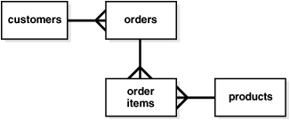
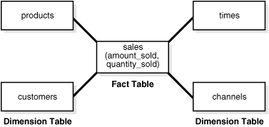
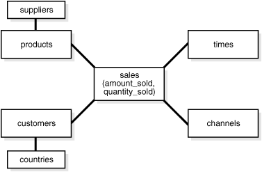

This chapter explains how to create a logical design for a data warehousing environment and includes the following topics:

- Logical Versus Physical Design in Data Warehouses

- Creating a Logical Design

- About Third Normal Form Schemas

- About Star Schemas

- Improved Analytics Using the In-Memory Column Store

- Automatic Big Table Caching to Improve the Performance of In-Memory Parallel Queries

### 2.1 Logical Versus Physical Design in Data Warehouses

Your organization has decided to build an enterprise data warehouse. You have defined the business requirements and agreed upon the scope of your business goals, and created a conceptual design. Now you need to translate your requirements into a system deliverable. To do so, you create the logical and physical design for the data warehouse. You then define:

- The specific data content

- Relationships within and between groups of data

- The system environment supporting your data warehouse

- The data transformations required

- The frequency with which data is refreshed

The logical design is more conceptual and abstract than the physical design. In the logical design, you look at the logical relationships among the objects. In the physical design, you look at the most effective way of storing and retrieving the objects as well as handling them from a transportation and backup/recovery perspective.

Orient your design toward the needs of the end users. End users typically want to perform analysis and look at aggregated data, rather than at individual transactions. However, end users might not know what they need until they see it. In addition, a well-planned design allows for growth and changes as the needs of users change and evolve.

By beginning with the logical design, you focus on the information requirements and save the implementation details for later.

### 2.2 Creating a Logical Design

A logical design is conceptual and abstract. You do not deal with the physical implementation details yet. You deal only with defining the types of information that you need.

One technique you can use to model your organization's logical information requirements is entity-relationship modeling. Entity-relationship modeling involves identifying the things of importance (entities), the properties of these things (attributes), and how they are related to one another (relationships).

The process of logical design involves arranging data into a series of logical relationships called entities and attributes. An entity represents a chunk of information. In relational databases, an entity often maps to a table. An attribute is a component of an entity that helps define the uniqueness of the entity. In relational databases, an attribute maps to a column.

To ensure that your data is consistent, you must use unique identifiers. A unique identifier is something you add to tables so that you can differentiate between the same item when it appears in different places. In a physical design, this is usually a primary key.

Entity-relationship modeling is purely logical and applies to both OLTP and data warehousing systems. It is also applicable to the various common physical schema modeling techniques found in data warehousing environments, namely normalized (3NF) schemas in Enterprise Data Warehousing environments, star or snowflake schemas in data marts, or hybrid schemas with components of both of these classical modeling techniques.

**See Also:**

- [Oracle Fusion Middleware Developing Integration Projects with Oracle Data Integrator](https://docs.oracle.com/pls/topic/lookup?ctx=en/database/oracle/oracle-database/19/dwhsg&id=ODIDG171) for more details regarding ODI

#### 2.2.1 What is a Schema?

A schema is a collection of database objects, including tables, views, indexes, and synonyms. You can arrange schema objects in the schema models designed for data warehousing in a variety of ways. Most data warehouses use a dimensional model.

The model of your source data and the requirements of your users help you design the data warehouse schema. You can sometimes get the source model from your company's enterprise data model and reverse-engineer the logical data model for the data warehouse from this. The physical implementation of the logical data warehouse model may require some changes to adapt it to your system parameters—size of computer, number of users, storage capacity, type of network, and software. A key part of designing the schema is whether to use a third normal form, star, or snowflake schema, and these are discussed later.

### 2.3 About Third Normal Form Schemas

Third Normal Form design seeks to minimize data redundancy and avoid anomalies in data insertion, updates and deletion. 3NF design has a long heritage in online transaction processing (OLTP) systems. OLTP systems must maximize performance and accuracy when inserting, updating and deleting data. Transactions must be handled as quickly as possible or the business may be unable to handle the flow of events, perhaps losing sales or incurring other costs. Therefore, 3NF designs avoid redundant data manipulation and minimize table locks, both of which can slow inserts, updates and deletes. 3NF designs also works well to abstract the data from specific application needs. If new types of data are added to the environment, you can extend the data model with relative ease and minimal impact to existing applications. Likewise, if you have completely new types of analyses to perform in your data warehouse, a well-designed 3NF schema will be able to handle them without requiring redesigned data structures.3NF designs have great flexibility, but it comes at a cost. 3NF databases use very many tables and this requires complex queries with many joins. For full scale enterprise models built in 3NF form, over one thousand tables are commonly encountered in the schema. With the kinds of queries involved in data warehousing, which will often need access to many rows from many tables, this design imposes understanding and performance penalties. It can be complex for query builders, whether they are humans or business intelligence tools and applications, to choose and join the tables needed for a given piece of data when there are very large numbers of tables available. Even when the tables are readily chosen by the query generator, the 3NF schema often requires that a large number of tables be used in a single query. More tables in a query mean more potential data access paths, which makes the database query optimizer's job harder. The end result can be slow query performance.

The issue of slow query performance in a 3NF system is not necessarily limited to the core queries used to create reports and analyses. It can also show up in the simpler task of users browsing subsets of data to understand the contents. Similarly, the complexity of a 3NF schema may impact generating the pick-lists of data used to constrain queries and reports. Although these may seem relatively minor issues, speedy response time for such processes makes a big impact on user satisfaction.

Figure 2-1 presents a tiny fragment of a 3NF Schema. Note how order information is broken into order and order items to avoid redundant data storage. The "crow's feet" markings on the relationship between tables indicate one-to-many relationships among the entities. Thus, one order may have multiple order items, a single customer may have many orders, and a single product may be found in many order items. Although this diagram shows a very small case, you can see that minimizing data redundancy can lead to many tables in the schema.

Figure 2-1 Fragment of a Third Normal Form Schema

[Description of "Figure 2-1 Fragment of a Third Normal Form Schema"](img_text/dwhsg108.md)

**See Also:**

Design Concepts for 3NF Schemas

#### 2.3.1 About Normalization

Normalization is a data design process that has a high level goal of keeping each fact in just one place to avoid data redundancy and insert, update, and delete anomalies. There are multiple levels of normalization, and this section describes the first three of them. Considering how fundamental the term third normal form (3NF) term is, it only makes sense to see how 3NF is reached.

Consider a situation where you are tracking sales. The core entity you track is sales orders, where each sales order contains details about each item purchased (referred to as a line item): its name, price, quantity, and so on. The order also holds the name and address of the customer and more. Some orders have many different line items, and some orders have just one.

In first normal form (1NF), there are no repeating groups of data and no duplicate rows. Every intersection of a row and column (a field) contains just one value, and there are no groups of columns that contain the same facts. To avoid duplicate rows, there is a primary key. For sales orders, in first normal form, multiple line items of each sales order in a single field of the table are not displayed. Also, there will not be multiple columns showing line items.

Then comes second normal form (2NF), where the design is in first normal form and every non-key column is dependent on the complete primary key. Thus, the line items are broken out into a table of sales order line items where each row represents one line item of one order. You can look at the line item table and see that the names of the items sold are not dependent on the primary key of the line items table: the sales item is its own entity. Therefore, you move the sales item to its own table showing the item name. Prices charged for each item can vary by order (for instance, due to discounts) so these remain in the line items table. In the case of sales order, the name and address of the customer is not dependent on the primary key of the sales order: customer is its own entity. Thus, you move the customer name and address columns out into their own table of customer information.

Next is third normal form, where the goal is to ensure that there are no dependencies on non-key attributes. So the goal is to take columns that do not directly relate to the subject of the row (the primary key), and put them in their own table. So details about customers, such as customer name or customer city, should be put in a separate table, and then a customer foreign key added into the orders table.

Another example of how a 2NF table differs from a 3NF table would be a table of the winners of tennis tournaments that contained columns of tournament, year, winner, and winner's date of birth. In this case, the winner's date of birth is vulnerable to inconsistencies, as the same person could be shown with different dates of birth in different records. The way to avoid this potential problem is to break the table into one for tournament winners, and another for the player dates of birth.

#### 2.3.2 Design Concepts for 3NF Schemas

The following section discusses some basic concepts when modeling for a data warehousing environment using a 3NF schema approach. The intent is not to discuss the theoretical foundation for 3NF modeling (or even higher levels of normalization), but to highlight some key components relevant for data warehousing.

Some key 3NF schema design concepts that are relevant to data warehousing are as follows:

- Identifying Candidate Primary Keys

- Foreign Key Relationships and Referential Integrity Constraints

- Denormalization

##### 2.3.2.1 Identifying Candidate Primary Keys

A primary key is an attribute that uniquely identifies a specific record in a table. Primary keys can be identified through single or multiple columns. It is normally preferred to achieve unique identification through as little columns as possible - ideally one or two - and to either use a column that is most likely not going to be updated or even changed in bulk. If your data model does not lead to a simple unique identification through its attributes, you would require too many attributes to uniquely identify a single records, or the data is prone to changes, the usage of a surrogate key is highly recommended.

Specifically, 3NF schemas rely on proper and simple unique identification since queries tend to have many table joins and all columns necessary to uniquely identify a record are needed as join condition to avoid row duplication through the join.

##### 2.3.2.2 Foreign Key Relationships and Referential Integrity Constraints

3NF schemas in data warehousing environments often resemble the data model of its OLTP source systems, in which the logical consistency between data entities is expressed and enforced through primary key - foreign key relationships, also known as parent-child relationship. A foreign key resolves a 1-to-many relationship in relational system and ensures logical consistency: for example, you cannot have an order line item without an order header, or an employee working for a non-existent department.

While such referential are always enforced in OLTP system, data warehousing systems often implement them as declarative, non-enforced conditions, relying on the ETL process to ensure data consistency. Whenever possible, foreign keys and referential integrity constraints should be defined as non-enforced conditions, since it enables better query optimization and cardinality estimates.

##### 2.3.2.3 Denormalization

Proper normalized modelling tends to decompose logical entities - such as a customer. a product, or an order - into many physical tables, making even the retrieval of perceived simple information requiring to join many tables. While this is not a problem from a query processing perspective, it can put some unnecessary burden on both the application developer (for writing code) as well as the database (for joining information that is always used together). It is not uncommon to see some sensible level of denormalization in 3NF data warehousing models, in a logical form as views or in a physical form through slightly denormalized tables.

Care has to be taken with the physical denormalization to preserve the subject-neutral shape and therefore the flexibility of the physical implementation of the 3NF schema.

### 2.4 About Star Schemas

Star schemas are often found in data warehousing systems with embedded logical or physical data marts. The term star schema is another way of referring to a "dimensional modeling" approach to defining your data model. Most descriptions of dimensional modeling use terminology drawn from the work of Ralph Kimball, the pioneering consultant and writer in this field. Dimensional modeling creates multiple star schemas, each based on a business process such as sales tracking or shipments. Each star schema can be considered a data mart, and perhaps as few as 20 data marts can cover the business intelligence needs of an enterprise. Compared to 3NF designs, the number of tables involved in dimensional modeling is a tiny fraction. Many star schemas will have under a dozen tables. The star schemas are knit together through conformed dimensions and conformed facts. Thus, users are able to get data from multiple star schemas with minimal effort.

The goal for star schemas is structural simplicity and high performance data retrieval. Because most queries in the modern era are generated by reporting tools and applications, it's vital to make the query generation convenient and reliable for the tools and application. In fact, many business intelligence tools and applications are designed with the expectation that a star schema representation will be available to them.

Discussions of star schemas are less abstracted from the physical database than 3NF descriptions. This is due to the pragmatic emphasis of dimensional modeling on the needs of business intelligence users.

Note how different the dimensional modeling style is from the 3NF approach that minimizes data redundancy and the risks of update/inset/delete anomalies. The star schema accepts data redundancy (denormalization) in its dimension tables for the sake of easy user understanding and better data retrieval performance. A common criticism of star schemas is that they limit analysis flexibility compared to 3NF designs. However, a well designed dimensional model can be extended to enable new types of analysis, and star schemas have been successful for many years at the largest enterprises.

As noted earlier, the modern approach to data warehousing does not pit star schemas and 3NF against each other. Rather, both techniques are used, with a foundation layer of 3NF - the Enterprise Data Warehouse of 3NF, acting as the bedrock data, and star schemas as a central part of an access and performance optimization layer.

**See Also:**

- About Facts and Dimensions in Star Schemas

- Design Concepts in Star Schemas

#### 2.4.1 About Facts and Dimensions in Star Schemas

Star schemas divide data into facts and dimensions. Facts are the measurements of some event such as a sale and are typically numbers. Dimensions are the categories you use to identify facts, such as date, location, and product.

The name "star schema" comes from the fact that the diagrams of the schemas typically show a central fact table with lines joining it to the dimension tables, so the graphic impression is similar to a star. Figure 2-2 is a simple example with sales as the fact table and products, times, customers, and channels as the dimension table.

Figure 2-2 Star Schema

[Description of "Figure 2-2 Star Schema"](img_text/td007.md)

**See Also:**

- About Fact Tables in Data Warehouses

- About Dimension Tables in Data Warehouses

##### 2.4.1.1 About Fact Tables in Data Warehouses

Fact tables have measurement data. They have many rows but typically not many columns. Fact tables for a large enterprise can easily hold billions of rows. For many star schemas, the fact table will represent well over 90 percent of the total storage space. A fact table has a composite key made up of the primary keys of the dimension tables of the schema.

A fact table contains either detail-level facts or facts that have been aggregated. Fact tables that contain aggregated facts are often called summary tables. A fact table usually contains facts with the same level of aggregation. Though most facts are additive, they can also be semi-additive or non-additive. Additive facts can be aggregated by simple arithmetical addition. A common example of this is sales. Non-additive facts cannot be added at all. An example of this is averages. Semi-additive facts can be aggregated along some of the dimensions and not along others. An example of this is inventory levels stored in physical warehouses, where you may be able to add across a dimension of warehouse sites, but you cannot aggregate across time.

In terms of adding rows to data in a fact table, there are three main approaches:

- Transaction-based

  Shows a row for the finest level detail in a transaction. A row is entered only if a transaction has occurred for a given combination of dimension values. This is the most common type of fact table.

- Periodic Snapshot

  Shows data as of the end of a regular time interval, such as daily or weekly. If a row for the snapshot exists in a prior period, a row is entered for it in the new period even if no activity related to it has occurred in the latest interval. This type of fact table is useful in complex business processes where it is difficult to compute snapshot values from individual transaction rows.

- Accumulating Snapshot

  Shows one row for each occurrence of a short-lived process. The rows contain multiple dates tracking major milestones of a short-lived process. Unlike the other two types of fact tables, rows in an accumulating snapshot are updated multiple times as the tracked process moves forward.

##### 2.4.1.2 About Dimension Tables in Data Warehouses

Dimension tables provide category data to give context to the fact data. For instance, a star schema for sales data will have dimension tables for product, date, sales location, promotion and more. Dimension tables act as lookup or reference tables because their information lets you choose the values used to constrain your queries. The values in many dimension tables may change infrequently. As an example, a dimension of geographies showing cities may be fairly static. But when dimension values do change, it is vital to update them fast and reliably. Of course, there are situations where data warehouse dimension values change frequently. The customer dimension for an enterprise will certainly be subject to a frequent stream of updates and deletions.

A key aspect of dimension tables is the hierarchy information they provide. Dimension data typically has rows for the lowest level of detail plus rows for aggregated dimension values. These natural rollups or aggregations within a dimension table are called hierarchies and add great value for analyses. For instance, if you want to calculate the share of sales that a specific product represents within its specific product category, it is far easier and more reliable to have a predefined hierarchy for product aggregation than to specify all the elements of the product category in each query. Because hierarchy information is so valuable, it is common to find multiple hierarchies reflected in a dimension table.

Dimension tables are usually textual and descriptive, and you will use their values as the row headers, column headers and page headers of the reports generated by your queries. While dimension tables have far fewer rows than fact tables, they can be quite wide, with dozens of columns. A location dimension table might have columns indicating every level of its rollup hierarchy, and may show multiple hierarchies reflected in the table. The location dimension table could have columns for its geographic rollup, such as street address, postal code, city, state/province, and country. The same table could include a rollup hierarchy set up for the sales organization, with columns for sales district, sales territory, sales region, and characteristics.

**See Also:**

[Dimensions](dimensions.md) for further information regarding dimensions

#### 2.4.2 Design Concepts in Star Schemas

Here we touch on some of the key terms used in star schemas. This is by no means a full set, but is intended to highlight some of the areas worth your consideration.

##### Data Grain

One of the most important tasks when designing your model is to consider the level of detail it will provide, referred to as the grain of the data. Consider a sales schema: will the grain be very fine, storing every single item purchased by each customer? Or will it be a coarse grain, storing only the daily totals of sales for each product at each store? In modern data warehousing there is a strong emphasis on providing the finest grain data possible, because this allows for maximum analytic power. Dimensional modeling experts generally recommend that each fact table store just one grain level. Presenting fact data in single-grain tables supports more reliable querying and table maintenance, because there is no ambiguity about the scope of any row in a fact table.

##### Working with Multiple Star Schemas

Because the star schema design approach is intended to chunk data into distinct processes, you need reliable and performant ways to traverse the schemas when queries span multiple schemas. One term for this ability is a data warehouse bus architecture. A data warehouse bus architecture can be achieved with conformed dimensions and conformed facts.

##### Conformed Dimensions

Conformed dimensions means that dimensions are designed identically across the various star schemas. Conformed dimensions use the same values, column names and data types consistently across multiple stars. The conformed dimensions do not have to contain the same number of rows in each schema's copy of the dimension table, as long as the rows in the shorter tables are a true subset of the larger tables.

##### Conformed Facts

If the fact columns in multiple fact tables have exactly the same meaning, then they are considered conformed facts. Such facts can be used together reliably in calculations even though they are from different tables. Conformed facts should have the same column names to indicate their conformed status. Facts that are not conformed should always have different names to highlight their different meanings.

##### Surrogate Keys

Surrogate or artificial keys, usually sequential integers, are recommended for dimension tables. By using surrogate keys, the data is insulated from operational changes. Also, compact integer keys may allow for better performance than large and complex alphanumeric keys.

##### Degenerate Dimensions

Degenerate dimensions are dimension columns in fact tables that do not join to a dimension table. They are typically items such as order numbers and invoice numbers. You will see them when the grain of a fact table is at the level of an order line-item or a single transaction.

##### Junk Dimensions

Junk dimensions are abstract dimension tables used to hold text lookup values for flags and codes in fact tables. These dimensions are referred to as junk, not because they have low value, but because they hold an assortment of columns for convenience, analogous to the idea of a "junk drawer" in your home. The number of distinct values (cardinality) of each column in a junk dimension table is typically small.

##### Embedded Hierarchy

Classic dimensional modeling with star schemas advocates that each table contain data at a single grain. However, there are situations where designers choose to have multiple grains in a table, and these commonly represent a rollup hierarchy. A single sales fact table, for instance, might contain both transaction-level data, then a day-level rollup by product, then a month-level rollup by product. In such cases, the fact table will need to contain a level column indicating the hierarchy level applying to each row, and queries against the table will need to include a level predicate.

##### Factless Fact Tables

Factless fact tables do not contain measures such as sales price or quantity sold. Instead, the rows of a factless fact table are used to show events not represented by other fact tables. Another use for factless tables is as a "coverage table" which holds all the possible events that could have occurred in a given situation, such as all the products that were part of a sales promotion and might have been sold at the promotional price.

##### Slowly Changing Dimensions

One of the certainties of data warehousing is that the way data is categorized will change. Product names and category names will change. Characteristics of a store will change. The areas included in sales territories will change. The timing and extent of these changes will not always be predictable. How can these slowly changing dimensions be handled? Star schemas treat these in three main ways:

- Type 1

  The dimension values that change are simply overwritten, with no history kept. This creates a problem for time-based analyses. Also, it invalidates any existing aggregates that depended on the old value of the dimension.

- Type 2

  When a dimension value changes, a new dimension row showing the new value and having a new surrogate key is created. You may choose to include date columns in our dimension showing when the new row is valid and when it is expired. No changes need be made to the fact table.

- Type 3

  When a dimension value is changed, the prior value is stored in a different column of the same row. This enables easy query generation if you want to compare results using the current and prior value of the column.

In practice, Type 2 is the most common treatment for slowly changing dimensions.

#### 2.4.3 About Snowflake Schemas

The snowflake schema is a more complex data warehouse model than a star schema, and is a type of star schema. It is called a snowflake schema because the diagram of the schema resembles a snowflake.

Snowflake schemas normalize dimensions to eliminate redundancy. That is, the dimension data has been grouped into multiple tables instead of one large table. For example, a product dimension table in a star schema might be normalized into a `products` table, a `product_category` table, and a `product_manufacturer` table in a snowflake schema. While this saves space, it increases the number of dimension tables and requires more foreign key joins. The result is more complex queries and reduced query performance. Figure 2-3 presents a graphical representation of a snowflake schema.

Figure 2-3 Snowflake Schema

[Description of "Figure 2-3 Snowflake Schema"](img_text/td008.md)

### 2.5 Improved Analytics Using the In-Memory Column Store

The In-Memory column store (IM column store) is an optional portion of the system global area (SGA) that stores copies of tables, table partitions, and other database objects in a compressed columnar format that is optimized for rapid scans.

Columnar format lends itself easily to vector processing thus making aggregations, joins, and certain types of data retrieval faster than the traditional on-disk formats. The columnar format exists only in memory and does not replace the on-disk or buffer cache format. Instead, it supplements the buffer cache and provides an additional, transaction-consistent, copy of the table that is independent of the disk format.

Traditional analytics have certain limitations or requirements that need to be managed to obtain good performance for analytic queries. You need to know user access patterns and then customize your data structures to provide optimal performance for these access patterns. Existing indexes, materialized views, and OLAP cubes need to be tuned. Certain data marts and reporting databases have complex ETL and thus need specialized tuning. Additionally, you need to strike a balance between performing analytics on stale data and slowing down OLTP operations on the production databases.

The Oracle In-Memory Column Store (IM column store) within the Oracle Database provides improved performance for both ad-hoc queries and analytics on live data. The live transactional database is used to provide instant answers to queries, thus enabling you to seamlessly use the same database for OLTP transactions and data warehouse analytics.

The IM column store integrates seamlessly with the Oracle Database and provides the following benefits in data warehousing environments:

- Improved query performance

  - Processing of ad-hoc queries with unanticipated access patterns is faster

    IM column store provides fast throughput for analyzing large amounts of data. Querying a subset of columns in a table provides quick results because only the columns necessary for the specific data analysis task are scanned.

  - Scanning of large number of rows and the application of filters that use operators such as =,\<,\>, and IN are faster with the use of SIMD vector processing

  - Storing frequently evaluated expressions using IM expressions reduces repeated computations of the same expressions

  - Using IM virtual columns and populating specified virtual columns into the IM column store avoids repeated evaluation of virtual columns

- Enhanced join performance using bloom filters

  Certain types of joins run faster when the tables being joined are stored in the IM column store. IM column store takes advantage of bloom filters with hash joins that speed up joins by converting predicates on small dimension tables to filters on a large fact table.

- Efficient aggregation using `VECTOR GROUP BY` transformation and vector array processing

  Queries that aggregate data and join one or more relatively small tables to a larger table, as often occurs in a star query, run faster. VECTOR GROUP BY will be chosen by the optimizer based on cost estimates.

- Reduced storage space and significantly less processing overhead because fewer indexes, materialized views, and OLAP cubes are required when IM column store is used.

**See Also:**

[Oracle Database In-Memory Guide](../inmem/optimizing-in-memory-aggregation.md) for detailed information about using the IM column store

#### 2.5.1 About Improving Query Performance Using In-Memory Expressions

When you use the In-Memory Column Store (IM column store), query performance can be further enhanced by using In-Memory Expressions (IM expressions) for frequently evaluated expressions.

Most queries in a data warehousing environment involve querying large data sets and are computationally intensive as they contain complex expressions or calculations. IM expressions provide enhanced performance for queries that contain frequently evaluated expressions. The optimizer automatically identifies and records repeatedly used expressions in the Expression Statistics Store (ESS). Expressions captured in the ESS are candidates for IM expressions. To facilitate reuse, IM expressions are materialized and populated into In-Memory Expression Units (IMEUs) within the IM column store. The database then maintains IM expressions and ensures that they are consistent with any modifications made to the source columns on which these expressions are based. Populating IM expressions into the IM column store reduces repeated computations of the same expressions.

For example, total cost, which is a product of the price and number of units sold, is a candidate for an IM expression. Without IM expressions, the value of total cost needs to be recomputed for every query and for every row returned by the query. With IM expressions, this frequently evaluated expression can be materialized and stored in the IM column store. This eliminates the need to repeatedly recompute the expression used in the query. Oracle Database rewrites the queries at runtime to use expression results stored in the IM column store thereby improving query performance.

The initialization parameter `INMEMORY_EXPRESSIONS_USAGE` controls which IM expressions must be populated into the IM column store. Procedures in the `DBMS_INMEMORY_ADMIN` package specify when IM expressions are identified, populated, and used.

**Related Topics**

- [Oracle Database In-Memory Guide](../inmem/optimizing-in-memory-expressions.md)

#### 2.5.2 About Using In-Memory Virtual Columns to Improve Query Performance

When you use the In-Memory Column Store (IM column store), In-Memory virtual columns (IM virtual columns) enable you to avoid repeated evaluations of virtual columns by populating specified virtual columns into the IM column store.

Virtual columns are user-created, named expressions that Oracle treats like regular columns. For example, if the `SALARY` table contains the column `monthly_salary`, you can define a virtual column called `annual_salary` as `monthly_salary` \* 12. IM virtual columns are virtual columns that can be populated into the IM column store. You can populate all or a subset of the virtual columns defined in a table into the IM column store. Storing precomputed virtual columns in the IM column store improves query performance by avoiding repeated evaluations. Virtual column values can also be scanned and filtered using in-memory techniques such as SIMD vector processing.

The initialization parameter `INMEMORY_VIRTUAL_COLUMNS` determines if IM virtual columns must be created for tables enabled for IM column store.

**Related Topics**

- [Oracle Database In-Memory Guide](../inmem/populating-objects-in-memory.md)

#### 2.5.3 About In-Memory Column Store and Automatic Data Optimization

Automatic Data Optimization (ADO) can be used to manage the contents of the In-Memory Column Store (IM column store).

The performance benefits provided by the IM column store can be optimized by effectively managing the contents of the IM column store. Objects that benefit most from being stored in the IM column store must be retained. This requires a constant monitoring of the IM column store to determine which objects must be retained and which objects must be removed from the IM column store.

Automatic Data Optimization (ADO) automates the management of the IM column store contents. Heat map statistics are gathered for objects in the IM column store and these statistics are used to determine the least active and the most active objects. You can define ADO policies to specify when objects are eligible to be moved out of the IM column store.

In data warehousing applications, the frequency with which objects are accessed typically decreases over time. Therefore, objects are accessed most frequently when they are first loaded in to the data warehouse and the activity levels decrease subsequently. Data warehouse performance can be enhanced by defining ADO policies that move objects that are accessed the least out of the IM column store.

**Related Topics**

- [Oracle Database In-Memory Guide](../inmem/configuring-memory-management.md)

### 2.6 Automatic Big Table Caching to Improve the Performance of In-Memory Parallel Queries

Automatic big table caching enhances the in-memory query capabilities of Oracle Database. When a table does not fit in memory, the database decides which buffers to cache based on access patterns. This provides efficient caching for large tables, even if they do not fully fit in the buffer cache.

An optional section of the buffer cache, called the big table cache, is used to store data for table scans. The big table cache is integrated with the buffer cache and uses a temperature-based, object-level replacement algorithm to manage the big table cache contents. This is different from the access-based, block level LRU algorithm used by the buffer cache.

**Note:**

The automatic big table caching feature is available starting with Oracle Database 12c Release 1 (12.1.0.2).

Typical data warehousing workloads scan multiple tables. Performance may be impacted if the combined size of these tables is greater than the combined size of the buffer cache. With automatic big table caching, the scanned tables are stored in the big table cache instead of the buffer cache. The temperature-based, object-level replacement algorithm used by the big table cache can provide enhanced performance for data warehousing workloads by:

- Selectively caching the "hot" objects

  Each time an object is accessed, Oracle Database increments the temperature of that object. An object in the big table cache can be replaced only by another object whose temperature is higher than its own temperature.

- Avoiding thrashing

  Partial objects are cached when objects cannot be fully cached.

In Oracle Real Application Clusters (Oracle RAC) environments, automatic big table caching is supported only for parallel queries. In single instance environments, this functionality is supported for both serial and parallel queries.

To use automatic big table caching, you must enable the big table cache. To use automatic big table caching for serial queries, you must set the `DB_BIG_TABLE_CACHE_PERCENT_TARGET` initialization parameter to a nonzero value. To use automatic big table caching for parallel queries, you must set `PARALLEL_DEGREE_POLICY` to `AUTO` or `ADAPTIVE` and `DB_BIG_TABLE_CACHE_PERCENT_TARGET` to a nonzero value.

**See Also:**

[Oracle Database VLDB and Partitioning Guide](../vldbg/inmemory-parallel-exec.md) for more information about the big table cache and how it can be used
