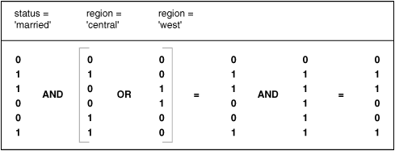
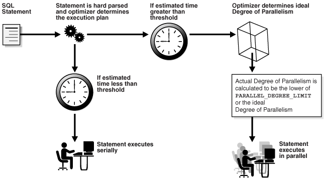
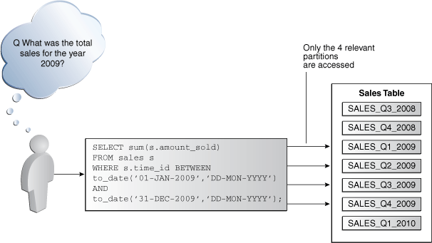
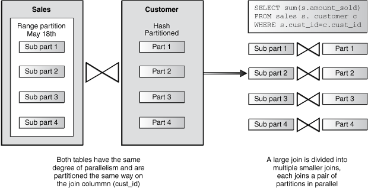
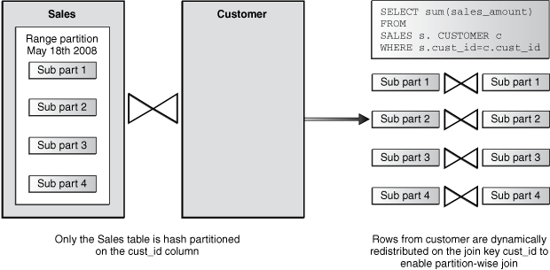

The following topics provide information about schemas in a data warehouse:

- Using Indexes in Data Warehouses

- Using Integrity Constraints in a Data Warehouse

- About Parallel Execution in Data Warehouses

- About Optimizing Storage Requirements in Data Warehouses

- Optimizing Star Queries and 3NF Schemas

- About Approximate Query Processing

- About Approximate Top-N Query Processing

### 4.1 Using Indexes in Data Warehouses

Indexes enable faster retrieval of data stored in data warehouses. This section discusses the following aspects of using indexes in data warehouses:

- About Using Bitmap Indexes in Data Warehouses

- Benefits of Indexes for Data Warehousing Applications

- About Cardinality and Bitmap Indexes

- How to Determine Candidates for Using a Bitmap Index

- Using Bitmap Join Indexes in Data Warehouses

- Using B-Tree Indexes in Data Warehouses

- Using Index Compression

- Choosing Between Local Indexes and Global Indexes

#### 4.1.1 About Using Bitmap Indexes in Data Warehouses

Bitmap indexes are widely used in data warehousing environments. The environments typically have large amounts of data and ad hoc queries, but a low level of concurrent DML transactions. For such applications, bitmap indexing provides:

- Reduced response time for large classes of ad hoc queries.

- Reduced storage requirements compared to other indexing techniques.

- Dramatic performance gains even on hardware with a relatively small number of CPUs or a small amount of memory.

Fully indexing a large table with a traditional B-tree index can be prohibitively expensive in terms of disk space because the indexes can be several times larger than the data in the table. Bitmap indexes are typically only a fraction of the size of the indexed data in the table.

An index provides pointers to the rows in a table that contain a given key value. A regular index stores a list of rowids for each key corresponding to the rows with that key value. In a bitmap index, a bitmap for each key value replaces a list of rowids.

Each bit in the bitmap corresponds to a possible rowid, and if the bit is set, it means that the row with the corresponding rowid contains the key value. A mapping function converts the bit position to an actual rowid, so that the bitmap index provides the same functionality as a regular index. Bitmap indexes store the bitmaps in a compressed way. If the number of distinct key values is small, bitmap indexes compress better and the space saving benefit compared to a B-tree index becomes even better.

Bitmap indexes are most effective for queries that contain multiple conditions in the `WHERE` clause. Rows that satisfy some, but not all, conditions are filtered out before the table itself is accessed. This improves response time, often dramatically. If you are unsure of which indexes to create, the SQL Access Advisor can generate recommendations on what to create. As the bitmaps from bitmap indexes can be combined quickly, it is usually best to use single-column bitmap indexes.

In addition, you should keep in mind that bitmap indexes are usually easier to destroy and re-create than to maintain.

##### 4.1.1.1 About Bitmap Indexes and Nulls

Unlike most other types of indexes, bitmap indexes include rows that have `NULL` values. Indexing of nulls can be useful for some types of SQL statements, such as queries with the aggregate function `COUNT`.

Example 4-1 Bitmap Index

    SELECT COUNT(*) FROM customers WHERE cust_marital_status IS NULL;

This query uses a bitmap index on `cust_marital_status`. Note that this query would not be able to use a B-tree index, because B-tree indexes do not store the `NULL` values.

    SELECT COUNT(*) FROM customers;

Any bitmap index can be used for this query because all table rows are indexed, including those that have `NULL` data. If nulls were not indexed, the optimizer would be able to use indexes only on columns with `NOT NULL` constraints.

##### 4.1.1.2 About Bitmap Indexes on Partitioned Tables

You can create bitmap indexes on partitioned tables but they must be local to the partitioned table—they cannot be global indexes. A partitioned table can only have global B-tree indexes, partitioned or nonpartitioned.

**See Also:**

- [Oracle Database SQL Language Reference](../sqlrf/CREATE-INDEX.md)

- [Oracle Database VLDB and Partitioning Guide](../vldbg/partition-concepts.md)

#### 4.1.2 Benefits of Indexes for Data Warehousing Applications

Bitmap indexes are primarily intended for data warehousing applications where users query the data rather than update it. They are not suitable for OLTP applications with large numbers of concurrent transactions modifying the data.

Indexes are more beneficial for high cardinality columns.

**See Also:**

About Cardinality and Bitmap Indexes

Parallel query and parallel DML work with bitmap indexes. Bitmap indexing also supports parallel create indexes and concatenated indexes.

#### 4.1.3 About Cardinality and Bitmap Indexes

The advantages of using bitmap indexes are greatest for columns in which the ratio of the number of distinct values to the number of rows in the table is small. This ratio is referred to as the [degree of cardinality](glossary.md). A gender column, which has only two distinct values (male and female), is optimal for a bitmap index. However, data warehouse administrators also build bitmap indexes on columns with higher cardinalities.

For example, on a table with one million rows, a column with 10,000 distinct values is a candidate for a bitmap index. A bitmap index on this column can outperform a B-tree index, particularly when this column is often queried in conjunction with other indexed columns. In fact, in a typical data warehouse environments, a bitmap index can be considered for any non-unique column.

B-tree indexes are most effective for high-cardinality data: that is, for data with many possible values, such as `customer_name` or `phone_number`. In a data warehouse, B-tree indexes should be used only for unique columns or other columns with very high cardinalities (that is, columns that are almost unique). The majority of indexes in a data warehouse should be bitmap indexes.

In ad hoc queries and similar situations, bitmap indexes can dramatically improve query performance. `AND` and `OR` conditions in the `WHERE` clause of a query can be resolved quickly by performing the corresponding Boolean operations directly on the bitmaps before converting the resulting bitmap to rowids. If the resulting number of rows is small, the query can be answered quickly without resorting to a full table scan.

The following query output shows a portion of a company's `customers` table.

    SELECT cust_id, cust_gender, cust_marital_status, cust_income_level
    FROM customers;

    CUST_ID    C CUST_MARITAL_STATUS  CUST_INCOME_LEVEL
    ---------- - -------------------- ---------------------
    ...
            70 F                      D: 70,000 - 89,999
            80 F married              H: 150,000 - 169,999
            90 M single               H: 150,000 - 169,999
           100 F                      I: 170,000 - 189,999
           110 F married              C: 50,000 - 69,999
           120 M single               F: 110,000 - 129,999
           130 M                      J: 190,000 - 249,999
           140 M married              G: 130,000 - 149,999
    ...

Because `cust_gender`, `cust_marital_status`, and `cust_income_level` are all low-cardinality columns (there are only three possible values for marital status, two possible values for gender, and 12 for income level), bitmap indexes are ideal for these columns. Do not create a bitmap index on `cust_id` because this is a unique column. Instead, a unique B-tree index on this column provides the most efficient representation and retrieval.

Table 4-1 illustrates the bitmap index for the `cust_gender` column in this example. It consists of two separate bitmaps, one for gender.

Table 4-1 Sample Bitmap Index

| cust_id       | gender='M' | gender='F' |
|:--------------|:-----------|:-----------|
| `cust_id 70`  | 0          | 1          |
| `cust_id 80`  | 0          | 1          |
| `cust_id 90`  | 1          | 0          |
| `cust_id 100` | 0          | 1          |
| `cust_id 110` | 0          | 1          |
| `cust_id 120` | 1          | 0          |
| `cust_id 130` | 1          | 0          |
| `cust_id 140` | 1          | 0          |

Each entry (or bit) in the bitmap corresponds to a single row of the `customers` table. The value of each bit depends upon the values of the corresponding row in the table. For example, the bitmap `cust_gender='F'` contains a one as its first bit because the gender is `F` in the first row of the `customers` table. The bitmap `cust_gender='F'` has a zero for its third bit because the gender of the third row is not `F`.

An analyst investigating demographic trends of the company's customers might ask, "How many of our married customers have an income level of G or H?" This corresponds to the following query:

    SELECT COUNT(*) FROM customers
    WHERE cust_marital_status = 'married'
    AND cust_income_level IN ('H: 150,000 - 169,999', 'G: 130,000 - 149,999');

Bitmap indexes can efficiently process this query by merely counting the number of ones in the bitmap illustrated in Figure 4-1. The result set will be found by using bitmap `OR` merge operations without the necessity of a conversion to rowids. To identify additional specific customer attributes that satisfy the criteria, use the resulting bitmap to access the table after a bitmap to rowid conversion.

Figure 4-1 Executing a Query Using Bitmap Indexes

[Description of "Figure 4-1 Executing a Query Using Bitmap Indexes"](img_text/dwhsg093.md)

#### 4.1.4 How to Determine Candidates for Using a Bitmap Index

Bitmap indexes should help when either the fact table is queried alone, and there are predicates on the indexed column, or when the fact table is joined with two or more dimension tables, and there are indexes on foreign key columns in the fact table, and predicates on dimension table columns.

A fact table column is a candidate for a bitmap index when the following conditions are met:

- There are 100 or more rows for each distinct value in the indexed column. When this limit is met, the bitmap index will be much smaller than a regular index, and you will be able to create the index much faster than a regular index. An example would be one million distinct values in a multi-billion row table.

And either of the following are true:

- The indexed column will be restricted in queries (referenced in the `WHERE` clause).

or

- The indexed column is a foreign key for a dimension table. In this case, such an index will make star transformation more likely.

#### 4.1.5 Using Bitmap Join Indexes in Data Warehouses

In addition to a bitmap index on a single table, you can create a bitmap join index, which is a bitmap index for the join of two or more tables. In a bitmap join index, the bitmap for the table to be indexed is built for values coming from the joined tables. In a data warehousing environment, the join condition is an equi-inner join between the primary key column or columns of the dimension tables and the foreign key column or columns in the fact table.

A bitmap join index can improve the performance by an order of magnitude. By storing the result of a join, the join can be avoided completely for SQL statements using a bitmap join index. Furthermore, because it is most likely to have a much smaller number of distinct values for a bitmap join index compared to a regular bitmap index on the join column, the bitmaps compress better, yielding to less space consumption than a regular bitmap index on the join column.

Bitmap join indexes are much more efficient in storage than materialized join views, an alternative for materializing joins in advance. This is because the materialized join views do not compress the rowids of the fact tables.

B-tree and bitmap indexes have different maximum column limitations.

**See Also:**

- Four Join Models for Bitmap Join Indexes in Data Warehouses

- Bitmap Join Index Restrictions and Requirements

- [Oracle Database SQL Language Reference](../sqlrf/CREATE-INDEX.md) for details regarding these limitations

##### 4.1.5.1 Four Join Models for Bitmap Join Indexes in Data Warehouses

The most common usage of a bitmap join index is in star model environments, where a large table is indexed on columns joined by one or several smaller tables. The large table is referred to as the fact table and the smaller tables as dimension tables. The following section describes the four different join models supported by bitmap join indexes.

The following example shows a bitmap join index where one dimension table column joins one fact table. Unlike the example in About Cardinality and Bitmap Indexes, where a bitmap index on the `cust_gender` column on the `customers` table was built, you now create a bitmap join index on the fact table `sales` for the joined column `customers(cust_gender)`. Table `sales` stores `cust_id` values only:

    SELECT time_id, cust_id, amount_sold FROM sales;

    TIME_ID   CUST_ID    AMOUNT_SOLD
    --------- ---------- -----------
    01-JAN-98      29700        2291
    01-JAN-98       3380         114
    01-JAN-98      67830         553
    01-JAN-98     179330           0
    01-JAN-98     127520         195
    01-JAN-98      33030         280
    ...

To create such a bitmap join index, column `customers(cust_gender)` has to be joined with table `sales`. The join condition is specified as part of the `CREATE` statement for the bitmap join index as follows:

    CREATE BITMAP INDEX sales_cust_gender_bjix
    ON sales(customers.cust_gender)
    FROM sales, customers
    WHERE sales.cust_id = customers.cust_id
    LOCAL NOLOGGING COMPUTE STATISTICS;

The following query shows the join result that is used to create the bitmaps that are stored in the bitmap join index:

    SELECT sales.time_id, customers.cust_gender, sales.amount_sold
    FROM sales, customers
    WHERE sales.cust_id = customers.cust_id;

    TIME_ID   C AMOUNT_SOLD
    --------- - -----------
    01-JAN-98 M        2291
    01-JAN-98 F         114
    01-JAN-98 M         553
    01-JAN-98 M           0
    01-JAN-98 M         195
    01-JAN-98 M         280
    01-JAN-98 M          32
    ...

Table 4-2 illustrates the bitmap representation for the bitmap join index in this example.

Table 4-2 Sample Bitmap Join Index

| sales record   | cust_gender='M' | cust_gender='F' |
|:---------------|:----------------|:----------------|
| sales record 1 | 1               | 0               |
| sales record 2 | 0               | 1               |
| sales record 3 | 1               | 0               |
| sales record 4 | 1               | 0               |
| sales record 5 | 1               | 0               |
| sales record 6 | 1               | 0               |
| sales record 7 | 1               | 0               |

You can create other bitmap join indexes using more than one column or more than one table, as shown in these examples.

Example 4-2 Bitmap Join Index: Multiple Dimension Columns Join One Fact Table

You can create a bitmap join index on more than one column from a single dimension table, as in the following example, which uses `customers(cust_gender, cust_marital_status)` from the `sh` schema:

    CREATE BITMAP INDEX sales_cust_gender_ms_bjix
    ON sales(customers.cust_gender, customers.cust_marital_status)
    FROM sales, customers
    WHERE sales.cust_id = customers.cust_id
    LOCAL NOLOGGING COMPUTE STATISTICS;

Example 4-3 Bitmap Join Index: Multiple Dimension Tables Join One Fact Table

You can create a bitmap join index on multiple dimension tables, as in the following, which uses `customers(gender)` and `products(category)`:

    CREATE BITMAP INDEX sales_c_gender_p_cat_bjix
    ON sales(customers.cust_gender, products.prod_category)
    FROM sales, customers, products
    WHERE sales.cust_id = customers.cust_id
    AND sales.prod_id = products.prod_id
    LOCAL NOLOGGING COMPUTE STATISTICS;

Example 4-4 Bitmap Join Index: Snowflake Schema

You can create a bitmap join index on more than one table, in which the indexed column is joined to the indexed table by using another table. For example, you can build an index on `countries.country_name`, even though the `countries` table is not joined directly to the `sales` table. Instead, the `countries` table is joined to the `customers` table, which is joined to the `sales` table. This type of schema is commonly called a [snowflake schema](glossary.md).

    CREATE BITMAP INDEX sales_co_country_name_bjix
    ON sales(countries.country_name)
    FROM sales, customers, countries
    WHERE sales.cust_id = customers.cust_id
      AND customers.country_id = countries.country_id
    LOCAL NOLOGGING COMPUTE STATISTICS;

##### 4.1.5.2 Bitmap Join Index Restrictions and Requirements

Join results must be stored, therefore, bitmap join indexes have the following restrictions:

- Parallel DML is only supported on the fact table. Parallel DML on one of the participating dimension tables will mark the index as unusable.

- Only one table can be updated concurrently by different transactions when using the bitmap join index.

- No table can appear twice in the join.

- You cannot create a bitmap join index on a temporary table.

- The columns in the index must all be columns of the dimension tables.

- The dimension table join columns must be either primary key columns or have unique constraints.

- The dimension table column(s) participating in the join with the fact table must be either the primary key column(s) or the unique constraint.

- If a dimension table has composite primary key, each column in the primary key must be part of the join.

- The restrictions for creating a regular bitmap index also apply to a bitmap join index. For example, you cannot create a bitmap index with the `UNIQUE` attribute. See [Oracle Database SQL Language Reference](../sqlrf/CREATE-INDEX.md) for other restrictions.

#### 4.1.6 Using B-Tree Indexes in Data Warehouses

A B-tree index is organized like an upside-down tree. The bottom level of the index holds the actual data values and pointers to the corresponding rows, much as the index in a book has a page number associated with each index entry.

In general, use B-tree indexes when you know that your typical query refers to the indexed column and retrieves a few rows. In these queries, it is faster to find the rows by looking at the index. However, using the book index analogy, if you plan to look at every single topic in a book, you might not want to look in the index for the topic and then look up the page. It might be faster to read through every chapter in the book. Similarly, if you are retrieving most of the rows in a table, it might not make sense to look up the index to find the table rows. Instead, you might want to read or scan the table.

B-tree indexes are most commonly used in a data warehouse to enforce unique keys. In many cases, it may not even be necessary to index these columns in a data warehouse, because the uniqueness was enforced as part of the preceding ETL processing, and because typical data warehouse queries may not work better with such indexes. B-tree indexes are more common in environments using third normal form schemas. In general, bitmap indexes should be more common than B-tree indexes in most data warehouse environments.

B-tree and bitmap indexes have different maximum column limitations. See [Oracle Database SQL Language Reference](../sqlrf/CREATE-INDEX.md) for these limitations.

#### 4.1.7 Using Index Compression

Bitmap indexes are always stored in a patented, compressed manner without the need of any user intervention. B-tree indexes, however, can be stored specifically in a compressed manner to enable huge space savings, storing more keys in each index block, which also leads to less I/O and better performance.

Key compression lets you compress a B-tree index, which reduces the storage overhead of repeated values. In the case of a nonunique index, all index columns can be stored in a compressed format, whereas in the case of a unique index, at least one index column has to be stored uncompressed. In addition to key compression, OLTP index compression may provide a higher degree of compression, but is more appropriate for OLTP applications than data warehousing environments.

Generally, keys in an index have two pieces, a grouping piece and a unique piece. If the key is not defined to have a unique piece, Oracle Database provides one in the form of a rowid appended to the grouping piece. Key compression is a method of breaking off the grouping piece and storing it so it can be shared by multiple unique pieces. The cardinality of the chosen columns to be compressed determines the compression ratio that can be achieved. So, for example, if a unique index that consists of five columns provides the uniqueness mostly by the last two columns, it is most optimal to choose the three leading columns to be stored compressed. If you choose to compress four columns, the repetitiveness will be almost gone, and the compression ratio will be worse.

Although key compression reduces the storage requirements of an index, it can increase the CPU time required to reconstruct the key column values during an index scan. It also incurs some additional storage overhead, because every prefix entry has an overhead of four bytes associated with it.

**See Also:**

- [Oracle Database Administrator’s Guide](../admin/managing-tables.md) for more information regarding key compression

- [Oracle Database Administrator’s Guide](../admin/managing-indexes.md) for more information regarding OLTP index compression

#### 4.1.8 Choosing Between Local Indexes and Global Indexes

B-tree indexes on partitioned tables can be global or local. With Oracle8i and earlier releases, Oracle recommended that global indexes not be used in data warehouse environments because a partition DDL statement (for example, `ALTER` `TABLE` ... `DROP` `PARTITION`) would invalidate the entire index, and rebuilding the index is expensive. Global indexes can be maintained without Oracle marking them as unusable after DDL, which makes global indexes effective for data warehouse environments.

However, local indexes will be more common than global indexes. Global indexes should be used when there is a specific requirement which cannot be met by local indexes (for example, a unique index on a non-partitioning key, or a performance requirement).

Bitmap indexes on partitioned tables are always local.

### 4.2 Using Integrity Constraints in a Data Warehouse

Integrity constraints provide a mechanism for ensuring that data conforms to guidelines specified by the database administrator.

The most common types of constraints include:

- `UNIQUE` constraints

  To ensure that a given column is unique

- `NOT` `NULL` constraints

  To ensure that no null values are allowed

- `FOREIGN` `KEY` constraints

  To ensure that two keys share a primary key to foreign key relationship

Constraints can be used for these purposes in a data warehouse:

- Data cleanliness

  Constraints verify that the data in the data warehouse conforms to a basic level of data consistency and correctness, preventing the introduction of dirty data.

- Query optimization

  The Oracle Database utilizes constraints when optimizing SQL queries. Although constraints can be useful in many aspects of query optimization, constraints are particularly important for query rewrite of materialized views.

Unlike data in many relational database environments, data in a data warehouse is typically added or modified under controlled circumstances during the extraction, transformation, and loading (ETL) process. Multiple users normally do not update the data warehouse directly, as they do in an OLTP system.

**See Also:**

- [Data Movement/ETL Overview](etl-overview.md)

This section contains the following topics:

- Overview of Constraint States

- Typical Data Warehouse Integrity Constraints

#### 4.2.1 Overview of Constraint States

To understand how best to use constraints in a data warehouse, you should first understand the basic purposes of constraints.

Some of these purposes are:

- Enforcement

  In order to use a constraint for enforcement, the constraint must be in the `ENABLE` state. An enabled constraint ensures that all data modifications upon a given table (or tables) satisfy the conditions of the constraints. Data modification operations which produce data that violates the constraint fail with a constraint violation error.

- Validation

  To use a constraint for validation, the constraint must be in the `VALIDATE` state. If the constraint is validated, then all data that currently resides in the table satisfies the constraint.

  Note that validation is independent of enforcement. Although the typical constraint in an operational system is both enabled and validated, any constraint could be validated but not enabled or vice versa (enabled but not validated). These latter two cases are useful for data warehouses.

- Belief

  In some cases, you will know that the conditions for a given constraint are true, so you do not need to validate or enforce the constraint. However, you may wish for the constraint to be present anyway to improve query optimization and performance. When you use a constraint in this way, it is called a belief or `RELY` constraint, and the constraint must be in the `RELY` state. The `RELY` state provides you with a mechanism for telling Oracle that a given constraint is believed to be true.

  Note that the `RELY` state only affects constraints that have not been validated.

#### 4.2.2 Typical Data Warehouse Integrity Constraints

This section assumes that you are familiar with the typical use of constraints. That is, constraints that are both enabled and validated. For data warehousing, many users have discovered that such constraints may be prohibitively costly to build and maintain. The topics discussed are:

- UNIQUE Constraints in a Data Warehouse

- FOREIGN KEY Constraints in a Data Warehouse

- RELY Constraints in a Data Warehouse

- NOT NULL Constraints in a Data Warehouse

- Integrity Constraints and Parallelism in a Data Warehouse

- Integrity Constraints and Partitioning in a Data Warehouse

- View Constraints in a Data Warehouse

##### 4.2.2.1 UNIQUE Constraints in a Data Warehouse

A `UNIQUE` constraint is typically enforced using a `UNIQUE` index. However, in a data warehouse whose tables can be extremely large, creating a unique index can be costly both in processing time and in disk space.

Suppose that a data warehouse contains a table `sales`, which includes a column `sales_id`. `sales_id` uniquely identifies a single sales transaction, and the data warehouse administrator must ensure that this column is unique within the data warehouse.

One way to create the constraint is as follows:

    ALTER TABLE sales ADD CONSTRAINT sales_uk
    UNIQUE (prod_id, cust_id, promo_id, channel_id, time_id);

By default, this constraint is both enabled and validated. Oracle implicitly creates a unique index on `sales_id` to support this constraint. However, this index can be problematic in a data warehouse for three reasons:

- The unique index can be very large, because the `sales` table can easily have millions or even billions of rows.

- The unique index is rarely used for query execution. Most data warehousing queries do not have predicates on unique keys, so creating this index will probably not improve performance.

- If `sales` is partitioned along a column other than `sales_id`, the unique index must be global. This can detrimentally affect all maintenance operations on the `sales` table.

A unique index is required for unique constraints to ensure that each individual row modified in the `sales` table satisfies the `UNIQUE` constraint.

For data warehousing tables, an alternative mechanism for unique constraints is illustrated in the following statement:

    ALTER TABLE sales ADD CONSTRAINT sales_uk
    UNIQUE (prod_id, cust_id, promo_id, channel_id, time_id) DISABLE VALIDATE;

This statement creates a unique constraint, but, because the constraint is disabled, a unique index is not required. This approach can be advantageous for many data warehousing environments because the constraint now ensures uniqueness without the cost of a unique index.

However, there are trade-offs for the data warehouse administrator to consider with `DISABLE` `VALIDATE` constraints. Because this constraint is disabled, no DML statements that modify the unique column are permitted against the `sales` table. You can use one of two strategies for modifying this table in the presence of a constraint:

- Use DDL to add data to this table (such as exchanging partitions). See the example in [Refreshing Materialized Views](refreshing-materialized-views.md).

- Before modifying this table, drop the constraint. Then, make all necessary data modifications. Finally, re-create the disabled constraint. Re-creating the constraint is more efficient than re-creating an enabled constraint. However, this approach does not guarantee that data added to the `sales` table while the constraint has been dropped is unique.

##### 4.2.2.2 FOREIGN KEY Constraints in a Data Warehouse

In a star schema data warehouse, `FOREIGN` `KEY` constraints validate the relationship between the fact table and the dimension tables. A sample constraint might be:

    ALTER TABLE sales ADD CONSTRAINT sales_time_fk
    FOREIGN KEY (time_id) REFERENCES times (time_id)
    ENABLE VALIDATE;

However, in some situations, you may choose to use a different state for the `FOREIGN` `KEY` constraints, in particular, the `ENABLE NOVALIDATE` state. A data warehouse administrator might use an `ENABLE NOVALIDATE` constraint when either:

- The tables contain data that currently disobeys the constraint, but the data warehouse administrator wishes to create a constraint for future enforcement.

- An enforced constraint is required immediately.

Suppose that the data warehouse loaded new data into the fact tables every day, but refreshed the dimension tables only on the weekend. During the week, the dimension tables and fact tables may in fact disobey the `FOREIGN` `KEY` constraints. Nevertheless, the data warehouse administrator might wish to maintain the enforcement of this constraint to prevent any changes that might affect the `FOREIGN` `KEY` constraint outside of the ETL process. Thus, you can create the `FOREIGN` `KEY` constraints every night, after performing the ETL process, as shown in the following:

    ALTER TABLE sales ADD CONSTRAINT sales_time_fk
    FOREIGN KEY (time_id) REFERENCES times (time_id)
    ENABLE NOVALIDATE;

`ENABLE` `NOVALIDATE` can quickly create an enforced constraint, even when the constraint is believed to be true. Suppose that the ETL process verifies that a `FOREIGN` `KEY` constraint is true. Rather than have the database re-verify this `FOREIGN` `KEY` constraint, which would require time and database resources, the data warehouse administrator could instead create a `FOREIGN` `KEY` constraint using `ENABLE` `NOVALIDATE`.

##### 4.2.2.3 RELY Constraints in a Data Warehouse

The ETL process commonly verifies that certain constraints are true. For example, it can validate all of the foreign keys in the data coming into the fact table. This means that you can trust it to provide clean data, instead of implementing constraints in the data warehouse. You create a `RELY` constraint as follows:

    ALTER TABLE sales ADD CONSTRAINT sales_time_fk
    FOREIGN KEY (time_id) REFERENCES times (time_id)
    RELY DISABLE NOVALIDATE;

This statement assumes that the primary key is in the `RELY` state. `RELY` constraints, even though they are not used for data validation, can:

- Enable more sophisticated query rewrites for materialized views. See [Basic Query Rewrite for Materialized Views](basic-query-rewrite-materialized-views.md) for further details.

- Enable other data warehousing tools to retrieve information regarding constraints directly from the Oracle data dictionary.

Creating a `RELY` constraint is inexpensive and does not impose any overhead during DML or load. Because the constraint is not being validated, no data processing is necessary to create it.

##### 4.2.2.4 NOT NULL Constraints in a Data Warehouse

When using query rewrite, you should consider whether `NOT` `NULL` constraints are required. The primary situation where you will need to use them is for join back query rewrite.

**See Also:**

- [Advanced Query Rewrite for Materialized Views](advanced-query-rewrite-materialized-views.md) for further information regarding `NOT` `NULL` constraints when using query rewrite

##### 4.2.2.5 Integrity Constraints and Parallelism in a Data Warehouse

All constraints can be validated in parallel. When validating constraints on very large tables, parallelism is often necessary to meet performance goals. The degree of parallelism for a given constraint operation is determined by the default degree of parallelism of the underlying table.

##### 4.2.2.6 Integrity Constraints and Partitioning in a Data Warehouse

You can create and maintain constraints before you partition the data. Later chapters discuss the significance of partitioning for data warehousing. Partitioning can improve constraint management just as it does to management of many other operations. For example, [Refreshing Materialized Views](refreshing-materialized-views.md) provides a scenario creating `UNIQUE` and `FOREIGN` `KEY` constraints on a separate staging table, and these constraints are maintained during the `EXCHANGE` `PARTITION` statement.

For external tables, you can only define `RELY` constraints in `DISABLE` mode. This is applicable to primary key, unique key, and foreign key constraints.

##### 4.2.2.7 View Constraints in a Data Warehouse

You can create constraints on views. The only type of constraint supported on a view is a `RELY` constraint.

This type of constraint is useful when queries typically access views instead of base tables, and the database administrator thus needs to define the data relationships between views rather than tables.

**See Also:**

- [Basic Materialized Views](basic-materialized-views.md)

- [Basic Query Rewrite for Materialized Views](basic-query-rewrite-materialized-views.md)

### 4.3 About Parallel Execution in Data Warehouses

Databases today, irrespective of whether they are data warehouses, operational data stores, or OLTP systems, contain a large amount of information. However, finding and presenting the right information in a timely fashion can be a challenge because of the vast quantity of data involved.

Parallel execution is the capability that addresses this challenge. Using parallel execution (also called parallelism), terabytes of data can be processed in minutes, not hours or days, simply by using multiple processes to accomplish a single task. This dramatically reduces response time for data-intensive operations on large databases typically associated with decision support systems (DSS) and data warehouses. You can also implement parallel execution on OLTP system for batch processing or schema maintenance operations such as index creation. Parallelism is the idea of breaking down a task so that, instead of one process doing all of the work in a query, many processes do part of the work at the same time. An example of this is when four processes combine to calculate the total sales for a year, each process handles one quarter of the year instead of a single processing handling all four quarters by itself. The improvement in performance can be quite significant.

Parallel execution improves processing for:

- Queries requiring large table scans, joins, or partitioned index scans

- Creations of large indexes

- Creation of large tables (including materialized views)

- Bulk inserts, updates, merges, and deletes

You can also use parallel execution to access object types within an Oracle database. For example, you can use parallel execution to access large objects (LOBs).

Large data warehouses should always use parallel execution to achieve good performance. Specific operations in OLTP applications, such as batch operations, can also significantly benefit from parallel execution.

This section contains the following topics:

- Why Use Parallel Execution?

- Automatic Degree of Parallelism and Statement Queuing

- About In-Memory Parallel Execution in Data Warehouses

#### 4.3.1 Why Use Parallel Execution?

Imagine that your task is to count the number of cars in a street. There are two ways to do this. One, you can go through the street by yourself and count the number of cars or you can enlist a friend and then the two of you can start on opposite ends of the street, count cars until you meet each other and add the results of both counts to complete the task.

Assuming your friend counts equally fast as you do, you expect to complete the task of counting all cars in a street in roughly half the time compared to when you perform the job all by yourself. If this is the case, then your operations scales linearly. That is, twice the number of resources halves the total processing time.

A database is not very different from the counting cars example. If you allocate twice the number of resources and achieve a processing time that is half of what it was with the original amount of resources, then the operation scales linearly. Scaling linearly is the ultimate goal of parallel processing, both in counting cars as well as in delivering answers from a database query.

**See Also:**

- [Oracle Database VLDB and Partitioning Guide](../vldbg/using-parallel.md) for more information about using parallel execution

This following topics provide guidance on the scenarios in which parallel execution is useful:

- When to Implement Parallel Execution

- When Not to Implement Parallel Execution

##### 4.3.1.1 When to Implement Parallel Execution

Parallel execution benefits systems with all of the following characteristics:

- Symmetric multiprocessors (SMPs), clusters, or massively parallel systems

- Sufficient I/O bandwidth

- Underutilized or intermittently used CPUs (for example, systems where CPU usage is typically less than 30%)

- Sufficient memory to support additional memory-intensive processes, such as sorts, hashing, and I/O buffers

If your system lacks any of these characteristics, parallel execution might not significantly improve performance. In fact, parallel execution may reduce system performance on overutilized systems or systems with small I/O bandwidth.

The benefits of parallel execution can be seen in DSS and data warehousing environments. OLTP systems can also benefit from parallel execution during batch processing and during schema maintenance operations such as creation of indexes. The average simple DML or `SELECT` statements, accessing or manipulating small sets of records or even single records, that characterize OLTP applications would not see any benefit from being executed in parallel.

##### 4.3.1.2 When Not to Implement Parallel Execution

Parallel execution is not normally useful for:

- Environments in which the typical query or transaction is very short (a few seconds or less). This includes most online transaction systems. Parallel execution is not useful in these environments because there is a cost associated with coordinating the parallel execution servers; for short transactions, the cost of this coordination may outweigh the benefits of parallelism.

- Environments in which the CPU, memory, or I/O resources are heavily utilized, even with parallel execution. Parallel execution is designed to exploit additional available hardware resources; if no such resources are available, then parallel execution does not yield any benefits and indeed may be detrimental to performance.

#### 4.3.2 Automatic Degree of Parallelism and Statement Queuing

As the name implies, automatic degree of parallelism is where Oracle Database determines the degree of parallelism (DOP) with which to run a statement (DML, DDL, and queries) based on the execution cost - the resource consumption of CPU, I/O, and memory - as determined by the Optimizer. That means that the database parses a query, calculates the cost and then determines a DOP to run with. The cheapest plan may be to run serially, which is also an option. Figure 4-2 illustrates this decision making process.

Figure 4-2 Optimizer Calculation: Serial or Parallel?

[Description of "Figure 4-2 Optimizer Calculation: Serial or Parallel?"](img_text/dwhsg132.md)

Should you choose to use automatic DOP, you may potentially see many more statements running in parallel, especially if the threshold is relatively low, where low is relative to the system and not an absolute quantifier.

Because of this expected behavior of more statements running in parallel with automatic DOP, it becomes more important to manage the utilization of the parallel processes available. That means that the system must be intelligent about when to run a statement and verify whether the requested numbers of parallel processes are available. The requested number of processes in this is the DOP for that statement.

The answer to this workload management question is parallel statement queuing with the Database Resource Manager. Parallel statement queuing runs a statement when its requested DOP is available. For example, when a statement requests a DOP of 64, it will not run if there are only 32 processes currently free to assist this customer, so the statement will be placed into a queue.

With Database Resource Manager, you can classify statements into workloads through consumer groups. Each consumer group can then be given the appropriate priority and the appropriate levels of parallel processes. Each consumer group also has its own queue to queue parallel statements based on the system load.

**See Also:**

- [Oracle Database VLDB and Partitioning Guide](../vldbg/degree-parallel.md) for more information about using automatic DOP with parallel execution

- [Oracle Database Administrator’s Guide](../admin/managing-resources-with-oracle-database-resource-manager.md) for more information about using the Database Resource Manager

#### 4.3.3 About In-Memory Parallel Execution in Data Warehouses

Traditionally, parallel processing by-passed the database buffer cache for most operations, reading data directly from disk (through direct path I/O) into the parallel execution server's private working space. Only objects smaller than about 2% of `DB_CACHE_SIZE` would be cached in the database buffer cache of an instance, and most objects accessed in parallel are larger than this limit. This behavior meant that parallel processing rarely took advantage of the available memory other than for its private processing. However, over the last decade, hardware systems have evolved quite dramatically; the memory capacity on a typical database server is now in the double or triple digit gigabyte range. This, together with Oracle's compression technologies and the capability of Oracle Database to exploit the aggregated database buffer cache of an Oracle Real Application Clusters environment, enables caching of objects in the terabyte range.

In-memory parallel execution takes advantage of this large aggregated database buffer cache. Having parallel execution servers accessing objects using the buffer cache enables full parallel in-memory processing of large volumes of data, leading to performance improvements in orders of magnitudes.

With in-memory parallel execution, when a SQL statement is issued in parallel, a check is conducted to determine if the objects accessed by the statement should be cached in the aggregated buffer cache of the system. In this context, an object can either be a table, index, or, in the case of partitioned objects, one or multiple partitions.

**See Also:**

- [Oracle Database VLDB and Partitioning Guide](../vldbg/inmemory-parallel-exec.md) for more information about using in-memory parallel execution

### 4.4 About Optimizing Storage Requirements in Data Warehouses

You can reduce your storage requirements by compressing data, which is achieved by eliminating duplicate values in a database block. "Using Data Compression to Improve Storage in Data Warehouses" describes how you can use compress data.

Database objects that can be compressed include tables and materialized views. For partitioned tables, you can compress some or all partitions. Compression attributes can be declared for a tablespace, a table, or a partition of a table. If declared at the tablespace level, then all tables created in that tablespace are compressed by default. You can alter the compression attribute for a table (or a partition or tablespace), and the change applies only to new data going into that table. As a result, a single table or partition may contain some compressed blocks and some regular blocks. This guarantees that data size will not increase as a result of compression. In cases where compression could increase the size of a block, it is not applied to that block.

#### 4.4.1 Using Data Compression to Improve Storage in Data Warehouses

You can compress several partitions or a complete partitioned heap-organized table. You do this either by defining a complete partitioned table as being compressed, or by defining it on a per-partition level. Partitions without a specific declaration inherit the attribute from the table definition or, if nothing is specified on the table level, from the tablespace definition.

The decision about whether or not a partition should be compressed is based on the same rules as a nonpartitioned table. Because of the ability of range and composite partitioning to separate data logically into distinct partitions, a partitioned table is an ideal candidate for compressing parts of the data (partitions) that are mainly read-only. It is, for example, beneficial in all rolling window operations as a kind of intermediate stage before aging out old data. With data compression, you can keep more old data online, minimizing the burden of additional storage use.

You can also change any existing uncompressed table partition later, add new compressed and uncompressed partitions, or change the compression attribute as part of any partition maintenance operation that requires data movement, such as `MERGE` `PARTITION`, `SPLIT` `PARTITION`, or `MOVE` `PARTITION`. The partitions can contain data, or they can be empty.

The access and maintenance of a partially or fully compressed partitioned table are the same as for a fully uncompressed partitioned table. All rules that apply to fully uncompressed partitioned tables are also valid for partially or fully compressed partitioned tables.

##### To use data compression:

The following example creates a range-partitioned table with one compressed partition `costs_old`. The compression attribute for the table and all other partitions is inherited from the tablespace level.

    CREATE TABLE costs_demo (
       prod_id     NUMBER(6),    time_id     DATE,
       unit_cost   NUMBER(10,2), unit_price  NUMBER(10,2))
    PARTITION BY RANGE (time_id)
       (PARTITION costs_old
           VALUES LESS THAN (TO_DATE('01-JAN-2003', 'DD-MON-YYYY')) COMPRESS,
        PARTITION costs_q1_2003
           VALUES LESS THAN (TO_DATE('01-APR-2003', 'DD-MON-YYYY')),
        PARTITION costs_q2_2003
           VALUES LESS THAN (TO_DATE('01-JUN-2003', 'DD-MON-YYYY')),
        PARTITION costs_recent VALUES LESS THAN (MAXVALUE));

### 4.5 Optimizing Star Queries and 3NF Schemas

Oracle data warehouses can work well with star schemas and third normal form schemas. This section presents important techniques for optimizing performance in both types of schema. For conceptual background on star and 3NF schemas, see "[About Third Normal Form Schemas](data-warehouse-logical-design.md)". and "[About Star Schemas](data-warehouse-logical-design.md)".

You should consider the following when using star queries:

- Optimizing Star Queries

- Using Star Transformation

- Optimizing Third Normal Form Schemas

- Optimizing Star Queries Using VECTOR GROUP BY Aggregation

#### 4.5.1 Optimizing Star Queries

A star query is a join between a fact table and a number of dimension tables. Each dimension table is joined to the fact table using a primary key to foreign key join, but the dimension tables are not joined to each other. The optimizer recognizes star queries and generates efficient execution plans for them. "Tuning Star Queries" describes how to improve the performance of star queries.

##### 4.5.1.1 Tuning Star Queries

To get the best possible performance for star queries, it is important to follow some basic guidelines:

- A bitmap index should be built on each of the foreign key columns of the fact table or tables.

- The initialization parameter `STAR_TRANSFORMATION_ENABLED` should be set to `TRUE`. This enables an important optimizer feature for star-queries. It is set to `FALSE` by default for backward-compatibility.

When a data warehouse satisfies these conditions, the majority of the star queries running in the data warehouse uses a query execution strategy known as the star transformation. The star transformation provides very efficient query performance for star queries.

#### 4.5.2 Using Star Transformation

The star transformation is a powerful optimization technique that relies upon implicitly rewriting (or transforming) the SQL of the original star query. The end user never needs to know any of the details about the star transformation. Oracle Database's query optimizer automatically chooses the star transformation where appropriate.

The star transformation is a query transformation aimed at executing star queries efficiently. Oracle Database processes a star query using two basic phases. The first phase retrieves exactly the necessary rows from the fact table (the result set). Because this retrieval utilizes bitmap indexes, it is very efficient. The second phase joins this result set to the dimension tables. An example of an end user query is: "What were the sales and profits for the grocery department of stores in the west and southwest sales districts over the last three quarters?" This is a simple star query.

This section contains the following topics:

- Star Transformation with a Bitmap Index

- Execution Plan for a Star Transformation with a Bitmap Index

- Star Transformation with a Bitmap Join Index

- Execution Plan for a Star Transformation with a Bitmap Join Index

- How Oracle Chooses to Use Star Transformation

- Star Transformation Restrictions

##### 4.5.2.1 Star Transformation with a Bitmap Index

A prerequisite of the star transformation is that there be a single-column bitmap index on every join column of the fact table. These join columns include all foreign key columns.

For example, the `sales` table of the `sh` sample schema has bitmap indexes on the `time_id`, `channel_id`, `cust_id`, `prod_id`, and `promo_id` columns.

Consider the following star query:

    SELECT ch.channel_class, c.cust_city, t.calendar_quarter_desc,
       SUM(s.amount_sold) sales_amount
    FROM sales s, times t, customers c, channels ch
    WHERE s.time_id = t.time_id
    AND   s.cust_id = c.cust_id
    AND   s.channel_id = ch.channel_id
    AND   c.cust_state_province = 'CA'
    AND   ch.channel_desc in ('Internet','Catalog')
    AND   t.calendar_quarter_desc IN ('1999-Q1','1999-Q2')
    GROUP BY ch.channel_class, c.cust_city, t.calendar_quarter_desc;

This query is processed in two phases. In the first phase, Oracle Database uses the bitmap indexes on the foreign key columns of the fact table to identify and retrieve only the necessary rows from the fact table. That is, Oracle Database retrieves the result set from the fact table using essentially the following query:

    SELECT ... FROM sales
    WHERE time_id IN
      (SELECT time_id FROM times
       WHERE calendar_quarter_desc IN('1999-Q1','1999-Q2'))
       AND cust_id IN
      (SELECT cust_id FROM customers WHERE cust_state_province='CA')
       AND channel_id IN
      (SELECT channel_id FROM channels WHERE channel_desc IN('Internet','Catalog'));

This is the transformation step of the algorithm, because the original star query has been transformed into this subquery representation. This method of accessing the fact table leverages the strengths of bitmap indexes. Intuitively, bitmap indexes provide a set-based processing scheme within a relational database. Oracle has implemented very fast methods for doing set operations such as `AND` (an intersection in standard set-based terminology), `OR` (a set-based union), `MINUS`, and `COUNT`.

In this star query, a bitmap index on `time_id` is used to identify the set of all rows in the fact table corresponding to `sales` in `1999-Q1`. This set is represented as a bitmap (a string of 1's and 0's that indicates which rows of the fact table are members of the set).

A similar bitmap is retrieved for the fact table rows corresponding to the sale from `1999-Q2`. The bitmap `OR` operation is used to combine this set of `Q1` sales with the set of `Q2` sales.

Additional set operations will be done for the `customer` dimension and the `product` dimension. At this point in the star query processing, there are three bitmaps. Each bitmap corresponds to a separate dimension table, and each bitmap represents the set of rows of the fact table that satisfy that individual dimension's constraints.

These three bitmaps are combined into a single bitmap using the bitmap `AND` operation. This final bitmap represents the set of rows in the fact table that satisfy all of the constraints on the dimension table. This is the result set, the exact set of rows from the fact table needed to evaluate the query. Note that none of the actual data in the fact table has been accessed. All of these operations rely solely on the bitmap indexes and the dimension tables. Because of the bitmap indexes' compressed data representations, the bitmap set-based operations are extremely efficient.

Once the result set is identified, the bitmap is used to access the actual data from the sales table. Only those rows that are required for the end user's query are retrieved from the fact table. At this point, Oracle Database has effectively joined all of the dimension tables to the fact table using bitmap indexes. This technique provides excellent performance because Oracle Database is joining all of the dimension tables to the fact table with one logical join operation, rather than joining each dimension table to the fact table independently.

The second phase of this query is to join these rows from the fact table (the result set) to the dimension tables. Oracle uses the most efficient method for accessing and joining the dimension tables. Many dimension are very small, and table scans are typically the most efficient access method for these dimension tables. For large dimension tables, table scans may not be the most efficient access method. In the previous example, a bitmap index on `product.department` can be used to quickly identify all of those products in the grocery department. Oracle Database's optimizer automatically determines which access method is most appropriate for a given dimension table, based upon the optimizer's knowledge about the sizes and data distributions of each dimension table.

The specific join method (as well as indexing method) for each dimension table will likewise be intelligently determined by the optimizer. A hash join is often the most efficient algorithm for joining the dimension tables. The final answer is returned to the user once all of the dimension tables have been joined. The query technique of retrieving only the matching rows from one table and then joining to another table is commonly known as a semijoin.

##### 4.5.2.2 Execution Plan for a Star Transformation with a Bitmap Index

The following typical execution plan might result from "Star Transformation with a Bitmap Index":

    SELECT STATEMENT
     SORT GROUP BY
      HASH JOIN
       TABLE ACCESS FULL                          CHANNELS
       HASH JOIN
        TABLE ACCESS FULL                         CUSTOMERS
        HASH JOIN
         TABLE ACCESS FULL                        TIMES
         PARTITION RANGE ITERATOR
          TABLE ACCESS BY LOCAL INDEX ROWID       SALES
           BITMAP CONVERSION TO ROWIDS
            BITMAP AND
             BITMAP MERGE
              BITMAP KEY ITERATION
               BUFFER SORT
                TABLE ACCESS FULL                 CUSTOMERS
               BITMAP INDEX RANGE SCAN            SALES_CUST_BIX
             BITMAP MERGE
              BITMAP KEY ITERATION
               BUFFER SORT
                TABLE ACCESS FULL                 CHANNELS
               BITMAP INDEX RANGE SCAN            SALES_CHANNEL_BIX
             BITMAP MERGE
              BITMAP KEY ITERATION
               BUFFER SORT
                TABLE ACCESS FULL                 TIMES
               BITMAP INDEX RANGE SCAN            SALES_TIME_BIX

In this plan, the fact table is accessed through a bitmap access path based on a bitmap `AND`, of three merged bitmaps. The three bitmaps are generated by the `BITMAP` `MERGE` row source being fed bitmaps from row source trees underneath it. Each such row source tree consists of a `BITMAP` `KEY` `ITERATION` row source which fetches values from the subquery row source tree, which in this example is a full table access. For each such value, the `BITMAP` `KEY` `ITERATION` row source retrieves the bitmap from the bitmap index. After the relevant fact table rows have been retrieved using this access path, they are joined with the dimension tables and temporary tables to produce the answer to the query.

##### 4.5.2.3 Star Transformation with a Bitmap Join Index

In addition to bitmap indexes, you can use a bitmap join index during star transformations. Assume you have the following additional index structure:

    CREATE BITMAP INDEX sales_c_state_bjix
    ON sales(customers.cust_state_province)
    FROM sales, customers
    WHERE sales.cust_id = customers.cust_id
    LOCAL NOLOGGING COMPUTE STATISTICS;

The processing of the same star query using the bitmap join index is similar to the previous example. The only difference is that Oracle utilizes the join index, instead of a single-table bitmap index, to access the customer data in the first phase of the star query.

##### 4.5.2.4 Execution Plan for a Star Transformation with a Bitmap Join Index

The following typical execution plan might result from "Execution Plan for a Star Transformation with a Bitmap Join Index":

    SELECT STATEMENT
     SORT GROUP BY
      HASH JOIN
       TABLE ACCESS FULL                          CHANNELS
       HASH JOIN
        TABLE ACCESS FULL                         CUSTOMERS
        HASH JOIN
         TABLE ACCESS FULL                        TIMES
         PARTITION RANGE ALL
          TABLE ACCESS BY LOCAL INDEX ROWID       SALES
           BITMAP CONVERSION TO ROWIDS
            BITMAP AND
             BITMAP INDEX SINGLE VALUE            SALES_C_STATE_BJIX
             BITMAP MERGE
              BITMAP KEY ITERATION
               BUFFER SORT
                TABLE ACCESS FULL                 CHANNELS
               BITMAP INDEX RANGE SCAN            SALES_CHANNEL_BIX
             BITMAP MERGE
              BITMAP KEY ITERATION
               BUFFER SORT
                TABLE ACCESS FULL                 TIMES
               BITMAP INDEX RANGE SCAN            SALES_TIME_BIX

The difference between this plan as compared to the previous one is that the inner part of the bitmap index scan for the `customer` dimension has no subselect. This is because the join predicate information on `customer.cust_state_province `can be satisfied with the bitmap join index `sales_c_state_bjix`.

##### 4.5.2.5 How Oracle Chooses to Use Star Transformation

The optimizer generates and saves the best plan it can produce without the transformation. If the transformation is enabled, the optimizer then tries to apply it to the query and, if applicable, generates the best plan using the transformed query. Based on a comparison of the cost estimates between the best plans for the two versions of the query, the optimizer then decides whether to use the best plan for the transformed or untransformed version.

If the query requires accessing a large percentage of the rows in the fact table, it might be better to use a full table scan and not use the transformations. However, if the constraining predicates on the dimension tables are sufficiently selective that only a small portion of the fact table must be retrieved, the plan based on the transformation will probably be superior.

Note that the optimizer generates a subquery for a dimension table only if it decides that it is reasonable to do so based on a number of criteria. There is no guarantee that subqueries will be generated for all dimension tables. The optimizer may also decide, based on the properties of the tables and the query, that the transformation does not merit being applied to a particular query. In this case, the best regular plan will be used.

##### 4.5.2.6 Star Transformation Restrictions

Star transformation is not supported for tables with any of the following characteristics:

- Queries with a table hint that is incompatible with a bitmap access path

- Tables with too few bitmap indexes. There must be a bitmap index on a fact table column for the optimizer to generate a subquery for it.

- Remote fact tables. However, remote dimension tables are allowed in the subqueries that are generated.

- Anti-joined tables

- Tables that are already used as a dimension table in a subquery

- Tables that are really unmerged views, which are not view partitions

- Tables where the fact table is an unmerged view

- Tables where a partitioned view is used as a fact table

The star transformation may not be chosen by the optimizer for the following cases:

- Tables that have a good single-table access path

- Tables that are too small for the transformation to be worthwhile

In addition, temporary tables will not be used by star transformation under the following conditions:

- The database is in read-only mode

- The star query is part of a transaction that is in serializable mode

#### 4.5.3 Optimizing Third Normal Form Schemas

Optimizing a third normal form (3NF) schema requires the following:

- Power

  Power means that the hardware configuration must be balanced. Many data warehouse operations are based upon large table scans and other IO-intensive operations, which perform vast quantities of random IOs. In order to achieve optimal performance the hardware configuration must be sized end to end to sustain this level of throughput. This type of hardware configuration is called a balanced system. In a balanced system, all components - from the CPU to the disks - are orchestrated to work together to guarantee the maximum possible IO throughput.

- Partitioning

  The larger tables should be partitioned using composite partitioning (range-hash or list-hash). There are three reasons for this:

  - Easier manageability of terabytes of data

  - Faster accessibility to the necessary data

  - Efficient and performant table joins

  See 3NF Schemas: Partitioning.

- Parallel Execution

  Parallel Execution enables a database task to be parallelized or divided into smaller units of work, thus allowing multiple processes to work concurrently. By using parallelism, a terabyte of data can be scanned and processed in minutes or less, not hours or days.

  See 3NF Schemas: Parallel Query Execution.

##### 4.5.3.1 3NF Schemas: Partitioning

Partitioning allows a table, index or index-organized table to be subdivided into smaller pieces. Each piece of the database object is called a partition. Each partition has its own name, and may optionally have its own storage characteristics. From the perspective of a database administrator, a partitioned object has multiple pieces that can be managed either collectively or individually.

This gives the administrator considerable flexibility in managing partitioned objects. However, from the perspective of the application, a partitioned table is identical to a non-partitioned table; no modifications are necessary when accessing a partitioned table using SQL DML commands. Partitioning can provide tremendous benefits to a wide variety of applications by improving manageability, availability, and performance.

###### 4.5.3.1.1 Partitioning for Manageability

Range partitioning will help improve the manageability and availability of large volumes of data. Consider the case where two year's worth of sales data or 100 terabytes (TB) is stored in a table. At the end of each day a new batch of data needs to be to loaded into the table and the oldest days worth of data needs to be removed. If the Sales table is ranged partitioned by day the new data can be loaded using a partition exchange load. This is a sub-second operation and should have little or no impact to end user queries. In order to remove the oldest day of data simply issue the following command:

    SH@DBM1 > ALTER TABLE SALES DROP PARTITION Sales_Q4_2009;

###### 4.5.3.1.2 Partitioning for Easier Data Access

Range partitioning will also help ensure only the necessary data to answer a query will be scanned. Let's assume that the business users predominately accesses the sales data on a weekly basis, e.g. total sales per week then range partitioning this table by day will ensure that the data is accessed in the most efficient manner, as only 4 partitions need to be scanned to answer the business users query instead of the entire table. The ability to avoid scanning irrelevant partitions is known as partition pruning.

Figure 4-3 Partition Pruning

[Description of "Figure 4-3 Partition Pruning"](img_text/dwhsg152.md)

Starting with Oracle Database 12c Release 2 (12.2), you can define partitions for external tables. External tables are tables that do not reside in the database and can be in any format for which an access driver is provided. The files for partitioned external tables can be stored in a file system, in Apache Hive storage, or in a Hadoop Distributed File System (HDFS).

Partitioning for external tables improves query performance and enables easier data maintenance. It also enables external tables to take advantage of performance optimizations, such as partition pruning and partition-wise joins, that are available to partitioned tables stored in the database. Most partitioning techniques supported for tables in the database, except hash partitioning, are supported for partitioned external tables. However, Oracle Database cannot guarantee that the external storage files for partitions contain data that satisfies the partitioning conditions.

**See Also:**

[Oracle Database Administrator’s Guide](../admin/managing-tables.md) for detailed information about partitioned external tables

###### 4.5.3.1.3 Partitioning for Join Performance

Sub-partitioning by hash is used predominately for performance reasons. Oracle uses a linear hashing algorithm to create sub-partitions. In order to ensure that the data gets evenly distributed among the hash partitions, it is highly recommended that the number of hash partitions is a power of 2 (for example, 2, 4, 8, and so on). Each hash partition should be at least 16MB in size. Any smaller and they will not have efficient scan rates with parallel query.

One of the main performance benefits of hash partitioning is partition-wise joins. Partition-wise joins reduce query response time by minimizing the amount of data exchanged among parallel execution servers when joins execute in parallel. This significantly reduces response time and improves both CPU and memory resource usage. In a clustered data warehouse, this significantly reduces response times by limiting the data traffic over the interconnect (IPC), which is the key to achieving good scalability for massive join operations. Partition-wise joins can be full or partial, depending on the partitioning scheme of the tables to be joined.

A full partition-wise join divides a join between two large tables into multiple smaller joins. Each smaller join performs a joins on a pair of partitions, one for each of the tables being joined. For the optimizer to choose the full partition-wise join method, both tables must be equi-partitioned on their join keys. That is, they have to be partitioned on the same column with the same partitioning method. Parallel execution of a full partition-wise join is similar to its serial execution, except that instead of joining one partition pair at a time, multiple partition pairs are joined in parallel by multiple parallel query servers. The number of partitions joined in parallel is determined by the Degree of Parallelism (DOP).

Figure 4-4 Full Partition-Wise Join

[Description of "Figure 4-4 Full Partition-Wise Join"](img_text/dwhsg153.md)

Figure 4-4 illustrates the parallel execution of a full partition-wise join between two tables, `Sales` and `Customers`. Both tables have the same degree of parallelism and the same number of partitions. They are range partitioned on a date field and sub-partitioned by hash on the `cust_id` field. As illustrated in the picture, each partition pair is read from the database and joined directly. There is no data redistribution necessary, thus minimizing IPC communication, especially across nodes. Figure 4-5 below shows the execution plan you would see for this join.

To ensure that you get optimal performance when executing a partition-wise join in parallel, the number of partitions in each of the tables should be larger than the degree of parallelism used for the join. If there are more partitions than parallel servers, each parallel server will be given one pair of partitions to join, when the parallel server completes that join, it will requests another pair of partitions to join. This process repeats until all pairs have been processed. This method enables the load to be balanced dynamically (for example, 128 partitions with a degree of parallelism of 32).

What happens if only one of the tables you are joining is partitioned? In this case the optimizer could pick a partial partition-wise join. Unlike full partition-wise joins, partial partition-wise joins can be applied if only one table is partitioned on the join key. Hence, partial partition-wise joins are more common than full partition-wise joins. To execute a partial partition-wise join, Oracle dynamically repartitions the other table based on the partitioning strategy of the partitioned table. Once the other table is repartitioned, the execution is similar to a full partition-wise join. The redistribution operation involves exchanging rows between parallel execution servers. This operation leads to interconnect traffic in Oracle RAC environments, because data needs to be repartitioned across node boundaries.

Figure 4-5 Partial Partition-Wise Join

[Description of "Figure 4-5 Partial Partition-Wise Join"](img_text/dwhsg154.md)

Figure 4-5 illustrates a partial partition-wise join. It uses the same example as in Figure 4-4, except that the customer table is not partitioned. Before the join operation is executed, the rows from the customers table are dynamically redistributed on the join key.

##### 4.5.3.2 3NF Schemas: Parallel Query Execution

3NF schemas can leverage parallelism in multiple ways, but here the focus is on one facet of parallelism that is specially significant to 3NF: SQL parallel execution for large queries. SQL parallel execution in the Oracle Database is based on the principles of a coordinator (often called the Query Coordinator or QC) and parallel servers. The QC is the session that initiates the parallel SQL statement and the parallel servers are the individual sessions that perform work in parallel. The QC distributes the work to the parallel servers and may have to perform a minimal mostly logistical - portion of the work that cannot be executed in parallel. For example a parallel query with a `SUM()` operation requires adding the individual sub-totals calculated by each parallel server.

The QC is easily identified in the parallel execution in Figure 4-5 as PX COORDINATOR. The process acting as the QC of a parallel SQL operation is the actual user session process itself. The parallel servers are taken from a pool of globally available parallel server processes and assigned to a given operation. The parallel servers do all the work shown in a parallel plan BELOW the QC.

By default, the Oracle Database is configured to support parallel execution out-of-the-box and is controlled by two initialization parameters `parallel_max_servers` and `parallel_min_servers`. While parallel execution provides a very powerful and scalable framework to speed up SQL operations, you should not forget to use some common sense rules; while parallel execution might buy you an additional incremental performance boost, it requires more resources and might also have side effects on other users or operations on the same system. Small tables/indexes (up to thousands of records; up to 10s of data blocks) should never be enabled for parallel execution. Operations that only hit small tables will not benefit much from executing in parallel, but they will use parallel servers that you will want to be available for operations accessing large tables. Remember also that once an operation starts at a certain degree of parallelism (DOP), there is no way to reduce its DOP during the execution.

The general rules of thumb for determining the appropriate DOP for an object are:

- Objects smaller than 200 MB should not use any parallelism

- Objects between 200 MB and 5GB should use a DOP of 4

- Objects beyond 5GB use a DOP of 32

Needless to say the optimal settings may vary on your system - either in size range or DOP - and highly depend on your target workload, the business requirements, and your hardware configuration. Whether or Not to Use Cross Instance Parallel Execution in Oracle RAC describes parallel execution in Oracle RAC environments.

###### 4.5.3.2.1 Whether or Not to Use Cross Instance Parallel Execution in Oracle RAC

By default, Oracle Database enables inter-node parallel execution (parallel execution of a single statement involving more than one node). As mentioned earlier, the interconnect in an Oracle RAC environment must be sized appropriately as inter-node parallel execution may result in a lot of interconnect traffic. If you are using a relatively weak interconnect in comparison to the I/O bandwidth from the server to the storage subsystem, you may be better off restricting parallel execution to a single node or to a limited number of nodes. Inter-node parallel execution will not scale with an undersized interconnect. From Oracle Database 11g onwards, it is recommended to use Oracle RAC services to control parallel execution on a cluster.

#### 4.5.4 Optimizing Star Queries Using VECTOR GROUP BY Aggregation

`VECTOR GROUP BY` aggregation optimizes queries that aggregate data and join one or more relatively small tables to a larger table. This transformation can be chosen by the SQL optimizer based on cost estimates. In the context of data warehousing, `VECTOR GROUP BY` will often be chosen for star queries that select data from in-memory columnar tables.

`VECTOR GROUP BY` aggregation is similar to a bloom filter in that it transforms the join condition between a small table and a large table into a filter on the larger table. `VECTOR GROUP BY` aggregation further enhances query performance by aggregating data during the scan of the fact table rather than as a separate step following the scan.

**See Also:**

- [Using In-Memory Aggregation](sql-aggregation-data-warehouses.md)

- [Oracle Database In-Memory Guide](../inmem/optimizing-in-memory-aggregation.md) for a detailed `VECTOR GROUP BY` scenario

### 4.6 About Approximate Query Processing

Approximate query processing uses SQL functions to provide real-time responses to explorative queries where approximations are acceptable. A query containing SQL functions that return approximate results is referred to as an approximate query.

Business intelligence (BI) applications extensively use aggregate functions, including analytic functions, to provide answers to common business queries. For some types of queries, when the data set is extremely large, providing exact answers can be resource intensive. For example, counting the number of unique customer sessions on a website or establishing the median house price within each zip code across a state. In certain scenarios, these types of queries may not require exact answers because you are more interested in approximate trends or patterns, which can then be used to drive further analysis. Approximate query processing is primarily used in data discovery applications to return quick answers to explorative queries. Users typically want to locate interesting data points within large amounts of data and then drill down to uncover further levels of detail. For explorative queries, quick responses are more important than exact values.

Oracle provides a set of SQL functions that enable you to obtain approximate results with negligible deviation from the exact result. There are additional approximate functions that support materialized view based summary aggregation strategies. The functions that provide approximate results are as follows:

- `APPROX_COUNT_DISTINCT`

- `APPROX_COUNT_DISTINCT_DETAIL`

- `APPROX_COUNT_DISTINCT_AGG`

- `TO_APPROX_COUNT_DISTINCT`

- `APPROX_MEDIAN`

- `APPROX_PERCENTILE`

- `APPROX_PERCENTILE_DETAIL`

- `APPROX_PERCENTILE_AGG`

- `TO_APPROX_PERCENTILE`

- `APPROX_COUNT`

- `APPROX_RANK`

- `APPROX_SUM`

Approximate query processing can be used without any changes to your existing code. When you set the appropriate initialization parameters, Oracle Database replaces exact functions in queries with the corresponding SQL functions that return approximate results.

**See Also:**

- Running Queries Containing Exact Functions Using SQL Functions that Return Approximate Values

- [Creating Materialized Views Based on Approximate Queries](basic-materialized-views.md)

- [Query Rewrite and Materialized Views Based on Approximate Queries](advanced-query-rewrite-materialized-views.md)

- [Oracle Database SQL Language Reference](../sqlrf/index.md) for information about the SQL functions

#### 4.6.1 Running Queries Containing Exact Functions Using SQL Functions that Return Approximate Values

Queries containing exact functions can be run by using the corresponding SQL functions that return approximate results, without modifying the queries. This enables you to run existing applications, without modifications, by using the corresponding SQL functions that return approximate results.

Oracle Database provides the following initialization parameters to indicate that exact functions must be replaced with the corresponding SQL functions that return approximate results at runtime: `approx_for_aggregation`, `approx_for_count_distinct`, and `approx_for_percentile`. You can replace all exact functions at runtime with the corresponding functions that return approximate results. If you need more fine-grained control over the list of functions that must be replaced with their corresponding approximate versions, then you can specify the type of functions that must be replaced at runtime. For example, if a query contains `COUNT(DISTINCT)`, then setting `approx_for_aggregation` to `TRUE` results in this query being run using `APPROX_COUNT_DISTINCT` instead of `COUNT(DISTINCT)`.

- To run all queries using the corresponding SQL functions that return approximate results instead of the specified SQL functions:
  Set the `approx_for_aggregation` initialization parameter to `TRUE` for the current session or for the entire database. This parameter acts as an umbrella parameter for enabling the use of functions that return approximate results. Setting this is equivalent to setting the `APPROX_COUNT_DISTINCT` and `APPROX_FOR_PERCENTILE` parameters.

  The following command sets `approx_for_aggregation` to true for the current session:

      alter session set approx_for_aggregation = TRUE;
- To replace only the `COUNT(DISTINCT)` function in queries with the `APPROX_COUNT_DISTINCT` function:
  Set the `approx_for_count_distinct` initialization parameter to `TRUE` for the current session or for the entire database.
- To replace percentile functions with the corresponding functions that return approximate results:
  Set `approx_for_percentile` to `PERCENTILE_CONT`, `PERCENTILE_DISC`, or `ALL` (replaces all percentile functions) for the current session or for the entire database. The default value of this parameter is `NONE`.

  **See Also:**

  - `APROX_FOR_AGGREGATION` in [Oracle Database Reference](../refrn/APPROX_FOR_AGGREGATION.md)

  - `APPROX_FOR_COUNT_DISTINCT` in [Oracle Database Reference](../refrn/APPROX_FOR_COUNT_DISTINCT.md)

  - `APPROX_FOR_PERCENTILE` in [Oracle Database Reference](../refrn/APPROX_FOR_PERCENTILE.md)

### 4.7 About Approximate Top-N Query Processing

Starting with Oracle Database Release 18c, to obtain top N query results much faster than traditional queries, the `APPROX_COUNT` and `APPROX_SUM` SQL functions can be used with `APPROX_RANK`.

#### APPROX_COUNT

`APPROX_COUNT` returns the approximate count of an expression. If `MAX_ERROR` is supplied as the second argument, then the function returns the maximum error between the actual and approximate count.

This function must be used with a corresponding `APPROX_RANK` function in the `HAVING` clause. If a query uses `APPROX_COUNT`, `APPROX_SUM`, or `APPROX_RANK`, then the query must not use any other aggregation functions.

**See Also:**

- [Oracle Database SQL Language Reference](../sqlrf/APPROX_COUNT.md)

- [APPROX_RANK Function](sql-analysis-reporting-data-warehouses.md)

#### APPROX_SUM

`APPROX_SUM` returns the approximate sum of an expression. If `MAX_ERROR` is supplied as the second argument, then the function returns the maximum error between the actual and approximate sum.

This function must be used with a corresponding `APPROX_RANK` function in the `HAVING` clause. If a query uses `APPROX_COUNT`, `APPROX_SUM`, or `APPROX_RANK`, then the query must not use any other aggregation functions.

**Note:**

`APPROX_SUM` returns an error when the input is a negative number.

**See Also:**

- [Oracle Database SQL Language Reference](../sqlrf/APPROX_SUM.md)

- [APPROX_RANK Function](sql-analysis-reporting-data-warehouses.md)
