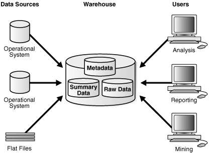
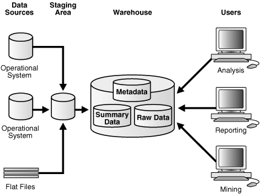
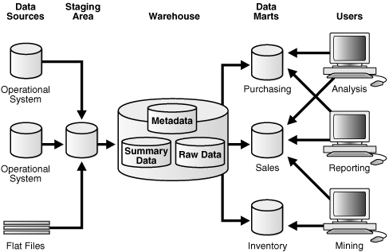

This chapter provides an overview of the Oracle data warehousing implementation. It contains:

- What Is a Data Warehouse?

- Contrasting OLTP and Data Warehousing Environments

- Common Data Warehouse Tasks

- Data Warehouse Architectures

### 1.1 What Is a Data Warehouse?

A data warehouse is a database designed to enable business intelligence activities: it exists to help users understand and enhance their organization's performance. It is designed for query and analysis rather than for transaction processing, and usually contains historical data derived from transaction data, but can include data from other sources. Data warehouses separate analysis workload from transaction workload and enable an organization to consolidate data from several sources. This helps in:

- Maintaining historical records

- Analyzing the data to gain a better understanding of the business and to improve the business

In addition to a relational database, a data warehouse environment can include an extraction, transportation, transformation, and loading (ETL) solution, statistical analysis, reporting, data mining capabilities, client analysis tools, and other applications that manage the process of gathering data, transforming it into useful, actionable information, and delivering it to business users.

To achieve the goal of enhanced business intelligence, the data warehouse works with data collected from multiple sources. The source data may come from internally developed systems, purchased applications, third-party data syndicators and other sources. It may involve transactions, production, marketing, human resources and more. In today's world of big data, the data may be many billions of individual clicks on web sites or the massive data streams from sensors built into complex machinery.

Data warehouses are distinct from online transaction processing (OLTP) systems. With a data warehouse you separate analysis workload from transaction workload. Thus data warehouses are very much read-oriented systems. They have a far higher amount of data reading versus writing and updating. This enables far better analytical performance and avoids impacting your transaction systems. A data warehouse system can be optimized to consolidate data from many sources to achieve a key goal: it becomes your organization's "single source of truth". There is great value in having a consistent source of data that all users can look to; it prevents many disputes and enhances decision-making efficiency.

A data warehouse usually stores many months or years of data to support historical analysis. The data in a data warehouse is typically loaded through an extraction, transformation, and loading (ETL) process from multiple data sources. Modern data warehouses are moving toward an extract, load, transformation (ELT) architecture in which all or most data transformation is performed on the database that hosts the data warehouse. It is important to note that defining the ETL process is a very large part of the design effort of a data warehouse. Similarly, the speed and reliability of ETL operations are the foundation of the data warehouse once it is up and running.

Users of the data warehouse perform data analyses that are often time-related. Examples include consolidation of last year's sales figures, inventory analysis, and profit by product and by customer. But time-focused or not, users want to "slice and dice" their data however they see fit and a well-designed data warehouse will be flexible enough to meet those demands. Users will sometimes need highly aggregated data, and other times they will need to drill down to details. More sophisticated analyses include trend analyses and data mining, which use existing data to forecast trends or predict futures. The data warehouse acts as the underlying engine used by middleware business intelligence environments that serve reports, dashboards and other interfaces to end users.

Although the discussion above has focused on the term "data warehouse", there are two other important terms that need to be mentioned. These are the data mart and the operation data store (ODS).

A data mart serves the same role as a data warehouse, but it is intentionally limited in scope. It may serve one particular department or line of business. The advantage of a data mart versus a data warehouse is that it can be created much faster due to its limited coverage. However, data marts also create problems with inconsistency. It takes tight discipline to keep data and calculation definitions consistent across data marts. This problem has been widely recognized, so data marts exist in two styles. Independent data marts are those which are fed directly from source data. They can turn into islands of inconsistent information. Dependent data marts are fed from an existing data warehouse. Dependent data marts can avoid the problems of inconsistency, but they require that an enterprise-level data warehouse already exist.

Operational data stores exist to support daily operations. The ODS data is cleaned and validated, but it is not historically deep: it may be just the data for the current day. Rather than support the historically rich queries that a data warehouse can handle, the ODS gives data warehouses a place to get access to the most current data, which has not yet been loaded into the data warehouse. The ODS may also be used as a source to load the data warehouse. As data warehousing loading techniques have become more advanced, data warehouses may have less need for ODS as a source for loading data. Instead, constant trickle-feed systems can load the data warehouse in near real time.

A common way of introducing data warehousing is to refer to the characteristics of a data warehouse as set forth by William Inmon:

- Subject Oriented

- Integrated

- Nonvolatile

- Time Varient

#### Subject Oriented

Data warehouses are designed to help you analyze data. For example, to learn more about your company's sales data, you can build a data warehouse that concentrates on sales. Using this data warehouse, you can answer questions such as "Who was our best customer for this item last year?" or "Who is likely to be our best customer next year?" This ability to define a data warehouse by subject matter, sales in this case, makes the data warehouse subject oriented.

#### Integrated

Integration is closely related to subject orientation. Data warehouses must put data from disparate sources into a consistent format. They must resolve such problems as naming conflicts and inconsistencies among units of measure. When they achieve this, they are said to be integrated.

#### Nonvolatile

Nonvolatile means that, once entered into the data warehouse, data should not change. This is logical because the purpose of a data warehouse is to enable you to analyze what has occurred.

#### Time Varient

A data warehouse's focus on change over time is what is meant by the term time variant. In order to discover trends and identify hidden patterns and relationships in business, analysts need large amounts of data. This is very much in contrast to [online transaction processing (OLTP)](glossary.md) systems, where performance requirements demand that historical data be moved to an archive.

#### 1.1.1 Key Characteristics of a Data Warehouse

The key characteristics of a data warehouse are as follows:

- Data is structured for simplicity of access and high-speed query performance.

- End users are time-sensitive and desire speed-of-thought response times.

- Large amounts of historical data are used.

- Queries often retrieve large amounts of data, perhaps many thousands of rows.

- Both predefined and ad hoc queries are common.

- The data load involves multiple sources and transformations.

In general, fast query performance with high data throughput is the key to a successful data warehouse.

### 1.2 Contrasting OLTP and Data Warehousing Environments

There are important differences between an OLTP system and a data warehouse. One major difference between the types of system is that data warehouses are not exclusively in [third normal form (3NF)](glossary.md), a type of data normalization common in OLTP environments.

Data warehouses and OLTP systems have very different requirements. Here are some examples of differences between typical data warehouses and OLTP systems:

- Workload

  Data warehouses are designed to accommodate ad hoc queries and data analysis. You might not know the workload of your data warehouse in advance, so a data warehouse should be optimized to perform well for a wide variety of possible query and analytical operations.

  OLTP systems support only predefined operations. Your applications might be specifically tuned or designed to support only these operations.

- Data modifications

  A data warehouse is updated on a regular basis by the ETL process (run nightly or weekly) using bulk data modification techniques. The end users of a data warehouse do not directly update the data warehouse except when using analytical tools, such as data mining, to make predictions with associated probabilities, assign customers to market segments, and develop customer profiles.

  In OLTP systems, end users routinely issue individual data modification statements to the database. The OLTP database is always up to date, and reflects the current state of each business transaction.

- Schema design

  Data warehouses often use partially denormalized schemas to optimize query and analytical performance.

  OLTP systems often use fully normalized schemas to optimize update/insert/delete performance, and to guarantee data consistency.

- Typical operations

  A typical data warehouse query scans thousands or millions of rows. For example, "Find the total sales for all customers last month."

  A typical OLTP operation accesses only a handful of records. For example, "Retrieve the current order for this customer."

- Historical data

  Data warehouses usually store many months or years of data. This is to support historical analysis and reporting.

  OLTP systems usually store data from only a few weeks or months. The OLTP system stores only historical data as needed to successfully meet the requirements of the current transaction.

### 1.3 Common Data Warehouse Tasks

As an Oracle data warehousing administrator or designer, you can expect to be involved in the following tasks:

- Configuring an Oracle database for use as a data warehouse

- Designing data warehouses

- Performing upgrades of the database and data warehousing software to new releases

- Managing schema objects, such as tables, indexes, and materialized views

- Managing users and security

- Developing routines used for the extraction, transformation, and loading (ETL) processes

- Creating reports based on the data in the data warehouse

- Backing up the data warehouse and performing recovery when necessary

- Monitoring the data warehouse's performance and taking preventive or corrective action as required

In a small-to-midsize data warehouse environment, you might be the sole person performing these tasks. In large, enterprise environments, the job is often divided among several DBAs and designers, each with their own specialty, such as database security or database tuning.

These tasks are illustrated in the following:

- For more information regarding partitioning, see [Oracle Database VLDB and Partitioning Guide](../vldbg/partition-concepts.md).

- For more information regarding database security, see [Oracle Database Security Guide](../dbseg/introduction-to-oracle-database-security.md).

- For more information regarding database performance, see [Oracle Database Performance Tuning Guide](../tgdba/performance-tuning-overview.md) and [Oracle Database SQL Tuning Guide](../tgsql/introduction-to-sql-tuning.md).

- For more information regarding backup and recovery, see Oracle Database Backup and Recovery User's Guide.

- For more information regarding ODI, see [Oracle Fusion Middleware Developer's Guide for Oracle Data Integrator](https://docs.oracle.com/pls/topic/lookup?ctx=en/database/oracle/oracle-database/19/dwhsg&id=ODIDG-GUID-140D831D-2B38-429E-AB2F-DE9F0762EFD3).

### 1.4 Data Warehouse Architectures

Data warehouses and their architectures vary depending upon the specifics of an organization's situation. Three common architectures are:

- Data Warehouse Architecture: Basic

- Data Warehouse Architecture: with a Staging Area

- Data Warehouse Architecture: with a Staging Area and Data Marts

#### 1.4.1 Data Warehouse Architecture: Basic

Figure 1-1 shows a simple architecture for a data warehouse. End users directly access data derived from several source systems through the data warehouse.

Figure 1-1 Architecture of a Data Warehouse

[Description of "Figure 1-1 Architecture of a Data Warehouse"](img_text/dwhsg013.md)

In Figure 1-1, the metadata and raw data of a traditional OLTP system is present, as is an additional type of data, summary data. Summaries are a mechanism to pre-compute common expensive, long-running operations for sub-second data retrieval. For example, a typical data warehouse query is to retrieve something such as August sales. A summary in an Oracle database is called a [materialized view](glossary.md).

The consolidated storage of the raw data as the center of your data warehousing architecture is often referred to as an Enterprise Data Warehouse (EDW). An EDW provides a 360-degree view into the business of an organization by holding all relevant business information in the most detailed format.

#### 1.4.2 Data Warehouse Architecture: with a Staging Area

You must clean and process your operational data before putting it into the warehouse, as shown in Figure 1-2. You can do this programmatically, although most data warehouses use a [staging area](glossary.md) instead. A staging area simplifies data cleansing and consolidation for operational data coming from multiple source systems, especially for enterprise data warehouses where all relevant information of an enterprise is consolidated. Figure 1-2 illustrates this typical architecture.

Figure 1-2 Architecture of a Data Warehouse with a Staging Area

[Description of "Figure 1-2 Architecture of a Data Warehouse with a Staging Area"](img_text/dwhsg015.md)

#### 1.4.3 Data Warehouse Architecture: with a Staging Area and Data Marts

Although the architecture in Figure 1-2 is quite common, you may want to customize your warehouse's architecture for different groups within your organization. You can do this by adding data marts, which are systems designed for a particular line of business. Figure 1-3 illustrates an example where purchasing, sales, and inventories are separated. In this example, a financial analyst might want to analyze historical data for purchases and sales or mine historical data to make predictions about customer behavior.

Figure 1-3 Architecture of a Data Warehouse with a Staging Area and Data Marts

[Description of "Figure 1-3 Architecture of a Data Warehouse with a Staging Area and Data Marts"](img_text/dwhsg064.md)

**Note:**

Data marts can be physically instantiated or implemented purely logically though views. Furthermore, data marts can be co-located with the enterprise data warehouse or built as separate systems. Building an end-to-end data warehousing architecture with an enterprise data warehouse and surrounding data marts is not the focus of this book.
