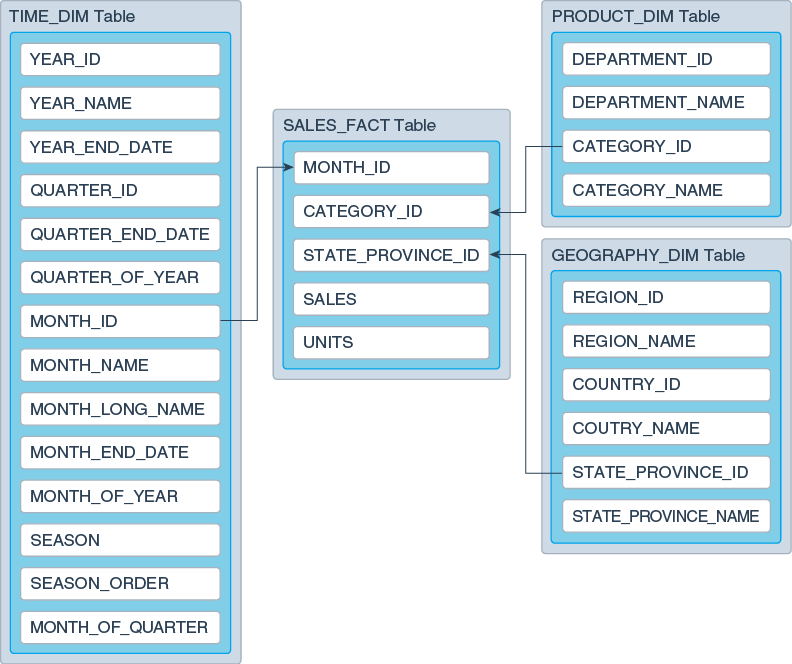

Analytic views are metadata objects that enable the user to quickly and easily create complex hierarchical and dimensional queries on data in database tables and views.

General considerations of analytic views are described in the following topics.

- What Are Analytic Views?

- Privileges for Analytic Views

- Application Programming Interfaces for Analytic Views

- Compilation States of Analytic Views

- Validation of Data

- Classifications for Analytic Views

- Share Analytic Views with Application Containers

- Alter or Drop an Analytic View Object

- Data and Scripts for Examples

### 24.1 What Are Analytic Views?

Analytic views provide a fast and efficient way to create analytic queries of data stored in existing database tables and views.

Analytic views organize data using a dimensional model. They allow you to easily add aggregations and calculations to data sets and to present data in views that can be queried with relatively simple SQL.

Like standard relational views, analytic views:

- Are metadata objects (that is, they do not store data)

- Can be queried using SQL

- Can access data from other database objects such as tables, views, and external tables

- Can join multiple tables into a single view

Analytic views also:

- Organize data using a rich business model that has dimensional and hierarchical concepts

- Include system-generated columns with hierarchical data

- Automatically aggregate data

- Include embedded measure calculations that are easily defined using syntax based on the business model

- Include presentation metadata

The definition of an analytic view includes navigation, join, aggregation, and calculation rules, thus eliminating the need to include these rules in queries. Rather than having simple tables and complex `SELECT` statements that express joins, aggregations, and measure calculations, you can use simple SQL to query smart analytic views. This approach has several benefits, including:

- Simplified and faster application development; it is much easier to define calculations within analytic views than it is to write or generate complex `SELECT` statements

- Calculation rules can be defined once in the database and then be re-used by any number of applications; this provides end-users with greater freedom of choice in their use of reporting tools without concern for inconsistent results

Analytic views are especially useful for the following users:

- Data warehouse architect or designer

- Business Intelligence application developer

- Database analyst

For a data warehouse architect, analytic views are a tool for presenting data in a data warehouse to application developers and business users. Tools provided by the BI application generate a query, get the data, and present the result.

#### Components of Analytic Views

Analytic view component objects consist of the following:

- Attribute dimensions, which are metadata objects that reference tables or views and organize columns into higher-level objects such as attributes and levels. Most metadata related to dimensions and hierarchies is defined in the attribute dimension object.

- Hierarchies, which are a type of view that reference attribute dimension objects and that organize data using hierarchical relationships. Data related to dimensions and hierarchies is selected from hierarchies.

- Analytic view objects, which are a type of view that presents fact data. Analytic views reference both fact tables and hierarchies. You can select both hierarchy and measure data from analytic views.

- Derived analytic views, which are defined in the `WITH` or `FROM` clause of a SELECT statement and are based on an existing analytic view.

Data dictionary views, such as `ALL_ANALYTIC_VIEW_COLUMNS`, contain the metadata and other information for the analytic view component objects.

The `DBMS_HIERARCHY` PL/SQL package contains functions for validating analytic view and hierarchy objects and a procedure that creates a table that you can use for logging messages generated by the validation functions.

#### Data Sources for Analytic Views

Attribute dimensions and analytic views typically use [star schema](glossary.md) dimension tables and fact tables as data sources. For larger data sets, tables in the in-memory column store can offer the best query performance with analytic views. Analytic views can also be used with snowflake schemas, denormailized tables, external tables and remote tables.

You specify the data source with the `using_clause` in the attribute dimension or analytic view definition. You may specify an alias for the data source.

A database user who has the privileges required for access to the data sources can create analytic view objects. The creator defines the business model, which specifies how the data is queried, and implements the model by creating attribute dimensions, hierarchies, and analytic views.

#### Materialized Views and Analytic Views

Creating a materialized view over queries of an analytic view or a hierarchy is not supported. You may use a materialized view in a `MEASURE_GROUP` phrase of a `cache_clause` of an analytic view.

#### Constraints for Analytic View Objects

For optimal query performance in queries of an analytic view, you should use the same constraints that you would typically use for querying a star schema. An attribute dimension or analytic view does not require that the source table or view have any particular constraints defined or enabled. Also, defining an attribute dimension or analytic view does not introduce any additional constraints on those tables or views. The PL/SQL functions `VALIDATE_HIERARCHY` and `VALIDATE_ANALYTIC_VIEW` are available for validating that the data in a table or view used by an attribute dimension in a hierarchy or used by an analytic view conforms to the logical constraints inherent in the metadata definitions.

#### Naming Conventions for Analytic Views

The naming conventions for attribute dimensions, hierarchies, and analytic views, and components of them such as attributes, levels, and measures, follow standard database identifier rules. Double-quotes may be used to enclose identifiers, including extended characters and mixed-case; otherwise, the standard upper-case and limited character rules apply.

### 24.2 Privileges for Analytic Views

Describes the system and object privileges available for analytic views, attribute dimensions, and hierarchies.

#### System Privileges

The following system privileges allow the user to create, alter, or drop analytic view component objects.

| System Privilege                 | Description                                                 |
|:---------------------------------|:------------------------------------------------------------|
| `CREATE ANALYTIC VIEW`           | Create an analytic view in the grantee's schema.            |
| `CREATE ANY ANALYTIC VIEW`       | Create analytic views in any schema except SYS.             |
| `CREATE ATTRIBUTE DIMENSION`     | Create an attribute dimension in the grantee's schema.      |
| `CREATE ANY ATTRIBUTE DIMENSION` | Create attribute dimensions in any schema except SYS.       |
| `CREATE HIERARCHY`               | Create a hierarchy in the grantee's schema.                 |
| `CREATE ANY HIERARCHY`           | Create hierarchies in any schema except SYS.                |
| `ALTER ANY ANALYTIC VIEW`        | Rename analytic views in any schema except SYS.             |
| `ALTER ANY ATTRIBUTE DIMENSION`  | Rename attribute dimensions in any schema except SYS.       |
| `ALTER ANY HIERARCHY`            | Rename hierarchies in any schema except SYS.                |
| `DROP ANY ANALYTIC VIEW`         | Drop analytic views in any schema except SYS.               |
| `DROP ANY ATTRIBUTE DIMENSION`   | Drop attribute dimensions in any schema except SYS.         |
| `DROP ANY HIERARCHY`             | Drop hierarchies in any schema except SYS.                  |
| `SELECT ANY TABLE`               | Query or view any analytic view or hierarchy in any schema. |

#### Object Privileges

The following object privileges allow the user to query or rename analytic view component objects.

| Object Privilege | Operations Authorized                                        |
|:-----------------|:-------------------------------------------------------------|
| `ALTER`          | Rename the analytic view, attribute dimension, or hierarchy. |
| `READ`           | Query the object with the `SELECT` statement.                |
| `SELECT`         | Query the object with the `SELECT` statement.                |

Example 24-1 Granting System Privileges

The following statements grant the `CREATE` system privilege to the user av_user.

    GRANT CREATE ATTRIBUTE DIMENSION TO av_user;
    GRANT CREATE HIERARCHY TO av_user;
    GRANT CREATE ANALYTIC VIEW TO av_user;
    GRANT SELECT ANY TABLE TO av_user;

Example 24-2 Granting Object Privileges

The following statements grant all object privileges to the user av_user2 and then revoke the `ALTER` privilege.

    GRANT ALL ON "AV_USER".SALES_AV TO "AV_USER2";
    REVOKE ALTER ON "AV_USER".SALES_AV FROM "AV_USER2";

### 24.3 Application Programming Interfaces for Analytic Views

The application programming interfaces for analytic views consist of SQL DDL statements, PL/SQL procedures and functions, and data dictionary views.

These interfaces are listed in the following topics:

- SQL DDL Statements for the Creation and Management of Analytic Views

- PL/SQL Package for Analytic Views

- Data Dictionary Views for Analytic Views

#### SQL DDL Statements for the Creation and Management of Analytic Views

You create and manage analytic view objects with the following SQL DDL statements:

- `CREATE ANALYTIC VIEW`

- `CREATE ATTRIBUTE DIMENSION`

- `CREATE HIERARCHY`

- `ALTER ANALYTIC VIEW`

- `ALTER ATTRIBUTE DIMENSION`

- `ALTER HIERARCHY`

- `DROP ANALYTIC VIEW`

- `DROP ATTRIBUTE DIMENSION`

- `DROP HIERARCHY`

For details about these statements, see [`CREATE ANALYTIC VIEW`](../sqlrf/CREATE-ANALYTIC-VIEW.md) and the other statements in Oracle Database SQL Language Reference.

#### SQL SELECT Statement Clauses for Filtered Facts and Added Measures

In the `WITH` and `FROM` clauses of a `SELECT` statement, you can define one or more transitory analytic views that filter the hierarchy members before the aggregation of measure values for the hierarchy. You can also define additional measures that participate in the query. The filtered facts and additional measures are based on an existing persistent analytic view, but they do not alter the definition of the persistent analytic view itself.

**See Also:**

[Analytic View Queries with Filtered Facts and Added Measures](analytic-view-objects.md)

#### PL/SQL Package for Analytic Views

You can validate the data for analytic view and hierarchy objects with the following procedures in the `DBMS_HIERARCHY` package:

- `CREATE_VALIDATE_LOG_TABLE` procedure

- `VALIDATE_ANALYTIC_VIEW` function

- `VALIDATE_CHECK_SUCCESS` function

- `VALIDATE_HIERARCHY` function

For details about this package, see [DBMS_HIERARCHY](../arpls/DBMS_HIERARCHY.md) in Oracle Database PL/SQL Packages and Types Reference.

#### Data Dictionary Views for Analytic Views

The following data dictionary views contain information about analytic view objects. Only the views with the prefix `ALL` are listed. Each view also has a corresponding `DBA` and `USER` version.

Analytic View Views

- `ALL_ANALYTIC_VIEW_ATTR_CLASS`

- `ALL_ANALYTIC_VIEW_BASE_MEAS`

- `ALL_ANALYTIC_VIEW_CALC_MEAS`

- `ALL_ANALYTIC_VIEW_CLASS`

- `ALL_ANALYTIC_VIEW_COLUMNS`

- `ALL_ANALYTIC_VIEW_DIM_CLASS`

- `ALL_ANALYTIC_VIEW_DIMENSIONS`

- `ALL_ANALYTIC_VIEW_HIER_CLASS`

- `ALL_ANALYTIC_VIEW_HIERS`

- `ALL_ANALYTIC_VIEW_KEYS`

- `ALL_ANALYTIC_VIEW_LEVEL_CLASS`

- `ALL_ANALYTIC_VIEW_LEVELS`

- `ALL_ANALYTIC_VIEW_LVLGRPS`

- `ALL_ANALYTIC_VIEW_MEAS_CLASS`

- `ALL_ANALYTIC_VIEWS`

Attribute Dimension Views

- `ALL_ATTRIBUTE_DIM_ATTR_CLASS`

- `ALL_ATTRIBUTE_DIM_ATTRS`

- `ALL_ATTRIBUTE_DIM_CLASS`

- `ALL_ATTRIBUTE_DIM_JOIN_PATHS`

- `ALL_ATTRIBUTE_DIM_KEYS`

- `ALL_ATTRIBUTE_DIM_LEVEL_ATTRS`

- `ALL_ATTRIBUTE_DIM_LEVELS`

- `ALL_ATTRIBUTE_DIM_LVL_CLASS`

- `ALL_ATTRIBUTE_DIM_ORDER_ATTRS`

- `ALL_ATTRIBUTE_DIM_TABLES`

- `ALL_ATTRIBUTE_DIMENSIONS`

Hierarchy Views

- `ALL_HIER_CLASS`

- `ALL_HIER_COLUMNS`

- `ALL_HIER_HIER_ATTR_CLASS`

- `ALL_HIER_HIER_ATTRIBUTES`

- `ALL_HIER_JOIN_PATHS`

- `ALL_HIER_LEVEL_ID_ATTRS`

- `ALL_HIER_LEVELS`

- `ALL_HIERARCHIES`

For details about these views, see [`ALL_ANALYTIC_VIEWS`](../refrn/ALL_ANALYTIC_VIEWS.md) and the other views in Oracle Database Reference.

### 24.4 Compilation States of Analytic Views

When you create or alter an attribute dimension, a hierarchy, or an analytic view, Oracle Database ascertains the internal validity of the object’s metadata.

The SQL DDL `CREATE` and `ALTER` statements for analytic views have `FORCE` and `NOFORCE` options, with `NOFORCE` as the default. The verification of metadata that depends on another object is optional and is determined by the `FORCE` and `NOFORCE` options.

If you specify `NOFORCE` and the compilation fails, then the `CREATE` or `ALTER` operation fails and an error is raised. If you specify `FORCE`, the `CREATE` or `ALTER` succeeds even if the compilation fails.

You can explicitly invoke a compilation by specifying the `COMPILE` keyword; a compilation is implicitly invoked as needed during a query. A query returns an error if an object is not compiled and cannot implicitly be compiled.

The compilation state is recorded in the `COMPILE_STATE` column in the `ALL_ATTRIBUTE_DIMENSIONS`, `ALL_HIERARCHIES`, and `ALL_ANALYTIC_VIEWS` data dictionary views (and the corresponding `DBA` and `USER` views). The state may be one of the following:

| Value     | Description                                                                                  |
|:----------|:---------------------------------------------------------------------------------------------|
| `VALID`   | The object has been compiled without error.                                                  |
| `INVALID` | Some change requires recompilation or the object has been compiled and errors have occurred. |

A SQL DDL operation on the analytic views object causes the state of dependent objects to change to `INVALID`. For example, a change to an attribute dimension causes any hierarchies that use that attribute dimension, and analytic views dimensioned by the attribute dimension, to change state to `INVALID`. Also, DDL changes to the tables or views used by attribute dimensions and analytic views cause the state for those objects to change to `INVALID`.

The `ALL_OBJECTS` data dictionary view has a `STATUS` column that may be `VALID` or `INVALID`. For attribute dimensions, hierarchies, and analytic views, the `STATUS` value correlates to the `COMPILE_STATE`. When `COMPILE_STATE` is `VALID`, the `STATUS` value is `VALID`. When `COMPILE_STATE` is `INVALID`, `STATUS` is `INVALID`.

### 24.5 Validation of Data

To ensure the accuracy of query results, the data of hierarchies and analytic views must be validated.

To validate the data for a hierarchy or analytic view, use the functions in the PL/SQL package `DBMS_HIERARCHY`. The `VALIDATE_HIERARCHY` and `VALIDATE_ANALYTIC_VIEW` functions validate the data and store the results in a table. An optional argument to the functions is the name of a table. The `CREATE_VALIDATE_LOG_TABLE` procedure creates a table that you can use for the purpose. If you do not specify a table, the `VALIDATE_HIERARCHY` and `VALIDATE_ANALYTIC_VIEW` functions create a table.

Any SQL DDL or DML changes made on the tables used by an associated attribute dimension or analytic view, or any DDL change to an attribute dimension, hierarchy, or analytic view itself, causes the state of a hierarchy to change to `INVALID`.

If any data security policies are applied to a hierarchy or analytic view, or any of the tables or views used by an associated attribute dimension, then the validation state cannot be determined and the `VALIDATE_STATE` is not set to `VALID`. An execution of the `VALIDATE_HIERARCHY` or `VALIDATE_ANALYTIC_VIEW` function indicates whether the hierarchy or analytic view is valid at that time and for that user.

If a SQL DML change to a table or view used by an attribute dimension occurs between the time you query the data dictionary or run the `VALIDATE_HIERARCHY` function and the time you execute a query of a hierarchy or analytic view, then the hierarchy may become invalid. To ensure that a hierarchy is valid for a query, you can establish a read-only transaction (for example, `SET TRANSACTION READ ONLY)`, run the validation function, verify the success of the validation, execute queries, and then end the transaction with a `COMMIT` or `ROLLBACK` statement.

### 24.6 Classifications for Analytic Views

Classifications provide descriptive metadata for attribute dimensions, hierarchies, and analytic view objects, and for components of them such as attribute dimension keys, attributes, levels, and measures.

Applications can use classifications to present information about hierarchies and analytic views. Classifications are similar to comments on tables and columns, but a comment is a single value. You can specify any number of classifications for the same object. You can vary the values by language. A classification value is always a text literal and can have maximum length of 4000 bytes.

Classifications play no role in SQL queries, but are available in the data dictionary views for use by tools or applications. The `CAPTION` and `DESCRIPTION` classifications have DDL shortcuts for all objects that support classifications.

You may specify a language for a classification value. If you specify a language, it must be a valid `NLS_LANGUAGE` value. If you do not specify a language, then the language value for the classification is `NULL` and the default database language is used.

The DDL shortcuts for `CAPTION` and `DESCRIPTION` apply only to the `NULL` language. To specify a `CAPTION` and `DESCRIPTION` classification for a particular language, you must use the full `CLASSIFICATION` syntax.

SQL tools can interpret a `NULL` language value as a default. For example, suppose a tool is looking for the `CAPTION` for an attribute dimension. The tool might first look for the `CAPTION` having a language that matches the current `NLS_LANGUAGE`. If it finds one, it uses that `CAPTION` value. If not, it then looks for a `CAPTION` having a `NULL` language value and uses that. The SQL logic is up to the user, tool, or application.

To provide descriptive metadata that varies by language for a member of a hierarchy, use the hierarchical attributes `MEMBER_NAME`, `MEMBER_CAPTION`, and `MEMBER_DESCRIPTION`.

### 24.7 Share Analytic Views with Application Containers

You can share analytic views with application containers.

In the definition of analytic view objects, you can use the `SHARING` clause to share attribute dimension, hierarchy, or analytic view metadata or objects with application containers. The values for the clause are the following:

| Value      | Description                              |
|:-----------|:-----------------------------------------|
| `NONE`     | Do not share; this is the default value. |
| `METADATA` | Share metadata only.                     |
| `OBJECT`   | Share the object, including data.        |

If you specify `METADATA`, then only the definition of the object is shared with application containers.

If you specify `OBJECT`, then the attribute dimension, hierarchy, or analytic view object, including the data sources of the object, is shared with the application container.

### 24.8 Alter or Drop an Analytic View Object

With SQL DDL statements you can change the name of an object or you can drop it.

To alter any aspect of an analytic view object other than the name, use a `CREATE` `OR` `REPLACE` statement to replace the object with one that has the desired alterations.

Example 24-3 Renaming an Attribute Dimension

The following example renames an attribute dimension.

    ALTER ATTRIBUTE DIMENSION product_attr_dim RENAME TO myproduct_attr_dim;

Example 24-4 Dropping an Attribute Dimension

The following example drops an attribute dimension.

    DROP ATTRIBUTE DIMENSION myproduct_attr_dim;

### 24.9 Data and Scripts for Examples

This section describes the data on which the analytic views examples are based and contains SQL statements that create the analytic view component objects.

The data and the analytic view components are described in the following topics:

- About the Data and Scripts for Examples

- Create Attribute Dimension Statements

- Create Hierarchy Statements

- Create Analytic View Statements

#### 24.9.1 About the Data and Scripts for Examples

The data used by the examples consists of sales data in a single fact table and three dimension tables with time periods, products, and geographies.

You can view and run the SQL scripts that create the tables, the analytic view component objects, and the queries used in the examples from the Oracle Live SQL website at <https://livesql.oracle.com/apex/livesql/file/index.html>.

The data is in the star schema tables shown in the following figure.

Figure 24-1 Tables for Analytic View Examples

[Description of "Figure 24-1 Tables for Analytic View Examples "](img_text/example-tables-analytic-views.md)

In the SALES_FACT table, the MONTH_ID, DEPARTMENT_ID, and STATE_PROVINCE_ID columns are foreign keys to the TIME_DIM, PRODUCT_DIM, and GEOGRAPHY_DIM dimension tables, respectively.

In each dimension table, the \_ID columns are used as keys and the \_NAME columns are used as descriptors. Other columns may be used as attributes for sorting or reporting.

There are 1:1 relationships in data between \_ID and \_NAME columns. You can sort time periods by using the \_END_DATE columns of the TIME_DIM table.

#### 24.9.2 Create Attribute Dimension Statements

This topic contains SQL statements that create the example attribute dimensions.

##### Create the time_attr_dim Attribute Dimension

The time_attr_dim attribute dimension is based on the TIME_DIM dimension table. The following statement creates the attribute dimension.

    CREATE OR REPLACE ATTRIBUTE DIMENSION time_attr_dim
    DIMENSION TYPE TIME
    USING time_dim
    ATTRIBUTES
     (year_id
       CLASSIFICATION caption VALUE 'YEAR_ID'
       CLASSIFICATION description VALUE 'YEAR ID',
      year_name
        CLASSIFICATION caption VALUE 'YEAR_NAME'
        CLASSIFICATION description VALUE 'Year',
      year_end_date
        CLASSIFICATION caption VALUE 'YEAR_END_DATE'
        CLASSIFICATION description VALUE 'Year End Date',
      quarter_id
        CLASSIFICATION caption VALUE 'QUARTER_ID'
        CLASSIFICATION description VALUE 'QUARTER ID',
      quarter_name
        CLASSIFICATION caption VALUE 'QUARTER_NAME'
        CLASSIFICATION description VALUE 'Quarter',
      quarter_end_date
        CLASSIFICATION caption VALUE 'QUARTER_END_DATE'
        CLASSIFICATION description VALUE 'Quarter End Date',
      quarter_of_year
        CLASSIFICATION caption VALUE 'QUARTER_OF_YEAR'
        CLASSIFICATION description VALUE 'Quarter of Year',
      month_id
        CLASSIFICATION caption VALUE 'MONTH_ID'
        CLASSIFICATION description VALUE 'MONTH ID',
      month_name
        CLASSIFICATION caption VALUE 'MONTH_NAME'
        CLASSIFICATION description VALUE 'Month',
      month_long_name
        CLASSIFICATION caption VALUE 'MONTH_LONG_NAME'
        CLASSIFICATION description VALUE 'Month Long Name',
      month_end_date
        CLASSIFICATION caption VALUE 'MONTH_END_DATE'
        CLASSIFICATION description VALUE 'Month End Date',
      month_of_quarter
        CLASSIFICATION caption VALUE 'MONTH_OF_QUARTER'
        CLASSIFICATION description VALUE 'Month of Quarter',
      month_of_year
        CLASSIFICATION caption VALUE 'MONTH_OF_YEAR'
        CLASSIFICATION description VALUE 'Month of Year',
      season
        CLASSIFICATION caption VALUE 'SEASON'
        CLASSIFICATION description VALUE 'Season',
      season_order
        CLASSIFICATION caption VALUE 'SEASON_ORDER'
        CLASSIFICATION description VALUE 'Season Order')
    LEVEL month
      LEVEL TYPE MONTHS
      CLASSIFICATION caption VALUE 'MONTH'
      CLASSIFICATION description VALUE 'Month'
      KEY month_id
      MEMBER NAME month_name
      MEMBER CAPTION month_name
      MEMBER DESCRIPTION month_long_name
      ORDER BY month_end_date
      DETERMINES (month_end_date,
        quarter_id,
        season,
        season_order,
        month_of_year,
        month_of_quarter)
    LEVEL quarter
      LEVEL TYPE QUARTERS
      CLASSIFICATION caption VALUE 'QUARTER'
      CLASSIFICATION description VALUE 'Quarter'
      KEY quarter_id
      MEMBER NAME quarter_name
      MEMBER CAPTION quarter_name
      MEMBER DESCRIPTION quarter_name
      ORDER BY quarter_end_date
      DETERMINES (quarter_end_date,
        quarter_of_year,
        year_id)
    LEVEL year
      LEVEL TYPE YEARS
      CLASSIFICATION caption VALUE 'YEAR'
      CLASSIFICATION description VALUE 'Year'
      KEY year_id
      MEMBER NAME year_name
      MEMBER CAPTION year_name
      MEMBER DESCRIPTION year_name
      ORDER BY year_end_date
      DETERMINES (year_end_date)
    LEVEL season
      LEVEL TYPE QUARTERS
      CLASSIFICATION caption VALUE 'SEASON'
      CLASSIFICATION description VALUE 'Season'
      KEY season
      MEMBER NAME season
      MEMBER CAPTION season
      MEMBER DESCRIPTION season
    LEVEL month_of_quarter
      LEVEL TYPE MONTHS
      CLASSIFICATION caption VALUE 'MONTH_OF_QUARTER'
      CLASSIFICATION description VALUE 'Month of Quarter'
      KEY month_of_quarter;

##### Create the product_attr_dim Attribute Dimension

The product_attr_dim attribute dimension is based on the PRODUCT_DIM dimension table. The following statement creates the attribute dimension.

    CREATE OR REPLACE ATTRIBUTE DIMENSION product_attr_dim
    USING product_dim
    ATTRIBUTES
     (department_id
        CLASSIFICATION caption VALUE 'DEPARTMENT_ID'
        CLASSIFICATION description VALUE 'DEPARTMENT ID',
      department_name
        CLASSIFICATION caption VALUE 'DEPARTMENT_NAME'
        CLASSIFICATION description VALUE 'Department',
      category_id
        CLASSIFICATION caption VALUE 'CATEGORY_ID'
        CLASSIFICATION description VALUE 'CATEGORY ID',
      category_name
        CLASSIFICATION caption VALUE 'CATEGORY_NAME'
        CLASSIFICATION description VALUE 'Category')
    LEVEL DEPARTMENT
      CLASSIFICATION caption VALUE 'DEPARTMENT'
      CLASSIFICATION description VALUE 'Department'
      KEY department_id
      MEMBER NAME department_name
      MEMBER CAPTION department_name
      ORDER BY department_name
    LEVEL CATEGORY
      CLASSIFICATION caption VALUE 'CATEGORY'
      CLASSIFICATION description VALUE 'Category'
      KEY category_id
      MEMBER NAME category_name
      MEMBER CAPTION category_name
      ORDER BY category_name
      DETERMINES(department_id)
    ALL MEMBER NAME 'ALL PRODUCTS';

##### Create the geography_attr_dim Attribute Dimension

The geography_attr_dim attribute dimension is based on the GEOGRAPHY_DIM dimension table. The following statement creates the attribute dimension.

    CREATE OR REPLACE ATTRIBUTE DIMENSION geography_attr_dim
    USING geography_dim
    ATTRIBUTES
     (region_id
        CLASSIFICATION caption VALUE 'REGION_ID'
        CLASSIFICATION description VALUE 'REGION ID',
      region_name
        CLASSIFICATION caption VALUE 'REGION_NAME'
        CLASSIFICATION description VALUE 'Region',
      country_id
        CLASSIFICATION caption VALUE 'COUNTRY_ID'
        CLASSIFICATION description VALUE 'COUNTRY ID',
      country_name
        CLASSIFICATION caption VALUE 'COUNTRY_NAME'
        CLASSIFICATION description VALUE 'Country',
      state_province_id
        CLASSIFICATION caption VALUE 'STATE_PROVINCE_ID'
        CLASSIFICATION description VALUE 'STATE-PROVINCE ID',
      state_province_name
        CLASSIFICATION caption VALUE 'STATE_PROVINCE_NAME'
        CLASSIFICATION description VALUE 'State-Province')
    LEVEL REGION
      CLASSIFICATION caption VALUE 'REGION'
      CLASSIFICATION description VALUE 'Region'
      KEY region_id
      MEMBER NAME region_name
      MEMBER CAPTION region_name
      ORDER BY region_name
    LEVEL COUNTRY
      CLASSIFICATION caption VALUE 'COUNTRY'
      CLASSIFICATION description VALUE 'Country'
      KEY country_id
      MEMBER NAME country_name
      MEMBER CAPTION country_name
      ORDER BY country_name
      DETERMINES(region_id)
    LEVEL STATE_PROVINCE
      CLASSIFICATION caption VALUE 'STATE_PROVINCE'
      CLASSIFICATION description VALUE 'State-Province'
      KEY state_province_id
      MEMBER NAME state_province_name
      MEMBER CAPTION state_province_name
      ORDER BY state_province_name
      DETERMINES(country_id)
    ALL MEMBER NAME 'ALL CUSTOMERS';

#### 24.9.3 Create Hierarchy Statements

This topic contains SQL statements that create the example hierarchies.

##### Create Hierarchies Using time_attr_dim

The following statements create hierarchies that use the time_attr_dim attribute dimension.

    CREATE OR REPLACE HIERARCHY time_hier
      CLASSIFICATION caption VALUE 'CALENDAR'
      CLASSIFICATION description VALUE 'CALENDAR'
    USING time_attr_dim
      (month CHILD OF
       quarter CHILD OF
       year);
    --
    CREATE OR REPLACE HIERARCHY time_season_hier
      CLASSIFICATION caption VALUE 'SEASONS'
      CLASSIFICATION description VALUE 'Seasons'
    USING time_attr_dim
      (month CHILD OF
       season);
    --
    CREATE OR REPLACE HIERARCHY time_year_season_hier
    USING time_attr_dim
      (month CHILD OF
       season CHILD OF
       year);
    --
    CREATE OR REPLACE HIERARCHY time_month_of_qtr_hier
      CLASSIFICATION caption VALUE 'MONTH_OF_QUARTER'
      CLASSIFICATION description VALUE 'Month of Quarter'
    USING time_attr_dim
      (month CHILD OF
       month_of_quarter);

##### Create a Hierarchy Using product_attr_dim

The following statement creates a hierarchy that uses the product_attr_dim attribute dimension.

    CREATE OR REPLACE HIERARCHY product_hier
      CLASSIFICATION caption VALUE 'PRODUCT'
      CLASSIFICATION description VALUE 'Product'
    USING product_attr_dim
      (CATEGORY
       CHILD OF department);

##### Create a Hierarchy Using geography_attr_dim

The following statement creates a hierarchy that uses the geography_attr_dim attribute dimension.

    CREATE OR REPLACE HIERARCHY geography_hier
      CLASSIFICATION caption VALUE 'GEOGRAPHY'
      CLASSIFICATION description VALUE 'Geography'
    USING geography_attr_dim
      (state_province
       CHILD OF country
       CHILD OF region);

#### 24.9.4 Create Analytic View Statements

This topic contains a SQL statement that creates the example analytic view.

##### Create the sales_av Analytic View

The following statement creates an analytic view that uses the SALES_FACT fact table.

    CREATE OR REPLACE ANALYTIC VIEW sales_av
      CLASSIFICATION caption VALUE 'Sales AV'
      CLASSIFICATION description VALUE 'Sales Analytic View'
      CLASSIFICATION created_by VALUE 'Harold C. Ehrlicher'
    USING sales_fact
    DIMENSION BY
      (time_attr_dim
        KEY month_id REFERENCES month_id
        HIERARCHIES (
          time_hier DEFAULT,
          time_season_hier,
          time_year_season_hier,
          time_month_of_qtr_hier),
       product_attr_dim
        KEY category_id REFERENCES category_id
        HIERARCHIES (
          product_hier DEFAULT),
       geography_attr_dim
        KEY state_province_id
        REFERENCES state_province_id
        HIERARCHIES (
          geography_hier DEFAULT)
       )
    MEASURES
     (sales FACT sales
        CLASSIFICATION caption VALUE 'Sales'
        CLASSIFICATION description VALUE 'Sales'
        CLASSIFICATION format_string VALUE '$9,999.99',
      units FACT units
        CLASSIFICATION caption VALUE 'Units'
        CLASSIFICATION description VALUE 'Units Sold'
        CLASSIFICATION format_string VALUE '9,999',
      sales_prior_period AS
        (LAG(SALES) OVER (HIERARCHY time_hier OFFSET 1))
          CLASSIFICATION caption VALUE 'Sales Prior Period'
          CLASSIFICATION description VALUE 'Sales Prior_Period'
          CLASSIFICATION format_string VALUE '$9,999.99',
      sales_chg_prior_period AS
        (LAG_DIFF(SALES) OVER (HIERARCHY time_hier OFFSET 1))
          CLASSIFICATION caption VALUE 'Sales Change Prior Period'
          CLASSIFICATION description VALUE 'Sales Change Prior Period'
          CLASSIFICATION format_string VALUE '$9,999.99',
      sales_qtr_ago AS
        (LAG(SALES) OVER (HIERARCHY time_hier OFFSET 1
          ACROSS ANCESTOR AT LEVEL quarter))
            CLASSIFICATION caption VALUE 'Sales Qtr Ago'
            CLASSIFICATION description VALUE 'Sales Qtr Ago'
            CLASSIFICATION format_string VALUE '$9,999.99',
      sales_chg_qtr_ago AS
        (LAG_DIFF(SALES) OVER (HIERARCHY time_hier OFFSET 1
          ACROSS ANCESTOR AT LEVEL quarter))
            CLASSIFICATION caption VALUE 'Sales Change Qtr Ago'
            CLASSIFICATION description VALUE 'Sales Change Qtr Ago'
            CLASSIFICATION format_string VALUE '$9,999.99',
      sales_pct_chg_qtr_ago AS
        (LAG_DIFF_PERCENT(SALES) OVER (HIERARCHY time_hier OFFSET 1
          ACROSS ANCESTOR AT LEVEL quarter))
            CLASSIFICATION caption VALUE 'Sales Percent Change Qtr Ago'
            CLASSIFICATION description VALUE 'Sales Percent Change Qtr Ago'
            CLASSIFICATION format_string VALUE '999.99',
      sales_yr_ago AS
        (LAG(SALES) OVER (HIERARCHY time_hier OFFSET 1
          ACROSS ANCESTOR AT LEVEL year))
            CLASSIFICATION caption VALUE 'Sales Year Ago'
            CLASSIFICATION description VALUE 'Sales Year Ago'
            CLASSIFICATION format_string VALUE '$9,999.99',
      sales_chg_yr_ago AS
        (LAG_DIFF(SALES) OVER (HIERARCHY time_hier OFFSET 1
          ACROSS ANCESTOR AT LEVEL year))
            CLASSIFICATION caption VALUE 'Sales Change Year Ago'
            CLASSIFICATION description VALUE 'Sales Change Year Ago'
            CLASSIFICATION format_string VALUE '$9,999.99',
      sales_pct_chg_yr_ago AS
        (LAG_DIFF_PERCENT(SALES) OVER (HIERARCHY time_hier OFFSET 1
          ACROSS ANCESTOR AT LEVEL year))
            CLASSIFICATION caption VALUE 'Sales Percent Change Year Ago'
            CLASSIFICATION description VALUE 'Sales Percent Change Year Ago'
            CLASSIFICATION format_string VALUE '999.99',
      sales_qtd AS
        (SUM(sales) OVER (HIERARCHY time_hier
          BETWEEN UNBOUNDED PRECEDING AND CURRENT MEMBER
          WITHIN ANCESTOR AT LEVEL quarter))
            CLASSIFICATION caption VALUE 'Sales Quarter to Date'
            CLASSIFICATION description VALUE 'Sales Quarter to Date'
            CLASSIFICATION format_string VALUE '$9,999.99',
      sales_ytd AS
        (SUM(sales) OVER (HIERARCHY time_hier
          BETWEEN UNBOUNDED PRECEDING AND CURRENT MEMBER
          WITHIN ANCESTOR AT LEVEL year))
            CLASSIFICATION caption VALUE 'Sales Year to Date'
            CLASSIFICATION description VALUE 'Sales Year to Date'
            CLASSIFICATION format_string VALUE '$9,999.99',
      sales_2011 AS
        (QUALIFY (sales, time_hier = year['11']))
          CLASSIFICATION caption VALUE 'Sales CY2011'
          CLASSIFICATION description VALUE 'Sales CY2011'
          CLASSIFICATION format_string VALUE '$9,999.99',
      sales_pct_chg_2011 AS
        ((sales - (QUALIFY (sales, time_hier = year['11']))) /
        (QUALIFY (sales, time_hier = year['11'])))
          CLASSIFICATION caption VALUE 'Sales Pct Change CY2011'
          CLASSIFICATION description VALUE 'Sales Pct Change CY2011'
          CLASSIFICATION format_string VALUE '999.99',
      sales_share_time_parent AS
        (SHARE_OF(sales HIERARCHY time_hier PARENT))
          CLASSIFICATION caption VALUE 'Sales Share of Time Parent'
          CLASSIFICATION description VALUE 'Sales Share of Time Parent'
          CLASSIFICATION format_string VALUE '999.99',
      sales_share_season_parent AS
        (SHARE_OF(sales HIERARCHY time_season_hier PARENT))
          CLASSIFICATION caption VALUE 'Sales Share of Season Parent'
          CLASSIFICATION description VALUE 'Sales Share of Season Parent'
         CLASSIFICATION format_string VALUE '999.99',
      sales_share_prod_parent AS
        (SHARE_OF(sales HIERARCHY product_hier PARENT))
          CLASSIFICATION caption VALUE 'Sales Share of Product Parent'
          CLASSIFICATION description VALUE 'Sales Share of Product Parent'
          CLASSIFICATION format_string VALUE '999.99',
      sales_share_dept AS
        (SHARE_OF(sales HIERARCHY product_hier LEVEL department))
          CLASSIFICATION caption VALUE 'Sales Share of Product Parent'
          CLASSIFICATION description VALUE 'Sales Share of Product Parent'
          CLASSIFICATION format_string VALUE '999.99',
      sales_share_geog_parent AS
       (SHARE_OF(sales HIERARCHY geography_hier PARENT))
          CLASSIFICATION caption VALUE 'Sales Share of Geography Parent'
          CLASSIFICATION description VALUE 'Sales Share of Geography Parent'
          CLASSIFICATION format_string VALUE '999.99',
      sales_share_region AS
        (SHARE_OF(sales HIERARCHY geography_hier LEVEL region))
          CLASSIFICATION caption VALUE 'Sales Share of Geography Parent'
          CLASSIFICATION description VALUE 'Sales Share of Geography Parent'
          CLASSIFICATION format_string VALUE '999.99'
      )
    DEFAULT MEASURE SALES;
