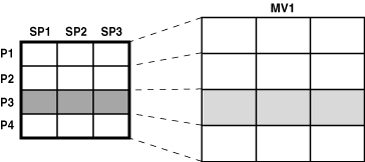

This chapter discusses how to refresh materialized views, which is a key element in maintaining good performance and consistent data when working with materialized views in a data warehousing environment.

This chapter includes the following sections:

- About Refreshing Materialized Views

- Tips for Refreshing Materialized Views

- Using Materialized Views with Partitioned Tables

- Using Partitioning to Improve Data Warehouse Refresh

- Optimizing DML Operations During Refresh

### 7.1 About Refreshing Materialized Views

The database maintains data in materialized views by refreshing them after changes to the base tables.

Performing a refresh operation requires temporary space to rebuild the indexes and can require additional space for performing the refresh operation itself. Some sites might prefer not to refresh all of their materialized views at the same time: as soon as some underlying detail data has been updated, all materialized views using this data become stale. Therefore, if you defer refreshing your materialized views, you can either rely on your chosen rewrite integrity level to determine whether or not a stale materialized view can be used for query rewrite, or you can temporarily disable query rewrite with an `ALTER` `SYSTEM` `SET` `QUERY_REWRITE_ENABLED = FALSE` statement. After refreshing the materialized views, you can re-enable query rewrite as the default for all sessions in the current database instance by specifying `ALTER` `SYSTEM` `SET` `QUERY_REWRITE_ENABLED` as `TRUE`. Refreshing a materialized view automatically updates all of its indexes. In the case of full refresh, this requires temporary sort space to rebuild all indexes during refresh. This is because the full refresh truncates or deletes the table before inserting the new full data volume. If insufficient temporary space is available to rebuild the indexes, then you must explicitly drop each index or mark it `UNUSABLE` prior to performing the refresh operation.

#### About Types of Refresh for Materialized Views

The refresh method can be incremental or a complete refresh. There are two incremental refresh methods, known as log-based refresh and partition change tracking (PCT) refresh. The incremental refresh is commonly called `FAST` refresh as it usually performs faster than the complete refresh.

A complete refresh occurs when the materialized view is initially created when it is defined as `BUILD` `IMMEDIATE`, unless the materialized view references a prebuilt table or is defined as `BUILD` `DEFERRED`. Users can perform a complete refresh at any time after the materialized view is created. The complete refresh involves executing the query that defines the materialized view. This process can be slow, especially if the database must read and process huge amounts of data.

An incremental refresh eliminates the need to rebuild materialized views from scratch. Thus, processing only the changes can result in a very fast refresh time. Materialized views can be refreshed either on demand or at regular time intervals. Alternatively, materialized views in the same database as their base tables can be refreshed whenever a transaction commits its changes to the base tables.

For materialized views that use the log-based fast refresh method, a materialized view log and/or a direct loader log keep a record of changes to the base tables. A materialized view log is a schema object that records changes to a base table so that a materialized view defined on the base table can be refreshed incrementally. Each materialized view log is associated with a single base table. The materialized view log resides in the same database and schema as its base table.

The PCT refresh method can be used if the modified base tables are partitioned and the modified base table partitions can be used to identify the affected partitions or portions of data in the materialized view. When there have been some partition maintenance operations on the base tables, this is the only incremental refresh method that can be used. The PCT refresh removes all data in the affected materialized view partitions or affected portions of data and recomputes them from scratch.

#### About Refresh Modes for Materialized Views

When creating a materialized view, you have the option of specifying whether the refresh occurs `ON` `DEMAND` or `ON` `COMMIT`.

If you anticipate performing insert, update or delete operations on tables referenced by a materialized view concurrently with the refresh of that materialized view, and that materialized view includes joins and aggregation, Oracle recommends you use `ON` `COMMIT` fast refresh rather than `ON` `DEMAND` fast refresh.

In the case of `ON` `COMMIT`, the materialized view is changed every time a transaction commits, thus ensuring that the materialized view always contains the latest data. Alternatively, you can control the time when refresh of the materialized views occurs by specifying `ON` `DEMAND`. In the case of `ON` `DEMAND` materialized views, the refresh can be performed with refresh methods provided in either the `DBMS_SYNC_REFRESH` or the `DBMS_MVIEW` packages:

- The `DBMS_SYNC_REFRESH` package contains the APIs for synchronous refresh, a new refresh method introduced in Oracle Database 12c, Release 1. For details, see [Synchronous Refresh](synchronous-refresh.md).

- The `DBMS_MVIEW` package contains the APIs whose usage is described in this chapter. There are three basic types of refresh operations: complete refresh, fast refresh, and partition change tracking (PCT) refresh. These basic types have been enhanced in Oracle Database 12c, Release 1 with a new refresh option called out-of-place refresh.

The `DBMS_MVIEW` package contains three APIs for performing refresh operations:

- `DBMS_MVIEW.REFRESH`

  Refresh one or more materialized views.

- `DBMS_MVIEW.REFRESH_ALL_MVIEWS`

  Refresh all materialized views.

- `DBMS_MVIEW.REFRESH_DEPENDENT`

  Refresh all materialized views that depend on a specified master table or materialized view or list of master tables or materialized views.

#### How to Refresh Materialized Views?

For each of these refresh options, you have two techniques for how the refresh is performed, namely in-place refresh and out-of-place refresh. The in-place refresh executes the refresh statements directly on the materialized view. The out-of-place refresh creates one or more outside tables and executes the refresh statements on the outside tables and then switches the materialized view or affected materialized view partitions with the outside tables. Both in-place refresh and out-of-place refresh achieve good performance in certain refresh scenarios. However, the out-of-place refresh enables high materialized view availability during refresh, especially when refresh statements take a long time to finish.

Also adopting the out-of-place mechanism, a new refresh method called synchronous refresh is introduced in Oracle Database 12c, Release 1. It targets the common usage scenario in the data warehouse where both fact tables and their materialized views are partitioned in the same way or their partitions are related by a functional dependency.

The refresh approach enables you to keep a set of tables and the materialized views defined on them to be always in sync. In this refresh method, the user does not directly modify the contents of the base tables but must use the APIs provided by the synchronous refresh package that will apply these changes to the base tables and materialized views at the same time to ensure their consistency. The synchronous refresh method is well-suited for data warehouses, where the loading of incremental data is tightly controlled and occurs at periodic intervals.

**See Also:**

- About the Out-of-Place Refresh Option

- [Oracle OLAP User’s Guide](../olaug/administering-oracle-olap.md) for information regarding the refresh of cube organized materialized views

#### 7.1.1 About Complete Refresh for Materialized Views

A complete refresh occurs when the materialized view is initially defined as `BUILD` `IMMEDIATE`, unless the materialized view references a prebuilt table. For materialized views using `BUILD` `DEFERRED`, a complete refresh must be requested before it can be used for the first time. A complete refresh may be requested at any time during the life of any materialized view. The refresh involves reading the detail tables to compute the results for the materialized view. This can be a very time-consuming process, especially if there are huge amounts of data to be read and processed. Therefore, you should always consider the time required to process a complete refresh before requesting it.

There are, however, cases when the only refresh method available for an already built materialized view is complete refresh because the materialized view does not satisfy the conditions specified in the following section for a fast refresh.

#### 7.1.2 About Fast Refresh for Materialized Views

Most data warehouses have periodic incremental updates to their detail data. As described in "[About Materialized View Schema Design](basic-materialized-views.md)", you can use the SQL\*Loader or any bulk load utility to perform incremental loads of detail data. Fast refresh of your materialized views is usually efficient, because instead of having to recompute the entire materialized view, the changes are applied to the existing data. Thus, processing only the changes can result in a very fast refresh time.

#### 7.1.3 About Partition Change Tracking (PCT) Refresh for Materialized Views

When there have been some partition maintenance operations on the detail tables, this is the only method of fast refresh that can be used. PCT-based refresh on a materialized view is enabled only if all the conditions described in "[About Partition Change Tracking](advanced-materialized-views.md)" are satisfied.

In the absence of partition maintenance operations on detail tables, when you request a `FAST` method (`method => 'F'`) of refresh through procedures in `DBMS_MVIEW` package, Oracle uses a heuristic rule to try log-based rule fast refresh before choosing PCT refresh. Similarly, when you request a `FORCE` method (`method => '?'`), Oracle chooses the refresh method based on the following attempt order: log-based fast refresh, PCT refresh, and complete refresh. Alternatively, you can request the PCT method (`method => 'P'`), and Oracle uses the PCT method provided all PCT requirements are satisfied.

Oracle can use `TRUNCATE` `PARTITION` on a materialized view if it satisfies the conditions in "[Benefits of Partitioning a Materialized View](advanced-materialized-views.md)" and hence, make the PCT refresh process more efficient.

**See Also:**

- "[About Partition Change Tracking](advanced-materialized-views.md)" for more information regarding partition change tracking

#### 7.1.4 About the Out-of-Place Refresh Option

Beginning with Oracle Database 12c Release 1, a new refresh option is available to improve materialized view refresh performance and availability. This refresh option is called out-of-place refresh because it uses outside tables during refresh as opposed to the existing "in-place" refresh that directly applies changes to the materialized view container table. The out-of-place refresh option works with all existing refresh methods, such as `FAST` (`'F'`), `COMPLETE` ('`C'`), `PCT` (`'P'`), and `FORCE` (`'?'`). Out-of-place refresh is particularly effective when handling situations with large amounts of data changes, where conventional DML statements do not scale well. It also enables you to achieve a very high degree of availability because the materialized views that are being refreshed can be used for direct access and query rewrite during the execution of refresh statements. In addition, it helps to avoid potential problems such as materialized view container tables becoming fragmented over time or intermediate refresh results being seen.

In out-of-place refresh, the entire or affected portions of a materialized view are computed into one or more outside tables. For partitioned materialized views, if partition level change tracking is possible, and there are local indexes defined on the materialized view, the out-of-place method also builds the same local indexes on the outside tables. This refresh process is completed by either switching between the materialized view and the outside table or partition exchange between the affected partitions and the outside tables. Note that query rewrite is not supported during the switching or partition exchange operation. During refresh, the outside table is populated by direct load, which is efficient.

This section contains the following topics:

- Types of Out-of-Place Refresh

- Restrictions and Considerations with Out-of-Place Refresh

##### 7.1.4.1 Types of Out-of-Place Refresh

There are three types of out-of-place refresh:

- out-of-place fast refresh

  This offers better availability than in-place fast refresh. It also offers better performance when changes affect a large part of the materialized view.

- out-of-place PCT refresh

  This offers better availability than in-place PCT refresh. There are two different approaches for partitioned and non-partitioned materialized views. If truncation and direct load are not feasible, you should use out-of-place refresh when the changes are relatively large. If truncation and direct load are feasible, in-place refresh is preferable in terms of performance. In terms of availability, out-of-place refresh is always preferable.

- out-of-place complete refresh

  This offers better availability than in-place complete refresh.

Using the refresh interface in the `DBMS_MVIEW` package, with `method` `=` `?` and `out_of_place` `=` `true`, out-of-place fast refresh are attempted first, then out-of-place PCT refresh, and finally out-of-place complete refresh. An example is the following:

    DBMS_MVIEW.REFRESH('CAL_MONTH_SALES_MV', method => '?',
       atomic_refresh => FALSE, out_of_place => TRUE);

##### 7.1.4.2 Restrictions and Considerations with Out-of-Place Refresh

Out-of-place refresh has all the restrictions that apply when using the corresponding in-place refresh. In addition, it has the following restrictions:

- Only materialized join views and materialized aggregate views are allowed

- No `ON` `COMMIT` refresh is permitted

- No remote materialized views, cube materialized views, object materialized views are permitted

- No `LOB` columns are permitted

- Not permitted if materialized view logs, triggers, or constraints (except `NOT` `NULL`) are defined on the materialized view

- Not permitted if the materialized view contains the `CLUSTERING` clause

- Not applied to complete refresh within a `CREATE` or `ALTER` `MATERIALIZED` `VIEW` session or an `ALTER` `TABLE` session

- Atomic mode is not permitted. If you specify `atomic_refresh` as `TRUE` and `out_of_place` as `TRUE`, an error is displayed

For out-of-place PCT refresh, there is the following restriction:

- No `UNION` `ALL` or grouping sets are permitted

For out-of-place fast refresh, there are the following restrictions:

- No `UNION` `ALL`, grouping sets or outer joins are permitted

- Not allowed for materialized join views when more than one base table is modified with mixed DML statements

Out-of-place refresh requires additional storage for the outside table and the indexes for the duration of the refresh. Thus, you must have enough available tablespace or auto extend turned on.

The partition exchange in out-of-place PCT refresh impacts the global index on the materialized view. Therefore, if there are global indexes defined on the materialized view container table, Oracle disables the global indexes before doing the partition exchange and rebuild the global indexes after the partition exchange. This rebuilding is additional overhead.

#### 7.1.5 About ON COMMIT Refresh for Materialized Views

A materialized view can be refreshed automatically using the `ON` `COMMIT` method. Therefore, whenever a transaction commits which has updated the tables on which a materialized view is defined, those changes are automatically reflected in the materialized view. The advantage of using this approach is you never have to remember to refresh the materialized view. The only disadvantage is the time required to complete the commit will be slightly longer because of the extra processing involved. However, in a data warehouse, this should not be an issue because there is unlikely to be concurrent processes trying to update the same table.

#### 7.1.6 About ON STATEMENT Refresh for Materialized Views

A materialized view that uses the `ON STATEMENT` refresh mode is automatically refreshed every time a DML operation is performed on any of the materialized view’s base tables.

With the `ON STATEMENT` refresh mode, any changes to the base tables are immediately reflected in the materialized view. There is no need to commit the transaction or maintain materialized view logs on the base tables. If the DML statements are subsequently rolled back, then the corresponding changes made to the materialized view are also rolled back.

To use the `ON STATEMENT` refresh mode, a materialized view must be fast refreshable. An index is automatically created on `ROWID` column of the fact table to improve fast refresh performance.

The advantage of the `ON STATEMENT` refresh mode is that the materialized view is always synchronized with the data in the base tables, without the overhead of maintaining materialized view logs. However, this mode may increase the time taken to perform a DML operation because the materialized view is being refreshed as part of the DML operation.

**See Also:**

[Oracle Database SQL Language Reference](../sqlrf/CREATE-MATERIALIZED-VIEW.md) for the `ON STATEMENT` clause restrictions

Example 7-1 Creating a Materialized View with ON STATEMENT Refresh

This example creates a materialized view `sales_mv_onstat` that uses the `ON STATEMENT` refresh mode and is based on the `sh.sales`, `sh.customers`, and `sh.products` tables. The materialized view is automatically refreshed when a DML operation is performed on any of the base tables. No commit is required after the DML operation to refresh the materialized view.

    CREATE MATERIALIZED VIEW sales_mv_onstat
    REFRESH FAST ON STATEMENT USING TRUSTED CONSTRAINT
    AS
    SELECT s.rowid sales_rid, c.cust_first_name first_name, c.cust_last_name last_name,
           p.prod_name prod_name,
        s.quantity_sold quantity_sold, s.amount_sold amount_sold
    FROM sh.sales s, sh.customers c, sh.products p
    WHERE s.cust_id = c.cust_id and s.prod_id = p.prod_id;

#### 7.1.7 About Manual Refresh Using the DBMS_MVIEW Package

When a materialized view is refreshed `ON` `DEMAND`, one of four refresh methods can be specified as shown in the following table. You can define a default option during the creation of the materialized view. Table 7-1 details the refresh options.

Table 7-1 ON DEMAND Refresh Methods

| Refresh Option | Parameter | Description                                                                                                                                                                                                                                                                         |
|:---------------|:----------|:------------------------------------------------------------------------------------------------------------------------------------------------------------------------------------------------------------------------------------------------------------------------------------|
| `COMPLETE`     | `C`       | Refreshes by recalculating the defining query of the materialized view.                                                                                                                                                                                                             |
| `FAST`         | `F`       | Refreshes by incrementally applying changes to the materialized view. For local materialized views, it chooses the refresh method which is estimated by optimizer to be most efficient. The refresh methods considered are log-based `FAST` and `FAST_PCT`.                      |
| `FAST_PCT`     | `P`       | Refreshes by recomputing the rows in the materialized view affected by changed partitions in the detail tables.                                                                                                                                                                     |
| `FORCE`        | `?`       | Attempts a fast refresh. If that is not possible, it does a complete refresh. For local materialized views, it chooses the refresh method which is estimated by optimizer to be most efficient. The refresh methods considered are log based `FAST`, `FAST_PCT`, and `COMPLETE`. |

Three refresh procedures are available in the `DBMS_MVIEW` package for performing `ON` `DEMAND` refresh. Each has its own unique set of parameters.

**See Also:**

[Oracle Database PL/SQL Packages and Types Reference](../arpls/DBMS_MVIEW.md) for detailed information about the `DBMS_MVIEW` package

#### 7.1.8 Refreshing Specific Materialized Views with REFRESH

Use the `DBMS_MVIEW.REFRESH` procedure to refresh one or more materialized views. Some parameters are used only for replication, so they are not mentioned here. The required parameters to use this procedure are:

- The comma-delimited list of materialized views to refresh

- The refresh method: `F`-Fast, `P`-Fast_PCT, `?`-Force, `C`-Complete

- The rollback segment to use

- Refresh after errors (`TRUE` or `FALSE`)

  A Boolean parameter. If set to `TRUE`, the `number_of_failures` output parameter is set to the number of refreshes that failed, and a generic error message indicates that failures occurred. The alert log for the instance gives details of refresh errors. If set to `FALSE`, which is the default, then refresh stops after it encounters the first error, and any remaining materialized views in the list are not refreshed.

- The following four parameters are used by the replication process. For warehouse refresh, set them to `FALSE, 0,0,0`.

- Atomic refresh (`TRUE` or `FALSE`)

  If set to `TRUE`, then all refreshes are done in one transaction. If set to `FALSE`, then each of the materialized views is refreshed non-atomically in separate transactions. If set to `FALSE`, Oracle can optimize refresh by using parallel DML and truncate DDL on a materialized views. When a materialized view is refreshed in atomic mode, it is eligible for query rewrite if the rewrite integrity mode is set to `stale_tolerated`. Atomic refresh cannot be guaranteed when refresh is performed on nested views.

- Whether to use out-of-place refresh

  This parameter works with all existing refresh methods (`F`, `P`, `C`, `?`). So, for example, if you specify `F` and `out_of_place` `=` `true`, then an out-of-place fast refresh is attempted. Similarly, if you specify `P` and `out_of_place` `=` `true`, then out-of-place PCT refresh is attempted.

For example, to perform a fast refresh on the materialized view `cal_month_sales_mv`, the `DBMS_MVIEW` package would be called as follows:

    DBMS_MVIEW.REFRESH('CAL_MONTH_SALES_MV', 'F', '', TRUE, FALSE, 0,0,0,
       FALSE, FALSE);

Multiple materialized views can be refreshed at the same time, and they do not all have to use the same refresh method. To give them different refresh methods, specify multiple method codes in the same order as the list of materialized views (without commas). For example, the following specifies that `cal_month_sales_mv` be completely refreshed and `fweek_pscat_sales_mv` receive a fast refresh:

    DBMS_MVIEW.REFRESH('CAL_MONTH_SALES_MV, FWEEK_PSCAT_SALES_MV', 'CF', '',
      TRUE, FALSE, 0,0,0, FALSE, FALSE);

If the refresh method is not specified, the default refresh method as specified in the materialized view definition is used.

#### 7.1.9 Refreshing All Materialized Views with REFRESH_ALL_MVIEWS

An alternative to specifying the materialized views to refresh is to use the procedure `DBMS_MVIEW.REFRESH_ALL_MVIEWS`. This procedure refreshes all materialized views. If any of the materialized views fails to refresh, then the number of failures is reported.

The parameters for this procedure are:

- The number of failures (this is an `OUT` variable)

- The refresh method: `F`-Fast, `P`-Fast_PCT, `?`-Force, `C`-Complete

- Refresh after errors (`TRUE` or `FALSE`)

  A Boolean parameter. If set to `TRUE`, the `number_of_failures` output parameter is set to the number of refreshes that failed, and a generic error message indicates that failures occurred. The alert log for the instance gives details of refresh errors. If set to `FALSE`, the default, then refresh stops after it encounters the first error, and any remaining materialized views in the list is not refreshed.

- Atomic refresh (`TRUE` or `FALSE`)

  If set to `TRUE`, then all refreshes are done in one transaction. If set to `FALSE`, then each of the materialized views is refreshed non-atomically in separate transactions. If set to `FALSE`, Oracle can optimize refresh by using parallel DML and truncate DDL on a materialized views. When a materialized view is refreshed in atomic mode, it is eligible for query rewrite if the rewrite integrity mode is set to `stale_tolerated`. Atomic refresh cannot be guaranteed when refresh is performed on nested views.

- Whether to use out-of-place refresh

  This parameter works with all existing refresh method (`F`, `P`, `C`, `?`). So, for example, if you specify `F` and `out_of_place` `=` `true`, then an out-of-place fast refresh is attempted. Similarly, if you specify `P` and `out_of_place` `=` `true`, then out-of-place PCT refresh is attempted.

An example of refreshing all materialized views is the following:

    DBMS_MVIEW.REFRESH_ALL_MVIEWS(failures,'C','', TRUE, FALSE, FALSE);

#### 7.1.10 Refreshing Dependent Materialized Views with REFRESH_DEPENDENT

The third procedure, `DBMS_MVIEW.REFRESH_DEPENDENT`, refreshes only those materialized views that depend on a specific table or list of tables. For example, suppose the changes have been received for the `orders` table but not for `customer` payments. The refresh dependent procedure can be called to refresh only those materialized views that reference the `orders` table.

The parameters for this procedure are:

- The number of failures (this is an `OUT` variable)

- The dependent table

- The refresh method: `F`-Fast, `P`-Fast_PCT, `?`-Force, `C`-Complete

- The rollback segment to use

- Refresh after errors (`TRUE` or `FALSE`)

  A Boolean parameter. If set to `TRUE`, the `number_of_failures` output parameter is set to the number of refreshes that failed, and a generic error message indicates that failures occurred. The alert log for the instance gives details of refresh errors. If set to `FALSE`, the default, then refresh stops after it encounters the first error, and any remaining materialized views in the list are not refreshed.

- Atomic refresh (`TRUE` or `FALSE`)

  If set to `TRUE`, then all refreshes are done in one transaction. If set to `FALSE`, then each of the materialized views is refreshed non-atomically in separate transactions. If set to `FALSE`, Oracle can optimize refresh by using parallel DML and truncate DDL on a materialized views. When a materialized view is refreshed in atomic mode, it is eligible for query rewrite if the rewrite integrity mode is set to `stale_tolerated`. Atomic refresh cannot be guaranteed when refresh is performed on nested views.

- Whether it is nested or not

  If set to `TRUE`, refresh all the dependent materialized views of the specified set of tables based on a dependency order to ensure the materialized views are truly fresh with respect to the underlying base tables.

- Whether to use out-of-place refresh

  This parameter works with all existing refresh methods (`F`, `P`, `C`, `?`). So, for example, if you specify `F` and `out_of_place` `=` `true`, then an out-of-place fast refresh is attempted. Similarly, if you specify `P` and `out_of_place` `=` `true`, then out-of-place PCT refresh is attempted.

To perform a full refresh on all materialized views that reference the `customers` table, specify:

    DBMS_MVIEW.REFRESH_DEPENDENT(failures, 'CUSTOMERS', 'C', '', FALSE, FALSE, FALSE);

#### 7.1.11 About Using Job Queues for Refresh

Job queues can be used to refresh multiple materialized views in parallel. If queues are not available, fast refresh sequentially refreshes each view in the foreground process. To make queues available, you must set the `JOB_QUEUE_PROCESSES` parameter. This parameter defines the number of background job queue processes and determines how many materialized views can be refreshed concurrently. Oracle tries to balance the number of concurrent refreshes with the degree of parallelism of each refresh. The order in which the materialized views are refreshed is determined by dependencies imposed by nested materialized views and potential for efficient refresh by using query rewrite against other materialized views (See "Scheduling Refresh of Materialized Views" for details). This parameter is only effective when `atomic_refresh` is set to `FALSE`.

If the process that is executing `DBMS_MVIEW.REFRESH` is interrupted or the instance is shut down, any refresh jobs that were executing in job queue processes are requeued and continue running. To remove these jobs, use the `DBMS_JOB.REMOVE` procedure.

**See Also:**

- [Oracle Database PL/SQL Packages and Types Reference](../arpls/DBMS_JOB.md) for detailed information about the `DBMS_JOB` package

#### 7.1.12 When Fast Refresh is Possible

Not all materialized views may be fast refreshable. Therefore, use the package `DBMS_MVIEW.EXPLAIN_MVIEW` to determine what refresh methods are available for a materialized view.

If you are not sure how to make a materialized view fast refreshable, you can use the `DBMS_ADVISOR.TUNE_MVIEW` procedure, which provides a script containing the statements required to create a fast refreshable materialized view.

**See Also:**

- [Oracle Database SQL Tuning Guide](../tgsql/introduction-to-sql-tuning.md)

- [Basic Materialized Views](basic-materialized-views.md) for further information about the `DBMS_MVIEW` package

#### 7.1.13 Refreshing Materialized Views Based on Approximate Queries

Oracle Database performs fast refresh for materialized views that are defined using approximate queries.

Approximate queries contain SQL functions that return approximate results. Refreshing materialized views containing approximate queries depends on the DML operation that is performed on the base tables of the materialized view.

- For insert operations, fast refresh is used for materialized views containing detailed percentiles.

- For delete operations or any DML operation that leads to deletion (such as `UPDATE` or `MERGE`), fast refresh is used for materialized views containing approximate aggregations only if the materialized view does not contain a `WHERE` clause.

Materialized view logs must exist on all base tables of a materialized view that needs to be fast refreshed.

- To refresh a materialized view that is based on an approximate query:
  Run the `DBMS_REFRESH.REFRESH` procedure to perform a fast refresh of the materialized view

Example 7-2 Refreshing Materialized Views Based on Approximate Queries

The following example performs a fast refresh of the materialized view `percentile_per_pdt` that is based on an approximate query.

    exec DBMS_MVIEW.REFRESH('percentile_per_pdt', method => 'F');

**See Also:**

- [About Approximate Query Processing](data-warehouse-optimizations-techniques.md)

- [Creating Materialized Views Based on Approximate Queries](basic-materialized-views.md)

- [Query Rewrite and Materialized Views Based on Approximate Queries](advanced-query-rewrite-materialized-views.md)

#### 7.1.14 About Refreshing Dependent Materialized Views During Online Table Redefinition

While redefining a table online using the `DBMS_REDEFINITION` package, you can perform incremental refresh of fast refreshable materialized views that are dependent on the table being redefined.

Prior to Oracle Database 12c Release 2 (12.2), to refresh dependent materialized views on tables undergoing redefinition, you must execute complete refresh manually after the redefinition process completes.

To incrementally refresh dependent materialized views during online table redefinition, set the `refresh_dep_mviews` parameter in the `DBMS_REDEFINITON.REDEF_TABLE` procedure to Y . Dependent materialized views can be refreshed during online table redefinition only if the materialized view is fast refreshable and is not a `ROWID`-based materialized view or materialized join view. Materialized views that do not follow these restrictions are not refreshed.

Consider the table `my_sales` that has the following dependent materialized views:

- `my_sales_pk_mv`: fast refreshable primary key-based materialized view

- `my_sales_rid_mv`: fast refreshable `ROWID`-based materialized view

- `my_sales_mjv`: fast refreshable materialized join view

- `my_sales_mav`: fast refreshable materialized aggregate view

- `my_sales_rmv`: only fully-refreshable materialized view

When you run the following command, fast refresh is performed only for the `my_sales_pk_mv` and `my_sales_mav` materialized views:

    DBMS_REDEFINITION.REDEF_TABLE(
    uname => 'SH',
    tname => 'MY_SALES',
    table_compression_type => 'ROW STORE COMPRESS ADVANCED',
    refresh_dep_mviews => 'Y');

**See Also:**

[Oracle Database Administrator’s Guide](../admin/managing-tables.md)

#### 7.1.15 Recommended Initialization Parameters for Parallelism

The following initialization parameters need to be set properly for parallelism to be effective:

- `PARALLEL_MAX_SERVERS` should be set high enough to take care of parallelism. You must consider the number of slaves needed for the refresh statement. For example, with a degree of parallelism of eight, you need 16 slave processes.

- `PGA_AGGREGATE_TARGET` should be set for the instance to manage the memory usage for sorts and joins automatically. If the memory parameters are set manually, `SORT_AREA_SIZE` should be less than `HASH_AREA_SIZE`.

- `OPTIMIZER_MODE` should equal `all_rows`.

Remember to analyze all tables and indexes for better optimization.

**See Also:**

[Oracle Database VLDB and Partitioning Guide](../vldbg/using-parallel.md)

#### 7.1.16 Monitoring a Refresh

While a job is running, you can query the `V$SESSION_LONGOPS` view to tell you the progress of each materialized view being refreshed.

    SELECT * FROM V$SESSION_LONGOPS;

To look at the progress of which jobs are on which queue, use:

    SELECT * FROM DBA_JOBS_RUNNING;

#### 7.1.17 Checking the Status of a Materialized View

Three views are provided for checking the status of a materialized view: `DBA_MVIEWS`, `ALL_MVIEWS`, and `USER_MVIEWS`. To check if a materialized view is fresh or stale, issue the following statement:

    SELECT MVIEW_NAME, STALENESS, LAST_REFRESH_TYPE, COMPILE_STATE
    FROM USER_MVIEWS ORDER BY MVIEW_NAME;

    MVIEW_NAME            STALENESS      LAST_REF       COMPILE_STATE
    ----------            ---------      --------       -------------
    CUST_MTH_SALES_MV     NEEDS_COMPILE  FAST           NEEDS_COMPILE
    PROD_YR_SALES_MV      FRESH          FAST           VALID

If the `compile_state` column shows `NEEDS` `COMPILE`, the other displayed column values cannot be trusted as reflecting the true status. To revalidate the materialized view, issue the following statement:

    ALTER MATERIALIZED VIEW [materialized_view_name] COMPILE;

Then reissue the `SELECT` statement.

##### 7.1.17.1 Viewing Partition Freshness

Several views are available that enable you to verify the status of base table partitions and determine which ranges of materialized view data are fresh and which are stale. The views are as follows:

- `*_USER_MVIEWS`

  To determine partition change tracking (PCT) information for the materialized view.

- `*_USER_MVIEW_DETAIL_RELATIONS`

  To display partition information for the detail table a materialized view is based on.

- `*_USER_MVIEW_DETAIL_PARTITION`

  To determine which partitions are fresh.

- `*_USER_MVIEW_DETAIL_SUBPARTITION`

  To determine which subpartitions are fresh.

The use of these views is illustrated in the following examples. Figure 7-1 illustrates a range-list partitioned table and a materialized view based on it. The partitions are P1, P2, P3, and P4, while the subpartitions are SP1, SP2, and SP3.

Figure 7-1 Determining PCT Freshness

[Description of "Figure 7-1 Determining PCT Freshness"](img_text/dwhsg130.md)

**See Also:**

Examples of Using Views to Determine Freshness

###### 7.1.17.1.1 Examples of Using Views to Determine Freshness

This section illustrates examples of determining the PCT and freshness information for materialized views and their detail tables.

Example 7-3 Verifying the PCT Status of a Materialized View

Query `USER_MVIEWS` to access PCT information about the materialized view, as shown in the following:

    SELECT MVIEW_NAME, NUM_PCT_TABLES, NUM_FRESH_PCT_REGIONS,
       NUM_STALE_PCT_REGIONS
    FROM USER_MVIEWS
    WHERE MVIEW_NAME = MV1;

    MVIEW_NAME NUM_PCT_TABLES NUM_FRESH_PCT_REGIONS NUM_STALE_PCT_REGIONS
    ---------- -------------- --------------------- ---------------------
           MV1              1                     9                     3

Example 7-4 Verifying the PCT Status in a Materialized View's Detail Table

Query `USER_MVIEW_DETAIL_RELATIONS` to access PCT detail table information, as shown in the following:

    SELECT MVIEW_NAME, DETAILOBJ_NAME, DETAILOBJ_PCT,
       NUM_FRESH_PCT_PARTITIONS, NUM_STALE_PCT_PARTITIONS
    FROM USER_MVIEW_DETAIL_RELATIONS
    WHERE MVIEW_NAME = MV1;

    MVIEW_NAME  DETAILOBJ_NAME  DETAIL_OBJ_PCT  NUM_FRESH_PCT_PARTITIONS  NUM_STALE_PCT_PARTITIONS
    ----------  --------------  --------------  ------------------------  ------------------------
            MV1             T1               Y                         3                         1

Example 7-5 Verifying Which Partitions are Fresh

Query `USER_MVIEW_DETAIL_PARTITION` to access PCT freshness information for partitions, as shown in the following:

    SELECT MVIEW_NAME,DETAILOBJ_NAME,DETAIL_PARTITION_NAME,
       DETAIL_PARTITION_POSITION,FRESHNESS
    FROM USER_MVIEW_DETAIL_PARTITION
    WHERE MVIEW_NAME = MV1;

    MVIEW_NAME  DETAILOBJ_NAME  DETAIL_PARTITION_NAME  DETAIL_PARTITION_POSITION  FRESHNESS
    ----------  --------------  ---------------------  -------------------------  ---------
           MV1               T1                    P1                          1      FRESH
           MV1               T1                    P2                          2      FRESH
           MV1               T1                    P3                          3      STALE
           MV1               T1                    P4                          4      FRESH

Example 7-6 Verifying Which Subpartitions are Fresh

Query `USER_MVIEW_DETAIL_SUBPARTITION` to access PCT freshness information for subpartitions, as shown in the following:

    SELECT MVIEW_NAME,DETAILOBJ_NAME,DETAIL_PARTITION_NAME, DETAIL_SUBPARTITION_NAME,
        DETAIL_SUBPARTITION_POSITION,FRESHNESS
    FROM USER_MVIEW_DETAIL_SUBPARTITION
    WHERE MVIEW_NAME = MV1;

    MVIEW_NAME DETAILOBJ DETAIL_PARTITION DETAIL_SUBPARTITION_NAME DETAIL_SUBPARTITION_POS FRESHNESS
    ---------- --------- ---------------- ------------------------ ----------------------- ---------
           MV1        T1               P1                      SP1                       1     FRESH
           MV1        T1               P1                      SP2                       1     FRESH
           MV1        T1               P1                      SP3                       1     FRESH
           MV1        T1               P2                      SP1                       1     FRESH
           MV1        T1               P2                      SP2                       1     FRESH
           MV1        T1               P2                      SP3                       1     FRESH
           MV1        T1               P3                      SP1                       1     STALE
           MV1        T1               P3                      SP2                       1     STALE
           MV1        T1               P3                      SP3                       1     STALE
           MV1        T1               P4                      SP1                       1     FRESH
           MV1        T1               P4                      SP2                       1     FRESH
           MV1        T1               P4                      SP3                       1     FRESH

#### 7.1.18 Scheduling Refresh of Materialized Views

Very often you have multiple materialized views in the database. Some of these can be computed by rewriting against others. This is very common in data warehousing environment where you may have nested materialized views or materialized views at different levels of some hierarchy.

In such cases, you should create the materialized views as `BUILD DEFERRED`, and then issue one of the refresh procedures in `DBMS_MVIEW` package to refresh all the materialized views. Oracle Database computes the dependencies and refreshes the materialized views in the right order. Consider the example of a complete hierarchical cube described in "[Examples of Hierarchical Cube Materialized Views](sql-aggregation-data-warehouses.md)". Suppose all the materialized views have been created as `BUILD DEFERRED`. Creating the materialized views as `BUILD DEFERRED` only creates the metadata for all the materialized views. And, then, you can just call one of the refresh procedures in `DBMS_MVIEW` package to refresh all the materialized views in the right order:

    DECLARE numerrs PLS_INTEGER;
    BEGIN DBMS_MVIEW.REFRESH_DEPENDENT (
       number_of_failures => numerrs, list=>'SALES', method => 'C');
    DBMS_OUTPUT.PUT_LINE('There were ' || numerrs || ' errors during refresh');
    END;
    /

The procedure refreshes the materialized views in the order of their dependencies (first `sales_hierarchical_mon_cube_mv`, followed by `sales_hierarchical_qtr_cube_mv`, then, `sales_hierarchical_yr_cube_mv` and finally, `sales_hierarchical_all_cube_mv`). Each of these materialized views gets rewritten against the one prior to it in the list).

The same kind of rewrite can also be used while doing PCT refresh. PCT refresh recomputes rows in a materialized view corresponding to changed rows in the detail tables. And, if there are other fresh materialized views available at the time of refresh, it can go directly against them as opposed to going against the detail tables.

Hence, it is always beneficial to pass a list of materialized views to any of the refresh procedures in `DBMS_MVIEW` package (irrespective of the method specified) and let the procedure figure out the order of doing refresh on materialized views.

### 7.2 Tips for Refreshing Materialized Views

This section contains the following topics with tips on refreshing materialized views:

- Tips for Refreshing Materialized Views with Aggregates

- Tips for Refreshing Materialized Views Without Aggregates

- Tips for Refreshing Nested Materialized Views

- Tips for Fast Refresh with UNION ALL

- Tips for Fast Refresh with Commit SCN-Based Materialized View Logs

- Tips After Refreshing Materialized Views

#### 7.2.1 Tips for Refreshing Materialized Views with Aggregates

Following are some guidelines for using the refresh mechanism for materialized views with aggregates.

- For fast refresh, create materialized view logs on all detail tables involved in a materialized view with the `ROWID`, `SEQUENCE` and `INCLUDING` `NEW` `VALUES` clauses.

  Include all columns from the table likely to be used in materialized views in the materialized view logs.

  Fast refresh may be possible even if the `SEQUENCE` option is omitted from the materialized view log. If it can be determined that only inserts or deletes will occur on all the detail tables, then the materialized view log does not require the `SEQUENCE` clause. However, if updates to multiple tables are likely or required or if the specific update scenarios are unknown, make sure the `SEQUENCE` clause is included.

- Use Oracle's bulk loader utility or direct-path `INSERT` (`INSERT` with the `APPEND` hint for loads). Starting in Oracle Database 12c, the database automatically gathers table statistics as part of a bulk-load operation (CTAS and IAS) similar to how statistics are gathered when an index is created. By gathering statistics during the data load, you avoid additional scan operations and provide the necessary statistics as soon as the data becomes available to the users.

  This is a lot more efficient than conventional insert. During loading, disable all constraints and re-enable when finished loading. Note that materialized view logs are required regardless of whether you use direct load or conventional DML.

  Try to optimize the sequence of conventional mixed DML operations, direct-path `INSERT` and the fast refresh of materialized views. You can use fast refresh with a mixture of conventional DML and direct loads. Fast refresh can perform significant optimizations if it finds that only direct loads have occurred, as illustrated in the following:

  1.  Direct-path `INSERT` (SQL\*Loader or `INSERT /*+ APPEND */`) into the detail table

  2.  Refresh materialized view

  3.  Conventional mixed DML

  4.  Refresh materialized view

  You can use fast refresh with conventional mixed DML (`INSERT`, `UPDATE`, and `DELETE`) to the detail tables. However, fast refresh is able to perform significant optimizations in its processing if it detects that only inserts or deletes have been done to the tables, such as:

  - DML `INSERT` or `DELETE` to the detail table

  - Refresh materialized views

  - DML update to the detail table

  - Refresh materialized view

  Even more optimal is the separation of `INSERT` and `DELETE`.

  If possible, refresh should be performed after each type of data change (as shown earlier) rather than issuing only one refresh at the end. If that is not possible, restrict the conventional DML to the table to inserts only, to get much better refresh performance. Avoid mixing deletes and direct loads.

  Furthermore, for refresh `ON` `COMMIT`, Oracle keeps track of the type of DML done in the committed transaction. Therefore, do not perform direct-path `INSERT` and DML to other tables in the same transaction, as Oracle may not be able to optimize the refresh phase.

  For `ON` `COMMIT` materialized views, where refreshes automatically occur at the end of each transaction, it may not be possible to isolate the DML statements, in which case keeping the transactions short will help. However, if you plan to make numerous modifications to the detail table, it may be better to perform them in one transaction, so that refresh of the materialized view is performed just once at commit time rather than after each update.

- Oracle recommends partitioning the tables because it enables you to use:

  - Parallel DML

    For large loads or refresh, enabling parallel DML helps shorten the length of time for the operation.

  - Partition change tracking (PCT) fast refresh

    You can refresh your materialized views fast after partition maintenance operations on the detail tables. "[About Partition Change Tracking](advanced-materialized-views.md)" for details on enabling PCT for materialized views.

- Partitioning the materialized view also helps refresh performance as refresh can update the materialized view using parallel DML. For example, assume that the detail tables and materialized view are partitioned and have a parallel clause. The following sequence would enable Oracle to parallelize the refresh of the materialized view.

  1.  Bulk load into the detail table.

  2.  Enable parallel DML with an `ALTER` `SESSION` `ENABLE` `PARALLEL` `DML` statement.

  3.  Refresh the materialized view.

- For refresh using `DBMS_MVIEW.REFRESH`, set the parameter `atomic_refresh` to `FALSE`.

  - For `COMPLETE` refresh, this causes a `TRUNCATE` to delete existing rows in the materialized view, which is faster than a delete.

  - For `PCT` refresh, if the materialized view is partitioned appropriately, this uses `TRUNCATE` `PARTITION` to delete rows in the affected partitions of the materialized view, which is faster than a delete.

  - For `FAST` or `FORCE` refresh, if `COMPLETE` or PCT refresh is chosen, this is able to use the `TRUNCATE` optimizations described earlier.

- When using `DBMS_MVIEW.REFRESH` with `JOB_QUEUES`, remember to set `atomic` to `FALSE`. Otherwise, `JOB_QUEUES` is not used. Set the number of job queue processes greater than the number of processors.

  If job queues are enabled and there are many materialized views to refresh, it is faster to refresh all of them in a single command than to call them individually.

- Use `REFRESH` `FORCE` to ensure refreshing a materialized view so that it can definitely be used for query rewrite. The best refresh method is chosen. If a fast refresh cannot be done, a complete refresh is performed.

- Refresh all the materialized views in a single procedure call. This gives Oracle an opportunity to schedule refresh of all the materialized views in the right order taking into account dependencies imposed by nested materialized views and potential for efficient refresh by using query rewrite against other materialized views.

#### 7.2.2 Tips for Refreshing Materialized Views Without Aggregates

If a materialized view contains joins but no aggregates, then having an index on each of the join column rowids in the detail table enhances refresh performance greatly, because this type of materialized view tends to be much larger than materialized views containing aggregates. For example, consider the following materialized view:

    CREATE MATERIALIZED VIEW detail_fact_mv BUILD IMMEDIATE AS
    SELECT s.rowid "sales_rid", t.rowid "times_rid", c.rowid "cust_rid",
       c.cust_state_province, t.week_ending_day, s.amount_sold
    FROM sales s, times t, customers c
    WHERE s.time_id = t.time_id AND s.cust_id = c.cust_id;

Indexes should be created on columns `sales_rid`, `times_rid` and `cust_rid`. Partitioning is highly recommended, as is enabling parallel DML in the session before invoking refresh, because it greatly enhances refresh performance.

This type of materialized view can also be fast refreshed if DML is performed on the detail table. It is recommended that the same procedure be applied to this type of materialized view as for a single table aggregate. That is, perform one type of change (direct-path `INSERT` or DML) and then refresh the materialized view. This is because Oracle Database can perform significant optimizations if it detects that only one type of change has been done.

Also, Oracle recommends that the refresh be invoked after each table is loaded, rather than load all the tables and then perform the refresh.

For refresh `ON` `COMMIT`, Oracle keeps track of the type of DML done in the committed transaction. Oracle therefore recommends that you do not perform direct-path and conventional DML to other tables in the same transaction because Oracle may not be able to optimize the refresh phase. For example, the following is not recommended:

1.  Direct load new data into the fact table

2.  DML into the store table

3.  Commit

Also, try not to mix different types of conventional DML statements if possible. This would again prevent using various optimizations during fast refresh. For example, try to avoid the following:

1.  Insert into the fact table

2.  Delete from the fact table

3.  Commit

If many updates are needed, try to group them all into one transaction because refresh is performed just once at commit time, rather than after each update.

In a data warehousing environment, assuming that the materialized view has a parallel clause, the following sequence of steps is recommended:

1.  Bulk load into the fact table

2.  Enable parallel DML

3.  An `ALTER` `SESSION` `ENABLE` `PARALLEL` `DML` statement

4.  Refresh the materialized view

#### 7.2.3 Tips for Refreshing Nested Materialized Views

All underlying objects are treated as ordinary tables when refreshing materialized views. If the `ON` `COMMIT` refresh option is specified, then all the materialized views are refreshed in the appropriate order at commit time. In other words, Oracle builds a partially ordered set of materialized views and refreshes them such that, after the successful completion of the refresh, all the materialized views are fresh. The status of the materialized views can be checked by querying the appropriate `USER_`, `DBA_`, or `ALL_MVIEWS` view.

If any of the materialized views are defined as `ON` `DEMAND` refresh (irrespective of whether the refresh method is `FAST`, `FORCE`, or `COMPLETE`), you must refresh them in the correct order (taking into account the dependencies between the materialized views) because the nested materialized view are refreshed with respect to the current contents of the other materialized views (whether fresh or not). This can be achieved by invoking the refresh procedure against the materialized view at the top of the nested hierarchy and specifying the `nested` parameter as `TRUE`.

If a refresh fails during commit time, the list of materialized views that has not been refreshed is written to the alert log, and you must manually refresh them along with all their dependent materialized views.

Use the same `DBMS_MVIEW` procedures on nested materialized views that you use on regular materialized views.

These procedures have the following behavior when used with nested materialized views:

- If `REFRESH` is applied to a materialized view `my_mv` that is built on other materialized views, then `my_mv` is refreshed with respect to the current contents of the other materialized views (that is, the other materialized views are not made fresh first) unless you specify `nested => TRUE`.

- If `REFRESH_DEPENDENT` is applied to materialized view `my_mv`, then only materialized views that directly depend on `my_mv` are refreshed (that is, a materialized view that depends on a materialized view that depends on `my_mv` will not be refreshed) unless you specify `nested => TRUE`.

- If `REFRESH_ALL_MVIEWS` is used, the order in which the materialized views are refreshed is guaranteed to respect the dependencies between nested materialized views.

- `GET_MV_DEPENDENCIES` provides a list of the immediate (or direct) materialized view dependencies for an object.

#### 7.2.4 Tips for Fast Refresh with UNION ALL

You can use fast refresh for materialized views that use the `UNION` `ALL` operator by providing a maintenance column in the definition of the materialized view. For example, a materialized view with a `UNION` `ALL` operator can be made fast refreshable as follows:

    CREATE MATERIALIZED VIEW fast_rf_union_all_mv AS
    SELECT x.rowid AS r1, y.rowid AS r2, a, b, c, 1 AS marker
    FROM x, y WHERE x.a = y.b
    UNION ALL
    SELECT p.rowid, r.rowid, a, c, d, 2 AS marker
    FROM p, r WHERE p.a = r.y;

The form of a maintenance marker column, column `MARKER` in the example, must be `numeric_or_string_literal` `AS` `column_alias`, where each `UNION` `ALL` member has a distinct value for `numeric_or_string_literal`.

#### 7.2.5 Tips for Fast Refresh with Commit SCN-Based Materialized View Logs

You can often improve fast refresh performance by ensuring that your materialized view logs on the base table contain a `WITH` `COMMIT` `SCN` clause, often significantly. By optimizing materialized view log processing `WITH` `COMMIT` `SCN`, the fast refresh process can save time. The following example illustrates how to use this clause:

    CREATE MATERIALIZED VIEW LOG ON sales WITH ROWID
     (prod_id, cust_id, time_id, channel_id, promo_id, quantity_sold, amount_sold),
    COMMIT SCN INCLUDING NEW VALUES;

The materialized view refresh automatically uses the commit SCN-based materialized view log to save refresh time.

Note that only new materialized view logs can take advantage of `COMMIT` `SCN`. Existing materialized view logs cannot be altered to add `COMMIT` `SCN` unless they are dropped and recreated.

When a materialized view is created on both base tables with timestamp-based materialized view logs and base tables with commit SCN-based materialized view logs, an error (ORA-32414) is raised stating that materialized view logs are not compatible with each other for fast refresh.

#### 7.2.6 Tips After Refreshing Materialized Views

After you have performed a load or incremental load and rebuilt the detail table indexes, you must re-enable integrity constraints (if any) and refresh the materialized views and materialized view indexes that are derived from that detail data. In a data warehouse environment, referential integrity constraints are normally enabled with the `NOVALIDATE` or `RELY` options. An important decision to make before performing a refresh operation is whether the refresh needs to be recoverable. Because materialized view data is redundant and can always be reconstructed from the detail tables, it might be preferable to disable logging on the materialized view. To disable logging and run incremental refresh non-recoverably, use the `ALTER` `MATERIALIZED` `VIEW` ... `NOLOGGING` statement prior to refreshing.

If the materialized view is being refreshed using the `ON` `COMMIT` method, then, following refresh operations, consult the alert log `alert_`SID`.log` and the trace file `ora_`SID`_number.trc` to check that no errors have occurred.

### 7.3 Using Materialized Views with Partitioned Tables

A major maintenance component of a data warehouse is synchronizing (refreshing) the materialized views when the detail data changes. Partitioning the underlying detail tables can reduce the amount of time taken to perform the refresh task. This is possible because partitioning enables refresh to use parallel DML to update the materialized view. Also, it enables the use of partition change tracking.

"Materialized View Fast Refresh with Partition Change Tracking" provides additional information about PCT refresh.

#### 7.3.1 Materialized View Fast Refresh with Partition Change Tracking

In a data warehouse, changes to the detail tables can often entail partition maintenance operations, such as `DROP`, `EXCHANGE`, `MERGE`, and `ADD` `PARTITION`. To maintain the materialized view after such operations used to require manual maintenance (see also `CONSIDER` `FRESH`) or complete refresh. You now have the option of using an addition to fast refresh known as partition change tracking (PCT) refresh.

For PCT to be available, the detail tables must be partitioned. The partitioning of the materialized view itself has no bearing on this feature. If PCT refresh is possible, it occurs automatically and no user intervention is required in order for it to occur. See "[About Partition Change Tracking](advanced-materialized-views.md)" for PCT requirements.

The following examples illustrate the use of this feature:

- PCT Fast Refresh for Materialized Views: Scenario 1

- PCT Fast Refresh for Materialized Views: Scenario 2

- PCT Fast Refresh for Materialized Views: Scenario 3

##### 7.3.1.1 PCT Fast Refresh for Materialized Views: Scenario 1

In this scenario, assume `sales` is a partitioned table using the `time_id` column and `products` is partitioned by the `prod_category` column. The table `times` is not a partitioned table.

1.  Create the materialized view. The following materialized view satisfies requirements for PCT.
        CREATE MATERIALIZED VIEW cust_mth_sales_mv
        BUILD IMMEDIATE
        REFRESH FAST ON DEMAND
        ENABLE QUERY REWRITE AS
        SELECT s.time_id, s.prod_id, SUM(s.quantity_sold), SUM(s.amount_sold),
               p.prod_name, t.calendar_month_name, COUNT(*),
               COUNT(s.quantity_sold), COUNT(s.amount_sold)
        FROM sales s, products p, times t
        WHERE  s.time_id = t.time_id AND s.prod_id = p.prod_id
        GROUP BY t.calendar_month_name, s.prod_id, p.prod_name, s.time_id;
2.  Run the `DBMS_MVIEW.EXPLAIN_MVIEW` procedure to determine which tables allow PCT refresh.
        MVNAME              CAPABILITY_NAME   POSSIBLE  RELATED_TEXT  MSGTXT
        -----------------   ---------------   --------  ------------  ----------------
        CUST_MTH_SALES_MV   PCT               Y         SALES
        CUST_MTH_SALES_MV   PCT_TABLE         Y         SALES
        CUST_MTH_SALES_MV   PCT_TABLE         N         PRODUCTS      no partition key
                                                                      or PMARKER
                                                                      in SELECT list
        CUST_MTH_SALES_MV   PCT_TABLE         N         TIMES         relation is not
                                                                      partitionedtable

    As can be seen from the partial sample output from `EXPLAIN_MVIEW`, any partition maintenance operation performed on the `sales` table allows PCT fast refresh. However, PCT is not possible after partition maintenance operations or updates to the `products` table as there is insufficient information contained in `cust_mth_sales_mv` for PCT refresh to be possible. Note that the `times` table is not partitioned and hence can never allow for PCT refresh. Oracle Database applies PCT refresh if it can determine that the materialized view has sufficient information to support PCT for all the updated tables. You can verify which partitions are fresh and stale with views such as `DBA_MVIEWS` and `DBA_MVIEW_DETAIL_PARTITION`.

    See "[Analyzing Materialized View Capabilities](basic-materialized-views.md)" for information on how to use this procedure and also some details regarding PCT-related views.
3.  Suppose at some later point, a `SPLIT` operation of one partition in the sales table becomes necessary.
        ALTER TABLE SALES
        SPLIT PARTITION month3 AT (TO_DATE('05-02-1998', 'DD-MM-YYYY'))
        INTO (PARTITION month3_1 TABLESPACE summ,
              PARTITION month3 TABLESPACE summ);

4.  Insert some data into the `sales` table.
5.  Fast refresh `cust_mth_sales_mv` using the `DBMS_MVIEW.REFRESH` procedure.
        EXECUTE DBMS_MVIEW.REFRESH('CUST_MTH_SALES_MV', 'F',
           '',TRUE,FALSE,0,0,0,FALSE);

Fast refresh automatically performs a PCT refresh as it is the only fast refresh possible in this scenario. However, fast refresh will not occur if a partition maintenance operation occurs when any update has taken place to a table on which PCT is not enabled. This is shown in "PCT Fast Refresh for Materialized Views: Scenario 2".

"PCT Fast Refresh for Materialized Views: Scenario 1" would also be appropriate if the materialized view was created using the `PMARKER` clause as illustrated in the following:

    CREATE MATERIALIZED VIEW cust_sales_marker_mv
    BUILD IMMEDIATE
    REFRESH FAST ON DEMAND
    ENABLE QUERY REWRITE AS
    SELECT DBMS_MVIEW.PMARKER(s.rowid) s_marker, SUM(s.quantity_sold),
      SUM(s.amount_sold), p.prod_name, t.calendar_month_name, COUNT(*),
      COUNT(s.quantity_sold), COUNT(s.amount_sold)
    FROM sales s, products p, times t
    WHERE  s.time_id = t.time_id AND s.prod_id = p.prod_id
    GROUP BY DBMS_MVIEW.PMARKER(s.rowid),
             p.prod_name, t.calendar_month_name;

##### 7.3.1.2 PCT Fast Refresh for Materialized Views: Scenario 2

In this scenario, the first three steps are the same as in "PCT Fast Refresh for Materialized Views: Scenario 1". Then, the `SPLIT` partition operation to the `sales` table is performed, but before the materialized view refresh occurs, records are inserted into the `times` table.

1.  The same as in "PCT Fast Refresh for Materialized Views: Scenario 1".
2.  The same as in "PCT Fast Refresh for Materialized Views: Scenario 1".
3.  The same as in "PCT Fast Refresh for Materialized Views: Scenario 1".
4.  After issuing the same `SPLIT` operation, as shown in "PCT Fast Refresh for Materialized Views: Scenario 1", some data is inserted into the `times` table.
        ALTER TABLE SALES
        SPLIT PARTITION month3 AT (TO_DATE('05-02-1998', 'DD-MM-YYYY'))
        INTO (PARTIITION month3_1 TABLESPACE summ,
              PARTITION month3 TABLESPACE summ);
5.  Refresh `cust_mth_sales_mv`.
        EXECUTE DBMS_MVIEW.REFRESH('CUST_MTH_SALES_MV', 'F',
            '', TRUE, FALSE, 0, 0, 0, FALSE, FALSE);
        ORA-12052: cannot fast refresh materialized view SH.CUST_MTH_SALES_MV

The materialized view is not fast refreshable because DML has occurred to a table on which PCT fast refresh is not possible. To avoid this occurring, Oracle recommends performing a fast refresh immediately after any partition maintenance operation on detail tables for which partition tracking fast refresh is available.

If the situation in "PCT Fast Refresh for Materialized Views: Scenario 2" occurs, there are two possibilities; perform a complete refresh or switch to the `CONSIDER` `FRESH` option outlined in the following, if suitable. However, it should be noted that `CONSIDER` `FRESH` and partition change tracking fast refresh are not compatible. Once the `ALTER` `MATERIALIZED` `VIEW` `cust_mth_sales_mv` `CONSIDER` `FRESH` statement has been issued, PCT refresh is no longer be applied to this materialized view, until a complete refresh is done. Moreover, you should not use `CONSIDER` `FRESH` unless you have taken manual action to ensure that the materialized view is indeed fresh.

A common situation in a data warehouse is the use of rolling windows of data. In this case, the detail table and the materialized view may contain say the last 12 months of data. Every month, new data for a month is added to the table and the oldest month is deleted (or maybe archived). PCT refresh provides a very efficient mechanism to maintain the materialized view in this case.

##### 7.3.1.3 PCT Fast Refresh for Materialized Views: Scenario 3

1.  The new data is usually added to the detail table by adding a new partition and exchanging it with a table containing the new data.
        ALTER TABLE sales ADD PARTITION month_new ...
        ALTER TABLE sales EXCHANGE PARTITION month_new month_new_table

2.  Next, the oldest partition is dropped or truncated.
        ALTER TABLE sales DROP PARTITION month_oldest;
3.  Now, if the materialized view satisfies all conditions for PCT refresh.
        EXECUTE DBMS_MVIEW.REFRESH('CUST_MTH_SALES_MV', 'F', '', TRUE, FALSE, 0, 0, 0, FALSE, FALSE);

Fast refresh will automatically detect that PCT is available and perform a PCT refresh.

### 7.4 Refreshing Materialized Views Based on Hybrid Partitioned Tables

You can use the complete, fast, or PCT refresh methods to refresh a materialized view that is based on a hybrid partitioned table.

Because Oracle Database has no control over how data is maintained in the external source, data in the external partitions is not guaranteed to be fresh and its freshness is marked as UNKNOWN. Data from external partitions can be used only in trusted integrity mode or stale-tolerated mode.

Refreshing data that originates from external partitions can be an expensive and often unnecessary (when source data is unchanged) operation. You can skip refreshing materialized view data that corresponds to external partitions by using the `skip_ext_data` attribute in the `DBMS_MVIEW.REFRESH` procedure. When you set this attribute to TRUE, the materialized view data corresponding to external partitions is not recomputed and remains in trusted mode with the state UNKNOWN. By default, `skip_ext_data` is FALSE.

**Note:**

If the hybrid partitioned table on which a materialized view is based is not PCT-enabled, then `COMPLETE` and `FORCE` are the only refresh methods supported. `FAST` refresh is not supported.

Example 7-7 Refreshing a Materialized View that is Based on a Hybrid Partitioned Table

Assume that the internal partition, `year_2000`, in the materialized view named `hypt_mv` is stale. This materialized view is based on a hybrid partitioned table. Querying the catalog view `USER_MVIEW_DETAIL_PARTITION` displays the following:

    SELECT mview_name, detail_partition_name, freshness, last_refresh_time
        from USER_MVIEW_DETAIL_PARTITION;

    MVIEW_NAME  DETAIL_PARTITION_NAME   FRESHNESS   LAST_REFRESH_TIME
    ----------  ---------------------   ---------   -----------------
    HyPT_MV         century_19                  UNKNOWN     2016-10-31 20:48:00.20
    HyPT_MV     century_20                  UNKNOWN     2016-10-31 20:48:00.20
    HyPT_MV         year_2000                       STALE           2016-10-31 20:48:00.20
    HyPT_MV         year_2001                       FRESH           2016-10-31 20:48:00.20

Use the following command to perform a fast refresh of the materialized view:

    DBMS_MVIEW.REFERSH('HyPT_MV', 'F', skip_ext_data => false);

Querying the catalog view `USER_MVIEW_DETAIL_PARTITION` after the refresh, displays the following:

    SELECT mview_name, detail_partition_name, freshness, last_refresh_time
        from USER_MVIEW_DETAIL_PARTITION;

    MVIEW_NAME  DETAIL_PARTITION_NAME   FRESHNESS   LAST_REFRESH_TIME
    ----------  ---------------------   ---------   -----------------
    HyPT_MV         century_19      UNKNOWN     2016-10-31 21:32:17.00
    HyPT_MV     century_20      UNKNOWN     2016-10-31 21:32:17.00
    HyPT_MV         year_2000           FRESH           2016-10-31 21:32:17.00
    HyPT_MV         year_2001           FRESH           2016-10-31 20:48:00.20

Note that only the internal partition, `year_2000`, was refreshed. The partition, `year_2001`, was not refreshed as it was already fresh. When `skip_ext_data` is set to FALSE, a full refresh of the external partitions and a fast refresh of the internal partitions is performed.

### 7.5 Using Partitioning to Improve Data Warehouse Refresh

[ETL](glossary.md) (Extraction, Transformation and Loading) is done on a scheduled basis to reflect changes made to the original source system. During this step, you physically insert the new, clean data into the production data warehouse schema, and take all of the other steps necessary (such as building indexes, validating constraints, taking backups) to make this new data available to the end users. Once all of this data has been loaded into the data warehouse, the materialized views have to be updated to reflect the latest data.

The partitioning scheme of the data warehouse is often crucial in determining the efficiency of refresh operations in the data warehouse load process. In fact, the load process is often the primary consideration in choosing the partitioning scheme of data warehouse tables and indexes.

The partitioning scheme of the largest data warehouse tables (for example, the fact table in a star schema) should be based upon the loading paradigm of the data warehouse.

Most data warehouses are loaded with new data on a regular schedule. For example, every night, week, or month, new data is brought into the data warehouse. The data being loaded at the end of the week or month typically corresponds to the transactions for the week or month. In this very common scenario, the data warehouse is being loaded by time. This suggests that the data warehouse tables should be partitioned on a date column. In our data warehouse example, suppose the new data is loaded into the `sales` table every month. Furthermore, the `sales` table has been partitioned by month. These steps show how the load process proceeds to add the data for a new month (January 2001) to the table `sales`.

1.  Place the new data into a separate table, `sales_01_2001`. This data can be directly loaded into `sales_01_2001` from outside the data warehouse, or this data can be the result of previous data transformation operations that have already occurred in the data warehouse. `sales_01_2001` has the exact same columns, data types, and so forth, as the `sales` table. Gather statistics on the `sales_01_2001` table.
2.  Create indexes and add constraints on `sales_01_2001`. Again, the indexes and constraints on `sales_01_2001` should be identical to the indexes and constraints on `sales`. Indexes can be built in parallel and should use the `NOLOGGING` and the `COMPUTE` `STATISTICS` options. For example:
        CREATE BITMAP INDEX sales_01_2001_customer_id_bix
          ON sales_01_2001(customer_id)
              TABLESPACE sales_idx NOLOGGING PARALLEL 8 COMPUTE STATISTICS;

    Apply all constraints to the `sales_01_2001` table that are present on the `sales` table. This includes referential integrity constraints. A typical constraint would be:

        ALTER TABLE sales_01_2001 ADD CONSTRAINT sales_customer_id
              REFERENCES customer(customer_id) ENABLE NOVALIDATE;

    If the partitioned table `sales` has a primary or unique key that is enforced with a global index structure, ensure that the constraint on `sales_pk_jan01` is validated without the creation of an index structure, as in the following:

        ALTER TABLE sales_01_2001 ADD CONSTRAINT sales_pk_jan01
        PRIMARY KEY (sales_transaction_id) DISABLE VALIDATE;

    The creation of the constraint with `ENABLE` clause would cause the creation of a unique index, which does not match a local index structure of the partitioned table. You must not have any index structure built on the nonpartitioned table to be exchanged for existing global indexes of the partitioned table. The exchange command would fail.
3.  Add the `sales_01_2001` table to the `sales` table.
    In order to add this new data to the `sales` table, you must do two things. First, you must add a new partition to the `sales` table. You use an `ALTER` `TABLE` ... `ADD` `PARTITION` statement. This adds an empty partition to the `sales` table:

        ALTER TABLE sales ADD PARTITION sales_01_2001
        VALUES LESS THAN (TO_DATE('01-FEB-2001', 'DD-MON-YYYY'));

    Then, you can add our newly created table to this partition using the `EXCHANGE` `PARTITION` operation. This exchanges the new, empty partition with the newly loaded table.

        ALTER TABLE sales EXCHANGE PARTITION sales_01_2001 WITH TABLE sales_01_2001
        INCLUDING INDEXES WITHOUT VALIDATION UPDATE GLOBAL INDEXES;

    The `EXCHANGE` operation preserves the indexes and constraints that were already present on the `sales_01_2001` table. For unique constraints (such as the unique constraint on `sales_transaction_id`), you can use the `UPDATE` `GLOBAL` `INDEXES` clause, as shown previously. This automatically maintains your global index structures as part of the partition maintenance operation and keep them accessible throughout the whole process. If there were only foreign-key constraints, the exchange operation would be instantaneous.

    Note that, if you use synchronous refresh, instead of performing Step 3, you must register the `sales_01_2001` table using the `DBMS_SYNC_REFRESH.REGISTER_PARTITION_OPERATION` package. See [Synchronous Refresh](synchronous-refresh.md) for more information.

The benefits of this partitioning technique are significant. First, the new data is loaded with minimal resource utilization. The new data is loaded into an entirely separate table, and the index processing and constraint processing are applied only to the new partition. If the `sales` table was 50 GB and had 12 partitions, then a new month's worth of data contains approximately four GB. Only the new month's worth of data must be indexed. None of the indexes on the remaining 46 GB of data must be modified at all. This partitioning scheme additionally ensures that the load processing time is directly proportional to the amount of new data being loaded, not to the total size of the `sales` table.

Second, the new data is loaded with minimal impact on concurrent queries. All of the operations associated with data loading are occurring on a separate `sales_01_2001` table. Therefore, none of the existing data or indexes of the `sales` table is affected during this data refresh process. The `sales` table and its indexes remain entirely untouched throughout this refresh process.

Third, in case of the existence of any global indexes, those are incrementally maintained as part of the exchange command. This maintenance does not affect the availability of the existing global index structures.

The exchange operation can be viewed as a publishing mechanism. Until the data warehouse administrator exchanges the `sales_01_2001` table into the `sales` table, end users cannot see the new data. Once the exchange has occurred, then any end user query accessing the `sales` table is immediately able to see the `sales_01_2001` data.

Partitioning is useful not only for adding new data but also for removing and archiving data. Many data warehouses maintain a rolling window of data. For example, the data warehouse stores the most recent 36 months of `sales` data. Just as a new partition can be added to the `sales` table (as described earlier), an old partition can be quickly (and independently) removed from the `sales` table. These two benefits (reduced resources utilization and minimal end-user impact) are just as pertinent to removing a partition as they are to adding a partition.

Removing data from a partitioned table does not necessarily mean that the old data is physically deleted from the database. There are two alternatives for removing old data from a partitioned table. First, you can physically delete all data from the database by dropping the partition containing the old data, thus freeing the allocated space:

    ALTER TABLE sales DROP PARTITION sales_01_1998;

Also, you can exchange the old partition with an empty table of the same structure; this empty table is created equivalent to steps 1 and 2 described in the load process. Assuming the new empty table stub is named `sales_archive_01_1998`, the following SQL statement empties partition `sales_01_1998`:

    ALTER TABLE sales EXCHANGE PARTITION sales_01_1998
    WITH TABLE sales_archive_01_1998 INCLUDING INDEXES WITHOUT VALIDATION
    UPDATE GLOBAL INDEXES;

Note that the old data is still existent as the exchanged, nonpartitioned table `sales_archive_01_1998`.

If the partitioned table was setup in a way that every partition is stored in a separate tablespace, you can archive (or transport) this table using Oracle Database's transportable tablespace framework before dropping the actual data (the tablespace).

In some situations, you might not want to drop the old data immediately, but keep it as part of the partitioned table; although the data is no longer of main interest, there are still potential queries accessing this old, read-only data. You can use Oracle's data compression to minimize the space usage of the old data. You also assume that at least one compressed partition is already part of the partitioned table.

**See Also:**

- "[Transportation Using Transportable Tablespaces](transportation-data-warehouses.md)" for further details regarding transportable tablespaces

- [Oracle Database Administrator’s Guide](../admin/managing-tables.md) for more information regarding table compression

- [Oracle Database VLDB and Partitioning Guide](../vldbg/partition-availability.md) for more information regarding partitioning and table compression

#### 7.5.1 Data Warehouse Refresh Scenarios

A typical scenario might not only need to compress old data, but also to merge several old partitions to reflect the granularity for a later backup of several merged partitions. Let us assume that a backup (partition) granularity is on a quarterly base for any quarter, where the oldest month is more than 36 months behind the most recent month. In this case, you are therefore compressing and merging `sales_01_1998`, `sales_02_1998`, and `sales_03_1998` into a new, compressed partition `sales_q1_1998`.

1.  Create the new merged partition in parallel in another tablespace. The partition is compressed as part of the `MERGE` operation:

        ALTER TABLE sales MERGE PARTITIONS sales_01_1998, sales_02_1998, sales_03_1998
         INTO PARTITION sales_q1_1998 TABLESPACE archive_q1_1998
        COMPRESS UPDATE GLOBAL INDEXES PARALLEL 4;

2.  The partition `MERGE` operation invalidates the local indexes for the new merged partition. You therefore have to rebuild them:

        ALTER TABLE sales MODIFY PARTITION sales_q1_1998
        REBUILD UNUSABLE LOCAL INDEXES;

Alternatively, you can choose to create the new compressed table outside the partitioned table and exchange it back. The performance and the temporary space consumption is identical for both methods:

1.  Create an intermediate table to hold the new merged information. The following statement inherits all `NOT` `NULL` constraints from the original table by default:
        CREATE TABLE sales_q1_1998_out TABLESPACE archive_q1_1998
        NOLOGGING COMPRESS PARALLEL 4 AS SELECT * FROM sales
        WHERE time_id >=  TO_DATE('01-JAN-1998','dd-mon-yyyy')
          AND time_id < TO_DATE('01-APR-1998','dd-mon-yyyy');
2.  Create the equivalent index structure for table `sales_q1_1998_out` than for the existing table `sales`.
3.  Prepare the existing table sales for the exchange with the new compressed table `sales_q1_1998_out`. Because the table to be exchanged contains data actually covered in three partitions, you have to create one matching partition, having the range boundaries you are looking for. You simply have to drop two of the existing partitions. Note that you have to drop the lower two partitions `sales_01_1998` and `sales_02_1998`; the lower boundary of a range partition is always defined by the upper (exclusive) boundary of the previous partition:
        ALTER TABLE sales DROP PARTITION sales_01_1998;
        ALTER TABLE sales DROP PARTITION sales_02_1998;

4.  You can now exchange table `sales_q1_1998_out` with partition `sales_03_1998`. Unlike what the name of the partition suggests, its boundaries cover Q1-1998.
        ALTER TABLE sales EXCHANGE PARTITION sales_03_1998
        WITH TABLE sales_q1_1998_out INCLUDING INDEXES WITHOUT VALIDATION
        UPDATE GLOBAL INDEXES;

Both methods apply to slightly different business scenarios: Using the `MERGE` `PARTITION` approach invalidates the local index structures for the affected partition, but it keeps all data accessible all the time. Any attempt to access the affected partition through one of the unusable index structures raises an error. The limited availability time is approximately the time for re-creating the local bitmap index structures. In most cases, this can be neglected, because this part of the partitioned table should not be accessed too often.

The CTAS approach, however, minimizes unavailability of any index structures close to zero, but there is a specific time window, where the partitioned table does not have all the data, because you dropped two partitions. The limited availability time is approximately the time for exchanging the table. Depending on the existence and number of global indexes, this time window varies. Without any existing global indexes, this time window is a matter of a fraction to few seconds.

These examples are a simplification of the data warehouse rolling window load scenario. Real-world data warehouse refresh characteristics are always more complex. However, the advantages of this rolling window approach are not diminished in more complex scenarios.

Note that before you add single or multiple compressed partitions to a partitioned table for the first time, all local bitmap indexes must be either dropped or marked unusable. After the first compressed partition is added, no additional actions are necessary for all subsequent operations involving compressed partitions. It is irrelevant how the compressed partitions are added to the partitioned table.

**See Also:**

- [Oracle Database VLDB and Partitioning Guide](../vldbg/partition-availability.md) for more information regarding partitioning and table compression

- [Oracle Database Administrator's Guide](../admin/managing-tables.md) for further details about partitioning and table compression.

#### 7.5.2 Scenarios for Using Partitioning for Refreshing Data Warehouses

This section describes the following two typical scenarios where partitioning is used with refresh:

- Partitioning for Refreshing Data Warehouses: Scenario 1

- Partitioning for Refreshing Data Warehouses: Scenario 2

##### 7.5.2.1 Partitioning for Refreshing Data Warehouses: Scenario 1

Data is loaded daily. However, the data warehouse contains two years of data, so that partitioning by day might not be desired.

The solution is to partition by week or month (as appropriate). Use `INSERT` to add the new data to an existing partition. The `INSERT` operation only affects a single partition, so the benefits described previously remain intact. The `INSERT` operation could occur while the partition remains a part of the table. Inserts into a single partition can be parallelized:

    INSERT /*+ APPEND*/ INTO sales PARTITION (sales_01_2001)
    SELECT * FROM new_sales;

The indexes of this `sales` partition is maintained in parallel as well. An alternative is to use the `EXCHANGE` operation. You can do this by exchanging the `sales_01_2001` partition of the `sales` table and then using an `INSERT` operation. You might prefer this technique when dropping and rebuilding indexes is more efficient than maintaining them.

##### 7.5.2.2 Partitioning for Refreshing Data Warehouses: Scenario 2

New data feeds, although consisting primarily of data for the most recent day, week, and month, also contain some data from previous time periods.

##### Solution 1

Use parallel SQL operations (such as `CREATE` `TABLE` ... `AS` `SELECT`) to separate the new data from the data in previous time periods. Process the old data separately using other techniques.

New data feeds are not solely time based. You can also feed new data into a data warehouse with data from multiple operational systems on a business need basis. For example, the sales data from direct channels may come into the data warehouse separately from the data from indirect channels. For business reasons, it may furthermore make sense to keep the direct and indirect data in separate partitions.

##### Solution 2

Oracle supports composite range-list partitioning. The primary partitioning strategy of the sales table could be range partitioning based on `time_id` as shown in the example. However, the subpartitioning is a list based on the channel attribute. Each subpartition can now be loaded independently of each other (for each distinct channel) and added in a rolling window operation as discussed before. The partitioning strategy addresses the business needs in the most optimal manner.

### 7.6 Optimizing DML Operations During Refresh

You can optimize DML performance through the following techniques:

- Implementing an Efficient MERGE Operation

- Maintaining Referential Integrity in Data Warehouses

- Purging Data from Data Warehouses

#### 7.6.1 Implementing an Efficient MERGE Operation

Commonly, the data that is extracted from a source system is not simply a list of new records that needs to be inserted into the data warehouse. Instead, this new data set is a combination of new records as well as modified records. For example, suppose that most of data extracted from the OLTP systems will be new sales transactions. These records are inserted into the warehouse's `sales` table, but some records may reflect modifications of previous transactions, such as returned merchandise or transactions that were incomplete or incorrect when initially loaded into the data warehouse. These records require updates to the `sales` table.

As a typical scenario, suppose that there is a table called `new_sales` that contains both inserts and updates that are applied to the `sales` table. When designing the entire data warehouse load process, it was determined that the `new_sales` table would contain records with the following semantics:

- If a given `sales_transaction_id` of a record in `new_sales` already exists in `sales`, then update the `sales` table by adding the `sales_dollar_amount` and `sales_quantity_sold` values from the `new_sales` table to the existing row in the `sales` table.

- Otherwise, insert the entire new record from the `new_sales` table into the `sales` table.

This `UPDATE-ELSE-INSERT` operation is often called a merge. A merge can be executed using one SQL statement.

Example 7-8 MERGE Operation

    MERGE INTO sales s USING new_sales n
    ON (s.sales_transaction_id = n.sales_transaction_id)
    WHEN MATCHED THEN
    UPDATE SET s.sales_quantity_sold = s.sales_quantity_sold + n.sales_quantity_sold,
     s.sales_dollar_amount = s.sales_dollar_amount + n.sales_dollar_amount
    WHEN NOT MATCHED THEN INSERT (sales_transaction_id, sales_quantity_sold,
    sales_dollar_amount)
    VALUES (n.sales_transcation_id, n.sales_quantity_sold, n.sales_dollar_amount);

In addition to using the `MERGE` statement for unconditional `UPDATE` `ELSE` `INSERT` functionality into a target table, you can also use it to:

- Perform an `UPDATE` only or `INSERT` only statement.

- Apply additional `WHERE` conditions for the `UPDATE` or `INSERT` portion of the `MERGE` statement.

- The `UPDATE` operation can even delete rows if a specific condition yields true.

Example 7-9 Omitting the INSERT Clause

In some data warehouse applications, it is not allowed to add new rows to historical information, but only to update them. It may also happen that you do not want to update but only insert new information. The following example demonstrates `INSERT`-only with `UPDATE`-only functionality:

    MERGE USING Product_Changes S     -- Source/Delta table
    INTO Products D1                  -- Destination table 1
    ON (D1.PROD_ID = S.PROD_ID)       -- Search/Join condition
    WHEN MATCHED THEN UPDATE          -- update if join
    SET D1.PROD_STATUS = S.PROD_NEW_STATUS

Example 7-10 Omitting the UPDATE Clause

The following statement illustrates an example of omitting an `UPDATE`:

    MERGE USING New_Product S           -- Source/Delta table
    INTO Products D2                    -- Destination table 2
    ON (D2.PROD_ID = S.PROD_ID)         -- Search/Join condition
    WHEN NOT MATCHED THEN               -- insert if no join
    INSERT (PROD_ID, PROD_STATUS) VALUES (S.PROD_ID, S.PROD_NEW_STATUS)

When the `INSERT` clause is omitted, Oracle Database performs a regular join of the source and the target tables. When the `UPDATE` clause is omitted, Oracle Database performs an antijoin of the source and the target tables. This makes the join between the source and target table more efficient.

Example 7-11 Skipping the UPDATE Clause

In some situations, you may want to skip the `UPDATE` operation when merging a given row into the table. In this case, you can use an optional `WHERE` clause in the `UPDATE` clause of the `MERGE`. As a result, the `UPDATE` operation only executes when a given condition is true. The following statement illustrates an example of skipping the `UPDATE` operation:

    MERGE
    USING Product_Changes S                      -- Source/Delta table
    INTO Products P                              -- Destination table 1
    ON (P.PROD_ID = S.PROD_ID)                   -- Search/Join condition
    WHEN MATCHED THEN
    UPDATE                                       -- update if join
    SET P.PROD_LIST_PRICE = S.PROD_NEW_PRICE
    WHERE P.PROD_STATUS <> "OBSOLETE"            -- Conditional UPDATE

This shows how the `UPDATE` operation would be skipped if the condition `P.PROD_STATUS <> "OBSOLETE"` is not true. The condition predicate can refer to both the target and the source table.

Example 7-12 Conditional Inserts with MERGE Statements

You may want to skip the `INSERT` operation when merging a given row into the table. So an optional `WHERE` clause is added to the `INSERT` clause of the `MERGE`. As a result, the `INSERT` operation only executes when a given condition is true. The following statement offers an example:

    MERGE USING Product_Changes S                      -- Source/Delta table
    INTO Products P                                    -- Destination table 1
    ON (P.PROD_ID = S.PROD_ID)                         -- Search/Join condition
    WHEN MATCHED THEN UPDATE                           -- update if join
    SET P.PROD_LIST_PRICE = S.PROD_NEW_PRICE
    WHERE P.PROD_STATUS <> "OBSOLETE"                  -- Conditional
    WHEN NOT MATCHED THEN
    INSERT (PROD_ID, PROD_STATUS, PROD_LIST_PRICE)     -- insert if not join
    VALUES (S.PROD_ID, S.PROD_NEW_STATUS, S.PROD_NEW_PRICE)
    WHERE S.PROD_STATUS <> "OBSOLETE";                 -- Conditional INSERT

This example shows that the `INSERT` operation would be skipped if the condition `S.PROD_STATUS <> "OBSOLETE"` is not true, and `INSERT` only occurs if the condition is true. The condition predicate can refer to the source table only. The condition predicate can only refer to the source table.

Example 7-13 Using the DELETE Clause with MERGE Statements

You may want to cleanse tables while populating or updating them. To do this, you may want to consider using the `DELETE` clause in a `MERGE` statement, as in the following example:

    MERGE USING Product_Changes S
    INTO Products D ON (D.PROD_ID = S.PROD_ID)
    WHEN MATCHED THEN
    UPDATE SET D.PROD_LIST_PRICE =S.PROD_NEW_PRICE, D.PROD_STATUS = S.PROD_NEWSTATUS
    DELETE WHERE (D.PROD_STATUS = "OBSOLETE")
    WHEN NOT MATCHED THEN
    INSERT (PROD_ID, PROD_LIST_PRICE, PROD_STATUS)
    VALUES (S.PROD_ID, S.PROD_NEW_PRICE, S.PROD_NEW_STATUS);

Thus when a row is updated in `products`, Oracle checks the delete condition `D.PROD_STATUS = "OBSOLETE"`, and deletes the row if the condition yields true.

The `DELETE` operation is not as same as that of a complete `DELETE` statement. Only the rows from the destination of the `MERGE` can be deleted. The only rows that are affected by the `DELETE` are the ones that are updated by this `MERGE` statement. Thus, although a given row of the destination table meets the delete condition, if it does not join under the `ON` clause condition, it is not deleted.

Example 7-14 Unconditional Inserts with MERGE Statements

You may want to insert all of the source rows into a table. In this case, the join between the source and target table can be avoided. By identifying special constant join conditions that always result to `FALSE`, for example, 1=0, such `MERGE` statements are optimized and the join condition are suppressed.

    MERGE USING New_Product S       -- Source/Delta table
    INTO Products P                 -- Destination table 1
    ON (1 = 0)                      -- Search/Join condition
    WHEN NOT MATCHED THEN           -- insert if no join
    INSERT (PROD_ID, PROD_STATUS) VALUES (S.PROD_ID, S.PROD_NEW_STATUS)

#### 7.6.2 Maintaining Referential Integrity in Data Warehouses

In some data warehousing environments, you might want to insert new data into tables in order to guarantee referential integrity. For example, a data warehouse may derive `sales` from an operational system that retrieves data directly from cash registers. `sales` is refreshed nightly. However, the data for the `product` dimension table may be derived from a separate operational system. The `product` dimension table may only be refreshed once for each week, because the `product` table changes relatively slowly. If a new product was introduced on Monday, then it is possible for that product's `product_id` to appear in the `sales` data of the data warehouse before that `product_id` has been inserted into the data warehouses `product` table.

Although the sales transactions of the new product may be valid, this sales data do not satisfy the referential integrity constraint between the `product` dimension table and the `sales` fact table. Rather than disallow the new sales transactions, you might choose to insert the sales transactions into the `sales` table. However, you might also wish to maintain the referential integrity relationship between the `sales` and `product` tables. This can be accomplished by inserting new rows into the `product` table as placeholders for the unknown products.

As in previous examples, assume that the new data for the `sales` table is staged in a separate table, `new_sales`. Using a single `INSERT` statement (which can be parallelized), the `product` table can be altered to reflect the new products:

    INSERT INTO product
      (SELECT sales_product_id, 'Unknown Product Name', NULL, NULL ...
       FROM new_sales WHERE sales_product_id NOT IN
      (SELECT product_id FROM product));

#### 7.6.3 Purging Data from Data Warehouses

Occasionally, it is necessary to remove large amounts of data from a data warehouse. A very common scenario is the rolling window discussed previously, in which older data is rolled out of the data warehouse to make room for new data.

However, sometimes other data might need to be removed from a data warehouse. Suppose that a retail company has previously sold products from `XYZ` `Software`, and that `XYZ` `Software` has subsequently gone out of business. The business users of the warehouse may decide that they are no longer interested in seeing any data related to `XYZ` `Software`, so this data should be deleted.

One approach to removing a large volume of data is to use parallel delete as shown in the following statement:

    DELETE FROM sales WHERE sales_product_id IN (SELECT product_id
       FROM product WHERE product_category = 'XYZ Software');

This SQL statement spawns one parallel process for each partition. This approach is much more efficient than a series of `DELETE` statements, and none of the data in the `sales` table needs to be moved. However, this approach also has some disadvantages. When removing a large percentage of rows, the `DELETE` statement leaves many empty row-slots in the existing partitions. If new data is being loaded using a rolling window technique (or is being loaded using direct-path `INSERT` or load), then this storage space is not reclaimed. Moreover, even though the `DELETE` statement is parallelized, there might be more efficient methods. An alternative method is to re-create the entire `sales` table, keeping the data for all product categories except `XYZ` `Software`.

    CREATE TABLE sales2 AS SELECT * FROM sales, product
    WHERE sales.sales_product_id = product.product_id
    AND product_category <> 'XYZ Software'
    NOLOGGING PARALLEL (DEGREE 8)
    #PARTITION ... ; #create indexes, constraints, and so on
    DROP TABLE SALES;
    RENAME SALES2 TO SALES;

This approach may be more efficient than a parallel delete. However, it is also costly in terms of the amount of disk space, because the `sales` table must effectively be instantiated twice.

An alternative method to utilize less space is to re-create the `sales` table one partition at a time:

    CREATE TABLE sales_temp AS SELECT * FROM sales WHERE 1=0;
    INSERT INTO sales_temp
    SELECT * FROM sales PARTITION (sales_99jan), product
    WHERE sales.sales_product_id = product.product_id
    AND product_category <> 'XYZ Software';
    <create appropriate indexes and constraints on sales_temp>
    ALTER TABLE sales EXCHANGE PARTITION sales_99jan WITH TABLE sales_temp;

Continue this process for each partition in the `sales` table.
