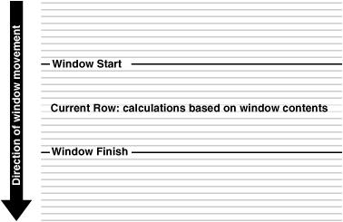
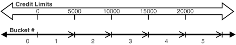

The following topics provide information about analytical SQL features and techniques in Oracle. Although these topics are presented in terms of data warehousing, they are applicable to any activity needing analysis and reporting.

- Overview of SQL for Analysis and Reporting

- Ranking, Windowing, and Reporting Functions

- Advanced Aggregates for Analysis

- Pivoting Operations

- Data Densification for Reporting

- Time Series Calculations on Densified Data

- Miscellaneous Analysis and Reporting Capabilities

- Limiting SQL Rows

### 19.1 Overview of SQL for Analysis and Reporting

Oracle Database provides a large family of analytic SQL functions. These analytic functions enable you to calculate:

- Rankings and percentiles

- Moving window calculations

- Lag/lead analysis

- First/last analysis

- Linear regression statistics

Ranking functions include cumulative distributions, percent rank, and N-tiles. Moving window calculations allow you to find moving and cumulative aggregations, such as sums and averages. Lag/lead analysis enables direct inter-row references so you can calculate period-to-period changes. First/last analysis enables you to find the first or last value in an ordered group.

Other SQL elements valuable for analysis and reporting include the `CASE` expression and partitioned outer join. `CASE` expressions provide if-then logic useful in many situations. Partitioned outer join is a variant of ANSI outer join syntax that allows users to selectively densify certain dimensions while keeping others sparse. This allows reporting tools to selectively densify dimensions, for example, the ones that appear in their cross-tabular reports while keeping others sparse.

To enhance performance, analytic functions can be parallelized: multiple processes can simultaneously execute all of these statements. These capabilities make calculations easier and more efficient, thereby enhancing database performance, scalability, and simplicity.

Analytic functions are classified as described in Table 19-1.

Table 19-1 Analytic Functions and Their Uses 

| Type                               | Used For                                                                                                                                                                                                                                                                                                                               |
|:-----------------------------------|:---------------------------------------------------------------------------------------------------------------------------------------------------------------------------------------------------------------------------------------------------------------------------------------------------------------------------------------|
| Ranking                            | Calculating ranks, percentiles, and n-tiles of the values in a result set.                                                                                                                                                                                                                                                             |
| Windowing                          | Calculating cumulative and moving aggregates. Works with these functions: `SUM`, `AVG`, `MIN`, `MAX`, `COUNT`, `VARIANCE`, `STDDEV`, `FIRST_VALUE`, `LAST_VALUE`, and new statistical functions. Note that the `DISTINCT` keyword is not supported in windowing functions except for `MAX` and `MIN`.                                  |
| Reporting                          | Calculating shares, for example, market share. Works with these functions: `SUM`, `AVG`, `MIN`, `MAX`, `COUNT` (with/without `DISTINCT`), `VARIANCE`, `STDDEV`, `RATIO_TO_REPORT`, and new statistical functions. Note that the `DISTINCT` keyword may be used in those reporting functions that support `DISTINCT` in aggregate mode. |
| `LAG`/`LEAD`                       | Finding a value in a row a specified number of rows from a current row.                                                                                                                                                                                                                                                                |
| `FIRST`/`LAST`                     | First or last value in an ordered group.                                                                                                                                                                                                                                                                                               |
| Linear Regression                  | Calculating linear regression and other statistics (slope, intercept, and so on).                                                                                                                                                                                                                                                      |
| Inverse Percentile                 | The value in a data set that corresponds to a specified percentile.                                                                                                                                                                                                                                                                    |
| Hypothetical Rank and Distribution | The rank or percentile that a row would have if inserted into a specified data set.                                                                                                                                                                                                                                                    |

To perform these operations, the analytic functions add several new elements to SQL processing. These elements build on existing SQL to allow flexible and powerful calculation expressions. With just a few exceptions, the analytic functions have these additional elements. The processing flow is represented in Figure 19-1.

Figure 19-1 Processing Order

[Description of "Figure 19-1 Processing Order"](img_text/dwhsg021.md)

The essential concepts used in analytic functions are:

- Processing order

  Query processing using analytic functions takes place in three stages. First, all joins, `WHERE`, `GROUP` `BY` and `HAVING` clauses are performed. Second, the result set is made available to the analytic functions, and all their calculations take place. Third, if the query has an `ORDER` `BY` clause at its end, the `ORDER` `BY` is processed to allow for precise output ordering. The processing order is shown in Figure 19-1.

- Result set partitions

  The analytic functions allow users to divide query result sets into groups of rows called partitions. Note that the term partitions used with analytic functions is unrelated to the table partitions feature. Throughout this chapter, the term partitions refers to only the meaning related to analytic functions. Partitions are created after the groups defined with `GROUP` `BY` clauses, so they are available to any aggregate results such as sums and averages. Partition divisions may be based upon any desired columns or expressions. A query result set may be partitioned into just one partition holding all the rows, a few large partitions, or many small partitions holding just a few rows each.

- Window

  For each row in a partition, you can define a sliding window of data. This window determines the range of rows used to perform the calculations for the current row. Window sizes can be based on either a physical number of rows or a logical interval such as time. The window has a starting row and an ending row. Depending on its definition, the window may move at one or both ends. For instance, a window defined for a cumulative sum function would have its starting row fixed at the first row of its partition, and its ending row would slide from the starting point all the way to the last row of the partition. In contrast, a window defined for a moving average would have both its starting and end points slide so that they maintain a constant physical or logical range.

  A window can be set as large as all the rows in a partition or just a sliding window of one row within a partition. When a window is near a border, the function returns results for only the available rows, rather than warning you that the results are not what you want.

  When using window functions, the current row is included during calculations, so you should only specify (n-1) when you are dealing with n items.

- Current row

  Each calculation performed with an analytic function is based on a current row within a partition. The current row serves as the reference point determining the start and end of the window. For instance, a centered moving average calculation could be defined with a window that holds the current row, the six preceding rows, and the following six rows. This would create a sliding window of 13 rows, as shown in Figure 19-2.

Figure 19-2 Sliding Window Example

[Description of "Figure 19-2 Sliding Window Example"](img_text/dwhsg022.md)

### 19.2 Ranking, Windowing, and Reporting Functions

This section illustrates the basic analytic functions for ranking, windowing, and reporting. It contains the following topics:

- Ranking Functions

- Windowing Functions

- Reporting Functions

- LAG/LEAD Functions

- FIRST_VALUE\_ LAST_VALUE\_ and NTH_VALUE Functions

#### 19.2.1 Ranking Functions

A ranking function computes the rank of a record compared to other records in the data set based on the values of a set of measures. The types of ranking function are:

- RANK and DENSE_RANK Functions

- Bottom N Ranking Functions

- CUME_DIST Function

- PERCENT_RANK Function

- NTILE Function

- ROW_NUMBER Function

##### 19.2.1.1 RANK and DENSE_RANK Functions

The `RANK` and `DENSE_RANK` functions allow you to rank items in a group, for example, finding the top three products sold in California last year. There are two functions that perform ranking, as shown by the following syntax:

    RANK ( ) OVER ( [query_partition_clause] order_by_clause )
    DENSE_RANK ( ) OVER ( [query_partition_clause] order_by_clause )

The difference between `RANK` and `DENSE_RANK` is that `DENSE_RANK` leaves no gaps in ranking sequence when there are ties. That is, if you were ranking a competition using `DENSE_RANK` and had three people tie for second place, you would say that all three were in second place and that the next person came in third. The `RANK` function would also give three people in second place, but the next person would be in fifth place.

The following are some relevant points about `RANK`:

- Ascending is the default sort order, which you may want to change to descending.

- The expressions in the optional `PARTITION` `BY` clause divide the query result set into groups within which the `RANK` function operates. That is, `RANK` gets reset whenever the group changes. In effect, the value expressions of the `PARTITION` `BY` clause define the reset boundaries.

- If the `PARTITION` `BY` clause is missing, then ranks are computed over the entire query result set.

- The `ORDER` `BY` clause specifies the measures (\<`value` `expression`\>) on which ranking is done and defines the order in which rows are sorted in each group (or partition). Once the data is sorted within each partition, ranks are given to each row starting from 1.

- The `NULLS` `FIRST` \| `NULLS` `LAST` clause indicates the position of `NULLs` in the ordered sequence, either first or last in the sequence. The order of the sequence would make `NULLs` compare either high or low with respect to non-`NULL` values. If the sequence were in ascending order, then `NULLS` `FIRST` implies that `NULLs` are smaller than all other non-`NULL` values and `NULLS` `LAST` implies they are larger than non-`NULL` values. It is the opposite for descending order. See the example in "Examples: Treatment of NULLs in Ranking Functions".

- If the `NULLS` `FIRST` \| `NULLS` `LAST` clause is omitted, then the ordering of the null values depends on the `ASC` or `DESC` arguments. Null values are considered larger than any other values. If the ordering sequence is `ASC`, then nulls will appear last; nulls will appear first otherwise. Nulls are considered equal to other nulls and, therefore, the order in which nulls are presented is non-deterministic.

###### 19.2.1.1.1 Ranking Order in RANK and DENSE_RANK Functions

The following example shows how the `[ASC | DESC]` option of RANK changes the ranking order.

Example 19-1 Ranking Order

    SELECT channel_desc, TO_CHAR(SUM(amount_sold), '9,999,999,999') SALES$,
       RANK() OVER (ORDER BY SUM(amount_sold)) AS default_rank,
       RANK() OVER (ORDER BY SUM(amount_sold) DESC NULLS LAST) AS custom_rank
    FROM sales, products, customers, times, channels, countries
    WHERE sales.prod_id=products.prod_id AND sales.cust_id=customers.cust_id
      AND customers.country_id = countries.country_id AND sales.time_id=times.time_id
      AND sales.channel_id=channels.channel_id
      AND times.calendar_month_desc IN ('2000-09', '2000-10')
      AND country_iso_code='US'
    GROUP BY channel_desc;

    CHANNEL_DESC         SALES$         DEFAULT_RANK CUSTOM_RANK
    -------------------- -------------- ------------ -----------
    Direct Sales              1,320,497            3           1
    Partners                    800,871            2           2
    Internet                    261,278            1           3

While the data in this result is ordered on the measure `SALES$`, in general, it is not guaranteed by the `RANK` function that the data will be sorted on the measures. If you want the data to be sorted on `SALES$` in your result, you must specify it explicitly with an `ORDER` `BY` clause, at the end of the `SELECT` statement.

###### 19.2.1.1.2 Ranking on Multiple Expressions

Ranking functions must resolve ties between values in the set. If the first expression cannot resolve ties, the second expression is used to resolve ties and so on. For example, here is a query ranking three of the sales channels over two months based on their dollar sales, breaking ties with the unit sales. (Note that the `TRUNC` function is used here only to create tie values for this query.)

Example 19-2 Ranking On Multiple Expressions

    SELECT channel_desc, calendar_month_desc, TO_CHAR(TRUNC(SUM(amount_sold),-5),
      '9,999,999,999') SALES$, TO_CHAR(SUM(quantity_sold), '9,999,999,999')
      SALES_Count, RANK() OVER (ORDER BY TRUNC(SUM(amount_sold), -5)
      DESC, SUM(quantity_sold) DESC) AS col_rank
    FROM sales, products, customers, times, channels
    WHERE sales.prod_id=products.prod_id AND sales.cust_id=customers.cust_id
      AND sales.time_id=times.time_id AND sales.channel_id=channels.channel_id
      AND times.calendar_month_desc IN ('2000-09', '2000-10')
      AND channels.channel_desc<>'Tele Sales'
    GROUP BY channel_desc, calendar_month_desc;

    CHANNEL_DESC         CALENDAR SALES$         SALES_COUNT     COL_RANK
    -------------------- -------- -------------- -------------- ---------
    Direct Sales         2000-10       1,200,000         12,584          1
    Direct Sales         2000-09       1,200,000         11,995          2
    Partners             2000-10         600,000          7,508          3
    Partners             2000-09         600,000          6,165          4
    Internet             2000-09         200,000          1,887          5
    Internet             2000-10         200,000          1,450          6

The `sales_count` column breaks the ties for three pairs of values.

If you only want to see the top five results for this query, you can add an `ORDER` `BY` `COL_RANK` `FETCH` `FIRST` `5` `ROWS` `ONLY` statement. See "Limiting SQL Rows" for further information.

###### 19.2.1.1.3 Example: Difference Between RANK and DENSE_RANK

The difference between `RANK` and `DENSE_RANK` functions is illustrated in Example 19-3.

Example 19-3 RANK and DENSE_RANK

    SELECT channel_desc, calendar_month_desc,
       TO_CHAR(TRUNC(SUM(amount_sold),-5), '9,999,999,999') SALES$,
          RANK() OVER (ORDER BY TRUNC(SUM(amount_sold),-5) DESC) AS RANK,
    DENSE_RANK() OVER (ORDER BY TRUNC(SUM(amount_sold),-5) DESC) AS DENSE_RANK
    FROM sales, products, customers, times, channels
    WHERE sales.prod_id=products.prod_id
      AND sales.cust_id=customers.cust_id
      AND sales.time_id=times.time_id AND sales.channel_id=channels.channel_id
      AND times.calendar_month_desc IN ('2000-09', '2000-10')
      AND channels.channel_desc<>'Tele Sales'
    GROUP BY channel_desc, calendar_month_desc;

    CHANNEL_DESC         CALENDAR SALES$              RANK DENSE_RANK
    -------------------- -------- -------------- --------- ----------
    Direct Sales         2000-09       1,200,000         1          1
    Direct Sales         2000-10       1,200,000         1          1
    Partners             2000-09         600,000         3          2
    Partners             2000-10         600,000         3          2
    Internet             2000-09         200,000         5          3
    Internet             2000-10         200,000         5          3

Note that, in the case of `DENSE_RANK`, the largest rank value gives the number of distinct values in the data set.

###### 19.2.1.1.4 Ranking Within Groups: Example

The `RANK` function can be made to operate within groups, that is, the rank gets reset whenever the group changes. This is accomplished with the `PARTITION` `BY` clause. The group expressions in the `PARTITION` `BY` subclause divide the data set into groups within which `RANK` operates. For example, to rank products within each channel by their dollar sales, you could issue the following statement.

Example 19-4 Per Group Ranking Example 1

    SELECT channel_desc, calendar_month_desc, TO_CHAR(SUM(amount_sold),
     '9,999,999,999') SALES$, RANK() OVER (PARTITION BY channel_desc
      ORDER BY SUM(amount_sold) DESC) AS RANK_BY_CHANNEL
    FROM sales, products, customers, times, channels
    WHERE sales.prod_id=products.prod_id AND sales.cust_id=customers.cust_id
      AND sales.time_id=times.time_id AND sales.channel_id=channels.channel_id
      AND times.calendar_month_desc IN ('2000-08', '2000-09', '2000-10', '2000-11')
      AND channels.channel_desc IN ('Direct Sales', 'Internet')
    GROUP BY channel_desc, calendar_month_desc;

    CHANNEL_DESC         CALENDAR SALES$         RANK_BY_CHANNEL
    -------------------- -------- -------------- ---------------
    Direct Sales         2000-08       1,236,104               1
    Direct Sales         2000-10       1,225,584               2
    Direct Sales         2000-09       1,217,808               3
    Direct Sales         2000-11       1,115,239               4
    Internet             2000-11         284,742               1
    Internet             2000-10         239,236               2
    Internet             2000-09         228,241               3
    Internet             2000-08         215,107               4

    8 rows selected.

A single query block can contain more than one ranking function, each partitioning the data into different groups (that is, reset on different boundaries). The groups can be mutually exclusive. The following query ranks products based on their dollar sales within each month (`rank_of_product_per_region`) and within each channel (`rank_of_product_total`).

Example 19-5 Per Group Ranking Example 2

    SELECT channel_desc, calendar_month_desc, TO_CHAR(SUM(amount_sold),
      '9,999,999,999') SALES$, RANK() OVER (PARTITION BY calendar_month_desc
      ORDER BY SUM(amount_sold) DESC) AS RANK_WITHIN_MONTH, RANK() OVER (PARTITION
     BY channel_desc ORDER BY SUM(amount_sold) DESC) AS RANK_WITHIN_CHANNEL
    FROM sales, products, customers, times, channels, countries
    WHERE sales.prod_id=products.prod_id AND sales.cust_id=customers.cust_id
      AND customers.country_id = countries.country_id AND sales.time_id=times.time_id
      AND sales.channel_id=channels.channel_id
      AND times.calendar_month_desc IN ('2000-08', '2000-09', '2000-10', '2000-11')
      AND channels.channel_desc IN ('Direct Sales', 'Internet')
    GROUP BY channel_desc, calendar_month_desc;

    CHANNEL_DESC  CALENDAR    SALES$     RANK_WITHIN_MONTH  RANK_WITHIN_CHANNEL
    ------------- --------    ---------  -----------------  -------------------
    Direct Sales   2000-08    1,236,104                  1                    1
    Internet       2000-08      215,107                  2                    4
    Direct Sales   2000-09    1,217,808                  1                    3
    Internet       2000-09      228,241                  2                    3
    Direct Sales   2000-10    1,225,584                  1                    2
    Internet       2000-10      239,236                  2                    2
    Direct Sales   2000-11    1,115,239                  1                    4
    Internet       2000-11      284,742                  2                    1

###### 19.2.1.1.5 Example: Per Cube and Rollup Group Ranking

Analytic functions, `RANK` for example, can be reset based on the groupings provided by a `CUBE`, `ROLLUP`, or `GROUPING` `SETS` operator. It is useful to assign ranks to the groups created by `CUBE`, `ROLLUP`, and `GROUPING` `SETS` queries. See [SQL for Aggregation in Data Warehouses](sql-aggregation-data-warehouses.md) for further information about the `GROUPING` function.

A sample `CUBE` and `ROLLUP` query is the following:

    SELECT  channel_desc, country_iso_code, SUM(amount_sold) SALES$,
      RANK() OVER (PARTITION BY GROUPING_ID(channel_desc, country_iso_code)
      ORDER BY SUM(amount_sold) DESC) AS RANK_PER_GROUP
    FROM sales, customers, times, channels, countries
    WHERE sales.time_id=times.time_id AND sales.cust_id=customers.cust_id
      AND countries.country_id = customers.country_id AND sales.channel_id = channels.channel_id
      AND channels.channel_desc IN ('Direct Sales', 'Internet') AND times.calendar_month_desc='2000-07'
      AND country_iso_code IN ('GB', 'US', 'JP')
    GROUP BY cube(channel_desc, country_iso_code);

    CHANNEL_DESC    CO  SALES$         RANK_PER_GROUP
    --------------  --  -------------  --------------
    Direct Sales      US    616539.04         1
    Direct Sales      GB    83869.96          2
    Internet          US    82595.71          3
    Direct Sales      JP    79047.78          4
    Internet          JP    7103.39           5
    Internet          GB    6477.98           6
    Direct Sales            779456.78         1
    Internet                96177.08          2
                        US  699134.75         1
                        GB  90347.94          2
                        JP  86151.17          3
                              875633.86       1

###### 19.2.1.1.6 Examples: Treatment of NULLs in Ranking Functions

`NULLs` are treated like normal values. Also, for rank computation, a `NULL` value is assumed to be equal to another `NULL` value. Depending on the `ASC` \| `DESC` options provided for measures and the `NULLS` `FIRST` \| `NULLS` `LAST` clause, `NULLs` will either sort low or high and hence, are given ranks appropriately. The following example shows how `NULLs` are ranked in different cases:

    SELECT  times.time_id time,  sold,
      RANK() OVER (ORDER BY (sold) DESC NULLS LAST) AS NLAST_DESC,
      RANK() OVER (ORDER BY (sold) DESC NULLS FIRST) AS NFIRST_DESC,
      RANK() OVER (ORDER BY (sold) ASC NULLS FIRST) AS NFIRST,
      RANK() OVER (ORDER BY (sold) ASC NULLS LAST) AS NLAST
    FROM
      (
       SELECT time_id, SUM(sales.amount_sold)  sold
       FROM sales, products, customers, countries
       WHERE sales.prod_id=products.prod_id
        AND customers.country_id = countries.country_id
        AND sales.cust_id=customers.cust_id
        AND prod_name IN ('Envoy Ambassador', 'Mouse Pad') AND country_iso_code ='GB'
       GROUP BY  time_id)
     v, times
    WHERE v.time_id (+) = times.time_id
      AND calendar_year=1999
      AND calendar_month_number=1
    ORDER BY sold  DESC NULLS LAST;

    TIME            SOLD NLAST_DESC NFIRST_DESC     NFIRST      NLAST
    --------- ---------- ---------- ----------- ---------- ----------
    25-JAN-99    3097.32          1          18         31         14
    17-JAN-99    1791.77          2          19         30         13
    30-JAN-99     127.69          3          20         29         12
    28-JAN-99     120.34          4          21         28         11
    23-JAN-99      86.12          5          22         27         10
    20-JAN-99      79.07          6          23         26          9
    13-JAN-99       56.1          7          24         25          8
    07-JAN-99      42.97          8          25         24          7
    08-JAN-99      33.81          9          26         23          6
    10-JAN-99      22.76         10          27         21          4
    02-JAN-99      22.76         10          27         21          4
    26-JAN-99      19.84         12          29         20          3
    16-JAN-99      11.27         13          30         19          2
    14-JAN-99       9.52         14          31         18          1
    09-JAN-99                    15           1          1         15
    12-JAN-99                    15           1          1         15
    31-JAN-99                    15           1          1         15
    11-JAN-99                    15           1          1         15
    19-JAN-99                    15           1          1         15
    03-JAN-99                    15           1          1         15
    15-JAN-99                    15           1          1         15
    21-JAN-99                    15           1          1         15
    24-JAN-99                    15           1          1         15
    04-JAN-99                    15           1          1         15
    06-JAN-99                    15           1          1         15
    27-JAN-99                    15           1          1         15
    18-JAN-99                    15           1          1         15
    01-JAN-99                    15           1          1         15
    22-JAN-99                    15           1          1         15
    29-JAN-99                    15           1          1         15
    05-JAN-99                    15           1          1         15

##### 19.2.1.2 APPROX_RANK Function

The `APPROX_RANK` function returns the approximate value in a group of values.

This function takes an optional `PARTITION BY` clause followed by a mandatory `ORDER BY ... DESC` clause. The `PARTITION BY` key must be a subset of the `GROUP BY` key. The `ORDER BY` clause must include either `APPROX_COUNT` or `APPROX_SUM`.

The `APPROX_RANK` function has the following syntax:

    SELECT expr_1[, expr_2, … expr_j], APPROX_*(expr_k) agg_1[, APPROX_*(expr_l) agg_2…]
    FROM table_name
    WHERE …
    GROUP BY expr_1[, expr_2, …expr_j]
    HAVING APPROX_RANK(PARTITION BY partition_by_clause ORDER BY APPROX_*(expr_k) DESC) <= N1
    [AND APPROX_RANK(PARTITION BY partition_by_clause ORDER BY APPROX_*(expr_l) DESC) <= N2…)];

In the following example, the query returns the jobs that are among the top 10 total salary per department. For each job, the total salary and ranking is also given:

    SELECT deptno, job, APPROX_SUM(sal), APPROX_RANK(PARTITION BY deptno ORDER BY APPROX_SUM(sal) DESC) rk
    FROM emp
    GROUP BY deptno, job
    HAVING APPROX_RANK(PARTITION BY deptno ORDER BY APPROX_SUM(sal) DESC) <= 10;

        DEPTNO JOB       APPROX_SUM(SAL)         RK
    ---------- --------- --------------- ----------
            10 CLERK                1300          3
            10 MANAGER              2450          2
            10 PRESIDENT            5000          1
            20 CLERK                1900          3
            20 MANAGER              2975          2
            20 ANALYST              6000          1
            30 CLERK                 950          3
            30 MANAGER              2850          2
            30 SALESMAN             5600          1

In the following example, the query returns the jobs that are among the top 2 in terms of total salary and among the top 3 in terms of number of employees holding the job titles per department:

    SELECT deptno, job, APPROX_SUM(sal), APPROX_COUNT(*)
    FROM emp
    GROUP BY deptno, job
    HAVING APPROX_RANK(PARTITION BY deptno ORDER BY APPROX_SUM(sal) DESC) <= 2
    AND APPROX_RANK(PARTITION BY deptno ORDER BY APPROX_COUNT(*) DESC) <= 3;

        DEPTNO JOB       APPROX_SUM(SAL) APPROX_COUNT(*)
    ---------- --------- --------------- ---------------
            10 MANAGER              2450               1
            10 PRESIDENT            5000               1
            20 MANAGER              2975               1
            20 ANALYST              6000               2
            30 MANAGER              2850               1
            30 SALESMAN             5600               4

The following example reports the accuracy of the approximate aggregate using the `MAX_ERROR` attribute:

    SELECT deptno, job, APPROX_SUM(sal) sum_sal, APPROX_SUM(sal,'MAX_ERROR') sum_sal_err
    FROM emp
    GROUP BY deptno, job
    HAVING APPROX_RANK(PARTITION BY deptno ORDER BY APPROX_SUM(sal) DESC) <= 2;

        DEPTNO JOB          SUM_SAL SUM_SAL_ERR
    ---------- --------- ---------- -----------
            10 MANAGER         2450           0
            10 PRESIDENT       5000           0
            20 MANAGER         2975           0
            20 ANALYST         6000           0
            30 MANAGER         2850           0
            30 SALESMAN        5600           0

**See Also:**

- [Oracle Database SQL Language Reference](../sqlrf/APPROX_RANK.md)

##### 19.2.1.3 Bottom N Ranking Functions

Bottom N is similar to top N except for the ordering sequence within the rank expression. Using the previous example, you can order `SUM(s_amount)` ascending instead of descending.

##### 19.2.1.4 CUME_DIST Function

The `CUME_DIST` function (defined as the inverse of percentile in some statistical books) computes the position of a specified value relative to a set of values. The order can be ascending or descending. Ascending is the default. The range of values for `CUME_DIST` is from greater than 0 to 1. To compute the `CUME_DIST` of a value x in a set S of size N, you use the formula:

    CUME_DIST(x) =  number of values in S coming before
       and including x in the specified order/ N

Its syntax is:

    CUME_DIST ( ) OVER ( [query_partition_clause] order_by_clause )

The semantics of various options in the `CUME_DIST` function are similar to those in the `RANK` function. The default order is ascending, implying that the lowest value gets the lowest `CUME_DIST` (as all other values come later than this value in the order). `NULLs` are treated the same as they are in the `RANK` function. They are counted toward both the numerator and the denominator as they are treated like non-`NULL` values. The following example finds cumulative distribution of sales by channel within each month:

    SELECT calendar_month_desc AS MONTH, channel_desc,
         TO_CHAR(SUM(amount_sold) , '9,999,999,999') SALES$,
         CUME_DIST() OVER (PARTITION BY calendar_month_desc ORDER BY
             SUM(amount_sold) ) AS CUME_DIST_BY_CHANNEL
    FROM sales, products, customers, times, channels
    WHERE sales.prod_id=products.prod_id AND sales.cust_id=customers.cust_id
      AND sales.time_id=times.time_id AND sales.channel_id=channels.channel_id
      AND times.calendar_month_desc IN ('2000-09', '2000-07','2000-08')
    GROUP BY calendar_month_desc, channel_desc;

    MONTH    CHANNEL_DESC         SALES$         CUME_DIST_BY_CHANNEL
    -------- -------------------- -------------- --------------------
    2000-07  Internet                    140,423           .333333333
    2000-07  Partners                    611,064           .666666667
    2000-07  Direct Sales              1,145,275                    1
    2000-08  Internet                    215,107           .333333333
    2000-08  Partners                    661,045           .666666667
    2000-08  Direct Sales              1,236,104                    1
    2000-09  Internet                    228,241           .333333333
    2000-09  Partners                    666,172           .666666667
    2000-09  Direct Sales              1,217,808                    1

##### 19.2.1.5 PERCENT_RANK Function

`PERCENT_RANK` is similar to `CUME_DIST`, but it uses rank values rather than row counts in its numerator. Therefore, it returns the percent rank of a value relative to a group of values. The function is available in many popular spreadsheets. `PERCENT_RANK` of a row is calculated as:

    (rank of row in its partition - 1) / (number of rows in the partition - 1)

`PERCENT_RANK` returns values in the range zero to one. The row(s) with a rank of 1 will have a `PERCENT_RANK` of zero. Its syntax is:

    PERCENT_RANK () OVER ([query_partition_clause] order_by_clause)

##### 19.2.1.6 NTILE Function

`NTILE` allows easy calculation of tertiles, quartiles, deciles and other common summary statistics. This function divides an ordered partition into a specified number of groups called buckets and assigns a bucket number to each row in the partition. `NTILE` is a very useful calculation because it lets users divide a data set into fourths, thirds, and other groupings.

The buckets are calculated so that each bucket has exactly the same number of rows assigned to it or at most 1 row more than the others. For instance, if you have 100 rows in a partition and ask for an `NTILE` function with four buckets, 25 rows will be assigned a value of 1, 25 rows will have value 2, and so on. These buckets are referred to as equiheight buckets.

If the number of rows in the partition does not divide evenly (without a remainder) into the number of buckets, then the number of rows assigned for each bucket will differ by one at most. The extra rows will be distributed one for each bucket starting from the lowest bucket number. For instance, if there are 103 rows in a partition which has an `NTILE(5)` function, the first 21 rows will be in the first bucket, the next 21 in the second bucket, the next 21 in the third bucket, the next 20 in the fourth bucket and the final 20 in the fifth bucket.

The `NTILE` function has the following syntax:

    NTILE (expr) OVER ([query_partition_clause] order_by_clause)

In this, the N in `NTILE(N)` can be a constant (for example, 5) or an expression.

This function, like `RANK` and `CUME_DIST`, has a `PARTITION` `BY` clause for per group computation, an `ORDER` `BY` clause for specifying the measures and their sort order, and `NULLS` `FIRST` \| `NULLS` `LAST` clause for the specific treatment of `NULLs`. For example, the following is an example assigning each month's sales total into one of four buckets:

    SELECT calendar_month_desc AS MONTH , TO_CHAR(SUM(amount_sold),
     '9,999,999,999')
     SALES$, NTILE(4) OVER (ORDER BY SUM(amount_sold)) AS TILE4
    FROM sales, products, customers, times, channels
    WHERE sales.prod_id=products.prod_id AND sales.cust_id=customers.cust_id
      AND sales.time_id=times.time_id AND sales.channel_id=channels.channel_id
      AND times.calendar_year=2000 AND prod_category= 'Electronics'
    GROUP BY calendar_month_desc;

    MONTH    SALES$              TILE4
    -------- -------------- ----------
    2000-02         242,416          1
    2000-01         257,286          1
    2000-03         280,011          1
    2000-06         315,951          2
    2000-05         316,824          2
    2000-04         318,106          2
    2000-07         433,824          3
    2000-08         477,833          3
    2000-12         553,534          3
    2000-10         652,225          4
    2000-11         661,147          4
    2000-09         691,449          4

`NTILE` `ORDER` `BY` statements must be fully specified to yield reproducible results. Equal values can get distributed across adjacent buckets. To ensure deterministic results, you must order on a unique key.

##### 19.2.1.7 ROW_NUMBER Function

The `ROW_NUMBER` function assigns a unique number (sequentially, starting from 1, as defined by `ORDER` `BY`) to each row within the partition. It has the following syntax:

    ROW_NUMBER ( ) OVER ( [query_partition_clause] order_by_clause )

Example 19-6 ROW_NUMBER

    SELECT channel_desc, calendar_month_desc,
       TO_CHAR(TRUNC(SUM(amount_sold), -5), '9,999,999,999') SALES$,
       ROW_NUMBER() OVER (ORDER BY TRUNC(SUM(amount_sold), -6) DESC) AS ROW_NUMBER
    FROM sales, products, customers, times, channels
    WHERE sales.prod_id=products.prod_id AND sales.cust_id=customers.cust_id
      AND sales.time_id=times.time_id AND sales.channel_id=channels.channel_id
      AND times.calendar_month_desc IN ('2001-09', '2001-10')
    GROUP BY channel_desc, calendar_month_desc;

    CHANNEL_DESC         CALENDAR SALES$         ROW_NUMBER
    -------------------- -------- -------------- ----------
    Direct Sales         2001-10       1,000,000          1
    Direct Sales         2001-09       1,100,000          2
    Internet             2001-09         500,000          3
    Partners             2001-09         600,000          4
    Partners             2001-10         600,000          5
    Internet             2001-10         700,000          6

Note that there are three pairs of tie values in these results. Like `NTILE`, `ROW_NUMBER` is a non-deterministic function, so each tied value could have its row number switched. To ensure deterministic results, you must order on a unique key. In most cases, that will require adding a new tie breaker column to the query and using it in the `ORDER` `BY` specification.

#### 19.2.2 Windowing Functions

Windowing functions can be used to compute cumulative, moving, and centered aggregates. They return a value for each row in the table, which depends on other rows in the corresponding window. With windowing aggregate functions, you can calculate moving and cumulative versions of `SUM`, `AVERAGE`, `COUNT`, `MAX`, `MIN`, and many more functions. They can be used only in the `SELECT` and `ORDER` `BY` clauses of the query. Windowing aggregate functions include the convenient `FIRST_VALUE`, which returns the first value in the window; and `LAST_VALUE`, which returns the last value in the window. These functions provide access to more than one row of a table without a self-join. The syntax of the windowing functions is:

    analytic_function([ arguments ])
       OVER (analytic_clause)

     where analytic_clause =
         [ query_partition_clause ]
         [ order_by_clause [ windowing_clause ] ]

    and query_partition_clause =
        PARTITION BY
          { value_expr[, value_expr ]...
          }

     and windowing_clause =
         { ROWS | RANGE }
         { BETWEEN
           { UNBOUNDED PRECEDING
         | CURRENT ROW
         | value_expr { PRECEDING | FOLLOWING }
         }
         AND
         { UNBOUNDED FOLLOWING
         | CURRENT ROW
         | value_expr { PRECEDING | FOLLOWING }
         }
       | { UNBOUNDED PRECEDING
         | CURRENT ROW
         | value_expr PRECEDING
         }
       }

Note that the `DISTINCT` keyword is not supported in windowing functions except for `MAX` and `MIN`.

**See Also:**

[Oracle Database SQL Language Reference](../sqlrf/Aggregate-Functions.md) for further information regarding syntax and restrictions

This section contains the following topics:

- About Treatment of NULLs as Input to Window Functions

- Windowing Functions with Logical Offset

- Centered Aggregate Function

- Windowing Aggregate Functions in the Presence of Duplicates

- Varying Window Size for Each Row

- Windowing Aggregate Functions with Physical Offsets

- Parallel Partition-Wise Operations with Windowing Functions

##### 19.2.2.1 About Treatment of NULLs as Input to Window Functions

Window functions' `NULL` semantics match the `NULL` semantics for SQL aggregate functions. Other semantics can be obtained by user-defined functions, or by using the `DECODE` or a `CASE` expression within the window function.

##### 19.2.2.2 Windowing Functions with Logical Offset

A logical offset can be specified with constants such as `RANGE 10 PRECEDING`, or an expression that evaluates to a constant, or by an interval specification like `RANGE` `INTERVAL` `N` `DAY`/`MONTH`/`YEAR` `PRECEDING` or an expression that evaluates to an interval.

With logical offset, there can only be one expression in the `ORDER` `BY` expression list in the function, with type compatible to `NUMERIC` if offset is numeric, or `DATE` if an interval is specified.

An analytic function that uses the `RANGE` keyword can use multiple sort keys in its `ORDER` `BY` clause if it specifies either of these two windows:

- `RANGE` `BETWEEN` `UNBOUNDED` `PRECEDING` `AND` `CURRENT` `ROW`. The short form of this is `RANGE` `UNBOUNDED` `PRECEDING`, which can also be used.

- `RANGE` `BETWEEN` `CURRENT` `ROW` `AND` `UNBOUNDED` `FOLLOWING`.

Window boundaries that do not meet these conditions can have only one sort key in the analytic function's `ORDER` `BY` clause.

Example 19-7 Cumulative Aggregate Function

The following is an example of cumulative `amount_sold` by customer ID by quarter in 2000:

    SELECT c.cust_id, t.calendar_quarter_desc, TO_CHAR (SUM(amount_sold),
      '9,999,999,999.99') AS Q_SALES, TO_CHAR(SUM(SUM(amount_sold))
    OVER (PARTITION BY c.cust_id ORDER BY c.cust_id, t.calendar_quarter_desc
    ROWS UNBOUNDED
    PRECEDING), '9,999,999,999.99') AS CUM_SALES
      FROM sales s, times t, customers c
      WHERE s.time_id=t.time_id AND s.cust_id=c.cust_id AND t.calendar_year=2000
        AND c.cust_id IN (2595, 9646, 11111)
      GROUP BY c.cust_id, t.calendar_quarter_desc
      ORDER BY c.cust_id, t.calendar_quarter_desc;

       CUST_ID CALENDA Q_SALES           CUM_SALES
    ---------- ------- ----------------- -----------------
          2595 2000-01            659.92            659.92
          2595 2000-02            224.79            884.71
          2595 2000-03            313.90          1,198.61
          2595 2000-04          6,015.08          7,213.69
          9646 2000-01          1,337.09          1,337.09
          9646 2000-02            185.67          1,522.76
          9646 2000-03            203.86          1,726.62
          9646 2000-04            458.29          2,184.91
         11111 2000-01             43.18             43.18
         11111 2000-02             33.33             76.51
         11111 2000-03            579.73            656.24
         11111 2000-04            307.58            963.82

In this example, the analytic function `SUM` defines, for each row, a window that starts at the beginning of the partition (`UNBOUNDED` `PRECEDING`) and ends, by default, at the current row.

Nested `SUM`s are needed in this example because you are performing a `SUM` over a value that is itself a `SUM`. Nested aggregations are used very often in analytic aggregate functions.

Example 19-8 Moving Aggregate Function

This example of a time-based window shows, for one customer, the moving average of sales for the current month and preceding two months:

    SELECT c.cust_id, t.calendar_month_desc, TO_CHAR (SUM(amount_sold),
          '9,999,999,999') AS SALES, TO_CHAR(AVG(SUM(amount_sold))
    OVER (ORDER BY c.cust_id, t.calendar_month_desc ROWS 2 PRECEDING),
          '9,999,999,999') AS MOVING_3_MONTH_AVG
    FROM sales s, times t, customers c
    WHERE s.time_id=t.time_id AND s.cust_id=c.cust_id
       AND t.calendar_year=1999 AND c.cust_id IN (6510)
    GROUP BY c.cust_id, t.calendar_month_desc
    ORDER BY c.cust_id, t.calendar_month_desc;

       CUST_ID CALENDAR SALES          MOVING_3_MONTH
    ---------- -------- -------------- --------------
          6510 1999-04             125            125
          6510 1999-05           3,395          1,760
          6510 1999-06           4,080          2,533
          6510 1999-07           6,435          4,637
          6510 1999-08           5,105          5,207
          6510 1999-09           4,676          5,405
          6510 1999-10           5,109          4,963
          6510 1999-11             802          3,529

Note that the first two rows for the three month moving average calculation in the output data are based on a smaller interval size than specified because the window calculation cannot reach past the data retrieved by the query. You must consider the different window sizes found at the borders of result sets. In other words, you may need to modify the query to include exactly what you want.

##### 19.2.2.3 Centered Aggregate Function

Calculating windowing aggregate functions centered around the current row is straightforward. This example computes for all customers a centered moving average of sales for one week in late December 1999. It finds an average of the sales total for the one day preceding the current row and one day following the current row including the current row as well.

Example 19-9 Centered Aggregate

    SELECT t.time_id, TO_CHAR (SUM(amount_sold), '9,999,999,999')
    AS SALES, TO_CHAR(AVG(SUM(amount_sold)) OVER
      (ORDER BY t.time_id
       RANGE BETWEEN INTERVAL '1' DAY PRECEDING AND
       INTERVAL '1' DAY FOLLOWING), '9,999,999,999') AS CENTERED_3_DAY_AVG
       FROM sales s, times t
       WHERE s.time_id=t.time_id AND t.calendar_week_number IN (51)
         AND calendar_year=1999
       GROUP BY t.time_id
       ORDER BY t.time_id;

    TIME_ID   SALES          CENTERED_3_DAY
    --------- -------------- --------------
    20-DEC-99        134,337        106,676
    21-DEC-99         79,015        102,539
    22-DEC-99         94,264         85,342
    23-DEC-99         82,746         93,322
    24-DEC-99        102,957         82,937
    25-DEC-99         63,107         87,062
    26-DEC-99         95,123         79,115

The starting and ending rows for each product's centered moving average calculation in the output data are based on just two days, because the window calculation cannot reach past the data retrieved by the query. As in the prior example, you must consider the different window sizes found at the borders of result sets: the query may need to be adjusted.

##### 19.2.2.4 Windowing Aggregate Functions in the Presence of Duplicates

The following example illustrates how window aggregate functions compute values when there are duplicates, that is, when multiple rows are returned for a single ordering value. The query retrieves the quantity sold to several customers during a specified time range. (Although an inline view was used to define the base data set, it has no special significance and can be ignored.) The query defines a moving window that runs from the date of the current row to 10 days earlier.Note that the `RANGE` keyword is used to define the windowing clause of this example. This means that the window can potentially hold many rows for each value in the range. In this case, there are three pairs of rows with duplicate date values.

Example 19-10 Windowing Aggregate Functions with Logical Offsets

    SELECT time_id, daily_sum, SUM(daily_sum) OVER (ORDER BY time_id
    RANGE BETWEEN INTERVAL '10' DAY PRECEDING AND CURRENT ROW)
    AS current_group_sum
    FROM (SELECT time_id, channel_id, SUM(s.quantity_sold)
    AS daily_sum
    FROM customers c, sales s, countries
    WHERE c.cust_id=s.cust_id
      AND c.country_id = countries.country_id
      AND s.cust_id IN (638, 634, 753, 440 ) AND s.time_id BETWEEN '01-MAY-00'
      AND '13-MAY-00' GROUP BY time_id, channel_id);

    TIME_ID    DAILY_SUM CURRENT_GROUP_SUM
    --------- ---------- -----------------
    06-MAY-00          7                 7   /* 7 */
    10-MAY-00          1                 9   /* 7 + (1+1) */
    10-MAY-00          1                 9   /* 7 + (1+1) */
    11-MAY-00          2                15   /* 7 + (1+1) + (2+4) */
    11-MAY-00          4                15   /* 7 + (1+1) + (2+4) */
    12-MAY-00          1                16   /* 7 + (1+1) + (2+4) + 1 */
    13-MAY-00          2                23   /* 7 + (1+1) + (2+4) + 1 + (5+2) */
    13-MAY-00          5                23   /* 7 + (1+1) + (2+4) + 1 + (5+2) */

In the output of this example, all dates except May 6 and May 12 return two rows. Examine the commented numbers to the right of the output to see how the values are calculated. Note that each group in parentheses represents the values returned for a single day.

Note that this example applies only when you use the `RANGE` keyword rather than the `ROWS` keyword. It is also important to remember that with `RANGE`, you can only use 1 `ORDER` `BY` expression in the analytic function's `ORDER` `BY` clause. With the `ROWS` keyword, you can use multiple order by expressions in the analytic function's `ORDER` `BY` clause.

##### 19.2.2.5 Varying Window Size for Each Row

There are situations where it is useful to vary the size of a window for each row, based on a specified condition. For instance, you may want to make the window larger for certain dates and smaller for others. Assume that you want to calculate the moving average of stock price over three working days. If you have an equal number of rows for each day for all working days and no non-working days are stored, then you can use a physical window function. However, if the conditions noted are not met, you can still calculate a moving average by using an expression in the window size parameters.

Expressions in a window size specification can be made in several different sources. the expression could be a reference to a column in a table, such as a time table. It could also be a function that returns the appropriate boundary for the window based on values in the current row. The following statement for a hypothetical stock price database uses a user-defined function in its `RANGE` clause to set window size:

    SELECT t_timekey, AVG(stock_price)
            OVER (ORDER BY t_timekey RANGE fn(t_timekey) PRECEDING) av_price
    FROM stock, time WHERE st_timekey = t_timekey
    ORDER BY t_timekey;

In this statement, `t_timekey` is a date field. Here, fn could be a PL/SQL function with the following specification:

`fn(t_timekey)` returns

- 4 if `t_timekey` is Monday, Tuesday

- 2 otherwise

- If any of the previous days are holidays, it adjusts the count appropriately.

Note that, when window is specified using a number in a window function with `ORDER` `BY` on a date column, then it is converted to mean the number of days. You could have also used the interval literal conversion function, as `NUMTODSINTERVAL(fn(t_timekey), 'DAY')` instead of just `fn(t_timekey)` to mean the same thing. You can also write a PL/SQL function that returns an `INTERVAL` data type value.

##### 19.2.2.6 Windowing Aggregate Functions with Physical Offsets

For windows expressed in rows, the ordering expressions should be unique to produce deterministic results. For example, the following query is not deterministic because `time_id` is not unique in this result set.

Example 19-11 Windowing Aggregate Functions With Physical Offsets

    SELECT t.time_id, TO_CHAR(amount_sold, '9,999,999,999') AS INDIV_SALE,
           TO_CHAR(SUM(amount_sold) OVER (PARTITION BY t.time_id ORDER BY t.time_id
    ROWS UNBOUNDED PRECEDING), '9,999,999,999') AS CUM_SALES
    FROM sales s, times t, customers c
    WHERE s.time_id=t.time_id AND s.cust_id=c.cust_id
      AND t.time_id IN
       (TO_DATE('11-DEC-1999'), TO_DATE('12-DEC-1999'))
      AND c.cust_id
    BETWEEN 6500 AND 6600
    ORDER BY t.time_id;

    TIME_ID   INDIV_SALE    CUM_SALES
    --------- ----------    ---------
    12-DEC-99         23           23
    12-DEC-99          9           32
    12-DEC-99         14           46
    12-DEC-99         24           70
    12-DEC-99         19           89

One way to handle this problem would be to add the `prod_id` column to the result set and order on both `time_id` and `prod_id`.

##### 19.2.2.7 Parallel Partition-Wise Operations with Windowing Functions

SQL windowing functions can have a query partitioning clause that can partition a query result into groups based on expressions used in the clause. For parallel queries on partitioned tables, the partitioning defined by the clause can be used to perform a partition-wise operation if the requirements for such operations are satisfied. This achieves faster SQL windowing queries on partitioned tables.

**See Also:**

[Oracle Database VLDB and Partitioning Guide](../vldbg/partition-wise-joins.md)

#### 19.2.3 Reporting Functions

After a query has been processed, aggregate values like the number of resulting rows or an average value in a column can be easily computed within a partition and made available to other reporting functions. Reporting aggregate functions return the same aggregate value for every row in a partition. Their behavior with respect to `NULLs` is the same as the SQL aggregate functions. The syntax is:

    {SUM | AVG | MAX | MIN | COUNT | STDDEV | VARIANCE  ... }
      ([ALL | DISTINCT] {value expression1 [,...] | *})
       OVER ([PARTITION BY value expression2[,...]])

In addition, the following conditions apply:

- An asterisk (\*) is only allowed in `COUNT(*)`

- `DISTINCT` is supported only if corresponding aggregate functions allow it.

- `value expression1` and `value expression2` can be any valid expression involving column references or aggregates.

- The `PARTITION` `BY` clause defines the groups on which the windowing functions would be computed. If the `PARTITION` `BY` clause is absent, then the function is computed over the whole query result set.

**See Also:**

RATIO_TO_REPORT Function

Reporting functions can appear only in the `SELECT` clause or the `ORDER` `BY` clause. The major benefit of reporting functions is their ability to do multiple passes of data in a single query block and speed up query performance. Queries such as "Count the number of salesmen with sales more than 10% of city sales" do not require joins between separate query blocks.

For example, consider the question "For each product category, find the region in which it had maximum sales". The equivalent SQL query using the `MAX` reporting aggregate function would be:

    SELECT prod_category, country_region, sales
    FROM (SELECT SUBSTR(p.prod_category,1,8) AS prod_category, co.country_region,
     SUM(amount_sold) AS sales,
    MAX(SUM(amount_sold)) OVER (PARTITION BY prod_category) AS MAX_REG_SALES
    FROM sales s, customers c, countries co, products p
    WHERE s.cust_id=c.cust_id AND c.country_id=co.country_id
       AND s.prod_id =p.prod_id AND s.time_id = TO_DATE('11-OCT-2001')
    GROUP BY prod_category, country_region)
    WHERE sales = MAX_REG_SALES;

The inner query with the reporting aggregate function `MAX(SUM(amount_sold))` returns:

    PROD_CAT COUNTRY_REGION            SALES MAX_REG_SALES
    -------- -------------------- ---------- -------------
    Electron Americas                 581.92        581.92
    Hardware Americas                 925.93        925.93
    Peripher Americas                3084.48       4290.38
    Peripher Asia                    2616.51       4290.38
    Peripher Europe                  4290.38       4290.38
    Peripher Oceania                  940.43       4290.38
    Software Americas                 4445.7        4445.7
    Software Asia                    1408.19        4445.7
    Software Europe                  3288.83        4445.7
    Software Oceania                  890.25        4445.7

The full query results are:

    PROD_CAT COUNTRY_REGION            SALES
    -------- -------------------- ----------
    Electron Americas                 581.92
    Hardware Americas                 925.93
    Peripher Europe                  4290.38
    Software Americas                 4445.7

Example 19-12 Reporting Aggregate Example

Reporting aggregates combined with nested queries enable you to answer complex queries efficiently. For example, what if you want to know the best selling products in your most significant product subcategories? The following is a query which finds the 5 top-selling products for each product subcategory that contributes more than 20% of the sales within its product category:

    SELECT SUBSTR(prod_category,1,8) AS CATEG, prod_subcategory, prod_id, SALES
    FROM (SELECT p.prod_category, p.prod_subcategory, p.prod_id,
          SUM(amount_sold) AS SALES,
          SUM(SUM(amount_sold)) OVER (PARTITION BY p.prod_category) AS CAT_SALES,
          SUM(SUM(amount_sold)) OVER
             (PARTITION BY p.prod_subcategory) AS SUBCAT_SALES,
          RANK() OVER  (PARTITION BY p.prod_subcategory
             ORDER BY SUM(amount_sold) ) AS RANK_IN_LINE
         FROM sales s, customers c, countries co, products p
         WHERE s.cust_id=c.cust_id
           AND c.country_id=co.country_id AND  s.prod_id=p.prod_id
           AND s.time_id=to_DATE('11-OCT-2000')
         GROUP BY p.prod_category, p.prod_subcategory, p.prod_id
         ORDER BY prod_category, prod_subcategory)
      WHERE SUBCAT_SALES>0.2*CAT_SALES AND RANK_IN_LINE<=5;

##### 19.2.3.1 RATIO_TO_REPORT Function

The `RATIO_TO_REPORT` function computes the ratio of a value to the sum of a set of values. If the expression `value` `expression` evaluates to `NULL`, `RATIO_TO_REPORT` also evaluates to `NULL`, but it is treated as zero for computing the sum of values for the denominator. Its syntax is:

    RATIO_TO_REPORT ( expr ) OVER ( [query_partition_clause] )

In this, the following applies:

- `expr` can be any valid expression involving column references or aggregates.

- The `PARTITION` `BY` clause defines the groups on which the `RATIO_TO_REPORT` function is to be computed. If the `PARTITION` `BY` clause is absent, then the function is computed over the whole query result set.

Example 19-13 RATIO_TO_REPORT

To calculate `RATIO_TO_REPORT` of sales for each channel, you might use the following syntax:

    SELECT ch.channel_desc, TO_CHAR(SUM(amount_sold),'9,999,999') AS SALES,
         TO_CHAR(SUM(SUM(amount_sold)) OVER (), '9,999,999') AS TOTAL_SALES,
         TO_CHAR(RATIO_TO_REPORT(SUM(amount_sold)) OVER (), '9.999')
         AS RATIO_TO_REPORT
    FROM sales s, channels ch
    WHERE s.channel_id=ch.channel_id  AND s.time_id=to_DATE('11-OCT-2000')
    GROUP BY ch.channel_desc;

    CHANNEL_DESC         SALES      TOTAL_SALE RATIO_
    -------------------- ---------- ---------- ------
    Direct Sales             14,447     23,183   .623
    Internet                    345     23,183   .015
    Partners                  8,391     23,183   .362

#### 19.2.4 LAG/LEAD Functions

The `LAG` and `LEAD` functions are useful for comparing values when the relative positions of rows can be known reliably. They work by specifying the count of rows which separate the target row from the current row. Because the functions provide access to more than one row of a table at the same time without a self-join, they can enhance processing speed. The `LAG` function provides access to a row at a given offset prior to the current position, and the `LEAD` function provides access to a row at a given offset after the current position. "LAG/LEAD Syntax" describes the syntax of these functions.

The `LAG` and `LEAD` functions can be thought of as being related to, and a simplification of, the `NTH_VALUE` function. With `LAG` and `LEAD`, you can only retrieve values from a row at the specified physical offset. If this is insufficient, you can use `NTH_VALUE`, which enables you to retrieve values from a row based on what is called a logical offset or relative position. You can use the `IGNORE` `NULLS` option with the `NTH_VALUE` function to make it more useful, in the sense that you can specify conditions and filter out rows based on certain conditions. See Example 19-17, where rows with quantities less than eight are filtered out. This cannot be done with `LAG` or `LEAD`, as you would not know the offset to the row.

See "NTH_VALUE Function" and [Oracle Database SQL Language Reference](../sqlrf/NTH_VALUE.md) for more information.

##### 19.2.4.1 LAG/LEAD Syntax

These functions have the following syntax:

    {LAG | LEAD} ( value_expr [, offset] [, default] ) [RESPECT NULLS|IGNORE NULLS]
       OVER ( [query_partition_clause] order_by_clause )

`offset` is an optional parameter and defaults to 1. `default` is an optional parameter and is the value returned if `offset` falls outside the bounds of the table or partition. When `IGNORE` `NULLS` is specified, the value returned will be from a row at a specified lag or lead offset after ignoring rows with NULLs.

Example 19-14 LAG/LEAD

This example illustrates a typical case of using `LAG` and `LEAD`:

    SELECT time_id, TO_CHAR(SUM(amount_sold),'9,999,999') AS SALES,
      TO_CHAR(LAG(SUM(amount_sold),1) OVER (ORDER BY time_id),'9,999,999') AS LAG1,
      TO_CHAR(LEAD(SUM(amount_sold),1) OVER (ORDER BY time_id),'9,999,999') AS LEAD1
    FROM sales
    WHERE time_id>=TO_DATE('10-OCT-2000') AND time_id<=TO_DATE('14-OCT-2000')
    GROUP BY time_id;

    TIME_ID   SALES      LAG1       LEAD1
    --------- ---------- ---------- ----------
    10-OCT-00    238,479                23,183
    11-OCT-00     23,183    238,479     24,616
    12-OCT-00     24,616     23,183     76,516
    13-OCT-00     76,516     24,616     29,795
    14-OCT-00     29,795     76,516

See "Data Densification for Reporting" for information showing how to use the `LAG`/`LEAD` functions for doing period-to-period comparison queries on sparse data.

Example 19-15 LAG/LEAD Using IGNORE NULLS

This example illustrates a typical case of using `LAG` and `LEAD` with the `IGNORE` `NULLS` option:

    SELECT prod_id, channel_id, SUM(quantity_sold) quantity,
     CASE WHEN SUM(quantity_sold) < 5000 THEN SUM(amount_sold) ELSE NULL END amount,
     LAG(CASE WHEN SUM(quantity_sold) < 5000 THEN SUM(amount_sold) ELSE NULL END)
     IGNORE NULLS OVER (PARTITION BY prod_id ORDER BY channel_id) lag
    FROM sales
    WHERE prod_id IN (18,127,138)
    GROUP BY prod_id, channel_id;

     PROD_ID  CHANNEL_ID  QUANTITY   AMOUNT          LAG
    --------  ----------  --------   -----------     ----------
          18           2      2888    4420923.94
          18           3      5615                   4420923.94
          18           4      1088    1545729.81     4420923.94
         127           2      4508     274088.08
         127           3      9626                    274088.08
         127           4      1850     173682.67      274088.08
         138           2      1120      127390.3
         138           3      3878     393111.15       127390.3
         138           4       543      71203.21      393111.15

    9 rows selected.

#### 19.2.5 FIRST_VALUE, LAST_VALUE, and NTH_VALUE Functions

This section illustrates the `FIRST_VALUE`, `LAST_VALUE`, and `NTH_VALUE` functions that are described in the following topics:

- FIRST_VALUE and LAST_VALUE Functions

- NTH_VALUE Function

##### 19.2.5.1 FIRST_VALUE and LAST_VALUE Functions

The `FIRST_VALUE` and `LAST_VALUE` functions allow you to select the first and last rows from a window. These rows are especially valuable because they are often used as the baselines in calculations. For instance, with a partition holding sales data ordered by day, you might ask "How much was each day's sales compared to the first sales day (`FIRST_VALUE`) of the period?"

If the `IGNORE` `NULLS` option is used with `FIRST_VALUE`, it returns the first non-null value in the set, or `NULL` if all values are `NULL`. If `IGNORE` `NULLS` is used with `LAST_VALUE`, it returns the last non-null value in the set, or `NULL` if all values are `NULL`. The `IGNORE` `NULLS` option is particularly useful in populating an inventory table properly.

These functions have syntax as follows:

    FIRST_VALUE|LAST_VALUE ( <expr> ) [RESPECT NULLS|IGNORE NULLS] OVER (analytic clause );

Example 19-16 FIRST_VALUE

This example illustrates using the `IGNORE` `NULLS` option with `FIRST_VALUE`:

    SELECT prod_id, channel_id, time_id,
      CASE WHEN MIN(amount_sold) > 9.5
        THEN MIN(amount_sold) ELSE NULL END amount_sold,
      FIRST_VALUE(CASE WHEN MIN(amount_sold) > 9.5
        THEN min(amount_sold) ELSE NULL END)
        IGNORE NULLS OVER (PARTITION BY prod_id
                          ORDER BY channel_id DESC, time_id
                          ROWS BETWEEN UNBOUNDED PRECEDING
                          AND UNBOUNDED FOLLOWING) nv FROM sales
                          WHERE prod_id = 115 AND time_id BETWEEN '18-DEC-01'
                          AND '22-DEC-01' GROUP BY prod_id, channel_id, time_id
                          ORDER BY prod_id;

      PROD_ID CHANNEL_ID TIME_ID    AMOUNT_SOLD         NV
    ---------- ---------- --------- ----------- ----------
           115          4 18-DEC-01                   9.66
           115          4 19-DEC-01                   9.66
           115          4 20-DEC-01                   9.66
           115          4 22-DEC-01                   9.66
           115          3 18-DEC-01        9.66       9.66
           115          3 19-DEC-01        9.66       9.66
           115          3 20-DEC-01        9.66       9.66
           115          3 21-DEC-01        9.66       9.66
           115          3 22-DEC-01        9.66       9.66
           115          2 18-DEC-01        9.67       9.66
           115          2 19-DEC-01        9.67       9.66
           115          2 21-DEC-01        9.67       9.66
           115          2 22-DEC-01        9.67       9.66

    13 rows selected.

##### 19.2.5.2 NTH_VALUE Function

The `NTH_VALUE` function enables you to find column values from an arbitrary row in the window. This could be used when, for example, you want to retrieve the 5th highest closing price for a company's shares during a year.

The `LAG` and `LEAD` functions can be thought of as being related to, and a simplification of, the `NTH_VALUE` function. With `LAG` and `LEAD`, you can only retrieve values from a row at the specified physical offset. If this is insufficient, you can use `NTH_VALUE`, which enables you to retrieve values from a row based on what is called a logical offset or relative position. You can use the `IGNORE` `NULLS` option with the `NTH_VALUE`, `FIRST_VALUE`, and `LAST_VALUE` functions to make it more powerful, in the sense that you can specify conditions and filter out rows based on certain conditions. See Example 19-17, where rows with quantities less than eight are filtered out. This cannot be done with `LAG` or `LEAD`, as you would not know the offset to the row.

See [Oracle Database SQL Language Reference](../sqlrf/NTH_VALUE.md) for more information.

This function has syntax as follows:

    NTH_VALUE (<expr>, <n expr>) [FROM FIRST | FROM LAST]
    [RESPECT NULLS | IGNORE NULLS] OVER (<window specification>)

- `expr` can be a column, constant, bind variable, or an expression involving them.

- `n` can be a column, constant, bind variable, or an expression involving them.

- `RESPECT` `NULLS` is the default NULL handling mechanism. It determines whether null values of `expr` are included in or eliminated from the calculation. The default is `RESPECT` `NULLS`.

- The `FROM` `FIRST` and `FROM` `LAST` options determine whether the offset `n` is from the first or last row. The default is `FROM` `FIRST`.

- `IGNORE` `NULLS` enables you to skip NULLs in measure values.

Example 19-17 NTH_VALUE

The following example returns the `amount_sold` value of the second `channel_id` in ascending order for each `prod_id` in the range between 10 and 20:

    SELECT prod_id, channel_id, MIN(amount_sold),
      NTH_VALUE(MIN(amount_sold), 2) OVER (PARTITION BY prod_id ORDER BY channel_id
      ROWS BETWEEN UNBOUNDED PRECEDING AND UNBOUNDED FOLLOWING) NV
    FROM sales
    WHERE prod_id BETWEEN 10 AND 20 GROUP BY prod_id, channel_id;

       PROD_ID CHANNEL_ID MIN(AMOUNT_SOLD)         NV
    ---------- ---------- ---------------- ----------
            13          2           907.34      906.2
            13          3            906.2      906.2
            13          4           842.21      906.2
            14          2          1015.94    1036.72
            14          3          1036.72    1036.72
            14          4           935.79    1036.72
            15          2           871.19     871.19
            15          3           871.19     871.19
            15          4           871.19     871.19
            16          2           266.84     266.84
            16          3           266.84     266.84
            16          4           266.84     266.84
            16          9            11.99     266.84
    ...

### 19.3 Advanced Aggregates for Analysis

Oracle Database provides multiple SQL functions to perform advanced aggregations. Additionally, for certain exact functions, corresponding functions that return approximate results are provided.

This section illustrates the following advanced analytic aggregate functions:

- About Approximate Aggregates

- LISTAGG Function

- FIRST/LAST Functions

- Inverse Percentile Functions

- Hypothetical Rank Functions

- Linear Regression Functions

- About Statistical Aggregates

- About User-Defined Aggregates

#### 19.3.1 About Approximate Aggregates

Approximate aggregates are computed using SQL functions that return approximate results. They are used primarily in data exploration queries where exact values are not required and approximations are acceptable.

The `APPROX_COUNT_DISTINCT` function returns the approximate number of rows containing a distinct value for a specified expression. The `APPROX_COUNT_DISTINCT_DETAIL` and `APPROX_COUNT_DISTINCT_AGG` functions enable you to compute varying aggregated levels of approximate distinct value counts within specified groupings. The result of these aggregations can be stored in tables or materialized views for further analysis or answering user queries.

The `APPROX_COUNT_DISTINCT_DETAIL` function creates a base-level summary, in binary format, containing tuples for all the dimensions listed in the `WHERE` clause. The `APPROX_COUNT_DISTINCT_AGG` function uses the data generated by the `APPROX_COUNT_DISTINCT_DETAIL` function to extract the higher level tuples in binary format. This avoids having to rerun the original calculation (in this case, the calculation with `APPROX_COUNT_DISTINCT`). The aggregate data that uses a binary format is converted into a human-readable format using `TO_APPROX_COUNT_DISTINCT`.

Figure 19-3 describes an example of using `APPROX_COUNT_DISTINCT_DETAIL` to obtain the approximate number of distinct products sold each month. The sales data selected from the `my_sales` table is aggregated by year and month and stored in the `SALES_APPROX_MONTH` table using a query such as the following:

    INSERT INTO sales_approx_month
       (SELECT year, month, APPROX_COUNT_DISTINCT_DETAIL(prod_id) approx_month
          FROM my_sales
          GROUP BY year, month);

Notice that the values stored in `approx_month` are binary values. Use the `TO_APPROX_COUNT_DISTINCT` function to display these binary values in human readable format. To display the distinct number of products sold, aggregated by year and month, use the `TO_APPROX_COUNT_DISTINCT` function on the `approx_month` column. To display data aggregated by year, use the `TO_APPROX_COUNT_DISTINCT` function along with the `APPROX_COUNT_DISTINCT_AGG` function on the data stored in the `approx_month` column.

Figure 19-3 Displaying Approximate Aggregates Using SQL Functions

[Description of "Figure 19-3 Displaying Approximate Aggregates Using SQL Functions"](img_text/dwhsg_3p_001.md)

Another approach to computing the approximate number of distinct products sold each year could be to use the `APPROX_COUNT_DISTINCT_AGG` to aggregate the monthly detail stored in the `SALES_APPROX_MONTH` table and store the results in a table or materialized view.

##### Properties of SQL Functions that Return Approximate Percentile Results

SQL functions that provide approximate percentile results include `APPROX_PERCENTILE`, `APPROX_PERCENTILE_DETAIL`, and `APPROX_PERCENTILE_AGG`. These functions have the following additional properties:

- `ERROR_RATE`

  Indicates the accuracy of the interpolated percentile values by computing the error rate of the approximate calculation

- `CONFIDENCE`

  Indicates the confidence in the accuracy of the error rate (when error rate is specified)

- `DETERMINISTIC`

  Controls the algorithm used to calculate approximations

  If you need consistent and repeatable results, then use `DETERMINISTIC`. This would typically be the case where results need to be shared with other users

**See Also:**

- Using Percentile Functions that Return Approximate Results

- `APPROX_COUNT_DISTINCT` in [Oracle Database SQL Language Reference](../sqlrf/APPROX_COUNT_DISTINCT.md)

- `APPROX_COUNT_DISTINCT_DETAIL` in [Oracle Database SQL Language Reference](../sqlrf/APPROX_COUNT_DISTINCT_DETAIL.md) for information about the function and the `ERROR_RATE`, `CONFIDENCE`, and `DETERMINISTIC` properties

- `APPROX_COUNT_DISTINCT_AGG` in [Oracle Database SQL Language Reference](../sqlrf/APPROX_COUNT_DISTINCT_AGG.md)

- `TO_APPROX_COUNT_DISTINCT` in [Oracle Database SQL Language Reference](../sqlrf/TO_APPROX_COUNT_DISTINCT.md)

#### 19.3.2 LISTAGG Function

The `LISTAGG` function orders data within each group based on the `ORDER` `BY` clause and then concatenates the values of the measure column.

In releases prior to Oracle Database 12c Release 2 (12.2), if the concatenated value returned by the `LISTAGG` function exceeds the maximum length supported for the return data type, then the following error is returned:

`ORA-01489: result of string concatenation is too long`

Starting with Oracle Database 12c Release 2 (12.2), you can truncate the return string to fit within the maximum length supported for the return data type and display a truncation literal to indicate that the return value was truncated. The truncation is performed after the last complete data value thereby ensuring that no incomplete data value is displayed.

The syntax of the `LISTAGG` function is as follows:

    LISTAGG ( [ALL] [DISTINCT] <measure_column> [,<delimiter>] [ON OVERFLOW TRUNCATE [truncate_literal] | ON OVERFLOW ERROR  [WITH | WITHOUT COUNT]])
        WITHIN GROUP (ORDER BY <oby_expression_list>)

`DISTINCT` removes duplicate values from the list.

`measure_column` can be a column, constant, bind variable, or an expression involving them.

When the return string does not fit within the maximum length supported for the data type, you can either display an error or truncate the return string and display a truncation literal. The default is `ON OVERFLOW ERROR`, which displays an error when truncation occurs.

`truncate_literal` can be `NULL`, a string literal, or constant expression. It is appended to the end of the list of values, after the last delimiter, when `LISTAGG` returns a value that is larger than the maximum length supported for the return data type. The default value is an ellipsis (...).

`WITH COUNT` displays the number of data values that were truncated from the `LISTAGG` output because the maximum length supported for the return data type was exceeded. This is the default option. Use `WITHOUT COUNT` to omit displaying a count at the end of the `LISTAGG` function when the string is truncated.

`delimiter` can be `NULL` (default value), a string literal, bind variable, or constant expression. This is a mandatory parameter. If no delimiter is specified, then `NULL` is used as the delimiter.

`oby_expression_list` can be a list of expressions with optional ordering options to sort in ascending or descending order (`ASC` or `DESC`), and to control the sort order of NULLs (`NULLS` `FIRST` or `NULLS` `LAST`). `ASCENDING` and `NULLS` `LAST` are the defaults.

**See Also:**

[Oracle Database SQL Language Reference](../sqlrf/Data-Types.md) for information about the maximum length supported for the `VARCHAR2` data type

##### 19.3.2.1 LISTAGG as Aggregate

You can use the `LISTAGG` function as an aggregate.

Example 19-18 LISTAGG as Aggregate

The following example illustrates using `LISTAGG` as an aggregate.

    SELECT prod_id, LISTAGG(cust_first_name||' '||cust_last_name, '; ')
      WITHIN GROUP (ORDER BY amount_sold DESC) cust_list
    FROM sales, customers
    WHERE sales.cust_id = customers.cust_id AND cust_gender = 'M'
      AND cust_credit_limit = 15000 AND prod_id BETWEEN 15 AND 18
      AND channel_id = 2 AND time_id > '01-JAN-01'
    GROUP BY prod_id;

    PROD_ID  CUST_LIST
    -------  -----------------------------------------------
         15  Hope Haarper; Roxanne Crocker; ... Mason Murray
         16  Manvil Austin; Bud Pinkston; ... Helga Nickols
         17  Opal Aaron; Thacher Rudder; ... Roxanne Crocker
         18  Boyd Lin; Bud Pinkston; ... Erik Ready

The output has been modified for readability. In this case, the ellipsis indicate that some values before the last customer name have been omitted from the output.

Example 19-19 LISTAGG with Return String Exceeding the Maximum Permissible Length

This example orders data within each group specified by the `GROUP BY` clause and concatenates the values in the `cust_first_name` and `cust_last_name` columns. If the list of concatenated names exceeds the maximum length supported for the `VARCHAR2` data type, then the list is truncated to the last complete name. At the end of the list, the overflow literal of ’...’ is appended followed by the number of values that were truncated.

    SELECT country_region,
      LISTAGG(s.CUST_FIRST_NAME||' '|| s.CUST_LAST_NAME, ';' ON OVERFLOW TRUNCATE WITH COUNT) WITHIN GROUP (ORDER BY s.cust_id) AS customer_names
    FROM countries c, customers s
    WHERE c.country_id = s.country_id
    GROUP BY c.country_region
    ORDER BY c.country_region;

    COUNTRY_REGION
    --------------------
    CUSTOMER_NAMES
    --------------------------------------------------------------------------------
    Africa
    Laurice Lincoln;Kirsten Newkirk;Verna Yarborough;Chloe Dwyer;Betty Sampler;Terry
     Hole;Waren Parkburg;Uwe Feldman;Douglas Hanson;Woodrow Lazar;Alfred Doctor;Stac
    .
    .
    Zwolinsky;Buzz Milenova;Abbie Venkayala

    COUNTRY_REGION
    --------------------
    CUSTOMER_NAMES
    --------------------------------------------------------------------------------
    Americas
    Linette Ingram;Vida Puleo;Gertrude Atkins;Sibil Haul;Raina Cassidy;Kaula Daley;G
    abriela Sean;Dolores Moore;Erica Vandermark;Madallyn Ladd;Carolyn Hinkle;Leonora
    .
    .
    emphill;Urban Smyth;Murry Ivy;Steven Lauers;...(21482)

    COUNTRY_REGION
    --------------------
    CUSTOMER_NAMES
    --------------------------------------------------------------------------------
    Asia
    Harriett Charles;Willa Fitz;Faith Fischer;Gay Nance;Maggie Cain;Neda Clatterbuck
    ;Justa Killman;Penelope Oliver;Mandisa Grandy;Marette Overton;Astrid Rice;Poppy
    .
    .
    ob Gentile;Lynn Hardesty;Mabel Barajas;...(1648)

    COUNTRY_REGION
    --------------------
    CUSTOMER_NAMES
    --------------------------------------------------------------------------------
    Europe
    Abigail Kessel;Anne Koch;Buick Emmerson;Frank Hardy;Macklin Gowen;Rosamond Kride
    r;Raina Silverberg;Gloria Saintclair;Macy Littlefield;Yuri Finch;Bertilde Sexton
    .
    .
    el Floyd;Lincoln Sean;Morel Gregory;Kane Speer;...(30284)

    COUNTRY_REGION
    --------------------
    CUSTOMER_NAMES
    --------------------------------------------------------------------------------
    Middle East
    Dalila Rockwell;Alma Elliott;Cara Jeffreys;Joy Sandstrum;Elizabeth Barone;Whitby
     Burnns;Geoffrey Door;Austin Dutton;Tobin Newcomer;Blake Overton;Lona Kimball;Lo
    .
    .
    edy;Brandon Moy;Sydney Fenton

    COUNTRY_REGION
    --------------------
    CUSTOMER_NAMES
    --------------------------------------------------------------------------------
    Oceania
    Fredericka Umstatt;Viola Nettles;Alyce Reagan;Catherine Odenwalld;Mauritia Linde
    green;Heidi Schmidt;Ray Wade;Cicily Graham;Myrtle Joseph;Joan Morales;Brenda Obr
    .
    .
    ;Fredie Elgin;Gilchrist Lease;Guthrey Cain;...(793)

    6 rows selected.

Example 19-20 LISTAGG with Repeating Values Removed Using DISTINCT

This example orders data within each group specified by the `GROUP BY` clause and concatenates the values in the` prod_cateogry` and `prod_desc` columns. If the list of concatenated names exceeds the maximum length supported for the `VARCHAR2` data type, then the list is truncated to the last complete string. The `DISTINCT` keyword specifies that duplicate values in the specified measure column must be removed.

    SELECT cust_id, LISTAGG( DISTINCT prod_category||':'||prod_desc,' ; ' ON OVERFLOW TRUNCATE WITH COUNT)
    WITHIN GROUP (ORDER BY amount_sold)
    FROM sh.sales, sh.products
    WHERE sales.prod_id=products.prod_id
    AND amount_sold > 200 AND products.prod_id BETWEEN 10 and 15
    AND time_id > '01-JAN-01'
    GROUP BY cust_id;

##### 19.3.2.2 LISTAGG as Reporting Aggregate

You can use the `LISTAGG` function as a reporting aggregate.

Example 19-21 LISTAGG as Reporting Aggregate

This example illustrates using `LISTAGG` as a reporting aggregate. It extracts the lowest unit cost for each product within each time period.

    connect sh/sh
    set lines 120 pages 20000
    column list format A40

    SELECT time_id, prod_id, LISTAGG(MIN(unit_cost),';')
          WITHIN GROUP (ORDER BY prod_id) OVER (PARTITION BY time_id) lowest_unit_cost
      FROM sh.sales_transactions_ext
      WHERE time_id BETWEEN '20-DEC-01' AND '22-DEC-01' AND prod_id BETWEEN 120 AND 125
      GROUP BY time_id, prod_id;

        TIME_ID      PROD_ID   LOWEST_UNIT_COST
        --------- ----------   -----------------------------------
        20-DEC-01        121    9.11;9.27;15.84;43.95
        20-DEC-01        122    9.11;9.27;15.84;43.95
        20-DEC-01        123    9.11;9.27;15.84;43.95
        21-DEC-01        120    9.11;9.27
        21-DEC-01        121    9.11;9.27
        22-DEC-01        120    9.11;9.27;15.84;43.95;16.06;12.66
        22-DEC-01        121    9.11;9.27;15.84;43.95;16.06;12.66
        22-DEC-01        122    9.11;9.27;15.84;43.95;16.06;12.66
        22-DEC-01        123    9.11;9.27;15.84;43.95;16.06;12.66
        22-DEC-01        124    9.11;9.27;15.84;43.95;16.06;12.66
        22-DEC-01        125    9.11;9.27;15.84;43.95;16.06;12.66

#### 19.3.3 FIRST/LAST Functions

The `FIRST/LAST` aggregate functions allow you to rank a data set and work with its top-ranked or bottom-ranked rows. After finding the top or bottom ranked rows, an aggregate function is applied to any desired column. That is, `FIRST`/`LAST` lets you rank on column A but return the result of an aggregate applied on the first-ranked or last-ranked rows of column B. This is valuable because it avoids the need for a self-join or subquery, thus improving performance. These functions' syntax begins with a regular aggregate function (`MIN`, `MAX`, `SUM`, `AVG`, `COUNT`, `VARIANCE`, `STDDEV`) that produces a single return value per group. To specify the ranking used, the `FIRST`/`LAST` functions add a new clause starting with the word `KEEP`.

These functions have the following syntax:

    aggregate_function KEEP ( DENSE_RANK FIRST | LAST ORDER BY
      expr [ DESC | ASC ] [NULLS { FIRST | LAST }]
      [, expr [ DESC | ASC ] [NULLS { FIRST | LAST }]]...)
    [OVER query_partitioning_clause]

Note that the `ORDER` `BY` clause can take multiple expressions.

This section contains the following topics:

- FIRST/LAST As Regular Aggregates

- FIRST/LAST As Reporting Aggregates

##### 19.3.3.1 FIRST/LAST As Regular Aggregates

You can use the `FIRST`/`LAST` family of aggregates as regular aggregate functions.

Example 19-22 FIRST/LAST Example 1

The following query lets us compare minimum price and list price of our products. For each product subcategory within the Men's clothing category, it returns the following:

- List price of the product with the lowest minimum price

- Lowest minimum price

- List price of the product with the highest minimum price

- Highest minimum price

<!-- -->

    SELECT prod_subcategory, MIN(prod_list_price)
      KEEP (DENSE_RANK FIRST ORDER BY (prod_min_price)) AS LP_OF_LO_MINP,
    MIN(prod_min_price) AS LO_MINP,
    MAX(prod_list_price) KEEP (DENSE_RANK LAST ORDER BY (prod_min_price))
     AS LP_OF_HI_MINP,
    MAX(prod_min_price) AS HI_MINP
    FROM products WHERE prod_category='Electronics'
    GROUP BY prod_subcategory;

    PROD_SUBCATEGORY LP_OF_LO_MINP LO_MINP  LP_OF_HI_MINP  HI_MINP
    ---------------- ------------- -------  ------------- ----------
    Game Consoles          299.99  299.99          299.99     299.99
    Home Audio             499.99  499.99          599.99     599.99
    Y Box Accessories        7.99    7.99           20.99      20.99
    Y Box Games              7.99    7.99           29.99      29.99

##### 19.3.3.2 FIRST/LAST As Reporting Aggregates

You can also use the `FIRST`/`LAST` family of aggregates as reporting aggregate functions. An example is calculating which months had the greatest and least increase in head count throughout the year. The syntax for these functions is similar to the syntax for any other reporting aggregate.

Consider the example in Example 19-22 for `FIRST/LAST`. What if you wanted to find the list prices of individual products and compare them to the list prices of the products in their subcategory that had the highest and lowest minimum prices?

The following query lets us find that information for the Documentation subcategory by using `FIRST/LAST` as reporting aggregates.

Example 19-23 FIRST/LAST Example 2

    SELECT prod_id, prod_list_price,
        MIN(prod_list_price) KEEP (DENSE_RANK FIRST ORDER BY (prod_min_price))
           OVER(PARTITION BY (prod_subcategory)) AS LP_OF_LO_MINP,
        MAX(prod_list_price) KEEP (DENSE_RANK LAST ORDER BY (prod_min_price))
           OVER(PARTITION BY (prod_subcategory)) AS LP_OF_HI_MINP
    FROM products WHERE prod_subcategory = 'Documentation';

       PROD_ID PROD_LIST_PRICE LP_OF_LO_MINP LP_OF_HI_MINP
    ---------- --------------- ------------- -------------
            40           44.99         44.99         44.99
            41           44.99         44.99         44.99
            42           44.99         44.99         44.99
            43           44.99         44.99         44.99
            44           44.99         44.99         44.99
            45           44.99         44.99         44.99

Using the `FIRST` and `LAST` functions as reporting aggregates makes it easy to include the results in calculations such as "Salary as a percent of the highest salary."

#### 19.3.4 Inverse Percentile Functions

Using the `CUME_DIST` function, you can find the cumulative distribution (percentile) of a set of values. However, the inverse operation (finding what value computes to a certain percentile) is neither easy to do nor efficiently computed. To overcome this difficulty, the `PERCENTILE_CONT` and `PERCENTILE_DISC` functions were introduced. These can be used both as window reporting functions as well as normal aggregate functions.

These functions need a sort specification and a parameter that takes a percentile value between 0 and 1. The sort specification is handled by using an `ORDER` `BY` clause with one expression. When used as a normal aggregate function, it returns a single value for each ordered set.

`PERCENTILE_CONT` is a continuous function computed by interpolation and `PERCENTILE_DISC` is a step function that assumes discrete values. Like other aggregates, `PERCENTILE_CONT` and `PERCENTILE_DISC` operate on a group of rows in a grouped query, but with the following differences:

- They require a parameter between 0 and 1 (inclusive). A parameter specified out of this range results in error. This parameter should be specified as an expression that evaluates to a constant.

- They require a sort specification. This sort specification is an `ORDER` `BY` clause with a single expression. Multiple expressions are not allowed.

Starting with Oracle Database 12c Release 2 (12.2), the approximate inverse distribution function `APPROX_PERCENTILE` returns an approximate interpolated value that would fall into that percentile value with respect to the sort specification.

**See Also:**

- Normal Aggregate Syntax

- Inverse Percentile Example Basis

- As Reporting Aggregates

- Restrictions on Inverse Percentile Functions

- Using Percentile Functions that Return Approximate Results

##### 19.3.4.1 Normal Aggregate Syntax

    [PERCENTILE_CONT | PERCENTILE_DISC]( constant expression )
        WITHIN GROUP ( ORDER BY single order by expression
    [ASC|DESC] [NULLS FIRST| NULLS LAST])

##### 19.3.4.2 Inverse Percentile Example Basis

Use the following query to return the 17 rows of data used in the examples of this section:

    SELECT cust_id, cust_credit_limit, CUME_DIST()
       OVER (ORDER BY cust_credit_limit) AS CUME_DIST
    FROM customers WHERE cust_city='Marshal';

       CUST_ID CUST_CREDIT_LIMIT  CUME_DIST
    ---------- ----------------- ----------
         28344              1500 .173913043
          8962              1500 .173913043
         36651              1500 .173913043
         32497              1500 .173913043
         15192              3000 .347826087
        102077              3000 .347826087
        102343              3000 .347826087
          8270              3000 .347826087
         21380              5000  .52173913
         13808              5000  .52173913
        101784              5000  .52173913
         30420              5000  .52173913
         10346              7000 .652173913
         31112              7000 .652173913
         35266              7000 .652173913
          3424              9000 .739130435
        100977              9000 .739130435
        103066             10000 .782608696
         35225             11000 .956521739
         14459             11000 .956521739
         17268             11000 .956521739
        100421             11000 .956521739
         41496             15000          1

`PERCENTILE_DISC`(`x`) is computed by scanning up the `CUME_DIST` values in each group till you find the first one greater than or equal to `x`, where `x` is the specified percentile value. For the example query where `PERCENTILE_DISC(0.5)`, the result is 5,000, as the following illustrates:

    SELECT PERCENTILE_DISC(0.5) WITHIN GROUP
      (ORDER BY cust_credit_limit) AS perc_disc, PERCENTILE_CONT(0.5) WITHIN GROUP
      (ORDER BY cust_credit_limit) AS perc_cont
     FROM customers WHERE cust_city='Marshal';

    PERC_DISC   PERC_CONT
    ---------   ---------
         5000        5000

The result of `PERCENTILE_CONT` is computed by linear interpolation between rows after ordering them. To compute `PERCENTILE_CONT(x)`, you first compute the row number = `RN`= (1+x\*(n-1)), where n is the number of rows in the group and x is the specified percentile value. The final result of the aggregate function is computed by linear interpolation between the values from rows at row numbers `CRN = CEIL(RN)` and `FRN = FLOOR(RN)`.

The final result is: `PERCENTILE_CONT(X)` = if (`CRN = FRN = RN`), then (value of expression from row at `RN`) else (`CRN - RN`) \* (value of expression for row at `FRN`) + (`RN -FRN`) \* (value of expression for row at `CRN`).

Consider the previous example query, where you compute `PERCENTILE_CONT(0.5)`. Here n is 17. The row number `RN` = (1 + 0.5\*(n-1))= 9 for both groups. Putting this into the formula, (`FRN=CRN=9`), you return the value from row 9 as the result.

Another example is, if you want to compute `PERCENTILE_CONT``(0.66)`. The computed row number `RN`=(1 + 0.66\*(`n`-1))= (1 + 0.66\*16)= 11.67. `PERCENTILE_CONT`(0.66) = (12-11.67)\*(value of row 11)+(11.67-11)\*(value of row 12). These results are:

    SELECT PERCENTILE_DISC(0.66) WITHIN GROUP
      (ORDER BY cust_credit_limit) AS perc_disc, PERCENTILE_CONT(0.66) WITHIN GROUP
      (ORDER BY cust_credit_limit) AS perc_cont
    FROM customers WHERE cust_city='Marshal';

     PERC_DISC  PERC_CONT
    ---------- ----------
          9000       8040

Inverse percentile aggregate functions can appear in the `HAVING` clause of a query like other existing aggregate functions.

##### 19.3.4.3 As Reporting Aggregates

You can also use the aggregate functions `PERCENTILE_CONT`, `PERCENTILE_DISC` as reporting aggregate functions. When used as reporting aggregate functions, the syntax is similar to those of other reporting aggregates.

    [PERCENTILE_CONT | PERCENTILE_DISC](constant expression)
    WITHIN GROUP ( ORDER BY single order by expression
    [ASC|DESC] [NULLS FIRST| NULLS LAST])
    OVER ( [PARTITION BY value expression [,...]] )

This query performs the same computation (median credit limit for customers in this result set), but reports the result for every row in the result set, as shown in the following output:

    SELECT cust_id, cust_credit_limit, PERCENTILE_DISC(0.5) WITHIN GROUP
         (ORDER BY cust_credit_limit) OVER () AS perc_disc,
      PERCENTILE_CONT(0.5) WITHIN GROUP (ORDER BY cust_credit_limit)
      OVER () AS perc_cont
    FROM customers WHERE cust_city='Marshal';

       CUST_ID CUST_CREDIT_LIMIT  PERC_DISC  PERC_CONT
    ---------- ----------------- ---------- ----------
         28344              1500       5000       5000
          8962              1500       5000       5000
         36651              1500       5000       5000
         32497              1500       5000       5000
         15192              3000       5000       5000
        102077              3000       5000       5000
        102343              3000       5000       5000
          8270              3000       5000       5000
         21380              5000       5000       5000
         13808              5000       5000       5000
        101784              5000       5000       5000
         30420              5000       5000       5000
         10346              7000       5000       5000
         31112              7000       5000       5000
         35266              7000       5000       5000
          3424              9000       5000       5000
        100977              9000       5000       5000
        103066             10000       5000       5000
         35225             11000       5000       5000
         14459             11000       5000       5000
         17268             11000       5000       5000
        100421             11000       5000       5000
         41496             15000       5000       5000

##### 19.3.4.4 Restrictions on Inverse Percentile Functions

For `PERCENTILE_DISC`, the expression in the `ORDER` `BY` clause can be of any data type that you can sort (numeric, string, date, and so on). However, the expression in the `ORDER` `BY` clause must be a numeric or datetime type (including intervals) because linear interpolation is used to evaluate `PERCENTILE_CONT`. If the expression is of type `DATE`, the interpolated result is rounded to the smallest unit for the type. For a `DATE` type, the interpolated value is rounded to the nearest second, for interval types to the nearest second (`INTERVAL` `DAY` `TO` `SECOND`) or to the month (`INTERVAL` `YEAR` `TO` `MONTH`).

Like other aggregates, the inverse percentile functions ignore `NULLs` in evaluating the result. For example, when you want to find the median value in a set, Oracle Database ignores the `NULLs` and finds the median among the non-null values. You can use the `NULLS` `FIRST`/`NULLS` `LAST` option in the `ORDER` `BY` clause, but they will be ignored as `NULLs` are ignored.

##### 19.3.4.5 Using Percentile Functions that Return Approximate Results

Oracle Database provides a set of SQL functions that return approximate percentile results. These functions can be used to monitor quality, track social media activity, monitor performance, and search for outliers within a data set.

The following SQL functions compute and display approximate percentile results:

- `APPROX_PERCENTILE`

  Returns an approximate interpolated value that falls into the percentile value with respect to a sort specification. It can process large amounts of data significantly faster than the `PERCENTILE_CONT` with negligible deviation from the exact result.

- `APPROX_PERCENTILE_DETAIL`

  Calculates approximate percentile information, called a detail, within a set of data that is specified using a `GROUP BY` clause. Detail information created with this function is stored in binary format and is meant to be consumed by both the `TO_APPROX_PERCENTILE` and `APPROX_PERCENT_DETAIL_AGG` functions.

- `APPROX_PERCENTILE_AGG`

  Performs aggregations on the details created using the `APPROX_PERCENTILE_DETAIL` function.

- `TO_APPROX_PECENTILE`

  Displays the results of detail or aggregation, which are stored as BLOB values, in human readable format.

The detail and the higher level aggregated data can be stored in tables or materialized views for further analysis.

##### Example: Displaying Approximate Percentile Sales Data Within a Country or State

This example uses `APPROX_PERCENTILE_DETAIL` to perform percentile calculations once, store the results in table, and then perform approximate aggregations based on the stored data. The `TO_APPROX_PERCENTILE` function is used to display the results of the percentile calculations in human-readable format.

1.  Use `APPROX_PERCENTILE_DETAIL` to calculate the approximate percentile of the amount of sales in each state and store the results in a table called `approx_sales_percentile_detail`.
        CREATE TABLE approx_sales_percentile_detail AS
        SELECT c.country_id country, c.cust_state_province state, approx_percentile_detail(amount_sold) detail
        FROM sales s, customers c
        WHERE s.cust_id = c.cust_id
        GROUP BY c.country_id, c.cust_state_province;
2.  Use `TO_APPROX_PERCENTILE` to query the detail and aggregate values stored in the table and display these values in human-readable format.
    The following statement uses the `APPROX_PERCENTILE_AGG` function to further aggregate the detail data stored in the `approx_sales_percentile_detail` table. The `TO_APPROX_PERCENTILE` function displays the aggregated results in human-readable format.

        SELECT country, to_approx_percentile(approx_percentile_agg(detail),0.5) median_amt_sold
        FROM approx_sales_percentile_detail
        GROUP BY country
        ORDER BY country;

           COUNTRY   MEDIAN_AMT_SOLD
        ----------    ---------------
             52769        33.5
             52770       35.92
             52771       44.99
             52772       35.55
             52773       29.61
             52774       35.55
             52775       42.09
             52776       34.67
             52777        38.1
             52778       38.35
             52779       38.67
             52782       36.89
             52785       22.99
             52786       44.99
             52787       27.99
             52788       27.13
             52789       37.79
             52790       33.69

        18 rows selected.

    **See Also:**

    `APROX_PERCENTILE`, `APPROX_PERCENTILE_DETAIL`, `APPROX_PERCENTILE_AGG`, and `TO_APPROX_PERCENTILE` in [Oracle Database SQL Language Reference](../sqlrf/index.md)

#### 19.3.5 Hypothetical Rank Functions

These functions provide functionality useful for what-if analysis. As an example, whatwould be the rank of a row, if the row was hypothetically inserted into a set of other rows?

This family of aggregates takes one or more arguments of a hypothetical row and an ordered group of rows, returning the `RANK`, `DENSE_RANK`, `PERCENT_RANK` or `CUME_DIST` of the row as if it was hypothetically inserted into the group.

    [RANK | DENSE_RANK | PERCENT_RANK | CUME_DIST]( constant expression [, ...] )
    WITHIN GROUP ( ORDER BY order by expression [ASC|DESC] [NULLS FIRST|NULLS LAST][, ...] )

Here, `constant expression` refers to an expression that evaluates to a constant, and there may be more than one such expressions that are passed as arguments to the function. The `ORDER` `BY` clause can contain one or more expressions that define the sorting order on which the ranking will be based. `ASC`, `DESC`, `NULLS` `FIRST`, `NULLS` `LAST` options will be available for each expression in the `ORDER` `BY`.

Example 19-24 Hypothetical Rank and Distribution Example 1

Using the list price data from the `products` table used throughout this section, you can calculate the `RANK`, `PERCENT_RANK` and `CUME_DIST` for a hypothetical sweater with a price of \$50 for how it fits within each of the sweater subcategories. The query and results are:

    SELECT cust_city,
      RANK(6000) WITHIN GROUP (ORDER BY CUST_CREDIT_LIMIT DESC) AS HRANK,
      TO_CHAR(PERCENT_RANK(6000) WITHIN GROUP
      (ORDER BY cust_credit_limit),'9.999') AS HPERC_RANK,
      TO_CHAR(CUME_DIST (6000) WITHIN GROUP
      (ORDER BY cust_credit_limit),'9.999') AS HCUME_DIST
    FROM customers
    WHERE cust_city LIKE 'Fo%'
    GROUP BY cust_city;

    CUST_CITY                           HRANK HPERC_ HCUME_
    ------------------------------ ---------- ------ ------
    Fondettes                              13   .455   .478
    Fords Prairie                          18   .320   .346
    Forest City                            47   .370   .378
    Forest Heights                         38   .456   .464
    Forestville                            58   .412   .418
    Forrestcity                            51   .438   .444
    Fort Klamath                           59   .356   .363
    Fort William                           30   .500   .508
    Foxborough                             52   .414   .420

Unlike the inverse percentile aggregates, the `ORDER` `BY` clause in the sort specification for hypothetical rank and distribution functions may take multiple expressions. The number of arguments and the expressions in the `ORDER` `BY` clause should be the same and the arguments must be constant expressions of the same or compatible type to the corresponding `ORDER` `BY` expression. The following is an example using two arguments in several hypothetical ranking functions.

Example 19-25 Hypothetical Rank and Distribution Example 2

    SELECT prod_subcategory,
      RANK(10,8) WITHIN GROUP (ORDER BY prod_list_price DESC,prod_min_price)
      AS HRANK, TO_CHAR(PERCENT_RANK(10,8) WITHIN GROUP
      (ORDER BY prod_list_price, prod_min_price),'9.999') AS HPERC_RANK,
      TO_CHAR(CUME_DIST (10,8) WITHIN GROUP
      (ORDER BY prod_list_price, prod_min_price),'9.999') AS HCUME_DIST
    FROM products WHERE prod_subcategory LIKE 'Recordable%'
    GROUP BY prod_subcategory;

    PROD_SUBCATEGORY          HRANK   HPERC_   HCUME_
    --------------------      -----   ------   ------
    Recordable CDs                4     .571     .625
    Recordable DVD Discs          5     .200     .333

These functions can appear in the `HAVING` clause of a query just like other aggregate functions. They cannot be used as either reporting aggregate functions or windowing aggregate functions.

#### 19.3.6 Linear Regression Functions

The regression functions support the fitting of an ordinary-least-squares regression line to a set of number pairs. You can use them as both aggregate functions or windowing or reporting functions.

The regression functions are as follows:

- REGR_COUNT Function

- REGR_AVGY and REGR_AVGX Functions

- REGR_SLOPE and REGR_INTERCEPT Functions

- REGR_R2 Function

- REGR_SXX, REGR_SYY, and REGR_SXY Functions

Oracle applies the function to the set of (`e1`, `e2`) pairs after eliminating all pairs for which either of `e1` or `e2` is null. e1 is interpreted as a value of the dependent variable (a "y value"), and `e2` is interpreted as a value of the independent variable (an "x value"). Both expressions must be numbers.

The regression functions are all computed simultaneously during a single pass through the data. They are frequently combined with the `COVAR_POP`, `COVAR_SAMP`, and `CORR` functions.

**See Also:**

- Linear Regression Statistics Examples

- Sample Linear Regression Calculation

##### 19.3.6.1 REGR_COUNT Function

`REGR_COUNT` returns the number of non-null number pairs used to fit the regression line. If applied to an empty set (or if there are no (`e1`, `e2`) pairs where neither of `e1` or `e2` is null), the function returns 0.

##### 19.3.6.2 REGR_AVGY and REGR_AVGX Functions

`REGR_AVGY` and `REGR_AVGX` compute the averages of the dependent variable and the independent variable of the regression line, respectively. `REGR_AVGY` computes the average of its first argument (`e1`) after eliminating (`e1`, `e2`) pairs where either of `e1` or `e2` is null. Similarly, `REGR_AVGX` computes the average of its second argument (`e2`) after null elimination. Both functions return `NULL` if applied to an empty set.

##### 19.3.6.3 REGR_SLOPE and REGR_INTERCEPT Functions

The `REGR_SLOPE` function computes the slope of the regression line fitted to non-null (`e1`, `e2`) pairs.

The `REGR_INTERCEPT` function computes the y-intercept of the regression line. `REGR_INTERCEPT` returns `NULL` whenever slope or the regression averages are `NULL`.

##### 19.3.6.4 REGR_R2 Function

The `REGR_R2` function computes the coefficient of determination (usually called "R-squared" or "goodness of fit") for the regression line.

`REGR_R2` returns values between 0 and 1 when the regression line is defined (slope of the line is not null), and it returns `NULL` otherwise. The closer the value is to 1, the better the regression line fits the data.

##### 19.3.6.5 REGR_SXX, REGR_SYY, and REGR_SXY Functions

`REGR_SXX`, `REGR_SYY` and `REGR_SXY` functions are used in computing various diagnostic statistics for regression analysis. After eliminating (`e1`, `e2`) pairs where either of `e1` or `e2` is null, these functions make the following computations:

    REGR_SXX:    REGR_COUNT(e1,e2) * VAR_POP(e2)
    REGR_SYY:    REGR_COUNT(e1,e2) * VAR_POP(e1)
    REGR_SXY:    REGR_COUNT(e1,e2) * COVAR_POP(e1, e2)

##### 19.3.6.6 Linear Regression Statistics Examples

Some common diagnostic statistics that accompany linear regression analysis are given in Table 19-2. Note that Oracle enables you to calculate all of these.

Table 19-2 Common Diagnostic Statistics and Their Expressions 

| Type of Statistic           | Expression                                                                                   |
|:----------------------------|:---------------------------------------------------------------------------------------------|
| Adjusted R2                 | `1-((1 - REGR_R2)*((REGR_COUNT-1)/(REGR_COUNT-2)))`                                          |
| Standard error              | `SQRT((REGR_SYY-(POWER(REGR_SXY,2)/REGR_SXX))/(REGR_COUNT-2))`                               |
| Total sum of squares        | `REGR_SYY`                                                                                   |
| Regression sum of squares   | `POWER(REGR_SXY,2) / REGR_SXX`                                                               |
| Residual sum of squares     | `REGR_SYY` - (`POWER(REGR_SXY,2)/REGR_SXX)`                                                  |
| t statistic for slope       | `REGR_SLOPE * SQRT(REGR_SXX) `/ (Standard error)                                             |
| t statistic for y-intercept | `REGR_INTERCEPT` / ((Standard error) \* `SQRT((1/REGR_COUNT)+(POWER(REGR_AVGX,2)/REGR_SXX))` |

##### 19.3.6.7 Sample Linear Regression Calculation

In this example, you compute an ordinary-least-squares regression line that expresses the quantity sold of a product as a linear function of the product's list price. The calculations are grouped by sales channel. The values `SLOPE`, `INTCPT`, `RSQR` are slope, intercept, and coefficient of determination of the regression line, respectively. The (integer) value `COUNT` is the number of products in each channel for whom both quantity sold and list price data are available.

    SELECT s.channel_id, REGR_SLOPE(s.quantity_sold, p.prod_list_price) SLOPE,
      REGR_INTERCEPT(s.quantity_sold, p.prod_list_price) INTCPT,
      REGR_R2(s.quantity_sold, p.prod_list_price) RSQR,
      REGR_COUNT(s.quantity_sold, p.prod_list_price) COUNT,
      REGR_AVGX(s.quantity_sold, p.prod_list_price) AVGLISTP,
      REGR_AVGY(s.quantity_sold, p.prod_list_price) AVGQSOLD
    FROM sales s, products p WHERE s.prod_id=p.prod_id
      AND p.prod_category='Electronics' AND s.time_id=to_DATE('10-OCT-2000')
    GROUP BY s.channel_id;

    CHANNEL_ID      SLOPE     INTCPT       RSQR      COUNT   AVGLISTP   AVGQSOLD
    ---------- ---------- ---------- ---------- ---------- ---------- ----------
             2          0          1          1         39 466.656667          1
             3          0          1          1         60     459.99          1
             4          0          1          1         19 526.305789          1

#### 19.3.7 About Statistical Aggregates

Oracle Database provides a set of SQL statistical functions and a statistics package, `DBMS_STAT_FUNCS`. This section lists some of the new functions along with basic syntax.

See [Oracle Database PL/SQL Packages and Types Reference](../arpls/DBMS_STAT_FUNCS.md) for detailed information about the `DBMS_STAT_FUNCS` package and [Oracle Database SQL Language Reference](../sqlrf/GROUPING.md) for syntax and semantics.

This section contains the following topics:

- Descriptive Statistics

- Hypothesis Testing - Parametric Tests

- Crosstab Statistics

- Hypothesis Testing - Non-Parametric Tests

- Non-Parametric Correlation

##### 19.3.7.1 Descriptive Statistics

You can calculate the following descriptive statistics:

- Median of a Data Set

      Median (expr) [OVER (query_partition_clause)]

- Mode of a Data Set

      STATS_MODE (expr)

Starting with Oracle Database 12c Release 2 (12.2), the approximate inverse distribution function `APPROX_MEDIAN` provides an approximate median value of the specified expression.

**See Also:**

[Oracle Database SQL Language Reference](../sqlrf/APPROX_COUNT_DISTINCT.md)

##### 19.3.7.2 Hypothesis Testing - Parametric Tests

You can calculate the following descriptive statistics:

- One-Sample T-Test

      STATS_T_TEST_ONE (expr1, expr2 (a constant) [, return_value])

- Paired-Samples T-Test

      STATS_T_TEST_PAIRED (expr1, expr2 [, return_value])

- Independent-Samples T-Test. Pooled Variances

      STATS_T_TEST_INDEP (expr1, expr2 [, return_value])

- Independent-Samples T-Test, Unpooled Variances

      STATS_T_TEST_INDEPU (expr1, expr2 [, return_value])

- The F-Test

      STATS_F_TEST (expr1, expr2 [, return_value])

- One-Way ANOVA

      STATS_ONE_WAY_ANOVA (expr1, expr2 [, return_value])

##### 19.3.7.3 Crosstab Statistics

You can calculate crosstab statistics using the following syntax:

    STATS_CROSSTAB (expr1, expr2 [, return_value])

Can return any one of the following:

- Observed value of chi-squared

- Significance of observed chi-squared

- Degree of freedom for chi-squared

- Phi coefficient, Cramer's V statistic

- Contingency coefficient

- Cohen's Kappa

##### 19.3.7.4 Hypothesis Testing - Non-Parametric Tests

You can calculate hypothesis statistics using the following syntax:

    STATS_BINOMIAL_TEST (expr1, expr2, p [, return_value])

- Binomial Test/Wilcoxon Signed Ranks Test

      STATS_WSR_TEST (expr1, expr2 [, return_value])

- Mann-Whitney Test

      STATS_MW_TEST (expr1, expr2 [, return_value])

- Kolmogorov-Smirnov Test

      STATS_KS_TEST (expr1, expr2 [, return_value])

##### 19.3.7.5 Non-Parametric Correlation

You can calculate the following parametric statistics:

- Spearman's rho Coefficient

      CORR_S (expr1, expr2 [, return_value])

- Kendall's tau-b Coefficient

      CORR_K (expr1, expr2 [, return_value])

In addition to the functions, this release has a PL/SQL package, `DBMS_STAT_FUNCS`. It contains the descriptive statistical function `SUMMARY` along with functions to support distribution fitting. The `SUMMARY` function summarizes a numerical column of a table with a variety of descriptive statistics. The five distribution fitting functions support normal, uniform, Weibull, Poisson, and exponential distributions.

#### 19.3.8 About User-Defined Aggregates

Oracle offers a facility for creating your own functions, called user-defined aggregate functions. These functions are written in programming languages such as PL/SQL, Java, and C, and can be used as analytic functions or aggregates in materialized views. See [Oracle Database Data Cartridge Developer's Guide](../addci/using-user-defined-aggregate-functions.md) for further information regarding syntax and restrictions.

The advantages of these functions are:

- Highly complex functions can be programmed using a fully procedural language.

- Higher scalability than other techniques when user-defined functions are programmed for parallel processing.

- Object data types can be processed.

As a simple example of a user-defined aggregate function, consider the skew statistic. This calculation measures if a data set has a lopsided distribution about its mean. It will tell you if one tail of the distribution is significantly larger than the other. If you created a user-defined aggregate called `udskew` and applied it to the credit limit data in the prior example, the SQL statement and results might look like this:

    SELECT USERDEF_SKEW(cust_credit_limit) FROM customers
    WHERE cust_city='Marshal';

    USERDEF_SKEW
    ============
    0.583891

Before building user-defined aggregate functions, you should consider if your needs can be met in regular SQL. Many complex calculations are possible directly in SQL, particularly by using the `CASE` expression.

Staying with regular SQL will enable simpler development, and many query operations are already well-parallelized in SQL. Even the earlier example, the skew statistic, can be created using standard, albeit lengthy, SQL.

### 19.4 Pivoting Operations

The data returned by business intelligence queries is often most usable if presented in a crosstabular format. The `pivot_clause` of the `SELECT` statement lets you write crosstabulation queries that rotate rows into columns, aggregating data in the process of the rotation. Pivoting is a key technique in data warehouses. In it, you transform multiple rows of input into fewer and generally wider rows in the data warehouse. When pivoting, an aggregation operator is applied for each item in the pivot column value list. The pivot column cannot contain an arbitrary expression. If you need to pivot on an expression, then you should alias the expression in a view before the `PIVOT` operation. The basic syntax is as follows:

    SELECT ....
    FROM <table-expr>
       PIVOT
         (
          aggregate-function(<column>) AS <alias>
          FOR <pivot-column> IN (<value1>, <value2>,..., <valuen>)
            ) AS <alias>
    WHERE .....

See [Oracle Database SQL Language Reference](../sqlrf/SELECT.md) for `pivot_clause` syntax.

This section contains the following topics:

- Creating the View Used for Pivoting Examples

- Pivoting Example

- Pivoting on Multiple Columns

- Pivoting: Multiple Aggregates

- Distinguishing PIVOT-Generated Nulls from Nulls in Source Data

- Wildcard and Subquery Pivoting with XML Operations

#### 19.4.1 Creating the View Used for Pivoting Examples

The pivoting and unpivoting examples are based on the `sales_view` view.

Example 19-26 Creating the SALES_VIEW View for Pivoting Examples

The following example creates the `sales_view` view that is used as the basis to illustrate the use of pivoting.

    CREATE VIEW sales_view AS
    SELECT
     prod_name product, country_name country, channel_id channel,
     SUBSTR(calendar_quarter_desc, 6,2) quarter,
     SUM(amount_sold) amount_sold, SUM(quantity_sold) quantity_sold
    FROM sales, times, customers, countries, products
    WHERE sales.time_id = times.time_id AND
      sales.prod_id = products.prod_id AND
      sales.cust_id = customers.cust_id AND
      customers.country_id = countries.country_id
    GROUP BY prod_name, country_name, channel_id,
     SUBSTR(calendar_quarter_desc, 6, 2);

#### 19.4.2 Pivoting Example

The following statement illustrates a typical pivot on the `channel` column of view `sales_view` created as described in Example 19-26:

    SELECT * FROM
      (SELECT product, channel, amount_sold
       FROM sales_view
       ) S PIVOT (SUM(amount_sold)
       FOR CHANNEL IN (3 AS DIRECT_SALES, 4 AS INTERNET_SALES,
                       5 AS CATALOG_SALES, 9 AS TELESALES))
    ORDER BY product;

    PRODUCT                  DIRECT­_SALES  INTERNET_SALES  CATALOG_SALES  TELESALES
    ----------------------   ------------  --------------  -------------  ---------
    ...
    Internal 6X CD-ROM          229512.97        26249.55
    Internal 8X CD-ROM          286291.49        42809.44
    Keyboard Wrist Rest         200959.84        38695.36                   1522.73
    ...

Note that the output has created four new aliased columns, `DIRECT_SALES`, `INTERNET_SALES`, `CATALOG_SALES`, and `TELESALES`, one for each of the pivot values. The output is a sum. If no alias is provided, the column heading will be the values of the `IN`-list.

#### 19.4.3 Pivoting on Multiple Columns

You can pivot on more than one column. The following statement illustrates a typical multiple column pivot on the view `sales_view` created as described in Example 19-26:

    SELECT *
    FROM
         (SELECT product, channel, quarter, quantity_sold
          FROM sales_view
         ) PIVOT (SUM(quantity_sold)
                    FOR (channel, quarter) IN
                      ((5, '02') AS CATALOG_Q2,
                       (4, '01') AS INTERNET_Q1,
                       (4, '04') AS INTERNET_Q4,
                       (2, '02') AS PARTNERS_Q2,
                       (9, '03') AS TELE_Q3
                      )
                    );

    PRODUCT              CATALOG_Q2  INTERNET_Q1  INTERNET_Q4  PARTNERS_Q2   TELE_Q3
    -------              ----------  -----------  -----------  -----------   -------
    ...
    Bounce                                  347           632          954
    ...
    Smash Up Boxing                         129           280          560
    ...
    Comic Book Heroes                        47           155          275
    ...

Note that this example specifies a multi-column `IN`-list with column headings designed to match the `IN`-list members.

#### 19.4.4 Pivoting: Multiple Aggregates

You can pivot with multiple aggregates, as shown in the following example that pivots on multiple aggregates from the `sales_view` created in Example 19-26:

    SELECT *
    FROM
         (SELECT product, channel, amount_sold, quantity_sold
          FROM sales_view
         ) PIVOT (SUM(amount_sold) AS sums,
                  SUM(quantity_sold) AS sumq
                  FOR channel IN (5, 4, 2, 9)
                   )
    ORDER BY product;

    PRODUCT                5_SUMS  5_SUMQ    4_SUMS   4_SUMQ      2_SUMS   2_SUMQ    9_SUMS   9_SUMQ
    -------------          ------  ------    ------   ------      ------   ------    ------   ------
    O/S Doc Set English                   142780.36     3081   381397.99     8044   6028.66      134
    O/S Doc Set French                     55503.58     1192   132000.77     2782
    ...

Note that the query creates column headings by concatenating the pivot values, the underscore character (\_), and the alias of the aggregate column. If the length of the generated column heading exceeds the maximum length of a column name, then an `ORA-00918` error is returned. To avoid this error, use `AS` `alias` to specify a shorter column alias for the pivot column heading, the aggregate value column name, or both. "Pivoting on Multiple Columns" demonstrates using an alias for the pivot values.

**See Also:**

Oracle Database SQL Language Reference for information about the maximum length of column names

#### 19.4.5 Distinguishing PIVOT-Generated Nulls from Nulls in Source Data

You can distinguish between null values that are generated from the use of `PIVOT` and those that exist in the source data. The following example illustrates nulls that `PIVOT` generates.

The following query returns rows with 5 columns, column `prod_id`, and pivot resulting columns `Q1`, `Q1_COUNT_TOTAL`, `Q2`, `Q2_COUNT_TOTAL`. For each unique value of `prod_id`, `Q1_COUNT_TOTAL` returns the total number of rows whose `qtr` value is `Q1`, that is, and `Q2_COUNT_TOTAL` returns the total number of rows whose `qtr` value is `Q2`.

Assume you have a table `sales2` of the following structure:

    PROD_ID   QTR  AMOUNT_SOLD
    -------   ---  -----------
    100        Q1           10
    100        Q1           20
    100        Q2         NULL
    200        Q1           50

    SELECT *
    FROM sales2
            PIVOT
             ( SUM(amount_sold), COUNT(*) AS count_total
               FOR qtr IN ('Q1', 'Q2')
             );

    PROD_ID    "Q1"   "Q1_COUNT_TOTAL"  "Q2"       "Q2_COUNT_TOTAL"
    -------    ----   ----------------  ---------  ----------------
        100      20                  2   NULL <1>                 1
        200      50                  1   NULL <2>                 0

From the result, you know that for `prod_id` 100, there are 2 sales rows for quarter `Q1`, and 1 sales row for quarter `Q2`; for `prod_id` 200, there is 1 sales row for quarter `Q1`, and no sales row for quarter `Q2`.So, in `Q2_COUNT_TOTAL`, you can identify that `NULL<1>` comes from a row in the original table whose measure is of null value, while `NULL<2>` is due to no row being present in the original table for `prod_id` 200 in quarter `Q2`.

#### 19.4.6 Wildcard and Subquery Pivoting with XML Operations

If you want to use a wildcard argument or subquery in your pivoting columns, you can do so with `PIVOT` XML syntax. With `PIVOT` XML, the output of the operation is properly formatted XML.

The following example illustrates using the wildcard keyword, `ANY`. It outputs XML that includes all channel values in `sales_view`:

    SELECT *
    FROM
       (SELECT product, channel, quantity_sold
        FROM sales_view
        ) PIVOT XML(SUM(quantity_sold)
                    FOR channel IN (ANY)
                   );

See Example 19-26 for the syntax that creates the view `sales_view`.

Note that the keyword `ANY` is available in `PIVOT` operations only as part of an XML operation. This output includes data for cases where the channel exists in the data set. Also note that aggregation functions must specify a `GROUP` `BY` clause to return multiple values, yet the `pivot_clause` does not contain an explicit `GROUP` `BY` clause. Instead, the `pivot_clause` performs an implicit `GROUP` `BY`.

The following example illustrates using a subquery. It outputs XML that includes all channel values and the sales data corresponding to each channel:

    SELECT *
    FROM
         (SELECT product, channel, quantity_sold
          FROM sales_view
         ) PIVOT XML(SUM(quantity_sold)
                    FOR channel IN (SELECT DISTINCT channel_id FROM CHANNELS)
                 );

The output densifies the data to include all possible channels for each product.

### 19.5 Unpivoting Operations

An unpivot does not reverse a `PIVOT` operation. Instead, it rotates data from columns into rows. If you are working with pivoted data, an `UNPIVOT` operation cannot reverse any aggregations that have been made by `PIVOT` or any other means.

To illustrate unpivoting, first create a pivoted table that includes four columns, for quarters of the year. The following command creates a table based on the view `sales_view` created as described in Example 19-26:

    CREATE TABLE pivotedTable AS
    SELECT *
    FROM (SELECT product, quarter, quantity_sold, amount_sold
          FROM sales_view)
        PIVOT
        (
           SUM(quantity_sold) AS sumq, SUM(amount_sold) AS suma
           FOR quarter IN ('01' AS Q1, '02' AS Q2, '03' AS Q3, '04' AS Q4));

The table's contents resemble the following:

    SELECT *
    FROM pivotedTable
    ORDER BY product;

    PRODUCT         Q1_SUMQ  Q1_SUMA  Q2_SUMQ  Q2_SUMA   Q3_SUMQ  Q3_SUMA   Q4_SUMQ    Q4_SUMA
    --------------- -------  -------  -------  --------  -------  --------  -------    ---------
    1.44MB External   6098   58301.33    5112   49001.56    6050   56974.3     5848     55341.28
    128MB Memory      1963  110763.63    2361  132123.12    3069  170710.4     2832    157736.6
    17" LCD           1492 1812786.94    1387 1672389.06    1591 1859987.66    1540   1844008.11
    ...

The following `UNPIVOT` operation rotates the quarter columns into rows. For each product, there will be four rows, one for each quarter.

    SELECT product, DECODE(quarter, 'Q1_SUMQ', 'Q1', 'Q2_SUMQ', 'Q2', 'Q3_SUMQ', 'Q3',
       'Q4_SUMQ', 'Q4') AS quarter, quantity_sold
    FROM  pivotedTable
       UNPIVOT INCLUDE NULLS
           (quantity_sold
            FOR quarter IN (Q1_SUMQ, Q2_SUMQ, Q3_SUMQ, Q4_SUMQ))
    ORDER BY product, quarter;

    PRODUCT                          QU    QUANTITY_SOLD
    -------                          --    -------------
    1.44MB External 3.5" Diskette    Q1             6098
    1.44MB External 3.5" Diskette    Q2             5112
    1.44MB External 3.5" Diskette    Q3             6050
    1.44MB External 3.5" Diskette    Q4             5848
    128MB Memory Card                Q1             1963
    128MB Memory Card                Q2             2361
    128MB Memory Card                Q3             3069
    128MB Memory Card                Q4             2832
    ...

Note the use of `INCLUDE` `NULLS` in this example. You can also use `EXCLUDE` `NULLS`, which is the default setting.

In addition, you can also unpivot using two columns, as in the following:

    SELECT product, quarter, quantity_sold, amount_sold
    FROM  pivotedTable
       UNPIVOT INCLUDE NULLS
           (
            (quantity_sold, amount_sold)
            FOR quarter IN ((Q1_SUMQ, Q1_SUMA) AS 'Q1', (Q2_SUMQ, Q2_SUMA) AS 'Q2', (Q3_SUMQ, Q3_SUMA) AS 'Q3', (Q4_SUMQ, Q4_SUMA) AS 'Q4'))
    ORDER BY product, quarter;

    PRODUCT                          QU   QUANTITY_SOLD   AMOUNT_SOLD
    -----------------------------    --   -------------   ------------
    1.44MB External 3.5" Diskette    Q1            6098       58301.33
    1.44MB External 3.5" Diskette    Q2            5112       49001.56
    1.44MB External 3.5" Diskette    Q3            6050       56974.3
    1.44MB External 3.5" Diskette    Q4            5848       55341.28
    128MB Memory Card                Q1            1963      110763.63
    128MB Memory Card                Q2            2361      132123.12
    128MB Memory Card                Q3            3069      170710.4
    128MB Memory Card                Q4            2832      157736.6

### 19.6 Data Densification for Reporting

Data is normally stored in sparse form. That is, if no value exists for a given combination of dimension values, no row exists in the fact table. However, you may want to view the data in dense form, with rows for all combination of dimension values displayed even when no fact data exist for them. For example, if a product did not sell during a particular time period, you may still want to see the product for that time period with zero sales value next to it. Moreover, time series calculations can be performed most easily when data is dense along the time dimension. This is because dense data will fill a consistent number of rows for each period, which in turn makes it simple to use the analytic windowing functions with physical offsets. Data densification is the process of converting sparse data into dense form.

To overcome the problem of sparsity, you can use a partitioned outer join to fill the gaps in a time series or any other dimension. Such a join extends the conventional outer join syntax by applying the outer join to each logical partition defined in a query. Oracle logically partitions the rows in your query based on the expression you specify in the `PARTITION` `BY` clause. The result of a partitioned outer join is a `UNION` of the outer joins of each of the partitions in the logically partitioned table with the table on the other side of the join.

Note that you can use this type of join to fill the gaps in any dimension, not just the time dimension. Most of the examples here focus on the time dimension because it is the dimension most frequently used as a basis for comparisons.

This section contains the following topics:

- About Partition Join Syntax

- Sample of Sparse Data

- Filling Gaps in Data

- Filling Gaps in Two Dimensions

- Filling Gaps in an Inventory Table

- Computing Data Values to Fill Gaps

#### 19.6.1 About Partition Join Syntax

The syntax for partitioned outer join extends the SQL `JOIN` clause with the phrase `PARTITION` `BY` followed by an expression list. The expressions in the list specify the group to which the outer join is applied. The following are the two forms of syntax normally used for partitioned outer join:

    SELECT .....
    FROM table_reference
    PARTITION BY (expr [, expr ]... )
    RIGHT OUTER JOIN table_reference

    SELECT .....
    FROM table_reference
    LEFT OUTER JOIN table_reference
    PARTITION BY {expr [,expr ]...)

Note that `FULL` `OUTER` `JOIN` is not supported with a partitioned outer join.

#### 19.6.2 Sample of Sparse Data

A typical situation with a sparse dimension is shown in the following example, which computes the weekly sales and year-to-date sales for the product Bounce for weeks 20-30 in 2000 and 2001:

    SELECT SUBSTR(p.Prod_Name,1,15) Product_Name, t.Calendar_Year Year,
     t.Calendar_Week_Number Week, SUM(Amount_Sold) Sales
    FROM Sales s, Times t, Products p
    WHERE s.Time_id = t.Time_id AND s.Prod_id = p.Prod_id AND
     p.Prod_name IN ('Bounce') AND t.Calendar_Year IN (2000,2001) AND
     t.Calendar_Week_Number BETWEEN 20 AND 30
    GROUP BY p.Prod_Name, t.Calendar_Year, t.Calendar_Week_Number;

    PRODUCT_NAME          YEAR       WEEK      SALES
    --------------- ---------- ---------- ----------
    Bounce                2000         20        801
    Bounce                2000         21    4062.24
    Bounce                2000         22    2043.16
    Bounce                2000         23    2731.14
    Bounce                2000         24    4419.36
    Bounce                2000         27    2297.29
    Bounce                2000         28    1443.13
    Bounce                2000         29    1927.38
    Bounce                2000         30    1927.38
    Bounce                2001         20    1483.3
    Bounce                2001         21    4184.49
    Bounce                2001         22    2609.19
    Bounce                2001         23    1416.95
    Bounce                2001         24    3149.62
    Bounce                2001         25    2645.98
    Bounce                2001         27    2125.12
    Bounce                2001         29    2467.92
    Bounce                2001         30    2620.17

In this example, you would expect 22 rows of data (11 weeks each from 2 years) if the data were dense. However, you get only 18 rows because weeks 25 and 26 are missing in 2000, and weeks 26 and 28 in 2001.

#### 19.6.3 Filling Gaps in Data

You can take the sparse data of the query shown in Sample of Sparse Data and do a partitioned outer join with a dense set of time data. In the following query, you alias the original query as `v` and you select data from the `times` table, which you alias as `t`. Here you retrieve 22 rows because there are no gaps in the series. The four added rows each have 0 as their Sales value set to 0 by using the `NVL` function.

    SELECT Product_Name, t.Year, t.Week, NVL(Sales,0) dense_sales
    FROM
     (SELECT SUBSTR(p.Prod_Name,1,15) Product_Name,
      t.Calendar_Year Year, t.Calendar_Week_Number Week, SUM(Amount_Sold) Sales
      FROM Sales s, Times t, Products p
      WHERE s.Time_id = t.Time_id AND s.Prod_id = p.Prod_id AND
       p.Prod_name IN ('Bounce') AND t.Calendar_Year IN (2000,2001) AND
       t.Calendar_Week_Number BETWEEN 20 AND 30
      GROUP BY p.Prod_Name, t.Calendar_Year, t.Calendar_Week_Number) v
    PARTITION BY (v.Product_Name)
    RIGHT OUTER JOIN
     (SELECT DISTINCT Calendar_Week_Number Week, Calendar_Year Year
      FROM Times
      WHERE Calendar_Year IN (2000, 2001)
      AND Calendar_Week_Number BETWEEN 20 AND 30) t
    ON (v.week = t.week AND v.Year = t.Year)
    ORDER BY t.year, t.week;

    PRODUCT_NAME          YEAR       WEEK DENSE_SALES
    --------------- ---------- ---------- -----------
    Bounce                2000         20         801
    Bounce                2000         21     4062.24
    Bounce                2000         22     2043.16
    Bounce                2000         23     2731.14
    Bounce                2000         24     4419.36
    Bounce                2000         25           0
    Bounce                2000         26           0
    Bounce                2000         27     2297.29
    Bounce                2000         28     1443.13
    Bounce                2000         29     1927.38
    Bounce                2000         30     1927.38
    Bounce                2001         20      1483.3
    Bounce                2001         21     4184.49
    Bounce                2001         22     2609.19
    Bounce                2001         23     1416.95
    Bounce                2001         24     3149.62
    Bounce                2001         25     2645.98
    Bounce                2001         26           0
    Bounce                2001         27     2125.12
    Bounce                2001         28           0
    Bounce                2001         29     2467.92
    Bounce                2001         30     2620.17

Note that in this query, a `WHERE` condition was placed for weeks between 20 and 30 in the inline view for the time dimension. This was introduced to keep the result set small.

#### 19.6.4 Filling Gaps in Two Dimensions

N-dimensional data is typically displayed as a dense 2-dimensional cross tab of (n - 2) page dimensions. This requires that all dimension values for the two dimensions appearing in the cross tab be filled in. The following is another example where the partitioned outer join capability can be used for filling the gaps on two dimensions:

    WITH v1 AS
     (SELECT p.prod_id, country_id, calendar_year,
        SUM(quantity_sold) units, SUM(amount_sold) sales
      FROM sales s, products p, customers c, times t
      WHERE s.prod_id in (147, 148) AND t.time_id = s.time_id AND
        c.cust_id = s.cust_id AND p.prod_id = s.prod_id
      GROUP BY p.prod_id, country_id, calendar_year),
    v2 AS                                  --countries to use for densifications
      (SELECT DISTINCT country_id
      FROM customers
      WHERE country_id IN (52782, 52785, 52786, 52787, 52788)),
    v3 AS                                   --years to use for densifications
      (SELECT DISTINCT calendar_year FROM times)
    SELECT v4.prod_id, v4.country_id, v3.calendar_year, units, sales
    FROM
      (SELECT prod_id, v2.country_id, calendar_year, units, sales
       FROM v1 PARTITION BY (prod_id)
       RIGHT OUTER JOIN v2                  --densifies on country
       ON (v1.country_id = v2.country_id)) v4
    PARTITION BY (prod_id,country_id)
    RIGHT OUTER JOIN v3                     --densifies on year
    ON (v4.calendar_year = v3.calendar_year)
    ORDER BY 1, 2, 3;

In this query, the `WITH` subquery factoring clause `v1` summarizes sales data at the product, country, and year level. This result is sparse but users may want to see all the country, year combinations for each product. To achieve this, you take each partition of `v1` based on product values and outer join it on the country dimension first. This will give us all values of country for each product. You then take that result and partition it on product and country values and then outer join it on time dimension. This will give us all time values for each product and country combination.

       PROD_ID COUNTRY_ID CALENDAR_YEAR      UNITS      SALES
    ---------- ---------- ------------- ---------- ----------
           147      52782          1998
           147      52782          1999         29     209.82
           147      52782          2000         71     594.36
           147      52782          2001        345    2754.42
           147      52782          2002
           147      52785          1998          1       7.99
           147      52785          1999
           147      52785          2000
           147      52785          2001
           147      52785          2002
           147      52786          1998          1       7.99
           147      52786          1999
           147      52786          2000          2      15.98
           147      52786          2001
           147      52786          2002
           147      52787          1998
           147      52787          1999
           147      52787          2000
           147      52787          2001
           147      52787          2002
           147      52788          1998
           147      52788          1999
           147      52788          2000          1       7.99
           147      52788          2001
           147      52788          2002
           148      52782          1998        139    4046.67
           148      52782          1999        228    5362.57
           148      52782          2000        251    5629.47
           148      52782          2001        308    7138.98
           148      52782          2002
           148      52785          1998
           148      52785          1999
           148      52785          2000
           148      52785          2001
           148      52785          2002
           148      52786          1998
           148      52786          1999
           148      52786          2000
           148      52786          2001
           148      52786          2002
           148      52787          1998
           148      52787          1999
           148      52787          2000
           148      52787          2001
           148      52787          2002
           148      52788          1998          4     117.23
           148      52788          1999
           148      52788          2000
           148      52788          2001
           148      52788          2002

#### 19.6.5 Filling Gaps in an Inventory Table

An inventory table typically tracks quantity of units available for various products. This table is sparse: it only stores a row for a product when there is an event. For a sales table, the event is a sale, and for the inventory table, the event is a change in quantity available for a product. For example, consider the following inventory table:

    CREATE TABLE invent_table (
    product VARCHAR2(10),
    time_id DATE,
    quant NUMBER);

    INSERT INTO invent_table VALUES
     ('bottle', TO_DATE('01/04/01', 'DD/MM/YY'), 10);
    INSERT INTO invent_table VALUES
     ('bottle', TO_DATE('06/04/01', 'DD/MM/YY'), 8);
    INSERT INTO invent_table VALUES
     ('can', TO_DATE('01/04/01', 'DD/MM/YY'), 15);
    INSERT INTO invent_table VALUES
     ('can', TO_DATE('04/04/01', 'DD/MM/YY'), 11);

The inventory table now has the following rows:

    PRODUCT    TIME_ID   QUANT
    ---------- --------- -----
    bottle     01-APR-01    10
    bottle     06-APR-01     8
    can        01-APR-01    15
    can        04-APR-01    11

For reporting purposes, users may want to see this inventory data differently. For example, they may want to see all values of time for each product. This can be accomplished using partitioned outer join. In addition, for the newly inserted rows of missing time periods, users may want to see the values for quantity of units column to be carried over from the most recent existing time period. The latter can be accomplished using analytic window function `LAST_VALUE` value. Here is the query and the desired output:

    WITH v1 AS
     (SELECT time_id
      FROM times
      WHERE times.time_id BETWEEN
       TO_DATE('01/04/01', 'DD/MM/YY')
       AND TO_DATE('07/04/01', 'DD/MM/YY'))
    SELECT product, time_id, quant quantity,
      LAST_VALUE(quant IGNORE NULLS)
        OVER (PARTITION BY product ORDER BY time_id)
        repeated_quantity
    FROM
     (SELECT product, v1.time_id, quant
      FROM invent_table PARTITION BY (product)
      RIGHT OUTER JOIN v1
      ON (v1.time_id = invent_table.time_id))
    ORDER BY 1, 2;

The inner query computes a partitioned outer join on time within each product. The inner query densifies the data on the time dimension (meaning the time dimension will now have a row for each day of the week). However, the measure column `quantity` will have nulls for the newly added rows (see the output in the column `quantity` in the following results.

The outer query uses the analytic function `LAST_VALUE`. Applying this function partitions the data by product and orders the data on the time dimension column (`time_id`). For each row, the function finds the last non-null value in the window due to the option `IGNORE` `NULLS`, which you can use with both `LAST_VALUE` and `FIRST_VALUE`. You see the desired output in the column `repeated_quantity` in the following output:

    PRODUCT    TIME_ID   QUANTITY REPEATED_QUANTITY
    ---------- --------- -------- -----------------
    bottle     01-APR-01       10                10
    bottle     02-APR-01                         10
    bottle     03-APR-01                         10
    bottle     04-APR-01                         10
    bottle     05-APR-01                         10
    bottle     06-APR-01        8                 8
    bottle     07-APR-01                          8
    can        01-APR-01       15                15
    can        02-APR-01                         15
    can        03-APR-01                         15
    can        04-APR-01       11                11
    can        05-APR-01                         11
    can        06-APR-01                         11
    can        07-APR-01                         11

#### 19.6.6 Computing Data Values to Fill Gaps

Examples in sections Filling Gaps in Data, Filling Gaps in Two Dimensions, and Filling Gaps in an Inventory Table illustrate how to use partitioned outer join to fill gaps in one or more dimensions. However, the result sets produced by partitioned outer join have null values for columns that are not included in the `PARTITION` `BY` list. Typically, these are measure columns. Users can make use of analytic SQL functions to replace those null values with a non-null value.

For example, the following query computes monthly totals for products 64MB Memory card and DVD-R Discs (product IDs 122 and 136) for the year 2000. It uses partitioned outer join to densify data for all months. For the missing months, it then uses the analytic SQL function `AVG` to compute the sales and units to be the average of the months when the product was sold.

If working in SQL\*Plus, the following two commands wraps the column headings for greater readability of results:

    col computed_units  heading  'Computed|_units'
    col computed_sales  heading  'Computed|_sales'

    WITH V AS
     (SELECT substr(p.prod_name,1,12) prod_name, calendar_month_desc,
         SUM(quantity_sold) units, SUM(amount_sold) sales
       FROM sales s, products p, times t
       WHERE s.prod_id IN (122,136) AND calendar_year = 2000
         AND t.time_id = s.time_id
         AND p.prod_id = s.prod_id
       GROUP BY p.prod_name, calendar_month_desc)
    SELECT v.prod_name, calendar_month_desc, units, sales,
      NVL(units, AVG(units) OVER (PARTITION BY v.prod_name)) computed_units,
      NVL(sales, AVG(sales) OVER (PARTITION BY v.prod_name)) computed_sales
    FROM
      (SELECT DISTINCT calendar_month_desc
       FROM times
       WHERE calendar_year = 2000) t
       LEFT OUTER JOIN V
       PARTITION BY (prod_name)
       USING (calendar_month_desc);
                                                  computed   computed
    PROD_NAME    CALENDAR      UNITS      SALES     _units     _sales
    ------------ -------- ---------- ---------- ---------- ----------
    64MB Memory  2000-01         112    4129.72        112    4129.72
    64MB Memory  2000-02         190       7049        190       7049
    64MB Memory  2000-03          47    1724.98         47    1724.98
    64MB Memory  2000-04          20      739.4         20      739.4
    64MB Memory  2000-05          47    1738.24         47    1738.24
    64MB Memory  2000-06          20      739.4         20      739.4
    64MB Memory  2000-07                        72.6666667    2686.79
    64MB Memory  2000-08                        72.6666667    2686.79
    64MB Memory  2000-09                        72.6666667    2686.79
    64MB Memory  2000-10                        72.6666667    2686.79
    64MB Memory  2000-11                        72.6666667    2686.79
    64MB Memory  2000-12                        72.6666667    2686.79
    DVD-R Discs, 2000-01         167     3683.5        167     3683.5
    DVD-R Discs, 2000-02         152    3362.24        152    3362.24
    DVD-R Discs, 2000-03         188    4148.02        188    4148.02
    DVD-R Discs, 2000-04         144    3170.09        144    3170.09
    DVD-R Discs, 2000-05         189    4164.87        189    4164.87
    DVD-R Discs, 2000-06         145    3192.21        145    3192.21
    DVD-R Discs, 2000-07                            124.25    2737.71
    DVD-R Discs, 2000-08                            124.25    2737.71
    DVD-R Discs, 2000-09           1      18.91          1      18.91
    DVD-R Discs, 2000-10                            124.25    2737.71
    DVD-R Discs, 2000-11                            124.25    2737.71
    DVD-R Discs, 2000-12           8     161.84          8     161.84

### 19.7 Time Series Calculations on Densified Data

Densification is not just for reporting purpose. It also enables certain types of calculations, especially, time series calculations. Time series calculations are easier when data is dense along the time dimension. Dense data has a consistent number of rows for each time periods which in turn make it simple to use analytic window functions with physical offsets.

To illustrate, let us first take the example on "Filling Gaps in Data", and let's add an analytic function to that query. In the following enhanced version, you calculate weekly year-to-date sales alongside the weekly sales. The `NULL` values that the partitioned outer join inserts in making the time series dense are handled in the usual way: the `SUM` function treats them as 0's.

    SELECT Product_Name, t.Year, t.Week, NVL(Sales,0) Current_sales,
     SUM(Sales)
       OVER (PARTITION BY Product_Name, t.year ORDER BY t.week) Cumulative_sales
    FROM
     (SELECT SUBSTR(p.Prod_Name,1,15) Product_Name, t.Calendar_Year Year,
       t.Calendar_Week_Number Week, SUM(Amount_Sold) Sales
      FROM Sales s, Times t, Products p
      WHERE s.Time_id = t.Time_id AND
       s.Prod_id = p.Prod_id AND p.Prod_name IN ('Bounce') AND
       t.Calendar_Year IN (2000,2001) AND
       t.Calendar_Week_Number BETWEEN 20 AND 30
      GROUP BY p.Prod_Name, t.Calendar_Year, t.Calendar_Week_Number) v
    PARTITION BY (v.Product_Name)
    RIGHT OUTER JOIN
    (SELECT DISTINCT
     Calendar_Week_Number Week, Calendar_Year Year
     FROM Times
     WHERE Calendar_Year in (2000, 2001)
     AND Calendar_Week_Number BETWEEN 20 AND 30) t
    ON (v.week = t.week AND v.Year = t.Year)
    ORDER BY t.year, t.week;

    PRODUCT_NAME          YEAR       WEEK CURRENT_SALES CUMULATIVE_SALES
    --------------- ---------- ---------- ------------- ----------------
    Bounce                2000         20           801              801
    Bounce                2000         21       4062.24          4863.24
    Bounce                2000         22       2043.16           6906.4
    Bounce                2000         23       2731.14          9637.54
    Bounce                2000         24       4419.36          14056.9
    Bounce                2000         25             0          14056.9
    Bounce                2000         26             0          14056.9
    Bounce                2000         27       2297.29         16354.19
    Bounce                2000         28       1443.13         17797.32
    Bounce                2000         29       1927.38          19724.7
    Bounce                2000         30       1927.38         21652.08
    Bounce                2001         20        1483.3           1483.3
    Bounce                2001         21       4184.49          5667.79
    Bounce                2001         22       2609.19          8276.98
    Bounce                2001         23       1416.95          9693.93
    Bounce                2001         24       3149.62         12843.55
    Bounce                2001         25       2645.98         15489.53
    Bounce                2001         26             0         15489.53
    Bounce                2001         27       2125.12         17614.65
    Bounce                2001         28             0         17614.65
    Bounce                2001         29       2467.92         20082.57
    Bounce                2001         30       2620.17         22702.74

This section contains the following topics:

- Period-to-Period Comparison for One Time Level: Example

- Period-to-Period Comparison for Multiple Time Levels: Example

- Creating a Custom Member in a Dimension: Example

#### 19.7.1 Period-to-Period Comparison for One Time Level: Example

How do you use this feature to compare values across time periods? Specifically, how do you calculate a year-over-year sales comparison at the week level? The following query returns on the same row, for each product, the year-to-date sales for each week of 2001 with that of 2000.

Note that in this example you start with a `WITH` clause. This improves readability of the query and lets us focus on the partitioned outer join. If working in SQL\*Plus, the following command wraps the column headings for greater readability of results:

    col Weekly_ytd_sales_prior_year  heading  'Weekly_ytd|_sales_|prior_year'

    WITH v AS
      (SELECT SUBSTR(p.Prod_Name,1,6) Prod, t.Calendar_Year Year,
         t.Calendar_Week_Number Week, SUM(Amount_Sold) Sales
       FROM Sales s, Times t, Products p
       WHERE s.Time_id = t.Time_id AND
         s.Prod_id = p.Prod_id AND p.Prod_name in ('Y Box') AND
         t.Calendar_Year in (2000,2001) AND
         t.Calendar_Week_Number BETWEEN 30 AND 40
       GROUP BY p.Prod_Name, t.Calendar_Year, t.Calendar_Week_Number)
    SELECT Prod , Year, Week, Sales,
      Weekly_ytd_sales, Weekly_ytd_sales_prior_year
    FROM
      (SELECT Prod, Year, Week, Sales, Weekly_ytd_sales,
         LAG(Weekly_ytd_sales, 1) OVER
           (PARTITION BY Prod , Week ORDER BY Year) Weekly_ytd_sales_prior_year
       FROM
         (SELECT v.Prod  Prod , t.Year Year, t.Week Week,
            NVL(v.Sales,0) Sales, SUM(NVL(v.Sales,0)) OVER
              (PARTITION BY v.Prod , t.Year ORDER BY t.week) weekly_ytd_sales
          FROM v
          PARTITION BY (v.Prod )
          RIGHT OUTER JOIN
            (SELECT DISTINCT Calendar_Week_Number Week, Calendar_Year Year
             FROM Times
             WHERE Calendar_Year IN (2000, 2001)) t
          ON (v.week = t.week AND v.Year = t.Year)
         ) dense_sales
      ) year_over_year_sales
    WHERE Year = 2001 AND Week BETWEEN 30 AND 40
    ORDER BY 1, 2, 3;
                                                             Weekly_ytd
                                                                _sales_
    PROD         YEAR       WEEK      SALES WEEKLY_YTD_SALES prior_year
    ------ ---------- ---------- ---------- ---------------- ----------
    Y Box        2001         30    7877.45          7877.45          0
    Y Box        2001         31   13082.46         20959.91    1537.35
    Y Box        2001         32   11569.02         32528.93    9531.57
    Y Box        2001         33   38081.97          70610.9   39048.69
    Y Box        2001         34   33109.65        103720.55   69100.79
    Y Box        2001         35          0        103720.55   71265.35
    Y Box        2001         36     4169.3        107889.85   81156.29
    Y Box        2001         37   24616.85         132506.7   95433.09
    Y Box        2001         38   37739.65        170246.35  107726.96
    Y Box        2001         39     284.95         170531.3   118817.4
    Y Box        2001         40   10868.44        181399.74  120969.69

In the `FROM` clause of the inline view `dense_sales`, you use a partitioned outer join of aggregate view `v` and time view `t` to fill gaps in the sales data along the time dimension. The output of the partitioned outer join is then processed by the analytic function `SUM ... OVER` to compute the weekly year-to-date sales (the `weekly_ytd_sales` column). Thus, the view `dense_sales` computes the year-to-date sales data for each week, including those missing in the aggregate view s. The inline view `year_over_year_sales` then computes the year ago weekly year-to-date sales using the `LAG` function. The `LAG` function labeled `weekly_ytd_sales_prior_year` specifies a `PARTITION` `BY` clause that pairs rows for the same week of years 2000 and 2001 into a single partition. You then pass an offset of 1 to the `LAG` function to get the weekly year to date sales for the prior year.The outermost query block selects data from `year_over_year_sales` with the condition `yr = 2001`, and thus the query returns, for each product, its weekly year-to-date sales in the specified weeks of years 2001 and 2000.

#### 19.7.2 Period-to-Period Comparison for Multiple Time Levels: Example

While the prior example shows us a way to create comparisons for a single time level, it would be even more useful to handle multiple time levels in a single query. For example, you could compare sales versus the prior period at the year, quarter, month and day levels. How can you create a query which performs a year-over-year comparison of year-to-date sales for all levels of our time hierarchy?

You will take several steps to perform this task. The goal is a single query with comparisons at the day, week, month, quarter, and year level. The steps are as follows:

1.  Create a view called `cube_prod_time`, which holds a hierarchical cube of sales aggregated across `times` and `products`.

    See "Create the Hierarchical Cube View".

2.  Create a view of the time dimension to use as an edge of the cube. The time edge, which holds a complete set of dates, will be partitioned outer joined to the sparse data in the view `cube_prod_time`.

    See "Create the View edge_time, which is a Complete Set of Date Values".

3.  Finally, for maximum performance, create a materialized view, `mv_prod_time`, built using the same definition as `cube_prod_time`.

    See "Create the Materialized View mv_prod_time to Support Faster Performance".

4.  Create the comparison query.

    See "Create the Comparison Query".

For more information regarding hierarchical cubes, see [SQL for Aggregation in Data Warehouses](sql-aggregation-data-warehouses.md). The materialized view is defined in the following section.

##### Create the Hierarchical Cube View

The materialized view shown in the following may already exist in your system; if not, create it now. If you must generate it, note that you limit the query to just two products to keep processing time short:

    CREATE OR REPLACE VIEW cube_prod_time AS
    SELECT
      (CASE
         WHEN ((GROUPING(calendar_year)=0 )
           AND (GROUPING(calendar_quarter_desc)=1 ))
           THEN (TO_CHAR(calendar_year) || '_0')
         WHEN ((GROUPING(calendar_quarter_desc)=0 )
           AND (GROUPING(calendar_month_desc)=1 ))
           THEN (TO_CHAR(calendar_quarter_desc) || '_1')
         WHEN ((GROUPING(calendar_month_desc)=0 )
           AND (GROUPING(t.time_id)=1 ))
           THEN (TO_CHAR(calendar_month_desc) || '_2')
         ELSE (TO_CHAR(t.time_id) || '_3')
      END) Hierarchical_Time,
      calendar_year year, calendar_quarter_desc quarter,
      calendar_month_desc month, t.time_id day,
      prod_category cat, prod_subcategory subcat, p.prod_id prod,
      GROUPING_ID(prod_category, prod_subcategory, p.prod_id,
        calendar_year, calendar_quarter_desc, calendar_month_desc,t.time_id) gid,
      GROUPING_ID(prod_category, prod_subcategory, p.prod_id) gid_p,
      GROUPING_ID(calendar_year, calendar_quarter_desc,
        calendar_month_desc, t.time_id) gid_t,
      SUM(amount_sold) s_sold, COUNT(amount_sold) c_sold, COUNT(*) cnt
    FROM SALES s, TIMES t, PRODUCTS p
    WHERE s.time_id = t.time_id AND
      p.prod_name IN ('Bounce', 'Y Box') AND s.prod_id = p.prod_id
    GROUP BY
      ROLLUP(calendar_year, calendar_quarter_desc, calendar_month_desc, t.time_id),
      ROLLUP(prod_category, prod_subcategory, p.prod_id);

Because this view is limited to two products, it returns just over 2200 rows. Note that the column `Hierarchical_Time` contains string representations of time from all levels of the time hierarchy. The `CASE` expression used for the `Hierarchical_Time` column appends a marker (\_0, \_1, ...) to each date string to denote the time level of the value. A \_0 represents the year level, \_1 is quarters, \_2 is months, and \_3 is day. Note that the `GROUP` `BY` clause is a concatenated `ROLLUP` which specifies the rollup hierarchy for the time and product dimensions. The `GROUP` `BY` clause is what determines the hierarchical cube contents.

##### Create the View edge_time, which is a Complete Set of Date Values

`edge_time` is the source for filling time gaps in the hierarchical cube using a partitioned outer join. The column `Hierarchical_Time` in `edge_time` will be used in a partitioned join with the `Hierarchical_Time` column in the view `cube_prod_time`. The following statement defines `edge_time`:

    CREATE OR REPLACE VIEW edge_time AS
    SELECT
      (CASE
         WHEN ((GROUPING(calendar_year)=0 )
           AND (GROUPING(calendar_quarter_desc)=1 ))
           THEN (TO_CHAR(calendar_year) || '_0')
         WHEN ((GROUPING(calendar_quarter_desc)=0 )
           AND (GROUPING(calendar_month_desc)=1 ))
           THEN (TO_CHAR(calendar_quarter_desc) || '_1')
         WHEN ((GROUPING(calendar_month_desc)=0 )
           AND (GROUPING(time_id)=1 ))
           THEN (TO_CHAR(calendar_month_desc) || '_2')
         ELSE (TO_CHAR(time_id) || '_3')
       END) Hierarchical_Time,
       calendar_year yr, calendar_quarter_number qtr_num,
       calendar_quarter_desc qtr, calendar_month_number mon_num,
       calendar_month_desc mon, time_id - TRUNC(time_id, 'YEAR') + 1 day_num,
       time_id day,
    GROUPING_ID(calendar_year, calendar_quarter_desc,
      calendar_month_desc, time_id) gid_t
    FROM TIMES
    GROUP BY ROLLUP
     (calendar_year, (calendar_quarter_desc, calendar_quarter_number),
     (calendar_month_desc, calendar_month_number), time_id);

##### Create the Materialized View mv_prod_time to Support Faster Performance

The materialized view definition is a duplicate of the view `cube_prod_time` defined earlier. Because it is a duplicate query, references to `cube_prod_time` will be rewritten to use the `mv_prod_time` materialized view. The following materialized may already exist in your system; if not, create it now. If you must generate it, note that you limit the query to just two products to keep processing time short.

    CREATE MATERIALIZED VIEW mv_prod_time
    REFRESH COMPLETE ON DEMAND AS
    SELECT
      (CASE
         WHEN ((GROUPING(calendar_year)=0 )
           AND (GROUPING(calendar_quarter_desc)=1 ))
           THEN (TO_CHAR(calendar_year) || '_0')
         WHEN ((GROUPING(calendar_quarter_desc)=0 )
           AND (GROUPING(calendar_month_desc)=1 ))
           THEN (TO_CHAR(calendar_quarter_desc) || '_1')
         WHEN ((GROUPING(calendar_month_desc)=0 )
           AND (GROUPING(t.time_id)=1 ))
           THEN (TO_CHAR(calendar_month_desc) || '_2')
         ELSE (TO_CHAR(t.time_id) || '_3')
      END) Hierarchical_Time,
      calendar_year year, calendar_quarter_desc quarter,
      calendar_month_desc month, t.time_id day,
      prod_category cat, prod_subcategory subcat, p.prod_id prod,
      GROUPING_ID(prod_category, prod_subcategory, p.prod_id,
        calendar_year, calendar_quarter_desc, calendar_month_desc,t.time_id) gid,
      GROUPING_ID(prod_category, prod_subcategory, p.prod_id) gid_p,
      GROUPING_ID(calendar_year, calendar_quarter_desc,
        calendar_month_desc, t.time_id) gid_t,
      SUM(amount_sold) s_sold, COUNT(amount_sold) c_sold, COUNT(*) cnt
    FROM SALES s, TIMES t, PRODUCTS p
    WHERE s.time_id = t.time_id AND
      p.prod_name IN ('Bounce', 'Y Box') AND s.prod_id = p.prod_id
    GROUP BY
      ROLLUP(calendar_year, calendar_quarter_desc, calendar_month_desc, t.time_id),
      ROLLUP(prod_category, prod_subcategory, p.prod_id);

##### Create the Comparison Query

You have now set the stage for our comparison query. You can obtain period-to-period comparison calculations at all time levels. It requires applying analytic functions to a hierarchical cube with dense data along the time dimension.

Some of the calculations you can achieve for each time level are:

- Sum of sales for prior period at all levels of time.

- Variance in sales over prior period.

- Sum of sales in the same period a year ago at all levels of time.

- Variance in sales over the same period last year.

The following example performs all four of these calculations. It uses a partitioned outer join of the views `cube_prod_time` and `edge_time` to create an inline view of dense data called `dense_cube_prod_time`. The query then uses the `LAG` function in the same way as the prior single-level example. The outer `WHERE` clause specifies time at three levels: the days of August 2001, the entire month, and the entire third quarter of 2001. Note that the last two rows of the results contain the month level and quarter level aggregations.Note that to make the results easier to read if you are using SQL\*Plus, the column headings should be adjusted with the following commands. The commands will fold the column headings to reduce line length:

    col sales_prior_period heading 'sales_prior|_period'
    col variance_prior_period heading 'variance|_prior|_period'
    col sales_same_period_prior_year heading 'sales_same|_period_prior|_year'
    col variance_same_period_p_year heading 'variance|_same_period|_prior_year'

Here is the query comparing current sales to prior and year ago sales:

    SELECT SUBSTR(prod,1,4) prod, SUBSTR(Hierarchical_Time,1,12) ht,
      sales, sales_prior_period,
      sales - sales_prior_period variance_prior_period,
      sales_same_period_prior_year,
      sales - sales_same_period_prior_year variance_same_period_p_year
    FROM
     (SELECT cat, subcat, prod, gid_p, gid_t,
        Hierarchical_Time, yr, qtr, mon, day, sales,
        LAG(sales, 1) OVER (PARTITION BY gid_p, cat, subcat, prod,
          gid_t ORDER BY yr, qtr, mon, day)
          sales_prior_period,
        LAG(sales, 1) OVER (PARTITION BY gid_p, cat, subcat, prod,
          gid_t, qtr_num, mon_num, day_num ORDER BY yr)
          sales_same_period_prior_year
      FROM
       (SELECT c.gid, c.cat, c.subcat, c.prod, c.gid_p,
          t.gid_t, t.yr, t.qtr, t.qtr_num, t.mon, t.mon_num,
          t.day, t.day_num, t.Hierarchical_Time, NVL(s_sold,0) sales
        FROM cube_prod_time c
        PARTITION BY (gid_p, cat, subcat, prod)
        RIGHT OUTER JOIN edge_time t
        ON ( c.gid_t = t.gid_t AND
          c.Hierarchical_Time = t.Hierarchical_Time)
       ) dense_cube_prod_time
     )                        --side by side current and prior year sales
    WHERE prod IN (139) AND gid_p=0 AND    --1 product and product level data
      ( (mon IN ('2001-08' ) AND gid_t IN (0, 1)) OR --day and month data
      (qtr IN ('2001-03' ) AND gid_t IN (3)))        --quarter level data
    ORDER BY day;

                                               variance    sales_same     variance
                                 sales_prior     _prior _period_prior _same_period
    PROD HT                SALES     _period    _period         _year  _prior_year
    ---- ------------ ---------- ----------- ---------- ------------- ------------
    139  01-AUG-01_3           0           0          0             0            0
    139  02-AUG-01_3     1347.53           0    1347.53             0      1347.53
    139  03-AUG-01_3           0     1347.53   -1347.53         42.36       -42.36
    139  04-AUG-01_3       57.83           0      57.83        995.75      -937.92
    139  05-AUG-01_3           0       57.83     -57.83             0            0
    139  06-AUG-01_3           0           0          0             0            0
    139  07-AUG-01_3      134.81           0     134.81        880.27      -745.46
    139  08-AUG-01_3     1289.89      134.81    1155.08             0      1289.89
    139  09-AUG-01_3           0     1289.89   -1289.89             0            0
    139  10-AUG-01_3           0           0          0             0            0
    139  11-AUG-01_3           0           0          0             0            0
    139  12-AUG-01_3           0           0          0             0            0
    139  13-AUG-01_3           0           0          0             0            0
    139  14-AUG-01_3           0           0          0             0            0
    139  15-AUG-01_3       38.49           0      38.49       1104.55     -1066.06
    139  16-AUG-01_3           0       38.49     -38.49             0            0
    139  17-AUG-01_3       77.17           0      77.17       1052.03      -974.86
    139  18-AUG-01_3     2467.54       77.17    2390.37             0      2467.54
    139  19-AUG-01_3           0     2467.54   -2467.54        127.08      -127.08
    139  20-AUG-01_3           0           0          0             0            0
    139  21-AUG-01_3           0           0          0             0            0
    139  22-AUG-01_3           0           0          0             0            0
    139  23-AUG-01_3     1371.43           0    1371.43             0      1371.43
    139  24-AUG-01_3      153.96     1371.43   -1217.47        2091.3     -1937.34
    139  25-AUG-01_3           0      153.96    -153.96             0            0
    139  26-AUG-01_3           0           0          0             0            0
    139  27-AUG-01_3     1235.48           0    1235.48             0      1235.48
    139  28-AUG-01_3       173.3     1235.48   -1062.18       2075.64     -1902.34
    139  29-AUG-01_3           0       173.3     -173.3             0            0
    139  30-AUG-01_3           0           0          0             0            0
    139  31-AUG-01_3           0           0          0             0            0
    139  2001-08_2       8347.43     7213.21    1134.22       8368.98       -21.55
    139  2001-03_1       24356.8    28862.14   -4505.34      24168.99       187.81

The first `LAG` function (`sales_prior_period`) partitions the data on `gid_p`, `cat`, `subcat`, `prod`, `gid_t` and orders the rows on all the time dimension columns. It gets the sales value of the prior period by passing an offset of 1. The second `LAG` function (`sales_same_period_prior_year`) partitions the data on additional columns `qtr_num`, `mon_num`, and `day_num` and orders it on `yr` so that, with an offset of 1, it can compute the year ago sales for the same period. The outermost `SELECT` clause computes the variances.

#### 19.7.3 Creating a Custom Member in a Dimension: Example

In many analytical SQL tasks, it is helpful to define custom members in a dimension. For instance, you might define a specialized time period for analyses. You can use a partitioned outer join to temporarily add a member to a dimension. Note that the new SQL `MODEL` clause is suitable for creating more complex scenarios involving new members in dimensions. See [SQL for Modeling](sql-modeling-data-warehouses.md) for more information on this topic.

As an example of a task, what if you want to define a new member for the `time` dimension? You want to create a 13th member of the Month level in the `time` dimension. This 13th month is defined as the summation of the sales for each product in the first month of each quarter of year 2001.

The solution has two steps. Note that you will build this solution using the views and tables created in the prior example. Two steps are required. First, create a view with the new member added to the appropriate dimension. The view uses a `UNION` `ALL` operation to add the new member. To query using the custom member, use a `CASE` expression and a partitioned outer join.

Our new member for the `time` dimension is created with the following view:

    CREATE OR REPLACE VIEW time_c AS
    (SELECT * FROM edge_time
    UNION ALL
    SELECT '2001-13_2', 2001, 5, '2001-05', 13, '2001-13', null, null,
    8 -- <gid_of_mon>
    FROM DUAL);

In this statement, the view `time_c` is defined by performing a `UNION` `ALL` of the `edge_time` view (defined in the prior example) and the user-defined 13th month. The `gid_t` value of 8 was chosen to differentiate the custom member from the standard members. The `UNION` `ALL` specifies the attributes for a 13th month member by doing a `SELECT` from the `DUAL` table. Note that the grouping id, column `gid_t`, is set to 8, and the quarter number is set to 5.

Then, the second step is to use an inline view of the query to perform a partitioned outer join of `cube_prod_time` with `time_c`. This step creates sales data for the 13th month at each level of product aggregation. In the main query, the analytic function `SUM` is used with a `CASE` expression to compute the 13th month, which is defined as the summation of the first month's sales of each quarter.

    SELECT * FROM  (SELECT SUBSTR(cat,1,12) cat, SUBSTR(subcat,1,12) subcat,
         prod, mon, mon_num,
         SUM(CASE WHEN mon_num IN (1, 4, 7, 10)
               THEN s_sold
               ELSE NULL
             END)
           OVER (PARTITION BY gid_p, prod, subcat, cat, yr) sales_month_13
       FROM
         (SELECT c.gid, c.prod, c.subcat, c.cat, gid_p,
            t.gid_t, t.day, t.mon, t.mon_num,
            t.qtr, t.yr, NVL(s_sold,0) s_sold
          FROM cube_prod_time c
          PARTITION BY (gid_p, prod, subcat, cat)
          RIGHT OUTER JOIN time_c t
          ON (c.gid_t = t.gid_t AND
            c.Hierarchical_Time = t.Hierarchical_Time)
         )
      )
    WHERE mon_num=13;

    CAT          SUBCAT             PROD MON         MON_NUM SALES_MONTH_13
    ------------ ------------ ---------- -------- ---------- --------------
    Electronics  Game Console         16 2001-13          13      762334.34
    Electronics  Y Box Games         139 2001-13          13       75650.22
    Electronics  Game Console            2001-13          13      762334.34
    Electronics  Y Box Games             2001-13          13       75650.22
    Electronics                          2001-13          13      837984.56
                                         2001-13          13      837984.56

The `SUM` function uses a `CASE` to limit the data to months 1, 4, 7, and 10 within each year. Due to the tiny data set, with just 2 products, the rollup values of the results are necessarily repetitions of lower level aggregations. For more realistic set of rollup values, you can include more products from the Game Console and Y Box Games subcategories in the underlying materialized view.

### 19.8 Miscellaneous Analysis and Reporting Capabilities

This section illustrates the following additional analytic capabilities:

- WIDTH_BUCKET Function

- Linear Algebra

- CASE Expressions

- Frequent Itemsets in SQL Analytics

#### 19.8.1 WIDTH_BUCKET Function

For a given expression, the `WIDTH_BUCKET` function returns the bucket number that the result of this expression will be assigned after it is evaluated. "WIDTH_BUCKET Syntax" describes the `WIDTH_BUCKET` syntax.

You can generate equiwidth histograms with this function. Equiwidth histograms divide data sets into buckets whose interval size (highest value to lowest value) is equal. The number of rows held by each bucket will vary. A related function, `NTILE`, creates equiheight buckets.

Equiwidth histograms can be generated only for numeric, date or datetime types. So the first three parameters should be all numeric expressions or all date expressions. Other types of expressions are not allowed. If the first parameter is `NULL`, the result is `NULL`. If the second or the third parameter is `NULL`, an error message is returned, as a `NULL` value cannot denote any end point (or any point) for a range in a date or numeric value dimension. The last parameter (number of buckets) should be a numeric expression that evaluates to a positive integer value; 0, `NULL`, or a negative value will result in an error.

Buckets are numbered from 0 to (`n`+1). Bucket 0 holds the count of values less than the minimum. Bucket(`n`+1) holds the count of values greater than or equal to the maximum specified value.

##### 19.8.1.1 WIDTH_BUCKET Syntax

The `WIDTH_BUCKET` takes four expressions as parameters. The first parameter is the expression that the equiwidth histogram is for. The second and third parameters are expressions that denote the end points of the acceptable range for the first parameter. The fourth parameter denotes the number of buckets.

    WIDTH_BUCKET(expression, minval expression, maxval expression, num buckets)

Consider the following data from table `customers`, that shows the credit limits of 17 customers. This data is gathered in the query shown in Example 19-27.

    CUST_ID    CUST_CREDIT_LIMIT
    ---------  -----------------
        10346               7000
        35266               7000
        41496              15000
        35225              11000
         3424               9000
        28344               1500
        31112               7000
         8962               1500
        15192               3000
        21380               5000
        36651               1500
        30420               5000
         8270               3000
        17268              11000
        14459              11000
        13808               5000
        32497               1500
       100977               9000
       102077               3000
       103066              10000
       101784               5000
       100421              11000
       102343               3000

In the table `customers`, the column `cust_credit_limit `contains values between 1500 and 15000, and you can assign the values to four equiwidth buckets, numbered from 1 to 4, by using `WIDTH_BUCKET (cust_credit_limit, 0, 20000, 4)`. Ideally each bucket is a closed-open interval of the real number line, for example, bucket number 2 is assigned to scores between 5000.0000 and 9999.9999..., sometimes denoted \[5000, 10000) to indicate that 5,000 is included in the interval and 10,000 is excluded. To accommodate values outside the range \[0, 20,000), values less than 0 are assigned to a designated underflow bucket which is numbered 0, and values greater than or equal to 20,000 are assigned to a designated overflow bucket which is numbered 5 (num buckets + 1 in general). See Figure 19-4 for a graphical illustration of how the buckets are assigned.

Figure 19-4 Bucket Assignments

[Description of "Figure 19-4 Bucket Assignments"](img_text/dwhsg078.md)

You can specify the bounds in the reverse order, for example, `WIDTH_BUCKET` (`cust_credit_limit`, `20000`, `0`, `4`). When the bounds are reversed, the buckets will be open-closed intervals. In this example, bucket number 1 is (`15000,20000`\], bucket number 2 is (`10000,15000`\], and bucket number 4, is (`0``,5000`\]. The overflow bucket will be numbered 0 (`20000`, +`infinity`), and the underflow bucket will be numbered 5 (-`infinity`, `0`\].

It is an error if the bucket count parameter is 0 or negative.

Example 19-27 WIDTH_BUCKET

The following query shows the bucket numbers for the credit limits in the customers table for both cases where the boundaries are specified in regular or reverse order. You use a range of 0 to 20,000.

    SELECT cust_id, cust_credit_limit,
     WIDTH_BUCKET(cust_credit_limit,0,20000,4) AS WIDTH_BUCKET_UP,
     WIDTH_BUCKET(cust_credit_limit,20000, 0, 4) AS WIDTH_BUCKET_DOWN
    FROM customers WHERE cust_city = 'Marshal';

       CUST_ID CUST_CREDIT_LIMIT WIDTH_BUCKET_UP WIDTH_BUCKET_DOWN
    ---------- ----------------- --------------- -----------------
         10346              7000               2                 3
         35266              7000               2                 3
         41496             15000               4                 2
         35225             11000               3                 2
          3424              9000               2                 3
         28344              1500               1                 4
         31112              7000               2                 3
          8962              1500               1                 4
         15192              3000               1                 4
         21380              5000               2                 4
         36651              1500               1                 4
         30420              5000               2                 4
          8270              3000               1                 4
         17268             11000               3                 2
         14459             11000               3                 2
         13808              5000               2                 4
         32497              1500               1                 4
        100977              9000               2                 3
        102077              3000               1                 4
        103066             10000               3                 3
        101784              5000               2                 4
        100421             11000               3                 2
        102343              3000               1                 4

#### 19.8.2 Linear Algebra

Linear algebra is a branch of mathematics with a wide range of practical applications. Many areas have tasks that can be expressed using linear algebra, and here are some examples from several fields: statistics (multiple linear regression and principle components analysis), data mining (clustering and classification), bioinformatics (analysis of microarray data), operations research (supply chain and other optimization problems), econometrics (analysis of consumer demand data), and finance (asset allocation problems). Various libraries for linear algebra are freely available for anyone to use. Oracle's `UTL_NLA` package exposes matrix PL/SQL data types and wrapper PL/SQL subprograms for two of the most popular and robust of these libraries, BLAS and LAPACK.

Linear algebra depends on matrix manipulation. Performing matrix manipulation in PL/SQL in the past required inventing a matrix representation based on PL/SQL's native data types and then writing matrix manipulation routines from scratch. This required substantial programming effort and the performance of the resulting implementation was limited. If developers chose to send data to external packages for processing rather than create their own routines, data transfer back and forth could be time consuming. Using the `UTL_NLA` package lets data stay within Oracle, removes the programming effort, and delivers a fast implementation.

**See Also:**

[Oracle Database PL/SQL Packages and Types Reference](../arpls/UTL_NLA.md) for further information regarding the use of the `UTL_NLA` package and linear algebra

Example 19-28 Linear Algebra

Here is an example of how Oracle's linear algebra support could be used for business analysis. It invokes a multiple linear regression application built using the `UTL_NLA` package. The multiple regression application is implemented in an object called `OLS_Regression`. Note that sample files for the OLS Regression object can be found in `$ORACLE_HOME/plsql/demo`.

Consider the scenario of a retailer analyzing the effectiveness of its marketing program. Each of its stores allocates its marketing budget over the following possible programs: media advertisements (`media`), promotions (`promo`), discount coupons (`disct`), and direct mailers (`dmail`). The regression analysis builds a linear relationship between the amount of sales that an average store has in a given year (`sales`) and the spending on the four components of the marketing program. Suppose that the marketing data is stored in the following table:

    sales_marketing_data (
      /* Store information*/
      store_no   NUMBER,
      year       NUMBER,
      /* Sales revenue (in dollars)*/
      sales      NUMBER,   /* sales amount*/
      /* Marketing expenses (in dollars)*/
      media      NUMBER,   /*media advertisements*/
      promo      NUMBER,   /*promotions*/
      disct      NUMBER,   /*discount coupons*/
      dmail      NUMBER,   /*direct mailers*/

Then you can build the following sales-marketing linear model using coefficients:

    Sales Revenue = a  + b Media Advisements
                       + c Promotions
                       + d Discount Coupons
                       + e Direct Mailer

This model can be implemented as the following view, which refers to the OLS regression object:

    CREATE OR REPLACE VIEW sales_marketing_model (year, ols)
       AS SELECT year,
            OLS_Regression(
            /* mean_y => */
            AVG(sales),
            /* variance_y => */
            var_pop(sales),
            /* MV mean vector => */
            UTL_NLA_ARRAY_DBL (AVG(media),AVG(promo),
                               AVG(disct),AVG(dmail)),
            /* VCM variance covariance matrix => */
            UTL_NLA_ARRAY_DBL (var_pop(media),covar_pop(media,promo),
                               covar_pop(media,disct),covar_pop(media,dmail),
                               var_pop(promo),covar_pop(promo,disct),
                               covar_pop(promo,dmail),var_pop(disct),
                               covar_pop(disct,dmail),var_pop(dmail)),
            /* CV covariance vector => */
      UTL_NLA_ARRAY_DBL (covar_pop(sales,media),covar_pop(sales,promo),
                               covar_pop(sales,disct),covar_pop(sales,dmail)))
     FROM sales_marketing_data
     GROUP BY year;

Using this view, a marketing program manager can perform an analysis such as "Is this sales-marketing model reasonable for year 2004 data? That is, is the multiple-correlation greater than some acceptable value, say, 0.9?" The SQL for such a query might be as follows:

    SELECT model.ols.getCorrelation(1)
           AS "Applicability of Linear Model"
    FROM sales_marketing_model model
    WHERE year = 2004;

You could also solve questions such as "What is the expected base-line sales revenue of a store without any marketing programs in 2003?" or "Which component of the marketing program was the most effective in 2004? That is, a dollar increase in which program produced the greatest expected increase in sales?"

#### 19.8.3 CASE Expressions

Oracle now supports simple and searched `CASE` statements. `CASE` statements are similar in purpose to the `DECODE` statement, but they offer more flexibility and logical power. They are also easier to read than traditional `DECODE` statements, and offer better performance as well. They are commonly used when breaking categories into buckets like age (for example, 20-29, 30-39, and so on).

The syntax for simple `CASE` statements is:

    CASE expr WHEN comparison_expr THEN return_expr
     [, WHEN comparison_expr THEN return_expr]... [ELSE else_expr] END

Simple `CASE` expressions test if the `expr` value equals the `comparison_expr`.

The syntax for searched `CASE` statements is:

    CASE WHEN condition THEN return_expr [, WHEN condition THEN return_expr]
       ... ELSE else_expr] END

You can use any kind of condition in a searched `CASE` expression, not just an equality test.

You can specify only 65,535 arguments and each `WHEN` ... `THEN` pair counts as two arguments. To avoid exceeding this limit, you can nest `CASE` expressions so that the `return_expr` itself is a `CASE` expression.

**See Also:**

"Creating Histograms Using CASE Statement" for information about using `CASE` to create histograms

Example 19-29 CASE

Suppose you wanted to find the average salary of all employees in the company. If an employee's salary is less than \$2000, you want the query to use \$2000 instead. Without a `CASE` statement, you might choose to write this query as follows:

    SELECT AVG(foo(e.salary)) FROM employees e;

Note that this runs against the `hr` sample schema. In this, `foo` is a function that returns its input if the input is greater than 2000, and returns 2000 otherwise. The query has performance implications because it needs to invoke a function for each row. Writing custom functions can also add to the development load.

Using `CASE` expressions in the database without PL/SQL, this query can be rewritten as:

    SELECT AVG(CASE when e.salary > 2000 THEN e.salary ELSE 2000 end)
      AS avg_sal_2k_floor
    FROM employees e;

Using a `CASE` expression lets you avoid developing custom functions and can also perform faster.

Example 19-30 CASE for Aggregating Independent Subsets

Using `CASE` inside aggregate functions is a convenient way to perform aggregates on multiple subsets of data when a plain `GROUP` `BY` will not suffice. For instance, the preceding example could have included multiple `AVG` columns in its `SELECT` list, each with its own `CASE` expression. You might have had a query find the average salary for all employees in the salary ranges 0-2000 and 2000-5000. It would look like:

    SELECT AVG(CASE WHEN e.sal BETWEEN 0 AND 2000 THEN e.sal ELSE null END) avg2000,
        AVG(CASE WHEN e.sal BETWEEN 2001 AND 5000 THEN e.sal ELSE null END) avg5000
     FROM emps e;

Although this query places the aggregates of independent subsets data into separate columns, by adding a `CASE` expression to the `GROUP` `BY` clause you can display the aggregates as the rows of a single column. The next section shows the flexibility of this approach with two approaches to creating histograms with `CASE`.

##### 19.8.3.1 Creating Histograms Using CASE Statement

You can use the `CASE` statement when you want to obtain histograms with user-defined buckets (both in number of buckets and width of each bucket). The following are two examples of histograms created with `CASE` statements. In the first example, the histogram totals are shown in multiple columns and a single row is returned. In the second example, the histogram is shown with a label column and a single column for totals, and multiple rows are returned.

Example 19-31 Histogram Example 1

    SELECT SUM(CASE WHEN cust_credit_limit BETWEEN  0 AND 3999 THEN 1 ELSE 0 END)
      AS "0-3999",
    SUM(CASE WHEN cust_credit_limit BETWEEN  4000 AND 7999 THEN 1 ELSE 0 END)
      AS "4000-7999",
    SUM(CASE WHEN cust_credit_limit BETWEEN  8000 AND 11999 THEN 1 ELSE 0 END)
      AS "8000-11999",
    SUM(CASE WHEN cust_credit_limit BETWEEN  12000 AND 16000 THEN 1 ELSE 0 END)
      AS "12000-16000"
    FROM customers WHERE cust_city = 'Marshal';

        0-3999  4000-7999 8000-11999 12000-16000
    ---------- ---------- ---------- -----------
             8          7          7           1

Example 19-32 Histogram Example 2

    SELECT (CASE WHEN cust_credit_limit BETWEEN  0 AND 3999 THEN  ' 0 - 3999'
       WHEN cust_credit_limit BETWEEN  4000 AND 7999 THEN ' 4000 - 7999'
       WHEN cust_credit_limit BETWEEN  8000 AND 11999 THEN  ' 8000 - 11999'
       WHEN cust_credit_limit BETWEEN  12000 AND 16000 THEN '12000 - 16000' END)
      AS BUCKET, COUNT(*) AS Count_in_Group
    FROM customers WHERE cust_city = 'Marshal' GROUP BY
     (CASE WHEN cust_credit_limit BETWEEN  0 AND 3999 THEN ' 0 - 3999'
     WHEN cust_credit_limit BETWEEN  4000 AND 7999 THEN ' 4000 - 7999'
     WHEN cust_credit_limit BETWEEN  8000 AND 11999 THEN  ' 8000 - 11999'
     WHEN cust_credit_limit BETWEEN  12000 AND 16000 THEN '12000 - 16000' END);

    BUCKET        COUNT_IN_GROUP
    ------------- --------------
     0 - 3999                  8
     4000 - 7999               7
     8000 - 11999              7
    12000 - 16000              1

#### 19.8.4 Frequent Itemsets in SQL Analytics

Instead of counting how often a given event occurs (for example, how often someone has purchased milk at the grocery), you may find it useful to count how often multiple events occur together (for example, how often someone has purchased both milk and cereal together at the grocery store). You can count these multiple events using what is called a frequent itemset, which is, as the name implies, a set of items. Some examples of itemsets could be all of the products that a given customer purchased in a single trip to the grocery store (commonly called a market basket), the web pages that a user accessed in a single session, or the financial services that a given customer utilizes.

The practical motivation for using a frequent itemset is to find those itemsets that occur most often. If you analyze a grocery store's point-of-sale data, you might, for example, discover that milk and bananas are the most commonly bought pair of items. Frequent itemsets have thus been used in business intelligence environments for many years, with the most common one being for market basket analysis in the retail industry. Frequent itemset calculations are integrated with the database, operating on top of relational tables and accessed through SQL. This integration provides the following key benefits:

- Applications that previously relied on frequent itemset operations now benefit from significantly improved performance as well as simpler implementation.

- SQL-based applications that did not previously use frequent itemsets can now be easily extended to take advantage of this functionality.

Frequent itemsets analysis is performed with the PL/SQL package `DBMS_FREQUENT_ITEMSETS`. See [Oracle Database PL/SQL Packages and Types Reference](../arpls/DBMS_FREQUENT_ITEMSET.md) for more information. In addition, there is an example of frequent itemset usage in "[Business Intelligence Query Example 4: Frequent Itemsets](advanced-analytical-sql-data-warehouses.md)".

### 19.9 Limiting SQL Rows

You can limit the rows returned from SQL queries by either a specific number of rows or a percentage of rows. In some cases, you may need the query results to be ordered before the number of rows returned is limited. A query which first sorts its rows and then limits the number of rows returned is often called a Top-N query, and it offers a straightforward way of creating reports or just a simple view of basic questions, such as "Who are the ten highest-paid employees?" It is also useful for user interfaces that provide the first few rows of a data set for browsing. When you issue a Top-N query, you may also want to specify an offset: the offset excludes the leading rows of the query result set. The query then returns the specified number or percent of rows starting with the first row after the offset. An offset enables you to modify typical questions, so that the question about highest-paid employees might skip the top ten employees and return only those from eleventh to twentieth place in the salary rankings. In a similar manner, you could query the employees by salary, skip the top ten employees and then return the top 10% of the remaining employees.

Queries that limit the rows returned have been possible using the `ROW_NUMBER` window function, the `ROWNUM` pseudocolumn, and other techniques for some time, but can now be written more simply with the ANSI SQL standard syntax of row_limiting_clause. When using this clause, you can ensure a deterministic sort order, as needed for Top-N queries, by including an `ORDER` `BY` clause in the query. The `row_limiting_clause` clause appears as the last part of a `SELECT`, after the `ORDER` `BY` clause, and it starts with either the keyword `FETCH` or `OFFSET`. Its basic syntax is as follows:

    [ OFFSET offset { ROW | ROWS } ]
    [ FETCH { FIRST | NEXT } [ { rowcount | percent PERCENT } ]
        { ROW | ROWS } { ONLY | WITH TIES } ]

This syntax is illustrated in the following sections.

#### OFFSET

This specifies the number of rows to skip before row limiting begins. `offset` must be a number. If you specify a negative number, then offset is treated as 0. If you specify `NULL`, or a number greater than or equal to the number of rows returned by the query, then 0 rows are returned. If `offset` includes a fraction, then the fractional portion is truncated. If you do not specify this clause, then `offset` is 0 and row limiting begins with the first row. To improve readability, Oracle offers the option of using either `ROW` or `ROWS` - both are equivalent.

#### FETCH

This specifies the number of rows or percentage of rows to return. If you do not specify this clause, then all rows are returned, beginning at the `offset` + 1 row. If you use the `WITH` `TIES` keywords, your query will also include all rows that match the sort key of the last qualified row.

To illustrate how you can limit the number of rows returned in a query, consider the following statement:

    SELECT employee_id, last_name
    FROM employees
    ORDER BY employee_id
    FETCH FIRST 5 ROWS ONLY;

    EMPLOYEE_ID LAST_NAME
    ----------- ----------
            100 King
            101 Kochhar
            102 De Haan
            103 Hunold
            104 Ernst

In this statement, the first 5 employees with the lowest `employee_id` values are returned.

To return the next set of 5 employees, add an `OFFSET` to the statement:

    SELECT employee_id, last_name
    FROM employees
    ORDER BY employee_id
    OFFSET 5 ROWS FETCH NEXT 5 ROWS ONLY;

    EMPLOYEE_ID LAST_NAME
    ----------- ----------
            105 Austin
            106 Pataballa
            107 Lorentz
            108 Greenberg
            109 Faviet

In this statement, `FETCH` `FIRST` and `FETCH` `NEXT` are equivalent, but `FETCH` `NEXT` is clearer when `OFFSET` is used.

The offset can be a larger value, such as 10, as in the following statement:

    SELECT employee_id, last_name
    FROM employees
    ORDER BY employee_id
    OFFSET 10 ROWS FETCH NEXT 5 ROWS ONLY;

    EMPLOYEE_ID LAST_NAME
    ----------- ----------
            110 Chen
            111 Sciarra
            112 Urman
            113 Popp
            114 Raphaely

You can choose to return values by percentage instead of a fixed number. To illustrate this, the following statement returns the 5 percent of employees with the lowest salaries:

    SELECT employee_id, last_name, salary
    FROM employees
    ORDER BY salary
    FETCH FIRST 5 PERCENT ROWS ONLY;

    EMPLOYEE_ID LAST_NAME             SALARY
    ----------- --------------------- ------
            132 Olson                   2100
            128 Markle                  2200
            136 Philtanker              2200
            127 Landry                  2400
            135 Gee                     2400
            119 Colmenares              2500

In this result set, 5% is six rows. This is important if you use `OFFSET`, because the percentage calculation is based on the entire result set before the offset is applied. An example of using `OFFSET` is the following statement:

    SELECT employee_id, last_name, salary
    FROM employees
    ORDER BY salary, employee_id
    OFFSET 6 ROWS FETCH FIRST 5 PERCENT ROWS ONLY;

    EMPLOYEE_ID LAST_NAME             SALARY
    ----------- --------------------- ------
            131 Marlow                  2500
            140 Patel                   2500
            144 Vargas                  2500
            182 Sullivan                2500
            191 Perkins                 2500
            118 Himuro                  2500

This statement still returns six rows, but starts with the seventh row of the result set. The additional `employee_id` added to the `ORDER` `BY` clause was to guarantee a deterministic sort.

You have the option of returning tie values by using `WITH` `TIES`. This would return the 5 percent with the lowest salaries, plus all additional employees with the same salary as the last row fetched:

    SELECT employee_id, last_name, salary
    FROM employees
    ORDER BY salary
    FETCH FIRST 5 PERCENT ROWS WITH TIES;

    EMPLOYEE_ID LAST_NAME             SALARY
    ----------- --------------------- ------
            132 Olson                   2100
            128 Markle                  2200
            136 Philtanker              2200
            127 Landry                  2400
            135 Gee                     2400
            119 Colmenares              2500
            131 Marlow                  2500
            140 Patel                   2500
            144 Vargas                  2500
            182 Sullivan                2500
            191 Perkins                 2500

You could issue the same query, but skip the first 5 values with the following statement:

    SELECT employee_id, last_name, salary
    FROM employees
    ORDER BY salary
    OFFSET 5 ROWS FETCH FIRST 5 PERCENT ROWS WITH TIES;

    EMPLOYEE_ID LAST_NAME             SALARY
    ----------- --------------------- ------
            119 Colmenares              2500
            131 Marlow                  2500
            140 Patel                   2500
            144 Vargas                  2500
            182 Sullivan                2500
            191 Perkins                 2500

#### 19.9.1 SQL Row Limiting Restrictions and Considerations

The `row_limiting_clause` clause is subject to the following restrictions:

- You cannot specify this clause with the `for_update_clause`.

- If you specify this clause, then the select list cannot contain the sequence pseudocolumns `CURRVAL` or `NEXTVAL`.

- Materialized views are not eligible for an incremental refresh if the defining query contains this clause.

**See Also:**

[Oracle Database SQL Language Reference](../sqlrf/SELECT.md) for further information regarding syntax and restrictions
