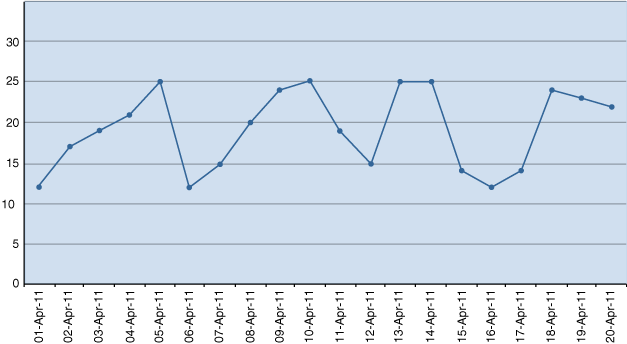
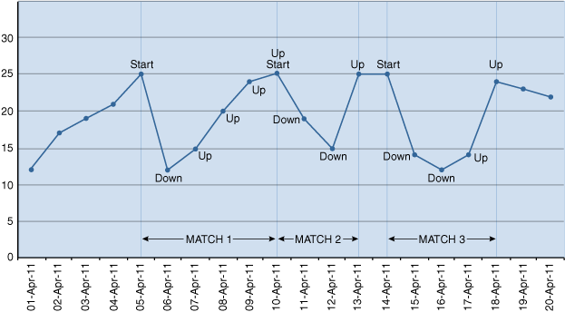
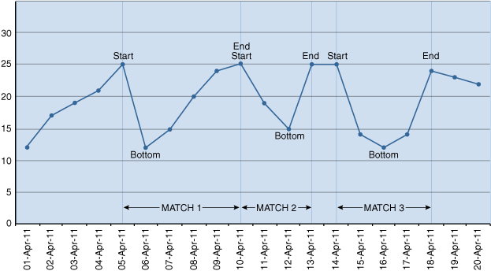

Recognizing patterns in a sequence of rows has been a capability that was widely desired, but not possible with SQL until now. There were many workarounds, but these were difficult to write, hard to understand, and inefficient to execute. Beginning in Oracle Database 12c, you can use the `MATCH_RECOGNIZE` clause to achieve this capability in native SQL that executes efficiently. This chapter discusses how to do this, and includes the following sections:

- Overview of Pattern Matching in Data Warehouses

- Basic Topics in Pattern Matching

- Pattern Matching Details

- Advanced Topics in Pattern Matching

- Rules and Restrictions in Pattern Matching

- Examples of Pattern Matching

### 21.1 Overview of Pattern Matching in Data Warehouses

Pattern matching in SQL is performed using the `MATCH_RECOGNIZE` clause. `MATCH_RECOGNIZE` enables you to do the following tasks:

- Logically partition and order the data that is used in the `MATCH_RECOGNIZE` clause with its `PARTITION` `BY` and `ORDER` `BY` clauses.

- Define patterns of rows to seek using the `PATTERN` clause of the `MATCH_RECOGNIZE` clause. These patterns use regular expression syntax, a powerful and expressive feature, applied to the pattern variables you define.

- Specify the logical conditions required to map a row to a row pattern variable in the `DEFINE` clause.

- Define measures, which are expressions usable in other parts of the SQL query, in the `MEASURES` clause.

As a simple case of pattern matching, consider the stock price chart illustrated in Figure 21-1.

Figure 21-1 Stock Chart

[Description of "Figure 21-1 Stock Chart"](img_text/dwhsg140.md)

Pattern matching can let you identify price patterns, such as V-shapes and W-shapes illustrated in Figure 21-1, along with performing many types of calculations. For example, your calculations might include the count of observations or the average value on a downward or upward slope.

This section contains the following topics:

- Why Use Pattern Matching?

- How Data is Processed in Pattern Matching

- About Pattern Matching Special Capabilities

#### 21.1.1 Why Use Pattern Matching?

The ability to recognize patterns found across multiple rows is important for many kinds of work. Examples include all kinds of business processes driven by sequences of events, such as security applications, where unusual behavior must be detected, and financial applications, where you seek patterns of pricing, trading volume, and other behavior. Other common uses are fraud detection applications and sensor data analysis. One term that describes this general area is complex event processing, and pattern matching is a powerful aid to this activity.

Now consider the query in Example 21-1. It uses the stock price shown in Figure 21-1, which you can load into your database with the `CREATE` and `INSERT` statements that follow. The query finds all cases where stock prices dipped to a bottom price and then rose. This is generally called a V-shape. Before studying the query, look at the output. There are only three rows because the code was written to report just one row per match, and three matches were found. The `MATCH_RECOGNIZE` clause lets you choose between showing one row per match and all rows per match. In this example, the shorter output of one row per match is used.

Example 21-1 Pattern Match: Simple V-Shape with 1 Row Output per Match

    CREATE TABLE Ticker (SYMBOL VARCHAR2(10), tstamp DATE, price NUMBER);

    INSERT INTO Ticker VALUES('ACME', '01-Apr-11', 12);
    INSERT INTO Ticker VALUES('ACME', '02-Apr-11', 17);
    INSERT INTO Ticker VALUES('ACME', '03-Apr-11', 19);
    INSERT INTO Ticker VALUES('ACME', '04-Apr-11', 21);
    INSERT INTO Ticker VALUES('ACME', '05-Apr-11', 25);
    INSERT INTO Ticker VALUES('ACME', '06-Apr-11', 12);
    INSERT INTO Ticker VALUES('ACME', '07-Apr-11', 15);
    INSERT INTO Ticker VALUES('ACME', '08-Apr-11', 20);
    INSERT INTO Ticker VALUES('ACME', '09-Apr-11', 24);
    INSERT INTO Ticker VALUES('ACME', '10-Apr-11', 25);
    INSERT INTO Ticker VALUES('ACME', '11-Apr-11', 19);
    INSERT INTO Ticker VALUES('ACME', '12-Apr-11', 15);
    INSERT INTO Ticker VALUES('ACME', '13-Apr-11', 25);
    INSERT INTO Ticker VALUES('ACME', '14-Apr-11', 25);
    INSERT INTO Ticker VALUES('ACME', '15-Apr-11', 14);
    INSERT INTO Ticker VALUES('ACME', '16-Apr-11', 12);
    INSERT INTO Ticker VALUES('ACME', '17-Apr-11', 14);
    INSERT INTO Ticker VALUES('ACME', '18-Apr-11', 24);
    INSERT INTO Ticker VALUES('ACME', '19-Apr-11', 23);
    INSERT INTO Ticker VALUES('ACME', '20-Apr-11', 22);

    SELECT *
    FROM Ticker MATCH_RECOGNIZE (
         PARTITION BY symbol
         ORDER BY tstamp
         MEASURES  STRT.tstamp AS start_tstamp,
                   LAST(DOWN.tstamp) AS bottom_tstamp,
                   LAST(UP.tstamp) AS end_tstamp
         ONE ROW PER MATCH
         AFTER MATCH SKIP TO LAST UP
         PATTERN (STRT DOWN+ UP+)
         DEFINE
            DOWN AS DOWN.price < PREV(DOWN.price),
            UP AS UP.price > PREV(UP.price)
         ) MR
    ORDER BY MR.symbol, MR.start_tstamp;

    SYMBOL     START_TST BOTTOM_TS END_TSTAM
    ---------- --------- --------- ---------
    ACME       05-APR-11 06-APR-11 10-APR-11
    ACME       10-APR-11 12-APR-11 13-APR-11
    ACME       14-APR-11 16-APR-11 18-APR-11

What does this query do? The following explains each line in the `MATCH_RECOGNIZE` clause:

- `PARTITION` `BY` divides the data from the `Ticker` table into logical groups where each group contains one stock symbol.

- `ORDER` `BY` orders the data within each logical group by `tstamp`.

- `MEASURES` defines three measures: the timestamp at the beginning of a V-shape (`start_tstamp`), the timestamp at the bottom of a V-shape (`bottom_tstamp`), and the timestamp at the end of the a V-shape (`end_tstamp`). The `bottom_tstamp` and `end_tstamp` measures use the `LAST()` function to ensure that the values retrieved are the final value of the timestamp within each pattern match.

- `ONE` `ROW` `PER` `MATCH` means that for every pattern match found, there will be one row of output.

- `AFTER` `MATCH` `SKIP` `TO` `LAST` `UP` means that whenever you find a match you restart your search at the row that is the last row of the `UP` pattern variable. A pattern variable is a variable used in a `MATCH_RECOGNIZE` statement, and is defined in the `DEFINE` clause.

- `PATTERN (STRT DOWN+ UP+)` says that the pattern you are searching for has three pattern variables: `STRT`, `DOWN`, and `UP`. The plus sign (`+`) after `DOWN` and `UP` means that at least one row must be mapped to each of them. The pattern defines a regular expression, which is a highly expressive way to search for patterns.

- `DEFINE` gives us the conditions that must be met for a row to map to your row pattern variables `STRT`, `DOWN`, and `UP`. Because there is no condition for `STRT`, any row can be mapped to `STRT`. Why have a pattern variable with no condition? You use it as a starting point for testing for matches. Both `DOWN` and `UP` take advantage of the `PREV()` function, which lets them compare the price in the current row to the price in the prior row. `DOWN` is matched when a row has a lower price than the row that preceded it, so it defines the downward (left) leg of our V-shape. A row can be mapped to `UP` if the row has a higher price than the row that preceded it.

The following two figures will help you better understand the results returned by Example 21-1. Figure 21-2 shows the dates mapped to specific pattern variables, as specified in the `PATTERN` clause. After the mappings of pattern variables to dates are available, that information is used by the `MEASURES` clause to calculate the measure values. The measures results are shown in Figure 21-3.

Figure 21-2 Stock Chart Illustrating Which Dates are Mapped to Which Pattern Variables

[Description of "Figure 21-2 Stock Chart Illustrating Which Dates are Mapped to Which Pattern Variables"](img_text/dwhsg143.md)

Figure 21-2 labels every date mapped to a pattern variable. The mapping is based on the pattern specified in the `PATTERN` clause and the logical conditions specified in the `DEFINE` clause. The thin vertical lines show the borders of the three matches that were found for the pattern. In each match, the first date has the `STRT` pattern variable mapped to it (labeled as Start), followed by one or more dates mapped to the `DOWN` pattern variable, and finally, one or more dates mapped to the `UP` pattern variable.

Because you specified `AFTER` `MATCH` `SKIP` `TO` `LAST` `UP` in the query, two adjacent matches can share a row. That means a single date can have two variables mapped to it. For example, 10-April has both the pattern variables `UP` and `STRT` mapped to it: April 10 is the end of Match 1 and the start of Match 2.

Figure 21-3 Stock Chart Showing the Dates to Which the Measures Correspond

[Description of "Figure 21-3 Stock Chart Showing the Dates to Which the Measures Correspond"](img_text/dwhsg144.md)

In Figure 21-3, the labels are solely for the measures defined in the `MEASURES` clause of the query: `START` (`start_tstamp` in the query), `BOTTOM` (`bottom_tstamp` in the query), and `END` (`end_tstamp` in the query). As in Figure 21-2, the thin vertical lines show the borders of the three matches found for the pattern. Every match has a `Start` date, a `Bottom` date, and an `End` date. As with Figure 21-2, the date 10-April is found in two matches: it is the `END` measure for Match 1 and the `START` measure for Match 2. The labeled dates of Figure 21-3 show which dates correspond to the measure definitions, which are based on the pattern variable mappings shown in Figure 21-2.

Note that the dates labeled in Figure 21-3 correspond to the nine dates shown earlier in the output of the example. The first row of the output has the dates shown in Match 1, the second row of the output has the dates shown in Match 2, and the third row of the output has the dates shown in Match 3.

#### 21.1.2 How Data is Processed in Pattern Matching

The `MATCH_RECOGNIZE` clause performs these steps:

1.  The row pattern input table is partitioned according to the `PARTITION` `BY` clause. Each partition consists of the set of rows of the input table that have the same value on the partitioning columns.

2.  Each row pattern partition is ordered according to the `ORDER` `BY` clause.

3.  Each ordered row pattern partition is searched for matches to the `PATTERN`.

4.  Pattern matching operates by seeking the match at the earliest row, considering the rows in a row pattern partition in the order specified by the `ORDER` `BY` clause.

    Pattern matching in a sequence of rows is an incremental process, with one row after another examined to see if it fits the pattern. With this incremental processing model, at any step until the complete pattern is recognized, you only have a partial match, and you do not know what rows might be added in the future, nor to what variables those future rows might be mapped.

    If no match is found at the earliest row, the search moves to the next row in the partition, checking if a match can be found starting with that row.

5.  After a match is found, row pattern matching calculates the row pattern measure columns, which are expressions defined by the `MEASURES` clause.

6.  Using `ONE` `ROW` `PER` `MATCH`, as shown in the first example, pattern matching generates one row for each match that is found. If you use `ALL` `ROWS` `PER` `MATCH`, every row that is matched is included in the pattern match output.

7.  The `AFTER` `MATCH` `SKIP` clause determines where row pattern matching resumes within a row pattern partition after a non-empty match is found. In the previous example, row pattern matching resumes at the last row of the match found (`AFTER` `MATCH` `SKIP` `TO` `LAST` `UP`).

#### 21.1.3 About Pattern Matching Special Capabilities

The capabilities are:

- Regular expressions are a robust and long-established way for systems to search for patterns in data. The regular expression features of the language Perl were adopted as the design target for pattern matching rules, and Oracle Database 12c Release 1, implements a subset of those rules for pattern matching.

- Oracle's regular expressions differ from typical regular expressions in that the row pattern variables are defined by Boolean conditions rather than characters or sets of characters.

- While pattern matching uses the notation of regular expressions to express patterns, it is actually a richer capability, because the pattern variables may be defined to depend upon the way previous rows were mapped to row pattern variables. The `DEFINE` clause enables pattern variables to be built upon other pattern variables.

- Subqueries are permitted in the definition of row pattern variables and the definition of measures.

### 21.2 Basic Topics in Pattern Matching

This section discusses:

- Basic Examples of Pattern Matching

- Tasks and Keywords in Pattern Matching

- Pattern Matching Syntax

#### 21.2.1 Basic Examples of Pattern Matching

This section includes some basic examples for matching patterns.

Example 21-2 Pattern Match for a Simple V-Shape with All Rows Output per Match

The first line in this example is to improve formatting if you are using SQL\*Plus.

    column var_match format a4

    SELECT *
    FROM Ticker MATCH_RECOGNIZE (
         PARTITION BY symbol
         ORDER BY tstamp
         MEASURES  STRT.tstamp AS start_tstamp,
                   FINAL LAST(DOWN.tstamp) AS bottom_tstamp,
                   FINAL LAST(UP.tstamp) AS end_tstamp,
                   MATCH_NUMBER() AS match_num,
                   CLASSIFIER() AS var_match
         ALL ROWS PER MATCH
         AFTER MATCH SKIP TO LAST UP
         PATTERN (STRT DOWN+ UP+)
         DEFINE
            DOWN AS DOWN.price < PREV(DOWN.price),
            UP AS UP.price > PREV(UP.price)
         ) MR
    ORDER BY MR.symbol, MR.match_num, MR.tstamp;

    SYMBOL     TSTAMP    START_TST BOTTOM_TS END_TSTAM  MATCH_NUM VAR_      PRICE
    ---------- --------- --------- --------- --------- ---------- ---- ----------
    ACME       05-APR-11 05-APR-11 06-APR-11 10-APR-11          1 STRT         25
    ACME       06-APR-11 05-APR-11 06-APR-11 10-APR-11          1 DOWN         12
    ACME       07-APR-11 05-APR-11 06-APR-11 10-APR-11          1 UP           15
    ACME       08-APR-11 05-APR-11 06-APR-11 10-APR-11          1 UP           20
    ACME       09-APR-11 05-APR-11 06-APR-11 10-APR-11          1 UP           24
    ACME       10-APR-11 05-APR-11 06-APR-11 10-APR-11          1 UP           25
    ACME       10-APR-11 10-APR-11 12-APR-11 13-APR-11          2 STRT         25
    ACME       11-APR-11 10-APR-11 12-APR-11 13-APR-11          2 DOWN         19
    ACME       12-APR-11 10-APR-11 12-APR-11 13-APR-11          2 DOWN         15
    ACME       13-APR-11 10-APR-11 12-APR-11 13-APR-11          2 UP           25
    ACME       14-APR-11 14-APR-11 16-APR-11 18-APR-11          3 STRT         25
    ACME       15-APR-11 14-APR-11 16-APR-11 18-APR-11          3 DOWN         14
    ACME       16-APR-11 14-APR-11 16-APR-11 18-APR-11          3 DOWN         12
    ACME       17-APR-11 14-APR-11 16-APR-11 18-APR-11          3 UP           14
    ACME       18-APR-11 14-APR-11 16-APR-11 18-APR-11          3 UP           24

    15 rows selected.

What does this query do? It is similar to the query in Example 21-1 except for items in the `MEASURES` clause, the change to `ALL` `ROWS` `PER` `MATCH`, and a change to the `ORDER` `BY` at the end of the query. In the `MEASURES` clause, there are these additions:

- `MATCH_NUMBER()` `AS` `match_num`

  Because this example gives multiple rows per match, you need to know which rows are members of which match. `MATCH_NUMBER` assigns the same number to each row of a specific match. For instance, all the rows in the first match found in a row pattern partition are assigned the `match_num` value of 1. Note that match numbering starts over again at 1 in each row pattern partition.

- `CLASSIFIER()` `AS` `var_match`

  To know which rows map to which variable, use the `CLASSIFIER` function. In this example, some rows will map to the `STRT` variable, some rows the `DOWN` variable, and others to the `UP` variable.

- `FINAL` `LAST()`

  By specifying `FINAL` and using the `LAST()` function for `bottom_tstamp`, every row inside each match shows the same date for the bottom of its V-shape. Likewise, applying `FINAL` `LAST()` to the `end_tstamp` measure makes every row in each match show the same date for the end of its V-shape. Without this syntax, the dates shown would be the running value for each row.

Changes were made in two other lines:

- `ALL` `ROWS` `PER` `MATCH` - While Example 21-1 gave a summary with just 1 row about each match using the line `ONE` `ROW` `PER` `MATCH`, this example asks to show every row of each match.

- `ORDER` `BY` on the last line - This was changed to take advantage of the `MATCH_NUM`, so all rows in the same match are together and in chronological order.

Note that the row for April 10 appears twice because it is in two pattern matches: it is the last day of the first match and the first day of the second match.

Example 21-3 Pattern Match with an Aggregate on a Variable

Example 21-3 highlights the use of aggregate functions in pattern matching queries.

    SELECT *
    FROM Ticker MATCH_RECOGNIZE (
      PARTITION BY symbol
      ORDER BY tstamp
      MEASURES
        MATCH_NUMBER() AS match_num,
        CLASSIFIER() AS var_match,
        FINAL COUNT(UP.tstamp) AS up_days,
        FINAL COUNT(tstamp) AS total_days,
        RUNNING COUNT(tstamp) AS cnt_days,
        price - STRT.price AS price_dif
      ALL ROWS PER MATCH
      AFTER MATCH SKIP TO LAST UP
      PATTERN (STRT DOWN+ UP+)
      DEFINE
        DOWN AS DOWN.price < PREV(DOWN.price),
        UP AS UP.price > PREV(UP.price)
      ) MR
    ORDER BY MR.symbol, MR.match_num, MR.tstamp;

    SYMBOL TSTAMP    MATCH_NUM VAR_ UP_DAYS TOTAL_DAYS CNT_DAYS PRICE_DIF PRICE
    ------ --------- --------- ---- ------- ---------- -------- --------- -----
    ACME   05-APR-11         1 STRT       4          6        1         0    25
    ACME   06-APR-11         1 DOWN       4          6        2       -13    12
    ACME   07-APR-11         1 UP         4          6        3       -10    15
    ACME   08-APR-11         1 UP         4          6        4        -5    20
    ACME   09-APR-11         1 UP         4          6        5        -1    24
    ACME   10-APR-11         1 UP         4          6        6         0    25
    ACME   10-APR-11         2 STRT       1          4        1         0    25
    ACME   11-APR-11         2 DOWN       1          4        2        -6    19
    ACME   12-APR-11         2 DOWN       1          4        3       -10    15
    ACME   13-APR-11         2 UP         1          4        4         0    25
    ACME   14-APR-11         3 STRT       2          5        1         0    25
    ACME   15-APR-11         3 DOWN       2          5        2       -11    14
    ACME   16-APR-11         3 DOWN       2          5        3       -13    12
    ACME   17-APR-11         3 UP         2          5        4       -11    14
    ACME   18-APR-11         3 UP         2          5        5        -1    24

    15 rows selected.

What does this query do? It builds on Example 21-2 by adding three measures that use the aggregate function `COUNT()`. It also adds a measure showing how an expression can use a qualified and unqualified column.

- The `up_days` measure (with `FINAL` `COUNT`) shows the number of days mapped to the `UP` pattern variable within each match. You can verify this by counting the `UP` labels for each match in Figure 21-2.

- The `total_days` measure (also with `FINAL` `COUNT`) introduces the use of unqualified columns. Because this measure specified the `FINAL` `count(tstamp)` with no pattern variable to qualify the `tstamp` column, it returns the count of all rows included in a match.

- The `cnt_days` measure introduces the `RUNNING` keyword. This measure gives a running count that helps distinguish among the rows in a match. Note that it also has no pattern variable to qualify the `tstamp` column, so it applies to all rows of a match. You do not need to use the `RUNNING` keyword explicitly in this case because it is the default. See "Running Versus Final Semantics and Keywords" for more information.

- The `price_dif` measure shows us each day's difference in stock price from the price at the first day of a match. In the expression "`price - STRT.price)`," you see a case where an unqualified column, "`price`," is used with a qualified column, "`STRT.price`".

Example 21-4 Pattern Match for a W-Shape

This example illustrates a W-Shape.

    SELECT *
    FROM Ticker MATCH_RECOGNIZE (
      PARTITION BY symbol
      ORDER BY tstamp
      MEASURES
        MATCH_NUMBER() AS match_num,
        CLASSIFIER()  AS  var_match,
        STRT.tstamp AS start_tstamp,
        FINAL LAST(UP.tstamp) AS end_tstamp
      ALL ROWS PER MATCH
      AFTER MATCH SKIP TO LAST UP
      PATTERN (STRT DOWN+ UP+ DOWN+ UP+)
      DEFINE
        DOWN AS DOWN.price < PREV(DOWN.price),
        UP AS UP.price > PREV(UP.price)
      ) MR
    ORDER BY MR.symbol, MR.match_num, MR.tstamp;

    SYMBOL     TSTAMP     MATCH_NUM  VAR_  START_TST  END_TSTAM      PRICE
    ---------- --------- ----------  ----  ---------  --------- ----------
    ACME       05-APR-11          1  STRT  05-APR-11  13-APR-11         25
    ACME       06-APR-11          1  DOWN  05-APR-11  13-APR-11         12
    ACME       07-APR-11          1  UP    05-APR-11  13-APR-11         15
    ACME       08-APR-11          1  UP    05-APR-11  13-APR-11         20
    ACME       09-APR-11          1  UP    05-APR-11  13-APR-11         24
    ACME       10-APR-11          1  UP    05-APR-11  13-APR-11         25
    ACME       11-APR-11          1  DOWN  05-APR-11  13-APR-11         19
    ACME       12-APR-11          1  DOWN  05-APR-11  13-APR-11         15
    ACME       13-APR-11          1  UP    05-APR-11  13-APR-11         25

What does this query do? It builds on the concepts introduced in Example 21-1 and seeks W-shapes in the data rather than V-shapes. The query results show one W-shape. To find the W-shape, the line defining the `PATTERN` regular expression was modified to seek the pattern `DOWN` followed by `UP` two consecutive times: `PATTERN` `(STRT DOWN+ UP+ DOWN+ UP+)`. This pattern specification means it can only match a W-shape where the two V-shapes have no separation between them. For instance, if there is a flat interval with the price unchanging, and that interval occurs between two V-shapes, the pattern will not match that data. To illustrate the data returned, the output is set to `ALL` `ROWS` `PER` `MATCH`. Note that `FINAL` `LAST(UP.tstamp)` in the `MEASURES` clause returns the timestamp value for the last row mapped to `UP`.

#### 21.2.2 Tasks and Keywords in Pattern Matching

This section discusses the following tasks and keywords in pattern matching.

##### PARTITION BY: Logically Dividing the Rows into Groups

You will typically want to divide your input data into logical groups for analysis. In the example with stocks, you divide the pattern matching so that it applies to just one stock at a time. You do this with the `PARTITION` `BY` keyword. `PARTITION` `BY` is used to specify that the rows of the row pattern input table are to be partitioned by one or more columns. Matches are found within partitions and do not cross partition boundaries.

If there is no `PARTITION` `BY`, then all rows of the row pattern input table constitute a single row pattern partition.

##### ORDER BY: Logically Ordering the Rows in a Partition

After you divided your input data into logical partitions, you will want to order the data inside each partition. Without row ordering, you cannot have a reliable sequence to check for pattern matches. The `ORDER` `BY` keyword is used to specify the order of rows within a row pattern partition.

##### \[ONE ROW \| ALL ROWS\] PER MATCH: Choosing Summaries or Details for Each Match

You will sometimes want summary data about the matches and other times need details. You can do that with the following SQL keywords:

- `ONE` `ROW` `PER` `MATCH`

  Each match produces one summary row. This is the default.

- `ALL` `ROWS` `PER` `MATCH`

  A match spanning multiple rows will produce one output row for each row in the match.

The output is explained in "Row Pattern Output".

##### MEASURES: Defining Calculations for Export from the Pattern Matching

The pattern matching clause enables you to create expressions useful in a wide range of analyses. These are presented as columns in the output by using the `MEASURES` clause. The `MEASURES` clause defines row pattern measure columns, whose value is computed by evaluating an expression related to a particular match.

##### PATTERN: Defining the Row Pattern That Will be Matched

The `PATTERN` clause lets you define which pattern variables must be matched, the sequence in which they must be matched, and the quantity of rows which must be matched. The `PATTERN` clause specifies a regular expression for the match search.

A row pattern match consists of a set of contiguous rows in a row pattern partition. Each row of the match is mapped to a pattern variable. Mapping of rows to pattern variables must conform to the regular expression in the `PATTERN` clause, and all conditions in the `DEFINE` clause must be true.

##### DEFINE: Defining Primary Pattern Variables

Because the `PATTERN` clause depends on pattern variables, you must have a clause to define these variables. They are specified in the `DEFINE` clause.

`DEFINE` is a required clause, used to specify the conditions that a row must meet to be mapped to a specific pattern variable.

A pattern variable does not require a definition. Any row can be mapped to an undefined pattern variable.

##### AFTER MATCH SKIP: Restarting the Matching Process After a Match is Found

After the query finds a match, it must look for the next match at exactly the correct point. Do you want to find matches where the end of the earlier match overlaps the start of the next match? Do you want some other variation? Pattern matching provides great flexibility in specifying the restart point. The `AFTER` `MATCH` `SKIP` clause determines the point to resume row pattern matching after a non-empty match was found. The default for the clause is `AFTER` `MATCH` `SKIP` `PAST` `LAST` `ROW`: resume pattern matching at the next row after the last row of the current match.

##### MATCH_NUMBER: Finding Which Rows are Members of Which Match

You might have a large number of matches for your pattern inside a given row partition. How do you tell apart all these matches? This is done with the `MATCH_NUMBER` function. Matches within a row pattern partition are numbered sequentially starting with 1 in the order they are found. Note that match numbering starts over again at 1 in each row pattern partition, because there is no inherent ordering between row pattern partitions.

##### CLASSIFIER: Finding Which Pattern Variable Applies to Which Rows

Along with knowing which `MATCH_NUMBER` you are seeing, you may want to know which component of a pattern applies to a specific row. This is done using the `CLASSIFIER` function. The classifier of a row is the pattern variable that the row is mapped to by a row pattern match. The `CLASSIFIER` function returns a character string whose value is the name of the variable the row is mapped to.

#### 21.2.3 Pattern Matching Syntax

The pattern matching syntax is as follows:

    table_reference ::=
      {only (query_table_expression) | query_table_expression }[flashback_query_clause]
       [pivot_clause|unpivot_clause|row_pattern_recognition_clause] [t_alias]

    row_pattern_recognition_clause ::=
      MATCH_RECOGNIZE (
       [row_pattern_partition_by ]
       [row_pattern_order_by ]
       [row_pattern_measures ]
       [row_pattern_rows_per_match ]
       [row_pattern_skip_to ]
       PATTERN (row_pattern)
       [ row_pattern_subset_clause]
       DEFINE row_pattern_definition_list
       )

    row_pattern_partition_by ::=
       PARTITION BY column[, column]...

    row_pattern_order_by ::=
       ORDER BY column[, column]...

    row_pattern_measures ::=
       MEASURES row_pattern_measure_column[, row_pattern_measure_column]...

    row_pattern_measure_column ::=
       expression AS c_alias

    row_pattern_rows_per_match ::=
       ONE ROW PER MATCH
      | ALL ROWS PER MATCH

    row_pattern_skip_to ::=
       AFTER MATCH {
        SKIP TO NEXT ROW
       | SKIP PAST LAST ROW
       | SKIP TO FIRST variable_name
       | SKIP TO LAST variable_name
       | SKIP TO variable_name}

    row_pattern ::=
       row_pattern_term
      | row_pattern "|" row_pattern_term

    row_pattern_term ::=
       row_pattern_factor
      | row_pattern_term row_pattern_factor

    row_pattern_factor ::=
       row_pattern_primary [row_pattern_quantifier]

    row_pattern_quantifier ::=
        *[?]
       |+[?]
       |?[?]
       |"{"[unsigned_integer ],[unsigned_integer]"}"[?]
       |"{"unsigned_integer "}"

    row_pattern_primary ::=
       variable_name
       |$
       |^
       |([row_pattern])
       |"{-" row_pattern"-}"
       | row_pattern_permute

    row_pattern_permute ::=
       PERMUTE (row_pattern [, row_pattern] ...)

    row_pattern_subset_clause ::=
       SUBSET row_pattern_subset_item [, row_pattern_subset_item] ...

    row_pattern_subset_item ::=
       variable_name = (variable_name[ , variable_name]...)

    row_pattern_definition_list ::=
       row_pattern_definition[, row_pattern_definition]...

    row_pattern_definition ::=
       variable_name AS condition

The syntax for row pattern operations inside pattern matching is:

    function ::=
     single_row_function
    | aggregate_function
    | analytic_function
    | object_reference_function
    | model_function
    | user_defined_function
    | OLAP_function
    | data_cartridge_function
    | row_pattern_recognition_function

    row_pattern_recognition_function ::=
     row_pattern_classifier_function
    | row_pattern_match_number_function
    | row_pattern_navigation_function
    | row_pattern_aggregate_function

    row_pattern_classifier_function ::=
      CLASSIFIER( )

    row_pattern_match_number_function ::=
      MATCH_NUMBER( )

    row_pattern_navigation_function ::=
       row_pattern_navigation_logical
      | row_pattern_navigation_physical
      | row_pattern_navigation_compound

    row_pattern_navigation_logical ::=
       [RUNNING|FINAL] {FIRST|LAST} (expression[,offset])

    row_pattern_navigation_physical ::=
       {PREV|NEXT}(expression[, offset])

    row_pattern_navigation_compound ::=
       {PREV | NEXT} (
         [RUNNING| FINAL] {FIRST|LAST} (expression[, offset]) [,offset])

The syntax for set function specification inside the pattern matching clause is:

    row_pattern_aggregate_function ::=
       [RUNNING | FINAL] aggregate_function

### 21.3 Pattern Matching Details

This section presents details on the items discussed in Pattern Matching Syntax, plus additional topics. Note that some of the material is unavoidably intricate. Certain aspects of pattern matching require careful attention to subtle details.

- PARTITION BY: Logically Dividing the Rows into Groups

- ORDER BY: Logically Ordering the Rows in a Partition

- \[ONE ROW \| ALL ROWS\] PER MATCH: Choosing Summaries or Details for Each Match

- MEASURES: Defining Calculations for Use in the Query

- PATTERN: Defining the Row Pattern to Be Matched

- SUBSET: Defining Union Row Pattern Variables

- DEFINE: Defining Primary Pattern Variables

- AFTER MATCH SKIP: Defining Where to Restart the Matching Process After a Match Is Found

- Expressions in MEASURES and DEFINE

- Row Pattern Output

#### 21.3.1 PARTITION BY: Logically Dividing the Rows into Groups

Typically, you want to divide your input data into logical groups for analysis. In the examples with stocks, the pattern matching is divided so that it applies to just one stock at a time. To do this, use the `PARTITION` `BY` clause. `PARTITION` `BY` specifies that the rows of the input table are to be partitioned by one or more columns. Matches are found within partitions and do not cross partition boundaries.

If there is no `PARTITION` `BY`, then all rows of the row pattern input table constitute a single row pattern partition.

#### 21.3.2 ORDER BY: Logically Ordering the Rows in a Partition

The `ORDER` `BY` clause is used to specify the order of rows within a row pattern partition. If the order of two rows in a row pattern partition is not determined by `ORDER` `BY`, then the result of the `MATCH_RECOGNIZE` clause is non-deterministic: it may not give consistent results each time the query is run.

#### 21.3.3 \[ONE ROW \| ALL ROWS\] PER MATCH: Choosing Summaries or Details for Each Match

You will sometimes want summary data about the matches and other times need details. You can do that with the following SQL:

- `ONE` `ROW` `PER` `MATCH`

  Each match produces one summary row. This is the default.

- `ALL` `ROWS` `PER` `MATCH`

  A match spanning multiple rows will produce one output row for each row in the match.

The output is explained in "Row Pattern Output".

The `MATCH_RECOGNIZE` clause may find a match with zero rows. For an empty match, `ONE` `ROW` `PER` `MATCH` returns a summary row: the `PARTITION` `BY` columns take the values from the row where the empty match occurs, and the measure columns are evaluated over an empty set of rows.

`ALL` `ROWS` `PER` `MATCH` has three suboptions:

- `ALL` `ROWS` `PER` `MATCH` `SHOW` `EMPTY` `MATCHES`

- `ALL` `ROWS` `PER` `MATCH` `OMIT` `EMPTY` `MATCHES`

- `ALL` `ROWS` `PER` `MATCH` `WITH` `UNMATCHED` `ROWS`

These options are explained in "Advanced Topics in Pattern Matching".

#### 21.3.4 MEASURES: Defining Calculations for Use in the Query

The `MEASURES` clause defines a list of columns for the pattern output table. Each pattern measure column is defined with a column name whose value is specified by a corresponding pattern measure expression.

A value expression is defined with respect to the pattern variables. Value expression can contain set functions, pattern navigation operations, `CLASSIFIER()`, `MATCH_NUMBER()`, and column references to any column of the input table. See "Expressions in MEASURES and DEFINE" for more information.

#### 21.3.5 PATTERN: Defining the Row Pattern to Be Matched

The `PATTERN` keyword specifies the pattern to be recognized in the ordered sequence of rows in a partition. Each variable name in a pattern corresponds to a Boolean condition, which is specified later using the `DEFINE` component of the syntax.

The `PATTERN` clause is used to specify a regular expression. It is outside the scope of this material to explain regular expression concepts and details. If you are not familiar with regular expressions, you are encouraged to familiarize yourself with the topic using other sources.

The regular expression in a `PATTERN` clause is enclosed in parentheses. `PATTERN` may use the following operators:

- Concatenation

  Concatenation is used to list two or more items in a pattern to be matched in that order. Items are concatenated when there is no operator sign between two successive items. For example: `PATTERN (A B C)`.

- Quantifiers

  Quantifiers are POSIX operators that define the number of iterations accepted for a match. The syntax of POSIX extended regular expressions is similar to that of traditional UNIX regular expressions. The following are choices for quantifiers:

  - `*` — 0 or more iterations

  - `+` — 1 or more iterations

  - `?` — 0 or 1 iterations

  - `{n}` — `n` iterations (n \> 0)

  - `{n,}` — `n` or more iterations (n \>= 0)

  - `{n,m}` — between `n` and `m` (inclusive) iterations (`0 <= n` `<= m`, `0 < m`)

  - `{,m} `— between 0 and `m` (inclusive) iterations (`m > 0`)

  - reluctant quantifiers — indicated by an additional question mark following a quantifier `(*?, +?, ??, {n,}?, { n, m }?, {,m}?)`. See "Reluctant Versus Greedy Quantifier" for the difference between reluctant and non-reluctant quantifiers.

  The following are examples of using quantifier operators:

  - `A*` matches 0 or more iterations of `A`

  - `A{3,6}` matches 3 to 6 iterations of `A`

  - `A{,4}` matches 0 to 4 iterations of `A`

- Alternation

  Alternation matches a single regular expression from a list of several possible regular expressions. The alternation list is created by placing a vertical bar (\|) between each regular expression. Alternatives are preferred in the order they are specified. As an example, `PATTERN (A | B | C)` attempts to match `A` first. If `A` is not matched, it attempts to match `B`. If `B` is not matched, it attempts to match `C`.

- Grouping

  Grouping treats a portion of the regular expression as a single unit, enabling you to apply regular expression operators such as quantifiers to that group. Grouping is created with parentheses. As an example, `PATTERN ((A B){3} C)` attempts to match the group `(A B)` three times and then seeks one occurrence of `C`.

- `PERMUTE`

  See "How to Express All Permutations" for more information.

- Exclusion

  Parts of the pattern to be excluded from the output of `ALL` `ROWS` `PER` `MATCH` are enclosed between {- and -}. See "How to Exclude Portions of the Pattern from the Output".

- Anchors

  Anchors work in terms of positions rather than rows. They match a position either at the start or end of a partition.

  - ` ^` matches the position before the first row in the partition.

  - `$` matches the position after the last row in the partition.

  As an example, `PATTERN (^A+$)` will match only if all rows in a partition satisfy the condition for `A`. The resulting match spans the entire partition.

- Empty pattern (), matches an empty set of rows

This section contains the following topics:

- Reluctant Versus Greedy Quantifier

- Operator Precedence

##### 21.3.5.1 Reluctant Versus Greedy Quantifier

Pattern quantifiers are referred to as greedy; they will attempt to match as many instances of the regular expression on which they are applied as possible. The exception is pattern quantifiers that have a question mark `?` as a suffix, and those are referred to as reluctant. They will attempt to match as few instances as possible of the regular expression on which they are applied.

The difference between greedy and reluctant quantifiers appended to a single pattern variable is illustrated as follows: `A*` tries to map as many rows as possible to `A`, whereas `A*?` tries to map as few rows as possible to `A`. For example:

    PATTERN (X Y* Z)

The pattern consists of three variable names, `X`, `Y`, and `Z`, with `Y` quantified with `*`. This means a pattern match will be recognized and reported when the following condition is met by consecutive incoming input rows:

- A row satisfies the condition that defines variable `X` followed by zero or more rows that satisfy the condition that defines the variable `Y` followed by a row that satisfies the condition that defines the variable `Z`.

During the pattern matching process, after a row was mapped to `X` and 0 or more rows were mapped to `Y`, if the following row can be mapped to both variables `Y` and `Z` (which satisfies the defining condition of both `Y` and `Z`), then, because the quantifier `*` for `Y` is greedy, the row is preferentially mapped to `Y` instead of `Z`. Due to this greedy property, `Y` gets preference over `Z` and a greater number of rows to `Y` are mapped. If the pattern expression was `PATTERN (X Y*? Z)`, which uses a reluctant quantifier `*?` over `Y`, then `Z` gets preference over `Y`.

##### 21.3.5.2 Operator Precedence

The precedence of the elements in a regular expression, in decreasing order, is as follows:

- `row_pattern_primary`

  These elements include primary pattern variables (pattern variables not created with the `SUBSET` clause described in "SUBSET: Defining Union Row Pattern Variables"), anchors, `PERMUTE`, parenthetic expressions, exclusion syntax, and empty pattern

- Quantifier

  A `row_pattern_primary` may have zero or one quantifier.

- Concatenation

- Alternation

Precedence of alternation is illustrated by `PATTERN``(A B | C D)`, which is equivalent to `PATTERN` (`(A B) | (C D))`. It is not, however, equivalent to `PATTERN` `(A (B | C) D)`.

Precedence of quantifiers is illustrated by `PATTERN` (`A B *)`, which is equivalent to `PATTERN` `(A (B*))`. It is not, however, `PATTERN` (`(A B)*)`.

A quantifier may not immediately follow another quantifier. For example, `PATTERN``(A**)` is prohibited.

It is permitted for a primary pattern variable to occur more than once in a pattern, for example, `PATTERN` `(X Y X)`.

#### 21.3.6 SUBSET: Defining Union Row Pattern Variables

At times, it is helpful to create a grouping of multiple pattern variables that can be referred to with a variable name of its own. These groupings are called union row pattern variables, and you create them with the `SUBSET` clause. The union row pattern variable created by `SUBSET` can be used in the `MEASURES` and `DEFINE` clauses. The `SUBSET` clause is optional. It is used to declare union row pattern variables. For example, here is a query using `SUBSET` to calculate an average based on all rows that are mapped to the union of `STRT` and `DOWN` variables, where `STRT` is the starting point for a pattern, and `DOWN` is the downward (left) leg of a V shape.

Example 21-5 illustrates creating a union row pattern variable.

Example 21-5 Defining Union Row Pattern Variables

    SELECT *
    FROM Ticker MATCH_RECOGNIZE(
         PARTITION BY symbol
         ORDER BY tstamp
         MEASURES FIRST(STRT.tstamp) AS strt_time,
                  LAST(DOWN.tstamp) AS bottom,
                  AVG(STDN.Price) AS stdn_avgprice
         ONE ROW PER MATCH
         AFTER MATCH SKIP TO LAST UP
         PATTERN (STRT DOWN+ UP+)
         SUBSET STDN= (STRT, DOWN)
         DEFINE
            UP AS UP.Price > PREV(UP.Price),
            DOWN AS DOWN.Price < PREV (DOWN.Price)
    );

    SYMBOL    STRT_TIME BOTTOM    STDN_AVGPRICE
    ------    --------- --------- -------------
    ACME      05-APR-11 06-APR-11          18.5
    ACME      10-APR-11 12-APR-11    19.6666667
    ACME      14-APR-11 16-APR-11            17

This example declares a single union row pattern variable, `STDN`, and defines it as the union of the rows mapped to `STRT` and the rows mapped to `DOWN`. There can be multiple union row pattern variables in a query. For example:

    PATTERN (W+ X+ Y+ Z+)
    SUBSET XY = (X, Y),
           WZ = (W, Z)

The right-hand side of a `SUBSET` item is a comma-separated list of distinct primary row pattern variables within parentheses. This defines the union row pattern variable (on the left-hand side) as the union of the primary row pattern variables (on the right-hand side).

Note that the list of pattern variables on the right-hand side may not include any union row pattern variables (there are no unions of unions).

For every match, there is one implicit union row pattern variable called the universal row pattern variable. The universal row pattern variable is the union of all primary row pattern variables. For instance, if your pattern has primary pattern variable `A`, `B`, and `C`, then the universal row pattern variable is equivalent to a `SUBSET` clause with the argument `(A, B, C)`. Thus, every row of a match is mapped to the universal row pattern variable. Any unqualified column reference within the `MEASURES` or `DEFINE` clauses is implicitly qualified by the universal row pattern variable. Note that there is no keyword to explicitly specify the universal row pattern variable.

#### 21.3.7 DEFINE: Defining Primary Pattern Variables

`DEFINE` is a mandatory clause, used to specify the conditions that define primary pattern variables. In the example:

    DEFINE UP AS UP.Price > PREV(UP.Price),
    DOWN AS DOWN.Price < PREV(DOWN.Price)

`UP` is defined by the condition `UP.Price > PREV (UP.Price)`, and `DOWN` is defined by the condition `DOWN.Price < PREV (DOWN.Price)`. (`PREV` is a row pattern navigation operation which evaluates an expression in the previous row; see "Row Pattern Navigation Operations" regarding the complete set of row pattern navigation operations.)

A pattern variable does not require a definition; if there is no definition, any row can be mapped to the pattern variable.

A union row pattern variable (see discussion of `SUBSET` in "SUBSET: Defining Union Row Pattern Variables") cannot be defined by `DEFINE`, but can be referenced in the definition of a pattern variable.

The definition of a pattern variable can reference another pattern variable, which is illustrated in Example 21-6.

Example 21-6 Defining Pattern Variables

    SELECT *
    FROM Ticker MATCH_RECOGNIZE (
         PARTITION BY Symbol
         FROM Ticker
         MATCH_RECOGNIZE (
         PARTITION BY Symbol
         ORDER BY tstamp
         MEASURES FIRST (A.tstamp) AS A_Firstday,
                  LAST (D.tstamp) AS D_Lastday,
                  AVG (B.Price) AS B_Avgprice,
                  AVG (D.Price) AS D_Avgprice
         PATTERN (A B+ C+ D)
         SUBSET BC = (B,C)
         DEFINE A AS Price > 100,
                B AS B.Price > A.Price,
                C AS C.Price < AVG (B.Price),
                D AS D.Price > MAX (BC.Price)
    ) M

In this example:

- The definition of `A` implicitly references the universal row pattern variable (because of the unqualified column reference `Price`).

- The definition of `B` references the pattern variable `A`.

- The definition of `C` references the pattern variable `B`.

- The definition of `D` references the union row pattern variable `BC`.

The conditions are evaluated on successive rows of a partition in a trial match, with the current row being tentatively mapped to a pattern variable as permitted by the pattern. To be successfully mapped, the condition must evaluate to true.

In the previous example:

    A AS Price > 100

`Price` refers to the `Price` in the current row, because the last row mapped to any primary row pattern variable is the current row, which is tentatively mapped to `A`. Alternatively, in this example, using `A.Price` would have led to the same results.

    B AS B.Price > A.Price

`B.Price` refers to the `Price` in the current row (because `B` is being defined), whereas `A.Price` refers to the last row mapped to `A`. In view of the pattern, the only row mapped to `A` is the first row to be mapped.

    C AS C.Price < AVG(B.Price)

Here `C.Price` refers to the `Price` in the current row, because `C` is being defined. The aggregate `AVG` (that is, insert `Price`) is computed as the average of all rows that are already mapped to `B`.

    D AS D.Price > MAX(BC.Price)

The pattern variable `D` is similar to pattern variable `C`, though it illustrates the use of a union row pattern variable in the Boolean condition. In this case, `MAX(BC.Price)` returns the maximum price value of the rows matched to variable `B` or variable `C`. The semantics of Boolean conditions are discussed in more detail in "Expressions in MEASURES and DEFINE".

#### 21.3.8 AFTER MATCH SKIP: Defining Where to Restart the Matching Process After a Match Is Found

The `AFTER` `MATCH` `SKIP` clause determines the point to resume row pattern matching after a non-empty match was found. The default for the clause is `AFTER` `MATCH` `SKIP` `PAST` `LAST` `ROW`. The options are as follows:

- `AFTER` `MATCH` `SKIP` `TO` `NEXT` `ROW`

  Resume pattern matching at the row after the first row of the current match.

- `AFTER` `MATCH` `SKIP` `PAST` `LAST` `ROW`

  Resume pattern matching at the next row after the last row of the current match.

- `AFTER` `MATCH` `SKIP` `TO` `FIRST` `pattern_variable`

  Resume pattern matching at the first row that is mapped to the pattern variable.

- `AFTER` `MATCH` `SKIP` `TO` `LAST` `pattern_variable`

  Resume pattern matching at the last row that is mapped to the pattern variable.

- `AFTER` `MATCH` `SKIP` `TO` `pattern_variable`

  The same as `AFTER` `MATCH` `SKIP` `TO` `LAST` `pattern_variable`.

When using `AFTER` `MATCH` `SKIP` `TO` `FIRST` or `AFTER` `MATCH` `SKIP` `TO` `[LAST]`, it is possible that no row is mapped to the pattern_variable. For example:

    AFTER MATCH SKIP TO A
    PATTERN (X A* X),

The pattern variable `A` in the example might have no rows mapped to `A`. If there is no row mapped to `A`, then there is no row to skip to, so a runtime exception is generated. Another problem condition is that `AFTER` `MATCH` `SKIP` may try to resume pattern matching at the same row that the last match started. For example:

    AFTER MATCH SKIP TO X
    PATTERN (X Y+ Z),

In this example, `AFTER` `MATCH` `SKIP` `TO` `X` tries to resume pattern matching at the same row where the previous match was found. This would result in an infinite loop, so a runtime exception is generated for this scenario.

Note that the `AFTER` `MATCH` `SKIP` syntax only determines the point to resume scanning for a match after a non-empty match. When an empty match is found, one row is skipped (as if `SKIP` `TO` `NEXT` `ROW` had been specified). Thus an empty match never causes one of these exceptions. A query that gets one of these exceptions should be rewritten, as, for example, in the following:

    AFTER MATCH SKIP TO A
    PATTERN (X (A | B) Y)

This will cause a run-time error when a row is mapped to `B`, because no row was mapped to `A`. If the intent is to skip to either `A` or `B`, the following will work:

    AFTER MATCH SKIP TO C
    PATTERN (X (A | B) Y)
    SUBSET C = (A, B)

In the revised example, no runtime error is possible, whether `A` or `B` is matched.

As another example:

    AFTER MATCH SKIP TO FIRST A
    PATTERN (A* X)

This example gets an exception after the first match, either for skipping to the first row of the match (if `A*` matches) or for skipping to a nonexistent row (if `A*` does not match). In this example, `SKIP` `TO` `NEXT` `ROW` is a better choice.

When using `ALL` `ROWS` `PER` `MATCH` together with skip options other than `AFTER` `MATCH` `SKIP` `PAST` `LAST` `ROW`, it is possible for consecutive matches to overlap, in which case a row `R` of the row pattern input table might occur in more than one match. In that case, the row pattern output table will have one row for each match in which the row participates. If a row of the row pattern input table participates in multiple matches, the `MATCH_NUMBER` function can be used to distinguish among the matches. When a row participates in more than one match, its classifier can be different in each match.

#### 21.3.9 Expressions in MEASURES and DEFINE

Pattern matching provides the following scalar expressions that are unique to row pattern matching:

- Row pattern navigation operations, using the functions `PREV`, `NEXT`, `FIRST` and `LAST`. Row pattern navigation operations are discussed in "Row Pattern Navigation Operations".

- The `MATCH_NUMBER` function, which returns the sequential number of a row pattern match within its row pattern partition, discussed in "MATCH_NUMBER: Finding Which Rows Are in Which Match".

- The `CLASSIFIER` function, which returns the name of the primary row pattern variable that a row is mapped to, discussed in "CLASSIFIER: Finding Which Pattern Variable Applies to Which Rows".

Expressions in `MEASURES` and `DEFINE` clauses have the same syntax and semantics, with the following exceptions:

- The `DEFINE` clause only supports running semantics.

- The `MEASURES` clause defaults to running semantics, but also supports final semantics. This distinction is discussed in "RUNNING Versus FINAL Semantics".

##### Working with Expressions

This section discusses some of the considerations when working with expressions in pattern matching, and includes:

- MATCH_NUMBER: Finding Which Rows Are in Which Match

- CLASSIFIER: Finding Which Pattern Variable Applies to Which Rows

- Row Pattern Column References

- Aggregates

- Row Pattern Navigation Operations

##### 21.3.9.1 MATCH_NUMBER: Finding Which Rows Are in Which Match

Matches within a row pattern partition are numbered sequentially starting with 1 in the order they are found. Note that match numbering starts over again at 1 in each row pattern partition, because there is no inherent ordering between row pattern partitions. `MATCH_NUMBER()` is a function that returns a numeric value with scale 0 (zero) whose value is the sequential number of the match within the row pattern partition.

The previous examples using `MATCH_NUMBER()` have shown it used in the `MEASURES` clause. It is also possible to use `MATCH_NUMBER()` in the `DEFINE` clause, where it can be used to define conditions that depend upon the match number.

##### 21.3.9.2 CLASSIFIER: Finding Which Pattern Variable Applies to Which Rows

The `CLASSIFIER` function returns a character string whose value is the name of the pattern variable to which a row is mapped. The `CLASSIFIER` function is allowed in both the `MEASURES` and the `DEFINE` clauses.

In the `DEFINE` clause, the `CLASSIFIER` function returns the name of the primary pattern variable to which the current row is mapped.

In the `MEASURES` clause:

- If `ONE` `ROW` `PER` `MATCH` is specified, the query is using the last row of the match when processing the `MEASURES` clause, so the `CLASSIFIER` function returns the name of the pattern variable to which the last row of the match is mapped.

- If `ALL` `ROWS` `PER` `MATCH` is specified, for each row of the match found, the `CLASSIFIER` function returns the name of the pattern variable to which the row is mapped.

The classifier for the starting row of an empty match is the null value.

##### 21.3.9.3 Row Pattern Column References

A row pattern column reference is a column name qualified by an explicit or implicit pattern variable, such as the following:

    A.Price

`A` is the pattern variable and `Price` is a column name. A column name with no qualifier, such as `Price`, is implicitly qualified by the universal row pattern variable, which references the set of all rows in a match. Column references can be nested within other syntactic elements, notably aggregates and navigation operators. (However, nesting in row pattern matching is subject to limitations described in "Prohibited Nesting in the MATCH_RECOGNIZE Clause" for the `FROM` clause.)

Pattern column references are classified as follows:

- Nested within an aggregate, such as `SUM`: an aggregated row pattern column reference.

- Nested within a row pattern navigation operation (`PREV`, `NEXT`, `FIRST`, and `LAST`): a navigated row pattern column reference.

- Otherwise: an ordinary row pattern column reference.

All pattern column references in an aggregate or row pattern navigation operation must be qualified by the same pattern variable. For example:

    PATTERN (A+ B+)
    DEFINE B AS AVG(A.Price + B.Tax) > 100

The preceding example is a syntax error, because `A` and `B` are two different pattern variables. Aggregate semantics require a single set of rows; there is no way to form a single set of rows on which to evaluate `A.Price + B.Tax`. However, the following is acceptable:

    DEFINE B AS AVG (B.Price + B.Tax) > 100

In the preceding example, all pattern column references in the aggregate are qualified by `B`.

An unqualified column reference is implicitly qualified by the universal row pattern variable, which references the set of all rows in a match. For example:

    DEFINE B AS AVG(Price + B.Tax) > 1000

The preceding example is a syntax error, because the unqualified column reference `Price` is implicitly qualified by the universal row pattern variable, whereas `B.Tax` is explicitly qualified by `B`. However, the following is acceptable:

    DEFINE B AS AVG (Price + Tax) > 1000

In the preceding example, both `Price` and `Tax` are implicitly qualified by the universal row pattern variable.

##### 21.3.9.4 Aggregates

The aggregates (`COUNT`, `SUM`, `AVG`, `MAX`, and `MIN`) can be used in both the `MEASURES` and `DEFINE` clauses. Note that the `DISTINCT` keyword is not supported. When used in row pattern matching, aggregates operate on a set of rows that are mapped to a particular pattern variable, using either running or final semantics. For example:

    MEASURES SUM (A.Price) AS RunningSumOverA,
             FINAL SUM(A.Price) AS FinalSumOverA
    ALL ROWS PER MATCH

In this example, `A` is a pattern variable. The first pattern measure, `RunningSumOverA`, does not specify either `RUNNING` or `FINAL`, so it defaults to `RUNNING`. This means that it is computed as the sum of `Price` in those rows that are mapped to `A` by the current match, up to and including the current row. The second pattern measure, `FinalSumOverA`, computes the sum of `Price` over all rows that are mapped to `A` by the current match, including rows that may be later than the current row. Final aggregates are only available in the `MEASURES` clause, not in the `DEFINE` clause.

An unqualified column reference contained in an aggregate is implicitly qualified by the universal row pattern variable, which references all rows of the current pattern match. For example:

    SUM (Price)

The running sum of `Price` over all rows of the current row pattern match is computed.

All column references contained in an aggregate must be qualified by the same pattern variable. For example:

    SUM (Price + A.Tax)

Because `Price` is implicitly qualified by the universal row pattern variable, whereas `A.Tax` is explicitly qualified by `A`, you get a syntax error.

The `COUNT` aggregate has special syntax for pattern matching, so that `COUNT(A.*)` can be specified. `COUNT(A.*)` is the number of rows that are mapped to the pattern variable A by the current pattern match. As for `COUNT(*)`, the `*` implicitly covers the rows of the universal row pattern variable, so that `COUNT(*)` is the number of rows in the current pattern match.

##### 21.3.9.5 Row Pattern Navigation Operations

There are four functions — `PREV`, `NEXT`, `FIRST`, and `LAST` — that enable navigation within the row pattern by either physical or logical offsets.

###### 21.3.9.5.1 PREV and NEXT

The `PREV` function can be used to evaluate an expression using a previous row in a partition. It operates in terms of physical rows and is not limited to the rows mapped to a specific variable. If there is no previous row, the null value is returned. For example:

    DEFINE A AS PREV (A.Price) > 100

The preceding example says that the current row can be mapped to `A` if the row preceding the current row has a price greater than 100. If the preceding row does not exist (that is, the current row is the first row of a row pattern partition), then `PREV(A.Price)` is null, so the condition is not `True`, and therefore the first row cannot be mapped to `A`.

Note that you can use another pattern variable (such as `B`) in defining the pattern variable `A`, and have the condition apply a `PREV()` function to that other pattern variable. That might resemble:

    DEFINE A AS PREV (B.PRICE) > 100

In that case, the starting row used by the `PREV()` function for its navigation is the last row mapped to pattern variable `B`.

The `PREV` function can accept an optional non-negative integer argument indicating the physical offset to the previous rows. Thus:

- `PREV (A.Price, 0)` is equivalent to `A.Price`.

- `PREV (A.price, 1)` is equivalent to `PREV (A.Price)`. Note: 1 is the default offset.

- `PREV (A.Price, 2)` is the value of `Price` in the row two rows before to the row denoted by A with running semantics. (If no row is mapped to A, or if there is no row two rows prior, then `PREV (A.Price, 2)` is null.)

The offset must be a runtime constant (literal, bind variable, and expressions involving them), but not a column or a subquery.

The `NEXT` function is a forward-looking version of the `PREV` function. It can be used to reference rows in the forward direction in the row pattern partition using a physical offset. The syntax is the same as for `PREV`, except for the name of the function. For example:

    DEFINE A AS NEXT (A.Price) > 100

The preceding example looks forward one row in the row pattern partition. Note that pattern matching does not support aggregates that look past the current row during the `DEFINE` clause, because of the difficulty of predicting what row will be mapped to what pattern variable in the future. The `NEXT` function does not violate this principle, because it navigates to "future" rows on the basis of a physical offset, which does not require knowing the future mapping of rows.

For example, to find an isolated row that is more than twice the average of the two rows before and two rows after it: using `NEXT`, this can be expressed:

    PATTERN ( X )
    DEFINE X AS X.Price > 2 * ( PREV (X.Price, 2)
           + PREV (X.Price, 1)
           + NEXT (X.Price, 1)
           + NEXT (X.Price, 2) ) / 4

Note that the row in which `PREV` or `NEXT` is evaluated is not necessarily mapped to the pattern variable in the argument. For example, in this example, `PREV (X.Price, 2)` is evaluated in a row that is not part of the match. The purpose of the pattern variable is to identify the row from which to offset, not the row that is ultimately reached. (If the definition of pattern variable refers to itself in a `PREV()` or `NEXT()`, then it is referring to the current row as the row from which to offset.) This point is discussed further in "Nesting FIRST and LAST Within PREV and NEXT in Pattern Matching".

`PREV` and `NEXT` may be used with more than one column reference; for example:

    DEFINE A AS PREV (A.Price + A.Tax) < 100

When using a complex expression as the first argument of `PREV` or `NEXT`, all qualifiers must be the same pattern variable (in this example, `A`).

`PREV` and `NEXT` always have running semantics; the keywords `RUNNING` and `FINAL` cannot be used with `PREV` or `NEXT`. (See the section on "Running Versus Final Semantics and Keywords"). To obtain final semantics, use, for example, `PREV` (`FINAL` `LAST (A.Price))` as explained in "Nesting FIRST and LAST Within PREV and NEXT in Pattern Matching".

###### 21.3.9.5.1.1 FIRST and LAST

In contrast to the `PREV` and `NEXT` functions, the `FIRST` and `LAST` functions navigate only among the rows mapped to pattern variables: they use logical, not physical, offsets. `FIRST` returns the value of an expression evaluated in the first row of the group of rows mapped to a pattern variable. For example:

    FIRST (A.Price)

If no row is mapped to `A`, then the value is null.

Similarly, `LAST` returns the value of an expression evaluated in the last row of the group of rows mapped to a pattern variable. For example:

    LAST (A.Price)

The preceding example evaluates `A.Price` in the last row that is mapped to `A` (null if there is no such row).

The `FIRST` and `LAST` operators can accept an optional non-negative integer argument indicating a logical offset within the set of rows mapped to the pattern variable. For example:

    FIRST (A.Price, 1)

The preceding line evaluates `Price` in the second row that is mapped to `A`. Consider the following data set and mappings in Table 21-1.

Table 21-1 Pattern and Row

| Row | Price | Mapping |
|:----|:------|:--------|
| R1  | 10    | A       |
| R2  | 20    | B       |
| R3  | 30    | A       |
| R4  | 40    | C       |
| R5  | 50    | A       |

Then the following:

- `FIRST (A.Price)` = `FIRST (A.Price, 0)` = `LAST (A.Price, 2) = 10`

- `FIRST (A.Price, 1)` = `LAST (A.Price, 1) = 30`

- `FIRST (A.Price, 2)` = `LAST (A.Price, 0) = LAST (A.Price) = 50`

- `FIRST (A.Price, 3)` is null, as is `LAST (A.Price, 3)`

Note that the offset is a logical offset, moving within the set of rows `{R1, R3, R5}` that are mapped to the pattern variable `A`. It is not a physical offset, as with `PREV` or `NEXT`.

The optional integer argument must be a runtime constant (literal, bind variable, and expressions involving them), but not a column or subquery.

The first argument of `FIRST` or `LAST` must have at least one row pattern column reference. Thus, `FIRST(1)` is a syntax error.

The first argument of `FIRST` or `LAST` may have more than one row pattern column reference, in which case all qualifiers must be the same pattern variable. For example, `FIRST (A.Price + B.Tax)` is a syntax error, but `FIRST (A.Price + A.Tax)` is acceptable.

`FIRST` and `LAST` support both running and final semantics. The `RUNNING` keyword is the default, and the only supported option in the `DEFINE` clause. Final semantics can be accessed in the `MEASURES` by using the keyword `FINAL`, as in:

    MEASURES FINAL LAST (A.Price) AS FinalPrice
    ALL ROWS PER MATCH

##### 21.3.9.6 Running Versus Final Semantics and Keywords

This section discusses some of the considerations to keep in mind when working with `RUNNING` and `FINAL`.

###### 21.3.9.6.1 RUNNING Versus FINAL Semantics

Pattern matching in a sequence of rows is usually thought of as an incremental process, with one row after another examined to see if it fits the pattern. With this incremental processing model, at any step until the complete pattern has been recognized, there is only a partial match and it is not known what rows might be added in the future, nor to what variables those future rows might be mapped. Therefore, in pattern matching, a row pattern column reference in the Boolean condition of a `DEFINE` clause has running semantics. This means that a pattern variable represents the set of rows that were already mapped to the pattern variable, up to and including the current row, but not any future rows.

After the complete match is established, it is possible to have final semantics. Final semantics is the same as running semantics on the last row of a successful match. Final semantics is only available in `MEASURES`, because in `DEFINE` there is uncertainty about whether a complete match was achieved.

The keywords `RUNNING` and `FINAL` are used to indicate running or final semantics, respectively; the rules for these keywords are discussed in "RUNNING Versus FINAL Keywords".

The fundamental rule for expression evaluation in `MEASURES` and `DEFINE` is as follows:

- When an expression involving a pattern variable is computed on a group of rows, then the set of rows that is mapped to the pattern variable is used. If the set is empty, then `COUNT` is 0 and any other expression involving the pattern variable is null.

- When an expression requires evaluation in a single row, then the latest row of the set is used. If the set is empty, then the expression is null.

For example, consider the following table and query in Example 21-7.

Example 21-7 RUNNING Versus FINAL Semantics

    SELECT M.Symbol, M.Tstamp, M.Price, M.RunningAvg, M.FinalAvg
    FROM TICKER MATCH_RECOGNIZE (
         PARTITION BY Symbol
         ORDER BY tstamp
         MEASURES RUNNING AVG (A.Price) AS RunningAvg,
                  FINAL AVG (A.Price) AS FinalAvg
         ALL ROWS PER MATCH
         PATTERN (A+)
         DEFINE A AS A.Price >= AVG (A.Price)
         ) M
    ;

Consider the following ordered row pattern partition of data shown in Table 21-2.

Table 21-2 Pattern and Partitioned Data

| Row | Symbol | Timestamp | Price |
|:----|:-------|:----------|:------|
| R1  | XYZ    | 09-Jun-09 | 10    |
| R2  | XYZ    | 10-Jun-09 | 16    |
| R3  | XYZ    | 11-Jun-09 | 13    |
| R4  | XYZ    | 12-Jun-09 | 9     |

The following logic can be used to find a match:

- On the first row of the row pattern partition, tentatively map row `R1` to pattern variable `A`. At this point, the set of rows mapped to variable `A` is `{R1}`. To confirm whether this mapping is successful, evaluate the predicate:

  `A.Price >= AVG (A.Price)`

  On the left-hand side, `A.Price` must be evaluated in a single row, which is the last row of the set using running semantics. The last row of the set is `R1`; therefore `A.Price` is 10.

  On the right hand side, `AVG (A.Price)` is an aggregate, which is computed using the rows of the set. This average is 10/1 = 10.

  Thus the predicate asks if `10 >= 10.` The answer is yes, so the mapping is successful. However, the pattern `A+` is greedy, so the query must try to match more rows if possible.

- On the second row of the row pattern partition, tentatively map `R2` to pattern variable `A`. At this point there are two rows mapped to `A`, so the set is `{R1, R2}`. Confirm whether the mapping is successful by evaluating the predicate.

  `A.Price >= AVG (A.Price)`

  On the left hand side, `A.Price` must be evaluated in a single row, which is the last row of the set using running semantics. The last row of the set is `R2`; therefore `A.Price` is 16.On the right hand side, `AVG (A.Price)` is an aggregate, which is computed using the rows of the set. This average is (10+16)/2 = 13.Thus the predicate asks if 16 \>= 13. The answer is yes, so the mapping is successful.

- On the third row of the row pattern partition, tentatively map `R3` to pattern variable `A`. Now there are three rows mapped to `A`, so the set is `{R1, R2, R3}`. Confirm whether the mapping is successful by evaluating the predicate:

  `A.Price >= AVG (A.Price)`

  On the left-hand side, `A.Price` is evaluated in `R3`; therefore, `A.Price` is 13.

  On the right-hand side, `AVG (A.Price)` is an aggregate, which is computed using the rows of the set. This average is (10+16+13)/3 = 13.Thus the predicate asks if 13 \>= 13. The answer is yes, so the mapping is successful.

- On the fourth row of the row pattern partition, tentatively map `R4` to pattern variable `A`. At this point, the set is` {R1, R2, R3, R4}`. Confirm whether the mapping is successful by evaluating the predicate:

  `A.Price >= AVG (A.Price)`

  On the left-hand side, `A.Price `is evaluated in `R4`; therefore, `A.Price` is 9.

  On the right-hand side, `AVG (A.Price)` is an aggregate, which is computed using the rows of the set. This average is (10+16+13+9)/4 = 12.Thus the predicate asks if 9 \>= 12. The answer is no, so the mapping is not successful.

`R4` did not satisfy the definition of `A`, so the longest match to `A+` is `{R1, R2, R3}`. Because `A+` has a greedy quantifier, this is the preferred match.

The averages computed in the `DEFINE` clause are running averages. In `MEASURES`, especially with `ALL` `ROWS` `PER` `MATCH`, it is possible to distinguish final and running aggregates. Notice the use of the keywords `RUNNING` and `FINAL` in the `MEASURES` clause. The distinction can be observed in the result of the example in Table 21-3.

Table 21-3 Row Pattern Navigation

| Symbol | Timestamp  | Price | Running Average | Final Average |
|:-------|:-----------|:------|:----------------|:--------------|
| XYZ    | 2009-06-09 | 10    | 10              | 13            |
| XYZ    | 2009-06-10 | 16    | 13              | 13            |
| XYZ    | 2009-06-11 | 13    | 13              | 13            |

It is possible that the set of rows mapped to a pattern variable is empty. When evaluating over an empty set:

- `COUNT` is 0.

- Any other aggregate, row pattern navigation operation, or ordinary pattern column reference is null.

For example:

    PATTERN ( A? B+ )
    DEFINE A AS A.Price > 100,
           B AS B.Price > COUNT (A.*) * 50

With the preceding example, consider the following ordered row pattern partition of data in Table 21-4.

Table 21-4 Pattern and Row

| Row | Price |
|:----|:------|
| R1  | 60    |
| R2  | 70    |
| R3  | 40    |

A match can be found in this data as follows:

- Tentatively map row `R1` to pattern variable `A`. (The quantifier `?` means to try first for a single match to `A`; if that fails, then an empty match is taken as matching `A?`). To see if the mapping is successful, the predicate `A.Price > 100` is evaluated. `A.Price` is 60; therefore, the predicate is false and the mapping to `A` does not succeed.

- Because the mapping to `A` failed, the empty match is taken as matching `A?`.

- Tentatively map row `R1` to `B`. The predicate to check for this mapping is `B.Price > COUNT (A.*) * 50`

  No rows are mapped to `A`, therefore `COUNT (A.*)` is 0. Because `B.Price = 60` is greater than 0, the mapping is successful.

- Similarly, rows `R2` and `R3` can be successfully mapped to `B`. Because there are no more rows, this is the complete match: no rows mapped `A`, and rows {R1, R2, R3} mapped to `B`.

A pattern variable can make a forward reference, that is, a reference to a pattern variable that was not matched yet. For example:

    PATTERN (X+ Y+)
    DEFINE X AS COUNT (Y.*) > 3,
    Y AS Y.Price > 10

The previous example is valid syntax. However, this example will never be matched because at the time that a row is mapped to `X`, no row has been mapped to `Y`. Thus `COUNT(Y.*)` is 0 and can never be greater than three. This is true even if there are four future rows that might be successfully mapped to `Y`. Consider this data set in Table 21-5.

Table 21-5 Pattern and Row

| Row | Price |
|:----|:------|
| R1  | 2     |
| R2  | 11    |
| R3  | 12    |
| R4  | 13    |
| R5  | 14    |

Mapping `{R2, R3, R4, R5} `to `Y` would be successful, because all four of these rows satisfy the Boolean condition defined for `Y`. In that case, you might think that you could map `R1` to `X` and have a complete successful match. However, the rules of pattern matching will not find this match, because, according to the pattern `X+ Y+`, at least one row must be mapped to `X` before any rows are mapped to `Y`.

###### 21.3.9.6.2 RUNNING Versus FINAL Keywords

`RUNNING` and `FINAL` are keywords used to indicate whether running or final semantics are desired. `RUNNING` and `FINAL` can be used with aggregates and the row pattern navigation operations `FIRST` and `LAST`.

Aggregates, `FIRST` and `LAST` can occur in the following places in a row pattern matching query:

- In the `DEFINE` clause. When processing the `DEFINE` clause, the query is still in the midst of recognizing a match, therefore the only supported semantics is running.

- In the `MEASURES` clause. When processing the `MEASURES` clause, the query has finished recognizing a match; therefore, it becomes possible to consider final semantics. There are two subcases:

  - If `ONE` `ROW` `PER` `MATCH` is specified, then conceptually the query is positioned on the last row of the match, and there is no real difference between running versus final semantics.

  - If `ALL` `ROWS` `PER` `MATCH` is specified, then the row pattern output table will have one row for each row of the match. In this circumstance, the user may wish to see both running and final values, so pattern matching provides the `RUNNING` and `FINAL` keywords to support that distinction.

Based on this analysis, pattern matching specifies the following:

- In `MEASURES`, the keywords `RUNNING` and `FINAL` can be used to indicate the desired semantics for an aggregate, `FIRST` or `LAST`. The keyword is written before the operator, for example, `RUNNING` `COUNT` `(A.*)` or `FINAL` `SUM` `(B.Price)`.

- In both `MEASURES` and `DEFINE`, the default is `RUNNING`.

- In `DEFINE`, `FINAL` is not permitted; `RUNNING` may be used for added clarity if desired.

- In `MEASURES` with `ONE` `ROW` `PER` `MATCH`, all aggregates, `FIRST`, and `LAST` are computed after the last row of the match is recognized, so that the default `RUNNING` semantics is actually no different from `FINAL` semantics. The user may prefer to think of expressions defaulting to `FINAL` in these cases or the user may choose to write `FINAL` for added clarity.

- Ordinary column references have running semantics. (For `ALL` `ROWS` `PER` `MATCH`, to get final semantics in `MEASURES`, use the `FINAL` `LAST` row pattern navigation operation instead of an ordinary column reference.)

###### 21.3.9.6.3 Ordinary Row Pattern Column References

An ordinary row pattern column reference is one that is neither aggregated nor navigated, for example:

    A.Price

"RUNNING Versus FINAL Keywords" stated that ordinary row pattern column references always have running semantics. This means:

- In `DEFINE`, an ordinary column reference references the last row that is mapped to the pattern variable, up to and including the current row. If there is no such row, then the value is null.

- In `MEASURES`, there are two subcases:

  - If `ALL` `ROWS` `PER` `MATCH` is specified, then there is also a notion of current row, and the semantics are the same as in `DEFINE`.

  - If `ONE` `ROW` `PER` `MATCH` is specified, then conceptually the query is positioned on the last row of the match. An ordinary column reference references the last row that is mapped to the pattern variable. If the variable is not mapped to any row, then the value is null.

These semantics are the same as the `LAST` operator, with the implicit `RUNNING` default. Consequently, an ordinary column reference such as `X.Price` is equivalent to `RUNNING LAST (X.Price)`.

#### 21.3.10 Row Pattern Output

The result of `MATCH_RECOGNIZE` is called the row pattern output table. The shape (row type) of the row pattern output table depends on the choice of `ONE` `ROW` `PER` `MATCH` or `ALL` `ROWS` `PER` `MATCH`.

If `ONE` `ROW` `PER` `MATCH` is specified or implied, then the columns of the row pattern output table are the row pattern partitioning columns in their order of declaration, followed by the row pattern measure columns in their order of declaration. Because a table must have at least one column, this implies that there must be at least one row pattern partitioning column or one row pattern measure column.

If `ALL` `ROWS` `PER` `MATCH` is specified, then the columns of the row pattern output table are the row pattern partitioning columns in their order of declaration, the ordering columns in their order of declaration, the row pattern measure columns in their order of declaration, and finally any remaining columns of the row pattern input table, in the order they occur in the row pattern input table.

The names and declared types of the pattern measure columns are determined by the `MEASURES` clause. The names and declared types of the non-measure columns are inherited from the corresponding columns of the pattern input table.

**See Also:**

"Correlation Name and Row Pattern Output" for information about assigning a correlation name to row pattern output

##### 21.3.10.1 Correlation Name and Row Pattern Output

A correlation name can be assigned to the row pattern output table, similar to the following:

    SELECT M.Matchno
    FROM Ticker MATCH_RECOGNIZE (...
         MEASURE MATCH_NUMBER() AS Matchno
         ...
    ) M

In the preceding example, `M` is the correlation name assigned to the row pattern output table. The benefit to assigning a correlation name is that the correlation name can be used to qualify the column names of the row pattern output table, as in `M.Matchno` in the preceding example. This is especially important to resolve ambiguous column names if there are other tables in the `FROM` clause.

### 21.4 Advanced Topics in Pattern Matching

This section discusses the following advanced topics:

- Nesting FIRST and LAST Within PREV and NEXT in Pattern Matching

- Handling Empty Matches or Unmatched Rows in Pattern Matching

- How to Exclude Portions of the Pattern from the Output

- How to Express All Permutations

#### 21.4.1 Nesting FIRST and LAST Within PREV and NEXT in Pattern Matching

`FIRST` and `LAST` provide navigation within the set of rows already mapped to a particular pattern variable; `PREV` and `NEXT` provide navigation using a physical offset from a particular row. These kinds of navigation can be combined by nesting `FIRST` or `LAST` within `PREV` or `NEXT`. This permits expressions such as the following:

    PREV (LAST (A.Price + A.Tax, 1), 3)

In this example, `A` must be a pattern variable. It is required to have a row pattern column reference, and all pattern variables in the compound operator must be equivalent (`A`, in this example).

This compound operator is evaluated as follows:

1.  The inner operator, `LAST`, operates solely on the set of rows that are mapped to the pattern variable `A`. In this set, find the row that is the last minus 1. (If there is no such row, the result is null.)
2.  The outer operator, `PREV`, starts from the row found in Step 1 and backs up three rows in the row pattern partition. (If there is no such row, the result is null.)
3.  Let `R` be an implementation-dependent range variable that references the row found by Step 2. In the expression `A.Price + A.Tax`, replace every occurrence of the pattern variable `A` with `R`. The resulting expression `R.Price + R.Tax` is evaluated and determines the value of the compound navigation operation.

For example, consider the data set and mappings in Table 21-6.

Table 21-6 Data Set and Mappings

| Row | Price | Tax | Mapping |
|:----|:------|:----|:--------|
| R1  | 10    | 1   |         |
| R2  | 20    | 2   | A       |
| R3  | 30    | 3   | B       |
| R4  | 40    | 4   | A       |
| R5  | 50    | 5   | C       |
| R6  | 60    | 6   | A       |

To evaluate `PREV (LAST (A.Price + A.Tax, 1), 3)`, the following steps can be used:

- The set of rows mapped to `A` is `{R2, R4, R6}`. `LAST` operates on this set, offsetting from the end to arrive at row `R4`.

- `PREV` performs a physical offset, 3 rows before `R4`, arriving at `R1`.

- Let `R` be a range variable pointing at `R1`. `R.Price + R.Tax` is evaluated, giving 10+1 = 11.

Note that this nesting is not defined as a typical evaluation of nested functions. The inner operator `LAST` does not actually evaluate the expression `A.Price + A.Tax`; it uses this expression to designate a pattern variable `(A)` and then navigate within the rows mapped to that variable. The outer operator `PREV` performs a further physical navigation on rows. The expression `A.Price + A.Tax` is not actually evaluated as such, because the row that is eventually reached is not necessarily mapped to the pattern variable `A`. In this example, `R1` is not mapped to any pattern variable.

#### 21.4.2 Handling Empty Matches or Unmatched Rows in Pattern Matching

`ALL` `ROWS` `PER` `MATCH` has three suboptions:

- `ALL` `ROWS` `PER` `MATCH` `SHOW` `EMPTY` `MATCHES`

- `ALL` `ROWS` `PER` `MATCH` `OMIT` `EMPTY` `MATCHES`

- `ALL` `ROWS` `PER` `MATCH` `WITH` `UNMATCHED` `ROWS`

These options are explained in the following topics:

- Handling Empty Matches in Pattern Matching

- Handling Unmatched Rows in Pattern Matching

##### 21.4.2.1 Handling Empty Matches in Pattern Matching

Some patterns permit empty matches. For example, `PATTERN (A*)` can be matched by zero or more rows that are mapped to `A`.

An empty match does not map any rows to pattern variables; nevertheless, an empty match has a starting row. For example, there can be an empty match at the first row of a partition, an empty match at the second row of a partition, and so on. An empty match is assigned a sequential match number, based on the ordinal position of its starting row, the same as any other match.

When using `ONE` `ROW` `PER` `MATCH`, an empty match results in one row of the output table. The row pattern measures for an empty match are computed as follows:

- The value of `MATCH_NUMBER()` is the sequential match number of the empty match.

- Any `COUNT` is 0.

- Any other aggregate, row pattern navigation operation, or ordinary row pattern column reference is null.

As for `ALL` `ROWS` `PER` `MATCH`, the question arises, whether to generate a row of output for an empty match, because there are no rows in the empty match. To govern this, there are two options:

- `ALL` `ROWS` `PER` `MATCH` `SHOW` `EMPTY` `MATCHES`: with this option, any empty match generates a single row in the row pattern output table.

- `ALL` `ROWS` `PER` `MATCH` `OMIT` `EMPTY` `MATCHES`: with this option, an empty match is omitted from the row pattern output table. (This may cause gaps in the sequential match numbering.)

`ALL` `ROWS` `PER` `MATCH` defaults to `SHOW` `EMPTY` `MATCHES`. Using this option, an empty match generates one row in the row pattern output table. In this row:

- The value of the `CLASSIFIER()` function is null.

- The value of the `MATCH_NUMBER` `()` function is the sequential match number of the empty match.

- The value of any ordinary row pattern column reference is null.

- The value of any aggregate or row pattern navigation operation is computed using an empty set of rows (so any `COUNT` is 0, and all other aggregates and row pattern navigation operations are null).

- The value of any column corresponding to a column of the row pattern input table is the same as the corresponding column in the starting row of the empty match.

##### 21.4.2.2 Handling Unmatched Rows in Pattern Matching

Some rows of the row pattern input table may be neither the starting row of an empty match, nor mapped by a non-empty match. Such rows are called unmatched rows.

The option `ALL` `ROWS` `PER` `MATCH` `WITH` `UNMATCHED` `ROWS` shows both empty matches and unmatched rows. Empty matches are handled the same as with `SHOW` `EMPTY` `MATCHES`. When displaying an unmatched row, all row pattern measures are null, somewhat analogous to the null-extended side of an outer join. Thus, `COUNT` and `MATCH_NUMBER` may be used to distinguish an unmatched row from the starting row of an empty match. The exclusion syntax {- -} is prohibited as contrary to the spirit of `WITH` `UNMATCHED` `ROWS`. See "How to Exclude Portions of the Pattern from the Output" for more information.

It is not possible for a pattern to permit empty matches and also have unmatched rows. The reason is that if a row of the row pattern input table cannot be mapped to a primary row pattern variable, then that row can still be the starting row of an empty match, and will not be regarded as unmatched, assuming that the pattern permits empty matches. Thus, if a pattern permits empty matches, then the output using `ALL` `ROWS` `PER` `MATCH` `SHOW` `EMPTY` `MATCHES` is the same as the output using `ALL` `ROWS` `PER` `MATCH` `WITH` `UNMATCHED` `ROWS`. Thus `WITH` `UNMATCHED` `ROWS` is primarily intended for use with patterns that do not permit empty matches. However, the user may prefer to specify `WITH` `UNMATCHED` `ROWS` if the user is uncertain whether a pattern may have empty matches or unmatched rows.

Note that if `ALL` `ROWS` `PER` `MATCH` `WITH` `UNMATCHED` `ROWS` is used with the default skipping behavior (`AFTER` `MATCH` `SKIP` `PAST` `LAST` `ROW`), then there is exactly one row in the output for every row in the input.

Other skipping behaviors are permitted using `WITH` `UNMATCHED` `ROWS`, in which case it becomes possible for a row to be mapped by more than one match and appear in the row pattern output table multiple times. Unmatched rows will appear in the output only once.

#### 21.4.3 How to Exclude Portions of the Pattern from the Output

When using `ALL` `ROWS` `PER` `MATCH` with either the `OMIT` `EMPTY` `MATCHES` or `SHOW` `EMPTY` `MATCHES` suboptions, rows matching a portion of the `PATTERN` may be excluded from the row pattern output table. The excluded portion is bracketed between `{-` and `-}` in the `PATTERN` clause.

For example, the following example finds the longest periods of increasing prices that start with a price no less than ten.

Example 21-8 Periods of Increasing Prices

    SELECT M.Symbol, M.Tstamp, M.Matchno, M.Classfr, M.Price, M.Avgp
    FROM Ticker MATCH_RECOGNIZE (
         PARTITION BY Symbol
         ORDER BY tstamp
         MEASURES FINAL AVG(S.Price) AS Avgp,
                  CLASSIFIER() AS Classfr,
                  MATCH_NUMBER() AS Matchno
         ALL ROWS PER MATCH
         AFTER MATCH SKIP TO LAST B
         PATTERN ( {- A -} B+ {- C+ -} )
         SUBSET S = (A,B)
         DEFINE
            A AS A.Price >= 10,
            B AS B.Price > PREV(B.Price),
            C AS C.Price <= PREV(C.Price)
    )  M
    ORDER BY symbol, tstamp;

    SYMBOL     TSTAMP       MATCHNO CLAS      PRICE         AVGP
    ---------- --------- ---------- ---- ----------   ----------
    ACME       02-APR-11          1 B            17         18.8
    ACME       03-APR-11          1 B            19         18.8
    ACME       04-APR-11          1 B            21         18.8
    ACME       05-APR-11          1 B            25         18.8
    ACME       07-APR-11          2 B            15         19.2
    ACME       08-APR-11          2 B            20         19.2
    ACME       09-APR-11          2 B            24         19.2
    ACME       10-APR-11          2 B            25         19.2
    ACME       13-APR-11          3 B            25           20
    ACME       17-APR-11          4 B            14   16.6666667
    ACME       18-APR-11          4 B            24   16.6666667

The row pattern output table will only have rows that are mapped to `B`, the rows mapped to `A` and `C` will be excluded from the output. Although the excluded rows do not appear in the row pattern output table, they are not excluded from the definitions of union pattern variables, or from the calculation of scalar expressions in the `DEFINE` or `MEASURES`. For example, see the definitions of the primary pattern variables `A` and `C`, the definition of union pattern variable `S`, or the `Avgp` row pattern measure in the previous example.

The exclusion syntax is not permitted with `ALL` `ROWS` `PER` `MATCH` `WITH` `UNMATCHED` `ROWS`.

The exclusion syntax is permitted with `ONE` `ROW` `PER` `MATCH`, though it has no effect because in this case there is only a single summary row per match.

#### 21.4.4 How to Express All Permutations

The `PERMUTE` syntax may be used to express a pattern that is a permutation of simpler patterns. For example, `PATTERN (PERMUTE (A, B, C))` is equivalent to an alternation of all permutations of three pattern variables `A`, `B`, and `C`, similar to the following:

    PATTERN (A B C | A C B | B A C | B C A | C A B | C B A)

Note that `PERMUTE` is expanded lexicographically and that each element to permute must be comma-separated from the other elements. (In this example, because the three pattern variables `A`, `B`, and `C` are listed in alphabetic order, it follows from lexicographic expansion that the expanded possibilities are also listed in alphabetic order.) This is significant because alternatives are attempted in the order written in the expansion. Thus a match to `(A B C)` is attempted before a match to `(``A C B)`, and so on; the first attempt that succeeds is what can be called the "winner".

As another example:

    PATTERN (PERMUTE (X{3}, B C?, D))

This is equivalent to the following:

    PATTERN ((X{3} B C? D)
    | (X{3} D B C?)
    | (B C? X{3} D)
    | (B C? D X{3})
    | (D X{3} B C?)
    | (D B C? X{3}))

Note that the pattern elements "`B C?`" are not comma-separated and so they are treated as a single unit.)

### 21.5 Rules and Restrictions in Pattern Matching

This section discusses the following rules and restrictions:

- Input Table Requirements in Pattern Matching

- Prohibited Nesting in the MATCH_RECOGNIZE Clause

- Concatenated MATCH_RECOGNIZE Clause

- Aggregate Restrictions

#### 21.5.1 Input Table Requirements in Pattern Matching

The row pattern input table is the input argument to `MATCH_RECOGNIZE`. You can use a table or view, or a named query (defined in a `WITH` clause). The row pattern input table can also be a derived table (also known as in-line view). For example.

    FROM (SELECT S.Name, T.Tstamp, T.Price
          FROM Ticker T, SymbolNames S
          WHERE T.Symbol = S.Symbol)
    MATCH_RECOGNIZE (...) M

The row pattern input table cannot be a joined table. The work-around is to use a derived table, such as the following:

    FROM (SELECT * FROM A LEFT OUTER JOIN B ON (A.X = B.Y))
    MATCH_RECOGNIZE (...) M

Column names in the pattern input table must be unambiguous. If the row pattern input table is a base table or a view, this is not a problem, because SQL does not allow ambiguous column names in a base table or view. This is only an issue when the row pattern input table is a derived table. For example, consider a join of two tables, `Emp` and `Dept`, each of which has a column called `Name`. The following is a syntax error:

    FROM (SELECT D.Name, E.Name, E.Empno, E.Salary
          FROM Dept D, Emp E
          WHERE D.Deptno = E.Deptno)
    MATCH_RECOGNIZE (
          PARTITION BY D.Name
       ...)

The previous example is an error because the variable `D` is not visible within the `MATCH_RECOGNIZE` clause (The scope of `D` is just the derived table). Rewriting similar to the following does not help:

    FROM (SELECT D.Name, E.Name, E.Empno, E.Salary
          FROM Dept D, Emp E
          WHERE D.Deptno = E.Deptno)
    MATCH_RECOGNIZE (
          PARTITION BY Name
       ...)

This rewrite eliminates the use of the variable `D` within the `MATCH_RECOGNIZE` clause. However, now the error is that `Name` is ambiguous, because there are two columns of the derived table called `Name`. The way to handle this is to disambiguate the column names within the derived table itself, similar to the following:

    FROM (SELECT D.Name AS Dname, E.Name AS Ename,
             E.Empno, E.Salary
          FROM Dept D, Emp E
          WHERE D.Deptno = E.Deptno)
    MATCH_RECOGNIZE (
          PARTITION BY Dname
       ...)

**See Also:**

[Oracle Database SQL Language Reference](../sqlrf/Pattern-matching-Conditions.md)

#### 21.5.2 Prohibited Nesting in the MATCH_RECOGNIZE Clause

The following kinds of nesting are prohibited in the `MATCH_RECOGNIZE` clause:

- Nesting one `MATCH_RECOGNIZE` clause within another.

- Outer references in the `MEASURES` clause or the `DEFINE` subclause. This means that a `MATCH_RECOGNIZE` clause cannot reference any table in an outer query block except the row pattern input table.

- Correlated subqueries cannot be used in `MEASURES` or `DEFINE`. Also, subqueries in `MEASURES` or `DEFINE` cannot reference pattern variables.

- The `MATCH_RECOGNIZE` clause cannot be used in recursive queries.

- The `SELECT` `FOR` `UPDATE` statement cannot use the `MATCH_RECOGNIZE` clause.

#### 21.5.3 Concatenated MATCH_RECOGNIZE Clause

Note that it is not prohibited to feed the output of one `MATCH_RECOGNIZE` clause into the input of another, as in this example:

    SELECT ...
    FROM ( SELECT *
           FROM Ticker
                MATCH_RECOGNIZE (...) )
           MATCH_RECOGNIZE (...)

In this example, the first `MATCH_RECOGNIZE` clause is in a derived table, which then provides the input to the second `MATCH_RECOGNIZE`.

#### 21.5.4 Aggregate Restrictions

The aggregate functions `COUNT`, `SUM`, `AVG`, `MAX`, and `MIN` can be used in both the `MEASURES` and `DEFINE` clauses. The `DISTINCT` keyword is not supported.

### 21.6 Examples of Pattern Matching

This section contains the following types of advanced pattern matching examples:

- Pattern Matching Examples: Stock Market

- Pattern Matching Examples: Security Log Analysis

- Pattern Matching Examples: Sessionization

- Pattern Matching Example: Financial Tracking

#### 21.6.1 Pattern Matching Examples: Stock Market

This section contains pattern matching examples that are based on common tasks involving share prices and patterns.

Example 21-9 Price Dips of a Specified Magnitude

The query in Example 21-9 shows stocks where the current price is more than a specific percentage (in this example 8%) below the prior day's closing price.

    CREATE TABLE Ticker3Wave (SYMBOL VARCHAR2(10), tstamp DATE, PRICE NUMBER);

    INSERT INTO Ticker3Wave VALUES('ACME', '01-Apr-11', 1000);
    INSERT INTO Ticker3Wave VALUES('ACME', '02-Apr-11', 775);
    INSERT INTO Ticker3Wave VALUES('ACME', '03-Apr-11', 900);
    INSERT INTO Ticker3Wave VALUES('ACME', '04-Apr-11', 775);
    INSERT INTO Ticker3Wave VALUES('ACME', '05-Apr-11', 900);
    INSERT INTO Ticker3Wave VALUES('ACME', '06-Apr-11', 775);
    INSERT INTO Ticker3Wave VALUES('ACME', '07-Apr-11', 900);
    INSERT INTO Ticker3Wave VALUES('ACME', '08-Apr-11', 775);
    INSERT INTO Ticker3Wave VALUES('ACME', '09-Apr-11', 800);
    INSERT INTO Ticker3Wave VALUES('ACME', '10-Apr-11', 550);
    INSERT INTO Ticker3Wave VALUES('ACME', '11-Apr-11', 900);
    INSERT INTO Ticker3Wave VALUES('ACME', '12-Apr-11', 800);
    INSERT INTO Ticker3Wave VALUES('ACME', '13-Apr-11', 1100);
    INSERT INTO Ticker3Wave VALUES('ACME', '14-Apr-11', 800);
    INSERT INTO Ticker3Wave VALUES('ACME', '15-Apr-11', 550);
    INSERT INTO Ticker3Wave VALUES('ACME', '16-Apr-11', 800);
    INSERT INTO Ticker3Wave VALUES('ACME', '17-Apr-11', 875);
    INSERT INTO Ticker3Wave VALUES('ACME', '18-Apr-11', 950);
    INSERT INTO Ticker3Wave VALUES('ACME', '19-Apr-11', 600);
    INSERT INTO Ticker3Wave VALUES('ACME', '20-Apr-11', 300);

    SELECT *
    FROM Ticker3Wave MATCH_RECOGNIZE (
         PARTITION BY symbol
         ORDER BY tstamp
         MEASURES B.tstamp AS timestamp,
                  A.price AS Aprice,
                  B.price AS Bprice,
                  ((B.price - A.price)*100) / A.price AS PctDrop
        ONE ROW PER MATCH
        AFTER MATCH SKIP TO B
        PATTERN (A B)
        DEFINE
           B AS (B.price - A.price) / A.price  < -0.08
       );

    SYMBOL  TIMESTAMP    APRICE     BPRICE    PCTDROP
    ------  ---------  ---------- -------   ----------
    ACME    02-APR-11  1000           775        -22.5
    ACME    04-APR-11   900           775   -13.888889
    ACME    06-APR-11   900           775   -13.888889
    ACME    08-APR-11   900           775   -13.888889
    ACME    10-APR-11   800           550   -31.25
    ACME    12-APR-11   900           800   -11.111111
    ACME    14-APR-11  1100           800   -27.272727
    ACME    15-APR-11   800           550   -31.25
    ACME    19-APR-11   950           600   -36.842105
    ACME    20-APR-11   600           300   -50.0

    10 rows selected.

Example 21-10 Prices Dips of Specified Magnitude When They Have Returned to the Original Price

The query in Example 21-10 extends the pattern defined in Example 21-9. It finds a stock with a price drop of more than 8%. It also seeks zero or more additional days when the stock price remains below the original price. Then, it identifies when the stock has risen in price to equal or exceed its initial value. Because it can be useful to know the number of days that the pattern occurs, it is included here. The `start_price` column is the starting price of a match and the `end_price` column is the end price of a match, when the price is equal to or greater than the start price.

    SELECT *
     FROM Ticker3Wave MATCH_RECOGNIZE (
       PARTITION BY symbol
       ORDER BY tstamp
       MEASURES
          A.tstamp      as start_timestamp,
          A.price       as start_price,
          B.price       as drop_price,
          COUNT(C.*)+1  as cnt_days,
          D.tstamp      as end_timestamp,
          D.price       as end_price
       ONE ROW PER MATCH
       AFTER MATCH SKIP PAST LAST ROW
       PATTERN (A B C* D)
       DEFINE
          B as (B.price - A.price)/A.price < -0.08,
          C as C.price < A.price,
          D as D.price >= A.price
       );

    SYMBOL     START_TIM START_PRICE DROP_PRICE  CNT_DAYS  END_TIMES  END_PRICE
    ---------- --------- ----------- ----------  --------  --------- ----------
    ACME       01-APR-11        1000        775        11  13-APR-11       1100
    ACME       14-APR-11         800        550         1  16-APR-11        800

Example 21-11 Find both V and U Shapes in Trading History

Example 21-11 shows how important it is to take all possible data behavior into account when defining a pattern. The table `TickerVU` is just like the first example's table `Ticker`, except that it has two equal-price days in a row at the low point of its third bottom, April 16 and 17. This sort of flat bottom price drop is called a U-shape. Can the original example, Example 21-1, recognize that the modified data is a lot like a V-shape, and include the U-shape in its output? No, the query needs to be modified as shown.

    CREATE TABLE TickerVU (SYMBOL VARCHAR2(10), tstamp DATE, PRICE NUMBER);

    INSERT INTO TickerVU values('ACME', '01-Apr-11', 12);
    INSERT INTO TickerVU values('ACME', '02-Apr-11', 17);
    INSERT INTO TickerVU values('ACME', '03-Apr-11', 19);
    INSERT INTO TickerVU values('ACME', '04-Apr-11', 21);
    INSERT INTO TickerVU values('ACME', '05-Apr-11', 25);
    INSERT INTO TickerVU values('ACME', '06-Apr-11', 12);
    INSERT INTO TickerVU values('ACME', '07-Apr-11', 15);
    INSERT INTO TickerVU values('ACME', '08-Apr-11', 20);
    INSERT INTO TickerVU values('ACME', '09-Apr-11', 24);
    INSERT INTO TickerVU values('ACME', '10-Apr-11', 25);
    INSERT INTO TickerVU values('ACME', '11-Apr-11', 19);
    INSERT INTO TickerVU values('ACME', '12-Apr-11', 15);
    INSERT INTO TickerVU values('ACME', '13-Apr-11', 25);
    INSERT INTO TickerVU values('ACME', '14-Apr-11', 25);
    INSERT INTO TickerVU values('ACME', '15-Apr-11', 14);
    INSERT INTO TickerVU values('ACME', '16-Apr-11', 12);
    INSERT INTO TickerVU values('ACME', '17-Apr-11', 12);
    INSERT INTO TickerVU values('ACME', '18-Apr-11', 24);
    INSERT INTO TickerVU values('ACME', '19-Apr-11', 23);
    INSERT INTO TickerVU values('ACME', '20-Apr-11', 22);

What happens if you run your original query of Example 21-1, modified to use this table name?

    SELECT *
    FROM TickerVU MATCH_RECOGNIZE (
         PARTITION BY symbol
         ORDER BY tstamp
         MEASURES STRT.tstamp AS start_tstamp,
                  DOWN.tstamp AS bottom_tstamp,
                  UP.tstamp AS end_tstamp
        ONE ROW PER MATCH
        AFTER MATCH SKIP TO LAST UP
        PATTERN (STRT DOWN+ UP+)
        DEFINE DOWN AS DOWN.price < PREV(DOWN.price),
               UP AS UP.price > PREV(UP.price)
    ) MR
    ORDER BY MR.symbol, MR.start_tstamp;

    SYMBOL     START_TST BOTTOM_TS END_TSTAM
    ---------- --------- --------- ---------
    ACME       05-APR-11 06-APR-11 10-APR-11
    ACME       10-APR-11 12-APR-11 13-APR-11

Instead of showing three rows of output (one per price drop), the query shows only two. This happens because no variable was defined to handle a flat stretch of data at the bottom of a price dip. Now, use a modified version of this query, adding a variable for flat data in the `DEFINE` clause and using that variable in the `PATTERN` clause.

    SELECT *
    FROM TickerVU MATCH_RECOGNIZE (
         PARTITION BY symbol
         ORDER BY tstamp
         MEASURES STRT.tstamp AS start_tstamp,
                  DOWN.tstamp AS bottom_tstamp,
                  UP.tstamp AS end_tstamp
         ONE ROW PER MATCH
         AFTER MATCH SKIP TO LAST UP
         PATTERN (STRT DOWN+ FLAT* UP+)
         DEFINE
             DOWN AS DOWN.price < PREV(DOWN.price),
             FLAT AS FLAT.price = PREV(FLAT.price),
             UP AS UP.price > PREV(UP.price)
    ) MR
    ORDER BY MR.symbol, MR.start_tstamp;

    SYMBOL     START_TST   BOTTOM_TS   END_TSTAM
    ---------- ---------   ---------   ---------
    ACME       05-APR-11   06-APR-11   10-APR-11
    ACME       10-APR-11   12-APR-11   13-APR-11
    ACME       14-APR-11   16-APR-11   18-APR-11

Now, you get output that includes all three price dips in the data. The lesson here is to consider all possible variations in your data sequence and include those possibilities in your `PATTERN`, `DEFINE`, and `MEASURES` clauses as needed.

Example 21-12 Finding Elliott Wave Pattern: Multiple Instances of Inverted-V

Example 21-12 shows a simple version of a class of stock price patterns referred to as the Elliott Wave which has multiple consecutive patterns of inverted V-shapes. In this particular case, the pattern expression searches for 1 or more days up followed by 1 or more days down, and this sequence must appear five times consecutively with no gaps. That is, the pattern looks similar to: /\\\\\\\\\\

    SELECT MR_ELLIOTT.*
    FROM Ticker3Wave MATCH_RECOGNIZE (
         PARTITION BY symbol
         ORDER BY tstamp
         MEASURES
                  COUNT(*) as CNT,
                  COUNT(P.*) AS CNT_P,
                  COUNT(Q.*) AS CNT_Q,
                  COUNT(R.*) AS CNT_R,
                  COUNT(S.*) AS CNT_S,
                  COUNT(T.*) AS CNT_T,
                  COUNT(U.*) AS CNT_U,
                  COUNT(V.*) AS CNT_V,
                  COUNT(W.*) AS CNT_W,
                  COUNT(X.*) AS CNT_X,
                  COUNT(Y.*) AS CNT_Y,
                  COUNT(Z.*) AS CNT_Z,
                  CLASSIFIER() AS CLS,
         MATCH_NUMBER() AS MNO
         ALL ROWS PER MATCH
         AFTER MATCH SKIP TO LAST Z
         PATTERN (P Q+ R+ S+ T+ U+ V+ W+ X+ Y+ Z+)
         DEFINE
            Q AS Q.price > PREV(Q.price),
            R AS R.price < PREV(R.price),
            S AS S.price > PREV(S.price),
            T AS T.price < PREV(T.price),
            U AS U.price > PREV(U.price),
            V AS V.price < PREV(V.price),
            W AS W.price > PREV(W.price),
            X AS X.price < PREV(X.price),
            Y AS Y.price > PREV(Y.price),
            Z AS Z.price < PREV(Z.price)
       ) MR_ELLIOTT
    ORDER BY symbol, tstamp;

    SYMB TSTAMP    CNT  CNT_P CNT_Q CNT_R CNT_S CNT_T CNT_U CNT_V CNT_W CNT_X CNT_Y CNT_Z CLS MNO PRICE
    ---- --------- ---- ----- ----- ----- ----- ----- ----- ----- ----- ----- ----- ----- --- --- -----
    ACME 02-APR-11    1     1     0     0     0     0     0     0     0     0     0     0 P     1   775
    ACME 03-APR-11    2     1     1     0     0     0     0     0     0     0     0     0 Q     1   900
    ACME 04-APR-11    3     1     1     1     0     0     0     0     0     0     0     0 R     1   775
    ACME 05-APR-11    4     1     1     1     1     0     0     0     0     0     0     0 S     1   900
    ACME 06-APR-11    5     1     1     1     1     1     0     0     0     0     0     0 T     1   775
    ACME 07-APR-11    6     1     1     1     1     1     1     0     0     0     0     0 U     1   900
    ACME 08-APR-11    7     1     1     1     1     1     1     1     0     0     0     0 V     1   775
    ACME 09-APR-11    8     1     1     1     1     1     1     1     1     0     0     0 W     1   800
    ACME 10-APR-11    9     1     1     1     1     1     1     1     1     1     0     0 X     1   550
    ACME 11-APR-11   10     1     1     1     1     1     1     1     1     1     1     0 Y     1   900
    ACME 12-APR-11   11     1     1     1     1     1     1     1     1     1     1     1 Z     1   800

    11 rows selected.

Example 21-13 Finding Elliott Waves and Specifying a Range of Acceptable Row Counts

Similar to Example 21-12, Example 21-13 specifies an Elliott Wave of inverted Vs. However, in this case, regular expressions are used to specify for each pattern variable the number of consecutive rows to match, and it is specified as a range. Set each pattern variable to seek three or four consecutive matches, using the syntax `"{3,4}"`. The output shows all rows for one full match of the pattern and lets you see exactly when each pattern variable has its beginning and end. Note that variables `W` and `X` each have four rows which match, while variables `Y` and `Z` each have only three rows matching.

    CREATE TABLE tickerwavemulti (symbol VARCHAR2(10), tstamp DATE, price NUMBER);

    INSERT INTO tickerwavemulti VALUES('ACME', '01-May-10', 36.25 );
    INSERT INTO tickerwavemulti VALUES('BLUE', '01-May-10', 177.85);
    INSERT INTO tickerwavemulti VALUES('EDGY', '01-May-10', 27.18);
    INSERT INTO tickerwavemulti VALUES('ACME', '02-May-10', 36.47);
    INSERT INTO tickerwavemulti VALUES('BLUE', '02-May-10', 177.25);
    INSERT INTO tickerwavemulti VALUES('EDGY', '02-May-10', 27.41);
    INSERT INTO tickerwavemulti VALUES('ACME', '03-May-10', 36.36);
    INSERT INTO tickerwavemulti VALUES('BLUE', '03-May-10', 176.16);
    INSERT INTO tickerwavemulti VALUES('EDGY', '03-May-10', 27.43);
    INSERT INTO tickerwavemulti VALUES('ACME', '04-May-10', 36.25);
    INSERT INTO tickerwavemulti VALUES('BLUE', '04-May-10', 176.28);
    INSERT INTO tickerwavemulti VALUES('EDGY', '04-May-10', 27.56);
    INSERT INTO tickerwavemulti VALUES('ACME', '05-May-10', 36.36);
    INSERT INTO tickerwavemulti VALUES('BLUE', '05-May-10', 177.72);
    INSERT INTO tickerwavemulti VALUES('EDGY', '05-May-10', 27.31);
    INSERT INTO tickerwavemulti VALUES('ACME', '06-May-10', 36.70);
    INSERT INTO tickerwavemulti VALUES('BLUE', '06-May-10', 178.36);
    INSERT INTO tickerwavemulti VALUES('EDGY', '06-May-10', 27.23);
    INSERT INTO tickerwavemulti VALUES('ACME', '07-May-10', 36.50);
    INSERT INTO tickerwavemulti VALUES('BLUE', '07-May-10', 178.93);
    INSERT INTO tickerwavemulti VALUES('EDGY', '07-May-10', 27.08);
    INSERT INTO tickerwavemulti VALUES('ACME', '08-May-10', 36.66);
    INSERT INTO tickerwavemulti VALUES('BLUE', '08-May-10', 178.18);
    INSERT INTO tickerwavemulti VALUES('EDGY', '08-May-10', 26.90);
    INSERT INTO tickerwavemulti VALUES('ACME', '09-May-10', 36.98);
    INSERT INTO tickerwavemulti VALUES('BLUE', '09-May-10', 179.15);
    INSERT INTO tickerwavemulti VALUES('EDGY', '09-May-10', 26.73);
    INSERT INTO tickerwavemulti VALUES('ACME', '10-May-10', 37.08);
    INSERT INTO tickerwavemulti VALUES('BLUE', '10-May-10', 180.39);
    INSERT INTO tickerwavemulti VALUES('EDGY', '10-May-10', 26.86);
    INSERT INTO tickerwavemulti VALUES('ACME', '11-May-10', 37.43);
    INSERT INTO tickerwavemulti VALUES('BLUE', '11-May-10', 181.44);
    INSERT INTO tickerwavemulti VALUES('EDGY', '11-May-10', 26.78);
    INSERT INTO tickerwavemulti VALUES('ACME', '12-May-10', 37.68);
    INSERT INTO tickerwavemulti VALUES('BLUE', '12-May-10', 183.11);
    INSERT INTO tickerwavemulti VALUES('EDGY', '12-May-10', 26.59);
    INSERT INTO tickerwavemulti VALUES('ACME', '13-May-10', 37.66);
    INSERT INTO tickerwavemulti VALUES('BLUE', '13-May-10', 181.50);
    INSERT INTO tickerwavemulti VALUES('EDGY', '13-May-10', 26.39);
    INSERT INTO tickerwavemulti VALUES('ACME', '14-May-10', 37.32);
    INSERT INTO tickerwavemulti VALUES('BLUE', '14-May-10', 180.65);
    INSERT INTO tickerwavemulti VALUES('EDGY', '14-May-10', 26.31);
    INSERT INTO tickerwavemulti VALUES('ACME', '15-May-10', 37.16);
    INSERT INTO tickerwavemulti VALUES('BLUE', '15-May-10', 179.51);
    INSERT INTO tickerwavemulti VALUES('EDGY', '15-May-10', 26.53);
    INSERT INTO tickerwavemulti VALUES('ACME', '16-May-10', 36.98);
    INSERT INTO tickerwavemulti VALUES('BLUE', '16-May-10', 180.00);
    INSERT INTO tickerwavemulti VALUES('EDGY', '16-May-10', 26.76);
    INSERT INTO tickerwavemulti VALUES('ACME', '17-May-10', 37.19);
    INSERT INTO tickerwavemulti VALUES('BLUE', '17-May-10', 179.24);
    INSERT INTO tickerwavemulti VALUES('EDGY', '17-May-10', 26.63);
    INSERT INTO tickerwavemulti VALUES('ACME', '18-May-10', 37.45);
    INSERT INTO tickerwavemulti VALUES('BLUE', '18-May-10', 180.48);
    INSERT INTO tickerwavemulti VALUES('EDGY', '18-May-10', 26.84);
    INSERT INTO tickerwavemulti VALUES('ACME', '19-May-10', 37.79);
    INSERT INTO tickerwavemulti VALUES('BLUE', '19-May-10', 181.21);
    INSERT INTO tickerwavemulti VALUES('EDGY', '19-May-10', 26.90);
    INSERT INTO tickerwavemulti VALUES('ACME', '20-May-10', 37.49);
    INSERT INTO tickerwavemulti VALUES('BLUE', '20-May-10', 179.79);
    INSERT INTO tickerwavemulti VALUES('EDGY', '20-May-10', 27.06);
    INSERT INTO tickerwavemulti VALUES('ACME', '21-May-10', 37.30);
    INSERT INTO tickerwavemulti VALUES('BLUE', '21-May-10', 181.19);
    INSERT INTO tickerwavemulti VALUES('EDGY', '21-May-10', 27.17);
    INSERT INTO tickerwavemulti VALUES('ACME', '22-May-10', 37.08);
    INSERT INTO tickerwavemulti VALUES('BLUE', '22-May-10', 179.88);
    INSERT INTO tickerwavemulti VALUES('EDGY', '22-May-10', 26.95);
    INSERT INTO tickerwavemulti VALUES('ACME', '23-May-10', 37.34);
    INSERT INTO tickerwavemulti VALUES('BLUE', '23-May-10', 181.21);
    INSERT INTO tickerwavemulti VALUES('EDGY', '23-May-10', 26.71);
    INSERT INTO tickerwavemulti VALUES('ACME', '24-May-10', 37.54);
    INSERT INTO tickerwavemulti VALUES('BLUE', '24-May-10', 181.94);
    INSERT INTO tickerwavemulti VALUES('EDGY', '24-May-10', 26.96);
    INSERT INTO tickerwavemulti VALUES('ACME', '25-May-10', 37.69);
    INSERT INTO tickerwavemulti VALUES('BLUE', '25-May-10', 180.88);
    INSERT INTO tickerwavemulti VALUES('EDGY', '25-May-10', 26.72);
    INSERT INTO tickerwavemulti VALUES('ACME', '26-May-10', 37.60);
    INSERT INTO tickerwavemulti VALUES('BLUE', '26-May-10', 180.72);
    INSERT INTO tickerwavemulti VALUES('EDGY', '26-May-10', 26.47);
    INSERT INTO tickerwavemulti VALUES('ACME', '27-May-10', 37.93);
    INSERT INTO tickerwavemulti VALUES('BLUE', '27-May-10', 181.54);
    INSERT INTO tickerwavemulti VALUES('EDGY', '27-May-10', 26.73);
    INSERT INTO tickerwavemulti VALUES('ACME', '28-May-10', 38.17);
    INSERT INTO tickerwavemulti VALUES('BLUE', '28-May-10', 182.93);
    INSERT INTO tickerwavemulti VALUES('EDGY', '28-May-10', 26.89);

    SELECT MR_EW.*
    FROM tickerwavemulti MATCH_RECOGNIZE (
         PARTITION by symbol
         ORDER by tstamp
         MEASURES V.tstamp AS START_T,
                  Z.tstamp AS END_T,
                  COUNT(V.price) AS CNT_V,
                  COUNT(W.price) AS UP__W,
                  COUNT(X.price) AS DWN_X,
                  COUNT(Y.price) AS UP__Y,
                  COUNT(Z.price) AS DWN_Z,
        MATCH_NUMBER() AS MNO
        ALL ROWS PER MATCH
        AFTER MATCH SKIP TO LAST Z
        PATTERN (V W{3,4} X{3,4} Y{3,4} Z{3,4})
        DEFINE
           W AS W.price > PREV(W.price),
           X AS X.price < PREV(X.price),
           Y AS Y.price > PREV(Y.price),
           Z AS Z.price < PREV(Z.price)
    ) MR_EW
    ORDER BY symbol, tstamp;

    SYMB TSTAMP    START_T   END_T     CNT_V UP__W DWN_X UP__Y DWN_Z   MNO   PRICE
    ---- --------- --------- --------- ----- ----- ----- ----- ----- ----- -------
    ACME 08-MAY-10 08-MAY-10               1     0     0     0     0     1   36.66
    ACME 09-MAY-10 08-MAY-10               1     1     0     0     0     1   36.98
    ACME 10-MAY-10 08-MAY-10               1     2     0     0     0     1   37.08
    ACME 11-MAY-10 08-MAY-10               1     3     0     0     0     1   37.43
    ACME 12-MAY-10 08-MAY-10               1     4     0     0     0     1   37.68
    ACME 13-MAY-10 08-MAY-10               1     4     1     0     0     1   37.66
    ACME 14-MAY-10 08-MAY-10               1     4     2     0     0     1   37.32
    ACME 15-MAY-10 08-MAY-10               1     4     3     0     0     1   37.16
    ACME 16-MAY-10 08-MAY-10               1     4     4     0     0     1   36.98
    ACME 17-MAY-10 08-MAY-10               1     4     4     1     0     1   37.19
    ACME 18-MAY-10 08-MAY-10               1     4     4     2     0     1   37.45
    ACME 19-MAY-10 08-MAY-10               1     4     4     3     0     1   37.79
    ACME 20-MAY-10 08-MAY-10 20-MAY-10     1     4     4     3     1     1   37.49
    ACME 21-MAY-10 08-MAY-10 21-MAY-10     1     4     4     3     2     1   37.30
    ACME 22-MAY-10 08-MAY-10 22-MAY-10     1     4     4     3     3     1   37.08

    15 rows selected.

Example 21-14 Skipping into the Middle of a Match to Check for Overlapping Matches

Example 21-14 highlights the power of the `AFTER` `MATCH` `SKIP` `TO` clause to find overlapping matches. It has a simple pattern that seeks a W-shape made up of pattern variables `Q`, `R`, `S`, and `T`. For each leg of the W, the number of rows can be one or more. The match also takes advantage of the `AFTER` `MATCH` `SKIP` `TO` clause: when a match is found, it will skip forward only to the last `R` value, which is the midpoint of the W-shape. This enables the query to find matches in the W-shape where the second half of a W-shape is the first half of a following overlapped W-shape. In the following output, you can see that match one ends on April 5, but match two overlaps and begins on April 3.

    SELECT MR_W.*
    FROM Ticker3Wave MATCH_RECOGNIZE (
         PARTITION BY symbol
         ORDER BY tstamp
         MEASURES
            MATCH_NUMBER() AS MNO,
            P.tstamp AS START_T,
            T.tstamp AS END_T,
            MAX(P.price) AS TOP_L,
            MIN(Q.price) AS BOTT1,
            MAX(R.price) AS TOP_M,
            MIN(S.price) AS BOTT2,
            MAX(T.price) AS TOP_R
         ALL ROWS PER MATCH
         AFTER MATCH SKIP TO LAST R
         PATTERN ( P Q+ R+ S+ T+ )
         DEFINE
            Q AS Q.price < PREV(Q.price),
            R AS R.price > PREV(R.price),
            S AS S.price < PREV(S.price),
            T AS T.price > PREV(T.price)
    ) MR_W
    ORDER BY symbol, mno, tstamp;

    SYMB TSTAMP      MNO START_T   END_T     TOP_L BOTT1 TOP_M BOTT2 TOP_R PRICE
    ---- --------- ----- --------- --------- ----- ----- ----- ----- ----- -----
    ACME 01-APR-11     1 01-APR-11            1000                          1000
    ACME 02-APR-11     1 01-APR-11            1000   775                     775
    ACME 03-APR-11     1 01-APR-11            1000   775   900               900
    ACME 04-APR-11     1 01-APR-11            1000   775   900   775         775
    ACME 05-APR-11     1 01-APR-11 05-APR-11  1000   775   900   775   900   900
    ACME 03-APR-11     2 03-APR-11             900                           900
    ACME 04-APR-11     2 03-APR-11             900   775                     775
    ACME 05-APR-11     2 03-APR-11             900   775   900               900
    ACME 06-APR-11     2 03-APR-11             900   775   900   775         775
    ACME 07-APR-11     2 03-APR-11 07-APR-11   900   775   900   775   900   900
    ACME 05-APR-11     3 05-APR-11             900                           900
    ACME 06-APR-11     3 05-APR-11             900   775                     775
    ACME 07-APR-11     3 05-APR-11             900   775   900               900
    ACME 08-APR-11     3 05-APR-11             900   775   900   775         775
    ACME 09-APR-11     3 05-APR-11 09-APR-11   900   775   900   775   800   800
    ACME 07-APR-11     4 07-APR-11             900                           900
    ACME 08-APR-11     4 07-APR-11             900   775                     775
    ACME 09-APR-11     4 07-APR-11             900   775   800               800
    ACME 10-APR-11     4 07-APR-11             900   775   800   550         550
    ACME 11-APR-11     4 07-APR-11 11-APR-11   900   775   800   550   900   900
    ACME 09-APR-11     5 09-APR-11             800                           800
    ACME 10-APR-11     5 09-APR-11             800   550                     550
    ACME 11-APR-11     5 09-APR-11             800   550   900               900
    ACME 12-APR-11     5 09-APR-11             800   550   900   800         800
    ACME 13-APR-11     5 09-APR-11 13-APR-11   800   550   900   800  1100  1100
    ACME 11-APR-11     6 11-APR-11             900                           900
    ACME 12-APR-11     6 11-APR-11             900   800                     800
    ACME 13-APR-11     6 11-APR-11             900   800  1100              1100
    ACME 14-APR-11     6 11-APR-11             900   800  1100   800         800
    ACME 15-APR-11     6 11-APR-11             900   800  1100   550         550
    ACME 16-APR-11     6 11-APR-11 16-APR-11   900   800  1100   550   800   800
    ACME 17-APR-11     6 11-APR-11 17-APR-11   900   800  1100   550   875   875
    ACME 18-APR-11     6 11-APR-11 18-APR-11   900   800  1100   550   950   950

    33 rows selected.

Example 21-15 Find Large Transactions Occurring Within a Specified Time Interval

In Example 21-15, you find stocks which have heavy trading, that is, large transactions in a concentrated period. In this example, heavy trading is defined as three transactions occurring in a single hour where each transaction was for more than 30,000 shares. Note that it is essential to include a pattern variable such as `B`, so the pattern can accept the trades that do not meet the condition. Without the `B` variable, the pattern would only match cases where there were three consecutive transactions meeting the conditions.

The query in this example uses table `stockT04`.

    CREATE TABLE STOCKT04 (symbol varchar2(10), tstamp TIMESTAMP,
                           price NUMBER, volume NUMBER);

    INSERT INTO STOCKT04 VALUES('ACME', '01-Jan-10 12.00.00.000000 PM', 35, 35000);
    INSERT INTO STOCKT04 VALUES('ACME', '01-Jan-10 12.05.00.000000 PM', 35, 15000);
    INSERT INTO STOCKT04 VALUES('ACME', '01-Jan-10 12.10.00.000000 PM', 35,  5000);
    INSERT INTO STOCKT04 VALUES('ACME', '01-Jan-10 12.11.00.000000 PM', 35, 42000);
    INSERT INTO STOCKT04 VALUES('ACME', '01-Jan-10 12.16.00.000000 PM', 35,  7000);
    INSERT INTO STOCKT04 VALUES('ACME', '01-Jan-10 12.19.00.000000 PM', 35,  5000);
    INSERT INTO STOCKT04 VALUES('ACME', '01-Jan-10 12.20.00.000000 PM', 35,  5000);
    INSERT INTO STOCKT04 VALUES('ACME', '01-Jan-10 12.33.00.000000 PM', 35, 55000);
    INSERT INTO STOCKT04 VALUES('ACME', '01-Jan-10 12.36.00.000000 PM', 35, 15000);
    INSERT INTO STOCKT04 VALUES('ACME', '01-Jan-10 12.48.00.000000 PM', 35, 15000);
    INSERT INTO STOCKT04 VALUES('ACME', '01-Jan-10 12.59.00.000000 PM', 35, 15000);
    INSERT INTO STOCKT04 VALUES('ACME', '01-Jan-10 01.09.00.000000 PM', 35, 55000);
    INSERT INTO STOCKT04 VALUES('ACME', '01-Jan-10 01.19.00.000000 PM', 35, 55000);
    INSERT INTO STOCKT04 VALUES('ACME', '01-Jan-10 01.29.00.000000 PM', 35, 15000);

    SELECT *
    FROM stockT04 MATCH_RECOGNIZE (
         PARTITION BY symbol
         ORDER BY tstamp
         MEASURES FIRST (A.tstamp) AS in_hour_of_trade,
                  SUM (A.volume) AS sum_of_large_volumes
         ONE ROW PER MATCH
         AFTER MATCH SKIP PAST LAST ROW
         PATTERN (A B* A B* A)
         DEFINE
            A AS ((A.volume > 30000) AND
            ((A.tstamp - FIRST (A.tstamp)) < '0    01:00:00.00' )),
            B AS ((B.volume <= 30000) AND ((B.tstamp - FIRST (A.tstamp)) < '0
            01:00:00.00'))
    );

    SYMBOL IN_HOUR_OF_TRADE                SUM_OF_LARGE_VOLUMES
    ------ -----------------------------   --------------------
    ACME    01-JAN-10 12.00.00.000000 PM                 132000

    1 row selected.

#### 21.6.2 Pattern Matching Examples: Security Log Analysis

The examples in this section deal with a computer system that issues error messages and authentication checks, and stores the events in a system file. To determine if there are security issues and other problems, you want to analyze the system file. This activity is also referred to as log combing because the software combs through the file to find items of concern. Note that the source data for these examples is not shown because it would use too much space. In these examples, the `AUTHENLOG` table comes from the log file.

Example 21-16 Four or More Consecutive Identical Messages

The query in this example seeks occurrences of four or more consecutive identical messages from a set of three possible `'errtype'` values: `error`, `notice`, and `warn`.

    SELECT MR_SEC.ERRTYPE,
           MR_SEC.MNO     AS Pattern,
           MR_SEC.CNT     AS Count,
           SUBSTR(MR_SEC.MSG_W, 1, 30)   AS Message,
           MR_SEC.START_T AS Starting_on,
           MR_SEC.END_T   AS Ending_on
    FROM AUTHENLOG
    MATCH_RECOGNIZE(
        PARTITION BY errtype
        ORDER BY tstamp
        MEASURES
            S.tstamp         AS START_T,
            W.tstamp         AS END_T,
            W.message        AS MSG_W,
            COUNT(*)         AS CNT,
            MATCH_NUMBER()   AS MNO
        ONE ROW PER MATCH
        AFTER MATCH SKIP PAST LAST ROW
        PATTERN ( S W{3,} )
        DEFINE  W  AS  W.message = PREV (W.message)
        ) MR_SEC
    ORDER BY ErrType, Pattern;

    ERRTYP PATTERN COUNT MESSAGE              STARTING_ON                  ENDING_ON
    ------ ------- ----- -------------------  ---------------------------- ----------------------------
    error        1     4 script not found or  09-JAN-10 12.00.06.000006 PM 09-JAN-10 12.00.15.000015 PM
    error        2     4 File does not exist  04-FEB-10 12.00.18.000018 PM 04-FEB-10 12.00.23.000023 PM
    error        3     4 File does not exist  06-FEB-10 12.00.25.000025 PM 06-FEB-10 12.00.33.000033 PM
    error        4     4 File does not exist  13-FEB-10 12.00.19.000019 PM 14-FEB-10 12.00.07.000007 PM
    error        5     5 File does not exist  28-FEB-10 12.00.27.000027 PM 28-FEB-10 12.00.34.000034 PM
    error        6     4 script not found or  05-APR-10 12.00.19.000019 PM 05-MAR-10 12.00.23.000023 PM
    error        7     4 File does not exist  07-MAR-10 12.00.31.000031 PM 08-MAR-10 12.00.02.000002 PM
    error        8     4 File does not exist  14-MAR-10 12.00.19.000019 PM 15-MAR-10 12.00.00.000000 PM
    error        9     4 File does not exist  20-MAR-10 12.00.02.000002 PM 20-MAR-10 12.00.06.000006 PM
    error       10     5 File does not exist  28-APR-10 12.00.24.000024 PM 28-APR-10 12.00.31.000031 PM
    error       11     5 script not found or  01-MAY-10 12.00.15.000015 PM 02-MAY-10 12.00.11.000011 PM
    error       12     5 user jsmith: authen  02-MAY-10 12.00.54.000054 PM 03-MAY-10 12.00.11.000011 PM
    error       13     4 File does not exist  09-MAY-10 12.00.46.000046 PM 10-MAY-10 12.00.01.000001 PM
    error       14     4 File does not exist  20-MAY-10 12.00.42.000042 PM 20-MAY-10 12.00.47.000047 PM
    error       15     4 user jsmith: authen  21-MAY-10 12.00.08.000008 PM 21-MAY-10 12.00.18.000018 PM
    error       16     4 File does not exist  24-MAY-10 12.00.07.000007 PM 25-MAY-10 12.00.01.000001 PM
    error       17     4 user jsmith: authen  12-JUN-10 12.00.00.000000 PM 12-JUN-10 12.00.07.000007 PM
    error       18     4 script not found or  12-JUN-10 12.00.18.000018 PM 13-JUN-10 12.00.01.000001 PM
    error       19     4 File does not exist  17-JUN-10 12.00.23.000023 PM 17-JUN-10 12.00.30.000030 PM
    error       20     5 File does not exist  21-JUN-10 12.00.31.000031 PM 22-JUN-10 12.00.01.000001 PM
    error       21     4 user jsmith: authen  22-JUN-10 12.00.36.000036 PM 22-JUN-10 12.00.56.000056 PM
    error       22     4 File does not exist  08-JUL-10 12.00.29.000029 PM 08-JUL-10 12.00.32.000032 PM
    error       23     6 user jsmith: authen  10-JUL-10 12.00.43.000043 PM 11-JUL-10 12.00.06.000006 PM
    error       24     4 File does not exist  12-JUL-10 12.00.09.000009 PM 12-JUL-10 12.00.22.000022 PM
    error       25     4 File does not exist  26-JUL-10 12.00.18.000018 PM 27-JUL-10 12.00.04.000004 PM
    error       26     4 File does not exist  03-AUG-10 12.00.02.000002 PM 03-AUG-10 12.00.11.000011 PM
    error       27     4 File does not exist  23-AUG-10 12.00.04.000004 PM 23-AUG-10 12.00.18.000018 PM
    error       28     5 File does not exist  24-AUG-10 12.00.09.000009 PM 26-AUG-10 12.00.00.000000 PM
    error       29     4 script not found or  09-SEP-10 12.00.03.000003 PM 09-SEP-10 12.00.09.000009 PM
    error       30     4 script not found or  11-SEP-10 12.00.22.000022 PM 11-SEP-10 12.00.31.000031 PM
    error       31     4 script not found or  23-SEP-10 12.00.09.000009 PM 23-SEP-10 12.00.16.000016 PM
    error       32     5 script not found or  17-OCT-10 12.00.02.000002 PM 18-OCT-10 12.00.09.000009 PM
    error       33     4 File does not exist  20-OCT-10 12.00.35.000035 PM 21-OCT-10 12.00.00.000000 PM
    error       34     5 File does not exist  21-OCT-10 12.00.16.000016 PM 21-OCT-10 12.00.35.000035 PM
    error       35     4 File does not exist  26-OCT-10 12.00.25.000025 PM 26-OCT-10 12.00.35.000035 PM
    error       36     4 user jsmith: authen  26-OCT-10 12.00.43.000043 PM 26-OCT-10 12.00.49.000049 PM
    error       37     4 user jsmith: authen  01-NOV-10 12.00.35.000035 PM 01-NOV-10 12.00.39.000039 PM
    error       38     4 File does not exist  09-NOV-10 12.00.46.000046 PM 10-NOV-10 12.00.09.000009 PM
    error       39     4 user jsmith: authen  11-NOV-10 12.00.14.000014 PM 11-NOV-10 12.00.30.000030 PM
    error       40     4 user jsmith: authen  22-NOV-10 12.00.46.000046 PM 23-NOV-10 12.00.07.000007 PM
    error       41     4 script not found or  03-DEC-10 12.00.14.000014 PM 03-DEC-10 12.00.27.000027 PM
    error       42     5 File does not exist  07-DEC-10 12.00.02.000002 PM 07-DEC-10 12.00.37.000037 PM
    error       43     4 user jsmith: authen  11-DEC-10 12.00.06.000006 PM 11-DEC-10 12.00.11.000011 PM
    error       44     4 user jsmith: authen  19-DEC-10 12.00.26.000026 PM 20-DEC-10 12.00.04.000004 PM
    error       45     4 user jsmith: authen  25-DEC-10 12.00.11.000011 PM 25-DEC-10 12.00.17.000017 PM
    error       46     4 File does not exist  04-JAN-11 12.00.09.000009 PM 04-JAN-11 12.00.19.000019 PM
    error       47     4 user jsmith: authen  10-JAN-11 12.00.23.000023 PM 11-JAN-11 12.00.03.000003 PM
    error       48     4 File does not exist  11-JAN-11 12.00.14.000014 PM 11-JAN-11 12.00.24.000024 PM
    notice       1     4 Child 3228: Release  08-JAN-10 12.00.38.000038 PM 09-JAN-10 12.00.02.000002 PM
    notice       2     4 Child 3228: Release  16-JAN-10 12.00.10.000010 PM 17-JAN-10 12.00.13.000013 PM
    notice       3     4 Child 1740: Startin  28-JAN-10 12.00.17.000017 PM 28-JAN-10 12.00.22.000022 PM
    notice       4     4 Child 1740: Child p  08-MAR-10 12.00.37.000037 PM 08-MAR-10 12.00.40.000040 PM
    notice       5     4 Child 3228: All wor  19-APR-10 12.00.10.000010 PM 19-APR-10 12.00.15.000015 PM
    notice       6     4 Child 1740: Acquire  02-MAY-10 12.00.38.000038 PM 02-MAY-10 12.00.46.000046 PM
    notice       7     4 Child 1740: Starting 09-MAY-10 12.00.03.000003 PM 09-MAY-10 12.00.08.000008 PM
    notice       8     4 Child 3228: Child pr 18-MAY-10 12.00.38.000038 PM 18-MAY-10 12.00.45.000045 PM
    notice       9     4 Child 3228: All work 25-JUL-10 12.00.04.000004 PM 25-JUL-10 12.00.09.000009 PM
    notice      10     4 Child 3228: All work 24-AUG-10 12.00.11.000011 PM 24-AUG-10 12.00.18.000018 PM
    notice      11     4 Child 1740: Starting 19-SEP-10 12.00.05.000005 PM 19-SEP-10 12.00.15.000015 PM
    notice      12     4 Child 1740: Acquired 06-OCT-10 12.00.07.000007 PM 06-OCT-10 12.00.13.000013 PM
    notice      13     4 Child 1740: Starting 09-JAN-11 12.00.12.000012 PM 09-JAN-11 12.00.18.000018 PM
    warn         1  3448 The ScriptAlias dire 01-JAN-10 12.00.00.000000 PM 17-JAN-11 12.00.18.000018 PM

    62 rows selected.

Example 21-17 Four or More Consecutive Authentication Failures

In this example, you are looking for four or more consecutive authentication failures, regardless of IP origination address. The output shows two matches, the first with five rows and the last one with four rows.

    SELECT MR_SEC2.ERRTYPE  AS Authen,
           MR_SEC2.MNO      AS Pattern,
           MR_SEC2.CNT      AS Count,
           MR_SEC2.IPADDR   AS On_IP,
           MR_SEC2.TSTAMP   AS Occurring_on
    FROM AUTHENLOG
    MATCH_RECOGNIZE(
        PARTITION BY errtype
        ORDER BY tstamp
        MEASURES
            COUNT(*)          AS CNT,
            MATCH_NUMBER()    AS MNO
        ALL ROWS PER MATCH
        AFTER MATCH SKIP TO LAST W
        PATTERN ( S W{3,} )
        DEFINE S AS S.message LIKE '%authenticat%',
               W AS W.message = PREV (W.message)
        ) MR_SEC2
    ORDER BY Authen, Pattern, Count;

    AUTHEN     PATTERN      COUNT  ON_IP            OCCURRING_ON
    ------     -------  ---------  ------------     ----------------------------
    error            1          1  10.111.112.3     02-MAY-10 12.00.54.000054 PM
    error            1          2  10.111.112.6     03-MAY-10 12.00.07.000007 PM
    error            1          3  10.111.112.6     03-MAY-10 12.00.08.000008 PM
    error            1          4  10.111.112.6     03-MAY-10 12.00.09.000009 PM
    error            1          5  10.111.112.6     03-MAY-10 12.00.11.000011 PM
    error            2          1  10.111.112.5     21-MAY-10 12.00.08.000008 PM
    error            2          2  10.111.112.6     21-MAY-10 12.00.16.000016 PM
    error            2          3  10.111.112.4     21-MAY-10 12.00.17.000017 PM
    error            2          4  10.111.112.6     21-MAY-10 12.00.18.000018 PM
    error            3          1  10.111.112.5     12-JUN-10 12.00.00.000000 PM
    error            3          2  10.111.112.4     12-JUN-10 12.00.04.000004 PM
    error            3          3  10.111.112.3     12-JUN-10 12.00.06.000006 PM
    error            3          4  10.111.112.3     12-JUN-10 12.00.07.000007 PM
    error            4          1  10.111.112.5     22-JUN-10 12.00.36.000036 PM
    error            4          2  10.111.112.5     22-JUN-10 12.00.50.000050 PM
    error            4          3  10.111.112.5     22-JUN-10 12.00.53.000053 PM
    error            4          4  10.111.112.6     22-JUN-10 12.00.56.000056 PM
    error            5          1  10.111.112.4     10-JUL-10 12.00.43.000043 PM
    error            5          2  10.111.112.6     10-JUL-10 12.00.48.000048 PM
    error            5          3  10.111.112.6     10-JUL-10 12.00.51.000051 PM
    error            5          4  10.111.112.3     11-JUL-10 12.00.00.000000 PM
    error            5          5  10.111.112.5     11-JUL-10 12.00.04.000004 PM
    error            5          6  10.111.112.3     11-JUL-10 12.00.06.000006 PM
    error            6          1  10.111.112.4     26-OCT-10 12.00.43.000043 PM
    error            6          2  10.111.112.4     26-OCT-10 12.00.47.000047 PM
    error            6          3  10.111.112.4     26-OCT-10 12.00.48.000048 PM
    error            6          4  10.111.112.5     26-OCT-10 12.00.49.000049 PM
    error            7          1  10.111.112.3     01-NOV-10 12.00.35.000035 PM
    error            7          2  10.111.112.5     01-NOV-10 12.00.37.000037 PM
    error            7          3  10.111.112.5     01-NOV-10 12.00.38.000038 PM
    error            7          4  10.111.112.3     01-NOV-10 12.00.39.000039 PM
    error            8          1  10.111.112.6     11-NOV-10 12.00.14.000014 PM
    error            8          2  10.111.112.5     11-NOV-10 12.00.20.000020 PM
    error            8          3  10.111.112.6     11-NOV-10 12.00.24.000024 PM
    error            8          4  10.111.112.3     11-NOV-10 12.00.30.000030 PM
    error            9          1  10.111.112.5     22-NOV-10 12.00.46.000046 PM
    error            9          2  10.111.112.5     22-NOV-10 12.00.51.000051 PM
    error            9          3  10.111.112.3     23-NOV-10 12.00.06.000006 PM
    error            9          4  10.111.112.3     23-NOV-10 12.00.07.000007 PM
    error           10          1  10.111.112.5     11-DEC-10 12.00.06.000006 PM
    error           10          2  10.111.112.4     11-DEC-10 12.00.07.000007 PM
    error           10          3  10.111.112.5     11-DEC-10 12.00.08.000008 PM
    error           10          4  10.111.112.6     11-DEC-10 12.00.11.000011 PM
    error           11          1  10.111.112.5     19-DEC-10 12.00.26.000026 PM
    error           11          2  10.111.112.5     20-DEC-10 12.00.01.000001 PM
    error           11          3  10.111.112.4     20-DEC-10 12.00.03.000003 PM
    error           11          4  10.111.112.3     20-DEC-10 12.00.04.000004 PM
    error           12          1  10.111.112.4     25-DEC-10 12.00.11.000011 PM
    error           12          2  10.111.112.4     25-DEC-10 12.00.12.000012 PM
    error           12          3  10.111.112.4     25-DEC-10 12.00.16.000016 PM
    error           12          4  10.111.112.3     25-DEC-10 12.00.17.000017 PM
    error           13          1  10.111.112.6     10-JAN-11 12.00.23.000023 PM
    error           13          2  10.111.112.6     11-JAN-11 12.00.00.000000 PM
    error           13          3  10.111.112.3     11-JAN-11 12.00.02.000002 PM
    error           13          4  10.111.112.4     11-JAN-11 12.00.03.000003 PM

    55 rows selected.

Example 21-18 Authentication Failures from the Same IP Address

The query in Example 21-18 is similar to Example 21-17, but it finds authentication failures from the same IP origination address that occurred three or more consecutive times.

    SELECT MR_S3.MNO AS Pattern, MR_S3.CNT AS Count,
           MR_S3.ERRTYPE AS Type, MR_S3.IPADDR AS On_IP_addr,
           MR_S3.START_T AS Starting_on, MR_S3.END_T AS Ending_on
    FROM AUTHENLOG
    MATCH_RECOGNIZE(
        PARTITION BY errtype
        ORDER BY tstamp
        MEASURES
            S.tstamp         AS START_T,
            W.tstamp         AS END_T,
            W.ipaddr         AS IPADDR,
            COUNT(*)         AS CNT,
            MATCH_NUMBER()   AS MNO
        ONE ROW  PER MATCH
        AFTER MATCH SKIP TO LAST W
        PATTERN ( S W{2,} )
        DEFINE  S AS S.message LIKE '%authenticat%',
                W  AS  W.message = PREV (W.message)
                       AND W.ipaddr = PREV (W.ipaddr)
        ) MR_S3
    ORDER BY Type, Pattern;

    PATTERN COUNT  TYPE    ON_IP_ADDR     STARTING_ON                     ENDING_ON
    ------- -----  -----   ------------   ----------------------------    ----------------------------
          1     4  error   10.111.112.6   03-MAY-10 12.00.07.000007 PM    03-MAY-10 12.00.11.000011 PM
          2     3  error   10.111.112.5   22-JUN-10 12.00.36.000036 PM    22-JUN-10 12.00.53.000053 PM
          3     3  error   10.111.112.4   27-JUN-10 12.00.03.000003 PM    27-JUN-10 12.00.08.000008 PM
          4     3  error   10.111.112.6   19-JUL-10 12.00.15.000015 PM    19-JUL-10 12.00.17.000017 PM
          5     3  error   10.111.112.4   26-OCT-10 12.00.43.000043 PM    26-OCT-10 12.00.48.000048 PM
          6     3  error   10.111.112.4   25-DEC-10 12.00.11.000011 PM    25-DEC-10 12.00.16.000016 PM
          7     3  error   10.111.112.5   12-JAN-11 12.00.01.000001 PM    12-JAN-11 12.00.08.000008 PM

    7 rows selected.

#### 21.6.3 Pattern Matching Examples: Sessionization

Sessionization is the process of defining distinct sessions of user activity, typically involving multiple events in a single session. Pattern matching makes it easy to express queries for sessionization. For instance, you may want to know how many pages visitors to your website view during a typical session. If you are a communications provider, you may want to know the characteristics of phone sessions between two users where the sessions involve dropped connections and users redialing. Enterprises can derive significant value from understanding their user session behavior, because it can help firms define service offerings and enhancements, pricing, marketing and more.

The following examples include two introductory examples of sessionization related to web site clickstreams followed by an example involving phone calls.

Example 21-19 Simple Sessionization for Clickstream Data

Example 21-19 is a simple illustration of sessionization for clickstream data analysis. For a set of rows, the goal is to detect the sessions, assign a session ID to each session, and to display each input row with its session ID. The data below would come from a web server system log that tracks all page requests. You start with a set of rows where each row is the event of a user requesting a page. In this simple example, the data includes a partition key, which is the user ID, and a timestamp indicating when the user requested a page. Web system logs show when a user requested a given page, but there is no indication of when the user stopped looking at the page.

In Example 21-19, a session is defined as a sequence of one or more time-ordered rows with the same partition key (`User_ID`) where the time gap between timestamps is less than a specified threshold. In this case, the threshold is ten time units. If rows have a timestamp greater than ten units apart, they are considered to be in different sessions. Note that the 10-unit threshold used here is an arbitrary number: each real-world case requires the analyst's judgment to determine the most suitable threshold time gap. Historically, a 30-minute gap has been a commonly used threshold for separating sessions of website visits.

Start by creating a table of clickstream events.

    CREATE TABLE Events(
       Time_Stamp NUMBER,
       User_ID VARCHAR2(10)
      );

Next insert the data. The insert statements below have been ordered and spaced for your reading convenience so that you can see the partitions and the sessions within them. In real life, the events would arrive in timestamp order and the rows for different user sessions would be intermingled.

      INSERT INTO Events(Time_Stamp, User_ID) VALUES ( 1, 'Mary');
      INSERT INTO Events(Time_Stamp, User_ID) VALUES (11, 'Mary');

      INSERT INTO Events(Time_Stamp, User_ID) VALUES (23, 'Mary');

      INSERT INTO Events(Time_Stamp, User_ID) VALUES (34, 'Mary');
      INSERT INTO Events(Time_Stamp, User_ID) VALUES (44, 'Mary');
      INSERT INTO Events(Time_Stamp, User_ID) VALUES (53, 'Mary');
      INSERT INTO Events(Time_Stamp, User_ID) VALUES (63, 'Mary');

      INSERT INTO Events(Time_Stamp, User_ID) VALUES ( 3, 'Richard');
      INSERT INTO Events(Time_Stamp, User_ID) VALUES (13, 'Richard');
      INSERT INTO Events(Time_Stamp, User_ID) VALUES (23, 'Richard');
      INSERT INTO Events(Time_Stamp, User_ID) VALUES (33, 'Richard');
      INSERT INTO Events(Time_Stamp, User_ID) VALUES (43, 'Richard');

      INSERT INTO Events(Time_Stamp, User_ID) VALUES (54, 'Richard');
      INSERT INTO Events(Time_Stamp, User_ID) VALUES (63, 'Richard');

      INSERT INTO Events(Time_Stamp, User_ID) VALUES ( 2, 'Sam');
      INSERT INTO Events(Time_Stamp, User_ID) VALUES (12, 'Sam');
      INSERT INTO Events(Time_Stamp, User_ID) VALUES (22, 'Sam');
      INSERT INTO Events(Time_Stamp, User_ID) VALUES (32, 'Sam');

      INSERT INTO Events(Time_Stamp, User_ID) VALUES (43, 'Sam');
      INSERT INTO Events(Time_Stamp, User_ID) VALUES (47, 'Sam');
      INSERT INTO Events(Time_Stamp, User_ID) VALUES (48, 'Sam');

      INSERT INTO Events(Time_Stamp, User_ID) VALUES (59, 'Sam');
      INSERT INTO Events(Time_Stamp, User_ID) VALUES (60, 'Sam');
      INSERT INTO Events(Time_Stamp, User_ID) VALUES (68, 'Sam');

The row pattern matching query below will display each input row with its `Session_ID`. As noted above, events are considered to be part of the same session if they are ten or fewer time units apart. That session threshold is expressed in the `DEFINE` clause for pattern variables.

    SELECT time_stamp, user_id, session_id
    FROM Events MATCH_RECOGNIZE
             (PARTITION BY User_ID ORDER BY Time_Stamp
              MEASURES match_number() AS session_id
              ALL ROWS PER MATCH
              PATTERN (b s*)
              DEFINE
                 s AS (s.Time_Stamp - prev(Time_Stamp) <= 10)
             )
    ORDER BY user_id, time_stamp;

The output will be:

    TIME_STAMP USER_ID    SESSION_ID
    ---------- ---------- ----------
             1 Mary                1
            11 Mary                1
            23 Mary                2
            34 Mary                3
            44 Mary                3
            53 Mary                3
            63 Mary                3
             3 Richard             1
            13 Richard             1
            23 Richard             1
            33 Richard             1
            43 Richard             1
            54 Richard             2
            63 Richard             2
             2 Sam                 1
            12 Sam                 1
            22 Sam                 1
            32 Sam                 1
            43 Sam                 2
            47 Sam                 2
            48 Sam                 2
            59 Sam                 3
            60 Sam                 3
            68 Sam                 3

    24 rows selected.

Example 21-20 Simple Sessionization with Aggregation

Assigning session numbers to detail-level rows as in example Example 21-19 just begins the analytic process. The business value of sessionized data emerges only after aggregating by session.

This example aggregates the data to give one row per session with these columns: `Session_ID`, `User_ID`, number of aggregated events per session, and total session duration. This output makes it easy to see how many clicks each user has per session and how long each session lasts. In turn, data from this query could be used to drive many other analyses such as maximum, minimum, and average session duration.

    SELECT session_id, user_id, start_time, no_of_events, duration
    FROM Events MATCH_RECOGNIZE
         (PARTITION BY User_ID
          ORDER BY Time_Stamp
          MEASURES MATCH_NUMBER() session_id,
                   COUNT(*) AS no_of_events,
                   FIRST(time_stamp) start_time,
                   LAST(time_stamp) - FIRST(time_stamp) duration
          PATTERN (b s*)
          DEFINE
             s AS (s.Time_Stamp - PREV(Time_Stamp) <= 10)
         )
    ORDER BY user_id, session_id;

The output will be:

    SESSION_ID USER_ID    START_TIME NO_OF_EVENTS   DURATION
    ---------- ---------- ---------- ------------ ----------
             1 Mary                1            2         10
             2 Mary               23            1          0
             3 Mary               34            4         29
             1 Richard             3            5         40
             2 Richard            54            2          9
             1 Sam                 2            4         30
             2 Sam                43            3          5
             3 Sam                59            3          9

    8 rows selected.

Example 21-21 Sessionization for Phone Calls with Dropped Connections

In the examples Example 21-19 and Example 21-20 with clickstream data, there was no explicit end point in the source data to indicate the end time for viewing a page. Even if there are clear end points for user activity, an end point may not indicate that a user wanted to end the session. Consider a person using a mobile phone service whose phone connection is dropped: typically, the user will redial and continue the phone call. In that scenario, multiple phone calls involving the same pair of phone numbers should be considered part of a single phone session.

Example 21-21 illustrates phone call sessionization. It uses call detail record data as the base for sessionization, where the call data record rows include `Start_Time`, `End_Time`, `Caller_ID`, `Callee_ID`. The query below does the following:

- Partitions the data by `caller_id` and `callee_id`.

- Finds sessions where calls from a caller to a callee are grouped into a session if the gap between subsequent calls is within a threshold of 60 seconds. That threshold is specified in the `DEFINE` clause for pattern variable `B`.

- Returns for each session (see the `MEASURES` clause):

  - The `session_id`, the caller and callee

  - How many times calls were restarted in a session

  - Total effective call duration (total time during the session when the phones were connected)

  - Total interrupted duration (total time during the session when the phones were disconnected

<!-- -->

    SELECT  Caller, Callee, Start_Time, Effective_Call_Duration,
                    (End_Time - Start_Time) - Effective_Call_Duration
                         AS Total_Interruption_Duration, No_Of_Restarts, Session_ID
    FROM my_cdr MATCH_RECOGNIZE
            ( PARTITION BY Caller, Callee ORDER BY Start_Time
               MEASURES
                    A.Start_Time               AS Start_Time,
                    End_Time                   AS End_Time,
                    SUM(End_Time - Start_Time) AS Effective_Call_Duration,
                    COUNT(B.*)                 AS No_Of_Restarts,
                    MATCH_NUMBER()             AS Session_ID
               PATTERN (A B*)
               DEFINE B AS B.Start_Time - PREV(B.end_Time) < 60
             );

Because the previous query needs a significant amount of data to be meaningful, and that would consume substantial space, no `INSERT` statement is included here. However, the following is sample output.

    SQL> desc my_cdr
    Name            Null?        Type
    --------------  ----------   ----------
    CALLER          NOT NULL     NUMBER(38)
    CALLEE          NOT NULL     NUMBER(38)
    START_TIME      NOT NULL     NUMBER(38)
    END_TIME        NOT NULL     NUMBER(38)

    SELECT * FROM my_cdr ORDER BY 1, 2, 3, 4;

    CALLER   CALLEE  START_TIME   END_TIME
    ------   ------  ----------   ---------
         1        7        1354        1575
         1        7        1603        1829
         1        7        1857        2301
         1        7        2320        2819
         1        7        2840        2964
         1        7       64342       64457
         1        7       85753       85790
         1        7       85808       85985
         1        7       86011       86412
         1        7       86437       86546
         1        7      163436      163505
         1        7      163534      163967
         1        7      163982      164454
         1        7      214677      214764
         1        7      214782      215248
         1        7      216056      216271
         1        7      216297      216728
         1        7      216747      216853
         1        7      261138      261463
         1        7      261493      261864
         1        7      261890      262098
         1        7      262115      262655
         1        7      301931      302226
         1        7      302248      302779
         1        7      302804      302992
         1        7      303015      303258
         1        7      303283      303337
         1        7      383019      383378
         1        7      383407      383534
         1        7      424800      425096

    30 rows selected.

    CALLER CALLEE START_TIME EFFECTIVE_CALL TOTAL_INTERUPTION NO_OF_RE SESSION_ID
    ------ ------- --------- -------------- ----------------- -------- ----------
        1        7      1354           1514                96        4          1
        1        7     64342            115                 0        0          2
        1        7     85753            724                69        3          3
        1        7    163436            974                44        2          4
        1        7    214677            553                18        1          5
        1        7    216056            752                45        2          6
        1        7    261138           1444                73        3          7
        1        7    301931           1311                95        4          8
        1        7    383019            486                29        1          9
        1        7    424800            296                 0        0         10

    10 rows selected.

#### 21.6.4 Pattern Matching Example: Financial Tracking

A common financial application is to search for suspicious financial patterns. Example 21-22 illustrates how to detect money transfers that seem suspicious because certain criteria you have defined as being unusual have been met.

Example 21-22 Suspicious Money Transfer

In Example 21-22, we search for a pattern that seems suspicious when transferring funds. In this case, that is defined as three or more small (less than \$2000) money transfers within 30 days followed by a large transfer (over \$1,000,000) within 10 days of the last small transfer. To simplify things, the table and data are made very basic.

First, we create a table that contains the necessary data:

    CREATE TABLE event_log
         ( time          DATE,
           userid        VARCHAR2(30),
           amount        NUMBER(10),
           event         VARCHAR2(10),
           transfer_to   VARCHAR2(10));

Then we insert data into `event_log`:

    INSERT INTO event_log VALUES
       (TO_DATE('01-JAN-2012', 'DD-MON-YYYY'), 'john', 1000000, 'deposit', NULL);
    INSERT INTO event_log VALUES
       (TO_DATE('05-JAN-2012', 'DD-MON-YYYY'), 'john', 1200000, 'deposit', NULL);
    INSERT INTO event_log VALUES
       (TO_DATE('06-JAN-2012', 'DD-MON-YYYY'), 'john', 1000, 'transfer', 'bob');
    INSERT INTO event_log VALUES
       (TO_DATE('15-JAN-2012', 'DD-MON-YYYY'), 'john', 1500, 'transfer', 'bob');
    INSERT INTO event_log VALUES
       (TO_DATE('20-JAN-2012', 'DD-MON-YYYY'), 'john', 1500, 'transfer', 'allen');
    INSERT INTO event_log VALUES
       (TO_DATE('23-JAN-2012', 'DD-MON-YYYY'), 'john', 1000, 'transfer', 'tim');
    INSERT INTO event_log VALUES
       (TO_DATE('26-JAN-2012', 'DD-MON-YYYY'), 'john', 1000000, 'transfer', 'tim');
    INSERT INTO event_log VALUES
       (TO_DATE('27-JAN-2012', 'DD-MON-YYYY'), 'john', 500000, 'deposit', NULL);

Next, we can query this table:

    SELECT userid, first_t, last_t, amount
    FROM (SELECT * FROM event_log WHERE event = 'transfer')
    MATCH_RECOGNIZE
       (PARTITION BY userid ORDER BY time
        MEASURES FIRST(x.time) first_t, y.time last_t, y.amount amount
        PATTERN ( x{3,} y )
        DEFINE x AS (event='transfer' AND amount < 2000),
               y AS (event='transfer' AND amount >= 1000000 AND
                     LAST(x.time) - FIRST(x.time) < 30 AND
                     y.time - LAST(x.time) < 10));

    USERID        FIRST_T      LAST_T       AMOUNT
    ----------    ---------    ---------    -------
    john          06-JAN-12    26-JAN-12    1000000

In this statement, the first text in bold represents the small transfers, the second represents a large transfer, the third that the small transfers occurred within 30 days, and the fourth that the large transfer occurred within 10 days of the last small transfer.

This statement can be further refined to include the recipient of the suspicious transfer, as in the following:

    SELECT userid, first_t, last_t, amount, transfer_to
    FROM (SELECT * FROM event_log WHERE event = 'transfer')
    MATCH_RECOGNIZE
       (PARTITION BY userid ORDER BY time
        MEASURES z.time first_t, y.time last_t, y.amount amount,
                 y.transfer_to transfer_to
        PATTERN ( z x{2,} y )
        DEFINE z AS (event='transfer' AND amount < 2000),
               x AS (event='transfer' AND amount <= 2000 AND
                     PREV(x.transfer_to) <> x.transfer_to),
               y AS (event='transfer' AND amount >= 1000000 AND
                     LAST(x.time) - z.time < 30 AND
                     y.time - LAST(x.time) < 10 AND
                     SUM(x.amount) + z.amount < 20000);

    USERID        FIRST_T      LAST_T       AMOUNT      TRANSFER_TO
    ----------    ---------    ---------    -------     -----------
    john          15-JAN-12    26-JAN-12    1000000     tim

In this statement, the first text in bold represents the first small transfer, the next represents two or more small transfers to different accounts, the third represents the sum of all small transfers less than \$20,000.
