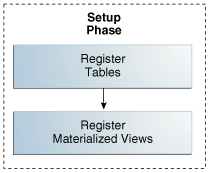
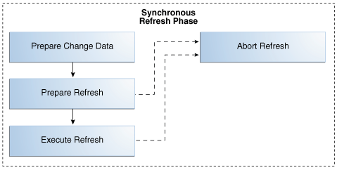
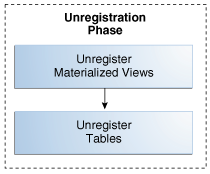

This chapter describes a method to synchronize changes to the tables and materialized views in a data warehouse. This method is based on synchronizing updates to tables and materialized views, and is called synchronous refresh.

This chapter includes the following sections:

- About Synchronous Refresh for Materialized Views

- Using Synchronous Refresh for Materialized Views

- Using Synchronous Refresh Groups

- Specifying and Preparing Change Data for Synchronous Refresh

- Troubleshooting Synchronous Refresh Operations

- Performing Synchronous Refresh Eligibility Analysis

- Overview of Synchronous Refresh Security Considerations

### 8.1 About Synchronous Refresh for Materialized Views

Synchronous refresh is a refresh method introduced in Oracle Database 12c Release 1 that enables you to keep a set of tables and the materialized views defined on them to be always in sync. It is well-suited for data warehouses, where the loading of incremental data is tightly controlled and occurs at periodic intervals.

In most data warehouses, the fact tables are partitioned along the time dimension and, very often, the incremental data load consists mainly of changes to recent time periods. Synchronous refresh exploits these characteristics to greatly improve refresh performance and throughput. This results in fast query performance for both planned and ad hoc queries, which is key to a successful data warehouse.

This section describes the main requirements and basic concepts of synchronous refresh, and includes the following:

- What Is Synchronous Refresh?

- Why Use Synchronous Refresh?

- Registering Tables and Materialized Views for Synchronous Refresh

- Specifying Change Data for Refresh

- Synchronous Refresh Preparation and Execution

- Materialized View Eligibility Rules and Restrictions for Synchronous Refresh

#### 8.1.1 What Is Synchronous Refresh?

Synchronous refresh is a new approach for maintaining tables and materialized views in a data warehouse where tables and materialized views are refreshed at the same time. In traditional refresh methods, the changes are applied to the base tables and the materialized views are refreshed separately with one of the following refresh methods:

- Log-based incremental (fast) refresh using materialized view logs if such logs are available

- PCT refresh if it is applicable

- Complete refresh

Synchronous refresh combines some elements of log-based incremental (fast) refresh and PCT refresh methods, but it is applicable only to `ON` `DEMAND` materialized views, unlike the other two methods. There are three major differences between it and the other refresh methods:

- Synchronous refresh requires you to register the tables and materialized views.

- Synchronous refresh requires you to specify changes to the data according to some formally specified rules.

- Synchronous refresh works by dividing the refresh operation into two steps: preparation and execution. This approach provides some important advantages over the other methods, such as better performance and more control.

Synchronous refresh APIs are defined in a new package called `DBMS_SYNC_REFRESH`. For more information about this package, see [Oracle Database PL/SQL Packages and Types Reference](../arpls/DBMS_SYNC_REFRESH.md).

#### 8.1.2 Why Use Synchronous Refresh?

Synchronous refresh offers the following advantages over traditional types of methods used to refresh materialized views in a data warehouse:

- It coordinates the loading of the changes into the base tables with the extremely efficient refresh of the dependent materialized views themselves.

- It decreases the time materialized views are not available to be used by the Optimizer to rewrite queries.

- It is well-suited for a wide class of materialized views (materialized aggregate views and materialized join views) commonly used in data warehouses. It does require the materialized views be partitioned as well as the fact tables, and if materialized views are not currently partitioned, they can be efficiently partitioned to take advantage of synchronous refresh.

- It fully exploits partitioning and the nature of the data warehouse load cycle to guarantee synchronization between the materialized view and the base table throughout the refresh procedure.

- In a typical data warehouse, data preparation consists of extracting the data from one or more sources, cleansing, and formatting it for consistency, and transforming into the data warehouse schema. The data preparation area is called the staging area and the base tables in a data warehouse are loaded from the tables in the staging area. The synchronous refresh method fits into this model because it allows you to load change data into the staging logs.

- The staging logs play the same role as materialized view logs in the conventional fast refresh method. There is, however, an important difference. In the conventional fast refresh method, the base table is first updated and the changes are then applied from the materialized view log to the materialized views. But in the synchronous refresh method, the changes from the staging log are applied to refresh the materialized views while also being applied to the base tables.

- Most materialized views in a data warehouse typically employ a star or snowflake schema with fact and dimension tables joined in a foreign key to primary key relationship. The synchronous refresh method can handle both schemas in all possible change data load scenarios, ranging from rows being added to only the fact table, to arbitrary changes to the fact and dimension tables.

- Instead of providing the change load data in the staging logs, you have a choice of directly providing the change data in the form of outside tables containing the data to be exchanged with the affected partition in the base table. This capability is provided by the `REGISTER_PARTITION_OPERATION` procedure in the `DBMS_SYNC_REFRESH` package.

#### 8.1.3 Registering Tables and Materialized Views for Synchronous Refresh

Before actually performing synchronous refresh, you must register the appropriate tables and materialized views. Synchronous refresh provides these methods to register tables and materialized views:

- Tables are registered with synchronous refresh by creating a staging log on them. A staging log is created with the `CREATE` `MATERIALIZED` `VIEW` `LOG` statement whose syntax has been extended in this release to create staging logs as well as the familiar materialized view logs used for the traditional incremental refresh. After you create a staging log on a table, it is deemed to be registered with synchronous refresh and can be modified only by using the synchronous refresh procedures. In other words, a table with a staging log defined on it is registered with synchronous refresh and cannot be modified directly by the user.

- Materialized views are registered with synchronous refresh using the `REGISTER_MVIEWS` procedure in the `DBMS_SYNC_REFRESH` package. The `REGISTER_MVIEWS` procedure implicitly creates groups of related objects called sync refresh groups. A sync refresh group consists of all related materialized views and tables that must be refreshed together as a single entity because they are dependent on one another.

**See Also:**

- [Oracle Database SQL Language Reference](../sqlrf/CREATE-MATERIALIZED-VIEW-LOG.md) for more information about the `CREATE` `MATERIALIZED` `VIEW` `LOG` statement

- [Oracle Database PL/SQL Packages and Types Reference](../arpls/DBMS_SYNC_REFRESH.md) for more information about the `DBMS_SYNC_REFRESH` package

#### 8.1.4 Specifying Change Data for Refresh

In the other refresh methods, you can directly modify the base tables of the materialized view, and the issue of specifying change data does not arise. But with synchronous refresh, you are required to specify and prepare the change data according to certain formally specified rules and using APIs provided by the `DBMS_SYNC_REFRESH` package.

There are two ways to specify the change data:

- Provide the change data in an outside table and register it with the `REGISTER_PARTITION_OPERATION` procedure.

  See "Working with Partition Operations While Capturing Change Data for Synchronous Refresh" for more details.

- Provide the change data by in staging logs and process them with the `PREPARE_STAGING_LOG` procedure. The format of the staging logs and rules for populating are described in "Working with Staging Logs While Capturing Change Data for Synchronous Refresh". You are required to run the `PREPARE_STAGING_LOG` procedure for every table before performing the refresh operation on that table.

#### 8.1.5 Synchronous Refresh Preparation and Execution

After preparing the change data, you can perform the actual refresh operation. Synchronous refresh takes a new approach to refresh execution. It works by dividing the refresh operation into two steps: preparation and execution. This is one of the main differences between it and the other refresh methods and provides some important benefits.

The preparation step determines the mapping between the fact table partitions and the materialized view partitions. This step computes the new tables corresponding only to the partitions of the fact table that have been changed by the incremental change data load. After these tables, called outside tables, have been computed, the actual execution of the refresh operation takes place in the execution step, which consists of just exchanging the outside tables with the corresponding partitions in the fact table or materialized view.

By dividing the refresh execution step into two phases and providing separate procedures for them, synchronous refresh not only provides you control over the refresh execution process, but also improves overall system performance. It does this by minimizing the time the materialized views are not available for use by direct access or the Optimizer because they are modified by the refresh process. During the preparation phase, the materialized view and its tables are not modified because at this time all the refresh changes are recorded in the outside table. Consequently, the materialized view is available to any query that needs to read them. It is only during execution that the tables and materialized views are modified. Execution performance is mainly affected by the number of changes to the dimension tables; if this number is small, then the performance should be very good because the exchange partition operations are themselves very fast.

The `DBMS_SYNC_REFRESH` package provides the `PREPARE_REFRESH` and `EXECUTE_REFRESH` procedures to perform these two steps.

**See Also:**

- [Oracle Database PL/SQL Packages and Types Reference](../arpls/DBMS_SYNC_REFRESH.md)

#### 8.1.6 Materialized View Eligibility Rules and Restrictions for Synchronous Refresh

The primary requirement for a materialized view to be eligible for synchronous refresh is that the materialized view must be partitioned with a key that can be derived from the partition key of its fact table. The following sections describe the other requirements for eligibility for synchronous refresh.

This section contains the following topics:

- Synchronous Refresh Restrictions: Partitioning

- Synchronous Refresh Restrictions: Refresh Options

- Synchronous Refresh Restrictions: Constraints

- Synchronous Refresh Restrictions: Tables

- Synchronous Refresh Restrictions: Materialized Views

- Synchronous Refresh Restrictions: Materialized Views with Aggregates

##### 8.1.6.1 Synchronous Refresh Restrictions: Partitioning

There are two key requirements to use synchronous refresh:

- The materialized view must be partitioned along the same dimension as the fact table.

- The partition key of the fact table should functionally determine the partition key of the materialized view.

The term functionally determine means the partition key of the materialized view can be derived from the partition key of the fact table based on a foreign key constraint relationship. This condition is satisfied if the partition key of the materialized view is the same as that for the fact table or related by joins from the fact table to the dimension table as in a star or snowflake schema. For example, if the fact table is partitioned by a date column, such as `TIME_KEY`, the materialized view can be partitioned by `TIME_KEY`, `MONTH`, or `YEAR`.

Synchronous refresh supports two types of partitioning on fact tables and materialized views: range partitioning and composite partitioning, when the top-level partitioning type is range.

##### 8.1.6.2 Synchronous Refresh Restrictions: Refresh Options

When you define a materialized view, you can specify three refresh options: how to refresh; whether trusted constraints can be used; and what type of refresh is to be performed. If unspecified, the defaults are assumed to be `ON` `DEMAND`, `ENFORCED` constraints, and `FORCE` respectively. Synchronous refresh requires that the first two of these options must have the values `ON` `DEMAND` and `TRUSTED` constraints respectively. Synchronous refresh does not require the type of refresh to have any specific value, so it can be `FAST`, `FORCE`, or `COMPLETE`.

##### 8.1.6.3 Synchronous Refresh Restrictions: Constraints

The relationships between the fact and dimension tables are declared by foreign and primary key constraints on the tables. Synchronous refresh trusts these constraints to perform the refresh, and requires that `USING` `TRUSTED` `CONSTRAINTS` must be specified in the materialized view definition. This allows using nonvalidated `RELY` constraints and rewriting against materialized views in an `UNKNOWN` or `FRESH` state during refresh.

When a table is registered for synchronous refresh, its constraints might be in a `VALIDATE` or `NOVALIDATE` state. If the table is a dimension table, synchronous refresh will retain this state during the refresh execution process.

However, if the table is a fact table, synchronous refresh marks the constraints `NOVALIDATE` state during refresh execution. This avoids the need for validating the constraint on existing data during a partition exchange that is the basis of the synchronous refresh method, and improves the performance of refresh execution.

Because the constraints on the fact table are not enforced by synchronous refresh, it is you who must verify the integrity and consistently of the data provided.

##### 8.1.6.4 Synchronous Refresh Restrictions: Tables

To be eligible for synchronous refresh, a table must satisfy the following conditions:

- The table cannot have VPD or triggers defined on it.

- The table cannot have any `RAW` type.

- The table cannot be remote.

- The staging log key of each table registered for synchronous refresh should satisfy the requirements described in "About the Staging Log Key".

##### 8.1.6.5 Synchronous Refresh Restrictions: Materialized Views

There are some other restrictions that are specific to materialized views registered for synchronous refresh:

- The `ROWID` column cannot be used to define the query. It is not relevant because it uses partition exchange, which replaces the original partition with the outside table. Hence, the defining query should not include any `ROWID` columns.

- Synchronous refresh does not support nested materialized views, `UNION` `ALL` materialized views, subqueries, or complex queries in the materialized view definition. The defining query must conform to the star or snowflake schema.

- These SQL constructs are also not supported: analytic window functions (such as `RANK`), the `MODEL` clause, and the `CONNECT` `BY` clause.

- Synchronous refresh is not supported for a materialized view that refers to views, remote tables, or outer joins.

- The materialized view must not contain references to nonrepeating expressions like `SYSDATE` and `ROWNUM`.

In general, most restrictions that apply to PCT-refresh, fast refresh, and general query rewrite also apply to synchronous refresh. Those restrictions are available at:

- "[About Materialized View Restrictions for Query Rewrite](basic-materialized-views.md)"

- "[General Query Rewrite Restrictions](basic-materialized-views.md)"

- "[General Restrictions on Fast Refresh](basic-materialized-views.md)"

##### 8.1.6.6 Synchronous Refresh Restrictions: Materialized Views with Aggregates

For materialized views with aggregates, synchronous refresh shares these restrictions with fast refresh:

- Only `SUM`, `COUNT`, `AVG`, `STDDEV`, `VARIANCE`, `MIN`, and `MAX` are supported.

- `COUNT(*)` must be specified.

- Aggregate functions must occur only as the outermost part of the expression. That is, aggregates such as `AVG(AVG(x))` or `AVG(x)+ AVG(x)` are not allowed.

- For each aggregate, such as `AVG(expr)`, the corresponding `COUNT(expr)` must be present. Oracle recommends that `SUM(expr)` be specified.

- If `VARIANCE(expr)` or `STDDEV(expr)` is specified, `COUNT(expr)` and `SUM(expr)` must be specified. Oracle recommends that `SUM(expr *expr)` be specified.

### 8.2 Using Synchronous Refresh for Materialized Views

Synchronous refresh differs from the other refresh methods in a number of ways. One is that the API for synchronous refresh is contained in a new package called `DBMS_SYNC_REFRESH`, whereas other refresh methods are declared in the `DBMS_MVIEW` package. Another difference is that after objects are registered with synchronous refresh, and, once registered, the other refresh methods cannot be used with them.

The operations associated with synchronous refresh can be divided into the following three broad phases:

- Synchronous Refresh Step 1: Registration Phase

- Synchronous Refresh Step 2: Synchronous Refresh Phase

- Synchronous Refresh Step 3: The Unregistration Phase

#### 8.2.1 Synchronous Refresh Step 1: Registration Phase

In this phase (Figure 8-1), you register the objects for use with synchronous refresh. The two steps in this phase are registration of tables first and then materialized views. You register the tables (by creating staging logs) and materialized views (with the `REGISTER_MVIEWS` procedure). The staging logs are created with the `CREATE` `MATERIALIZED` `LOG` `…` `FOR` `SYNCHRONOUS` `REFRESH` statement. If a table already has a regular materialized view log, the `ALTER` `MATERIALIZED` `LOG` `…` `FOR` `SYNCHRONOUS` `REFRESH` statement can be used to convert it to a staging log.

Figure 8-1 Registration Phase

[Description of "Figure 8-1 Registration Phase"](img_text/dwhsg_vm_157.md)

You can create a staging log with a statement, as show in Example 8-1.

Example 8-1 Registering Tables

    CREATE MATERIALIZED VIEW LOG ON fact
    FOR SYNCHRONOUS REFRESH USING st_fact;

If a table has a materialized view log, you can alter it to a staging log with a statement, such as the following:

    ALTER MATERIALIZED VIEW LOG ON fact
    FOR SYNCHRONOUS REFRESH USING st_fact;

You can register a materialized view with a statement, as shown in Example 8-2.

Example 8-2 Registering Materialized Views

    EXECUTE DBMS_SYNC_REFRESH.REGISTER_MVIEWS('MV1');

You can register multiple materialized views at one time:

    EXECUTE DBMS_SYNC_REFRESH.REGISTER_MVIEWS('mv2, mv2_year, mv1_halfmonth');

#### 8.2.2 Synchronous Refresh Step 2: Synchronous Refresh Phase

Figure 8-2 shows the synchronous refresh phase. This phase can be used repeatedly to perform synchronous refresh. The three main steps in this phase are:

1.  Prepare the change data for the refresh operation. You can provide the change data in a table and register it with the `REGISTER_PARTITION_OPERATION` procedure or provide the data by populating the staging logs. The staging logs must be processed with the `PREPARE_STAGING_LOG` procedure before proceeding to the next step.
    An example is Example 8-12.
2.  Perform the first step of the refresh operation (`PREPARE_REFRESH`). This can potentially be a long-running operation because it prepares and loads the outside tables.
    An example is Example 8-16.
3.  Perform the second and last step of the refresh operation (`EXECUTE_REFRESH`). This usually runs very fast because it usually consists of a series of partition-exchange operations.
    An example is Example 8-20.

In Figure 8-2, solid arrows show the standard control flow and dashed arrows are used for error-handling cases. If either of the refresh operations (`PREPARE_REFRESH` or `EXECUTE_REFRESH`) raises user errors, you use an `ABORT_REFRESH` procedure to restore tables and materialized views to the state that existed before the refresh operation, fix the problem, and retry the refresh operation starting from the beginning.

Figure 8-2 Refresh Phase

[Description of "Figure 8-2 Refresh Phase"](img_text/dwhsg_vm_156.md)

#### 8.2.3 Synchronous Refresh Step 3: The Unregistration Phase

If you choose to stop using synchronous refresh, then you must unregister the materialized views as shown in Figure 8-3. The materialized views are first unregistered with the `UNREGISTER_MVIEWS` procedure. The tables are then unregistered by either dropping their staging logs or altering the staging logs to ordinary logs. Note that if the staging logs are converted to be ordinary materialized view logs with an `ALTER` `MATERIALIZED` `LOG` `…` `FOR` `FAST` `REFRESH` statement, then the materialized views can be maintained with standard fast-refresh methods.

Figure 8-3 Unregistration Phase

[Description of "Figure 8-3 Unregistration Phase"](img_text/dwhsg_vm_155.md)

Example 8-3 illustrates how to unregister the single materialized view `MV1`.

Example 8-3 Unregister Materialized Views

    EXECUTE DBMS_SYNC_REFRESH.UNREGISTER_MVIEWS('MV1');

You can unregister multiple materialized views at one time:

    EXECUTE DBMS_SYNC_REFRESH.UNREGISTER_MVIEWS('mv2, mv2_year, mv1_halfmonth');

You can verify to see that a materialized view has been unregistered by querying the `DBA_SR_OBJ_ALL` view.

Example 8-4 illustrates how to drop the staging log.

Example 8-4 Unregister Tables

    DROP MATERIALIZED VIEW LOG ON fact;

Or you can alter the table to a materialized view log:

    ALTER MATERIALIZED VIEW LOG ON fact
    FOR FAST REFRESH;

You can verify to see that a table has been unregistered by querying the `DBA_SR_OBJ_ALL` view.

### 8.3 Using Synchronous Refresh Groups

The distinguishing feature of synchronous refresh is that changes to a table and its materialized views are loaded and refreshed together, hence the name synchronous refresh. For tables and materialized views to be maintained by synchronous refresh, the objects must be registered. Tables are registered for synchronous refresh when staging logs are created on them, and materialized views are registered using the `REGISTER_MVIEWS` procedure.

Synchronous refresh supports the refresh of materialized views built on multiple tables, with changes in one or more of them. Tables that are related by constraints must all necessarily be refreshed together to ensure data integrity. Furthermore, it is possible that some of the tables registered for synchronous refresh have several materialized views built on top of them, in which case, all those materialized views must also be refreshed together.

Instead of having you keep track of these dependencies, and issue the refresh commands on the right set of tables, Oracle Database automatically generates the minimal sets of tables and materialized views that must necessarily be refreshed together. These sets are termed synchronous refresh groups or just sync refresh groups. Each sync refresh group is identified by a `GROUP_ID`.value.

The three procedures related to performing synchronous refresh (`PREPARE_REFRESH`, `EXECUTE_REFRESH` and `ABORT_REFRESH`) take as input either a single group ID or a list of group IDs identifying the sync refresh groups.

Each table or materialized view registered for synchronous refresh is assigned a `GROUP_ID` value, which may change over time, if the dependencies among them change. This happens when you issue the `REGISTER_MVIEWS` and `UNREGISTER_MVIEWS` procedures. The examples that follow show the sync refresh groups in a number of scenarios.

Because the `GROUP_ID` value can change with time, Oracle recommends the actual `GROUP_ID` value not be used when invoking the synchronous refresh procedures, but that the function `DBMS_SYNC_REFRESH.GET_GROUP_ID` be used instead. This function takes a materialized view name as input and returns the materialized view's `GROUP_ID` value.

**See Also:**

[Oracle Database PL/SQL Packages and Types Reference](../arpls/DBMS_SYNC_REFRESH.md) for information about how to use the `DBMS_SYNC_REFRESH.REGISTER_MVIEWS` procedure

This section contains the following topics:

- Examples of Common Actions with Synchronous Refresh Groups

- Examples of Working with Multiple Synchronous Refresh Groups

#### 8.3.1 Examples of Common Actions with Synchronous Refresh Groups

The synchronous refresh demo scripts in the `rdbms/demo` directory enable you to view typical operations that you are likely to perform. The main script is `syncref_run.sql`, and its log is `syncref_run.log`. Example 8-5, Example 8-6, and Example 8-7 below illustrate the different contexts in which the `GET_GROUP_ID` function can be used.

Example 8-5 Display the Objects Registered in a Group

This example illustrates how to display the objects registered in a group after registering them.

    EXECUTE DBMS_SYNC_REFRESH.REGISTER_MVIEWS('MV1');
    SELECT NAME, TYPE, STAGING_LOG_NAME FROM USER_SR_OBJ
    WHERE GROUP_ID = DBMS_SYNC_REFRESH.GET_GROUP_ID('MV1')
    ORDER BY TYPE, NAME;

    NAME       TYPE       STAGING_LOG_NAME
    ---------- ---------- ----------------
    MV1        MVIEW
    FACT       TABLE      ST_FACT
    STORE      TABLE      ST_STORE
    TIME       TABLE      ST_TIME

Example 8-6 Invoke Refresh Operations

This example illustrates how to invoke refresh operations.

    EXECUTE DBMS_SYNC_REFRESH.PREPARE_REFRESH( -
            DBMS_SYNC_REFRESH.GET_GROUP_ID('MV1'));
    EXECUTE DBMS_SYNC_REFRESH.EXECUTE_REFRESH( -
            DBMS_SYNC_REFRESH.GET_GROUP_ID('MV1'));
    SELECT NAME, TYPE, STATUS FROM USER_SR_OBJ_STATUS
    WHERE GROUP_ID = DBMS_SYNC_REFRESH.GET_GROUP_ID('MV1')
    ORDER BY TYPE, NAME;

Example 8-7 Verify the Status of Objects Registered in a Group

This example illustrates how to verify the status of objects registered in a group after an `EXECUTE_REFRESH` operation.

    SELECT NAME, TYPE, STATUS FROM USER_SR_OBJ_STATUS
    WHERE GROUP_ID = DBMS_SYNC_REFRESH.GET_GROUP_ID('MV1')
    ORDER BY TYPE, NAME;

    NAME             TYPE       STATUS
    ---------------- ---------- ----------------
    MV1              MVIEW      COMPLETE
    FACT             TABLE      COMPLETE
    STORE            TABLE      COMPLETE
    TIME             TABLE      COMPLETE

#### 8.3.2 Examples of Working with Multiple Synchronous Refresh Groups

You can work with multiple refresh groups at one time with the following APIs:

- `GET_GROUP_ID_LIST`

  Takes a list of materialized views as input and returns their group IDs in a list.

- `GET_ALL_GROUP_IDS`

  Returns the group IDs of all groups in the system in a list.

- The prepare refresh procedures (`PREPARE_REFRESH`, `EXECUTE_REFRESH`, and `ABORT_REFRESH`) can work multiple groups. Their overloaded versions accept lists of group IDs at a time.

Example 8-8 Prepare Sync Refresh Groups

This example illustrates how to prepare the sync refresh groups of `MV1`, `MV2`, and `MV3`.

    EXECUTE DBMS_SYNC_REFRESH.PREPARE_REFRESH(
            DBMS_SYNC_REFRESH.GET_GROUP_ID_LIST('MV1, MV2, MV3'));

Note that it is not necessary that these three materialized views be all in different groups. It is possible that two of the materialized views are in one group, and third in another; or even that all three materialized views are in the same group. Because `PREPARE_REFRESH` is overloaded to accept either a group ID or a list of group IDs, the above call will work in all cases.

Example 8-9 Execute Sync Refresh Groups

This example illustrates how to prepare and execute the refresh of all sync refresh groups in the system.

    EXECUTE DBMS_SYNC_REFRESH.PREPARE_REFRESH(
            DBMS_SYNC_REFRESH.GET_ALL_GROUP_IDS);

    EXECUTE DBMS_SYNC_REFRESH.EXECUTE_REFRESH(
            DBMS_SYNC_REFRESH.GET_ALL_GROUP_IDS);

### 8.4 Specifying and Preparing Change Data for Synchronous Refresh

Synchronous refresh requires you to specify and prepare the change data that serves as the input to the `PREPARE_REFRESH` and `EXECUTE_REFRESH` procedures. There are two methods for specifying the change data:

- Provide the change data in an outside table and register it with the `REGISTER_PARTITION_OPERATION` procedure as described in Working with Partition Operations While Capturing Change Data for Synchronous Refresh.

- Provide the change data by in staging logs and process them with the `PREPARE_STAGING_LOG` procedure as described in Working with Staging Logs While Capturing Change Data for Synchronous Refresh.

Some important points about change data are:

- The two methods are not mutually exclusive and can be employed at the same time, even on the same table, but there cannot be any conflicts in the changes specified. For instance, you can use the staging log to specify the change in a partition with a small number of changes, but if another partition has extensive changes, you can provide the changes for that partition in an outside table.

- For dimension tables, you can use only the staging logs to provide changes.

- Synchronous refresh can handle arbitrary combinations of changes in fact and dimension tables, but it is optimized for the most common data warehouse usage scenarios, where the bulk of the changes are made to only a few partitions of the fact table.

- Synchronous refresh places no restrictions on the use of nondestructive partition maintenance operations (PMOPS), such as add partition, used commonly in data warehouses. The use of such PMOPS is not directly related to the method used to specify change data.

- Synchronous refresh requires that all staging logs in the group must be prepared, even if the staging log has no changes registered in it.

#### 8.4.1 Working with Partition Operations While Capturing Change Data for Synchronous Refresh

Using the `REGISTER_PARTITION_OPERATION` procedure, you can provide the change data directly. This method is applicable only to fact tables. For each fact table partition that is changed, you must provide an outside table containing the data for that partition. The synchronous refresh demo (`syncref_run.sql` and `syncref_run.log`) contains an example. The steps are:

1.  Create an outside table for the partition that it is intended to replace. It must have the same constraints as the fact table, and can be created in any desired tablespace.
        CREATE TABLE      fact_ot_fp3(
           time_key       DATE NOT NULL REFERENCES time(time_key),
           store_key      INTEGER NOT NULL REFERENCES store(store_key),
           dollar_sales   NUMBER (6,2),
           unit_sales     INTEGER)
           tablespace     syncref_fp3_tbs;
2.  Insert the data for this partition into the outside table.
3.  Register this table for partition exchange.
        begin
           DBMS_SYNC_REFRESH.REGISTER_PARTITION_OPERATION(
               partition_op                 => 'EXCHANGE',
               schema_name                  => 'SYNCREF_USER',
               base_table_name              => 'FACT',
               partition_name               => 'FP3',
               outside_partn_table_schema   => 'SYNCREF_USER',
               outside_partn_table_name     => 'FACT_OT_FP3');
           end;
          /
        /

When you register the outside table and execute the refresh, Oracle Database performs the following operation at `EXECUTE_REFRESH` time:

    ALTER TABLE FACT EXCHANGE PARTITION fp3 WITH TABLE fact_ot_fp3
    INCLUDING INDEXES WITHOUT VALIDATION;

However, you are not allowed to issue the above statement directly on your own. If you do, Oracle Database will give this error:

    ORA-31908: Cannot modify the contents of a table with a staging log.

Besides the `EXCHANGE` operation, the two other partition operations that can be registered with the `REGISTER_PARTITION_OPERATION` procedure are `DROP` and `TRUNCATE`.

Example 8-10 Registering a DROP Operation

This example illustrates how to specify the drop of the first partition (`FP1`), by using the following statement.

    begin
     DBMS_SYNC_REFRESH.REGISTER_PARTITION_OPERATION(
                  partition_op                 => 'DROP',
                  schema_name                  => 'SYNCREF_USER',
                  base_table_name              => 'FACT',
                  partition_name               => 'FP1');
    end;
    /

If you wanted to truncate the partition instead, you could specify `TRUNCATE` instead of `DROP` for the `partition_op` parameter.

The three partition operations (`EXCHANGE`, `DROP`, and `TRUNCATE`) are called destructive PMOPS because they modify the contents of the table. The following partition operations are not destructive, and can be performed directly on a table registered with synchronous refresh:

- `ADD` `PARTITION`

- `SPLIT` `PARTITION`

- `MERGE` `PARTITIONS`

- `MOVE` `PARTITION`

- `RENAME` `PARTITION`

In data warehouses, these partition operations are commonly used to manage the large volumes of data, and synchronous refresh places no restrictions on their usage. Oracle Database requires only that these operations be performed before the `PREPARE_REFRESH` command is issued. This is because the `PREPARE_REFRESH` procedure computes the mapping between the fact table partitions and the materialized view partitions, and if any partition-maintenance is done between the `PREPARE_REFRESH` and `EXECUTE_REFRESH` procedures, Oracle Database will detect this at `EXECUTE_REFRESH` and show an error.

You can use the `USER_SR_PARTN_OPS` catalog view to display the registered partition operations.

    SELECT   TABLE_NAME, PARTITION_OP, PARTITION_NAME,
             OUTSIDE_TABLE_SCHEMA ot_schema, OUTSIDE_TABLE_NAME ot_name
    FROM     USER_SR_PARTN_OPS
    ORDER BY TABLE_NAME;

    TABLE_NAME PARTITION_ PARTITION_NAME  OT_SCHEMA       OT_NAME
    ---------- ---------- --------------- --------------- --------------------
    FACT       EXCHANGE   FP3             SYNCREF_USER    FACT_OT_FP3

    1 row selected.

These partition operations are consumed by the synchronous refresh operation and are automatically unregistered by the `EXECUTE_REFRESH` procedure. So if you query `USER_SR_PARTN_OPS` after `EXECUTE_REFRESH`, it will show no rows.

After registering a partition, if you find you made a mistake or change your mind, you can undo it with the `UNREGISTER_PARTITION_OPERATION` command:

    begin
     DBMS_SYNC_REFRESH.UNREGISTER_PARTITION_OPERATION(
                  partition_op                  => 'EXCHANGE',
                  schema_name                   => 'SYNCREF_USER',
                  base_table_name               => 'FACT',
                  partition_name                => 'FP3');
    end;
    /

#### 8.4.2 Working with Staging Logs While Capturing Change Data for Synchronous Refresh

In synchronous refresh, staging logs play a role similar to materialized view logs in incremental refresh. They are created with a DDL statement and can be altered to a materialized view log. Unlike materialized view logs, however, you are responsible for loading changes into the staging logs in a specified format. Each row in the staging log must have a key to identify it uniquely; this key is called the staging log key, and is defined in "About the Staging Log Key".

You are responsible for populating the staging log, which will consist of all the columns in the base table and an additional control column `DMLTYPE$$` of type `CHAR(2)`. This must have the value `'I'` to denote the row is being inserted, `'D'` for delete, and `'UN'` and `'UO'` for the new and old values of the row being updated, respectively. The last two must occur in pairs.

The staging log is validated by the `PREPARE_STAGING_LOG` procedure and consumed by the synchronous refresh operations (`PREPARE_REFRESH` and `EXECUTE_REFRESH`). During validation by `PREPARE_STAGING_LOG`, if errors are detected, they will be captured in an exceptions table. You can query the view `USER_SR_STLOG_EXCEPTIONS` to get details on the exceptions.

Synchronous refresh requires that, before calling `PREPARE_REFRESH` for sync refresh groups, the staging logs of all tables in the group must be processed with `PREPARE_STAGING_LOG`. This is necessary even if a table has no change data and its staging log is empty.

This section contains the following topics:

- About the Staging Log Key

- About Staging Log Rules

- About Columns Being Updated to NULL

- Examples of Working with Staging Logs

- Error Handling in Preparing Staging Logs

##### 8.4.2.1 About the Staging Log Key

In order to create a staging log on a base table, the base table must have a key. If the table has a primary key, the primary key is deemed to be staging log key on the table's staging log. Note that every dimension table has a primary key.

With fact tables, it is less common for them to have a primary key. If a table does not have a primary key, the columns that are the foreign keys of its dimension tables constitute its staging log key.

The key of a staging log can be described as:

- The primary key of the base table. If a fact table has a primary key, it is sometimes called a surrogate key.

- The set of foreign keys for a fact table. This applies if the fact table does not have a primary key. This assumption is common in data warehouses, though it is not enforced.

The rules for loading staging logs are described in "About Staging Log Rules".

The `PREPARE_STAGING_LOG` procedure verifies that each key value is specified at most once. When populating the staging log, it is your responsibility to consolidate the changes if a row with the same key value is changed more than once. This process is known as change consolidation. When doing the change consolidation, you must:

- Consolidate a delete-insert of the same row into an update operation with rows `'UO'` and `'UN'`.

- Consolidate multiple updates into a single update.

- Prevent null changes such as an insert-update-delete of the same row from appearing in the staging log.

- Consolidate an insert followed by multiple updates into a single insert.

##### 8.4.2.2 About Staging Log Rules

Every row should contain non-null values for all the columns comprising the primary key. You are required to consolidate all the changes so that each key in the staging log can be specified only for one type of operation.

For the rows being inserted (`DMLTYPE$$` is `'I'`), all columns in the staging log must be supplied with valid values, conforming to any constraint on the corresponding columns in the base table. Keys of rows being inserted must not exist in the base table.

For the rows being deleted (`DMLTYPE$$` is `'D`'), the non-key column values are optional. Similarly, for the rows specifying the old values of the columns being updated (`DMLTYPE$$` is `'UO'`), the non-key column values are optional; an important exception is the column whose values are being updated to `NULL`, as explained subsequently.

For the rows specifying the new values of the columns being updated (`DMLTYPE$$` is `'UN'`), the non-key column values are optional except for the values of the columns that were changed.

##### 8.4.2.3 About Columns Being Updated to NULL

If a column is being updated to `NULL`, its old value must be specified. Otherwise, Oracle Database may not be able to distinguish this from a column whose value is being left unchanged in the update.

For example, let table `T1` have three columns `c1`, `c2`, and `c3`. Let there be a row with (`c1, c2, c3) = (1, 5, 10)`, and you supply the following information in the staging log:

| DMLTYPE\$\$ | C1  | C2   | C3   |
|:------------|:----|:-----|:-----|
| UO          | 1   | NULL | NULL |
| UN          | 1   | NULL | 11   |

The result would be that the new row could be `(1, 5, 11)` or `(1, NULL, 11)` without having specified the old value. However, with that specification, it is clear the new row is (`1, 5, 11)`. If you want to specify `NULL` for `c2`, you should specify the old value in the `UO` row as follows:

| DMLTYPE\$\$ | C1  | C2   | C3   |
|:------------|:----|:-----|:-----|
| UO          | 1   | 5    | NULL |
| UN          | 1   | NULL | 11   |

Because the old value of `c2` is `5`, (the correct previously updated value for the column), its new value, will be `NULL` and the new row is `(1, NULL, 11)`.

##### 8.4.2.4 Examples of Working with Staging Logs

This section illustrates examples of working with staging logs.

The `PREPARE_STAGING_LOG` procedure has an optional third parameter called `PSL_MODE`. This allows you to specify whether any or all of the three types of DML statements specified in the staging log can be treated as trusted, and not be subject to verification by the `PREPARE_STAGING_LOG` procedure, as shown in Example 8-11.

Example 8-11 Specifying Trusted DML Statements

    EXECUTE DBMS_SYNC_REFRESH.PREPARE_STAGING_LOG('syncref_user', 'store',
                                     DBMS_SYNC_REFRESH.INSERT_TRUSTED +
                                     DBMS_SYNC_REFRESH.DELETE_TRUSTED);

This call will skip verification of `INSERT` and `DELETE` DML statements in the staging log of `STORE` but will verify `UPDATE` DML statements.

Example 8-12 Preparing Staging Logs

This example is taken from the demo `syncref_run.sql`. It shows that the user has provided values for all columns for the delete and update operations. This is recommended if these values are available.

    INSERT INTO st_store (dmltype$$, STORE_KEY, STORE_NUMBER, STORE_NAME, ZIPCODE)
    VALUES ('I',   5, 5, 'Store 5', '03060');

    INSERT INTO st_store (dmltype$$, STORE_KEY, STORE_NUMBER, STORE_NAME, ZIPCODE)
    VALUES ('I',   6, 6, 'Store 6', '03062');

    INSERT INTO st_store (dmltype$$, STORE_KEY, STORE_NUMBER, STORE_NAME, ZIPCODE)
    VALUES ('UO',  4, 4, 'Store 4', '03062');

    INSERT INTO st_store (dmltype$$, STORE_KEY, STORE_NUMBER, STORE_NAME, ZIPCODE)
    VALUES ('UN',  4, 4, 'Stor4NewNam', '03062');

    INSERT INTO st_store (dmltype$$, STORE_KEY, STORE_NUMBER, STORE_NAME, ZIPCODE)
    VALUES ('D',   3, 3, 'Store 3', '03060');

    EXECUTE DBMS_SYNC_REFRESH.PREPARE_STAGING_LOG('syncref_user', 'store');

    -- display initial contents of st_store

    SELECT dmltype$$, STORE_KEY, STORE_NUMBER, STORE_NAME, ZIPCODE
    FROM st_store
    ORDER BY STORE_KEY ASC, dmltype$$ DESC;

    DM  STORE_KEY  STORE_NUMBER  STORE_NAME    ZIPCODE
    --  ---------  ------------  ----------    -------
    D            3            3  Store 3         03060
    UO           4            4  Store 4         03062
    UN           4            4  Stor4NewNam     03062
    I            5            5  Store 5         03060
    I            5            5  Store 6         03062

    5 rows selected.

Example 8-13 Filling in Missing Values for Deleting and Updating Records

This example shows that if you do not supply all the values for the delete and update operations, then when you run the `PREPARE_STAGING_LOG` procedure, Oracle Database will fill in missing values.

    INSERT INTO st_store (dmltype$$, STORE_KEY, STORE_NUMBER, STORE_NAME, ZIPCODE)
    VALUES ('D',  3, NULL, NULL, NULL);

    INSERT INTO st_store (dmltype$$, STORE_KEY, STORE_NUMBER, STORE_NAME, ZIPCODE)
    VALUES ('UO',  4, NULL, NULL, NULL);

    INSERT INTO st_store (dmltype$$, STORE_KEY, STORE_NUMBER, STORE_NAME, ZIPCODE)
    VALUES ('UN',  4, NULL, NULL, '03063');

    EXECUTE DBMS_SYNC_REFRESH.PREPARE_STAGING_LOG('syncref_user', 'store');

    SELECT dmltype$$, STORE_KEY, STORE_NUMBER, STORE_NAME, ZIPCODE
    FROM ST_STORE ORDER BY STORE_KEY ASC, dmltype$$ DESC;

    DM STORE_KEY STORE_NUMBER STORE_NAME  ZIPCODE
    -- --------- ------------ ----------- ---------
    D          3            3 Store 3     03060
    UO         4            4 Store 4     03062
    UN         4            4 Store 4     03063

Example 8-14 Updating a Column to NULL

This example illustrates how to update a column to `NULL`. If you want to update a column value to `NULL`, then you must provide its old value in the `UO` record.

In this example, your goal is to change the zipcode of store 4 to 03063 and its name to `NULL`. You can supply the old zipcode value, but you must supply the old value of `store_name` in the `'UO'` row, or else `store_name` will be unchanged.

    INSERT INTO st_store (dmltype$$, STORE_KEY, STORE_NUMBER, STORE_NAME, ZIPCODE)
    VALUES ('UO',  4, NULL, 'Store 4', NULL);

    INSERT INTO st_store (dmltype$$, STORE_KEY, STORE_NUMBER, STORE_NAME, ZIPCODE)
    VALUES ('UN',  4, NULL, NULL, '03063');

    EXECUTE DBMS_SYNC_REFRESH.PREPARE_STAGING_LOG('syncref_user', 'store');

    SELECT dmltype$$, STORE_KEY, STORE_NUMBER, STORE_NAME, ZIPCODE
    FROM st_store ORDER BY STORE_KEY ASC, dmltype$$ DESC;

    DM STORE_KEY STORE_NUMBER STORE_NAME  ZIPCODE
    -- --------- ------------ ----------- --------
    UO         4            4 Store 4     03062
    UN         4            4             03063

Example 8-15 Displaying Staging Log Statistics

This example illustrates how to use the `USER_SR_STLOG_STATS` catalog view to display the staging log statistics.

    SELECT   TABLE_NAME, STAGING_LOG_NAME, NUM_INSERTS, NUM_DELETE, NUM_UPDATES
    FROM     USER_SR_STLOG_STATS
    ORDER BY TABLE_NAME;

    TABLE_NAME STAGING_LOG_NAME NUM_INSERTS NUM_DELETES NUM_UPDATES
    ---------- ---------------- ----------- ----------- -----------
    FACT       ST_FACT                    4           1           1
    STORE      ST_STORE                   2           1           1
    TIME       ST_TIME                    1           0           0

    3 rows selected.

If you use the same query at the end of the `EXECUTE_REFRESH` procedure, then you will get no rows, indicating the change data has all been consumed by synchronous refresh.

##### 8.4.2.5 Error Handling in Preparing Staging Logs

When a table is processed by the `PREPARE_STAGING_LOG` procedure, it will detect and report errors in the specification of change data that relates only to that table. For example, it will verify that keys of rows being inserted do not already exist in the base table and that keys of rows being deleted or updated do exist. However, the `PREPARE_STAGING_LOG` procedure cannot detect errors related to the referential integrity constraints on the table; that is, it cannot detect errors if there are inconsistencies in the specification of change data that involves more than one table. Such errors will be detected at the time of the `EXECUTE_REFRESH` procedure.

### 8.5 Troubleshooting Synchronous Refresh Operations

This section describes how to monitor the status of the two synchronous refresh procedures, `PREPARE_REFRESH` and `EXECUTE_REFRESH` and how to troubleshoot errors that may occur. To be successful in using synchronous refresh, you should be aware of the different types of errors that can arise and how to deal with them.

One of the most likely sources of errors is from incorrect preparation of the change data. These errors will present themselves as referential constraint violations when the `EXECUTE_REFRESH` procedure is run. In such cases, the status of the group is set to `ABORT`. It is important to learn to recognize these errors and address them.

The topics covered in this section are:

- Overview of the Status of Refresh Operations

- How PREPARE_REFRESH Sets the STATUS Fields

- Examples of Preparing for Synchronous Refresh Using PREPARE_REFRESH

- How EXECUTE_REFRESH Sets the Status Fields During Synchronous Refresh

- Examples of Executing Synchronous Refresh Using EXECUTE_REFRESH

- Example of EXECUTE_REFRESH with Constraint Violations

#### 8.5.1 Overview of the Status of Refresh Operations

The `DBMS_SYNC_REFRESH` package provides three procedures to control the refresh execution process. You initiate synchronous refresh with the `PREPARE_REFRESH` procedure, which plans the entire refresh operation and does the bulk of the computational work for refresh, followed by the `EXECUTE_REFRESH` procedure, which carries out the refresh. The third procedure provided is `ABORT_REFRESH`, which is used to recover from errors if either of these procedures fails.

The `USER_SR_GRP_STATUS` and `USER_SR_OBJ_STATUS` catalog views contain all the information on the status of these refresh operations for current groups:

- The `USER_SR_GRP_STATUS` view shows the status of the group as a whole.

  - The `OPERATION` field indicates the current refresh procedure run on the group: `PREPARE` or `EXECUTE`.

  - The `STATUS` field indicates the status of the operation - `RUNNING`, `COMPLETE`, `ERROR`-`SOFT`, `ERROR`-`HARD`, `ABORT`, `PARTIAL`. These are explained in detail later.

  - The group is identified by its group ID.

- The `USER_SR_OBJ_STATUS` view shows the status of each individual object.

  - The object is identified by its owner, name, and type (`TABLE` or `MVIEW`) and group ID.

  - The `STATUS` field, which may be `NOT` `PROCESSED`, `ABORT`, or `COMPLETE`. These are explained in detail later.

#### 8.5.2 How PREPARE_REFRESH Sets the STATUS Fields

When you launch a new `PREPARE_REFRESH` job, the group's `STATUS` is set to `RUNNING` and the `STATUS` of the objects in the group is set to `NOT` `PROCESSED`. When the `PREPARE_REFRESH` job finishes, the status of the objects remains unchanged, but the group's status is changed to one of following three values:

- `COMPLETE` if the job completed successfully.

- `ERROR_SOFT` if the job encountered the ORA-01536: space quota exceeded for tablespace '%s' error.

- `ERROR_HARD` otherwise (that is, if the job encountered any error other than ORA-01536).

Some points to keep in mind when using the `PREPARE_REFRESH` procedure:

- The `NOT` `PROCESSED` status of the objects in the group signifies that the data of the objects has not been modified by the `PREPARE_REFRESH` job. The data modification will occur only in the `EXECUTE_REFRESH` step, at which time the status will be changed as appropriate. This is described later.

- If the `STATUS` is `ERROR_SOFT`, you can fix the ORA-01536 error by increasing the space quota for the specified tablespace, and resume `PREPARE_REFRESH`. Alternatively, you can choose to abort the refresh with `ABORT_REFRESH`.

- If the `STATUS` value is `ERROR_HARD`, then your only option is to abort the refresh with `ABORT_REFRESH`.

- If the `STATUS` value after the `PREPARE_REFRESH` procedure finishes is `RUNNING`, then an error has occurred. Contact Oracle Support Services for assistance.

- A `STATUS` value of `ERROR_HARD` might be related to running out of resources because the `PREPARE_REFRESH` procedure can be resource-intensive. If you are not able to identify the problem, then contact Oracle Support Services for assistance. But if you can identify the problem and fix it, then you might be able to continue using synchronous refresh, by first running `ABORT_REFRESH` and then the `PREPARE_REFRESH` procedure.

- Remember that you can launch a new `PREPARE_REFRESH` job only when the previous refresh operation on the group (if any) has either completed execution successfully or has aborted.

- If the `STATUS` value of the `PREPARE_REFRESH` procedure at the end is not `COMPLETE`, you cannot proceed to the `EXECUTE_REFRESH` step. If you are unable to get `PREPARE_REFRESH` to work correctly, then you can proceed to the unregistration phase, and maintain the objects in the groups with other refresh methods.

#### 8.5.3 Examples of Preparing for Synchronous Refresh Using PREPARE_REFRESH

This section offers examples of common cases when preparing a refresh.

Example 8-16 PREPARE_REFRESH Succeeds with Status COMPLETE

This example shows a `PREPARE_REFRESH` procedure completing successfully.

    EXECUTE DBMS_SYNC_REFRESH.PREPARE_REFRESH( DBMS_SYNC_REFRESH.GET_GROUP_ID('MV1'));

    PL/SQL procedure successfully completed.

    SELECT OPERATION, STATUS
    FROM USER_SR_GRP_STATUS
    WHERE GROUP_ID = DBMS_SYNC_REFRESH.GET_GROUP_ID('MV1');

    OPERATION  STATUS
    ---------  ------
    PREPARE    COMPLETE

Example 8-17 PREPARE_REFRESH Fails with Status ERROR_SOFT

This example shows a `PREPARE_REFRESH` procedure encountering ORA-01536.

    EXECUTE DBMS_SYNC_REFRESH.PREPARE_REFRESH( DBMS_SYNC_REFRESH.GET_GROUP_ID('MV1'));
    BEGIN DBMS_SYNC_REFRESH.PREPARE_REFRESH(DBMS_SYNC_REFRESH.GET_GROUP_ID('MV1')); END;

    *
    ERROR at line 1:
    ORA-01536: space quota exceeded for tablespace 'DUMMY_TS'
    ORA-06512: at "SYS.DBMS_SYNC_REFRESH", line 63
    ORA-06512: at "SYS.DBMS_SYNC_REFRESH", line 411
    ORA-06512: at "SYS.DBMS_SYNC_REFRESH", line 429
    ORA-06512: at line 1PL/SQL procedure successfully completed.

    SELECT OPERATION, STATUS
    FROM USER_SR_GRP_STATUS
    WHERE GROUP_ID = DBMS_SYNC_REFRESH.GET_GROUP_ID('MV1');

    OPERATION  STATUS
    ---------  ------
    PREPARE    ERROR_SOFT

Example 8-18 Resume of PREPARE_REFRESH Succeeds

This example is a continuation of Example 8-17. After the ORA-01536 error is raised, increase the tablespace for `DUMMY_TS` and rerun the `PREPARE_REFRESH` procedure, which now completes successfully. Note that the `PREPARE_REFRESH` procedure will resume processing from the place where it stopped. Also note the usage of the `PREPARE_REFRESH` procedure is no different from normal, and does not require any parameters or settings to indicate the procedure is being resumed.

    EXECUTE DBMS_SYNC_REFRESH.PREPARE_REFRESH(DBMS_SYNC_REFRESH.GET_GROUP_ID('MV1'));

    PL/SQL procedure successfully completed.

    SELECT OPERATION, STATUS
    FROM USER_SR_GRP_STATUS
    WHERE GROUP_ID = DBMS_SYNC_REFRESH.GET_GROUP_ID('MV1');

    OPERATION  STATUS
    ---------  ------
    PREPARE    COMPLETE

Example 8-19 Abort of PREPARE_REFRESH

This example assumes the `PREPARE_REFRESH` procedure has failed and the `STATUS` value is `ERROR_HARD`. You then run the `ABORT_REFRESH` procedure to abort the prepare job. Note that the `STATUS` value has changed from `ERROR_HARD` to `ABORT` at the end.

    SELECT OPERATION, STATUS
    FROM USER_SR_GRP_STATUS
    WHERE GROUP_ID = DBMS_SYNC_REFRESH.GET_GROUP_ID('MV1');

    OPERATION  STATUS
    ---------  ------
    PREPARE    ERROR_HARD

    EXECUTE DBMS_SYNC_REFRESH.ABORT_REFRESH( DBMS_SYNC_REFRESH.GET_GROUP_ID('MV1'));

    PL/SQL procedure successfully completed.

    SELECT OPERATION, STATUS
    FROM USER_SR_GRP_STATUS
    WHERE GROUP_ID = DBMS_SYNC_REFRESH.GET_GROUP_ID('MV1');

    OPERATION  STATUS
    ---------  ------
    PREPARE    ABORT

#### 8.5.4 How EXECUTE_REFRESH Sets the Status Fields During Synchronous Refresh

The `EXECUTE_REFRESH` procedure divides the group of objects in the sync refresh group into subgroups, each of which is refreshed atomically. The first subgroup consists of the base tables. Each materialized view in the sync refresh group is placed in a separate subgroup and refreshed atomically.

In the case of the `EXECUTE_REFRESH` procedure, the possible end states of the `STATUS` field are: `COMPLETE`, `PARTIAL`, and `ABORT`:

- `STATUS` `=` `COMPLETE`

  This state is reached if the base tables and all the materialized views refresh successfully.

- `STATUS` `=` `ABORT`

  This state indicates the refresh of the base tables subgroup has failed; the data in the tables and materialized views is consistent but unchanged. If this happens, then there should be an error associated with the failure. If it is a user error, such as a constraint violation, then you can fix the problem and retry the synchronous refresh operation from the beginning (that is, `PREPARE_STAGING_LOG` for each table in the group `PREPARE_REFRESH` and `EXECUTE_REFRESH`.). If it is not a user error, then you should contact Oracle Support Services.

- `STATUS` `=` `PARTIAL`

  If all the base tables refresh successfully and some, but not all, materialized views refresh successfully, then this state is reached. The data in the tables and materialized views that have refreshed successfully are consistent with one another; the other materialized views are stale and need complete refresh. If this happens, there should be an error associated with the failure. Most likely this is not a user error, but an Oracle error that you should report to Oracle Support Services. You have two choices in this state:

  - Retry execution of the `EXECUTE_REFRESH` procedure. In such a case, `EXECUTE_REFRESH` will retry the refresh of the failed materialized views with another refresh method like PCT-refresh or `COMPLETE` refresh. If all materialized views succeed, then the status will be set to `COMPLETE`. Otherwise, the status will remain at `PARTIAL`.

  - Invoke the `ABORT_REFRESH` procedure to abort the materialized views. This will roll back changes to all materialized views and base tables. They will all have the same data as in the original state before any of the changes in the staging logs or registered partition operations has been applied to them.

In the case of errors in the `EXECUTE_REFRESH` procedure, the following fields in the `USER_SR_GRP_STATUS` view are also useful:

- `NUM_MVS_COMPLETED`, which contains the number of materialized views that completed the refresh operation successfully.

- `NUM_MVS_ABORTED`, which contains the number of materialized views that aborted.

- `ERROR` and `ERROR_MESSAGE`, which records the error encountered in the operation.

At the end of the `EXECUTE_REFRESH`, procedure, the statuses of the objects in the group are marked as follows in the `USER_SR_OBJ_STATUS` view:

- The status of an object is set to `COMPLETE` if the changes were applied to it successfully.

- The status of an object is set to `ABORT` if the changes were not applied successfully. In this case, the object will be in the same state as it was before the refresh operation. The `ERROR` and `ERROR_MESSAGE` fields record the error encountered in the operation.

- The status of an object remains `NOT` `PROCESSED` if no changes were applied to it.

#### 8.5.5 Examples of Executing Synchronous Refresh Using EXECUTE_REFRESH

This section provides examples of common cases when executing a refresh.

Example 8-20 EXECUTE_REFRESH Completes Successfully

Example 8-20 shows an `EXECUTE_REFRESH` procedure completing successfully.

    EXECUTE DBMS_SYNC_REFRESH.EXECUTE_REFRESH( DBMS_SYNC_REFRESH.GET_GROUP_ID('MV1'));

    PL/SQL procedure successfully completed.

    SELECT OPERATION, STATUS
    FROM USER_SR_GRP_STATUS
    WHERE GROUP_ID = DBMS_SYNC_REFRESH.GET_GROUP_ID('MV1');

    OPERATION  STATUS
    ---------  ------
    EXECUTE    COMPLETE

Example 8-21 EXECUTE_REFRESH Succeeds Partially

Example 8-21 shows an `EXECUTE_REFRESH` procedure succeeding partially. In this example, the `EXECUTE_REFRESH` procedure fails after refreshing the base tables but before completing the refresh of all the materialized views. The resulting status of the group is `PARTIAL` and the QSM-03280 error message is thrown.

    EXECUTE DBMS_SYNC_REFRESH.EXECUTE_REFRESH(DBMS_SYNC_REFRESH.GET_GROUP_ID('MV1'));
    BEGIN DBMS_SYNC_REFRESH.EXECUTE_REFRESH(DBMS_SYNC_REFRESH.GET_GROUP_ID('MV1')); END;

    *
    ERROR at line 1:
    ORA-31928: Synchronous refresh error
    QSM-03280: One or more materialized views failed to refresh successfully.
    ORA-06512: at "SYS.DBMS_SYNC_REFRESH", line 63
    ORA-06512: at "SYS.DBMS_SYNC_REFRESH", line 411
    ORA-06512: at "SYS.DBMS_SYNC_REFRESH", line 446
    ORA-06512: at line 1

Check the status of the group itself after the `EXECUTE_REFRESH`.procedure. Note that the operation field is set to `EXECUTE` and the status is `PARTIAL`.

    SELECT OPERATION, STATUS FROM USER_SR_GRP_STATUS
    WHERE GROUP_ID = DBMS_SYNC_REFRESH.GET_GROUP_ID('MV1');

    OPERATION  STATUS
    ---------  -------------
    EXECUTE    PARTIAL

By querying the `USER_SR_GRP_STATUS` view, you find the number of materialized views that have aborted is 1 and the failed materialized view is `MV1`.

If you examine the status of objects in the group, because `STORE` and `TIME` are unchanged, then their status is `NOT` `PROCESSED`.

    SELECT NAME, TYPE, STATUS FROM USER_SR_OBJ_STATUS
    WHERE GROUP_ID = DBMS_SYNC_REFRESH.GET_GROUP_ID('MV1')
    ORDER BY TYPE, NAME;

    NAME             TYPE       STATUS
    ---------------- ---------- ----------------
    MV1              MVIEW      ABORT
    MV1_HALFMONTH    MVIEW      COMPLETE
    MV2              MVIEW      COMPLETE
    MV2_YEAR         MVIEW      COMPLETE
    FACT             TABLE      COMPLETE
    STORE            TABLE      NOT PROCESSED
    TIME             TABLE      NOT PROCESSED

    7 rows selected.

    SELECT NUM_TBLS, NUM_MVS, NUM_MVS_COMPLETED, NUM_MVS_ABORTED
    FROM USER_SR_GRP_STATUS
    WHERE GROUP_ID = DBMS_SYNC_REFRESH.GET_GROUP_ID('MV1');

    NUM_TBLS NUM_MVS NUM_MVS_COMPLETED NUM_MVS_ABORTED
    -------- ------- ----------------- ---------------
           3       4                 3               1

At this point, you can attempt to run the `EXECUTE_REFRESH` procedure once more. If the retry succeeds and the failed materialized views succeed, then the group status will be set to `COMPLETE`. Otherwise, the status will remain at `PARTIAL`. This is shown in Example 8-22. You can also abort the refresh procedure and return to the original state. This is shown in Example 8-23.

Example 8-22 Retrying a Refresh After a PARTIAL Status

Example 8-22 illustrates a continuation of Example 8-21. You retry the `EXECUTE_REFRESH` procedure and it succeeds:

    EXECUTE DBMS_SYNC_REFRESH.EXECUTE_REFRESH(DBMS_SYNC_REFRESH.GET_GROUP_ID('MV1'));

    PL/SQL procedure successfully completed.

    --Check the status of the group itself after the EXECUTE_REFRESH operation;
    --note that the operation field is set to EXECUTE and status is COMPLETE.

    SELECT OPERATION, STATUS
    FROM USER_SR_GRP_STATUS
    WHERE GROUP_ID = DBMS_SYNC_REFRESH.GET_GROUP_ID('MV1');

    OPERATION  STATUS
    ---------  ---------
    EXECUTE    COMPLETE

By querying the `USER_SR_GRP_STATUS` view, you find the number of materialized views that have aborted is 0 and the status of `MV1` is `COMPLETE`. If you examine the status of objects in the group, because `STORE` and `TIME` are unchanged, then their status is `NOT` `PROCESSED`.

    SELECT NAME, TYPE, STATUS FROM USER_SR_GRP_STATUS
    WHERE GROUP_ID = DBMS_SYNC_REFRESH.GET_GROUP_ID('MV1')
    ORDER BY TYPE, NAME;

    NAME             TYPE       STATUS
    ---------------- ---------- ----------------
    MV1              MVIEW      COMPLETE
    MV1_HALFMONTH    MVIEW      COMPLETE
    MV2              MVIEW      COMPLETE
    MV2_YEAR         MVIEW      COMPLETE
    FACT             TABLE      COMPLETE
    STORE            TABLE      NOT PROCESSED
    TIME             TABLE      NOT PROCESSED

    7 rows selected.

    SELECT NUM_TBLS, NUM_MVS, NUM_MVS_COMPLETED, NUM_MVS_ABORTED
    FROM  USER_SR_GRP_STATUS
    WHERE GROUP_ID = DBMS_SYNC_REFRESH.GET_GROUP_ID('MV1');

    NUM_TBLS NUM_MVS NUM_MVS_COMPLETED NUM_MVS_ABORTED
    -------- ------- ----------------- ---------------
           3       4                 4               0

You can examine the tables and materialized views to verify that the changes in the change data have been applied to them correctly, and the materialized views and tables are consistent with one another.

Example 8-23 Aborting a Refresh with a PARTIAL Status

Example 8-23 illustrates aborting a refresh procedure that is in a `PARTIAL` state.

    EXECUTE DBMS_SYNC_REFRESH.ABORT_REFRESH(DBMS_SYNC_REFRESH.GET_GROUP_ID('MV1'));

    PL/SQL procedure successfully completed.

Check the status of the group itself after the `ABORT_REFRESH` procedure; note that the operation field is set to `EXECUTE` and status is `ABORT`.

    SELECT OPERATION, STATUS FROM USER_SR_GRP_STATUS
    WHERE GROUP_ID = DBMS_SYNC_REFRESH.GET_GROUP_ID('MV1');

    OPERATION  STATUS
    ---------- -------
    EXECUTE    ABORT

By querying the `USER_SR_GRP_STATUS` view, you see that all the materialized views have aborted, and the fact table as well. Check the status of objects in the group; because `STORE` and `TIME` are unchanged, their status is `NOT` `PROCESSED`.

    SELECT NAME, TYPE, STATUS FROM USER_SR_GRP_STATUS
    WHERE GROUP_ID = DBMS_SYNC_REFRESH.GET_GROUP_ID('MV1')
    ORDER BY TYPE, NAME;

    NAME             TYPE       STATUS
    ---------------- ---------- ----------------
    MV1              MVIEW      ABORT
    MV1_HALFMONTH    MVIEW      ABORT
    MV2              MVIEW      ABORT
    MV2_YEAR         MVIEW      ABORT
    FACT             TABLE      ABORT
    STORE            TABLE      NOT PROCESSED
    TIME             TABLE      NOT PROCESSED

    7 rows selected.

    SELECT NUM_TBLS, NUM_MVS, NUM_MVS_COMPLETED, NUM_MVS_ABORTED
    FROM USER_SR_GRP_STATUS
    WHERE GROUP_ID = DBMS_SYNC_REFRESH.GET_GROUP_ID('MV1');

    NUM_TBLS NUM_MVS NUM_MVS_COMPLETED NUM_MVS_ABORTED
    -------- ------- ----------------- ---------------
           3       4                 0               4

You can examine the tables and materialized views to verify that they are all in the original state and no changes from the change data have been applied to them.

#### 8.5.6 Example of EXECUTE_REFRESH with Constraint Violations

In the synchronous refresh method, change data is loaded into the tables and materialized views at the same time to keep them synchronized. In the other refresh methods, change data is loaded into tables first, and any constraints that are enabled are checked at that time. In the synchronous refresh method, the outside table is prepared using trusted data from the user, and constraint validation is turned off to save execution time. The following example shows a constraint violation that is caught by the `EXECUTE_REFRESH` procedure. In such cases, the final status of the `EXECUTE_REFRESH` procedure will be `ABORT`. You will have to identify and fix the problem in the change data and begin the synchronous refresh phase all over.

Example 8-24 Child Key Constraint Violation

In Example 8-24, assume the same tables as in the file `syncref_run.sql` in the `rdbms/demo` directory are used and populated with the same data. In particular, the table `STORE` has four rows with the primary key `STORE_KEY` having the values 1 through 4, and the `FACT` table has rows referencing all four stores, including store 3.

To demonstrate a parent-key constraint violation, populate the staging log of `STORE` with the delete of the row having the `STORE_KEY` of 3. There are no other changes to the other tables. When the `EXECUTE_REFRESH` procedure runs, it fails with the ORA-02292 error as shown.

    INSERT INTO st_store (dmltype$$, STORE_KEY, STORE_NUMBER, STORE_NAME, ZIPCODE)
    VALUES ('D',   3, 3, 'Store 3', '03060');

    -- Prepare the staging logs
    EXECUTE DBMS_SYNC_REFRESH.PREPARE_STAGING_LOG('syncref_user', 'fact');
    EXECUTE DBMS_SYNC_REFRESH.PREPARE_STAGING_LOG('syncref_user', 'time');
    EXECUTE DBMS_SYNC_REFRESH.PREPARE_STAGING_LOG('syncref_user', 'store');

    -- Prepare the refresh
    EXECUTE DBMS_SYNC_REFRESH.PREPARE_REFRESH(DBMS_SYNC_REFRESH.GET_GROUP_ID('MV1'));

    -- Execute the refresh
    EXECUTE DBMS_SYNC_REFRESH.EXECUTE_REFRESH( -
               DBMS_SYNC_REFRESH.GET_GROUP_ID('MV1'));
    BEGIN DBMS_SYNC_REFRESH.EXECUTE_REFRESH(DBMS_SYNC_REFRESH.GET_GROUP_ID('MV1')); END;

    *
    ERROR at line 1:
    ORA-02292: integrity constraint (SYNCREF_USER.SYS_C0031765) violated - child record found
    ORA-06512: at line 1
    ORA-06512: at "SYS.DBMS_SYNC_REFRESH", line 63
    ORA-06512: at "SYS.DBMS_SYNC_REFRESH", line 411
    ORA-06512: at "SYS.DBMS_SYNC_REFRESH", line 446
    ORA-06512: at line 1

Examine the status of the group itself after the `EXECUTE_REFRESH` procedure. Note that the operation field is set to `EXECUTE` and the status is `ABORT`.

    SELECT OPERATION, STATUS
    FROM USER_SR_GRP_STATUS
    WHERE GROUP_ID = DBMS_SYNC_REFRESH.GET_GROUP_ID('MV1');

    OPERATION  STATUS
    ---------- --------------
    EXECUTE    ABORT

If you check the contents of the base tables and of `MV1`, then you will find there is no change, and they all have the original values.

### 8.6 Performing Synchronous Refresh Eligibility Analysis

The `CAN_SYNCREF_TABLE` function tells you whether a table and its dependent materialized views are eligible for synchronous refresh. It provides an explanation of its analysis. If the table and views are not eligible, you can examine the reasons and take appropriate action if possible. To be eligible for synchronous refresh, a table must satisfy the various criteria described earlier.

You can invoke `CAN_SYNCREF_TABLE` function in two ways:

- Use a table to store the output of the `CAN_SYNCREF_TABLE` function

  The following shows the basic syntax for using an output table:

      can_syncref_table(schema_name   IN VARCHAR2,
                        table_name    IN VARCHAR2,
                        statement_id  IN VARCHAR2)

- Use a VARRAY to store the output of the CAN_SYNCREF_TABLE function

  To direct the output of the `CAN_SYNCREF_TABLE` function to a `VARRAY` instead of a table, call the procedure as follows:

      can_syncref_table(schema_name   IN VARCHAR2,
                        table_name    IN VARCHAR2,
                        output_array  IN OUT Sys.CanSyncRefTypeArray)

You can create an output table called `SYNCREF_TABLE` by executing the `utlcsrt.sql` script.

Table 8-1 CAN_SYNCREF_TABLE

| Parameter         | Description                                                                                                                                                                               |
|:------------------|:------------------------------------------------------------------------------------------------------------------------------------------------------------------------------------------|
| `schema_name`     | Name of the schema of the base table.                                                                                                                                                     |
| `base_table_name` | Name of the base table.                                                                                                                                                                   |
| `statement_id`    | A string (`VARCHAR2(30)` to identify the rows pertaining to a call of the `CAN_SYNCREF_TABLE` function when the output is directed to a table named `SYNCREF_TABLE` in the user's schema. |
| `output_array`    | The output array into which `CAN_SYNCREF_TABLE` records the information on the eligibility of the base table and its dependent materialized views for synchronous refresh.                |

**Note:**

Only one `statement_id` or `output_array` parameter need be provided to the `CAN_SYNCREF_TABLE` function.

#### 8.6.1 Using SYNCREF_TABLE to Store the Results of Synchronous Refresh Eligibility Analysis

The output of the `CAN_SYNCREF_TABLE` function can be directed to a table named `SYNCREF_TABLE`. You are responsible for creating `SYNCREF_TABLE`; it can be dropped when it is no longer needed. The format of `SYNCREF_TABLE` is as follows:

    CREATE TABLE SYNCREF_TABLE(
              statement_id             VARCHAR2(30),
              schema_name              VARCHAR2(30),
              table_name               VARCHAR2(30),
              mv_schema_name           VARCHAR2(30),
              mv_name                  VARCHAR2(30),
              eligible                 VARCHAR2(1),   -- 'Y' , 'N'
              seq_num                  NUMBER,
              msg_number               NUMBER,
              message                  VARCHAR2(4000)
    );

You must provide a different `statement_id` parameter for each invocation of this procedure on the same table. If not, an error will be thrown. The `statement_id`, `schema_name`, and `table_name` fields identify the results for a given table and `statement_id`.

Each row contains information on the eligibility of either the table or its dependent materialized view. The `CAN_SYNCREF_TABLE` function guarantees that each row has values for both `mv_schema_name` and `mv_name` that are either `NULL` or non-`NULL`. These rows have the following semantics:

- If the `mv_schema_name` value is `NULL` and `mv_name` is `NULL`, then the `ELIGIBLE` field describes whether the table is eligible for synchronous refresh; if the table is not eligible, the `MSG_NUMBER` and `MESSAGE` fields provide the reason for this.

- If the `mv_schema_name` value is `NOT` `NULL` and `mv_name` is `NOT` `NULL`, then the `ELIGIBLE` field describes whether the materialized view is eligible for synchronous refresh; if the materialized view is not eligible, the `MSG_NUMBER` and `MESSAGE` fields provide the reason for this.

You must provide a different `statement_id` parameter for each invocation of this procedure on the same table, or else an error will be thrown. The `statement_id`, `schema_name`, and `table_name` fields identify the results for a given table and `statement_id`.

#### 8.6.2 Using a VARRAY to Store the Results of Synchronous Refresh Eligibility Analysis

You can save the output of the `CAN_SYNCREF_TABLE` function in a PL/SQL `VARRAY`. The elements of this array are of type `CanSyncRefMessage`, which is predefined in the `SYS` schema as shown in the following example:

    TYPE CanSyncRefMessage IS OBJECT (
              schema_name         VARCHAR2(30),
              table_name          VARCHAR2(30),
              mv_schema_name      VARCHAR2(30),
              mv_name             VARCHAR2(30),
              eligible            VARCHAR2(1),    -- 'Y' , 'N'
              seq_num             NUMBER,
              msg_number          NUMBER,
              message             VARCHAR2(4000)
    );

The array type, `CanSyncRefArrayType`, which is a `VARRAY` of `CanSyncRefMessage` objects, is predefined in the `SYS` schema as follows:

    TYPE  CanSyncRefArrayType AS VARRAY(256) OF CanSyncRefMessage;

Each `CanSyncRefMessage` record provides a message concerning the eligibility of the base table or a dependent materialized view for synchronous refresh. The semantics of the fields is the same as that of the corresponding fields in `SYNCREF_TABLE`. However, `SYNCREF_TABLE` has a `statement_id` field that is absent in `CanSyncRefMessage` because no `statement_id` is supplied (because it is not required) when the `CAN_SYNCREF_TABLE` procedure is called with a `VARRAY` parameter.

The default size limit for `CanSyncRefArrayType` is 256 elements. If you need more than 256 elements, then connect as `SYS` and redefine `CanSyncRefArray`. The following commands, when connected as the `SYS` user, redefine `CanSyncRefArray` and set the limit to 2048 elements:

    CREATE OR REPLACE TYPE CanSyncRefArrayType AS VARRAY(2048) OF SYS.CanSyncRefMessage;
    /
    GRANT EXECUTE ON SYS.CanSyncRefMessage TO PUBLIC;

    CREATE OR REPLACE PUBLIC SYNONYM CanSyncRefMessage FOR SYS.CanSyncRefMessage;
    /
    GRANT EXECUTE ON SYS.CanSyncRefArrayType TO PUBLIC;

    CREATE OR REPLACE PUBLIC SYNONYM CanSyncRefArrayType FOR SYS.CanSyncRefArrayType;
    /

#### 8.6.3 Demo Scripts

The synchronous refresh demo scripts in the `rdbms/demo` directory contain examples of the most common scenarios of the various synchronous refresh operations, including `CAN_SYNCREF_API`. The main script is `syncref_run.sql` and its log is `syncref_run.log`. The file `syncref_cst.sql` defines two procedures `DO_CST` and `DO_CST_ARR`, which simplify the usage of the `CAN_SYNCREF_TABLE` function and display the information on the screen in a convenient format. This format is documented in the `syncref_cst.sql` file.

### 8.7 Overview of Synchronous Refresh Security Considerations

The execute privilege on the `DBMS_SYNC_REFRESH` package is granted to `PUBLIC`, so all users can execute the procedures in that package to perform synchronous refresh on objects owned by them. The database administrator can perform synchronous refresh operation on all tables and materialized views in the database.

In general, if a user without the `DBA` privilege wants to use synchronous refresh on another user's table, he must have complete privileges to read from and write to that table; that is, the user must have the `SELECT`, `INSERT`, `UPDATE`, and `DELETE` privileges on that table or materialized view. The user can have the `READ` privilege instead of the `SELECT` privilege. A couple of exceptions occur in the following:

- `PURGE_REFRESH_STATS` and `ALTER_REFRESH_STATS_RETENTION` functions

  These two functions implement the purge policy and can be used to change the default retention period. These functions can be executed only by the database administrator.

- The `CAN_SYNCREF_TABLE` function

  This is an advisory function that examines the eligibility for synchronous refresh of all the materialized views associated with a specified table. Hence, this function requires the `READ` or `SELECT` privilege on all materialized views associated with the specified table.
