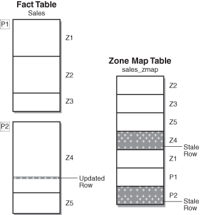
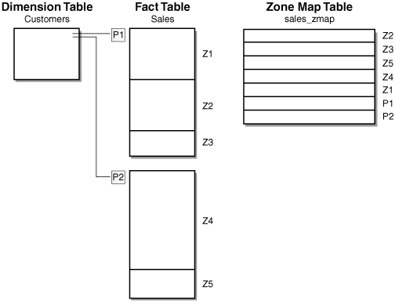
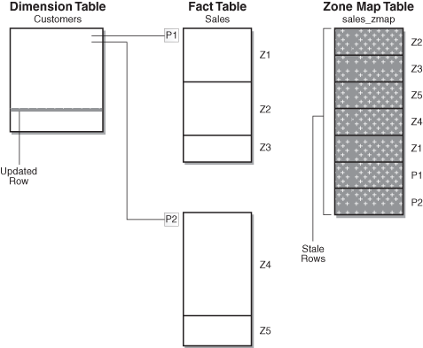
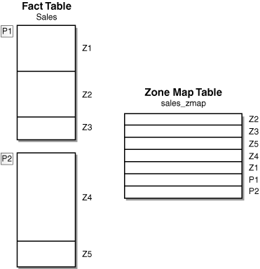

A zone map is a independent access structure that can be built for a table. During table and index scans, zone maps enable you to prune disk blocks of a table and potentially full partitions of a partitioned table based on predicates on the table columns. Zone maps can be used with or without attribute clustering.

This chapter includes the following sections:

- About Zone Maps

- Zone Map Operations

- Refresh and Staleness of Zone Maps

- Performing Pruning Using Zone Maps

- Viewing Zone Map Information

### 14.1 About Zone Maps

A zone map is an independent access structure built for a table that stores information about zones of a table. Zone maps enable the database to prune data blocks that cannot satisfy predicates on table columns. A zone is a set of a contiguous data blocks on disk.

Traditional zone maps store the minimum and maximum values of a column in a table per disk unit, set of blocks, or extents. If queries qualify on clustering columns, then I/O pruning takes place. Zone maps in an Oracle Database store minimum and maximum values of columns for a range of blocks (known as a zone). In addition to performing I/O pruning based on predicates of clustered fact tables, zone maps prune on predicates of dimension tables provided the fact tables are attribute-clustered by the dimension attributes through outer joins with the dimension tables.

You can define at most one zone map on a table. In the case of a partitioned table, there is one zone map for all partitions (and subpartitions). A zone map of a partitioned table also keeps track of the minimum and maximum values per zone, per partition, and per subpartition. Zone map definitions can include minimum and maximum values of dimension columns provided the table has an outer join with the dimension tables.

This section contains the following topics:

- Difference Between Zone Maps and Indexes

- Zone Maps and Attribute Clustering

- Types of Zone Maps

- Benefits of Zone Maps

- Scenarios Which Benefit from Zone Maps

- About Maintaining Zone Maps

#### 14.1.1 Difference Between Zone Maps and Indexes

A zone map is analogous to a coarse index structure. However, there are fundamental differences to an index:

- A zone map stores information per zone instead of per row. Thus, it is much more compact than an index.

- A zone map is not actively managed the way an index is kept in sync with DML actions. Thus, even if a zone map has the `REFRESH` `ON` `COMMIT` option, it can still be stale within a transaction until commit or rollback occurs.

- A zone map can contain stale information for some zones and fresh information for the rest of the zones, and Oracle Database will still use the zone map to perform I/O pruning during the scan of the fact table.

#### 14.1.2 Zone Maps and Attribute Clustering

Attribute clustering is not a mandatory pre-requirement for zone maps. Zone maps can be used with or without attribute clustering. Therefore, you can specify attribute clustering without zone maps and build zone maps without clustering on the table.

It is common for data warehousing environments to have reasonably clustered data due to ETL processing, for example, clustering by time columns or by geographical regions. Due to clustering, minimum and maximum values of the columns are more likely to be correlated with consecutive data blocks in the attribute-clustered table, which allows for more efficient pruning using zone maps. Zone maps enable more efficient pruning by taking advantage of data ordering performed by attribute clustering. During table scans and index scans (for example, fetch by rowid), zone maps allow pruning of data blocks that do not satisfy predicates on table columns.

**See Also:**

"[About Attribute Clustering](attribute-clustering.md)" for information about attribute clustering

#### 14.1.3 Types of Zone Maps

There are two types of zone maps:

- A basic zone map is defined on a single table and maintains the minimum and maximum values of some columns of this table.

- A join zone map is defined on a table that has an outer join to one or more other tables and maintains the minimum and maximum values of some columns in the other tables; these join conditions are common in master-detail relationships as well as in star schemas between fact and dimension tables.

  For star queries, multiple dimension tables are joined through PK-FK relationships with a fact table. Here a join zone map maintains the minimum and maximum values of columns from the dimension tables for zones of the fact table.

#### 14.1.4 Benefits of Zone Maps

- Enables I/O reduction during sequential or index scans of tables or table partitions

- Enables partition pruning based on non-key columns for partitioned and composite-partitioned tables when zone map columns correlate with the partitioning key

- Enables I/O reduction on a subset of the clustering columns for attribute clustering with interleaved ordering

- Eliminate storage costs associated with using indexes

**See Also:**

[Oracle Database SQL Language Reference](../sqlrf/CREATE-MATERIALIZED-ZONEMAP.md)

#### 14.1.5 Scenarios Which Benefit from Zone Maps

Using zone maps can be beneficial in the following scenarios:

- Table scans are performed with frequently-used predicates

  Zone maps enable Oracle Database to avoid scanning zones that are excluded by column predicates.

- Joins are defined between a fact table and dimension tables with frequently-used predicates on the dimension hierarchy columns

  Fact table rows can be ordered by dimension attribute values, pruning zones that are excluded by predicates on attribute values.

- Columns in partitioned tables contain values that correlate with the partition key

  This will facilitate partition pruning based on “non-key" columns. For example, a table partitioned by date will often have other date columns that correlate well with the partition key or columns that contain sequenced values that change or cycle over time.

- Data clustering is performed on the zone map column values

  Attribute clustering is designed specifically for this purpose. Alternatively, it is appropriate to make use of ordering inherent in the data (for example, time-based column values loaded sequentially or data that is sorted on load).

- Frequent and low cardinality index range scans are performed on tables

  Attribute clustering can be used alone to improve compression factors. Zone maps can be used to improve the efficiency of the index scans by pruning lookups from excluded zones. Alternatively, zone maps can be used to replace indexes.

#### 14.1.6 About Maintaining Zone Maps

Zone maps are based on tables and, therefore, any changes to the underlying tables impacts the state of the zone map. Depending on the operation performed on the table, some or all zones of a zone map are impacted. Zone maps affected by changes to the underlying tables require maintenance.

Zone map maintenance consists of one or more of the tasks:

- Checking the validity of affected zone maps

- Tracking the staleness of the affected zone maps

- Refreshing the affected zone maps that have become stale (depending on the refresh mode set for the zone map)

When there is a change in the structure of base tables on which a zone map is based, for example, dropping a table column whose minimum and maximum values are maintained by the zone map, then the zone map becomes invalid. Invalid zone maps are not used by queries and Oracle Database does not maintain these zone maps. However, when there is a change in the structure of the base tables that does not relate to the zone map, for example, adding a new column to the table, the zone map stays valid but it needs to be compiled. Oracle Database automatically compiles the zone map on a subsequent operation such as the use of zone map by a query. Or, you can compile the zone map using the `COMPILE` clause of the `ALTER MATERIALIZED ZONEMAP` command.

**See Also:**

"Compiling Zone Maps"

When there is a change in the data of the underlying tables, the zones that are impacted by these changes are marked stale. Only the data in a stale zone map is not current or fresh but its definition is still valid. Oracle Database automatically tracks the staleness of zone maps due to different types of operations on the underlying tables. Depending on the type of operation performed on the underlying table the Oracle Database will either mark the entire zone map as stale, or some zones in the zone map as stale.

This section contains the following topics:

- Operations that Require Zone Map Maintenance

- Scenarios in Which Zone Maps are Automatically Refreshed

##### 14.1.6.1 Operations that Require Zone Map Maintenance

Zone map maintenance is required when the following operations are performed on one or more of the underlying tables:

- DML (insert, delete, update, conventional load).

- Direct-path insert and load.

- Partition Maintenance Operations (`MOVE`, `SPLIT`, `MERGE`, `DROP`, `TRUNCATE`, and `EXCHANGE`), moving table data, and online redefinition of table.

##### 14.1.6.2 Scenarios in Which Zone Maps are Automatically Refreshed

The zone map refresh mode determines if Oracle Database will automatically refresh the zone maps affected by above operations.

Oracle Database performs automatic refresh for zone maps affected by the following:

- DML operations if the refresh mode is `REFRESH ON COMMIT`. Zone maps with `REFRESH ON COMMIT` mode stay transactionally fresh. The refresh is performed when the transaction is committed.

- Direct-path insert or load if the refresh mode is `REFRESH ON LOAD`.

  Zone maps with `REFRESH ON LOAD` can become stale after DML or PMOP operation on underlying table.

- PMOPs (`MOVE`, `SPLIT`, `MERGE`, `DROP`) or table move if the refresh mode is `REFRESH ON DATA MOVEMENT`.

  Zone maps with `REFRESH ON DATA MOVEMENT` can become stale after DML, direct-path insert or load, PMOP (`TRUNCATE`, `EXCHANGE`), or online redefinition of underlying table

- Direct-path insert or load, PMOP (`MOVE`, `SPLIT`, `MERGE`, `DROP`) or table move if the refresh mode is `REFRESH ON LOAD DATA MOVEMENT`.

  Zone maps with `REFRESH ON LOAD DATA MOVEMENT` can become stale after DML, PMOP (`TRUNCATE`, `EXCHANGE`), or online redefinition of underlying table.

Oracle Database does not perform automatic refresh of zone maps affected by any operation on underlying table if their refresh mode is `REFRESH ON DEMAND`. Zone maps with `REFRESH ON DEMAND` have to be manually refreshed

**See Also:**

- "Refresh and Staleness of Zone Maps"

- "Maintaining Zone Maps"

### 14.2 Zone Map Operations

This section describes common tasks involving zone maps, and includes:

- Privileges Required for Zone Maps

- Creating Zone Maps

- Modifying Zone Maps

- Dropping Zone Maps

- Compiling Zone Maps

- Controlling the Use of Zone Maps

- Maintaining Zone Maps

#### 14.2.1 Privileges Required for Zone Maps

- To create, alter, or drop zone maps in your own schema, you must have the `CREATE MATERIALIZED ZONEMAP` privilege

- To create zone maps in other schemas, you must have the `CREATE` `ANY` `MATERIALIZED` `ZONEMAP` privilege.

- To create zone maps in your own schema but on tables from other schemas, you must have the `SELECT` `ANY` `TABLE` or `READ ANY TABLE` privilege.

- To create zone maps in other schemas using tables from other schemas, you must have both the `SELECT` `ANY` `TABLE` and `CREATE` `ANY` `MATERIALIZED` `ZONEMAP` privileges. You can have the `READ ANY TABLE` privilege instead of the `SELECT ANY TABLE` privilege.

- To alter zone maps in other schemas, you must have the `ALTER ANY MATERIALIZED ZONEMAP` privilege.

- To drop zone maps in other schemas, you must have the `DROP ANY MATERIALIZED ZONEMAP` privilege.

#### 14.2.2 Creating Zone Maps

While zone maps can be created along with attribute clustering on a table, zone maps are independent of attribute clustering. Zone maps can be independently created, irrespective of attribute clustering.

Storage structures used by zone maps are created in the default tablespace of the tables on which they are defined.

**See Also:**

- [Oracle Database SQL Language Reference](../sqlrf/CREATE-MATERIALIZED-ZONEMAP.md) for zone map creation syntax

- [Oracle Database SQL Language Reference](../sqlrf/CREATE-MATERIALIZED-ZONEMAP.md) for information about zone map restrictions

This section contains the following topics:

- Creating Zone Maps with Attribute Clustering

- Creating Zone Maps Independent of Attribute Clustering

##### 14.2.2.1 Creating Zone Maps with Attribute Clustering

You can create a zone map by using `WITH MATERIALIZED ZONEMAP` subclause. You can use this subclause when you define attribute clustering for a table or later when you modify the clustering definition.

Use the steps described in any of the following topics to create a zone map with attribute clustering:

- Creating a Basic Zone Map with Linear Attribute Clustering

- Creating a Join Zone Map with Interleaved Attribute Clustering

- Creating a Zone Map After Attribute Clustering

**See Also:**

[Attribute Clustering](attribute-clustering.md) for information about attribute clustering

###### 14.2.2.1.1 Creating a Basic Zone Map with Linear Attribute Clustering

Assume that queries of sales often specify either a customer ID or a combination of a customer ID and product ID. You can create an attribute-clustered table so that queries benefit from pruning with zone maps. You create a table as follows:

    CREATE TABLE sales (
       prod_id NUMBER NOT NULL,
       cust_id NUMBER NOT NULL,
       time_id        DATE NOT NULL,
       channel_id     NUMBER NOT NULL,
       promo_id       NUMBER NOT NULL,
       quantity_sold  NUMBER(10,2),
       amount_sold NUMBER(10,2)
    )
    CLUSTERING
    BY LINEAR ORDER (cust_id, prod_id)
    YES ON LOAD YES ON DATA MOVEMENT
    WITH MATERIALIZED ZONEMAP;

Zone map `ZMAP$_SALES` on columns (`cust_id`, `prod_id`) is created. Here, `ZMAP$_SALES` is the name automatically generated by Oracle Database for the zone map. However, you can specify a name for the zone map by enclosing it in parentheses following the `WITH MATERIALIZED ZONEMAP` as described in "Creating a Join Zone Map with Interleaved Attribute Clustering".

Queries that qualify both columns `cust_id` and `prod_id` or the prefix `cust_id` experience natural pruning. The following examples show how the database can prune during table scans.

An application issues the following query:

    SELECT * FROM sales WHERE cust_id = 100;

Because the table is a `BY` `LINEAR` `ORDER` clustered, the database must only read the zones that include the `cust_id` value of 100.

An application issues the following query:

    SELECT * FROM sales WHERE cust_id = 100 AND prod_id = 2300;

Because the table is a `BY` `LINEAR` `ORDER` clustered, the database must only read the zones that include the `cust_id` value of 100 and `prod_id` of 2300.

###### 14.2.2.1.2 Creating a Join Zone Map with Interleaved Attribute Clustering

Consider a data warehouse that contains a `sales` fact table and its two dimension tables: `customers` and `products`. Most queries have predicates on the `customers` table hierarchy (`country_id`, `cust_state_province`, `cust_city`) and the `products` hierarchy (`prod_category`, `prod_subcategory`). You can use interleaved ordering for the `sales` table as shown in the following partial statement:

    CREATE TABLE sales (
       prod_id NUMBER NOT NULL,
       cust_id NUMBER NOT NULL,
       amount_sold NUMBER(10,2))
    CLUSTERING
    sales JOIN products ON (sales.prod_id = products.prod_id)
    JOIN customers ON (sales.cust_id = customers.cust_id)
    BY INTERLEAVED ORDER
    (
    (products.prod_category, products.prod_subcategory),
    (customers.country_id, customers.cust_state_province, customers.cust_city)
    )
    YES ON LOAD YES ON DATA MOVEMENT
    WITH MATERIALIZED ZONEMAP (sales_zmap);

A zone map called `sales_zmap` is created for the attribute clustered table. Note that, in this clustering clause, the join columns of the dimension table must have primary or unique key constraints. Note that for interleaved order columns from a single dimension should appear in the clustering clause a separate group bracketed by '('..')' for example (`prod_category`, `prod_subcategory`). Furthermore, the columns should follow the hierarchy in the dimension (such as the natural hierarchy of `prod_category`, `prod_subcategory`), and the order of the columns in the group should follow that of the hierarchy. This allows Oracle Database to effectively cluster the data according to the hierarchies present in the dimension tables.

###### 14.2.2.1.3 Creating a Zone Map After Attribute Clustering

Assume a table called `sales` exists in the database. You can define attribute clustering for the `sales` table using the following command:

    ALTER TABLE sales ADD CLUSTERING BY INTERLEAVED ORDER (cust_id, prod_id)
          YES ON LOAD YES ON DATA MOVEMENT;

Although this command adds attribute clustering to the table definition, it does not cluster the existing data in the `sales` table. When you perform a data movement operation on the `sales` table, its data will be clustered because of the `YES ON DATA MOVEMENT` option.

The following command clusters the data in the `sales` table:

    ALTER TABLES sales MOVE;

After the data in `sales` table is clustered, you can define a zone map on the `sales` table by modifying the clustering using the following command:

    ALTER TABLE sales MODIFY CLUSTERING WITH MATERIALIZED ZONEMAP (sales_zmap);

Subsequently, if necessary, you can drop the zone map by modifying the clustering using the following command:

    ALTER TABLE sales MODIFY CLUSTERING WITHOUT MATERIALIZED ZONEMAP;

##### 14.2.2.2 Creating Zone Maps Independent of Attribute Clustering

Use the `CREATE MATERIALIZED ZONEMAP` command to create a zone map on a table. This zone map is independent of attribute clustering, which means it can be created on a clustered or non-clustered table. Also, the set of columns used for the zone map can be same or different from the set of columns used for attribute clustering.

When you create a zone map, you must specify the table columns on which the zone map is based.

Use the steps described in any of the following topics to create a zone map independent of attribute clustering:

- Creating a Basic Zone Map Independent of Attribute Clustering

- Creating a Join Zone Map Independent of Attribute Clustering

###### 14.2.2.2.1 Creating a Basic Zone Map Independent of Attribute Clustering

Assume that queries on the `sales` table frequently specify a customer ID, product ID, or a combination of the two columns. You can create a zone map on the customer ID and product ID columns of the `sales` table so that queries benefit from pruning as shown in Example 14-1.

Example 14-1 Creating a Basic Zone Map Independent of Attribute Clustering

You can create a zone map `sales_zmap` on the `sales` table using the following statement:

    CREATE MATERIALIZED ZONEMAP sales_zmap ON sales (cust_id, prod_id);

This statement is equivalent to the following `CREATE` `...` `AS` statement:

    CREATE MATERIALIZED ZONEMAP sales_zmap
    REFRESH ON LOAD DATA MOVEMENT
    AS
    SELECT SYS_OP_ZONE_ID(rowid),MIN(cust_id),MAX(cust_id),MIN(prod_id),MAX(prod_id)
    FROM sales
    GROUP BY SYS_OP_ZONE_ID(rowid);

In this statement, the `SYS_OP_ZONE_ID(rowid)` function is used to work with zone maps. The `SYS_OP_ZONE_ID` function identifies a particular range of contiguous disk blocks (zone) given the rowid of fact table row. This function helps to maintain minimum and maximum ranges at a partition level, performing partition pruning and fast refresh of zone maps. When used with zone maps, it helps to map all rows from a set of contiguous data blocks to a single zone.

###### 14.2.2.2.2 Creating a Join Zone Map Independent of Attribute Clustering

Consider a data warehouse that contains the `sales` fact and multiple dimensions. Most queries have predicates on the `customers` table hierarchy (`cust_state_province, cust_city`). You can use interleaved ordering for the sales table as shown in Example 14-2.

Example 14-2 Creating a Join Zone Map Independent of Attribute Clustering

A join zone map involves outer joins from the table on which the zone map is created to one or more other tables. Most commonly used in star schema setups, a join zone map tracks the minimum and maximum of columns from dimension tables rather than columns from the fact table, as is illustrated in the following statement:

    CREATE MATERIALIZED ZONEMAP sales_zmap
    REFRESH ON LOAD DATA MOVEMENT
    AS
    SELECT SYS_OP_ZONE_ID(s.rowid), MIN(cust_state_province),
           MAX(cust_state_province), MIN(cust_city), MAX(cust_city)
    FROM sales s, customers c
    WHERE s.cust_id = c.cust_id(+)
    GROUP BY SYS_OP_ZONE_ID(s.rowid);

#### 14.2.3 Modifying Zone Maps

You can alter a zone map with an `ALTER` `MATERIALIZED` `ZONEMAP` statement.

Example 14-3 Making a Zone Map Unusable

The following statement makes a zone map unusable, which means that queries no longer use this zone map, and Oracle Database no longer maintains the zone map.

    ALTER MATERIALIZED ZONEMAP sales_zmap UNUSABLE;

Example 14-4 Performing Complete Refresh for a Zone Map

The following statement performs a complete refresh of the zone map:

    ALTER MATERIALIZED ZONEMAP sales_zmap REBUILD COMPLETE;

As part of the rebuild, the zone map is also made usable, if it was earlier marked as unusable.

Example 14-5 Refreshing Zone Maps

The following statement performs a fast refresh, if possible. Else, a complete refresh is performed.

    ALTER MATERIALIZED ZONEMAP sales_zmap REBUILD;

Example 14-6 Disabling Pruning for Zone Maps

The following statement disables pruning, which you might want to do for performance measurement:

    ALTER MATERIALIZED ZONEMAP sales_zmap DISABLE PRUNING;

Example 14-7 Enabling Pruning for Zone Maps

The following statement enables pruning, which may have been disabled earlier, for the zone map:

    ALTER MATERIALIZED ZONEMAP sales_zmap ENABLE PRUNING;

Example 14-8 Disabling Refresh for Zone Maps

The following statement turns off refresh on load and data movement, which offers you control over how and when zone maps are refreshed:

    ALTER MATERIALIZED ZONEMAP sales_zmap REFRESH ON DEMAND;

Example 14-9 Enabling Refresh on Commit for Zone Maps

The following statement turns on the refresh of the zone map on each transaction commit:

    ALTER MATERIALIZED ZONEMAP sales_zmap REFRESH ON COMMIT;

**See Also:**

- [Oracle Database SQL Language Reference](../sqlrf/ALTER-MATERIALIZED-ZONEMAP.md) for the syntax to alter a zone map

#### 14.2.4 Dropping Zone Maps

You can drop zone maps by issuing a `DROP` `MATERIALIZED` `ZONEMAP` statement, such as the following:

    DROP MATERIALIZED ZONEMAP sales_zmap;

**See Also:**

[Oracle Database SQL Language Reference](../sqlrf/DROP-MATERIALIZED-ZONEMAP.md) for the syntax to drop a zone map

#### 14.2.5 Compiling Zone Maps

Any DDL operation on the base table on which a zone map is based will affect the compile state of the zone map. This means that the query that defines the zone map must be compiled to check if the zone map remains valid or not. This behavior is similar to materialized views, which are also affected by DDL performed on the base table. Oracle Database will compile the zone map the first time it tries to use it following a DDL operation. You can, however, explicitly compile a zone map using an alter DDL statement such as the following:

    ALTER MATERIALIZED ZONEMAP sales_zmap COMPILE;

The result of compiling a zone map will either be valid or invalid depending on the specific action performed by the DDL. For example, if DDL was done to add a column to the fact table, then the zone map will be valid after compilation. But if the DDL was done to drop a column that is referenced in the definition query, then the zone map will be invalid after compilation.

Some of the points to keep in mind are:

- If a column that appears in the clustering clause is dropped, then clustering is dropped. In addition, if there was a zone map created as part of clustering, then the zone map will be dropped as well.

- If a dimension table from a star schema is dropped, and it is involved in clustering on a fact table, then the clustering on the fact table is dropped. In addition, if there was a zone map created as part of the clustering, then the zone map will be dropped.

- If a user drops a required primary key or unique key on the dimension table involved in a clustering clause, then clustering is invalidated (data will not be clustered on subsequent loads or data movement operations performed by certain types of PMOPs).

#### 14.2.6 Controlling the Use of Zone Maps

You can control the use of zone maps for the entire SQL workload or for specific SQL statements.

This section contains the following topics:

- Controlling Zone Map Usage for Entire SQL Workloads

- Controlling Zone Map Usage for Specific SQL Statements

##### 14.2.6.1 Controlling Zone Map Usage for Entire SQL Workloads

You can control the use of zone maps at the object level. Object-level changes apply to all statements in the SQL workload. When you create a zone map, it is available for pruning unless you override the default by specifying `DISABLE PRUNING`. For example, the following statement creates a zone map with pruning disabled:

    CREATE MATERIALIZED ZONEMAP sales_zmap
        DISABLE PRUNING ON sales(cust_id, prod_id);

This zone map is created and maintained by Oracle Database, but is not used for any SQL in the workload. You can make it available for pruning by using the following `ALTER MATERIALIZED ZONEMAP` statement:

    ALTER MATERIALIZED ZONEMAP sales_zmap ENABLE PRUNING;

Similarly, you can use the following statement to make a zone map unavailable for pruning:

    ALTER MATERIALIZED ZONEMAP sales_zmap DISABLE PRUNING;

##### 14.2.6.2 Controlling Zone Map Usage for Specific SQL Statements

You can use hints to control the use of zone maps at the individual SQL statement level. Note that hints cannot be used to control zone map usage if pruning is disabled for the zone map. You can achieve a finer control through hints by leaving pruning enabled and specifying negative hints in individual SQL statements.

Use the `NO_ZONEMAP` hint to disable the usage of a zone map for pruning. The following examples disable the usage of zone maps while pruning data.

Example 14-10 Scan Pruning: Disabling Zone Maps with the NO_ZONEMAP Hint

    SELECT /*+ NO_ZONEMAP (S SCAN) */* FROM sales S
    WHERE s.time_id BETWEEN '1-15-2008' AND '1-31-2008';

Example 14-11 Join Pruning: Disabling Zone Maps with the NO_ZONEMAP Hint

    SELECT /*+ NO_ZONEMAP (S JOIN) */* FROM sales s
    WHERE s.time_id BETWEEN '1-15-2008' AND '1-31-2008';

Example 14-12 Partition Pruning: Disabling Zone Maps with the NO_ZONEMAP Hint

    SELECT /*+ NO_ZONEMAP (S PARTITION) */* FROM sales S
    WHERE s.time_id BETWEEN '1-15-2008' AND '1-31-2008';

#### 14.2.7 Maintaining Zone Maps

You can specify how zone maps must be maintained either at the time of creating the zone map or, later, by altering the zone map definition. Refer to "Zone Map Maintenance Considerations".

**See Also:**

"About Maintaining Zone Maps"

Use the `REFRESH` clause in the `CREATE MATERIALIZED ZONEMAP` or `ALTER MATERIALIZED ZONEMAP` statement to specify how zone maps must be maintained. If you omit the `REFRESH` clause in the `CREATE MATERIALIZED ZONEMAP` statement, the default used is `REFRESH ON LOAD DATA MOVEMENT`, which enables the maintenance of the zone map by Oracle Database upon direct path load and certain data movement operations.

The following statement creates a zone map whose maintenance is managed manually by the user:

    CREATE MATERIALIZED ZONEMAP sales_zmap
    REFRESH ON DEMAND
    ON sales (cust_id, prod_id);

The following statement creates a zone map whose maintenance is managed by Oracle Database at the end of each transaction commit:

    CREATE MATERIALIZED ZONEMAP sales_zmap
    REFRESH ON COMMIT
    ON sales (cust_id, prod_id);

Because it is refreshed on commit, the above zone map never becomes stale.

Use the `ALTER MATERIALIZED ZONEMAP` statement to change the maintenance of existing zone maps.

Example 14-13 Enabling Zone Map Maintenance on Data Movement

The following statement enables zone map maintenance by Oracle Database on data movement operations such as `MOVE`, `SPLIT`, `MERGE`, and `DROP`:

    ALTER MATERIALIZED ZONEMAP sales_zmap REFRESH ON DATA MOVEMENT;

Example 14-14 Enabling Zone Map Maintenance on Direct Path Load

The following statement enables zone map maintenance by Oracle Database on direct path load operations, such as `INSERT /*+ APPEND */` statements:

    ALTER MATERIALIZED ZONEMAP sales_zmap REFRESH ON LOAD;

Example 14-15 Enabling Zone Map Maintenance on both Data Movement and Load

The following statement enables zone map maintenance by Oracle Database on data movement and load operations:

    ALTER MATERIALIZED ZONEMAP sales_zmap REFRESH ON LOAD DATA MOVEMENT;

Note that `REFRESH ON LOAD DATA MOVEMENT` is the default option.

##### 14.2.7.1 Zone Map Maintenance Considerations

The following are some of the issues to keep in mind when maintaining zone maps or tracking their staleness:

- DML/Parallel DML operations to the fact table

  When a zone map is created, an internal trigger is created by Oracle Database to track the row changes made by conventional DML operations. For example, if a new row is inserted into the `sales` table, this trigger will compute `zone_id` from `rowid` and mark the corresponding aggregate row in the zone map as stale. So the staleness of a zone map is tracked zone by zone, which means even after DML has been done to the fact table the zone map can still be used for pruning using the `MIN`/`MAX` aggregates in the fresh zones.

  Upon fact table update, if the columns being updated are not referenced by the zone map, then zone map staleness is not affected. Otherwise, zones corresponding to updated rows are marked as stale by the internal trigger.

- Direct loads (that is, `INSERT /*+ APPEND */`) operations to fact table

  Even though direct loads insert data above the high water mark, newly added rows can belong to zones already computed for the zone map. Therefore, Oracle Database will identify existing zones whose `MIN`/`MAX` aggregates are potentially affected by newly added data and mark such zones as stale. Again, Oracle Database can continue to use the zone map for pruning in spite of direct loads to the zone map by utilizing `MIN`/`MAX` aggregates of zones that still remain fresh. If the zone maps has the `REFRESH ON LOAD` option, then Oracle Database will perform zone map refresh at the end of the load.

- Data movement (for example, partition maintenance operations) on the fact table

  Data movement operations include partition maintenance operations and online partition/table redefinition. However, data movement (for example, move partition) will make the existing zones belonging to the old partition obsolete in the zone map while zones belonging to the new partition are not computed until the zone map is refreshed. Oracle Database will continue to use the zone map for pruning following data movement operations regardless of whether the zone map was refreshed or not. If the zone map has the `REFRESH` `ON` `DATA` `MOVEMENT` option, Oracle Database will perform refresh at the end of the data movement operation.

- Data movements on the dimension table

  This operation does not affect the zone map.

- Any DML to the dimension table

  This operation makes the entire zone map stale, so it requires a full refresh. However, there is one exception. If it is an update operation and the set of updated columns are not referenced by the zone map, then it remains unaffected.

- Direct loads to dimension table

  This operation makes the entire zone map stale. If the `REFRESH` `ON` `LOAD` option is specified for the zone map, then Oracle Database will perform zone map refresh immediately following the load operation.

- DDL to the fact or dimension table

  Upon DDL operation the zone map is marked with unknown staleness (that is, stale set to `'unknown'`) and requiring compilation (that is, `compile_state` set to `'needs_compile`'). Under this state, Oracle Database will not use the zone map for pruning. However, upon the first use of a zone map following the DDL operation Oracle Database will compile the zone map and based on its outcome appropriately set the invalid and stale states. For example, if the DDL operation dropped a column whose `MIN`/`MAX` aggregates are stored in the zone map, then zone map compilation will fail so zone map `compile_state` is set to `'compilation error'`, stale remains as `'unknown'`, and invalid is set to `'yes'`.

### 14.3 Refresh and Staleness of Zone Maps

Oracle Database marks either the zone maps as stale or individual zones within zone maps as stale when the data in their base tables changes. Stale zone maps are not used for pruning, but zone maps with stale zones are still used for pruning. You must refresh the zone maps to update the zones and make them usable for pruning.

This section contains the following topics:

- About Staleness of Zone Maps

- About Refreshing Zone Maps

- Refreshing Zone Maps

#### 14.3.1 About Staleness of Zone Maps

When the data in the tables on which a zone map is based changes, the zones corresponding to the changed rows are marked as stale. You need to refresh the zone map to make the zones current.

When a row in a partition of the fact table is updated, the row corresponding to the zone in the partitioned table is marked as stale because of the update. This automatically invalidates the aggregated partition-level information, and pruning can only happen on a zone level. The row in the zone map corresponding to this particular partition is also marked as stale because of the update.

In Figure 14-1, this is illustrated with an update in `Z4` of `P2`, and the corresponding `Z4` is marked as stale. Note that the zone map is still usable, however. Table data corresponding to `Z4` will always be read (no pruning is performed on `Z4`) as long as the zone map is partially stale.

Figure 14-1 Partially Stale Zone Map

[Description of "Figure 14-1 Partially Stale Zone Map"](img_text/dwhsg139.md)

If a dimension table is added to the fact table, then the status resembles that in Figure 14-2.

Figure 14-2 Zone Map with Dimension Table

[Description of "Figure 14-2 Zone Map with Dimension Table"](img_text/dwhsg150.md)

If any DML is made to the dimension table, the zone map becomes fully stale, as is illustrated in Figure 14-3. Because the zone map becomes fully state, it is not available for pruning until it is completely refreshed. Use the `REBUILD` option of `ALTER MATERIALIZED ZONEMAP` statement to refresh the zone map.

Figure 14-3 Zone Map with Dimension Table and Staleness

[Description of "Figure 14-3 Zone Map with Dimension Table and Staleness"](img_text/dwhsg151.md)

#### 14.3.2 About Refreshing Zone Maps

Oracle Database needs to maintain zone maps by refreshing them after changes to their underlying tables. The refresh method used for zone maps can be a complete refresh or an incremental refresh. A complete refresh, specified using the `REFRESH COMPLETE` clause, involves rebuilding all the zones in the zone map. A complete refresh is slow when large amounts of data need to be processed. An incremental refresh, specified using the `REFRESH FAST` clause, processes only the changes that have occurred since the last refresh. This method enables you to refresh the zone map without rebuilding them from scratch. Although zone maps are internally implemented using materialized view, materialized view logs on base tables are not required to perform a fast refresh of a zone map

The refresh mode specifies the operations that trigger zone map refresh. Use one of the following refresh modes:

- `ON COMMIT`

  Zone maps are refreshed when changes to the base tables are committed.

- `ON DEMAND`

  Zone maps must be refreshed manually after DML or partition maintenance operations.

- `ON DATA MOVEMENT`

  Zone maps are refreshed when data movement operations are performed on the base tables.

- `ON LOAD`

  Zone maps are refreshed when direct-path insert operations are performed on the base tables.

- `ON LOAD DATA MOVEMENT`

  Zone maps are refreshed when direct-path insert or certain data movement operations are performed on the base tables. This is the default.

By default, zone maps are refreshed on load and on data movement. To override this default, specify one of the following refresh modes when creating or modifying the zone map: `ON COMMIT`, `ON LOAD`, `ON DATA MOVEMENT`, or `ON LOAD`.

#### 14.3.3 Refreshing Zone Maps

When you create a zone map without specifying the `REFRESH` option, Oracle Database by default performs zone map maintenance after direct load and certain data movement operations. The exception is the DML operations such as delete, insert, and update. For these operations, Oracle Database will appropriately mark the zone map or some zones in the zone map as stale. To manually control the refresh maintenance of zone maps, you must specify the `REFRESH ON DEMAND` option.

The following command creates a zone map whose refresh maintenance is disabled which means that you must manually refresh the zone map after changes are made to the underlying tables.

    CREATE MATERIALIZED ZONEMAP sales_zmap
          ON sales (time_id, cust_id)
          REFRESH ON DEMAND;

Oracle Database provides the following two methods of refreshing zone maps:

- Refreshing Zone Maps Using the ALTER MATERIALIZED ZONEMAP Command

- Refreshing Zone Maps Using the DBMS_MVIEW Package

##### 14.3.3.1 Refreshing Zone Maps Using the ALTER MATERIALIZED ZONEMAP Command

Use the `REBUILD` option of `ALTER MATERIALIZED ZONEMAP` command to refresh zone maps.

The following command performs a complete refresh of the zone map:

    ALTER MATERIALIZED ZONEMAP sales_zmap REBUILD COMPLETE;

The following command performs a complete refresh if the zone map is fully stale or marked as unusable. Otherwise, an incremental (fast) refresh is performed.

    ALTER MATERIALIZED ZONEMAP sales_zmap REBUILD;

**See Also:**

[Oracle Database SQL Language Reference](../sqlrf/ALTER-MATERIALIZED-ZONEMAP.md) for the syntax to refresh a zone map

##### 14.3.3.2 Refreshing Zone Maps Using the DBMS_MVIEW Package

You can use the `REFRESH` procedure of `DBMS_MVIEW` package to refresh zone maps.

When `DBMS_MVIEW.REFRESH` procedure is used, Oracle Database will refresh the zone map according to the value specified for its `refresh_method` parameter as follows:

- C: Performs a complete refresh.

- F - Performs a fast refresh. If a fast refresh is not possible, then an error is issued.

- ? - Performs a fast refresh if possible. else a complete refresh is performed.

  This is the default used if no value is specified.

An example of using the `REFRESH` procedure is the following:

    EXECUTE DBMS_MVIEW.REFRESH('sales_zmap','C');

### 14.4 Performing Pruning Using Zone Maps

The primary benefit of zone maps is I/O reduction for table scans. Pruning leverages information about the natural locality of records to avoid unnecessary I/O. When a SQL statement contains predicates on columns tracked in the zone map, the database compares the predicate values to the minimum and maximum for each zone to determine which zones of blocks to read or skip during the table scan.

Candidates for zone map pruning include the following predicates:

- Relational predicates =, \<=, \<, \>, \>=

- (of the form `column_name` `relational_predicate` `constant`, for example, `WHERE country_name='US'` or `WHERE country_name=:name`)

- `IN` lists (for example, `WHERE product_name IN ('a','b')`)

- `LIKE` predicates suffixed with `%` (for example, `company_name LIKE 'ORA%'`)

This section contains the following topics:

- How Oracle Database Performs Pruning Using Zone Maps

- Examples: Performing Pruning with Zone Maps and Attribute Clustering

#### 14.4.1 How Oracle Database Performs Pruning Using Zone Maps

This section uses the following examples to illustrate how pruning is performed with zone maps and attribute clustering:

- Pruning Tables Using Zone Maps

- Pruning Partitioned Tables Using Zone Maps and Attribute Clustering

##### 14.4.1.1 Pruning Tables Using Zone Maps

This example illustrates creating a zone map that can prune data in a query whose predicate contains a constant. The `lineitem` table, illustrated in Table 14-1, is created using the following statement:

    CREATE TABLE lineitem
      ( orderkey      NUMBER
      , shipdate      DATE
      , receiptdate   DATE
      , destination   VARCHAR2(50)
      , quantity      NUMBER);

Assume that this table contains four data blocks with two rows per block. Table 14-1 shows the eight rows of the table.

Table 14-1 Data Blocks for lineitem Table

| Block | orderkey | shipdate  | receiptdate | destination | quantity |
|:------|:---------|:----------|:------------|:------------|:---------|
| 1     | 1        | 1-1-2011  | 1-10-2011   | San_Fran    | 100      |
| 1     | 2        | 1-2-2011  | 1-10-2011   | San_Fran    | 200      |
| 2     | 3        | 1-3-2011  | 1-5-2011    | San_Fran    | 100      |
| 2     | 4        | 1-5-2011  | 1-10-2011   | San_Diego   | 100      |
| 3     | 5        | 1-10-2011 | 1-15-2011   | San_Fran    | 100      |
| 3     | 6        | 1-12-2011 | 1-16-2011   | San_Fran    | 200      |
| 4     | 7        | 1-13-2011 | 1-20-2011   | San_Fran    | 100      |
| 4     | 8        | 1-15-2011 | 1-30-2011   | San_Jose    | 100      |

Next, you use the `CREATE` `MATERIALED` `ZONEMAP` statement to create a zone map on the `lineitem` table.

    CREATE MATERIALIZED ZONEMAP lineitem_zmap
         ON lineitem (orderkey, shipdate, receiptdate);

Each zone contains two blocks and stores the minimum and maximum of the `orderkey`, `shipdate`, and `receiptdate` columns. Table 14-2 represents the zone map.

Table 14-2 Zone Map for lineitem Table

| Block Range | min orderkey | max orderkey | min shipdate | max shipdate | min receiptdate | max receiptdate |
|:------------|:-------------|:-------------|:-------------|:-------------|:----------------|:----------------|
| 1-2         | 1            | 4            | 1-1-2011     | 1-5-2011     | 1-9-2011        | 1-10-2011       |
| 3-4         | 5            | 8            | 1-10-2011    | 1-15-2011    | 1-15-2011       | 1-30-2011       |

When you execute the following query, the database can read the zone map and then scan only blocks 1 and 2 because the date 1-3-2011 falls between the minimum and maximum dates:

    SELECT * FROM lineitem WHERE shipdate = '1-3-2011';

##### 14.4.1.2 Pruning Partitioned Tables Using Zone Maps and Attribute Clustering

This following statement creates a zone map, with attribute clustering, on a partitioned table:

    CREATE TABLE sales
    (
       prod_id        NUMBER NOT NULL,
       cust_id        NUMBER NOT NULL,
       time_id        DATE NOT NULL,
       channel_id     NUMBER NOT NULL,
       promo_id       NUMBER NOT NULL,
       quantity_sold  NUMBER(10,2) NOT NULL,
       amount_sold    NUMBER(10,2)
    )
    CLUSTERING sales JOIN products ON (sales.prod_id = products.prod_id)
       BY LINEAR ORDER (products.prod_id)
       WITH MATERIALIZED ZONEMAP (sales_zmap)
    PARTITION BY HASH (amount_sold)
         ( PARTITION p1, PARTITION p2);

Figure 14-4 illustrates creating zone maps for the partitioned table `sales`. For each of the five zones, the zone map will store the minimum and maximum of the columns tracked in the zone map. If a predicate is outside the minimum and maximum for a stored column of a given zone, then this zone does not have to be read. As an example, if zone `Z4` tracks a minimum of 10 and a maximum of 100 for a column `prod_id`, then a predicate `prod_id` `=` `200` will never have any matching records in this zone, so zone `Z4` will not be read.

For partitioned tables, pruning can happen both on a partition as well as zone level. If the aggregated partition-level information in the zone maps rules out any matching data for a given set of predicates, then the whole partition will be pruned; otherwise, pruning for the partition will happen on a per zone level.

Figure 14-4 Zone Map for a Partitioned Fact Table

[Description of "Figure 14-4 Zone Map for a Partitioned Fact Table"](img_text/dwhsg137.md)

#### 14.4.2 Examples: Performing Pruning with Zone Maps and Attribute Clustering

This section provides examples on performing pruning using zone maps and attribute clustering. The examples are based on the `my_sales` table that is created as shown in Example 14-16.

Example 14-16 Creating the my_sales Table

The `my_sales` table is a join attribute clustered table that contains a zone map. It is based on the `sales` tables in the `SH` schema and is created using the following statement:

    CREATE TABLE my_sales
    PARTITION BY LIST (channel_id)
     (PARTITION mysales_chan_c VALUES ('C'),
      PARTITION mysales_chan_i VALUES ('I'),
      PARTITION mysales_chan_p VALUES ('P'),
      PARTITION mysales_chan_s VALUES ('S'),
      PARTITION mysales_chan_t VALUES ('T'))
    CLUSTERING
      my_sales JOIN customers ON (my_sales.cust_id = customers.cust_id)
      BY INTERLEAVED ORDER ((my_sales.time_id),
                            (customers.country_id,
                             customers.cust_state_province,
                             customers.cust_city))
      WITH MATERIALIZED ZONEMAP (mysales_zmap)
    AS SELECT * FROM sales;

This section contains the following topics:

- Example: Partitions and Table Scan Pruning

- Example: Zone Map Join Pruning

##### 14.4.2.1 Example: Partitions and Table Scan Pruning

This example illustrates how zone maps can prune zones and partitions (or sub-partitions in a composite-partitioned table).

1.  Create the `my_sales` table. Example 14-16 contains the syntax used to create this table.
2.  Use the following statement to query the `my_sales` table joined with the `customers` dimension:
        SELECT c.cust_city, SUM(quantity_sold)
           FROM   my_sales s, customers c
           WHERE  s.cust_id = c.cust_id
              AND    c.country_id = 'US'
              AND    c.cust_state_province = 'CA'
              AND    s.promo_id < 50
           GROUP BY c.cust_city;
3.  Display the plan using the following statement:
        SELECT *
        FROM TABLE(dbms_xplan.display_cursor(FORMAT => 'BASIC PREDICATE PARTITION'));

        -------------------------------------------------------------------------
        | Id  | Operation                           | Name      | Pstart| Pstop |
        -------------------------------------------------------------------------
        |   0 | SELECT STATEMENT                    |           |       |       |
        |   1 |  HASH GROUP BY                      |           |       |       |
        |*  2 |   HASH JOIN                         |           |       |       |
        |   3 |    JOIN FILTER CREATE               | :BF0000   |       |       |
        |*  4 |     TABLE ACCESS FULL               | CUSTOMERS |       |       |
        |   5 |    JOIN FILTER USE                  | :BF0000   |       |       |
        |   6 |     PARTITION LIST ITERATOR         |           |KEY(ZM)|KEY(ZM)|
        |*  7 |      TABLE ACCESS FULL WITH ZONEMAP | MY_SALES  |KEY(ZM)|KEY(ZM)|
        -------------------------------------------------------------------------

        Predicate Information (identified by operation id):

        PLAN_TABLE_OUTPUT
        -------------------------------------------------------------------------
           2 - access("S"."CUST_ID"="C"."CUST_ID")
           4 - filter(("C"."CUST_STATE_PROVINCE"='CA' AND
              "C"."COUNTRY_ID"='US'))
           7 - filter((SYS_ZMAP_FILTER('/* ZM_PRUNING */ SELECT "ZONE_ID$",
              CASE WHEN BITAND(zm."ZONE_STATE$",1)=1 THEN 1 ELSE CASE WHEN
              (zm."MIN_2_COUNTRY_ID" > :1 OR zm."MAX_2_COUNTRY_ID" < :2 OR
              zm."MIN_3_CUST_STATE_PROVINCE" > :3 OR zm."MAX_3_CUST_STATE_PROVINCE" <
              :4) THEN 3 ELSE 2 END END FROM "SH"."MYSALES_ZMAP" zm WHERE
              zm."ZONE_LEVEL$"=0 ORDER BY zm."ZONE_ID$"',SYS_OP_ZONE_ID(ROWID),'US','U
              S','CA','CA')<3 AND "S"."PROMO_ID"<50 AND
              SYS_OP_BLOOM_FILTER(:BF0000,"S"."CUST_ID")))

    Line 7 illustrates that a zone map is being used. Note the zone map partition list iterator “KEY(ZM)".

##### 14.4.2.2 Example: Zone Map Join Pruning

This example illustrates join pruning using zone maps and attribute clustering. If the primary key of a dimension comprises of dimension hierarchy values, it is sufficient to cluster the fact table by the corresponding foreign key. In this example, `times.time_id` comprises of (`calendar_year`, `calendar_month_number`, `day_number_in_month`). Thus, `time_id` translates to the calendar time hierarchy as well as the fiscal time hierarchy. You can prune the join between `times` and `my_sales` when there are predicates for either the fiscal or calendar hierarchies.

1.  Create the `my_sales` table. Example 14-16 contains the syntax used to create this table.
2.  Query the `my_sales` table joined with `times` using the following statement:
        SELECT SUM(quantity_sold)
        FROM   my_sales s, times tWHERE  s.time_id = t.time_id AND t.calendar_year = '1999';
3.  Display the plan using the following statement:
        SELECT *
        FROM TABLE(dbms_xplan.display_cursor(FORMAT => 'BASIC PREDICATE PARTITION'));

        ---------------------------------------------------------------------------
        | Id  | Operation                               | Name    | Pstart| Pstop |
        ---------------------------------------------------------------------------
        |   0 | SELECT STATEMENT                        |         |       |       |
        |   1 |  SORT AGGREGATE                         |         |       |       |
        |*  2 |   HASH JOIN                             |         |       |       |
        |   3 |    JOIN FILTER CREATE                   | :BF0000 |       |       |
        |*  4 |     TABLE ACCESS FULL                   | TIMES   |       |       |
        |   5 |    JOIN FILTER USE                      | :BF0000 |       |       |
        |   6 |     PARTITION LIST ALL                  |         |     1 |     5 |
        |*  7 |      TABLE ACCESS FULL WITH ZONEMAP     | MY_SALES|     1 |     5 |
        ---------------------------------------------------------------------------

        Predicate Information (identified by operation id):
        ---------------------------------------------------

        PLAN_TABLE_OUTPUT
        ----------------------------------------------------
           2 - access("S"."TIME_ID"="T"."TIME_ID")
           4 - filter("T"."CALENDAR_YEAR"=1999)
           7 - filter((SYS_ZMAP_FILTER('/* ZM_PRUNING */ SELECT "ZONE_ID$",
              CASE WHEN BITAND(zm."ZONE_STATE$",1)=1 THEN 1 ELSE CASE WHEN
              ((ORA_RAWCOMPARE(zm."MIN_1_TIME_ID",:1,8)>0 OR
              ORA_RAWCOMPARE(zm."MAX_1_TIME_ID",:2,8)<0)) THEN 3 ELSE 2 END END FROM
              "SH"."MYSALES_ZMAP" zm WHERE zm."ZONE_LEVEL$"=0 ORDER BY
              zm."ZONE_ID$"',SYS_OP_ZONE_ID(ROWID),SYSVARCOL,SYSVARCOL)<3 AND
              SYS_OP_BLOOM_FILTER(:BF0000,"S"."TIME_ID")))

    Line 7 illustrates that a zone map is being used, joining on matching `time_id` zones.

### 14.5 Viewing Zone Map Information

Information about zone maps and their measures is stored in data dictionary views.

This section contains the following topics:

- Viewing Details of Zone Maps in the Database

- Viewing the Measures of a Zone Map

#### 14.5.1 Viewing Details of Zone Maps in the Database

Use one of the following data dictionary views to display information about the zone maps in the database:

- `DBA_ZONEMAPS` to display all zone maps in the database

- `ALL_ZONEMAPS` to display zone maps that are accessible to the user

- `USER_ZONEMAPS` to display zone maps that are owned by the user

The following query displays the name, base table, type, refresh mode, and staleness of the zone maps owned by the current user and indicates if zone maps were created with attribute clustering:

    SELECT zonemap_name,fact_table,hierarchical,with_clustering,refresh_mode,stale
           FROM USER_ZONEMAPS;

    ZONEMAP_NAME    FACT_TABLE  HIERARCHICAL  WITH_CLUSTERING REFRESH_MODE      STALE
    ------------    ----------  ------------  --------------- ------------      -----
    ZMAP$_MY_SALES  MY_SALES      NO          YES             LOAD DATAMOVEMENT   NO

The following query displays the status of all zone maps that are accessible to the user. Zone maps with `PRUNING` disabled are not used for I/O pruning. Zone maps marked invalid need to be recompiled because the structure of the underlying base tables has changed.

    SQL> SELECT zonemap_name,pruning,refresh_method,invalid,complie_state
        FROM all_zonemaps;

    ZONEMAP_NAME     PRUNING    REFRESH_METHOD INVALID  UNUSABLE   COMPILE_STATE
    ------------    ---------   -------------- -------  ------     -------------
    SALES_ZMAP       ENABLED    FORCE           NO      NO         VALID
    ZMAP$_MY_SALES   DISABLED   FORCE           NO      NO         VALID

#### 14.5.2 Viewing the Measures of a Zone Map

Use one of the following views to display information about the measures in a zone map:

- `DBA_ZONEMAP_MEASURES` to display the measures for all zone maps in the database

- `ALL_ZONEMAP_MEASURES` to display the measures for zone maps that are accessible to the user

- `USER_ZONEMAP_MEASURES` to display he measures for zone maps that are owned by the user

The following query displays the zone map, measure, and column whose MIN/MAX values are maintained for each zone that are accessible to the current user:

    SELECT zonemap_name, measure, agg_function
    FROM ALL_ZONEMAP_MEASURES;

    ZONEMAP_NAME      MEASURE                         AGG_FUNCTION
    ---------------   --------------------------      -------------
    ZMAP$_MY_SALES   "SH"."MY_SALES"."PROD_ID"        MAX
    ZMAP$_MY_SALES   "SH"."MY_SALES"."PROD_ID"        MIN
    ZMAP$_MY_SALES   "SH"."MY_SALES"."CUST_ID"        MAX
    ZMAP$_MY_SALES   "SH"."MY_SALES"."CUST_ID"        MIN
