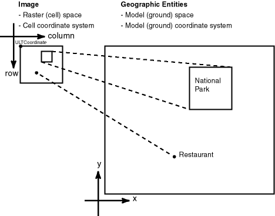
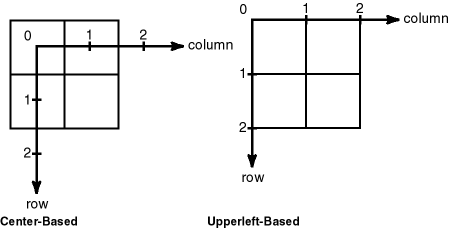
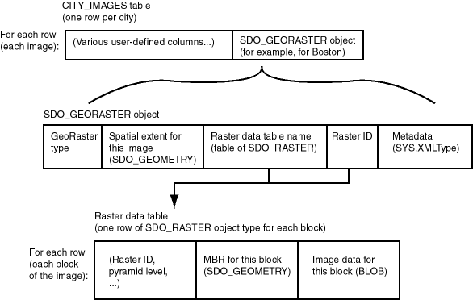
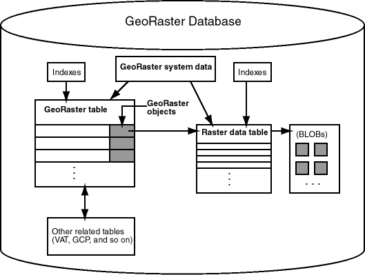
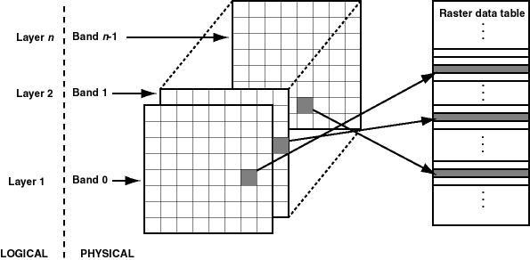
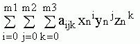
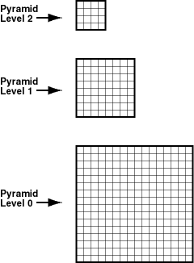

## 1 GeoRaster Overview and Concepts

GeoRaster is a feature of Oracle Spatial and Graph that lets you store, index, query, analyze, and deliver raster image and gridded data and its associated metadata.

GeoRaster provides Oracle spatial data types and an object-relational schema. You can use these data types and schema objects to store multidimensional grid layers and digital images that can be referenced to positions on the Earth's surface or in a local coordinate system. If the data is georeferenced, you can find the location on Earth for a cell in an image; or given a location on Earth, you can find the cell in an image associated with that location.

GeoRaster can be used with data from any technology that captures or generates images, such as remote sensing, photogrammetry, and thematic mapping. It can be used in a wide variety of application areas, including location based services, geoimagery archiving, environmental monitoring and assessment, geological engineering and exploration, natural resource management, defense, emergency response, telecommunications, transportation, urban planning, and homeland security.

**Note:**

- To use GeoRaster, you must understand the main concepts, data types, techniques, operators, procedures, and functions of Oracle Spatial and Graph, which are documented in [Oracle Spatial and Graph Developer's Guide](../spatl/index.md).
- You should also be familiar with raster and image concepts and terminology, techniques for capturing or creating raster data, and techniques for processing raster data.
- By default, the GeoRaster feature is disabled after Oracle Spatial and Graph is initially installed, and it must be enabled for each schema that will use GeoRaster. In order to enable GeoRaster, the schema must have the `CREATE TRIGGER` privilege. See [Enabling GeoRaster at the Schema Level](georaster-database-creation-management.md) for information and instructions.
- After a database upgrade, you should call the [SDO_GEOR_ADMIN.isUpgradeNeeded](SDO_GEOR_ADMIN-reference.md) function to check for any invalid GeoRaster objects and invalid system data for the current version. For more information, see [Maintaining GeoRaster Objects and System Data in the Database](georaster-database-creation-management.md).

This chapter describes the core concepts and features of GeoRaster, including the GeoRaster data model and storage schema, georeferencing models, metadata support, resampling algorithms, pyramids, compression, parallel processing, loading and exporting capabilities, and the Java API. It contains the following major sections.

- Vector and Raster Data
  Geographic features can be represented in vector or raster format, or both.
- Raster Data Sources
  Raster data is collected and used by a variety of geographic information technologies, including remote sensing, airborne photogrammetry, cartography, and global positioning systems.
- GeoRaster Data Model
  Raster data can have some or all of the following elements.
- GeoRaster Physical Storage
  GeoRaster optimizes the physical storage of metadata and data.
- Bands, Layers, and Metadata
  In GeoRaster, band and layer are different concepts.
- Georeferencing
  The GeoRaster spatial reference system (SRS), a metadata component of the GeoRaster object, includes information related to georeferencing. Georeferencing establishes the relationship between cell coordinates of GeoRaster data and real-world ground coordinates (or some local coordinates). Georeferencing assigns ground coordinates to cell coordinates, and cell coordinates to ground coordinates.
- Resampling and Interpolation
  Many image and raster transformations and operations involve pixel or cell resampling and interpolation.
- Pyramids
  Pyramids are subobjects of a GeoRaster object that represent the raster image or raster data at differing sizes and degrees of resolution.
- Bitmap Masks
  A bitmap mask is a special one-bit deep rectangular raster grid with each pixel having either the value of 0 or 1. It is used to define an irregularly shaped region inside another image. The 1-bits define the interior of the region, and the 0-bits define the exterior of the region.
- NODATA Values and Value Ranges
  A NODATA value is used for cells whose values are either not known or meaningless.
- Compression and Decompression
  GeoRaster provides the following types of native compression to reduce storage space requirements for GeoRaster objects: JPEG (JPEG-F), JPEG 2000, and DEFLATE.
- GeoRaster and Database Management
  GeoRaster enables you to perform database management tasks.
- Parallel Processing in GeoRaster
  There are two types of parallel processing with GeoRaster.
- Reporting Operation Progress in GeoRaster
  For some resource-intensive operations, GeoRaster enables you to monitor and report their execution progress.
- GeoRaster PL/SQL API
  GeoRaster provides the SDO_GEOR, SDO_GEOR_ADMIN, SDO_GEOR_AGGR, SDO_GEOR_RA, and SDO_GEOR_UTL PL/SQL packages, which contain subprograms (functions and procedures) to work with GeoRaster data and metadata.
- GeoRaster Java API
  The Oracle Spatial and Graph GeoRaster Java API consists of interfaces and classes that support features available with the GeoRaster feature of Oracle Spatial and Graph.
- GeoRaster Spatial Web Services
  A web service enables developers of Oracle Spatial and Graph GeoRaster applications to provide raster data and metadata to their application users over the web. GeoRaster supports Open Geospatial Consortium (OGC) web services, specifically, Web Coverage Services (WCS) and Web Map Services (WMS).
- MapViewer and GeoRaster
  Oracle Fusion Middleware MapViewer (MapViewer) is a programmable tool for rendering maps using spatial data managed by Oracle Spatial and Graph or Oracle Locator (also referred to as Locator). It fully supports GeoRaster data types and is the web-based mapping and visualization application platform for GeoRaster.
- GeoRaster Tools: Viewer, Loader, Exporter
  Oracle Spatial includes tools for viewing, loading, and exporting GeoRaster data.
- GeoRaster PL/SQL and Java Sample Files
  GeoRaster includes several PL/SQL and Java sample code files that show common operations.
- README File for Spatial and Graph and Related Features
  Oracle Spatial and Graph includes a `README.txt` file.

### 1.1 Vector and Raster Data

Geographic features can be represented in vector or raster format, or both.

With vector data, points are represented by their explicit x,y,z coordinates, lines are strings of points, and areas are represented as polygons whose borders are lines. This kind of vector format can be used to record precisely the location and shape of spatial objects. With raster data, you can represent spatial objects by assigning values to the cells that cover the objects, and you can represent the cells as arrays. This kind of raster format has less precision than vector format, but it is ideal for many types of spatial analysis.

In the raster geographic information systems (GIS) world, this kind of raster data is normally called gridded data. In image processing systems, the raster data representations are typically called images instead of grids. Despite any differences between grids and images, both forms of spatial information are usually represented as matrix structures (that is, arrays of cells), and each cell is usually regularly aligned in the space.

**Parent topic:** GeoRaster Overview and Concepts

### 1.2 Raster Data Sources

Raster data is collected and used by a variety of geographic information technologies, including remote sensing, airborne photogrammetry, cartography, and global positioning systems.

The collected data is then analyzed by digital image processing systems, computer graphics applications, and computer vision technologies. These technologies use several data formats and create a variety of products.

This section briefly describes some of the main data sources and uses for GeoRaster, focusing on concepts and techniques you need to be aware of in developing applications. It does not present detailed explanations of the technologies; you should consult standard textbooks and reference materials for that information.

- Remote Sensing
- Photogrammetry
- Geographic Information Systems
- Cartography
- Digital Image Processing
- Geology, Geophysics, and Geochemistry

**Parent topic:** GeoRaster Overview and Concepts

#### 1.2.1 Remote Sensing

Remote sensing obtains information about an area or object through a device that is not physically connected to the area or object. For example, the sensor might be in a satellite, balloon, airplane, boat, or ground station. The sensor device can be any of a variety of devices, including a frame camera, pushbroom (swath) imager, synthetic aperture radar (SAR), hydrographic sonar, or paper or film scanner. Remote sensing applications include environmental assessment and monitoring, global change detection and monitoring, and natural resource surveying.

The data collected by remote sensing is often called geoimagery. The wavelength, number of bands, and other factors determine the radiometric characteristics of the geoimages. The geoimages can be single-band, multiband, or hyperspectral, all of which can be managed by GeoRaster. These geoimages can cover any area of the Earth (especially for images sensed by satellite). The temporal resolution can be high, such as with meteorological satellites, making it easier to detect changes. For remote sensing applications, various types of resolution (temporal, spatial, spectral, and radiometric) are often important.

**Parent topic:** Raster Data Sources

#### 1.2.2 Photogrammetry

Photogrammetry derives metric information from measurements made on photographs. Most photogrammetry applications use airborne photos or high-resolution images collected by satellite remote sensing. In traditional photogrammetry, the main data includes images such as black and white photographs, color photographs, and stereo photograph pairs.

Photogrammetry rigorously establishes the geometric relationship between the image and the object as it existed at the time of the imaging event, and enables you to derive information about the object from its imagery. The relationship between image and object can be established by several means, which can be grouped in two categories: analog (using optical, mechanical, and electronic components) or analytical (where the modeling is mathematical and the processing is digital). Analog solutions are increasingly being replaced by analytical/digital solutions, which are also referred to as softcopy photogrammetry.

The main product from a softcopy photogrammetry system may include digital elevation models (DEMs) and orthoimagery. GeoRaster can manage all this raster data, together with its georeferencing information.

**Parent topic:** Raster Data Sources

#### 1.2.3 Geographic Information Systems

A geographic information system (GIS) captures, stores, and processes geographically referenced information. GIS software has traditionally been either vector-based or raster-based; however, with the GeoRaster feature, Oracle Spatial and Graph handles both raster and vector data.

Raster-based GIS systems typically process georectified gridded data. Gridded data can be discrete or continuous. Discrete data, such as political subdivisions, land use and cover, bus routes, and oil wells, is usually stored as integer grids. Continuous data, such as elevation, aspect, pollution concentration, ambient noise level, and wind speed, is usually stored as floating-point grids. GeoRaster can store all this data.

The attributes of a discrete grid layer are stored in a relational table called a value attribute table (VAT). A VAT contains columns specified by the GIS vendor, and may also contain user-defined columns. The VAT can be stored in the Oracle database as a plain table. The VAT name can be registered within the corresponding GeoRaster object so that raster GIS applications can use the table.

**Parent topic:** Raster Data Sources

#### 1.2.4 Cartography

Cartography is the science of creating maps, which are two-dimensional representations of the three-dimensional Earth (or of a non-Earth space using a local coordinate system). Today, maps are digitized or scanned into digital forms, and map production is largely automated. Maps stored on a computer can be queried, analyzed, and updated quickly.

There are many types of maps, corresponding to a variety of uses or purposes. Examples of map types include base (background), thematic, relief (three-dimensional), aspect, cadastral (land use), and inset. Maps usually contain several annotation elements to help explain the map, such as scale bars, legends, symbols (such as the north arrow), and labels (names of cities, rivers, and so on).

Maps can be stored in raster format (and thus can be managed by GeoRaster), in vector format, or in a hybrid format.

**Parent topic:** Raster Data Sources

#### 1.2.5 Digital Image Processing

Digital image processing is used to process raster data in standard image formats, such as TIFF, GIF, JFIF (JPEG), as well as in many geoimage formats, such as NITF, GeoTIFF, ERDAS IMG, and PCI PIX. Image processing techniques are widely used in remote sensing and photogrammetry applications. These techniques are used as needed to enhance, correct, and restore images to facilitate interpretation; to correct for any blurring, distortion, or other degradation that may have occurred; and to classify geo-objects automatically and identify targets. The source, intermediate, and result imagery can be loaded and managed by GeoRaster.

**Parent topic:** Raster Data Sources

#### 1.2.6 Geology, Geophysics, and Geochemistry

Geology, geophysics, and geochemistry all use digital data and produce some digital raster maps that can be managed by GeoRaster.

- In geology, the data includes regional geological maps, stratum maps, and rock slide pictures. In geological exploration and petroleum geology, computerized geostratum simulation, synthetic mineral prediction, and 3-D oil field characterization, all of which involve raster data, are widely used.

- In geophysics, data about gravity, the magnetic field, seismic wave transportation, and other subjects is saved, along with georeferencing information.

- In geochemistry, the contents of multiple chemical elements can be analyzed and measured. The triangulated irregular network (TIN) technique is often used to produce raster maps for further analysis, and image processing is widely used.

**Parent topic:** Raster Data Sources

### 1.3 GeoRaster Data Model

Raster data can have some or all of the following elements.

- Cells or pixels

- Spatial domain (footprint)

- Spatial, temporal, and band reference information

- Cell attributes

- Metadata

- Processing data and map support data

GeoRaster defines a generic raster data model that is component-based, logically layered, and multidimensional. The core data in a raster is a multidimensional array or matrix of raster cells. Each cell is one element of the matrix, and its value is called the cell value, which is sampled at the center of the cell. If the GeoRaster object represents an image, a cell can also be called a pixel, which has only one value. (In GeoRaster, the terms cell and pixel are interchangeable.) The matrix has a number of dimensions, a cell depth, and a size for each dimension. The cell depth is the data size of the value of each cell. The cell depth defines the range of all cell values, and it applies to each single cell, not to an array of cells. This core raster data set can be blocked for optimal storage and retrieval.

The data model has a logically layered structure. The core data consists of one or more logical layers. For example, for multichannel remote sensing imagery, the layers are used to model the channels of the imagery. (Bands and layers are explained in Bands\_ Layers\_ and Metadata.) In the current release, each layer is a two-dimensional matrix of cells that consists of the row dimension and the column dimension.

GeoRaster data has metadata and attributes, and each layer of the GeoRaster data can have its own metadata and attributes. In the GeoRaster data model, all data other than the core cell matrix is the GeoRaster metadata. The GeoRaster metadata is further divided into different components (and is thus called component-based), which contain the following kinds of information:

- Object information

- Raster information

- Spatial reference system information

- Date and time (temporal reference system) information

- Band reference system information

- Layer information for each layer

Based on this data model, GeoRaster objects are described by the GeoRaster metadata XML schema (described in [GeoRaster Metadata XML Schema](georaster-metadata-xml-schema.md)), which is used to organize the metadata. Some schema components and subcomponents are required and others are optional. You must understand this XML schema if you develop GeoRaster loaders, exporters, or other applications. Some restrictions on the metadata exist for the current release, and these are described in the Usage Notes for the [SDO_GEOR.validateGeoRaster](SDO_GEOR-reference.md) function (documented in [SDO_GEOR Package Reference](SDO_GEOR-reference.md)), which checks the validity of the metadata for a GeoRaster object.

The GeoRaster object data types, described in [GeoRaster Data Types and Related Structures](georaster-datatypes.md), are based on the GeoRaster data model.

In this data model, two different types of coordinates need to be considered: the coordinates of each pixel (cell) in the raster matrix and the coordinates on the Earth that they represent. Consequently, two types of coordinate systems or spaces are defined: the cell coordinate system and the model coordinate system.

The cell coordinate system (also called the raster space) is used to describe cells in the raster matrix and their spacing, and its dimensions are (in this order) row, column, and band. The model coordinate system (also called the ground coordinate system or the model space) is used to describe points on the Earth or any other coordinate system associated with an Oracle SRID value. The spatial dimensions of the model coordinate system are (in this order) X and Y, corresponding to the column and row dimensions, respectively, in the cell coordinate system. The logical layers correspond to the band dimension in the cell space.

Figure 1-1 shows the relationship between a raster image and its associated geographical (spatial) extent, and between parts of the image and their associated geographical entities.

Figure 1-1 Raster Space and Model Space

[Description of "Figure 1-1 Raster Space and Model Space"](img_text/raster_model.md)

In Figure 1-1:

- In the objects on the left, the medium-size rectangle represents a raster image, and within it are a rectangular area showing a national park and a point identifying the location of a specific restaurant. Each pixel in the image can be identified by its coordinates in a cell coordinate system (the coordinate system associated with the raster image). The upper-left corner of the medium-size rectangle has the coordinate values associated with the `ULTCoordinate` value of the cell space for the GeoRaster object.

- In the objects on the right, the large rectangle represents the geographical area (in the model, or ground, space) that is shown in the raster image, and within it are spatial geometries for the national park and the specific restaurant. Each entire geographical area and geometries within it can be identified using coordinates in its model (or, ground) coordinate system, such as WGS 84 for longitude/latitude data.

For two-dimensional single-layer GeoRaster data, the cell coordinate system has a row dimension pointing downward and a column dimension pointing to the right, as shown in Figure 1-1. The origin of the cell space is always (0,0). The spacing is 1 cell or 1 pixel, and in most cases the cell coordinates are identified by integer row and column numbers. For a multiband image, the axis along bands is called the band dimension. For a time series multilayer image (where each layer has a different date or timestamp), the axis along layers is called the temporal dimension. Three-dimensional GeoRaster data includes the vertical dimension, which is vertical to both the row and column dimensions.

**Note:**

Only row, column, and band dimensions in the cell coordinate system are currently supported. The row and column dimensions are used to model two-dimensional spatial coordinates. The band dimension can be used to model multichannel remote sensing imagery or photographs and any other types of layers, such as temporal layers and multiple-grid themes.

When the raster data is treated and processed as an array of numbers, integer addressing using row and column numbers is sufficient in most applications. However, the raster data array is generally a discretized representation of a continuous space, and so a one-to-one mapping of coordinates between the cell space and the model space is required, regardless of whether the value of a cell represents a collective value of an area or a single value of a point.

In other words, sub-cell (sub-pixel) addressing in the cell space is necessary. To support sub-cell addressing, GeoRaster defines two types of cell coordinate systems, depending on where the origin (0,0) of cells is defined. Figure 1-2, where each square represents one cell, shows the two types of cell coordinate systems: center-based and upperleft-based.

Figure 1-2 Two Types of Cell Coordinate Systems

[Description of "Figure 1-2 Two Types of Cell Coordinate Systems"](img_text/cell_cs_types.md)

The default cell coordinate system has its origin at the center of a cell, and is called the center-based cell coordinate system. The other cell coordinate system has its origin at the upper-left corner of a cell, and is called the upperleft-based cell coordinate system. In both systems, the cells are squares with equal size and the unit is 1 cell. Assuming that I and J are integers, and x and y are floating numbers:

- In center-based cell space, coordinate (x, y) is mapped to (I,J) as long as I-0.5 \<= x \< I+0.5 and J-0.5 \<= y \< J+0.5.

- In upperleft-based cell space, coordinate (x, y) is mapped to cell (I,J) as long as I \<= x \< I+1.0 and J \<= y \< J+1.0.

For example, sub-cell coordinate (0.3, 0.3) has the same integer cell coordinate (0,0) in both coordinate systems, while (0.3,0.6) means (0,1) in center-based cell space but means (0,0) in upperleft-based cell space. This two types of cell coordinate systems are defined by the `modelCoordinateLocation` element in the `spatialReferenceInfo` metadata; otherwise, the default type is center-based. GeoRaster supports both cell coordinate systems, and effective with Oracle Database 11g, sub-cell addresses are supported in the GeoRaster PL/SQL API. (Sub-cell addresses were internally supported in previous releases.)

In GeoRaster, while the origin of the cell space is always at (0,0), the upper-left corner cell of the raster data itself can have a different coordinate in its cell space from the coordinate of the origin of the cell space. In other words, the integer (row, column) coordinate of the upper-left corner cell is not necessarily (0,0). The upper-left corner is called the ULTCoordinate, and its value is registered in the metadata. It basically defines the relative location of the data in the cell space. If there is a band dimension, the ULTCoordinate value is always (row,column,0). The coordinate of each cell is relative to the origin of the cell space, not to the ULTCoordinate value. The origin of the cell coordinate system might not be exactly at the ULTCoordinate value.

The model coordinate system consists of spatial dimensions, and other dimensions if there are any. The spatial dimensions are called the x, y, and z dimensions, and values in these dimensions can be associated with a geodetic, projected, or local coordinate system. Other dimensions include spectral and temporal dimensions (called the s dimension and t dimension, respectively). GeoRaster SRS currently supports two spatial dimensions (X,Y) and three spatial dimensions (X, Y, Z) in the model coordinate system. (For information about coordinate systems, including the different types of coordinate systems, see [Oracle Spatial and Graph Developer's Guide](../spatl/coordinate-systems-concepts.md).)

The GeoRaster model coordinate system is defined by an Oracle Spatial and Graph SRID. The model coordinates have the same unit as that of the specified SRID and should be in the value range defined by the model coordinate system. For example, if the GeoRaster object is georeferenced to a geodetic coordinate system such as 4326 (EPSG WGS84), the unit of the model coordinates derived from the spatial reference system (SRS) must be decimal degrees, and values should be in the ranges of -180.0 to +180.0 for longitude and -90.0 to +90.0 for latitude.

The relationships between cell coordinates and model coordinates are modeled by GeoRaster reference systems (mapping schemes). The following GeoRaster reference systems are defined:

- Spatial reference system, also called GeoRaster SRS, which maps cell coordinates (row,column,vertical) to model coordinates (X,Y,Z). Using the spatial reference system with GeoRaster data is referred to as georeferencing the data. (Georeferencing is discussed in Georeferencing.)

- Temporal reference system, also called GeoRaster TRS, which maps cell coordinates (temporal) to model coordinates (T).

- Band reference system, also called GeoRaster BRS, which maps cell coordinates (band) to model coordinates (S, for Spectral).

Each of these reference systems is currently defined, at least partially, in the GeoRaster XML schema. However, for the current release, only the spatial reference system is supported. This means that only the relationship between (row,column) and (X,Y) or (X, Y, Z) coordinates can be mapped. If the model coordinate system is geodetic, (X,Y) means (longitude,latitude). The temporal and band reference systems can be used, however, to store useful temporal and spectral information, such as the spectral resolution and when the raster data was collected.

Other metadata is stored in the `<layerInfo>` element in the GeoRaster XML metadata, as explained in Bands\_ Layers\_ and Metadata.

**Parent topic:** GeoRaster Overview and Concepts

### 1.4 GeoRaster Physical Storage

GeoRaster optimizes the physical storage of metadata and data.

As mentioned in GeoRaster Data Model, GeoRaster data consists of a multidimensional matrix of cells and the GeoRaster metadata. Most metadata is stored as an XML document using the Oracle XMLType data type. The metadata is defined according to the GeoRaster metadata XML schema, which is described in [GeoRaster Metadata XML Schema](georaster-metadata-xml-schema.md). The spatial extent (footprint) of a GeoRaster object is part of the metadata, but it is stored separately as an attribute of the GeoRaster object. This approach allows GeoRaster to take advantage of the spatial geometry type and related capabilities, such as using R-tree indexing on GeoRaster objects. The spatial extent is described in [spatialExtent Attribute](georaster-datatypes.md).

The GeoRaster metadata is stored using either the CLOB storage option or the binary XML storage option. The binary XML storage option for the GeoRaster metadata is the default, which saves disk space and improves performance. You can specify or change the storage option when you create a GeoRaster table.

The multidimensional matrix of cells is blocked into small subsets for large-scale GeoRaster object storage and optimal retrieval and processing. Each block is stored in a table as a binary large object (BLOB), and a geometry object (of type SDO_GEOMETRY) is used to define the precise extent of the block. Each row of the table stores only one block and the blocking information related to that block. (This blocking scheme applies to pyramids also.)

The dimension sizes (along row, column, and band dimensions) may not be evenly divided by their respective block sizes. GeoRaster adds padding to the boundary blocks that do not have enough original cells to be completely filled. The boundary blocks are the end blocks along the positive direction of each dimension. The padding cells have the same cell depth as other cells and have values equal to zero. Padding makes each block have the same BLOB size. Padding mainly applies to row and column blocks, but for multiband and hyperspectral imagery, padding can be applied to the band dimension also. For example, assume the following specification: band interleaved by line, blocking as (64,64,3), and 8 bands, each with 64 rows and 64 columns. In this case:

1.  Bands 0, 1, and 2 are stored interleaved by line in the first block.

2.  Bands 3, 4, and 5 are stored interleaved by line in the second block.

3.  The third block holds the following in this order: line 1 of band 6, line 1 of band 7, 64 column values that are padding, line 2 of band 6, line 2 of band 7, 64 column values that are padding, and so on, until all 64 rows are stored.

However, the top-level pyramids are not padded if both the row and column dimension sizes of the pyramid level are less than or equal to one-half the row block size and column block size, respectively. See Pyramids for information about the physical storage of pyramids.

Each GeoRaster block has the same size. The dimension sizes of the blocks do not need to be a power of 2. They can be random integer values. The block sizes can be optimized automatically based on the dimension sizes of the GeoRaster object, so that each GeoRaster object uses only minimum padding space. See Table 1-1 in Storage Parameters for more information.

The raster blocks (BLOBs) contain the binary representation of the raster cell values. Specifically, floating-point cell values are represented in the IEEE 754 standard formats on supported platforms. If the cell depth is greater than 8 bits, GeoRaster cell data is stored in big-endian format in raster blocks. If the cell depth is less than 8 bits, each byte in the raster blocks contains two or more cells, so that the bits of a byte are fully filled with cell data. The cells are always filled into the byte from left to right. For example, if the cell depth is 4 bits, one byte contains two cells: the first four bits of the byte contain the value of a cell, and the second four bits contain the value of its following cell, which is determined by the interleaving type.

Based on this physical storage model, two object types are provided: SDO_GEORASTER for the raster data set and related metadata, and SDO_RASTER for each block in a raster image.

- The SDO_GEORASTER object contains a spatial extent geometry (footprint or coverage extent) and relevant metadata. A table containing one or more columns of this object type is called a GeoRaster table.

- The SDO_RASTER object contains information about a block (tile) of a GeoRaster object, and it uses a BLOB object to store the raster cell data for the block. An object table of this object type, or a relational table containing the same columns as the attributes of this object type, is called a raster data table (RDT).

The SDO_GEORASTER object stores and refers to an image or a raster data set. The SDO_RASTER object is an internal object for GeoRaster. The SDO_GEORASTER object fully encapsulates the raster data set's metadata and raster cell data, that is, a collection of SDO_RASTER objects. The relationship between the SDO_GEORASTER object and its SDO_RASTER objects is maintained by GeoRaster automatically. All interfaces of GeoRaster functions and procedures deal with the SDO_GEORASTER objects only; the SDO_RASTER objects of a SDO_GEORASTER object are internally handled automatically. The SDO_GEORASTER object is the major interface for users to build and manage a GeoRaster database; you only need to use the SDO_RASTER object to create raster data tables (RDTs).

Each SDO_GEORASTER object has a pair of attributes (`rasterDataTable`, `rasterID`) that uniquely identify the RDT and the rows within the RDT that are used to store the raster cell data for the GeoRaster object.

Figure 1-3 shows the storage of GeoRaster objects, using as an example an image of Boston, Massachusetts in a table that contains rows with images of various cities.

Figure 1-3 Physical Storage of GeoRaster Data

[Description of "Figure 1-3 Physical Storage of GeoRaster Data"](img_text/physical_storage.md)

As shown in Figure 1-3:

- Each row in the table of city images contains information about the image for a specific city (such as Boston), including an SDO_GEORASTER object.

- The SDO_GEORASTER object includes the spatial extent geometry covering the entire area of the image, the metadata, the raster ID, and the name of the raster data table associated with this image.

- Each row in the raster data table contains information about a block (or tile) of the image, including the block's minimum bounding rectangle (MBR) and image data (stored as a BLOB). The raster data table is described in Raster Data Table.

The SDO_GEORASTER and SDO_RASTER object types are described in detail in [GeoRaster Data Types and Related Structures](georaster-datatypes.md).

Figure 1-4 shows the physical storage of GeoRaster data and several related objects in a database.

Figure 1-4 GeoRaster Data in an Oracle Database

[Description of "Figure 1-4 GeoRaster Data in an Oracle Database"](img_text/georaster_db.md)

In Figure 1-4:

- Each GeoRaster object in the GeoRaster table has an associated raster data table, which has an entry for each block of the raster image.

- The BLOB with image data for each raster image block is stored separately from the raster table data. You can specify storage parameters (described in Storage Parameters) for the BLOBs.

- Each GeoRaster object has a raster data table associated with it. However, a raster data table can store blocks of multiple GeoRaster objects, and GeoRaster objects in a GeoRaster table can be associated with one or multiple raster data tables.

- GeoRaster system data (described in [GeoRaster System Data Views (xxx_SDO_GEOR_SYSDATA)](georaster-datatypes.md)) maintains the relationship between the GeoRaster tables and the raster data tables.

- Indexes (standard and spatial) can be built on the GeoRaster table and raster data tables. For information about indexing GeoRaster data, see [Indexing GeoRaster Objects](georaster-database-creation-management.md).

- Additional information, such as ground control points (GCPs) and value attribute tables (VATs), can be related to the GeoRaster objects.

You generally maintain a one-to-many relationship between a GeoRaster table and its associated raster data tables, even though they could have a many-to-many relationship. That is, let a raster data table only contain cell data of GeoRaster objects that belong to the same GeoRaster table. A GeoRaster table can contain a large number (potentially unlimited) of GeoRaster objects. An RDT should be used to contain the raster blocks of a limited number of GeoRaster objects, depending on the size of the rasters.

The following considerations apply to schema, table, and column names that are stored in any Oracle Spatial and Graph metadata views. For example, these considerations apply to geometry tables, GeoRaster tables, raster data tables, and geometry and GeoRaster columns.

- The name must contain only letters, numbers, and underscores. For example, the name cannot contain a space (` `), an apostrophe (`'`), a quotation mark (`"`), or a comma (`,`).

- All letters in the names are converted to uppercase before the names are stored in geometry metadata views or GeoRaster system data (xxx_SDO_GEOR_SYSDATA) views or before the tables are accessed. This conversion also applies to any schema name specified with the table name.

For more information about raster data tables, see Raster Data Table.

- Storage Parameters
- Raster Data Table
- Blank and Empty GeoRaster Objects
- Empty Raster Blocks
- Cross-Schema Support with GeoRaster

**Parent topic:** GeoRaster Overview and Concepts

#### 1.4.1 Storage Parameters

Several GeoRaster operations let you specify or change aspects of the storage. The relevant subprograms contain a parameter named `storageParam`, which is a quoted string of keywords and their values. The `storageParam` parameter keywords apply to characteristics of the raster data (see Table 1-1).

**Note:**

The keywords in this section either do not apply or only partially apply to the `storageParam` parameter of the [SDO_GEOR.importFrom](SDO_GEOR-reference.md) procedure and the `subsetParam` parameter of the [SDO_GEOR.exportTo](SDO_GEOR-reference.md) procedure. See the reference information about the relevant parameters for each of these procedures in [SDO_GEOR Package Reference](SDO_GEOR-reference.md).

**Note:**

For any numbers in string (VARCHAR2) parameters to GeoRaster subprograms, the period (.) must be used for any decimal points regardless of the locale.

Table 1-1 storageParam Keywords for Raster Data

| Keyword      | Explanation                                                                                                                                                                                                                                                                                                                                                                                                                                                                                                                                                                                                                                                                                                                                                                                                                                                                                                                                                                                                                                                                                                                                                                                       |
|:-------------|:--------------------------------------------------------------------------------------------------------------------------------------------------------------------------------------------------------------------------------------------------------------------------------------------------------------------------------------------------------------------------------------------------------------------------------------------------------------------------------------------------------------------------------------------------------------------------------------------------------------------------------------------------------------------------------------------------------------------------------------------------------------------------------------------------------------------------------------------------------------------------------------------------------------------------------------------------------------------------------------------------------------------------------------------------------------------------------------------------------------------------------------------------------------------------------------------------|
| bitmapmask   | Specifies whether or not bitmap masks are considered. `TRUE` specifies to consider any associated bitmap masks; `FALSE` specifies not to consider the bitmap masks. The default is `TRUE` for [SDO_GEOR.copy](SDO_GEOR-reference.md), [SDO_GEOR.changeFormatCopy](SDO_GEOR-reference.md), [SDO_GEOR.mergeLayers](SDO_GEOR-reference.md), [SDO_GEOR.scaleCopy](SDO_GEOR-reference.md), and [SDO_GEOR.subset](SDO_GEOR-reference.md); the default is `FALSE` for [SDO_GEOR.mosaic](SDO_GEOR-reference.md) (A value of `TRUE` is invalid and is ignored for [SDO_GEOR.mosaic](SDO_GEOR-reference.md).)                                                                                                                                                                                                                                                                                                                                                                                                                                                                                                                                                                                               |
| blocking     | Specifies whether or not raster data is blocked. `TRUE` causes raster data to be blocked using the blocks of the specified or default `blockSize` value; `OPTIMALPADDING` is the same as TRUE except that the specified `blockSize` value will be adjusted to an optimal value to reduce padding space; `FALSE` causes raster data not to be blocked (that is, only one block will be used for the entire image). Specifying `OPTIMALPADDING` causes GeoRaster to call the [SDO_GEOR_UTL.calcOptimizedBlockSize](SDO_GEOR_UTL-reference.md) procedure internally. The default value for `blocking` is `TRUE` if you specify the `blockSize` keyword. If you specify `blocking=TRUE` but do not specify the `blockSize` keyword, the default `blockSize` is (512,512,B), where B is the number of bands in the output GeoRaster object. If you specify neither `blocking` nor `blockSize`, default values are derived from the source GeoRaster object: that is, if the original data is not blocked, the data in the output GeoRaster object is by default not blocked; and if the original data is blocked, the data in the output GeoRaster object is blocked with the same blocking scheme. |
| blockSize    | Specifies the block size, that is, the number of cells per block. You must specify a value for each dimension of the output GeoRaster object. For example, `blocksize=(512,512,3)` specifies 512 for the row dimension, 512 for the column dimension, and 3 for the band dimension; and `blocksize=(512,512)` specifies row and column block sizes of 512 for a GeoRaster object that has no band dimension. The values must be non-negative integers. If a value is 0, it means the block size is the corresponding dimension size. If a value is greater than the corresponding dimension size, padding is applied. See also the explanation of the `blocking` keyword in this table and of the [SDO_GEOR_UTL.calcOptimizedBlockSize](SDO_GEOR_UTL-reference.md) procedure. Only regular blocking is supported; that is, all blocks must be the same size and be aligned with each other, except for some top-level pyramids. However, the dimension sizes of the blocks do not need to be a power of 2. They can be random integer values. For example, the `blockSize` value can be `(``589,1236,7)`. The physical storage size of a raster block must be less than or equal to 4GB.    |
| cellDepth    | Specifies the cell depth of the raster data set, which indicates the number of bits and the sign for the data type of all cells. Note, however, that changing the cell depth can cause loss of data and a reduction in precision and image quality. Must be one of the following values (`_U` indicating unsigned and `_S` indicating signed): `1BIT`, `2BIT`, `4BIT`, `8BIT_U`, `8BIT_S`, `16BIT_U`, `16BIT_S`, `32BIT_U`, `32BIT_S`, `32BIT_REAL`, or `64BIT_REAL`. (Complex `cellDepth` types are not supported.) If `cellDepth` is not specified, the value from the source GeoRaster object is used by default. Example: `celldepth=16BIT_U`                                                                                                                                                                                                                                                                                                                                                                                                                                                                                                                                                 |
| compression  | Specifies the compression type to be applied to the GeoRaster object. Must be one of the following values: `JPEG-F`, `DEFLATE`, or `NONE`. (You can use `NONE` to decompress a compressed GeoRaster object.) If `compression` is not specified, the compression type of the source GeoRaster object is used. For more information about compression and decompression, see Compression and Decompression. Example: `compression=JPEG-F` If the source GeoRaster object is blank, the `compression` keyword is ignored, except for the [SDO_GEOR.getRasterSubset](SDO_GEOR-reference.md) and [SDO_GEOR.getRasterData](SDO_GEOR-reference.md) functions. (Blank GeoRaster objects are explained in Blank and Empty GeoRaster Objects.)                                                                                                                                                                                                                                                                                                                                                                                                                                                           |
| interleaving | Specifies the interleaving type. (Interleaving is explained in Bands\_ Layers\_ and Metadata.) Must be one of the following values: `BSQ` (band sequential), `BIL` (band interleaved by line), or `BIP` (band interleaved by pixel). Example: `interleaving=BSQ`                                                                                                                                                                                                                                                                                                                                                                                                                                                                                                                                                                                                                                                                                                                                                                                                                                                                                                                                  |
| parallel     | Specifies the degree of parallelism for the compression operation. (This parameter is ignored when a subprogram call specifies the `parallelParam` parameter.) If specified, must be in the form `parallel=`n, where n is greater than 1. Must be used with the `compression` storage parameter. Parallelism is supported for the following compression operations: • From `NONE` to `JPEG-F` • From `NONE` to `DEFLATE` • From `JPEG-F` to `NONE` • From `DEFLATE` to `NONE` Parallelism is not supported for the following compression operations: • From `JPEG-F` to `DEFLATE` • From `DEFLATE` to `JPEG-F`                                                                                                                                                                                                                                                                                                                                                                                                                                                                                                                                                               |
| pyramid      | `TRUE` specifies to keep the original pyramid data; `FALSE` specifies not to keep the original pyramid data. The default value depends on the specific procedure: the default is `TRUE` for [SDO_GEOR.copy](SDO_GEOR-reference.md) and [SDO_GEOR.changeFormatCopy](SDO_GEOR-reference.md); the default is `FALSE` for [SDO_GEOR.scaleCopy](SDO_GEOR-reference.md), [SDO_GEOR.mosaic](SDO_GEOR-reference.md), and [SDO_GEOR.subset](SDO_GEOR-reference.md). (A value of `TRUE` is invalid and is ignored for [SDO_GEOR.scaleCopy](SDO_GEOR-reference.md) or [SDO_GEOR.subset](SDO_GEOR-reference.md).) You cannot generate pyramid data through the use of storage parameters; instead, you must use the [SDO_GEOR.generatePyramid](SDO_GEOR-reference.md) procedure after creating the GeoRaster object.                                                                                                                                                                                                                                                                                                                                                                                       |
| quality      | Specifies the JPEG compression quality, which is the degree of lossiness caused by the compression. Must be an integer from 0 (lowest quality) through 100 (highest quality) to be applied to the GeoRaster object. The default value is 75. For more information about compression quality, see JPEG Compression of GeoRaster Objects. Example: `quality=80`                                                                                                                                                                                                                                                                                                                                                                                                                                                                                                                                                                                                                                                                                                                                                                                                                                     |

Example 1-1 shows a GeoRaster object being copied, with its block size changed and any pyramid data from the original object not copied.

Example 1-1 Using storageParam Keywords

    DECLARE
       gr1 sdo_georaster;
       gr2 sdo_georaster;
    BEGIN
    INSERT INTO georaster_table (georid, georaster) VALUES (2, sdo_geor.init('RDT_1'))
           RETURNING georaster INTO gr2;
    SELECT georaster INTO gr1 FROM georaster_table WHERE georid=1;
    sdo_geor.changeFormatCopy(gr1, 'blocking=OPTIMALPADDING
       blocksize=(512,512) pyramid=FALSE', gr2);
    UPDATE georaster_table SET georaster=gr2 WHERE georid=2;
    COMMIT;
    END;
    /

In Example 1-1, the raster data table for GeoRaster object `gr2` is RDT_1. If raster data is to be written into table RDT_1, that table must exist before the PL/SQL block is run; otherwise, an error is generated by the [SDO_GEOR.changeFormatCopy](SDO_GEOR-reference.md) procedure.

**Note:**

If you insert, update, or delete GeoRaster cell data or metadata, update the GeoRaster object before committing the transaction, as shown in Example 1-1 and as explained in [Updating GeoRaster Objects Before Committing](georaster-data-manipulation.md).

Example 1-1 and many examples in [SDO_GEOR Package Reference](SDO_GEOR-reference.md) refer to a table named GEORASTER_TABLE, which has the following definition:

    CREATE TABLE georaster_table
    ( georid    NUMBER PRIMARY KEY,
      name      VARCHAR2(32),
      georaster SDO_GEORASTER );

**Parent topic:** GeoRaster Physical Storage

#### 1.4.2 Raster Data Table

A raster data table (RDT) must be an object table of SDO_RASTER type, or a relational table with the following column definitions:

      rasterID          NUMBER,
      pyramidLevel      NUMBER,
      bandBlockNumber   NUMBER,
      rowBlockNumber    NUMBER,
      columnBlockNumber NUMBER,
      blockMBR          SDO_GEOMETRY,
      rasterBlock       BLOB

The RDT, whether an object table or a relational table, must have the primary key defined on the columns `(rasterID, pyramidLevel, bandBlockNumber, rowBlockNumber, columnBlockNumber)`.

Each RDT name must be or equivalent to a valid nonquoted identifier, and it will be stored in the GeoRaster sysdata views and in the SDO_GEORASTER objects in all uppercase characters, without any schema prefix. (Each GeoRaster column name must be or equivalent to a valid nonquoted identifier, and it is stored in the GeoRaster sysdata views in all uppercase characters.)

Note, the RDTs used or referenced by the GeoRaster objects in a GeoRaster table must be in the same schema as that of the GeoRaster table. The name of each RDT must be unique and the pair of `(rasterDataTable`, `rasterID)` of a GeoRaster object must be unique in the database in order to support cross-schema manipulation and ensure data integrity of GeoRaster objects. When you initiate a GeoRaster object using the [SDO_GEOR.init](SDO_GEOR-reference.md) and [SDO_GEOR.createBlank](SDO_GEOR-reference.md) functions without specifying the RDT name and RID number, those functions will automatically generate a `rasterDataTable` name and a `rasterID` number for the new GeoRaster object to ensure the uniqueness requirements. You can use the [SDO_GEOR_ADMIN.isRDTNameUnique](SDO_GEOR_ADMIN-reference.md) function to check if an RDT name is already used by GeoRaster before you create it. You can use the [SDO_GEOR_UTL.renameRDT](SDO_GEOR_UTL-reference.md) procedure to rename an existing RDT already used by GeoRaster to a different name. To resolve any duplication in raster data table names, you can use the [SDO_GEOR_ADMIN.maintainSysdataEntries](SDO_GEOR_ADMIN-reference.md) function. For transferring GeoRaster data between databases, see [Transferring GeoRaster Data Between Databases](georaster-database-creation-management.md) for information on how to resolve conflicts.

Creating a raster data table enables you to control the placement and storage characteristics of the RDT (for example, if the table should be partitioned for better performance). For a large GeoRaster object, consider putting its raster data in a separate raster data table and partitioning the raster data table by pyramid level or block numbers, or both; however, always consider sharing an RDT for a certain number of smaller GeoRaster objects to avoid creating too many RDTs. Do not use the SYSTEM tablespace for storing GeoRaster tables and raster data tables. Instead, create separate locally managed (the default) tablespaces for GeoRaster tables.

Never insert or delete any rows directly in a raster data table. The rows in the appropriate RDTs are automatically inserted or deleted when GeoRaster objects are created with raster data or deleted from a GeoRaster table.

In choosing block sizes for raster data, consider the following:

- The maximum length of a raster block is 4 GB; therefore, do not specify a block size greater than 4 GB.

- Consider the `cellDepth` value of the GeoRaster object when you calculate the desired size for a raster block.

- Choosing an appropriate block size is a trade-off between the size of a raster block and the number of blocks needed for a GeoRaster object. For raster data of a large size, Oracle recommends at least 512 by 512 for the row and column dimension sizes. A blocking size value that results in a raster block smaller than or close to 4 KB (such as 64 by 64) is usually a bad choice, because 4 KB is the threshold for storing an Oracle BLOB out-of-line.

For information about creating object or relational raster data tables, see [Creating Raster Data Tables](georaster-database-creation-management.md).

**Parent topic:** GeoRaster Physical Storage

#### 1.4.3 Blank and Empty GeoRaster Objects

A blank GeoRaster object is a special type of GeoRaster object in which all cells have the same value. There is no need to store its cells in any SDO_RASTER block; instead, the cell value is registered in the metadata in the `blankCellValue` element. Otherwise, blank GeoRaster objects are treated in the same way as other GeoRaster objects. Use the [SDO_GEOR.createBlank](SDO_GEOR-reference.md) function to create a blank GeoRaster object, the [SDO_GEOR.isBlank](SDO_GEOR-reference.md) function to check if a GeoRaster object is a blank GeoRaster object, and the [SDO_GEOR.getBlankCellValue](SDO_GEOR-reference.md) function to return the value of the cells in a blank GeoRaster object.

An empty GeoRaster object contains only a rasterDataTable name and a rasterID. To create an empty GeoRaster object, use the [SDO_GEOR.init](SDO_GEOR-reference.md) function. You must create an empty GeoRaster object before you perform an action that outputs a new GeoRaster object, so that the output can be stored in the previously initialized empty GeoRaster object.

**Parent topic:** GeoRaster Physical Storage

#### 1.4.4 Empty Raster Blocks

GeoRaster supports empty raster blocks to save storage space with large mosaic objects and to improve raster processing speed. Empty raster blocks are used when there is no raster data available for a specific raster block of a large GeoRaster object. Such GeoRaster data is of a special sparse data type. There is still an entry in the raster data table for each empty raster block, but the length of the BLOB is zero (indicating empty).

When a GeoRaster operation (for example, [SDO_GEOR.changeCellValue](SDO_GEOR-reference.md), [SDO_GEOR.changeFormatCopy](SDO_GEOR-reference.md), [SDO_GEOR.generatePyramid](SDO_GEOR-reference.md), [SDO_GEOR.getRasterData](SDO_GEOR-reference.md), [SDO_GEOR.getRasterSubset](SDO_GEOR-reference.md), [SDO_GEOR.mergeLayers](SDO_GEOR-reference.md), [SDO_GEOR.mosaic](SDO_GEOR-reference.md), [SDO_GEOR.scaleCopy](SDO_GEOR-reference.md), [SDO_GEOR.subset](SDO_GEOR-reference.md), or [SDO_GEOR.updateRaster](SDO_GEOR-reference.md)) is applied to a source GeoRaster object with empty raster blocks, it may lead to empty or partially empty result raster blocks.

A resulting raster block is empty if all the cells in it are derived from empty source raster blocks. A resulting raster block is partially empty if only some of the cells in it are derived from empty source raster blocks. Any cells in a partially empty result raster block that are derived from an empty source raster block are either set to certain background values (as specified in the `bgValues` parameter) or set to 0 (if the `bgValues` parameter is not specified). Once this is done, a partially empty raster block becomes just like a normal non-empty raster block; and after the operation is finished, each raster block in the resulting GeoRaster object is either empty or non-empty.

Because the filling of partially empty raster blocks changes the raster data permanently, you should carefully choose consistent background values when manipulating a GeoRaster object. The NODATA values stored in the GeoRaster metadata, if present, are good choices for background values, although you can also select other background values as long as they are used consistently.

If a GeoRaster object has empty raster blocks, its pyramid data may not contain any empty raster blocks at all because partially empty raster blocks are filled with background values or 0 during the [SDO_GEOR.generatePyramid](SDO_GEOR-reference.md) operation. When you call this function to generate the pyramid, be careful in choosing a consistent background value, as explained in this section.

A bitmap mask (see Bitmap Masks) can also have empty raster blocks, with the missing cell values indicating 0. If filling is required, the missing cells are always filled with the value 0.

**Parent topic:** GeoRaster Physical Storage

#### 1.4.5 Cross-Schema Support with GeoRaster

A GeoRaster table and its associated raster data table or tables must have the same owner. However, users with appropriate privileges can create GeoRaster tables and associated raster data tables owned by other schemas, and they can also create, query, update, and delete GeoRaster objects owned by other schemas. For cross-schema query of GeoRaster objects, you must have the SELECT or READ privilege on the GeoRaster tables and their associated raster data tables. For cross-schema update of GeoRaster objects, you must have the SELECT or READ privilege and the INSERT, UPDATE, and DELETE privileges on the GeoRaster tables and their associated raster data tables.

The ALL_SDO_GEOR_SYSDATA view (described in [GeoRaster System Data Views (xxx_SDO_GEOR_SYSDATA)](georaster-datatypes.md)) contains information about all GeoRaster objects accessible to the current user. For each object listed, the GeoRaster table must be accessible by the current user. If the current user also needs to access the raster data, that user must also have the appropriate privileges on the associated raster data table.

All SDO_GEOR subprograms can work on GeoRaster objects defined in schemas other than the current connection schema.

For examples of cross-schema GeoRaster operations, see [Performing Cross-Schema Operations](georaster-data-manipulation.md).

**Parent topic:** GeoRaster Physical Storage

### 1.5 Bands, Layers, and Metadata

In GeoRaster, band and layer are different concepts.

Band is a physical dimension of the multidimensional raster data set; that is, it is one ordinate in the cell space. For example, the cell space might have the ordinates row, column, and band. Bands are numbered from 0 to n-1, where n is the highest layer number. Layer is a logical concept in the GeoRaster data model. Layers are mapped to bands. Typically, one layer corresponds to one band, and it consists of a two-dimensional matrix of size `rowDimensionSize` and `columnDimensionSize`. Layers are numbered from 1 to n; that is, `layerNumber = bandNumber + 1`.

A GeoRaster object can contain multiple bands, which can also be called multiple layers. For example, electromagnetic wave data from remote sensing devices is grouped into a certain number of channels, where the number of possible channels depends on the capabilities of the sensing device. Multispectral images contain multiple channels, and hyperspectral images contain a very large number (say, 50 or more) of channels. The channels are all mapped into GeoRaster bands, which are associated with layers.

In raster GIS applications, a data set can contain multiple raster layers, and each layer is called a theme. For example, a raster may have a population density layer, where different cell values are used to depict neighborhoods or counties depending on their average number of inhabitants per square mile or kilometer. Other examples of themes might be average income levels, land use (agricultural, residential, industrial, and so on), and elevation above sea level. The raster GIS themes can be stored in different GeoRaster objects or in one GeoRaster object, and each theme is modeled as one layer. The raster themes and multispectral image channels can also be stored together in one GeoRaster object as different layers, as long as they have the same dimensions.

Figure 1-5 shows an image with multiple layers and a single raster data table. Each layer contains multiple blocks, each of which typically contains many cells. Each block has an entry in the raster data table. Note that GeoRaster starts layer numbering at 1 and band numbering at 0 (zero), as shown in Figure 1-5.

Figure 1-5 Layers, Bands, and the Raster Data Table

[Description of "Figure 1-5 Layers, Bands, and the Raster Data Table"](img_text/bands.md)

The GeoRaster XML metadata refers to the object layer and to layers. The object layer refers to the whole GeoRaster object, which may or may not contain multiple layers. If the GeoRaster object contains multiple layers, each layer is a sublayer of the object layer, and it refers to a single band.

Each layer can have an optional set of metadata associated with it. The metadata items for a layer include the user-defined layer ID, description, bitmap mask, NODATA values and value ranges, scaling function, bin function, statistical data set (including histogram), grayscale lookup table, and colormap (or, pseudocolor lookup table, also called a PCT). The metadata items are defined in the GeoRaster metadata XML schema, which is presented in [GeoRaster Metadata XML Schema](georaster-metadata-xml-schema.md). the SDO_GEOR_HISTOGRAM object type in [SDO_GEOR_HISTOGRAM Object Type](georaster-datatypes.md), the SDO_GEOR_COLORMAP object type in [SDO_GEOR_COLORMAP Object Type](georaster-datatypes.md), SDO_GEOR_GRAYSCALE object type in [SDO_GEOR_GRAYSCALE Object Type](georaster-datatypes.md), and the SDO_GEOR_SRS object type in [SDO_GEOR_SRS Object Type](georaster-datatypes.md).

The metadata associated with the object layer applies to the whole GeoRaster object. The metadata associated with a layer applies only to that layer. For example, the statistical data set for the object layer is calculated based on all cells of the GeoRaster object, regardless of how many layers the object has; but the statistical data for a layer is calculated based only on the cells in that layer.

The metadata for the object layer and other layers is stored using `<layerInfo>` elements in the GeoRaster XML metadata and sometimes in separate tables, such as a colormap table or a histogram table. Metadata stored in the GeoRaster XML metadata is managed by GeoRaster, and you can use the GeoRaster API to retrieve and modify this metadata. For metadata stored in separate tables, the table name can be registered in the GeoRaster XML schema, in which case applications can retrieve the name of the table. However, GeoRaster does not check the existence or validity of that table or provide any operations on that table.

Three types of interleaving are supported: BSQ (band sequential), BIL (band interleaved by line), and BIP (band interleaved by pixel). Interleaving applies between bands or layers only. Interleaving is limited to the interleaving of cells inside each block of a GeoRaster object. This means GeoRaster always applies blocking on a GeoRaster object first, and then it applies interleaving inside each block independently. However, each block of the same GeoRaster object has the same interleaving type. You can change the interleaving type of a copy of a GeoRaster object by calling [SDO_GEOR.changeFormatCopy](SDO_GEOR-reference.md) procedure, so that the data can be more efficiently processed and used.

**Parent topic:** GeoRaster Overview and Concepts

### 1.6 Georeferencing

The GeoRaster spatial reference system (SRS), a metadata component of the GeoRaster object, includes information related to georeferencing. Georeferencing establishes the relationship between cell coordinates of GeoRaster data and real-world ground coordinates (or some local coordinates). Georeferencing assigns ground coordinates to cell coordinates, and cell coordinates to ground coordinates.

In GeoRaster, georeferencing is different from geocorrection, rectification, or orthorectification. In these three latter processes, cell resampling is often performed on the raster data, and the resulting GeoRaster data might have a different model coordinate system and dimension sizes. Georeferencing establishes the relationship between cell coordinates and real-world coordinates or some local coordinates. Georeferencing can be accomplished by providing an appropriate mathematical formula, enough ground control point (GCP) coordinates, or rigorous model data from the remote sensing system. Georeferencing does not change the GeoRaster cell data or other metadata, except as needed to facilitate the transformation of coordinates between the cell coordinate system and the model coordinate system.

GeoRaster supports both the functional fitting model (explained in Functional Fitting Georeferencing Model) and the stored function model (explained in Ground Control Point (GCP) Georeferencing Model) for georeferencing. Rigorous models are not supported. When a GeoRaster object is georeferenced with the functional fitting model, the `isReferenced` value in the SRS metadata will be `TRUE`; otherwise, it should be `FALSE`.

Rectification can be done with horizontal coordinates, so that cells of a GeoRaster data set can be mapped to a projection map coordinate system. After rectification, each cell is regularly sized in the map units and is aligned with the model coordinate system, that is, with the East-West dimension and the North-South dimension. If elevation data (DEM) is used in rectification, it is called orthorectification, a special form of rectification that corrects terrain displacement. If a GeoRaster object is rectified and georeferenced with the functional fitting model, the `isRectified` value in its metadata will be `TRUE`; otherwise, it should be `FALSE`. If a GeoRaster object is orthorectified and georeferenced with the functional fitting model, the `isOrthoRectified` value in its metadata will be `TRUE`; otherwise, it should be `FALSE`.

To georeference a GeoRaster object, see [Georeferencing GeoRaster Objects](georaster-database-creation-management.md) and [Advanced Georeferencing](image-processing-virtual-mosaic.md). To rectify and orthorectify a GeoRaster object, see [Image Rectification](image-processing-virtual-mosaic.md) and [Image Orthorectification](image-processing-virtual-mosaic.md).

- Functional Fitting Georeferencing Model
- Ground Control Point (GCP) Georeferencing Model
- Cell Coordinate and Model Coordinate Transformation

**Parent topic:** GeoRaster Overview and Concepts

#### 1.6.1 Functional Fitting Georeferencing Model

GeoRaster defines a generic functional fitting georeferencing model that is stored in the GeoRaster metadata. It includes several widely used geometric models, and it enables many non-rectified GeoRaster objects to be georeferenced.

This model supports transformations between two-dimensional or three-dimensional ground coordinates and two-dimensional cell coordinates, or between two-dimensional cell coordinates and two-dimensional or three-dimensional ground coordinates. The following equations describe the model:

rn = p(Xn,Yn,Zn) / q(Xn,Yn,Zn)

cn = r(Xn,Yn,Zn) / s(Xn,Yn,Zn)

In these equations:

- rn = Normalized row index of the cell in the raster

- cn = Normalized column index of the cell in the raster

- Xn , Yn , Zn = Normalized ground coordinate values

The polynomials p(Xn , Yn , Zn), q(Xn , Yn , Zn), r(Xn , Yn , Zn), and s(Xn , Yn , Zn) have the form shown in Figure 1-6:

Figure 1-6 Polynomials Used for Georeferencing

[Description of "Figure 1-6 Polynomials Used for Georeferencing"](img_text/georef_polynomials.md)

In the polynomial form shown in Figure 1-6, aijk are the coefficients for the polynomial.

Each of the four polynomials can be different, and each polynomial is described independently by the following:

- `pType` = Polynomial type (1 or 2)

- `nVars` = Total number of variables (ground coordinate dimensions; 0, 2, or 3)

- `order` = Maximum order of power for each variable or maximum total order of power for each polynomial term (up to 5)

- `nCoefficients` = Total number of coefficients (must be derived from the preceding three numbers)

The `pType` indicates the meaning of the maximum total order of the polynomial, and thus affects the total number of terms in the polynomial. `pType = 1` indicates that the maximum order is the maximum total order of all variables in each polynomial term. `pType = 2` indicates that the maximum order is the maximum order of each variable in all polynomial term. The `nVars` indicates whether or not the ground coordinate system is 2D (X, Y) or 3D (X,Y,Z). The cell coordinate systems are always 2D. For example, it supports 2D-to-2D affine transformation and 3D-to-2D DLT and RPC models.

The total number and sequential ordering of the polynomial terms and their coefficients are determined by the logic in the following looping pseudocode:

             n = 0;
             For (k = 0; k <= order; k++)
                For (j = 0; j <= order; j++)
                   For (i = 0; i <= order; i++)
                     {
                           if (pType == 1 & (i+j+k) > order )
                                break;
                            polynomialCoefficients[n]=COEF[ijk];
                            n++;
                      }

In the preceding pseudocode, assume `i` is the order of X, `j` is the order of Y and `k` is the order of Z, and `n` is the index of the coefficients inside the GeoRaster metadata element `<polynomialCoefficients>`. Thus, `COEF[ijk]` is the coefficient of the term `x(i)y(j)z(k)` of numerator `p` or denominator `q`; `polynomialCoefficients[n]` is the nth double number of the `<polynomialCoefficients>` element (a list type of doubles) inside the XML metadata; and `COEF[ijk]` and `polynomialCoefficients[n]` have a one-to-one match.

Normalized values, rather than actual values, may or may not be stored and used in order to minimize introduction of errors during the calculations, depending on the data itself. The transformation between row and column values (row,column) and normalized row and column values (rn, cn), and between the model coordinate (x,y,z) and normalized model coordinate (Xn , Yn , Zn), is defined by a set of normalizing translations (offsets) and scales:

- rn = (row - rowOff) / rowScale

- cn = (column - columnOff) / columnScale

- Xn = (x - xOff) / xScale

- Yn = (y - yOff) / yScale

- Zn = (z - zOff) / zScale

The coefficients, scales, and offsets are stored in the GeoRaster SRS metadata, and are described in [SDO_GEOR_SRS Object Type](georaster-datatypes.md).

This functional fitting model is generic. It includes specific geometric models, such as Affine Transformation, Quadratic Polynomial, Cubic Polynomial, Direct Linear Transformation (DLT), Quadratic Rational, and Rational Polynomial Coefficients (RPC, also called Rapid Positioning Coefficients). The coefficients of those standard models are converted to the sequential ordering described in this section, for storage in GeoRaster.

You can use the [SDO_GEOR.setSRS](SDO_GEOR-reference.md) procedure to directly set the spatial reference information of a GeoRaster object, and the [SDO_GEOR.getGeoreferenceType](SDO_GEOR-reference.md) function to find out the specific georeferencing model type in a GeoRaster object.

The simplest georeferencing model type is a special affine transformation, as follows:

    row    = a + c * y
    column = d - c * x

In the preceding formulas, if `c` is not zero, the raster data is considered rectified, and the `isRectified` value in its metadata will be `TRUE`.

For the Affine Transformation, `pType` can be either 1 or 2. `nVars` is 2, `order` is 1, and `nCoefficients` is 3 for the `p` and `r` polynomials; and `nVars` is 0, `order` is 0, and `nCoefficients` is 1 for the `q` and `s` polynomials.

For the Quadratic Polynomial model, `pType` is 1. `nVars` is 2, `order` is 2, and `nCoefficients` is 6 for the `p` and `r` polynomials; and `nVars` is 0, `order` is 0, and `nCoefficients` is 1 for the `q` and `s` polynomials.

For the Cubic Polynomial model, `pType` is 1. `nVars` is 2, `order` is 3, and `nCoefficients` is 10 for the `p` and `r` polynomials; and `nVars` is 0, `order` is 0, and `nCoefficients` is 1 for the `q` and `s` polynomials.

For the DLT model, `pType` can be either 1 or 2. `nVars` is 3, `order` is 1, and `nCoefficients` is 4 for all polynomials. In addition, the q and s polynomials must be identical.

For the Quadratic Rational model, `pType` is 1. `nVars` is 3, `order` is 2, and `nCoefficients` is 10 for all polynomials.

For the RPC model, `pType` is 1. `nVars` is 3, `order` is 3, and `nCoefficients` is 20 for all polynomials.

For detailed information about the DLT, RPC, and other geometric models, see any relevant third-party documentation.

**Parent topic:** Georeferencing

#### 1.6.2 Ground Control Point (GCP) Georeferencing Model

GeoRaster supports ground control point (GCP) storage and georeferencing. A ground control point (GCP), or simply a control point, is a point for which you know its coordinates (X,Y or X,Y,Z) in some reference coordinate system, as well as its corresponding location (row, column) in cell space in the GeoRaster object. The reference coordinate system can be any valid Oracle Spatial and Graph coordinate system, including SRID 999999 for an "unknown" coordinate system. A collection of GCPs and its associated geometric model (functional fitting method) are also referred to as (called) the stored function georeferencing model in GeoRaster.

You can use GCPs that are either stored in the GeoRaster SRS or specified in parameters to generate the Functional Fitting model. For more information, see the [SDO_GEOR.georeference](SDO_GEOR-reference.md) function.

The guidelines for selecting GCPs include the following:

- The points should be easy to identify both in the GeoRaster object and in the reference coordinate system.

- The points should be evenly distributed within the area covered by the GeoRaster object, to ensure that results are not skewed.

- The points should not be on a line, so that the results can be stable.

GCPs or the stored function are specified using the SDO_GEOR_GCP object type (see [SDO_GEOR_GCP Object Type](georaster-datatypes.md)), the SDO_GEOR_GCP\_ COLLECTION collection type (see [SDO_GEOR_GCP\_ COLLECTION Collection Type](georaster-datatypes.md)), and the SDO_GEOR_GCPGEOREFTYPE object type (see [SDO_GEOR_GCPGEOREFTYPE Object Type](georaster-datatypes.md)).

To georeference using GCPs, you must also select the geometric model, that is, how the relationship between the GeoRaster object's cell space and the reference coordinate system should be mathematically modeled. In GeoRaster, the following geometric models are supported with GCP georeferencing: Affine (the default model), Quadratic Polynomial, Cubic Polynomial, DLT, Quadratic Rational, and RPC. Affine, Quadratic Polynomial, and Cubic Polynomial are two-dimensional polynomial models with polynomial order 1, 2, and 3, respectively; DLT, Quadratic Rational, and RPC are three-dimensional rational polynomial models with polynomial order 1, 2, and 3, respectively. All the polynomials have polynomial type `pType=1`. (See Functional Fitting Georeferencing Model for more information about the georeferencing model types.)

In georeferencing using GCPs, the cell and model coordinates of the GCPs are used in the formula of the polynomial or rational polynomial model, and then a linear equation system is formed. No weight is used in the formula, that is, all points have equal weight 1.0. The linear equation system is solved by the least square method, which generates the coefficients for the model that best fits the given control points. Only GCPs with type Control Point are involved in the solution calculation; the GCP with type Check Point is used to check the positioning accuracy of the solved model. The solution accuracy is evaluated based on the residuals of the cell coordinates of those control points involved in the solution.

Different geometric models require different model coordinate dimensions and a different minimum number of GCPs. For two-dimensional geometric models, the model coordinates must be 2D (X,Y); and for three-dimensional geometric models, the model coordinates must be 3D (X, Y, Z). The minimum number of GCPs required for the geometric models are as follows: Affine: 3, Quadratic Polynomial: 6, Cubic Polynomial: 10, DLT: 7, Quadratic Rational: 19, and RPC: 39. However, you should generally use more than the minimum number of GCPs to do georeferencing.

For more information, see [Advanced Georeferencing](image-processing-virtual-mosaic.md).

**Parent topic:** Georeferencing

#### 1.6.3 Cell Coordinate and Model Coordinate Transformation

Through the functional fitting georeferencing model, GeoRaster assigns ground coordinates to cell coordinates, and cell coordinates to ground coordinates. As a special case, a cell's integer coordinate (the array index of a cell in the cell matrix) can be transformed into a model coordinate, which identifies an exact location of a point in the model space. This point or model coordinate may be either the upper-left corner or the center of the area represented by the cell in the model space.

Similarly, a model coordinate can be transformed into a cell coordinate through georeferencing. However, the resulting cell coordinate from the direct solution of the functional fitting georeferencing model is mostly in floating numbers. The type of the cell space coordinate system, which is decided by the modelCoordinateLocation element, determines which cell the floating coordinate refers to, as described in GeoRaster Data Model. GeoRaster supports both floating (subcell) cell coordinates and integer cell coordinates in all parts of its API.

Cell coordinate and model coordinate transformations are based on the functional fitting model of the GeoRaster spatial reference system (SRS). Both before and after transformation using the GeoRaster SRS, the (row, column) coordinate values of a cell are relative to the GeoRaster cell space, not necessarily relative to the upper-left corner of the raster data itself. The ULTCoordinate can have a different coordinate (row and column values) from the coordinate of the origin of the cell space. That is, the (row, column) coordinate of the upper-left corner is not necessarily (0,0).

Any application that defines the upper-left corner of a raster data as the origin (0, 0) of its own cell space, as in many image file formats, must convert the (row, column) derived from the GeoRaster SRS to be relative to that origin, if the value of GeoRaster ULTCoordinate (row0, column0) is not (0, 0). This conversion must take the GeoRaster ULTCoordinate into consideration, as shown in the following formulas:

    row = row0 + m
    column = column0 + n

In these formulas:

- row = Row index of the cell relative to the origin of the GeoRaster cell space.

- column = Column index of the cell relative to the origin of the GeoRaster cell space.

- row0 = Row index of the ULTCoordinate relative to the origin of the GeoRaster cell space.

- column0 = Column index of the ULTCoordinate relative to the origin of the GeoRaster cell space.

- m = Row index (that is, the mth row, starting at 0 for the first row) of the cell relative to the ULTCoordinate.

- n = Column index (that is, the nth column, starting at 0 for the first column) of the cell relative to the ULTCoordinate.

In most applications, the ULTCoordinate and the origin of cell space are the same (that is, row0 = 0 and column0 = 0), in which case m = row and n = column.

**Parent topic:** Georeferencing

### 1.7 Resampling and Interpolation

Many image and raster transformations and operations involve pixel or cell resampling and interpolation.

GeoRaster supports the following standard resampling and interpolation methods:

- Nearest neighbor (`NN`)

- Bilinear interpolation using 4 neighboring cells (`BILINEAR`)

- Biquadratic interpolation using 9 neighboring cells (`BIQUADRATIC`)

- Cubic convolution using 16 neighboring cells (`CUBIC`)

- Average using 4 neighboring cells (`AVERAGE4`)

- Average using 16 neighboring cells (`AVERAGE16`)

- `OTHER`

The keywords for these resampling types are defined in the `resamplingType` element definition in the GeoRaster XML metadata schema (described in [GeoRaster Metadata XML Schema](georaster-metadata-xml-schema.md)). Except for `OTHER`, the keywords can be used in several subprograms including the following:

- [SDO_GEOR.generatePyramid](SDO_GEOR-reference.md)

- [SDO_GEOR.scaleCopy](SDO_GEOR-reference.md)

- [SDO_GEOR.reproject](SDO_GEOR-reference.md)

- [SDO_GEOR.rectify](SDO_GEOR-reference.md)

- [SDO_GEOR_AGGR.append](SDO_GEOR_AGGR-referencer-ref.md)

- [SDO_GEOR_AGGR.getMosaicSubset](SDO_GEOR_AGGR-referencer-ref.md)

- [SDO_GEOR_AGGR.mosaicSubset](SDO_GEOR_AGGR-referencer-ref.md)

The resampling type `OTHER` is used only to indicate an unknown or external resampling type when the pyramids of a GeoRaster object are generated or imported from external sources, such as a file.

Raster data deals with real world phenomena that vary continuously over space. This data is usually associated with grid interpolation, a method for interpolating values at spatial positions between the cells or within the cells. In GeoRaster, [SDO_GEOR.evaluateDouble](SDO_GEOR-reference.md) is the grid interpolation function. It uses the same keywords for interpolation methods as those for resampling.

**Parent topic:** GeoRaster Overview and Concepts

### 1.8 Pyramids

Pyramids are subobjects of a GeoRaster object that represent the raster image or raster data at differing sizes and degrees of resolution.

The size is usually related to the amount of time that an application needs to retrieve and display an image, particularly over the Web. That is, the smaller the image size, the faster it can be displayed; and as long as detailed resolution is not needed (for example, if the user has "zoomed out" considerably), the display quality for the smaller image is adequate.

Pyramid levels represent reduced or increased resolution images that require less or more storage space, respectively. (GeoRaster supports only reduced resolution pyramids.) A pyramid level of 0 indicates the original raster data; that is, there is no reduction in the image resolution and no change in the storage space required. Values greater than 0 (zero) indicate increasingly reduced levels of image resolution and reduced storage space requirements.

Pyramid type indicates the type of pyramid, and can be one of the following values:

- `DECREASE` means that pyramids decrease in size as the pyramid level increases.

- `NONE` means that there are no pyramids associated with the GeoRaster object.

Figure 1-7 shows the concept of pyramid levels with a pyramid type of `DECREASE`. It conveys the idea that as the pyramid level number increases, the file size decreases, but the resolution also decreases because fewer pixels are used to represent the image.

Figure 1-7 Pyramid Levels

[Description of "Figure 1-7 Pyramid Levels"](img_text/pyramid.md)

The size of the pyramid image at each level is determined by the original image size and the pyramid level, according to the following formulas:

    r(n) = (int)(r(0) / 2^n)
    c(n) = (int)(c(0) / 2^n)

In the preceding formulas:

- `r(0)` and `c(0)` are the original row and column dimension size.

- `r(n)` and `c(n)` are the row and column dimension size of pyramid level n.

- `int` rounds off a number to the integer value that is less than but closest to that number.

- `2^n` means 2 to the power of n.

The smaller of the row and column dimension sizes of the top-level overview (the smallest top-level pyramid) is 1. This determines the maximum reduced-resolution pyramid level, which is calculated as follows: `(int)(log2(a))`

In the preceding calculation:

- `log2` is a logarithmic function with 2 as its base.

- `a` is the smaller of the original row and column dimension size.

The addressing of cells in the pyramid uses the same type of cell addressing as that defined for the original raster data, as described in GeoRaster Data Model. Each pyramid level has its own cell space; however, all cell spaces of the pyramid levels have the same type of cell coordinate system (either center-based or upper-left based) as that of the original level (level zero). The cells are squares with equal size and the unit is 1 cell. The upper-left corner cell in each pyramid level has the same ULTCoordinate as that of the original raster data, registered in the metadata. Based on this cell space definition and the pyramid levels, the cell coordinates in one pyramid level can be converted to another.

There is no separate SRS defined for each pyramid level in the GeoRaster metadata. The model coordinates of the cells in the pyramid are derived by first converting the cell coordinates of different pyramid level into cell coordinates of pyramid level zero and then applying the GeoRaster SRS. Conversely, the cell coordinates of ground points in the pyramid are derived by first obtaining the cell coordinates of those ground points in pyramid level zero using the GeoRaster SRS, and then converting them into a specific pyramid level. GeoRaster supports subcell addressing of pyramids in all parts of its API.

The pyramids are stored in the same raster data table as the GeoRaster object. The pyramidLevel attribute in the raster data table identifies all the blocks related to a specific pyramid level. In general, the blocking scheme for each pyramid level is the same as that for the original level (which is defined in the GeoRaster object metadata), except in the following cases:

- If the original GeoRaster object is not blocked, that is, if the original cell data is stored in one block (BLOB) of the exact size of the object, the cell data of each pyramid level is stored in one block, and its size is the same as that of the actual pyramid level image.

- If the original GeoRaster object is blocked (even if blocked as one block), the cell data of each pyramid level is blocked in the same way as for the original level data, and each block is stored in a different BLOB object as long as the maximum dimension size of the actual pyramid level image is larger than the block sizes. However, if lower-resolution pyramids are generated (that is, if both the row and column dimension sizes of the pyramid level are less than or equal to one-half the row block size and column block size, respectively), the cell data of each such pyramid level is stored in one BLOB object and its size is the same as that of the actual pyramid level image.

When pyramids are generated on a GeoRaster object or when a GeoRaster object is scaled, resampling of cell data is required. GeoRaster provides the standard resampling methods described in Resampling and Interpolation.

The following subprograms are associated with GeoRaster support for pyramids:

- [SDO_GEOR.generatePyramid](SDO_GEOR-reference.md) generates pyramid data for a GeoRaster object.

- [SDO_GEOR.deletePyramid](SDO_GEOR-reference.md) deletes pyramid data for a GeoRaster object.

- [SDO_GEOR.getPyramidMaxLevel](SDO_GEOR-reference.md) returns the maximum pyramid level of a GeoRaster object.

- [SDO_GEOR.getPyramidType](SDO_GEOR-reference.md) returns the pyramid type for a GeoRaster object.

**Parent topic:** GeoRaster Overview and Concepts

### 1.9 Bitmap Masks

A bitmap mask is a special one-bit deep rectangular raster grid with each pixel having either the value of 0 or 1. It is used to define an irregularly shaped region inside another image. The 1-bits define the interior of the region, and the 0-bits define the exterior of the region.

A bitmap mask can be attached to or removed from a nonblank GeoRaster object. Each band or layer of a nonblank GeoRaster object can also have a separate bitmap mask associated with it. Thus, there can be at most n+1 bitmap masks associated with a nonblank GeoRaster object, where n is the total number of sublayers of the GeoRaster object. A bitmap mask can also be edited or updated independently.

If a bitmap mask is associated with the object layer, it also becomes the default bitmap mask for all sublayers. A bitmap mask associated with a sublayer overrides the default bitmap mask associated with the object layer.

A bitmap mask attached to a raster layer must have the same number of rows and columns as any other raster layers in the image, and must precisely cover the same area. It uses the same ULTCoordinate and SRS as that of the GeoRaster object itself. Logically, it is not an integral part of the raster image itself, but rather an ancillary piece of information; however, physically, it is stored inside the GeoRaster object.

The physical storage of bitmap masks is similar to that of a GeoRaster object's raster data. Bitmap masks are stored in the raster data table of the associated GeoRaster object, with exactly the same blocking attributes. However, the `bandBlockNumber` of a bitmap mask entry is always set to the layer number with which the bitmap mask is associated. For information about the relationship between bands and layers, see Bands, Layers, and Metadata.

The `pyramidLevel` value starts with the value -99999 instead of 0, and it increases by 1 for each upper pyramid level. Pyramids are built on bitmap masks along with pyramids on the regular raster data, and bitmap masks can be scaled together with the associated GeoRaster object with the [SDO_GEOR.scaleCopy](SDO_GEOR-reference.md) procedure, but the resampling method used for bitmap masks is always NN (Nearest Neighbor). Bitmap masks are compressed or decompressed when its associated GeoRaster object is compressed or decompressed, and bitmap masks are always compressed with the DEFLATE method (lossless). A bitmap mask can also be sparse and thus can contain empty blocks, with the missing cell values indicating 0.

Bitmap masks are generally used by applications in either or both of the following ways:

- When used as a transparency mask, a bitmap mask can be used by a display application to determine which part of the image to display. For example, main image pixels that correspond to 1-bits in the bitmap mask are imaged to the screen or printer, but main image pixels that correspond to 0-bits in the mask are not displayed or printed. It can also be used as the alpha channel of the image, and so the 0 and 1 values can be mapped to different transparency values for display.

- When used as a NODATA mask in a GIS application, a bitmap mask tells the application to treat pixels that correspond to the exterior (0-bits) of the mask as NODATA. For this purpose, it can be registered as a special type of NODATA in the GeoRaster metadata, as explained in NODATA Values and Value Ranges.

Several PL/SQL subprograms perform operations on bitmap masks such as attaching a bitmap mask to a GeoRaster object, replacing an existing bitmap mask, removing a bitmap mask, checking whether a GeoRaster object has a certain bitmap mask, and extracting an entire bitmap mask, a subset of it, or a single cell value of it. You can also apply the masking operation inside the database using the [SDO_GEOR.mask](SDO_GEOR-reference.md) procedure. For more information about image masking, see [Image Masking](image-processing-virtual-mosaic.md).

**Parent topic:** GeoRaster Overview and Concepts

### 1.10 NODATA Values and Value Ranges

A NODATA value is used for cells whose values are either not known or meaningless.

Each individual raster layer can have multiple NODATA values or NODATA value ranges, or both, associated with it. The GeoRaster metadata schema stores the NODATA information with each raster layer. Specifically, the NODATA values and value ranges associated with the object layer apply to any other sublayers. The NODATA values and value ranges for a sublayer is the union of those for the object layer and any NODATA metadata present in the sublayer. When you delete NODATA values or value ranges from a sublayer, any values or value ranges present in the object layer cannot be removed.

NODATA values and value ranges can be considered during resampling, for example, when pyramids are generated or when an image is generated by scaling. NODATA cells are by default treated as regular cells in those processes, to avoid dilations or erosions. However, when NODATA values or value ranges are chosen to be considered and the resampling method is `BILINEAR`, `BIQUADRATIC`, `CUBIC`, `AVERAGE4`, or `AVERAGE16`, then whenever a cell value involved in the resampling calculation is a NODATA value, the result of the resampling is also a NODATA value. The resulting NODATA value is the first NODATA value inside each resampling window, where the cell values are ordered row by row from the upper-left corner to the lower-right corner.

If you have GeoRaster objects from before release 11g with NODATA metadata stored in the raster description, that metadata is still valid for backward compatibility. The old NODATA value is considered to be object-wide, and it is moved to the object layer when you call the [SDO_GEOR.addNODATA](SDO_GEOR-reference.md) procedure on the object layer or when you call the [SDO_GEOR.deleteNODATA](SDO_GEOR-reference.md) procedure on the object layer without deleting the old NODATA value.

A NODATA value or value range is described using the SDO_RANGE_ARRAY type, which is defined as `VARRAY(1048576) OF SDO_RANGE`; the SDO_RANGE type specifies a lower and upper bound and is defined as (`LB NUMBER, UB NUMBER)`.

- To specify a single number in an SDO_RANGE definition, specify LB as the number and UB as null. The following example specifies 2 as the NODATA value: `SDO_RANGE_ARRAY(SDO_RANGE(2,NULL))`

- SDO_RANGE(LB, UB) where LB=UB is considered the same as SDO_RANGE(LB, NULL).

- A real NODATA value range (where UB is not NULL and LB is less than UB) is inclusive at the lower bound and exclusive at the upper bound.

- You can specify multiple NODATA value ranges and individual NODATA values. The following example specifies one single NODATA value (5) and two NODATA value ranges (1,3) and (7,8): `SDO_RANGE_ARRAY(SDO_RANGE(1,3), SDO_RANGE(5,NULL), SDO_RANGE(7,8))`

Several PL/SQL subprograms perform operations (such as adding, removing, and querying) on NODATA values and value ranges associated with a GeoRaster layer.

In GeoRaster, a bitmap mask can be treated as a special type of NODATA, that is, a NODATA mask specifying one or more irregular areas as NODATA areas. In this case, the bitmap mask is not only identified in the `bitmapMask` element of the `layerInfo` metadata, but is also registered with the `NODATA` element of the `layerInfo` metadata. However, bitmap mask NODATA values are not considered during any resampling processing and statistical analysis.

**Parent topic:** GeoRaster Overview and Concepts

### 1.11 Compression and Decompression

GeoRaster provides the following types of native compression to reduce storage space requirements for GeoRaster objects: JPEG (JPEG-F), JPEG 2000, and DEFLATE.

- With JPEG (JPEG-F) and DEFLATE compression, each block of a GeoRaster object is compressed individually, as a distinct raster representation; and when a compressed GeoRaster object is decompressed, each block is decompressed individually

- With JPEG 2000 compression, each GeoRaster object is stored in a single BLOB as a JP2 file, in which the raster can be internally blocked.

For JPEG (JPEG-F) and DEFLATE compression, any GeoRaster operation that can be performed on a decompressed (uncompressed) GeoRaster object can also be performed on a compressed GeoRaster object. When GeoRaster performs an operation, if the source GeoRaster object is compressed, GeoRaster internally decompresses blocks of the source object as needed, performs the specified operation, and then compresses the resulting object in the format specified by the `compression` keyword or, if the `compression` keyword is not specified, in the source object's compression format. Therefore, you do not need to decompress compressed GeoRaster objects before performing certain operations, but you might gain some overall performance benefit if you decompress the objects before performing other operations.

For JPEG 2000 compression, most GeoRaster operations can internally decompress the JP2 compressed GeoRaster object while performing the operation.

Before a database user compresses or decompresses a GeoRaster object, ensure that the database has been created with a default temporary tablespace or that the user has been assigned a temporary tablespace or tablespace group. Otherwise, by default the `SYSTEM` tablespace is used for the temporary tablespace, and large temporary LOB data generated during GeoRaster operations are put in the `SYSTEM` tablespace, possibly affecting overall database performance. For information about managing temporary tablespaces, see [Oracle Database Administrator's Guide](../admin/managing-tablespaces.md).

To specify compression or decompression of a GeoRaster object, use the `compression` keyword in the `storageParam` parameter, which is described in Storage Parameters. You can use the `compression` keyword in the `storageParam` parameter with all GeoRaster procedures. (For JPEG (JPEG-F) and DEFLATE compression, there are no separate procedures for compressing and decompressing a GeoRaster object.)

If the source GeoRaster object is blank, the `compression` keyword is ignored, except for the [SDO_GEOR.getRasterSubset](SDO_GEOR-reference.md) and [SDO_GEOR.getRasterData](SDO_GEOR-reference.md) functions. That is, a blank GeoRaster object is never compressed, and the compression type in the metadata is always `NONE`. (Blank GeoRaster objects are explained in Blank and Empty GeoRaster Objects.)

This section covers the following topics.

- JPEG (JPEG-F) Compression of GeoRaster Objects
- JPEG 2000 Compression of GeoRaster Objects
- DEFLATE Compression of GeoRaster Objects
- Decompression of GeoRaster Objects
- Third-Party Plug-ins for Compression
- Advanced LOB Compression

**Parent topic:** GeoRaster Overview and Concepts

#### 1.11.1 JPEG (JPEG-F) Compression of GeoRaster Objects

JPEG (JPEG-F) compression is supported only for GeoRaster objects with a `cellDepth` value of `8BIT_U` and no more than 4 bands per block, and each block must have 1 band, 3 bands, or 4 bands. (2 bands per block is not supported for JPEG compression.) You can JPEG compress GeoRaster objects of more than 4 bands by reblocking the GeoRaster object with a band block size of 1, 3, or 4 bands. JPEG compression is not supported for GeoRaster objects with a colormap.

Although JPEG compression is supported for GeoRaster objects of any size, the total size (`columnsPerBlock * rowsPerBlock * bandsPerBlock * cellDepth / 8`) of each block of the GeoRaster object must not exceed 50 megabytes (MB). For large GeoRaster objects, you can call the [SDO_GEOR.changeFormatCopy](SDO_GEOR-reference.md) procedure to block the GeoRaster object into blocks smaller than 50 MB, and then compress the GeoRaster object; or you can perform the blocking and compression in the same call to the [SDO_GEOR.changeFormatCopy](SDO_GEOR-reference.md) procedure.

GeoRaster supports the JPEG-F compression mode, which compresses objects in the full-format baseline JPEG format.

JPEG-F compression is described in the CCITT Rec. T.81 JPEG specification (or ICO/IEC IS 10918-1). GeoRaster uses the quantization table in Table K.2 of the CCITT Rec. T.81 JPEG specification and (for the Huffman tables) standard chrominance tables in Tables K.4 and K.6 of that specification. The quantization table is scaled by the compression quality before the table is applied to data during the compression process.

JPEG-F is a lossy compression format. You can control the degree of loss with the `quality` keyword to the `storageParam` parameter. The `quality` keyword takes an integer value from 0 to 100. A value of 0 (zero) provides maximum compression, but causes substantial loss of data. A value of 75 (the GeoRaster default) provides an image that most people perceive as having no loss of quality, but that provides significant compression. A value of 100 provides the least compression, but the best quality.

- JPEG-B Support Deprecated

**Parent topic:** Compression and Decompression

##### 1.11.1.1 JPEG-B Support Deprecated

GeoRaster support for JPEG-B compression, which compresses objects in the abbreviated baseline JPEG format, is deprecated, and will be desupported in a future release. If JPEG-B is specified in a parameter to a GeoRaster subprogram, JPEG-F compression is used instead. You are encouraged to use the JPEG-F support.

**Parent topic:** JPEG (JPEG-F) Compression of GeoRaster Objects

#### 1.11.2 JPEG 2000 Compression of GeoRaster Objects

GeoRaster supports JPEG 2000 (JP2) compression on cell depth `8BIT_U` and `16BIT_U` raster images following the standard ISO/IEC 15444-1. A JPEG 2000 compressed GeoRaster object is stored in one raster block. The data in this raster block is in JP2 file format as described in standard ISO/IEC 15444-1 Annex I. The image contained in the JPEG 2000 compressed GeoRaster object can be internally tiled.

With JPEG 2000 compression, the pyramids are implicitly embedded in the JP2 compressed data, and thus there is no separate, explicit pyramid storage in the JP2 compressed GeoRaster object. The maximum level of pyramids that can be retrieved from a JP2 compressed GeoRaster object is `log2(min(tile_width, tile_height))`, where `tile_width` and `tile_height` are the width and height of the internal tiles, respectively. Both lossy and lossless compressions are supported.

The [SDO_GEOR.compressJP2](SDO_GEOR-reference.md) procedure is used to compress a GeoRaster object into JP2 compressed GeoRaster object. The [SDO_GEOR.decompressJP2](SDO_GEOR-reference.md) procedure can be used to explicitly decompress a JP2 compressed GeoRaster object into another GeoRaster object. Other GeoRaster operations, such as rectification, mosaicking, and raster algebra – but not [SDO_GEOR.changeCellValue](SDO_GEOR-reference.md), [SDO_GEOR.reproject](SDO_GEOR-reference.md), [SDO_GEOR.scaleScopy](SDO_GEOR-reference.md), and [SDO_GEOR.mosaic](SDO_GEOR-reference.md) – can internally decompress the JP2 compressed GeoRaster object while performing the operation.

Large images can be compressed, but the size is limited by memory and max number of tiles (max_mem_size / 20 \* 65535). To improve scalability and performance, always apply internal tiling. The tile size can be specified using the `tileSize` keyword in the `compressParam` parameter of the [SDO_GEOR.compressJP2](SDO_GEOR-reference.md) procedure. The maximum number of tiles supported is 65535.

**Parent topic:** Compression and Decompression

#### 1.11.3 DEFLATE Compression of GeoRaster Objects

DEFLATE compression compresses objects according to the Deflate Compressed Data Format Specification (Network Working Group RFC 1951), and it stores the compressed data in ZLIB format, as described in the ZLIB Compressed Data Format Specification (Network Working Group RFC 1950). The ZLIB header and checksum fields are included in the compressed GeoRaster object.

Although DEFLATE compression is supported for GeoRaster objects of any size, the total size (`columnsPerBlock * rowsPerBlock * bandsPerBlock * cellDepth / 8`) of each block of the GeoRaster object must not exceed 1 gigabyte (GB). For large GeoRaster objects, you can call the [SDO_GEOR.changeFormatCopy](SDO_GEOR-reference.md) procedure to block the GeoRaster object into blocks smaller than1 GB, and then compress the GeoRaster object; or you can perform the blocking and compression in the same call to the [SDO_GEOR.changeFormatCopy](SDO_GEOR-reference.md) procedure.

Because DEFLATE compression is lossless, compression quality does not apply, and is ignored if it is specified.

**Parent topic:** Compression and Decompression

#### 1.11.4 Decompression of GeoRaster Objects

You can decompress a compressed GeoRaster object in the database by specifying `compression=NONE` in the `storageParam` parameter. For JPEG-F compression, you should not specify compression quality as a storage parameter.

You can decompress a compressed GeoRaster object outside the database (that is, on the client side) by using an existing application programming interface (API), such as PL/SQL or the Oracle Call Interface (OCI), to retrieve the BLOB objects corresponding to the GeoRaster object's blocks, and decoding each compressed block individually according to the specifications of the relevant compression format. For example, if a GeoRaster object is compressed in JPEG-F mode, the decoding process should first parse the JPEG headers to retrieve the tables and block dimensions, and then apply Huffman decoding and dequantization to the image data.

Implementing JPEG decompression completely on your own is a complex, detail-oriented process. Depending on the application, it may be better to use an existing implementation. Libraries such as `jpeglib` in C and several imaging APIs in Java (for example, Oracle J2SE and JAI) already implement JPEG decompression, and you can adapt them to perform the decoding process on JPEG-compressed GeoRaster objects. You can apply essentially the same approach for DEFLATE compression using a ZLIB C library or Java API.

**Parent topic:** Compression and Decompression

#### 1.11.5 Third-Party Plug-ins for Compression

GeoRaster provides a plug-in architecture for third-party compression solutions. LizardTech Corporation provides a plug-in that enables users to compress and store raster imagery, in MrSID and JPEG 2000 compression types, natively in Oracle Spatial and Graph GeoRaster.

Before you install the LizardTech plug-in, you must follow these steps:

1.  Go to the `$ORACLE_HOME/md/admin` directory.

2.  Connect to the database as `SYS AS SYSDBA`.

3.  Enter the following SQL statement:

        SQL> @prvtgrlt.plb

To get the LizardTech plug-in and related information, contact LizardTech Corporation.

**Parent topic:** Compression and Decompression

#### 1.11.6 Advanced LOB Compression

You can use Oracle Database Advanced LOB Compression (described briefly in [Oracle Database SecureFiles and Large Objects Developer's Guide](../adlob/using-oracle-LOBs-storage.md)) to achieve lossless compression of GeoRaster raster data tables (RDTs), thus compressing the GeoRaster objects. If you specify Advanced LOB Compression for LOB storage when you create a table (such as the rasterBlock column of an RDT), then the SecureFiles LOBs in all rows of that table are compressed using Advanced LOB Compression. The compression is transparent to GeoRaster, and thus no application changes are required. However, you should avoid using Advanced LOB Compression on the RDT raster blocks if you are also using any GeoRaster-specific compression types (such as JPEG, DEFLATE, or a third-party plug-in) on these blocks.

The use of Advanced LOB Compression requires licensing for the Oracle Database Advanced Compression Option, which is described in [Oracle Database Licensing Information](../dblic/Licensing-Information.md). Note that the Oracle Database Advanced Compression Option is not required for GeoRaster compression operations that do not involve Advanced LOB Compression.

**Parent topic:** Compression and Decompression

### 1.12 GeoRaster and Database Management

GeoRaster enables you to perform database management tasks.

These tasks are described in [GeoRaster Database Creation and Management](georaster-database-creation-management.md). It also performs many management tasks automatically, and enforces several guidelines to facilitate its automatic management operations.

GeoRaster provides several subprograms for users who need to perform specialized management tasks:

- [SDO_GEOR_ADMIN.isRDTNameUnique](SDO_GEOR_ADMIN-reference.md) checks for the uniqueness of an RDT name, and [SDO_GEOR_UTL.renameRDT](SDO_GEOR_UTL-reference.md) renames the RDT in the database to solve conflicts, which might happen during data migration.

- [SDO_GEOR_ADMIN.checkSysdataEntries](SDO_GEOR_ADMIN-reference.md) and [SDO_GEOR_ADMIN.maintainSysdataEntries](SDO_GEOR_ADMIN-reference.md) check for and fix corrupt SYSDATA entries in the current schema or the database, depending on the privileges associated with the database connection.

- The following subprograms check the status of existing GeoRaster objects and related objects in the current schema or the database, depending on the privileges associated with the database connection: [SDO_GEOR_ADMIN.listGeoRasterObjects](SDO_GEOR_ADMIN-reference.md), [SDO_GEOR_ADMIN.listGeoRasterColumns](SDO_GEOR_ADMIN-reference.md), [SDO_GEOR_ADMIN.listGeoRasterTables](SDO_GEOR_ADMIN-reference.md), [SDO_GEOR_ADMIN.listRDT](SDO_GEOR_ADMIN-reference.md), [SDO_GEOR_ADMIN.listRegisteredRDT](SDO_GEOR_ADMIN-reference.md), and [SDO_GEOR_ADMIN.listUnregisteredRDT](SDO_GEOR_ADMIN-reference.md).

- The following subprograms enable you to register existing GeoRaster objects in the current schema or the database, depending on the privileges associated with the database connection: [SDO_GEOR_ADMIN.registerGeoRasterObjects](SDO_GEOR_ADMIN-reference.md) and [SDO_GEOR_ADMIN.registerGeoRasterColumns](SDO_GEOR_ADMIN-reference.md).

- [SDO_GEOR_ADMIN.upgradeGeoRaster](SDO_GEOR_ADMIN-reference.md) checks for and corrects errors after a database upgrade.

For usage information related to the preceding subprograms, see [Maintaining GeoRaster Objects and System Data in the Database](georaster-database-creation-management.md).

To ensure the reliability of GeoRaster data and metadata, the following actions are performed and the following guidelines are enforced:

- To ensure the consistency and integrity of internal GeoRaster tables and data structures, GeoRaster automatically creates a unique DML trigger for each GeoRaster column whenever a user creates a GeoRaster table.

- GeoRaster triggers are maintained by GeoRaster, and they cannot be dropped or altered by SQL statements issued by users directly.

- The name pattern `GRDMLTR_*` is reserved for GeoRaster triggers. Users must not create any triggers whose names start with `GRDMLTR_`.

- The associated GeoRaster metadata entries are updated automatically in all of the following cases: if a GeoRaster table is dropped, truncated, renamed, or altered; if a GeoRaster column is dropped; or if a schema is dropped.

- A raster data table (RDT) cannot be dropped or directly renamed using standard SQL statement as long as any GeoRaster object references that RDT.

For more information, see [Creating GeoRaster DML Triggers](georaster-database-creation-management.md) and [Deleting GeoRaster Objects, and Performing Actions on GeoRaster Tables and RDTs](georaster-data-manipulation.md).

**Parent topic:** GeoRaster Overview and Concepts

### 1.13 Parallel Processing in GeoRaster

There are two types of parallel processing with GeoRaster.

- Parallel execution of SQL statements

- Parallelized GeoRaster procedures

Parallel execution of SQL statements allows most SQL statements, both query and DML, to run in parallel. When a SQL statement is executed, it is decomposed into individual steps or row-sources, which are identified as separate lines in an execution plan.

All GeoRaster read-only functions such as metadata-related query operations (that is, all GeoRaster metadata get functions and [SDO_GEOR.validateGeoRaster](SDO_GEOR-reference.md)) and all single-raster cell queries ([SDO_GEOR.getCellValue](SDO_GEOR-reference.md) and [SDO_GEOR.evaluateDouble](SDO_GEOR-reference.md)) are enabled for parallel query. This means that in a multi-CPU environment, if these functions are used to query many GeoRaster objects in one or more GeoRaster tables and if the SQL statement is made to run in parallel, the GeoRaster rows are automatically divided into multiple subsets, and multiple Oracle server processes will work simultaneously to process each subset to reduce the overall response time. By dividing the work to run a GeoRaster SQL statement among multiple processes, you can more quickly maintain spatial indexes and find GeoRaster objects based on their locations, various metadata, and attributes. You can also use the pipelined and parallel table function to implement more sophisticated procedures, including parallelizing some operations on a single GeoRaster object.

Parallelized GeoRaster procedures let you specify multiple subprocesses for simultaneous processing of a GeoRaster object. Some individual raster and image processing procedures are specifically implemented to support this type of parallelism. With these procedures, you simply specify an integer number for the degree of parallelism (DOP) as an input parameter, to cause the operation to be split into that number of subprocesses to process the subsets of a single GeoRaster object simultaneously. Each of those subprocesses runs independently. When all subprocesses are finished, the whole process is finished. The following procedures directly support this kind of parallel processing:

- [SDO_GEOR.generatePyramid](SDO_GEOR-reference.md)

- [SDO_GEOR_RA.classify](sdo-geor-ra-ref.md)

- [SDO_GEOR_RA.findCells](sdo-geor-ra-ref.md)

- [SDO_GEOR_RA.rasterMathOp](sdo-geor-ra-ref.md)

- [SDO_GEOR_RA.rasterUpdate](sdo-geor-ra-ref.md)

- [SDO_GEOR_AGGR.mosaicSubset](SDO_GEOR_AGGR-referencer-ref.md)

Through the [SDO_GEOR_AGGR.mosaicSubset](SDO_GEOR_AGGR-referencer-ref.md) procedure, other types of parallel operations are supported. These include parallel compression and decompression, parallel copying or change format copying, parallel subsetting, parallel reprojection, and parallel rectification. See [Parallel Compression, Copying, and Subsetting](image-processing-virtual-mosaic.md) for more information.

Imagery and raster data are typically very large, so the preceding operations can be time consuming. Therefore, when using multi-CPU or multicore servers, always consider using parallel processing to improve the performance.

**Parent topic:** GeoRaster Overview and Concepts

### 1.14 Reporting Operation Progress in GeoRaster

For some resource-intensive operations, GeoRaster enables you to monitor and report their execution progress.

This capability applies to the execution of the following subprograms:

- [SDO_GEOR_AGGR.getMosaicSubset](SDO_GEOR_AGGR-referencer-ref.md)

- [SDO_GEOR_AGGR.mosaicSubset](SDO_GEOR_AGGR-referencer-ref.md)

- [SDO_GEOR.generatePyramid](SDO_GEOR-reference.md)

- [SDO_GEOR.mosaic](SDO_GEOR-reference.md)

To monitor and report on execution progress, you can use the following subprograms:

- [SDO_GEOR_UTL.clearReportTable](SDO_GEOR_UTL-reference.md)

- [SDO_GEOR_UTL.createReportTable](SDO_GEOR_UTL-reference.md)

- [SDO_GEOR_UTL.disableReport](SDO_GEOR_UTL-reference.md)

- [SDO_GEOR_UTL.dropReportTable](SDO_GEOR_UTL-reference.md)

- [SDO_GEOR_UTL.enableReport](SDO_GEOR_UTL-reference.md)

- [SDO_GEOR_UTL.getAllStatusReport](SDO_GEOR_UTL-reference.md)

- [SDO_GEOR_UTL.getProgress](SDO_GEOR_UTL-reference.md)

- [SDO_GEOR_UTL.getStatusReport](SDO_GEOR_UTL-reference.md)

- [SDO_GEOR_UTL.isReporting](SDO_GEOR_UTL-reference.md)

- [SDO_GEOR_UTL.setClientID](SDO_GEOR_UTL-reference.md)

- [SDO_GEOR_UTL.setSeqID](SDO_GEOR_UTL-reference.md)

For information about monitoring and reporting the progress of GeoRaster operations, see [Monitoring and Reporting GeoRaster Operation Progress](georaster-data-manipulation.md).

**Parent topic:** GeoRaster Overview and Concepts

### 1.15 GeoRaster PL/SQL API

GeoRaster provides the SDO_GEOR, SDO_GEOR_ADMIN, SDO_GEOR_AGGR, SDO_GEOR_RA, and SDO_GEOR_UTL PL/SQL packages, which contain subprograms (functions and procedures) to work with GeoRaster data and metadata.

Most of these subprograms fit into one of the following logical categories reflecting the purpose of the subprogram:

- Create, load, and export GeoRaster data

- Georeference and validate GeoRaster objects

- Query and update GeoRaster metadata

- Query and update GeoRaster cell data

- Format, transform, process, and analyze GeoRaster objects

- Perform GeoRaster administrative functions

GeoRaster automatically validates the GeoRaster object after any set or process procedure completes.

Reference chapters provide detailed information about the subprograms in the SDO_GEOR ([SDO_GEOR Package Reference](SDO_GEOR-reference.md)), SDO_GEOR_ADMIN ([SDO_GEOR_ADMIN Package Reference](SDO_GEOR_ADMIN-reference.md)), SDO_GEOR_AGGR ([SDO_GEOR_AGGR Package Reference](SDO_GEOR_AGGR-referencer-ref.md)), SDO_GEOR_RA ([SDO_GEOR_RA Package Reference](sdo-geor-ra-ref.md)), and SDO_GEOR_UTL ([SDO_GEOR_UTL Package Reference](SDO_GEOR_UTL-reference.md)) PL/SQL packages. The subprograms are presented in alphabetical order in those chapters. [Basic GeoRaster Operations](georaster-database-creation-management.md), [Raster Algebra and Analytics](raster-algebra-and-analytics.md), and [Image Processing and Virtual Mosaic](image-processing-virtual-mosaic.md) describe operations that involve the use of many of those subprograms, including the general steps for calling them.

GeoRaster uses spatial indexing capabilities and related operations, which are described in [Oracle Spatial and Graph Developer's Guide](../spatl/indexing-querying-spatial-data.md).

**Parent topic:** GeoRaster Overview and Concepts

### 1.16 GeoRaster Java API

The Oracle Spatial and Graph GeoRaster Java API consists of interfaces and classes that support features available with the GeoRaster feature of Oracle Spatial and Graph.

This API provides a complete mapping of the SDO_GEORASTER object type and its metadata to Java objects, and it offers Java methods to manipulate GeoRaster objects.

This API includes the following major packages:

- The `oracle.spatial.georaster` package is the core of this API. It provides a complete mapping of the SDO_GEORASTER object type and its metadata to Java objects, and it offers Java methods to manipulate GeoRaster objects. It also provides a virtual mosaic class to support advanced visualization applications. It is in pure Java and does not depend upon JAI.

- The `oracle.spatial.georaster.sql` package provides support for wrapping some of the GeoRaster PL/SQL subprograms that do not have support included in the `oracle.spatial.georaster` package.

- The `oracle.spatial.georaster.image` package provides support for generating Java images from a GeoRaster object, a subset of a GeoRaster object, or a virtual mosaic, and for processing the images. This package depends upon and leverages JAI.

For detailed information about these packages, see [Oracle Spatial and Graph Java API Reference](../spajv/index.md) (Javadoc).

The Spatial and Graph Java class libraries are in .jar files under the `<ORACLE_HOME>/md/jlib/` directory. The GeoRaster Java API .jar file is `$ORACLE_HOME/md/jlib/georasterapi.jar`.

**Parent topic:** GeoRaster Overview and Concepts

### 1.17 GeoRaster Spatial Web Services

A web service enables developers of Oracle Spatial and Graph GeoRaster applications to provide raster data and metadata to their application users over the web. GeoRaster supports Open Geospatial Consortium (OGC) web services, specifically, Web Coverage Services (WCS) and Web Map Services (WMS).

WCS offers multidimensional coverage data (imagery and gridded rasters) for access over the Internet. You can publish GeoRaster objects in the database and allow users to retrieve the raster data over the web, including subsetting, reprojection, and GeoTIFF format support. WCS is described in a chapter in the Oracle Spatial and Graph Developer’s Guide.

MapViewer supports the rendering of data delivered using the OGC Web Map Service (WMS) protocol, specifically the WMS 1.1.1 and 1.3.0 implementation specifications. It supports any images and gridded rasters stored in GeoRaster. WMS is described in an appendix in the User’s Guide to Oracle MapViewer.

**Parent topic:** GeoRaster Overview and Concepts

### 1.18 MapViewer and GeoRaster

Oracle Fusion Middleware MapViewer (MapViewer) is a programmable tool for rendering maps using spatial data managed by Oracle Spatial and Graph or Oracle Locator (also referred to as Locator). It fully supports GeoRaster data types and is the web-based mapping and visualization application platform for GeoRaster.

MapViewer allows you to define GeoRaster themes (based on an individual GeoRaster object) and GeoRaster virtual mosaic themes (based on a collection of GeoRaster objects). You can use the Map Builder tool to define GeoRaster themes and virtual mosaic themes, and to specify image processing operations and rendering styles.

MapViewer also has a map tile server, which is a map image caching engine that fetches, caches, and serves pregenerated, fixed-size map image tiles. You can leverage it to cache GeoRaster images in the middle tier to speed up applications.

MapViewer is documented in theUser’s Guide to Oracle MapViewer.

**Parent topic:** GeoRaster Overview and Concepts

### 1.19 GeoRaster Tools: Viewer, Loader, Exporter

Oracle Spatial includes tools for viewing, loading, and exporting GeoRaster data.

Oracle works closely with third parties to provide comprehensive ETL (extract, transform, load) tools for loading and exporting various raster data formats and to provide visualization clients to display GeoRaster objects. See the Spatial and Graph partner solutions information at [`http://www.oracle.com/technetwork/database-options/spatialandgraph/learnmore/`](http://www.oracle.com/technetwork/database-options/spatialandgraph/learnmore/) and the open source GDAL support at [`http://www.gdal.org/frmt_georaster.html`](http://www.gdal.org/frmt_georaster.html).

GeoRaster also includes the following client-side tools:

- JAI-based GeoRaster viewer, loader and exporter

- GDAL-based ETL wizard for concurrent batch loading and exporting of large numbers of image and raster files

To use these client-side tools, you must install the demo files from the Oracle Database Examples media (see [Oracle Database Examples Installation Guide](../exmpl/index.md)). After the installation, these tools are in the following `.jar` file (assuming the default Spatial and Graph installation directory of `$ORACLE_HOME``/md`):

    $ORACLE_HOME/md/demo/georaster/tool/georastertool.jar

In addition, GDAL itself is included with the Oracle Spatial and Graph installation.

- JAI-Based Viewer, Loader, and Exporter
- GDAL-Based ETL Wizard for Concurrent Batch Loading and Exporting
- Using GDAL from the Spatial and Graph Installation
- Using the SDO_GEOR_GDAL Package

**Parent topic:** GeoRaster Overview and Concepts

#### 1.19.1 JAI-Based Viewer, Loader, and Exporter

The GeoRaster JAI-based tools include a viewer, a loader, and an exporter. These tools are intended for DBAs and application developers. The viewer is especially useful for examining all types of GeoRaster objects and their metadata. It can also display a virtual mosaic defined as one or a list of GeoRaster tables or views. The loader and exporter are lightweight tools for conveniently load and export a limited number of image and raster files one at a time. They are very limited in loading and exporting capabilities and have many restrictions. Therefore, it is always recommended to use the GDAL-Based ETL, GDAL, or the [SDO_GEOR_GDAL.translate](SDO_GEOR_GDAL-reference.md) to load and export image and raster files. The `$ORACLE_HOME/md/demo/georaster/tool/README.txt` file includes helpful usage information and instructions for using the following tools:

- GeoRaster viewer displays GeoRaster objects and metadata, as well as virtual mosaics. You can connect to multiple databases simultaneously, and see the GeoRaster objects from each database listed in the left pane. You can quickly switch among views at various resolutions, from the original image (pyramid level 0) to the overview (highest pyramid level). You can perform image enhancement, such as linear stretch (automatic, manual, or piecewise), normalization, equalization, and controls for brightness, contrast, and threshold. (For more information about viewing GeoRaster objects, see [Viewing GeoRaster Objects](georaster-database-creation-management.md).)

  In the viewer, you can call the GeoRaster loader and exporter tools and invoke the GDAL-Based ETL tool, thus enabling you to use a single tool as an interface to the capabilities of all the GeoRaster tools. The loader and exporter tools are described in this section and in the `$ORACLE_HOME/md/demo/georaster/tool/JAI_based_tools_user_guide.txt` file.

- GeoRaster loader, which loads raster data into the GeoRaster objects. It can load the following image formats: TIFF, GeoTIFF, JPEG, BMP, GIF, PNG, and JP2. Georeferencing information can be loaded from ESRI world files, GeoTIFF files and Digital Globe RPC text files.

  On non-Windows systems this loader tool does not support the BMP or GIF image formats. This tool does not support raster data that has a cell depth value of `2BIT`, or source multiband raster data with BIL or BSQ interleaving types. The imported GeoRaster object has the BIP interleaving type. The loading operation of this tool cannot be rolled back.

  When an image in JPEG file format is loaded, the amount of memory required for the operation depends on the size of the uncompressed image, and can be specified as a command line parameter using the `-Xmx` option (for example, `java -Xmx256M oracle.spatial.georaster.tools.GeoRasterLoader ...`).

- GeoRaster exporter, which exports GeoRaster objects to image files. The GeoRaster exporter tool supports the following destination image file formats: TIFF, GeoTIFF, JPEG, BMP, GIF, PNG, and JP2. Georeferencing information can be exported to ESRI world files, GeoTIFF files and Digital Globe RPC text files.

  Note, the GeoRaster exporter tool does not support GIF as a destination file format. The GeoRaster exporter tool does not support GeoRaster objects that have a `cellDepth` value of `2BIT`. GeoRaster objects with a cell depth of 8 bits or greater that have a BSQ or BIL interleaving are exported in BIP interleaved format.

Some restrictions on load and export operations may apply regarding image size and type; see the `$ORACLE_HOME/md/demo/georaster/tool/JAI_based_tools_user_guide.txt` file for the GeoRaster tools.

These tools are developed in Java, so you can run them anywhere through an intranet or the Internet, as long as you establish a network connection with the Oracle database.

To load or export GeoTIFF images with the GeoRaster client-side tools, add the following libraries to your CLASSPATH definition:

- `xtiff-jai.jar` (available from the SourceForge Extensible-TIFF-JAI group)

- `geotiff-jai.jar` (available from the SourceForge GeoTIFF-JAI group)

To load or export JP2 images, add the following library to your CLASSPATH definition: `jai-imageio.jar` (available from the Oracle Java Advanced Imaging Image I/O Tools download page).

After raster or image files are loaded into GeoRaster objects, the data is completely stored in the native GeoRaster object data type and is independent from any specific file formats.

If you want to create your own GeoRaster loader and exporter tools, you can develop them using OCI, Oracle C++ Call Interface (OCCI), or Java, and you can implement them as client-side commands or server-side SQL procedures or functions.

**Parent topic:** GeoRaster Tools: Viewer, Loader, Exporter

#### 1.19.2 GDAL-Based ETL Wizard for Concurrent Batch Loading and Exporting

GeoRaster includes an ETL wizard tool to automate and enable concurrent batch loading and exporting of various image and raster files using GDAL. This powerful tool can load and export large numbers of raster and image files in batches and concurrently.

It defines an XML schema and provides a graphical user interface to create loading and exporting description files in XML. Each description file describes how to load or export a series of raster files into or from GeoRaster in a batch. After the XML description files are created, you can use the same wizard tool to invoke multiple description files to concurrently load and export raster files in batches. Any run-time failures are caught and logged, but they do not stop the batch loading or exporting processes. This tool supports the raster formats supported by the GDAL installed with it.

To use this wizard, you must install the demo files from the Oracle Database Examples media (see [Oracle Database Examples Installation Guide](../exmpl/index.md)). After the installation, this wizard is in the following `.jar` file (assuming the default Spatial installation directory of `$ORACLE_HOME``/md`):

    $ORACLE_HOME/md/demo/georaster/tool/georastertool.jar

The `$ORACLE_HOME/md/demo/georaster/tool/README.txt` file describes how to set up GDAL and launch the wizard.

The `$ORACLE_HOME/md/demo/georaster/tool/GDAL_based_etl_user_guide.pdf` file describes the usage in detail.

**Parent topic:** GeoRaster Tools: Viewer, Loader, Exporter

#### 1.19.3 Using GDAL from the Spatial and Graph Installation

The [GeoSpatial Data Abstraction Library (GDAL)](http://www.gdal.org/) is an Open Source software library that supports many data formats and services. Oracle Spatial geometries and GeoRaster objects are supported by the GDAL library, command line tools, and programing interface.

GDAL is distributed with Oracle Spatial and Graph, where it is installed under `$ORACLE_HOME/md/gdal` on Linux systems and `%ORACLE_HOME% \md\gdal` on Windows systems. (GDAL is distributed with Linux x86-64 and Microsoft Windows x64 (64-bit) platforms only. It is not distributed with Oracle Spatial and Graph on other platforms.)

To prepare GDAL for command line use, you must add the GDAL `bin`, `data`, `lib`, and `plugins` folders to the system environment variables.

The following examples set up GDAL on Linux x86-64:

    setenv GDAL_HOME ${ORACLE_HOME}/md/gdal
    setenv GDAL_DATA ${GDAL_HOME}/data
    setenv GDAL_DRIVER_PATH ${GDAL_HOME}/lib/gdalplugins
    setenv PATH ${GDAL_HOME}/bin:${PATH}
    setenv LD_LIBRARY_PATH ${GDAL_HOME}/lib:${LD_LIBRARY_PATH}

The following examples set up GDAL on Windows x64 (64-bit):

    set GDAL_HOME=%ORACLE_HOME%\md\gdal
    set GDAL_DATA=%GDAL_HOME%\data
    set GDAL_DRIVER_PATH=%GDAL_HOME%\bin\gdalplugins
    set PATH=%GDAL_HOME%\bin;%PATH%

The preceding examples assume that Oracle OCI shared libraries are already configured in the system. Oracle OCI shared libraries can be found in the Oracle Database or Instant Client installation.

The following example adds Oracle Instant Client to the Windows PATH variable:

    set PATH=C:\instantclient_12_1;%PATH%

The scripts to automatically set up GDAL are `setup_gdal.conf` and `setup_gdal.bat`, which can be found in the following folder: `$ORACLE_HOME/md/demo/georaster/tool`

[Loading Raster Data](georaster-database-creation-management.md) and its subtopics provide explanations and examples of how to use GDAL to load raster files into GeoRaster.

**Parent topic:** GeoRaster Tools: Viewer, Loader, Exporter

#### 1.19.4 Using the SDO_GEOR_GDAL Package

The SDO_GEOR_GDAL PL/SQL package integrates the open source software GDAL with Oracle Database Server through external procedures and provides PL/SQL APIs to execute a set of GDAL functions.

**Note:**

SDO_GEOR_GDAL is not supported in Oracle Autonomous Database in both shared and dedicated deployments.

The functions and procedures from the SDO_GEOR_GDAL package will execute on the Oracle Database server system and can work together with any other GeoRaster PL/SQL APIs.

Currently the SDO_GEOR_GDAL package is only available on the Linux x86-64 and Microsoft Windows x64 (64-bit) operating systems.

[SDO_GEOR_GDAL Package Reference](SDO_GEOR_GDAL-reference.md) describes the SDO_GEOR_GDAL package and includes reference information for the subprograms in that package.

##### Configuration Requirements for Using SDO_GEOR_GDAL

To use the SDO_GEOR_GDAL package, follow the instructions for your operating system.

Linux x86-64 Systems:

Add the following lines to the server configuration file: `${ORACLE_HOME}/hs/admin/extproc.ora`

However, in each of these lines, replace `${ORACLE_HOME}` with the actual path to the Oracle home directory.

    set EXTPROC_DLLS=${ORACLE_HOME}/md/lib/libsdogdal.so
    set GDAL_DATA=${ORACLE_HOME}/md/gdal/data
    set GDAL_DRIVER_PATH=${ORACLE_HOME}/md/gdal/lib/gdalplugins
    set LD_LIBRARY_PATH=${ORACLE_HOME}/lib:${ORACLE_HOME}/md/gdal/lib

You need to shut down and restart the database for the preceding configuration to take effect.

**Note:**

If you get an error `“ORA-06520: PL/SQL: Error loading external library”` while invoking SDO_GEOR_GDAL package methods for the configuration, then you can create symbolic links for all the libraries `(*.so*)` at `${ORALE_HOME}/md/gdal/lib in directory ${ORACLE_HOME}/lib` and try again. For example:

    ln -s ${ORACLE_HOME}/md/gdal/lib/libgdal.so  ${ORACLE_HOME}/lib/libgdal.so

Windows x64 (64-bit) Systems:

Add the following lines to the server configuration file: `%ORACLE_HOME%\hs\admin\extproc.ora`

However, in each of these lines, replace `%ORACLE_HOME%` with the actual path to the Oracle home directory.

    set EXTPROC_DLLS=%ORACLE_HOME%\\md\\bin\\orasdogdal.dll
    set GDAL_DATA=%ORACLE_HOME%\\md\\gdal\\data
    set GDAL_DRIVER_PATH=%ORACLE_HOME%\\md\\gdal\\bin\\gdalplugins
    set PATH=%ORACLE_HOME%\\bin;%ORACLE_HOME%\\lib;%ORACLE_HOME%\\md\\gdal\\bin

You need to shut down and restart the database for the preceding configuration to take effect.

**Note:**

If you get an error `“ORA-06520: PL/SQL: Error loading external library”` while invoking SDO_GEOR_GDAL package methods for the configuration, then you can copy all the libraries `(*.dll)` at `%ORACLE_HOME%\md\gdal\bin` to directory `%ORALCE_HOME%\bin ` and try again.

**Parent topic:** GeoRaster Tools: Viewer, Loader, Exporter

### 1.20 GeoRaster PL/SQL and Java Sample Files

GeoRaster includes several PL/SQL and Java sample code files that show common operations.

If you installed the example files from the Oracle Database Examples media (see [Oracle Database Examples Installation Guide](../exmpl/index.md)), these sample code files are in the following directories under the Spatial and Graph installation directory (which by default is `$ORACLE_HOME``/md`):

    /demo/georaster/plsql
    /demo/georaster/java

The PL/SQL code examples demonstrate basic operations using the GeoRaster PL/SQL API to initialize, import, insert, delete, query, process, update, and export GeoRaster objects.

The Java code examples demonstrate how to use the GeoRaster Java API to develop GeoRaster ETL (extract, transform, load) tools and applications.

**Parent topic:** GeoRaster Overview and Concepts

### 1.21 README File for Spatial and Graph and Related Features

Oracle Spatial and Graph includes a `README.txt` file.

This file supplements the information in the following manuals: [Oracle Spatial and Graph Developer's Guide](../spatl/index.md), Oracle Spatial and Graph GeoRaster Developer's Guide (this manual), and [Oracle Spatial and Graph Topology Data Model and Network Data Model Graph Developer's Guide](../topol/index.md). This file is located at:

    $ORACLE_HOME/md/doc/README.txt

**Parent topic:** GeoRaster Overview and Concepts
