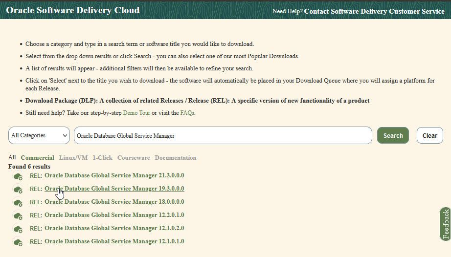

The Global Data Services framework consists of at least one global service manager, a Global Data Services catalog, and the GDS configuration databases. Some components of the framework are installed when you install Oracle Database. Other components require that you perform certain tasks using the Global Data Services control utility (GDSCTL).

This chapter includes the following topics:

### Planning an Installation

Before you install any software, review these hardware, network, operating system, and other software requirements for Linux.

- Each and every GDS pool database must be able to reach (in both directions) each and every global service manager’s Listener and ONS ports. The global service manager Listener ports and the ONS ports must also be opened to the Application/Client tier, all the GDS pool databases, the GDS catalog and all other global service managers.

- The TNS Listener port (Default: 1521) of each GDS pool database must be opened (in both directions) to global service managers and the GDS catalog.

- If GDSCTL is run from a separate machine, you also must have a port opened (in both directions) from that machine directly to each GDS pool database that is added.

For detailed information about memory, physical storage, kernel versions and packages required by Global Data Services see: [Database Installation Guide for Linux](../ladbi/index.md)

### What You Need to Know About Installing a Global Service Manager

The global service manager is the central component of the Global Data Services framework, and you must install the global service manager using separate media. No other Oracle software is required to install and run the global service manager.

You can install the global service manager on a system where you have other Oracle products installed, but you must install the global service manager in a separate Oracle home directory. You can install more than one global service manager on a single system, but each global service manager must have a separate Oracle home directory. For performance reasons, depending on the number of databases in your Global Data Services configuration, you may want to deploy the global service manager on a dedicated host.

You must install at least one global service manager for each Global Data Services region. Global service managers can be hosted on physical or virtual environments. For high availability, Oracle recommends installing multiple (typically 3) global service managers in each region running on separate hosts.

**Note:**

Oracle Universal Installer does not currently support installing software on multiple hosts. You must install each global service manager on its respective host.

The Global Data Services administrator installs the global service manager. The Global Data Services administrator's responsibilities include:

- Administering global service managers

- Administering the Global Data Services catalog

- Administering regions and database pools

**Note:**

The Global Data Services administrator must have an operating system user account on all hosts where global service managers are deployed, and you must run the installation under that user account. The installation must not be run by a `root` user.

**Note:**

When you install the global service manager on Windows platforms, Oracle Universal Installer provides you with the option to use a Windows Built-in Account or to specify a standard Windows user account as the Oracle home user for the Oracle home. This account is used for running the Windows Services for the Oracle home and it cannot be an administrator account.

Note that LocalService account is used for running the services if Windows Built-in Account option is chosen. For administrative tasks, including global service manager installation, upgrade, and patching, you should log on using a Windows account that has administrative privileges.

See Chapter 3 of the [Oracle Database Administrator’s Reference for Microsoft Windows](../ntqrf/supporting-oracle-home-user-on-windows.md) for details and recommendations regarding the use of Oracle home user.

### Installing a Global Service Manager

To install a global service manager:

1.  Download the global service manager software from [edelivery.oracle.com](https://edelivery.oracle.com) and unzip.
    Figure 2-1 Oracle Software Delivery Cloud

    
2.  Start Oracle Universal Installer from the root directory of the software media and follow the prompts.
    When the installation completes, the global service manager home directory contains binaries required to run the global service manager and the Global Service Manager Control utility (GDSCTL).
3.  Set the `ORACLE_HOME` environment variable to the directory you specified during installation.
4.  Add the `$ORACLE_HOME/bin` directory created for the global service manager to the `PATH` environment variable.
5.  Set the `TNS_ADMIN` environment variable set to `$ORACLE_HOME/network/admin`.

**Note:**

After installing the Global Data Services software, it is recommended that the installation be updated to the latest Oracle Database release. For more information regarding Oracle Database 19c release updates, see Oracle Support (MOS) Note [19202301.9](https://support.oracle.com/epmos/faces/DocumentDisplay?parent=EXTERNAL_SEARCH&sourceId=REFERENCE&id=19202301.9)

#### Performing a Silent Install of Global Service Manager

You can run the global service manager installation in the command line.

1.  Download the global service manager software from [edelivery.oracle.com](https://edelivery.oracle.com) and unzip.
    Figure 2-2 Oracle Software Delivery Cloud

    
2.  Edit the `response/gsm_install.rsp` file to suit your environment.
    You might want to edit the following variables:

    - `ORACLE_HOME`

    - `ORACLE_BASE`

    - `INVENTORY_LOCATION`

    - `UNIX_GROUP_NAME`
3.  Run the installer in the silent mode.
        ./runinstaller -silent  -responseFile  response/gsm_install.rsp -showProgress
         –ignorePrereq
4.  As a root user, execute the following scripts.
        /scratch/oraInventory/orainstRoot.sh
        /scratch/user/product/19.3.0/gsmhome_1/root.sh

### What You Need to Know About Upgrading Global Data Services

There are four components that comprise the distributed Global Data Services infrastructure, and each component may reside in a separate installation and may be upgraded independently using the usual upgrade procedure; however, there are certain rules about component versioning that should be followed. The components and rules are as follows:

- Catalog database: The catalog database is the central repository for the GDS metadata; it is a standard Oracle Database installation. The version of the catalog database must always be greater than or equal to the version of any GDSCTL session that connects to it, and exactly equal to the version of any global service manager server that connects to it, with one exception: to ease migration, the catalog may temporarily have a version greater than some global service manager servers that are connected to it, until any change is made to the catalog, at which time any connected global service manager that is not at the same version will be disconnected, and any stopped global service manager that is not at the same version will not be allowed to connect.

  **Note:**

  GDSCTL sessions running release 12.1.0.1 cannot make changes to a later versioned catalog; when running commands that will update the catalog, the GDSCTL client should be at a minimum version of 12.1.0.2.

- GDSCTL client: This component is run in an ad-hoc manner from a terminal session on any system that contains a global service manager installation. The version of the GDSCTL client is the version of the global service manager installation that it runs from.

  **Note:**

  When connecting a 12.1.0.1 GDSCTL client to a later versioned catalog only a limited set of commands are allowed, and any command that may cause catalog changes will result in a compatibility error. Commands that update the catalog metadata in a catalog at version 12.1.0.2 or later should be executed from a GDSCTL client running at least release 12.1.0.2.

- Global service manager server: The version of the global service manager server is the version of the global service manager installation from which the server runs. A global service manager server cannot connect to any catalog database that is at a lower version than itself. A global service manager server cannot connect to any catalog database that is at a higher version than itself in which changes have already been made to the catalog at that higher version. A global service manager can connect to a pool database running any version of Oracle Database 12c or later.

- Pool database: A pool database is any database added to a GDS pool which runs a global service. A pool database may be at any version of Oracle 12c or later, including versions later than the catalog version. You may upgrade or downgrade pool databases at any time.

Given these rules, it is possible to perform a rolling upgrade of the distributed GDS infrastructure with zero service downtime.

### Upgrading Global Data Services

The advised order of upgrade is:

1.  Upgrade the catalog database. For best results this should be done using a rolling database upgrade; however, global services will remain available during the upgrade if the catalog is unavailable, although service failover will not occur.
    **Note:**

    When upgrading Oracle Database 19c with a patch release, you must execute the following command after upgrading the catalog database:

    `modify catalog -newkeys`

    This command generates encryption keys and encrypt existing GSMUSR passwords stored in the GDS catalog.
2.  Upgrade global service manager installations that are used to run GDSCTL clients, which do not also run a global service manager server (if any).
    **Note:**

    Global service manager upgrades should be done in-place; however, an in-place upgrade will cause erroneous error messages unless permissions on the following files for the following platforms are updated to 755:

    On Linux/Solaris64/Solaris Sparc64:

    `$ORACLE_HOME/QOpatch/qopiprep.bat`

    `$ORACLE_HOME/jdk/bin/jcontrol`

    `$ORACLE_HOME/jdk/jre/bin/jcontrol`

    On AIX:

    `$ORACLE_HOME/QOpatch/qopiprep.bat`

    `$ORACLE_HOME/jdk/jre/bin/classic/libjvm.a`

    `$ORACLE_HOME/jdk/bin/policytool`

    On HPI:

    `$ORACLE_HOME/jdk/jre/lib/IA64N/server/Xusage.txt`

    `$ORACLE_HOME/jdk/jre/bin/jcontrol`

    `$ORACLE_HOME/QOpatch/qopiprep.bat`

    On Windows, no error messages are expected.
3.  Stop, upgrade, and restart all global service manager servers one-at-a-time. In order to ensure zero downtime, at least one global service manager server should always be running. Global service manager servers at an earlier version than the catalog will continue to operate fully until catalog changes are made.
4.  Upgrade pool databases in any order, either before or after the global service manager and catalog database upgrades, at the discretion of the pool database administrator.

**Note:**

For general information regarding upgrading and patching see: [Oracle Database Upgrade Guide.](../upgrd/index.md)

**Note:**

For Oracle Database 19c Proactive Patch Information, see Oracle Support (MOS) Note [2521164.1](https://support.oracle.com/epmos/faces/DocumentDisplay?id=2521164.1)

### GSM Out-of-Place Update/Patching Examples

This example shows the steps required to apply the 19.18 Database Realease Update (DBRU) to a 19.3 Oracle environment. The following assumptions are made:

- A 19.3.0.0.0 GDS Catalog database exists on Host A
- Two 19.3.0.0.0 GSMs (GSM1 and GSM2) exist on Host B. GSM1 is installed in ORACLE_HOME1 and GSM2 is installed in ORACLE_HOME2
- A pair of 19.3.0.0.0 Oracle pool databases exist on Host C and Host D respectively.

#### 19.18.0.0.0 DBRU on GDS catalog, two GSMs & two Pool Databases

1.  Stop the GDS catalog database and apply 19.18.0.0.0DBRU then start the GDS catalog database.
        $ORACLE_HOME/OPatch/opatch lspatches
        34765931;DATABASE RELEASE UPDATE : 19.18.0.0.230117 (REL-JAN230131) (34765931)
        29585399;OCW RELEASE UPDATE 19.3.0.0.0 (29585399)

        OPatch succeeded.

        SQL> select PATCH_ID, PATCH_UID, INSTALL_ID, STATUS, ACTION, DESCRIPTION from DBA_REGISTRY_SQLPATCH;

          PATCH_ID  PATCH_UID INSTALL_ID STATUS                    ACTION
        ---------- ---------- ---------- ------------------------- ---------------
        DESCRIPTION
        --------------------------------------------------------------------------------
          29517242   22862832          1 SUCCESS                   APPLY
        Database Release Update : 19.3.0.0.190416 (29517242)

          34765931   25098466          2 SUCCESS                   APPLY
        DATABASE RELEASE UPDATE : 19.18.0.0.230117 (REL-JAN230131) (34765931)

        SQL>
2.  Verify that the GSM setup is working properly before proceeding (now that the GDS catalog is at 19.18 and the GSMs and pool databases are at version 19.3).
3.  Next, stop GSM1, making GSM2 the new master. Apply the 19.18.0.0.0 DBRU on GSM1.
        $ORACLE_HOME1/OPatch/opatch lspatches
        34765931;DATABASE RELEASE UPDATE : 19.18.0.0.230117 (REL-JAN230131) (34765931)

        OPatch succeeded.

        GDSCTL> config

        Regions
        ------------------------
        east
        west

        GSMs
        ------------------------
        gsm1
        gsm2

        GDS pools
        ------------------------
        sdbpool

        Databases
        ------------------------
        cloud
        clouddb

        Services
        ------------------------
        srv1

        GDSCTL pending requests
        ------------------------
        Command                       Object                        Status
        -------                       ------                        ------

        Global properties
        ------------------------
        Name: orasampl
        Master GSM: gsm2
        DDL sequence #: 0

        GDSCTL>
4.  Next, start GSM1 and stop GSM2 (making GSM1 the new master) and apply the 19.18.0.0.0 DBRU on GSM2 and then start GSM2.
        $ORACLE_HOME2/OPatch/opatch lspatches
        34765931;DATABASE RELEASE UPDATE : 19.18.0.0.230117 (REL-JAN230131) (34765931)

        OPatch succeeded.

        GDSCTL> config

        Regions
        ------------------------
        east
        west

        GSMs
        ------------------------
        gsm1
        gsm2

        GDS pools
        ------------------------
        sdbpool

        Databases
        ------------------------
        cloud
        clouddb

        Services
        ------------------------
        srv1

        GDSCTL pending requests
        ------------------------
        Command                       Object                        Status
        -------                       ------                        ------

        Global properties
        ------------------------
        Name: orasampl
        Master GSM: gsm1
        DDL sequence #: 0

        GDSCTL>
5.  Verify that the GSM environment works properly, now that the GDS catalog & GSM versions are at 19.18 and pool database versions are still at 19.3).
6.  Stop the first pool database and apply the 19.18.0.0.0 DBRU. When complete, start the database.
        $ORACLE_HOME/OPatch/opatch lspatches
        34765931;DATABASE RELEASE UPDATE : 19.18.0.0.230117 (REL-JAN230131) (34765931)
        29585399;OCW RELEASE UPDATE 19.3.0.0.0 (29585399)

        OPatch succeeded.

        SQL> select PATCH_ID, PATCH_UID, INSTALL_ID, STATUS, ACTION, DESCRIPTION from DBA_REGISTRY_SQLPATCH;

          PATCH_ID  PATCH_UID INSTALL_ID STATUS                    ACTION
        ---------- ---------- ---------- ------------------------- ---------------
        DESCRIPTION
        --------------------------------------------------------------------------------
          29517242   22862832          1 SUCCESS                   APPLY
        Database Release Update : 19.3.0.0.190416 (29517242)

          34765931   25098466          2 SUCCESS                   APPLY
        DATABASE RELEASE UPDATE : 19.18.0.0.230117 (REL-JAN230131) (34765931)

        SQL>
7.  Stop the second pool database and apply the 19.18.0.0.0 DBRU then restart the database.
        $ORACLE_HOME/OPatch/opatch lspatches
        34765931;DATABASE RELEASE UPDATE : 19.18.0.0.230117 (REL-JAN230131) (34765931)
        29585399;OCW RELEASE UPDATE 19.3.0.0.0 (29585399)

        OPatch succeeded.

        SQL> select PATCH_ID, PATCH_UID, INSTALL_ID, STATUS, ACTION, DESCRIPTION from DBA_REGISTRY_SQLPATCH;

          PATCH_ID  PATCH_UID INSTALL_ID STATUS                    ACTION
        ---------- ---------- ---------- ------------------------- ---------------
        DESCRIPTION
        --------------------------------------------------------------------------------
          29517242   22862832          1 SUCCESS                   APPLY
        Database Release Update : 19.3.0.0.190416 (29517242)

          34765931   25098466          2 SUCCESS                   APPLY
        DATABASE RELEASE UPDATE : 19.18.0.0.230117 (REL-JAN230131) (34765931)

        SQL>
8.  Verify that the GSM setup works correctly now that the GDS catalog, GSMs & pool database versions are at 19.18.0.0.0
        GDSCTL> config

        Regions
        ------------------------
        east
        west

        GSMs
        ------------------------
        gsm1
        gsm2

        GDS pools
        ------------------------
        sdbpool

        Databases
        ------------------------
        cloud
        clouddb

        Services
        ------------------------
        srv1

        GDSCTL pending requests
        ------------------------
        Command                       Object                        Status
        -------                       ------                        ------

        Global properties
        ------------------------
        Name: orasampl
        Master GSM: gsm1
        DDL sequence #: 0

        GDSCTL>

        GDSCTL> databases;
        Database: "cloud" Registered: Y State: Ok ONS: N. Role: PRIMARY Instances: 1 Region: east
           Service: "srv1" Globally started: Y Started: Y
                    Scan: N Enabled: Y Preferred: Y
           Registered instances:
             sdbpool%1
        Database: "clouddb" Registered: Y State: Ok ONS: N. Role: PRIMARY Instances: 1 Region: west
           Service: "srv1" Globally started: Y Started: N
                    Scan: N Enabled: Y Preferred: N
           Registered instances:
             sdbpool%11

        GDSCTL>

        GDSCTL> status database;
        Database: "cloud" Registered: Y State: Ok ONS: N. Role: PRIMARY Instances: 1 Region: east
           Service: "srv1" Globally started: Y Started: Y
                    Scan: N Enabled: Y Preferred: Y
           Registered instances:
             sdbpool%1
        Database: "clouddb" Registered: Y State: Ok ONS: N. Role: PRIMARY Instances: 1 Region: west
           Service: "srv1" Globally started: Y Started: N
                    Scan: N Enabled: Y Preferred: N
           Registered instances:
             sdbpool%11

        GDSCTL>

        GDSCTL> status service;
        Service "srv1.sdbpool.orasampl" has 1 instance(s). Affinity: ANYWHERE
           Instance "sdbpool%1", name: "cloud", db: "cloud", region: "east", status: ready.

        GDSCTL>

#### `GSM_HOME` to 19.18.0.0.0 DBRU, Move Existing GSM to New Home on Same Host

1.  Install 19.3.0.0.0 GSM (GSM3) in ORACLE_HOME3 and apply 19.18.0.0.0 DBRU.

        $ORACLE_HOME3/OPatch/opatch lspatches
        34765931;DATABASE RELEASE UPDATE : 19.18.0.0.230117 (REL-JAN230131) (34765931)

        OPatch succeeded.

2.  Copy `gsm.ora`, `tnsnames.ora` and the `gsmwallet` directory from the old `$TNS_ADMIN` folder to the new one.

3.  Stop GSM1 from the old GSM1 home.

        GDSCTL> stop gsm -gsm gsm1;
        GSM is stopped successfully
        GDSCTL>

4.  Change the `WALLET_LOCATION` directory to point the new `GSM_HOME` under `gsm.ora`.

5.  Start GSM3 from new GSM3 home

        GDSCTL> start gsm -gsm gsm1;
        GSM is started successfully
        GDSCTL>

6.  Execute `modify gsm -gsm <gsm name>` from the new home.

        GDSCTL> modify gsm -gsm gsm1
        GSM modified
        GDSCTL>

7.  Install 19.3.0.0.0 GSM4 on `ORACLE_HOME4` and apply 19.18.0.0.0 DBRU.

        $ORACLE_HOME4/OPatch/opatch lspatches
        34765931;DATABASE RELEASE UPDATE : 19.18.0.0.230117 (REL-JAN230131) (34765931)
        OPatch succeeded.

8.  Copy `gsm.ora`, `tnsnames.ora `and the `gsmwallet` directory from the old` $TNS_ADMIN` folder to new one.

9.  Stop GSM2 from the old GSM2 home.

        GDSCTL> stop gsm -gsm gsm2;
        GSM is stopped successfully
        GDSCTL>

10. Change the `WALLET_LOCATION` directory to point to the new `GSM_HOME` under `gsm.ora`.

11. Start GSM4 from the new GSM4 home.

        GDSCTL> start gsm -gsm gsm2;
        GSM is started successfully
        GDSCTL>

12. Execute `modify gsm -gsm <gsm name>` from the new home.

        GDSCTL> modify gsm -gsm gsm2
        GSM modified
        GDSCTL>

13. Verify the new GSM environment.

        GDSCTL> config

        Regions
        ------------------------
        east
        west

        GSMs
        ------------------------
        gsm1
        gsm2

        GDS pools
        ------------------------
        sdbpool

        Databases
        ------------------------
        cloud
        clouddb

        Services
        ------------------------
        srv1

        GDSCTL pending requests
        ------------------------
        Command                       Object                        Status
        -------                       ------                        ------

        Global properties
        ------------------------
        Name: orasubbu
        Master GSM: gsm1
        DDL sequence #: 0

        GDSCTL>

        GDSCTL> databases;
        Database: "cloud" Registered: Y State: Ok ONS: N. Role: PRIMARY Instances: 1 Region: east
           Service: "srv1" Globally started: Y Started: Y
                    Scan: N Enabled: Y Preferred: Y
           Registered instances:
             sdbpool%1
        Database: "clouddb" Registered: Y State: Ok ONS: N. Role: PRIMARY Instances: 1 Region: west
           Service: "srv1" Globally started: Y Started: N
                    Scan: N Enabled: Y Preferred: N
           Registered instances:
             sdbpool%11

        GDSCTL>

        GDSCTL> status database;
        Database: "cloud" Registered: Y State: Ok ONS: N. Role: PRIMARY Instances: 1 Region: east
           Service: "srv1" Globally started: Y Started: Y
                    Scan: N Enabled: Y Preferred: Y
           Registered instances:
             sdbpool%1
        Database: "clouddb" Registered: Y State: Ok ONS: N. Role: PRIMARY Instances: 1 Region: west
           Service: "srv1" Globally started: Y Started: N
                    Scan: N Enabled: Y Preferred: N
           Registered instances:
             sdbpool%11

        GDSCTL>

        GDSCTL> status service;
        Service "srv1.sdbpool.orasubbu" has 1 instance(s). Affinity: ANYWHERE
           Instance "sdbpool%1", name: "cloud", db: "cloud", region: "east", status: ready.

        GDSCTL>

#### `GSM_HOME` to 19.18.0.0.0 DBRU on a Different Host

1.  Install 19.3.0.0.0 GSM1 on ORACLE_HOME1 and apply 19.18.0.0.0 DBRU.

        $ORACLE_HOME1/OPatch/opatch lspatches
        34765931;DATABASE RELEASE UPDATE : 19.18.0.0.230117 (REL-JAN230131) (34765931)

        OPatch succeeded.

2.  Copy `gsm.ora`, `tnsnames.ora` and the `gsmwallet` directory from source host to target host (`$GSM_HOME/network/admin`).

3.  Stop GSM1 on the source host.

4.  Modify the `gsm.ora` file with target host and target host wallet directory and modify the target host in the` tnsnames.ora` file for the GSM1 entry.

5.  Modify the GSM with endpoint entry and verify that `config gsm` points to the correct target host details. For example:

        GDSCTL> modify gsm -gsm gsm1 -endpoint (ADDRESS=(HOST=myhost.example.com)(PORT=1587)(PROTOCOL=tcp))
        GSM modified
        GDSCTL>

        GDSCTL> config gsm
        Name      Region    ENDPOINT
        ----      ------    --------
        gsm1      east      (address=(host=myhost.example.com)(port=1587)(protocol=tcp))
        gsm2      west      (ADDRESS=(HOST=myhost.example.com)(PORT=1787)(PROTOCOL=tcp))

        GDSCTL>

6.  Start GSM1 from the new GSM1 home.

        GDSCTL> start gsm -gsm gsm1;
        GSM is started successfully
        GDSCTL>

7.  Execute the `modify gsm -gsm ``<gsm name>`` -pwd <GSMCATUSER ``password``>` command like the example below:

        GDSCTL> modify gsm -gsm gsm1 -pwd <GSMCATUSER secret_password>
        GSM modified
        GDSCTL>

Perform the following steps on GSM2.

1.  Install 19.3.0.0.0 GSM2 on ORACLE_HOME2 and apply the 19.18.0.0.0 DBRU.

        /$ORACLE_HOME2/OPatch/opatch lspatches
        34765931;DATABASE RELEASE UPDATE : 19.18.0.0.230117 (REL-JAN230131) (34765931)

        OPatch succeeded.

2.  Copy `gsm.ora`, `tnsnames.ora` and the `gsmwallet`directory from the source host to the target host (`$GSM_HOME/network/admin`).

3.  Stop GSM2 on the source host.

4.  Modify the `gsm.ora` file with target host and target host wallet directory and modify the target host in` tnsnames.ora` file for the GSM2 entry.

5.  Modify the GSM configuration with the endpoint entry and verify using `config gsm` that it contais the correct target host details.

        GDSCTL> modify gsm -gsm gsm2 -endpoint (ADDRESS=(HOST=myhost.example.com)(PORT=1787)(PROTOCOL=tcp))
        GSM modified
        GDSCTL>

        GDSCTL> config gsm
        Name      Region    ENDPOINT
        ----      ------    --------
        gsm1      east      (address=(host=myhost.example.com)(port=1587)(protocol=tcp))
        gsm2      west      (address=(host=myhost.example.com)(port=1787)(protocol=tcp))

        GDSCTL>

6.  Start GSM2 on the target host.

        GDSCTL> start gsm -gsm gsm2;

        GSM is started successfully

        GDSCTL>

7.  Execute the `modify gsm -gsm ``<gsm name>`` -pwd <GSMCATUSER ``password``>` command:

        GDSCTL> modify gsm -gsm gsm2 -pwd <GSMCATUSER secret_password>
        GSM modified
        GDSCTL>

8.  Verify the new GSM environment.

        GDSCTL> config database;
        Name                Pool                Status    State       Region    Availability
        ----                ----                ------    -----       ------    ------------
        cloud               sdbpool             Ok        none        east      ONLINE
        clouddb             sdbpool             Ok        none        west      ONLINE

        GDSCTL>

        GDSCTL> config

        Regions
        ------------------------
        east
        west

        GSMs
        ------------------------
        gsm1
        gsm2

        GDS pools
        ------------------------
        sdbpool

        Databases
        ------------------------
        cloud
        clouddb

        Services
        ------------------------
        srv1

        GDSCTL pending requests
        ------------------------
        Command                       Object                        Status
        -------                       ------                        ------

        Global properties
        ------------------------
        Name: orasubbu
        Master GSM: gsm1
        DDL sequence #: 0

        GDSCTL

        GDSCTL> status database;
        Database: "cloud" Registered: Y State: Ok ONS: N. Role: PRIMARY Instances: 1 Region: east
           Service: "srv1" Globally started: Y Started: Y
                    Scan: Y Enabled: Y Preferred: Y
           Registered instances:
             sdbpool%1
        Database: "clouddb" Registered: Y State: Ok ONS: N. Role: PRIMARY Instances: 1 Region: west
           Service: "srv1" Globally started: Y Started: N
                    Scan: Y Enabled: Y Preferred: N
           Registered instances:
             sdbpool%11

        GDSCTL>

        GDSCTL> databases;
        Database: "cloud" Registered: Y State: Ok ONS: N. Role: PRIMARY Instances: 1 Region: east
           Service: "srv1" Globally started: Y Started: Y
                    Scan: Y Enabled: Y Preferred: Y
           Registered instances:
             sdbpool%1
        Database: "clouddb" Registered: Y State: Ok ONS: N. Role: PRIMARY Instances: 1 Region: west
           Service: "srv1" Globally started: Y Started: N
                    Scan: Y Enabled: Y Preferred: N
           Registered instances:
             sdbpool%11

        GDSCTL>

        GDSCTL> status service;
        Service "srv1.sdbpool.orasubbu" has 1 instance(s). Affinity: ANYWHERE
           Instance "sdbpool%1", name: "cloud", db: "cloud", region: "east", status: ready.

        GDSCTL>

        GDSCTL> config gsm
        Name      Region    ENDPOINT
        ----      ------    --------
        gsm1      east      (address=(host=myhost.example.com)(port=1587)(protocol=tcp))
        gsm2      west      (address=(host=myhost.example.com)(port=1787)(protocol=tcp))

        GDSCTL>

### Using GDSCTL

The GDSCTL utility is a command-line interface for configuring and managing the Global Data Services framework. To run some commands, GDSCTL must establish a connection to a global service manager, a Global Data Services catalog database, or a database in the Global Data Services configuration.

#### Operational Notes

**Note:**

Unless specified, GDSCTL resolves connect strings with the current name resolution methods (such as TNSNAMES). The exception is the global service manager name. GDSCTL queries the `gsm.ora` file to resolve the global service manager name.

To start GDSCTL, enter the following command at the operating system prompt:

    $ gdsctl

The preceding command starts GDSCTL and displays the GDSCTL command prompt. You can enter GDSCTL commands at either the operating system prompt or the GDSCTL command prompt, as shown in the following examples:

    $ gdsctl add gsm -gsm gsm1 -catalog 127.0.0.1:1521:db1

    GDSCTL> add gsm -gsm gsm1 -catalog 127.0.0.1:1521:db1

Both of the preceding commands achieve the same result. The first command is run at the operating system command prompt while the second command is run at the GDSCTL command prompt. The command syntax examples in this document use the GDSCTL command prompt.

**Note:**

- Many GDSCTL commands require you to first connect to the Global Data Services catalog before running the command.

  If you run commands from the GDSCTL prompt, then you must execute the `connect` command before the first GDSCTL command that requires connection to the Global Data Services catalog. The `connect` command needs only to be run once in a GDSCTL session.

- A net service name may be specified instead of a connect descriptor when adding a database or broker configuration to a GDS configuration. If a net service name is specified, it must be resolvable at each global service manager in the GDS configuration to a connect descriptor that allows connectivity to the entity that is being added.

Alternatively, you can gather all the GDSCTL commands in one file and run them as a batch with GDSCTL, as follows:

    $ gdsctl @script_file_name

The preceding command starts GDSCTL and runs the commands contained in the specified script file.

##### Using GDSCTL Help

You can display help for GDSCTL, as follows:

- `GDSCTL> help`: The `help` command displays a summary of all GDSCTL commands. If you specify a command name after `help`, then the help text for that command displays.

- `GDSCTL> ``command`` -h`: This syntax displays help text for the specified command, where `command` is the command name.

The following examples display identical help text for the `start` command:

    GDSCTL> help start
    GDSCTL> start -h

##### Privileges and Security

Only users with the proper privileges can run GDSCTL commands.

**See Also:**

[Overview of Global Data Services Administration](global-data-services-admin.md) for more information about GDSCTL privileges and security

#### GDSCTL Command Syntax and Objects

##### GDSCTL Command Syntax and Options

GDSCTL commands, objects, and options; database names, instance names, Global Data Services region names, Global Data Services pool names, and service names are all case insensitive. Passwords and server pool names are also case sensitive. GDSCTL uses the following command syntax:

    $ gdsctl command [object] [options] [argument]
    or
    GDSCTL> command [object] [options] [argument]

In GDSCTL syntax:

- `command`: A verb such as `add`, `start`, `stop`, or `remove`

- `object` (also known as a noun): The target or object on which GDSCTL performs the command, such as `service` or `database`. You can find a list of objects in Table 2-1.

- `options`: Optional flags that extend the use of a preceding command combination to include additional parameters for the command. For example, the `-gdspool` option indicates that the name of a specific Global Data Services pool follows. If a comma-delimited list follows an option, then do not use spaces between the items in the list.

- `argument`: Additional variables for the GDSCTL command to specify actions for an object, or to specify actions for GDSCTL without an object.

##### GDSCTL Objects Summary

Table 2-1 lists the keywords that you can use for the `object` portion of GDSCTL commands. You can use either the full name or the abbreviation for each object keyword. The Purpose column describes the object and the actions that can be performed on that object.

Table 2-1 Object Keywords and Abbreviations for GDSCTL

| Object                                 | Keyword (Abbreviations) | Purpose                                                                                                                                                                                                                                                           |
|:---------------------------------------|:------------------------|:------------------------------------------------------------------------------------------------------------------------------------------------------------------------------------------------------------------------------------------------------------------|
| Global Data Services catalog           | `autovncr`              | Enables or disables valid node checking for registration (VNCR) list for database registration                                                                                                                                                                    |
| Oracle Data Guard broker configuration | `brokerconfig`          | To add, modify, and manage the Oracle Data Guard broker configuration. The Oracle Data Guard broker logically groups primary and standby databases into a broker configuration that enables the broker to manage and monitor them together as an integrated unit. |
| Global Data Services catalog           | `catalog`               | To manage the Global Data Services catalog stored in an Oracle database.                                                                                                                                                                                          |
| Database                               | `database`              | To add, modify, and remove database configuration information about databases.                                                                                                                                                                                    |
| Global Data Services pool              | `gdspool`               | To add, modify, and manage a Global Data Services pool. A Global Data Services pool is a set of databases within a GDS configuration that provides a unique set of global services and belongs to a certain administrative domain.                                |
| Global service manager                 | `gsm`                   | To add, modify, and manage a global service manager. A global service manager is a software component that provides service-level load balancing and centralized management of services within the Global Data Services configuration.                            |
| Global Data Services catalog           | `invitednode`           | Adds host address information to the valid node checking for registration (VNCR) list in the Global Data Services catalog.                                                                                                                                        |
| Global Data Services catalog           | `invitedsubnet`         | Adds subnet information to the valid node checking for registration (VNCR) list in the Global Data Services catalog                                                                                                                                               |
| Global Data Services Region            | `region`                | To add, modify, and manage a Global Data Services Region, which is a logical boundary that contains database clients and servers that are considered to be geographically close to each other.                                                                    |
| Service                                | `service`               | To add, modify, list the configuration of, enable, disable, start, stop, obtain the status of, relocate, and remove global services.                                                                                                                              |

#### GDSCTL Connections

For certain operations, GDSCTL must connect to a global service manager. To connect to a global service manager, GDSCTL must be running on the same host as the global service manager. When connecting to a global service manager, GDSCTL looks for the `gsm.ora` file associated with the local global service manager.

The following are the GDSCTL operations that require a connection to a global service manager.

- [add gsm](gdsctl-reference.md)adds a global service manager.

- [start gsm](gdsctl-reference.md)starts the global service manager.

- [stop gsm](gdsctl-reference.md)stops the global service manager.

- [modify gsm](gdsctl-reference.md)modifies the configuration parameters of the global service manager.

- [status gsm](gdsctl-reference.md)returns the status of a global service manager.

- [set inbound_connect_level](gdsctl-reference.md)sets the `INBOUND_CONNECT_LEVEL` listener parameter.

- [set trace_level](gdsctl-reference.md)sets the trace level for the listener associated with the specified global service manager.

- [set outbound_connect_level](gdsctl-reference.md)sets the timeout value for the outbound connections for the listener associated with a specific global service manager.

- [set log_level](gdsctl-reference.md)sets the log level for the listener associated with a specific global service manager.

For all other operations, GDSCTL uses Oracle Net Services to connect to the Global Data Services catalog database or another database in the Global Data Services configuration. For these connections you can run GDSCTL from any client or host that has the necessary network configuration.

### What You Need to Know About Creating the Global Data Services Catalog

Every Global Data Services configuration must have a Global Data Services catalog. The Global Data Services catalog can reside on the same host as a GDS configuration database, but Oracle does not recommend this scenario for large configurations. Oracle recommends that you use Oracle high availability features such as Oracle Real Application Clusters (Oracle RAC) and Oracle Data Guard to protect the Global Data Services catalog against outages.

#### Global Data Services Catalog Requirements

- The Global Data Services catalog must reside on an Oracle Database 12c (or later) database that uses a server parameter file (SPFILE).

  If you create the Global Data Services catalog in an Oracle RAC database, then Oracle recommends that you set up Single Client Access Name (SCAN) for that database.

- The Global Data Services administrator who creates the Global Data Services catalog must have a user account on the [catalog database](glossary.md), and must have `GSMADMIN_ROLE` privileges and an account password. For example, the following SQL statements can be executed on the catalog database.

      CREATE USER gsm_admin IDENTIFIED BY ****;
      GRANT gsmadmin_role TO gsm_admin;

- The Global Data Services catalog must be protected for high availability and disaster recovery.

**Note:**

Oracle recommends that the Global Data Services administrator does not directly connect to the catalog database, despite having a user account on the catalog database. Global Data Services administrators can use the GDSCTL utility to manage Global Data Services. GDSCTL connects to the Global Data Services catalog with the credentials that the Global Data Services administrator provides when running GDSCTL commands.

For example:

    GDSCTL> create gdscatalog -database serv1:1521:catdb.example.com
        -user gsm_admin

In the preceding example, `serv1:1521:catdb.example.com` is an Easy Connect string that contains the host name and port number of the listener that is used to connect to the database, and `catdb.example.com` is the service name for the Global Data Services catalog database.

You designate one database as the primary repository for the Global Data Services catalog. You can use existing high availability technologies, such as Oracle RAC, Oracle Data Guard, and Oracle Clusterware, to protect the Global Data Services catalog.

If you use Oracle GoldenGate, then ensure that the Global Data Services catalog gets replicated to a secondary database.

**See Also:**

[create gdscatalog](gdsctl-reference.md) for complete usage information

### Creating the Global Data Services Catalog

Use GDSCTL on any host where GDSCTL is installed and configured to create a Global Data Services catalog, as follows:

    GDSCTL> create gdscatalog -database db_name -user user_name

**See Also:**

[create gdscatalog](gdsctl-reference.md)

### Adding a Global Service Manager to the Global Data Services Catalog

Before a global service manager can be started, the global service manager should be registered in the Global Data Services catalog.

To add a global service manager:

1.  Alter the `GSMCATUSER` account.
    Every global service manager in a Global Data Services configuration maintains a direct Oracle Net Services connection to the catalog database under the `GSMCATUSER` account, which is created by default during Oracle Database installation. The database administrator (DBA) of the catalog database must unlock the account and give the account password to the Global Data Services administrator.

        ALTER USER gsmcatuser ACCOUNT UNLOCK;
        ALTER USER gsmcatuser IDENTIFIED BY password;
2.  Run the following command on the host where you want the global service manager to run:
        GDSCTL> add gsm -gsm gsm_name -listener listener_port -catalog catalogdb_name

    For example:

        GDSCTL> add gsm -gsm east_gsm1 -listener 1523 -catalog
            serv1:1521:catdb.example.com

    In the preceding example, `serv1:1521:catdb.example.com` is the connect identifier of the catalog database. The Global Data Services administrator is prompted for the `GSMCATUSER` password during the execution of the command.

    **See Also:**

    [add gsm](gdsctl-reference.md) for complete usage information
3.  After you add the global service manager to the Global Data Services framework, start the global service manager, as follows:
        GDSCTL> start gsm -gsm gsm_name

    During startup, the global service manager creates or modifies the `ONS.CONFIG` file and populates the file with configuration data from the Oracle Notification Service server that belongs to the global service manager.

    By default, the file is created in the `$ORACLE_HOME/opmn/conf` directory. The location can be changed to `$ORACLE_CONFIG_HOME/opmn/conf` if the environment variable `ORACLE_CONFIG_HOME` is set.

    **Note:**

    The `ONS.CONFIG` file cannot be shared, and there must be a unique `ONS.CONFIG` file for each global service manager installation.

### Connecting to the Global Data Services Catalog

Many GDSCTL commands require a connection to the Global Data Services catalog. You can connect to the Global Data Services catalog using one of the following two methods:

#### Method 1

Connect to the Global Data Services catalog, as follows:

    GDSCTL> connect [user_name]@connect_identifier

If you run the preceding command but do not specify a password, then GDSCTL prompts you for a password, as shown in the following example:

    GDSCTL> connect gsm_admin@catalog
    Enter password: ******
    Catalog connection is established
    GDSCTL>

In the preceding example, `catalog` is a connect identifier that resolves to one or more global service manager endpoints. For high availability, Oracle recommends that the connect identifier resolves to the list of all global service managers in the configuration. For example, if there are two global service managers in the Global Data Services configuration and you use `TNSNAMES` for name resolution, then the `tnsnames.ora` file must contain an entry similar to the following:

    catalog = (DESCRIPTION=(ADDRESS=(PROTOCOL=tcp)(HOST=xyz)(PORT=1523))
        (ADDRESS=(PROTOCOL=tcp)(HOST=abc)(PORT=1523))
    )

In the preceding example, the first global service manager runs on the host named `xyz`, and the second global service manager runs on the host named `abc`.

**See Also:**

[connect](gdsctl-reference.md) for complete usage information

#### Method 2

To run GDSCTL commands from the operating system prompt, append the `-catalog` parameter to any of the commands that require you to be connected to the Global Data Services catalog.

For example:

    $ gdsctl add gdspool -gdspool hr -catalog  mygdscatlog

    username:Robert
    password:

GDSCTL must use a global service manager as a listener to connect to the Global Data Services catalog because the location of the Global Data Services catalog can change. The global service manager records location changes and can route connection requests.

### What You Need to Know About Adding a Global Data Services Pool

**Note:**

- If you require only one Global Data Services pool, then you do not need to add one using these instructions. A default Global Data Services pool, `DBPOOLORA`, is created for you when you create the Global Data Services catalog.

- The Global Data Services administrator has permissions to run GDSCTL commands to manage a Global Data Services pool and, if there is only a single pool, then the Global Data Services administrator also administers the pool.

- If you specify a user when you run the `gdsctl add gdspool` command, then the local DBA where the Global Data Services catalog resides must first add the user to the catalog database.

Large database clouds can require multiple Global Data Services pools that are managed by different administrators.

For example:

    GDSCTL> add gdspool -gdspool hr -users rjones

The preceding example adds a Global Data Services pool called `hr`, and adds the user `rjones`, who is assigned the privileges to administer the `hr` pool. The privileges enable the pool administrator to add databases to the pool and manage global services on the databases in the pool.

A Global Data Services pool must have a unique name within its GDS configuration. If you do not specify a name for the pool when you create it, then the name defaults to `oradbpool`. The pool name can be up to 30 bytes long and can be any valid identifier (an alphabetical character followed by zero or more alphanumeric ASCII characters or the underscore (\_)).

### Adding a Global Data Services Pool

Ensure that you are connected to the Global Data Services catalog and add a pool, administered by a specific user, as follows:

    GDSCTL> add gdspool -gdspool database_pool_list [-users user_list]

### What You Need to Know About Adding a Global Data Services Region

**Note:**

If you require only one Global Data Services region, then you do not need to add a region using these instructions. A default Global Data Services region, `REGIONORA`, is created for you when you create the Global Data Services catalog.

For example:

    GDSCTL> add region –region west,east

The preceding example adds two regions, `east` and `west`, to the Global Data Services framework.

A Global Data Services region should have a name that is unique within the corresponding Global Data Services configuration. If no name is specified at the first region creation time, the default name, `oraregion`, is given to the region. The region name can be up to 30 characters long and can be any valid identifier - an alphabetical character followed by zero or more alphanumeric ASCII characters or '\_'.

### Adding a Global Data Services Region

Ensure that you are connected to the Global Data Services catalog and add a Global Data Services region, as follows:

    GDSCTL> add region –region region_list

### Adding a Database to a Global Data Services Pool

To provide global services, a database must be added to a Global Data Services pool.

Before adding a database to a pool, the database administrator should unlock the `GSMUSER` account and give the password to the Global Data Services pool administrator, as shown in the following example:

    ALTER USER gsmuser ACCOUNT UNLOCK;
    ALTER USER gsmuser IDENTIFIED BY password;

To be part of a Global Data Services pool, a database must use a server parameter file (SPFILE). An Oracle RAC database should also have SCAN set up.

To add a database:

1.  Connect to the Global Data Services catalog using the Global Data Services pool or Global Data Services administrator credentials, for example:
        GDSCTL>connect rjones@catalog
2.  Run the `gdsctl add database` command:
        GDSCTL>add database -connect edc007:1521/db14.east.example.com -region east
         -gdspool hr

    In this example `edc007:1521/db14.east.example.com` is the connect identifier of the database, and then you are prompted for the GSMUSER account password on this database.

**Note:**

If the pool already contains databases and there are global services associated with the pool, then the services are automatically created on the new database.

#### Valid Node Checking for Registration

The valid node checking for registration (VNCR) feature provides the ability to configure and dynamically update a set of IP addresses, host names, or subnets from which registration requests are allowed by the global service manager. Database instance registration with a global service manager succeeds only when the request originates from a valid node.

By default, the Global Data Services framework automatically adds a VNCR entry for the host on which a remote database is running each time the `gdsctl add database` command is run. The automation (called auto-VNCR) requires that the host name entry exists in either the local hosts file or in the name server. If the remote host is identified by a different name on any of the nodes on which the global service manager runs, then the Global Data Services administrator must manually add VNCR entry to the Global Data Services catalog by running the `gdsctl add invitednode` command.

**See Also:**

[add invitednode (add invitedsubnet)](gdsctl-reference.md) for complete usage information

### Adding a Service to a Global Data Services Pool

The `gdsctl add service` command is used to create a service on the Global Data Services pool databases. A simple example of the command is as follows:

    GDSCTL> add service -gdspool hr -service emp_report1 -preferred_all

In this example `emp_report1` is the service name and the `-preferred_all` option means that the service should normally run on all of the databases in the pool.

The service name specified in the 'add service' command can be domain qualified (for example, sales.example.com) or not (for example, sales). If the specified name is not domain qualified, the service is created with the default domain name "\<GDS_pool_name\>.\<GDS_configuration_name\>", however the shorter non-domain qualified name can be used with subsequent GDSCTL commands to manage the service. If the specified name is domain qualified, the full domain qualified service name must be used in all subsequent GDSCTL commands used to manage the service.

For Oracle RAC-enabled pool databases, after the service has been added, run GDSCTL `modify service` to specify which Oracle RAC instance a given global service should run on, as shown in the following example.

    GDSCTL> modify service -service emp_report1 -gdspool hr - database db14
     -modify_instances -preferred db14_n1, db14_n2

A global service name must be unique within a GDS pool and when qualified by domain, must also be unique within a GDS configuration. A global service cannot be created at a database if a local or global service with the same name already exists at that database.

A global service name can contain alphanumeric characters, "\_' and '.'. The first character must be alphanumeric. The maximum length of a global service name is 64 characters. The maximum length of a domain qualified global service name is 250 characters.

An Oracle Net connect descriptor used to connect to a global service must contain a domain qualified service name

**See Also:**

[add service](gdsctl-reference.md) and [modify service](gdsctl-reference.md) for complete usage information

### Starting a Global Service

The `gdsctl start service` command is used to start an existing service on the Global Data Services pool databases.

    GDSCTL>start service -service emp_report1 -gdspool hr

If the `-role` parameter is specified for the service, the service only starts on the databases in which the role matches the specified value. If the `-lag` parameter is specified for the service, the service only starts on the databases for which replication lag does not exceed the specified value. Unless `-preferred_all` is specified for the service, the service only starts on the databases that are listed as preferred for the service.

**Note:**

Before starting services which run on administrator-managed databases, they must be modified for those databases to stipulate which instances should run the service. Please refer to the `-modify_instances` parameter of the `modify service` command.

**See Also:**

[start service](gdsctl-reference.md)

[modify service](gdsctl-reference.md)

### Database Client Configuration

Database clients connect to database services using an Oracle Net connect string. The connect string used for a global service differs from the connect string used for a local service in the following ways:

- The service name parameter in the connection data section specifies a global service

- Multiple connection endpoints are specified, and these endpoints are global service managers rather than local, remote, or single client access name (SCAN) listeners

- The database client's region may be specified in the connection data section

Consider the following connect string:

     (DESCRIPTION=
      (FAILOVER=on)
      (ADDRESS_LIST=
        (LOAD_BALANCE=ON)
        (ADDRESS=(host=sales-east1)(port=1522))
        (ADDRESS=(host=sales-east2)(port=1522))
        (ADDRESS=(host=sales-east3)(port=1522)))
      (ADDRESS_LIST=
        (LOAD_BALANCE=ON)
        (ADDRESS=(host=sales-west1)(port=1522))
        (ADDRESS=(host=sales-west2)(port=1522))
        (ADDRESS=(host=sales-west3)(port=1522)))
      (CONNECT_DATA=
       (SERVICE_NAME=sales)
       (REGION=east)))

This connect string contains three global service managers (sales-east1, sales-east2, and sales-east3) in the client's local region (east), and three global service managers (sales-west1, sales-west2, and sales-west3) in the client's buddy region (west).

Client-side load balancing is enabled across the global service managers within each region by setting the `LOAD_BALANCE` parameter to ON in the address list for each region. Connect-time failover between regions is enabled by setting the `FAILOVER` parameter to ON.

It is a best practice to have three global service managers in each region, for each region to have a buddy region, and for client-side load balancing and connect-time failover to be configured as shown in the example connect string.

The `REGION` parameter is optional if only global service managers from the local region are specified in the connect string. This is the case when there is only one region in the GDS configuration, or could be the case when there are multiple regions, but it is not feasible to change the connect string of an existing client designed to work with a single database. If the `REGION` parameter is not specified, the client's region is assumed to be the region of the global service manager used to connect to the global service.

**Note:**

The pre-12c Thin JDBC client can only be used with a GDS configuration that has a single region, unless the region parameter is specified in the connect string.

The Oracle Database 12c and later integrated clients use Oracle Notification Services (ONS) to receive the Fast Application Notification (FAN) events that support load balancing and Fast Connection Failover (FCF). The integrated clients automatically subscribe, without user-configuration, to up to 3 of the ONS servers co-located with the global service managers in each of the client's local and buddy regions.

**Note:**

Automatic ONS configuration is not supported if connections to an ONS server have to be secured using SSL. You must configure ONS manually to enable SSL. See client-specific guides for information on how to configure ONS manually.

#### Note for Pre-12c Clients:

The pre-12c OCI and ODP.NET clients do not support global services.

The pre-12c JDBC client supports global services, but you must manually configure it to subscribe to the ONS servers co-located with the global service managers in the client's local and buddy regions. It is a best practice to subscribe to three ONS servers in each of the client's local and buddy regions.

See the Oracle Database JDBC Developer's Guide for information about how to configure ONS subscriptions.

#### Configuring Integrated Clients for FAN and FCF

Load balancing and Fast Connection Failover (FCF) of client connections across the databases in a GDS configuration is supported by the Oracle database integrated clients, and requires that those clients be configured for FAN and FCF.

See one of these client-specific Programmer's Guides for information about that client's FAN and FCF configuration requirements:

- [Oracle Database JDBC Developer’s Guide](../jjdbc/high-availablility.md)

- [Oracle Universal Connection Pool Developer’s Guide](../jjucp/application-continuity-using-ucp.md)

- [Oracle Database Development Guide](../adfns/high-availability.md)

- [Oracle Data Provider for .NET Developer's Guide for Microsoft Windows](../odpnt/odp-dot-net-ha-event-classes.md)

### What You Need to Know About Exporting the GDS Catalog Data for Logical Backups

Because the GDS catalog stores metadata for the entire GDS configuration, loss or corruption of the catalog data may require significant efforts to manually recreate it. While unavailability of the GDS catalog does not impact core GDS functionality such as load balancing, service failover, and application notification, no changes can be made to the GDS configuration until the catalog is restored. Therefore it is important to develop a strategy for protecting the GDS catalog.

Even when the GDS catalog is protected by HA technologies such as Oracle RAC and Data Guard, it is highly recommended that you regularly back up the GDS catalog. You can create a logical backup of the catalog by exporting the catalog data to a file. This backup of the GDS catalog can help you in a disaster recovery scenario, and when there is need to undo changes made to the catalog since the last backup was made. You can also use the backup when moving the GDS catalog to a new database.

The catalog configuration will be saved to the specified file on the system where GDSCTL is running. Access to the file should be limited to Global Data Services administrators since it may contain sensitive information such as connection strings for the pool databases.

**Note:**

- It is strongly recommended that the catalog be validated before exporting it to ensure that there are no inconsistencies in the catalog data. Any errors reported by the `validate catalog` command should be corrected before exporting the catalog data.

- You must not make any change to the file with exported catalog data. Any changes to the file may prevent using of this file for the catalog restore, or may cause catalog corruption after restore. It is recommended to store the file checksum along with the backup file. Do not try to restore the catalog configuration if the file has been modified.

#### Exporting the GDS Catalog Data for Logical Backups

To export the GDS catalog data to a file, ensure that you are connected to the catalog and execute the following command:

    GDSCTL> export catalog file_name_with_full_path

#### Restoring Logical Backup of the GDS Catalog into the Same Catalog Database

To restore GDS catalog data from a backup file:

Connect to the catalog database and issue the following command:

    GDSCTL> import catalog file_name_with_full_path

After the import of the catalog data is finished, pool databases will be automatically synchronized (see the `sync database` command description in [sync database (synchronize database)](gdsctl-reference.md).) If there are no global service managers available, this action will be deferred until a global service manager registers with the catalog.

It is recommended that you validate the catalog after the import is done and all the databases are synchronized.

**Note:**

Trying to restore the GDS catalog from the file that has been modified may result in a corrupt catalog. It is the responsibility of the GDS administrator to check consistency of the backup file (for example, by using the checksum.)

#### Restoring Logical Backup of the GDS Catalog into a new Catalog Database

When moving a catalog to a new database, you must first create an empty catalog on the database (see What You Need to Know About Creating the Global Data Services Catalog.) After that the `import catalog` command may be executed as described in the previous section.

If the new catalog database has a different connection string, it is the administrator's responsibility to change the connection string on global service manager systems. It is also required to restart all global service managers in this case. The synchronization procedure will not be completed, and thus the restore procedure will not be finished, until at least one global service manager registers with the catalog.

### Changing the GSMCATUSER Password

To change GSMCATUSER password:

1.  Run the following command in SQL\*Plus while connected to the GDS catalog:
        ALTER USER gsmcatuser IDENTIFIED BY ****
2.  Then in GDSCTL run the following command:
        GDSCTL> modify catalog -oldpwd oldpassword -newpwd newpassword
