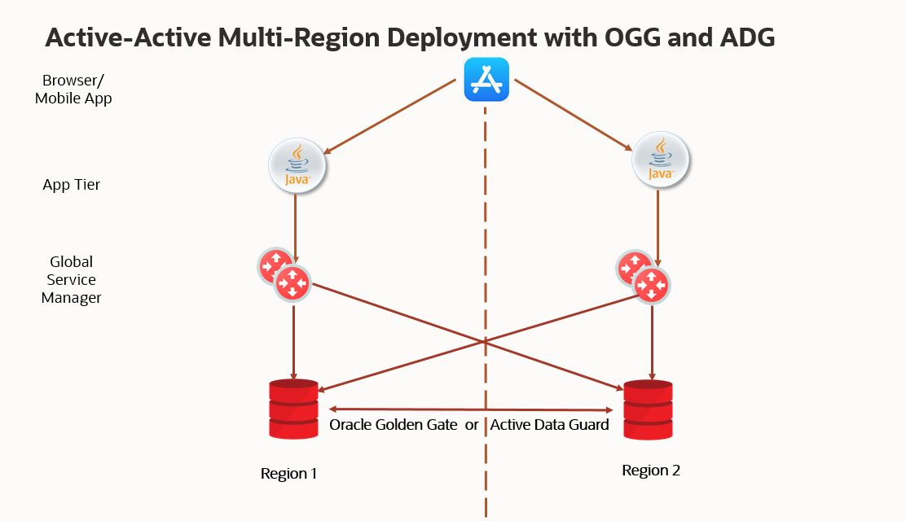
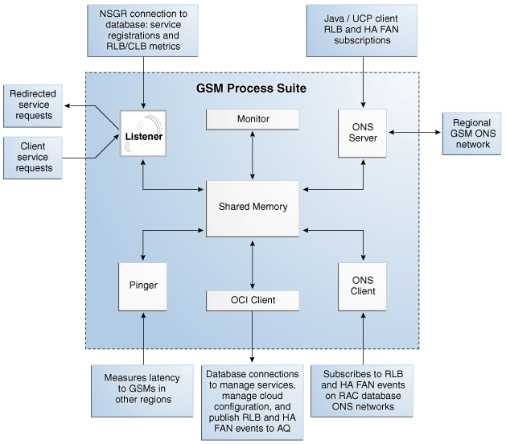
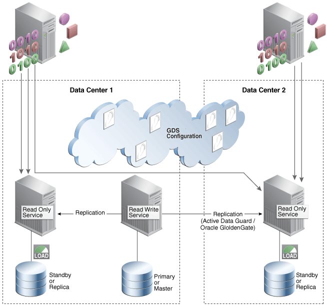
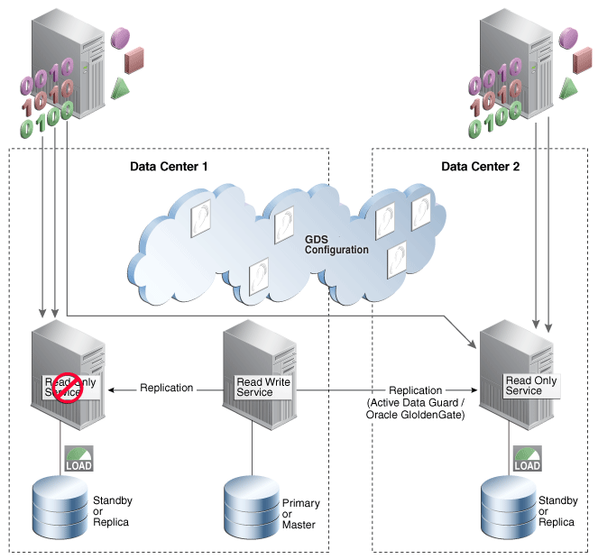
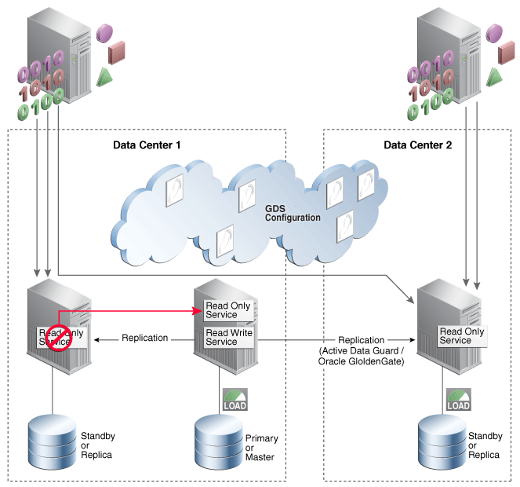
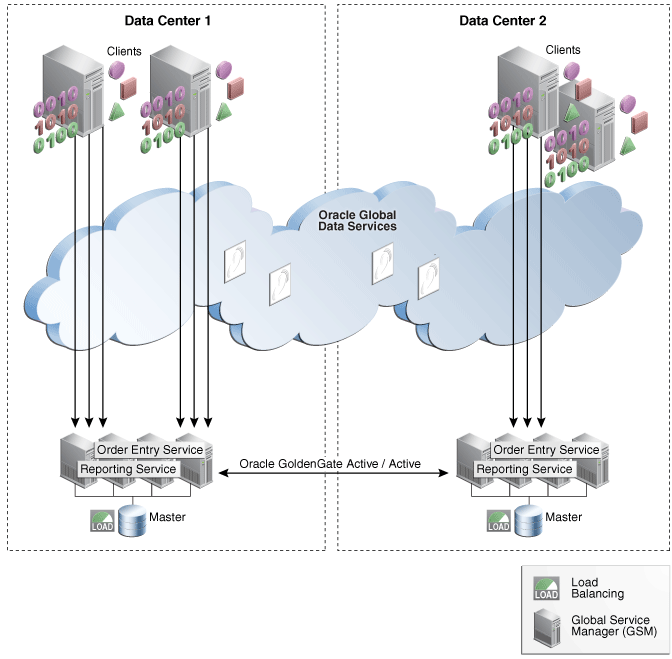
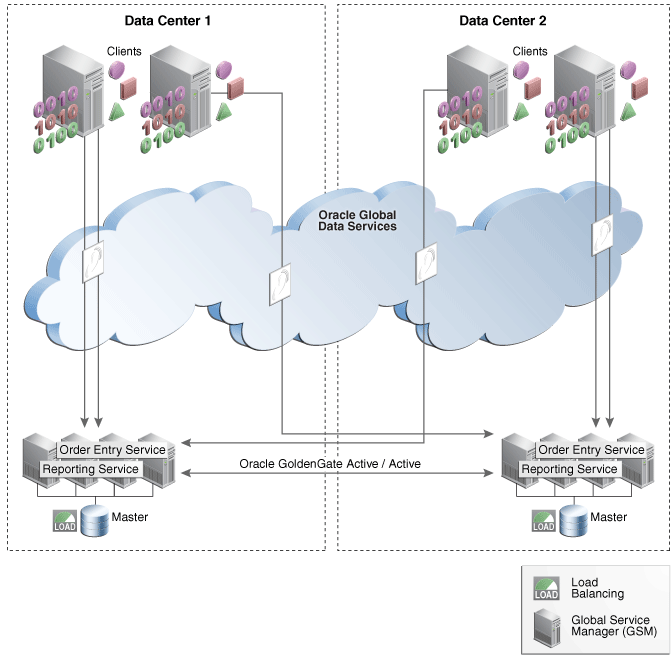
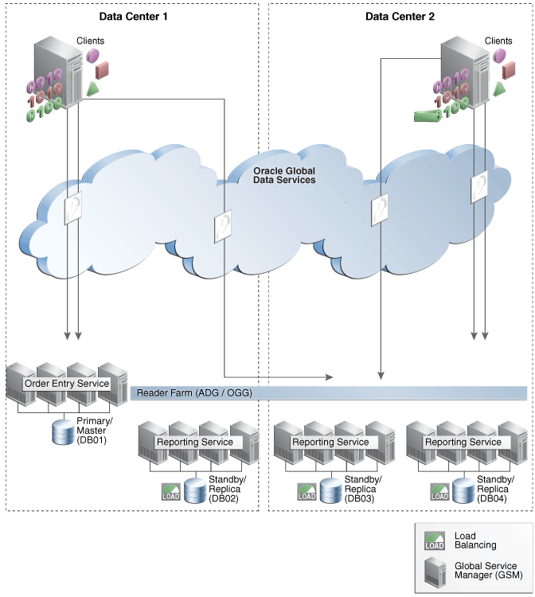

This chapter provides an overview of the Global Data Services architecture.

This chapter includes the following topics:

### Introduction to Global Data Services

Many enterprises consolidate their information technology infrastructure to improve business efficiency. Database consolidation is a critical part of this process. However, most organizations must still maintain local and remote replicas of their databases for reasons that include:

- Business continuity and disaster recovery

- High availability

- Performance optimization for local clients

- Content localization and caching

- Compliance with local laws

In any set of database replicas, some database servers may have a slow query response time because of high load or high network latency, while other servers capable of offering a faster response time may be under-utilized. Optimal query performance and resource utilization across a set of database replicas requires a workload management solution that provides dynamic load balancing of client connections and workload requests across the replicas.

Many enterprises use a home-grown solution for workload management across database replicas. These solutions cannot provide critical functionality such as run-time load balancing and reliable database service failover between replicas because they are not fully integrated with Oracle software.

Oracle Database provides a powerful workload management feature called database services. Database services are named representations of one or more database instances. Database services allow you to group database workloads, ensure that client requests are routed to the optimal instance that offers a service, and provide high availability by transparently failing client connections over to surviving instances when a planned or unplanned instance outage occurs.

Oracle Global Data Services (GDS) implements the Oracle Database service model across a set of replicated databases known as a **Global Data Services configuration**.

A Global Data Services configuration looks like a virtual multi-instance database to database clients. It provides client access through **global service**s, which are functionally similar to the local database services provided by single-instance or Oracle Real Application Clusters (Oracle RAC) databases. Local and global services both provide load balancing, high availability, and resource management. The essential difference between global services and local services is that global services span the instances of multiple databases, whereas local services span the instances of a single database.

A Global Data Services configuration and its global services are created and managed using the **GDSCTL** command-line interface, which is similar to the `SRVCTL` command-line interface used to manage an Oracle RAC database and its services.

A Global Data Services configuration can consist of any combination of multi-instance or single-instance Oracle databases hosted on heterogeneous or non-heterogeneous server platforms. Oracle Data Guard, Oracle GoldenGate, or any other database replication technology, can be used to synchronize the databases in a Global Data Services configuration.

Global Data Services is a highly effective solution for automatic workload management across a set of replicated databases, whether used with many widely distributed databases and clients or with a single database, a local replica and a few clients.

**Note:**

Global Data Services is primarily intended for applications that are replication-aware. A replication-aware application is one that has any of the following characteristics:

- Uses read-only global services exclusively

- Uses read/write global services, but is programmed to resolve update conflicts if those services are simultaneously offered by more than one database

- Can tolerate replicated data that is potentially stale due to replication lag

Applications that are not replication-aware can still benefit from the improved high availability and disaster recovery capabilities provided by Global Data Services.

**See Also:**

- [Global Data Services Control Utility (GDSCTL) Command Reference](gdsctl-reference.md), for more information about GDSCTL

- [Oracle Database Administrator’s Guide](../admin/creating-and-configuring-an-oracle-database.md) for more info about database services

### Global Data Services Architecture

The following figure shows an example of a Global Data Services (GDS) configuration and the GDS components that are present in every GDS configuration.

Figure 1-1 Global Data Services Components

[Description of "Figure 1-1 Global Data Services Components"](img_text/gds-arch.md)

The sections that follow describe these components.

#### Global Data Services Pool

A **Global Data Services pool** is a named subset of databases within a GDS configuration that provides a unique set of global services and belongs to the same administrative domain. Partitioning of GDS configuration databases into pools simplifies service management and provides higher security by allowing each pool to be administered by a different administrator.

A database can only belong to a single Global Data Services pool. All databases in a pool need not provide the same set of global services. However, all databases that provide the same global service must belong to the same pool.

#### Global Data Services Region

A **Global Data Services region** is a named subset of databases in a GDS configuration and database clients that share network proximity such that the network latency between members of a region is typically lower than between members of different regions. A region usually corresponds to a local area or metropolitan area network (LAN or MAN). For example, a data center hosting one or more GDS configuration databases and database clients in geographical proximity to the data center might belong to the same region.

A region can contain multiple Global Data Services pools, and these pools can span multiple regions.

For high availability purposes, each region in a GDS configuration should have a designated **buddy region**, which is a region that contains **global service manager**s that can provide continued access to a GDS configuration if the global services managers in the local region become unavailable.

#### Global Service Manager

A **global service manager** is the central software component of Global Data Services, providing service-level load balancing, failover, and centralized management of services in the GDS configuration. Global Data Service clients use a global service manager to perform all GDS configuration operations.

A global service manager is analogous to the remote listener in an Oracle RAC database, except that a global service manager serves multiple databases. A global service manager does the following:

- Acts as a regional listener that clients use to connect to global services

- Provides connect-time load balancing for clients

- Manages global services across the regions of a GDS configuration

- Collects performance metrics from databases in the GDS configuration and measures network latency between regions of a configuration

- Creates a run-time load balancing advisory and publishes it to client connection pools

- Monitors availability of database instances and global services and notifies clients if they fail.

A global service manager is associated with one and only one GDS configuration. Each region in the GDS configuration must have at least one global service manager. It is recommended that multiple global service managers be configured in each region to improve availability and performance. Every global service manager in a GDS configuration manages all global services supported by the configuration.

#### Global Data Services Catalog

A [Global Data Services catalog](glossary.md) is a repository that stores configuration data for a Global Data Services configuration and all global services provided by that configuration.

A catalog is associated with one and only one GDS configuration. A catalog must reside in an Oracle Database 12c or later database, and that database may be inside or outside the associated GDS configuration. For large-scale GDS configurations, it is recommended that the GDS catalog be hosted outside the databases in the GDS configuration.GDS catalog may be co-hosted along with catalogs of RMAN or Oracle Enterprise Manager.

Oracle strongly recommends that high availability technologies such as Oracle RAC, Oracle Data Guard, and Oracle Clusterware be used to enhance the availability of the database where the Global Data Services catalog resides.

#### Oracle Notification Service Servers

GDS clients use **Oracle Notification Service (ONS)** to receive run-time load balancing advisory and high availability events from global service managers.

An Oracle Notification Service (ONS) server is co-located with each global service manager. All such ONS servers within a region are interconnected. Clients of global services subscribe to the ONS server network within their region and its buddy region, and receive FAN notifications from those ONS server networks.

**Note:**

An Oracle RAC database in a Global Data Service configuration may also contain ONS servers running on the cluster nodes. These ONS servers generate FAN notifications related to local services and are not connected to ONS server networks in the GDS regions.

### Overview of Global Services

For database clients, a Global Data Services configuration is represented by a set of global services. A global service manager serving a Global Data Services configuration is aware of all global services that the configuration provides and acts as a mediator for the database clients and databases in the configuration. A client program connects to a regional global service manager and requests a connection to a global service. The client does not need to specify which database or instance it requires. The global service manager forwards the client's request to the optimal instance in the configuration that offers the global service. Database clients that share a global service must have the same service level requirements.

The functionality of local services, defined as traditional database services provided by a single database, is not changed by global services. Oracle Database 12c and later can provide local and global services, simultaneously. A client application can also work with global and local services, simultaneously.

**Note:**

Database versions earlier than Oracle Database 12c can provide local services, but only Oracle Database 12c, and later, can provide global services.

The configuration and run-time status of global services are stored in the Global Data Services catalog. Each database that offers global services also maintains information about those services in a local repository (such as a system dictionary or Oracle Cluster Registry), with data on local services. Global services that are stored in a local repository have a flag to distinguish those global services from traditional local services.

If you are locally connected to a particular database, then you can query data on global services provided by that database. You can configure, modify, start, or stop a global service using the Global Data Services Control utility (GDSCTL) when you are connected to the Global Data Services catalog. This ensures centralized coordinated management of global services. You cannot configure, modify, start, or stop a global service using either the Server Control utility (SRVCTL) or the Oracle Clusterware Control utility (CRSCTL).

**Note:**

Under certain circumstances (such as patching a database or clusterware software), you can stop or start global services using SRVCTL with the `-force` option with the appropriate command. You must have the appropriate system privileges.

After you configure global services for a Global Data Services configuration, the global service manager manages the global services on GDS configuration databases according to service properties that you specify when you create the services.

When a database joins the configuration or restarts after a shutdown, the database registers with all global service managers in the configuration. After receiving the registration request, one of the global service managers queries the GDS catalog and checks whether all global services which this database is supposed to provide are created there and have the correct attributes. If there is a discrepancy between the information in the catalog and database, the global service manager may create, delete, or modify some global services in the database, or change their attributes to synchronize them with the information in catalog. Then the global service manager determines which global services need to be running on the database and starts them if necessary.

The global service manager can start or stop a global service in a database. However, if it is an Oracle RAC database, the global service manager does not control which particular instances within the database offer the service. This is controlled by the clusterware and the administrator of the Oracle RAC database.

When a database instance in a Global Data Services configuration fails, all global service managers in the configuration get notified about the failure and stop forwarding requests to the instance. If this instance belongs to a noncluster database, or the instance is the last instance that was available in an Oracle RAC database, then, depending on the configuration, a global service manager can automatically start the service on another database in the Global Data Services pool where the service is enabled. If you decide to manually move a global service from one database to another using the appropriate GDSCTL command, then the global service manager stops and starts the service on the corresponding databases.

#### Global Service Attributes

Global services have a set of attributes associated with them that control starting the global services, load balancing connections to the global services, failing over those connections, and more. Attributes applicable to local services, including those services specific to Oracle RAC and Oracle Data Guard broker environments, are also applicable to global services.

The following attributes are unique to global services:

- Preferred or available databases

- Replication lag

- Region affinity

You can modify global services just as you can modify local services. You can enable and disable a global service, you can move the global service to a different database, and you can change the properties of the global service.

**Note:**

You cannot upgrade a local service to a global service.

#### Global Services in an Oracle RAC Database

Some properties of a global service are only applicable to Oracle RAC databases and are unique for each Oracle RAC database included in a Global Data Services configuration. These properties are related to the placement of global services with instances within an Oracle RAC database, including server pools and service cardinality.

All other existing global service attributes, such as load balancing, role, transparent application failover parameters, and database edition must be the same for all databases offering a global service. Specify these attributes at the global service level.

**Note:**

By default, in an Oracle RAC environment, a SQL statement executed in parallel can run across all of the nodes in the cluster. The cross-node parallel execution is not intended to be used with GDS load balancing. For an Oracle RAC database in a GDS configuration Oracle recommends that you restrict the scope of the parallel execution to an Oracle RAC node by setting the `PARALLEL_FORCE_LOCAL` initialization parameter to `TRUE`.

#### Global Services in an Oracle Data Guard Broker Configuration

Oracle Data Guard broker permits a primary database to have up to 30 standby databases. Oracle Data Guard broker logically groups primary and standby databases into a broker configuration that enables the broker to manage and monitor the databases as an integrated unit. When you include a broker configuration in a GDS configuration, you manage the broker configuration as one unit. Only an entire broker configuration can be included in (or deleted from) a GDS pool, and a broker configuration cannot span multiple pools.

If you attempt to add or remove a database that belongs to a broker configuration to or from a GDS pool, then an error occurs. You can only add a database to the GDS pool by adding the database to the broker configuration using the Oracle Data Guard command-line interface, DGMGRL. After you add a database to the broker configuration, you must run the `gdsctl sync brokerconfig` command to synchronize GDS and Oracle Data Guard.

A GDS pool can consist of a set of databases of a given Data Guard broker configuration. Databases that belong to different Data Guard broker configurations must be mapped to different GDS pools. A pool that contains a Data Guard configuration cannot have databases that do not belong to the configuration

**See Also:**

[sync brokerconfig (synchronize brokerconfig)](gdsctl-reference.md) for information about this command

Conversely, when you remove a database from a broker configuration, the database is removed from the GDS pool to which this broker configuration belongs. The `gdsctl sync brokerconfig` command must be executed after removing a database. This is the only way to remove a database from a pool that contains a broker configuration.

You can configure global services with a role attribute to be active in a specific database role, such as the role of primary or physical standby database. If you enable fast-start failover, then the Oracle Data Guard broker automatically fails over to a standby database if the primary database fails. The global service managers that you have configured to work with Oracle Data Guard broker ensure that the appropriate database services are active and that the appropriate Fast Application Notification (FAN) events are published after a role change. These FAN event enable Fast Connection Failover (FCF) of client connections to an appropriate database instance within the GDS configuration.

The Global Data Services framework supports the following Oracle Data Guard broker configurations:

- The set of databases in a Global Data Services pool can be either the set of databases that belong to a single broker configuration or a set of databases that do not belong to a broker configuration. You can add a broker configuration only to an empty Global Data Services pool. If a GDS pool already contains a broker configuration, then, to add a database to the pool, you must add the database to the broker configuration contained in the pool.

- Role-based global services are supported only for database pools that contain a broker configuration.

**See Also:**

[Oracle Data Guard Broker](../dgbkr/managing-oracle-data-guard-broker-configurations.md) for more information about broker configuration

#### Database Placement of a Global Service

You can specify which databases support a global service. These databases are referred to as preferred databases. The global service manager ensures that a global service runs on all preferred databases for which the service has been specified. The number of preferred databases is referred to as the database cardinality of a global service. You must specify at least one preferred database for a global service.

**Note:**

If you set `preferred_all` for which databases support a service, then you do not have to explicitly specify preferred or available databases. The `preferred_all` setting implies that all databases in the pool are preferred.

When you add or modify a global service, you can specify a list of available databases for this global service. If one of the preferred databases fails to provide a global service, then the global service manager relocates the service to an available database to maintain the specified database cardinality for that service.

In a Global Data Services pool that contains an Oracle Data Guard broker configuration, a role-based global service can be started on a database only if the database is listed as preferred or available for the service and the `role` attribute of the database corresponds to the `role` attribute specified for the service. For example, a global service that can run on any database in a broker configuration (as long as the `role` attribute of the database is set to `primary`) must have `primary` specified for its `role` attribute and have all other databases in the broker configuration with `role` attributes set to `preferred`.

**Note:**

Do not confuse database cardinality of global services with their instance cardinality. Instance cardinality is specified and maintained separately for each Oracle RAC database and is not maintained across databases of a Global Data Services pool.

For example, consider a case when there are few instances of an Oracle RAC database offering a global service and one of the instances fails, but there are no available instances on which to start the global service. In this case, the service is not started on an available database instance of another Oracle RAC database. However, if the instance that failed was the last instance in the database offering the service, then the service may start on another database that is listed as available for this service.

#### Replication Lag and Global Services

For performance reasons, distributed database systems often use asynchronous replication of data between databases, which means that there is the possibility of a delay between the time an update is made to data on a primary database and the time this update appears on a replica. When this happens, the replica database lags behind its primary database.

Global Data Services enables applications to differentiate between global services that provide real-time data from services that can return out-of-date data because of replication lag. For applications that can tolerate a certain degree of lag, you can configure a maximum acceptable lag value.

For applications that cannot tolerate replication lag, you can set the lag time for global services to zero. Requests for this global service are forwarded only to a primary database, or to a replica database that is synchronized with the primary database.

**See Also:**

[Administering Global Data Services Configurations](global-data-services-admin.md) for more information

**Note:**

Only an Oracle Data Guard standby database can be synchronized with the primary database, if necessary, so that you can enable real-time, read-only services on both the primary and synchronized standby databases.

For many applications it is acceptable to read stale data as long as the data is consistent. Such applications can use global services running on any database replica without regard to the length of the replication lag time.

If you configure the lag time for a service to a value other than zero, then a client request can be forwarded only to a replica database that is not lagging behind the primary database by longer than the configured lag time for the service. If there is no such database, then the connection request fails.

**Note:**

Specification of the maximum replication lag is only supported for Active Data Guard configurations.

If a service that is currently running starts to exceed the specified maximum lag, then the service is brought down after all current requests are completed. New requests for the service are routed to a database that meets the configured lag value for the service.

**Note:**

If you use Oracle Data Guard with the Oracle Active Data Guard option, then you can use the `STANDBY_MAX_DATA_DELAY` session parameter to specify a session-specific lag tolerance. When you set this parameter to a nonzero value, a query issued to a physical standby database is executed only if the application lag time is less than or equal to the `STANDBY_MAX_DATA_DELAY` parameter value. Otherwise, the database returns an error to alert the client that the lag time is too long. If both session-level and service-level parameters are set and the `STANDBY_MAX_DATA_DELAY` parameter value is less than the service level parameter value, the client remains connected to the database, but queries would return an error.

**Caution:**

If a database fails, then the global service manager can route a client connection to another database that meets the maximum lag value specified for the service, even if it lags behind the failed database. This solution, however, can create data consistency problems for some applications.

**See Also:**

[Oracle Data Guard Concepts and Administration](../sbydb/managing-oracle-data-guard-physical-standby-databases.md) for more information about the `STANDBY_MAX_DATA_DELAY` session parameter

#### Global Services and Distributed Transaction Processing

When performing XA (distributed) transactions against a GDS configuration, tightly-coupled branches of an XA transaction must be directed to the same database. This can be accomplished by ensuring that each global service used in a distributed transaction is, that is runs exactly on one database at a time. It is responsibility of the GDS pool administrator to configure and maintain the property of global services used in distributed transactions.

If a global service used in an XA transaction is running on a multi-instance Oracle RAC database, tightly-coupled branches of the XA transaction by default can be sent to separate database instances. This may result in sub-optimal performance. To avoid the performance degradation in this case, it is highly recommended to set the DTP parameter (`-dtp)` to TRUE for any service used by an XA transaction that can run in an Oracle RAC database. Setting the parameter guarantees that all distributed transactions performed through the service have their tightly-coupled branches running on a single Oracle RAC instance.

**Note:**

The DTP parameter of a global service only affects processing of XA transactions on an Oracle RAC database that provides this service. It has no effect on the database cardinality of the global service. A global service used by a distributed transaction must be manually configured to be active on a single database at a time.

#### Global Services in Multitenant Architecture

Multitenant container databases (CDB) can be part of the GDS configuration. A global service can be defined at root level of the CDB (CDB\$ROOT) or at the pluggable database (PDB) level. A global service that runs on a PDB can be created by setting the PDB property to the PDB name at creation time. The PDB property of a global service cannot be modified once the service is created. If the PDB property is not set, the service is created at the CDB root level (CDB\$ROOT).

When the service is created at the PDB-level all of the service's preferred and available databases should contain the PDB it belongs to. Global services defined at the PDB level are managed by the same operations and rules as the services defined at any other level.

### Global Connection Load Balancing

When a client connects to an Oracle RAC database using a service, the client can use the Oracle Net connection load balancing feature to spread user connections across all the instances that support that service. Similarly, in a Global Data Services configuration, clients connecting to a global service are load balanced, as necessary, across different databases and regions.

#### Client-Side Load Balancing

Client-side load balancing balances the connection requests across global service managers. Connection failover is also supported. With connection failover, if an error is returned from the chosen global service manager, then Oracle Net Services tries the next address in the address list until either a successful connection is made or Oracle Net Services has exhausted all the addresses in the list.

Client-side load balancing and failover in a Global Data Services configuration is similar to that for an Oracle RAC database. In a Global Data Services configuration, however, a client in a Global Data Services region first tries to connect to any of the global service managers in its local region. If a global service manager from the local region does not respond, then the client tries a global service manager in another region.

To enable client-side load balancing and failover across multiple regions in a Global Data Services configuration, clients must use an Oracle Net connect descriptor that contains one list of addresses of local regional global service managers for load balancing and intraregion failover, and one (or more) list of addresses of remote regional global service managers for interregion failover. If a region is not specified, it defaults to the region name of the global service manager to which the client is connected. You can also configure timeout and retry attempts for each list to enable multiple connection attempts to the current global service manager before moving to another global service manager in the list.

**See Also:**

[Database Client Configuration](global-data-services-config.md) for more information

#### Server-Side Load Balancing

Server-side load balancing for an Oracle RAC database has the listener directing connection requests to the best Oracle RAC database instance. Some applications have long-lived connections, while other applications have short-lived connections.

For global services, server-side load balancing works similarly, except that, instead of being limited to a single database, workloads are balanced across multiple databases in the Global Data Services configuration. In most cases, a global service manager directs a client request for a global service to a database server in the same region, unless all local servers are overloaded and a remote server can provide significantly better quality of service.

In some cases, to take advantage of data caching on a local server, you can direct requests to the local region. Global Data Services enables you to specify a desired level of client/server affinity for a global service.

#### Region Affinity for Global Services

You can configure global services to operate within specific regions or in any region in the Global Data Services configuration. This is called region affinity.

##### Any-Region Affinity

Any-region affinity (the default) for a global service routes a client connection request to the best database in the Global Data Services configuration, regardless of region, that can meet the connection load balancing goal for the requested service. The choice of the database is based on its performance and network latency between the regions where the client and database reside. If databases in different regions are equally loaded, then this policy gives preference to a local region. An interregion connection is made only if the difference in database performance between regions outweighs network latency.

If you specify preferred, available databases for a global service with any-region affinity, then service cardinality is maintained at the Global Data Services pool level. If a service fails on a preferred database, then the service is started on any available database in the Global Data Services pool, and the number of service providers in the pool remains the same. When starting the service on an available database, databases in the region where the service failed have preference. If there is no available database for this service in the local region, then an available database is chosen from a nearby region.

##### Affinity to a Local Region

Affinity to a local Global Data Services region for a global service routes a client connection request to the best database in the client's region that can meet the connection load balancing goal for the requested service. The global service manager chooses the database based only on the database's performance. A global service with affinity to a local region can be provided in multiple Global Data Services regions at the same time, but a client from one region is never connected to a database in another region.

If you specify preferred or available databases for a global service with local region affinity, then service cardinality is maintained at the regional level. If a service fails on a preferred database, then the service starts on an available database in the same region, so the number of service providers in the region remains the same. If there is no available database for this global service in the local region, then no action is taken and the service cardinality decreases. If there is no database in the local region offering the global service, then the client connection request is denied. For global services that have affinity to a local region, database cardinality of the service is maintained independently in each region.

##### Affinity to a Local Region with Interregion Failover

This type of affinity is similar to that of affinity to a local Global Data Services region, except that, if there are no databases in the local region offering a global service, then, instead of denying a client request, the request is forwarded to the best database in another region where the requested global service is running. This service failover does not trigger the service to be started on an available database in another region because, with affinity to a local region, database cardinality is maintained independently in each region, and should not change because of service failure in another region. If regional databases become overloaded because of interregion failover, then you can manually add a preferred database for the service.

### Global Run-Time Connection Load Balancing

Global run-time connection load balancing distributes client work requests across persistent connections that span the instances of an Oracle RAC database, based on load-balancing information from the database. This feature is supported with connection pools that can receive load balancing recommendations. The database uses the run-time connection load balancing goal for a service and the relative performance of the database instances to generate a recommendation about where to direct service requests.

There are two types of service-level goals for run-time connection load balancing:

- SERVICE_TIME: Attempts to direct work requests to instances according to response time. Load-balancing data is based on elapsed time for work done in the service plus available bandwidth to the service.

- THROUGHPUT: Attempts to direct work requests according to throughput. The load-balancing data is based on the rate that work is completed in the service plus available bandwidth to the service.

The Global Data Services framework also supports the balancing of work requests at run time to a global service. In the Global Data Services framework the requests are spread across connections to instances in multiple databases. Work is routed to provide the best service times globally and routing responds gracefully to changing system conditions.

To provide global run-time connection load balancing, a global service manager receives performance data for each service from all database instances in the Global Data Services configuration. The global service manager also measures interregion network latency by periodically exchanging messages with global service managers in other Global Data Services regions.

If the load-balancing goal for a global service is set to `SERVICE_TIME`, then a global service manager considers interregion network latency and instance performance data when deciding how to distribute work requests. For example, clients in Region A have run-time load balancing metrics that are weighted toward Region A, and clients in Region B have metrics that are weighted toward Region B. This implies that, even though the service may be the same, clients in different regions receive different run-time load balancing metrics.

If the load-balancing goal for a global service is set to `THROUGHPUT`, then run-time load balancing metrics are calculated only based on the performance of database instances.

In addition to calculating run-time load balancing metrics for local clients, a global service manager may also need to calculate run-time load balancing metrics of remote regions and publish the metrics for clients residing in a region where all global service managers are not available.

#### Affinity

The global service manager provides advice about how to direct incoming work to the databases in a Global Data Services configuration that provide the optimal quality of service for that work. The load balancing advisory also sends additional affinity information that indicates to the clients, subscribers to the Oracle Net Service events (as Universal Connection Pool (UCP) and ODP.NET Connection Pool, and so on), whether it should re-connect to the same database. Reconnecting a session to the same database can improve buffer cache efficiency and lower CPU usage and transaction latency. The affinity information indicates whether affinity is active or inactive for a particular database. It is always inactive for a single instance database and can be either active or inactive for a particular instance if the database is an Oracle RAC.

#### Disk I/O and CPU Thresholds

Disk I/O and CPU thresholds are resource consumption limits that a database administrator can set. The disk I/O threshold is configured by setting the single-block read latency limit, and the CPU threshold is set by setting the CPU usage limit. The global service manager monitors the resource usage and checks whether the I/O and CPU thresholds have been reached or not. When a database reaches one of the thresholds, the load balancing advisory readjusts its advice about how to direct incoming work to this database.

### Global Services Failover

When a global service or database fails, a global service that was running on the database fails over to another database where the global service is enabled, but not yet running (if the database role matches the service role). The global service manager considers preferred databases as the failover target before available databases.

If you stop a global service using GDSCTL, then the service does not fail over to another database. However, the database where the service was stopped remains a failover target for this service. If the service fails on another database, then the service can start on that database.

When a global service fails over to an available database, the Global Data Services framework does not move the service back to the preferred database when the preferred database restarts because of the following:

- The service has the desired cardinality

- Maintaining the service on the current instance or database provides a higher level of service availability

- Not moving the service back to the initial preferred instance or database prevents a second outage

If necessary, you can manually relocate the global service back to the preferred database after the service has restarted, without terminating active sessions.

In a Global Data Services pool that contains an Oracle Data Guard broker configuration, the Global Data Services framework supports role-based global services. Valid roles are `PRIMARY`, `PHYSICAL_STANDBY`, `LOGICAL_STANDBY`, and `SNAPSHOT_STANDBY`. The Global Data Services framework automatically starts a global service only when the database role matches the role specified for the service.

If a database switches roles or fails, then the Oracle Data Guard broker notifies the Global Data Services framework about the role change or failure, and the global service manager ensures that the services start according to the new database roles.

**Note:**

A global service cannot fail over from a database in one Global Data Services region to a database in another region if the locality parameter is set to `LOCAL_ONLY`, and interregion failover is not enabled.

When a global service fails over, fast connection failover, if enabled on Oracle clients, provides rapid failover of the connections to that global service. The Global Data Services framework, similar to Oracle RAC, uses Fast Application Notification (FAN) to notify applications about service outages. Instead of waiting for the application to poll the database and detect problems, clients receive FAN events and react, immediately. Sessions to the failed instance or node are terminated, and new connections are directed to available instances providing the global service.

All global service managers monitor service availability on all databases in a Global Data Services configuration. A global service is started on an available database when a global service manager detects that a global service becomes unavailable due to a failure.

**Note:**

A global service manager cannot automatically fail over a service if it cannot connect to the Global Data Services catalog.

**Note:**

When the target database for failover is under Oracle Clusterware control, the global service manager failover request to start a service on this database may lead to a Oracle Clusterware “pull up" event that starts another instance. This will occur when at least one instance is registered with the global service manager listener, allowing the global service manager to note that the database is running, and is therefore a valid target for failover, but that the service is not already running on the database. This can occur when the registered instance is not a primary or valid instance for the service, either because it is an available instance on an administrator-managed Oracle RAC database, or because it is an instance of a policy-managed Oracle RAC database that is not in the same server pool as the service.

### Global Service Manager Process Suite Architecture

The global service manager process suite architecture is a process suite containing multiple processes that communicate using shared memory. Global service manager contains the following processes:

- Monitor - Monitors the health of all other processes in the process suite. Responsible for starting the other global service manager processes, creating the shared memory area and re-spawning a global service manager process after detecting its death.

- Listener - Listens for incoming client connection requests and forwards requests to appropriate database instances. Each instance in Global Data Services configuration establishes a communication channel to all global service manager listeners. This channel is used for registration of global services and sending performance metrics to the listener. These metrics are later used for connection-time and run-time load balancing. Detects when a database instance goes down. The listener process provides the full functionality of the regular database listener. Therefore a global service manager plays the role of a remote listener for all databases in a Global Data Services configuration. A global service manager listener routes connection requests directly to local database listeners, bypassing SCAN listeners on an Oracle RAC database.

- Pinger - Measures network latency between regions by exchanging data with pinger processes of global service managers in the other regions. Measurements are required for connection-time and run-time load balancing in a globally distributed database cloud. Monitors other global service managers and tells its own global service manager when it has to become the regional or master

- OCI Process - Responsible for establishing SQLNET connections to Global Data Services databases for managing services, and to Global Data Services catalog for managing the Global Data Services configuration.

- ONS Server - Publishes RLB and HA fan events to regional ONS network so that clients can subscribe to the events.

- ONS Client - Responsible for subscribing to HA events that are published by Oracle RAC databases in Global Data Services configuration.

Figure 1-2 shows the internal process architecture and the information flow in and out of the process suite.

Figure 1-2 Global Service Manager Process Suite Architecture

[Description of "Figure 1-2 Global Service Manager Process Suite Architecture"](img_text/gsmug_vm_011.md)

### Global Data Services Use Cases

The following are some use cases for Oracle Global Data Services:

#### Load Balancing for Replicated Databases

Global Data Services extends Oracle RAC-style connect-time and run-time load balancing capabilities (within and across data centers) to a set of replicated databases. The algorithm takes into account load metrics, region affinity, network latency, and load balancing goals. It maximizes performance and achieves efficient resource utilization by enabling Global Data Services on Active Data Guard.

Figure 1-3 shows load balancing across replicated databases, both local and remote, in a Global Data Services configuration. The Read Write Service runs on the Primary (or Master) database. Read Only Services run on the two Standby (or Replica) databases. Client connections are load balanced between the read-only services running on the Standby databases (across the two data centers).

Figure 1-3 Load Balancing for Replicated Databases

[Description of "Figure 1-3 Load Balancing for Replicated Databases"](img_text/gsmug_vm_010.md)

#### Service Failover for Replicated Databases

Global Data Services extends Oracle RAC-style service failover (within and across data centers) and management capabilities to replicated databases, and takes into account service placement policies. It achieves higher availability and improved manageability by enabling Global Data Services with Active Data Guard and Oracle GoldenGate.

Figure 1-4 shows databases replicated across two data centers, in a Global Data Services Configuration. A Read Write Service runs on the Primary (or Master) database. Read Only Services are load balanced across the two Standby (or Replica) databases.

Figure 1-4 depicts the failure of the Standby in Data Center 1. In Figure 1-5 Global Data Services fails over the Read Only Service to another available database (in this case the Primary) and load balances it with the Read Only Service running on the remote Standby in Data Center 2.

Figure 1-4 Read Only Service Failure

[Description of "Figure 1-4 Read Only Service Failure"](img_text/gsmug_vm_015.md)

Figure 1-5 Read Only Service Failover

[Description of "Figure 1-5 Read Only Service Failover"](img_text/gsmug_vm_016.md)

#### Region Affinity in Oracle GoldenGate Multi-Master

Figure 1-6 depicts Oracle GoldenGate multi-mastered replicas in a Global Data Services configuration. In this use case the application needs to avoid multi-master read/write conflicts, and Global Data Services can route all of the workloads to nearest and best replica in the client's region.

    GDSCTL>add service –service reporting_srvc –gdspool sales
           –preferred_all –locality LOCAL_ONLY –region_failover
    GDSCTL>add service –service order_entry_srvc –gdspool sales
           –preferred_all –locality LOCAL_ONLY –region_failover

This use case features the following:

- The application handles multi-master conflict resolutions.

- Read/write and read-only global services run on both replicas.

- Client connections are routed to the nearest and the best replica database in the client's region that meets the connection load balancing goal for the requested Order Entry and Reporting global services.

- Takes into account load metrics, region affinity, and load balancing goals.

- Global Data Services provides workload routing for read-only and read/write services for Oracle GoldenGate multi-master configuration.

- Routes all database workloads to the nearest datacenter by enabling Global Data Services for Oracle GoldenGate multi-master configuration.

Figure 1-6 Region Affinity in Oracle GoldenGate Multi-Master

[Description of "Figure 1-6 Region Affinity in Oracle GoldenGate Multi-Master"](img_text/gsmug_vm_014.md)

#### Load Balancing in Oracle GoldenGate Multi-Master

Figure 1-7 depicts Oracle GoldenGate multi-mastered replicas in a Global Data Services configuration. In this use case the application needs to handle multi-master conflict resolutions, and Global Data Services provides connect-time and run-time load balancing (within and across data centers) for all work requests.

    GDSCTL>add service -service order_entry_srvc -gdspool sales
           –preferred_all -clbgoal LONG
    GDSCTL>add service -service reporting_srvc -gdspool sales
           –preferred_all -clbgoal LONG

This use case features the following:

- Application handles multi-master conflict resolutions.

- Read Write and Read Only global services run on both replicas.

- Client connections are load balanced between the READ WRITE global services running on both the masters (across data centers). Same is the case for the Read only service.

  - Takes into account load metrics, region affinity, network latency and load balancing goals.

  - Load balance all workloads by enabling GDS on Oracle GoldenGate multi-master configuration.

Figure 1-7 Load Balancing in Oracle GoldenGate Multi-Master

[Description of "Figure 1-7 Load Balancing in Oracle GoldenGate Multi-Master"](img_text/gsmug_vm_013.md)

#### Balancing Oracle Active Data Guard and Oracle GoldenGate Reader Farms

Figure 1-8 depicts Global Data Services enabled for an Oracle Active Data Guard or Oracle GoldenGate reader farm with physical standby/replicas located in both local and remote data centers. In this use case with Global Data Services, route read/write workload to primary/master, balance read-only workload on the reader farm, and you can expect improved resource utilization and higher scalability for read workloads.

This use case features the following:

- Read/write global service runs on the Primary/Master database.

- Read-only global services run on the reader farm.

- Client connections are load balanced between the read-only global services running on the reader farm (across data centers).

- Global Data Services provides connect-time and run-time load balancing (within and across data centers) on a reader farm and better resource utilization and higher scalability by balancing read-only workload on an Oracle Active Data Guard or Oracle GoldenGate reader farm.

Figure 1-8 Balancing Oracle Active Data Guard and Oracle GoldenGate Reader Farms

[Description of "Figure 1-8 Balancing Oracle Active Data Guard and Oracle GoldenGate Reader Farms"](img_text/gsmug_vm_012.md)

Example 1-1 Oracle GoldenGate

    GDSCTL>add service -service reporting_srvc -gdspool sales
           –preferred DB02, DB03, DB04 -clbgoal LONG –rlbgoal SERVICE_TIME
