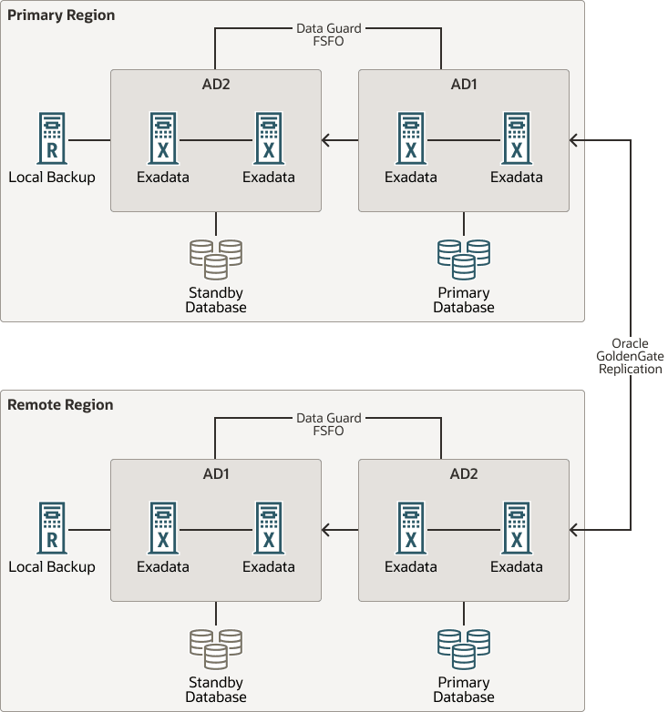
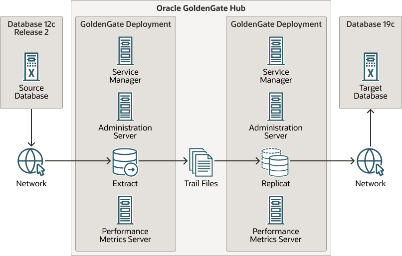
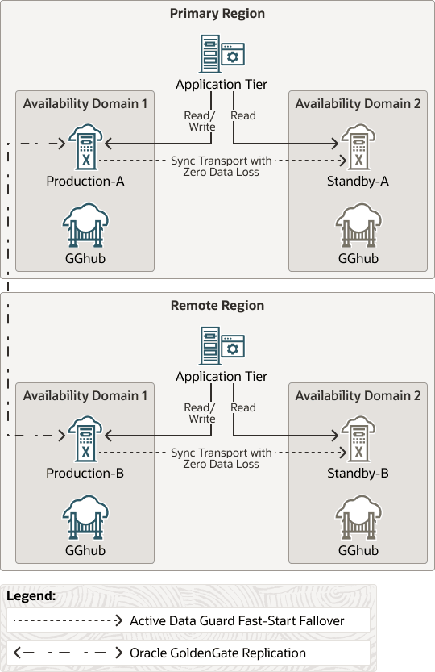

## 19 MAA Platinum Reference Architecture Overview

MAA Platinum or Never-Down Architecture, delivers near-zero Recovery Time Objective (RTO, or downtime incurred during an outage) and potentially zero or near zero Recover Point Objective (RPO, or data loss potential).

The MAA Platinum reference architecture ensures:

- RTO = zero or near-zero for all local failures using the Oracle Exadata Database Machine platform with its inherent Oracle RAC, full-stack redundancy, and failover capabilities

- RTO = zero or near-zero for disasters, such as database, cluster, or site failures, achieved by redirecting the application to an active Oracle GoldenGate source or target

- Zero downtime maintenance for software and hardware updates using Oracle RAC and Exadata Database Machine platform

- Zero downtime database upgrade or application upgrade by redirecting the application to an upgraded Oracle GoldenGate source or target database

- RPO = zero or near-zero data loss, depending on the Oracle Data Guard protection mode setting, which dictates the redo transport (SYNC, FAR SYNC, or ASYNC)

- Fast re-synchronization and zero or near-zero RPO between Oracle GoldenGate source and target databases after a disaster.

  After any database failure, automatic failover to its standby database occurs automatically. Subsequently, automatic re-synchronization between Oracle GoldenGate source and target databases will resume. For SYNC transport, this leads to eventual zero data loss.

Table 19-1 MAA Platinum Outage Matrix

| Event                                             | RTO/RPO Service Level Objective1 |
|:--------------------------------------------------|:--------------------------------------------|
| Unplanned Outage                                  |                                             |
| Recoverable node or instance failure              | Zero or single digit seconds2,3  |
| Disasters including corruptions and site failures | Zero3                            |
| Planned Maintenance                               |                                             |
| Most common software and hardware updates         | Zero2                            |
| Major database upgrade or application upgrade     | Zero3                            |

1RPO=0 unless explicitly specified

2To achieve zero downtime or lowest impact for online processing, apply MAA application high availability best practices (also known as The Checklist). For long running transactions, such as batch operations, it's recommended that you defer them outside the planned maintenance window.

3Application failover is customized or managed with Global Data Services.

Enabling features of the Platinum MAA solution include:

- Oracle Real Application Clusters with recommended Exadata Database Machine Platform, Exadata Database Service on Dedicated Infrastructure (ExaDB-D), or Oracle Exadata Database Service on Cloud@Customer (ExaDB-C@C) for the source and target databases

- Oracle Active Data Guard with Fast-Start Failover to bound data loss and automatically fail over to standby in case of database, cluster, or data center failures. The standby databases are typically in separate Fault Domains (FDs) with separate power supplies, residing in separate data centers, Availability Domains (ADs), or Availability Zones (AZs), with independent power and network. The standbys can also reside across regions with typically the greatest fault isolation.

- Oracle GoldenGate enables two active read-write database systems that can be leveraged for applications to fail over immediately after database, cluster, site failure, or planned outages such as database or application upgrades. The source and target databases on which Oracle GoldenGate replication is occurring can reside in the same region, across ADs, or across regions.

MAA Platinum architecture is illustrated in the image below, where two "active read-write" primary databases, or source or target databases, reside in separate regions. Oracle GoldenGate replication occurs between the source and target databases between primary and remote regions. Each primary database is protected by a standby database in another AD within the same region.

With Data Guard Fast-Start Failover (FSFO), the standby database becomes the new primary database automatically after primary database, cluster, or AD failure. With MAA Oracle GoldenGate configuration best practices implemented, replication resumes automatically between the source and target databases after any Data Guard role transition. Each database resides on an Exadata platform with its inherent built-in Real Application Cluster, system and storage redundancy, and low brownout failover capabilities.

Figure 19-1 MAA Platinum Reference Architecture

[Description of "Figure 19-1 MAA Platinum Reference Architecture"](img_text/platinum-architecture-general.md)

### MAA Platinum Architecture Variants

When setting up MAA Platinum architecture, the administrator can decide between setting up Oracle GoldenGate on each potential source or target database, or creating an Oracle GoldenGate hub independent from the database servers.

The MAA Oracle GoldenGate hub, shown in the following image, provides the following advantages:

- Offloads Oracle GoldenGate software installation, configuration, and life cycle management from source and target Exadata database systems.

- Reduces Oracle GoldenGate resource impact on the source and target database systems.

- Provides high availability by configuring a 2-node cluster server for fast and simple failover, and disaster recovery by leveraging ACFS replication to another identical GoldenGate hub server on a separate 2-node cluster server.

- Consolidates Oracle GoldenGate configurations and software deployment for multiple independent MAA Platinum or Oracle GoldenGate architectures.

Figure 19-2 MAA Oracle GoldenGate Hub

[Description of "Figure 19-2 MAA Oracle GoldenGate Hub"](img_text/maa-ogg-hub-b.md)

An example of MAA Oracle GoldenGate hub with MAA Platinum architecture is shown in the image below. Each hub is a 2-node cluster providing local high availability, and for additional protection uses ACFS replication to another hub, typically deployed across Availability Domains (ADs) or across regions.

Figure 19-3 MAA Platinum with Oracle GoldenGate Hub

[Description of "Figure 19-3 MAA Platinum with Oracle GoldenGate Hub"](img_text/platinum-architecture-ogghub.md)

### How to Implement the MAA Platinum Solution

To achieve an MAA Platinum solution, review and leverage the technical papers and documentation referenced in the following steps.

1.  Review [Oracle MAA Platinum Tier for Oracle Exadata](https://www.oracle.com/a/tech/docs/exadata-maa-platinum-focused.pdf) to understand MAA Platinum benefits and use cases.

2.  Decide between implementing the MAA Oracle GoldenGate hub solution, or setting up Oracle GoldenGate directly on database servers.

    - Option 1: (RECOMMENDED) Configure MAA Oracle GoldenGate Hub

      - For the Oracle Cloud configuration, see [Cloud Within Region: Configuring Oracle GoldenGate Hub for MAA Platinum](cloud-gghub-region.md) or [Cloud Across Regions: Configuring Oracle GoldenGate Hub for MAA Platinum](cloud-gghub-regions.md).

      - For on-premises configuration, see [On-Premises: Configuring Oracle GoldenGate Hub](premises-configuring-oracle-goldengate-hub.md).

    - Option 2: Configure Oracle GoldenGate on the Exadata Database servers

      - For Oracle Cloud Service, see

        1.  [Cloud: Oracle GoldenGate Microservices Architecture on Oracle Exadata Database Service Configuration Best Practices](ogg-microservices-cloud1.md) and

        2.  [Cloud MAA Platinum: Oracle GoldenGate Microservices Architecture Integrated with Active Data Guard](ogg-ma-cloud-rac-and-active-data-guard1.md)

      - For on-premises systems, see

        1.  [On-Premises: Oracle GoldenGate Microservices Architecture with Oracle Real Application Clusters Configuration Best Practices](ogg-microservices-premises1.md) and

        2.  [On-Premises MAA Platinum: Oracle GoldenGate Microservices Architecture Integrated with Active Data Guard](premises-maa-platinum-oracle-goldengate-microservices-architecture-integrated-active-data-gua.md)

3.  Configure Bidirectional Replication and Automatic Conflict Detection and Resolution. See [Oracle Cloud Infrastructure GoldenGate documentation](https://docs.oracle.com/en/cloud/paas/goldengate-service/index.html) or the latest [Oracle GoldenGate documentation](https://docs.oracle.com/en/middleware/goldengate/core/21.3/mabooks.html).

4.  Configure application failover options such as

    - Global Data Services (see [Oracle Global Data Services Best Practices](oracle-global-data-services-best-practices.md))

    - MAA application high availability configuration (also known as the "Checklist"; see [Configuring Continuous Availability for Applications](Chunk964113041.md))
