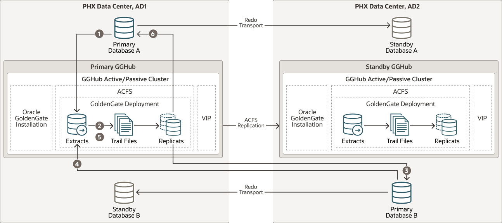
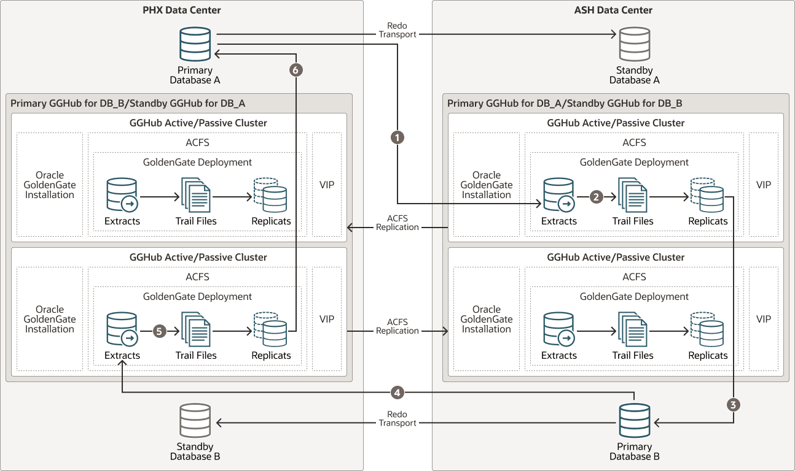

## Planning GGHub Placement in the Platinum MAA Architecture

Extreme availability that delivers zero downtime (RTO=0 or near zero) and zero or near zero data loss (RPO=0 or near zero) typically requires the following Platinum MAA architecture where:

1.  You have the source and target database in an Oracle GoldenGate architecture to allow your application to fail over immediately in the case of disaster (database, cluster, or site failure) or switch over in the case of a database or application upgrade. This architecture enables the potential RTO of zero or near zero for disaster scenarios and database and application upgrade maintenance.

2.  Each source and target database is deployed in Exadata systems so that any local failures are tolerated or recovered almost instantly.

3.  Each source and target database is configured with a standby database with Data Guard Fast-Start Failover so that any failure of the database results in activating a new primary database in seconds to minutes. If SYNC transport is leveraged with Maximum Availability protection mode, zero data loss Data Guard failover is achieved.

4.  Configured with GoldenGate replication using MAA GGHub between the source and target databases.

5.  Configured so that any standby that becomes a primary database because of Data Guard switchover or failover automatically resynchronizes with its target GoldenGate database. If zero data loss Data Guard switchover or failover occurs, GoldenGate resychronization ensures zero data loss across the distributed database environment.

6.  Configured with GoldenGate Automatic Conflict Detection and Resolution, which is required after any Data Guard failover operation occurs.

### Where to Place the MAA Primary GGHub and Standby GGHub

1.  GGHub Pair (Primary and Standby GGHub) must reside in the same data center (round trip latency of less 4ms) as each primary and standby database. For example,

    1.  If the primary database is in Data Center 1, Region A and standby database is in Data Center 2, Region A, then the GGHub pair will reside in Region A.

    2.  If the primary database is in Region A and standby database is in Region B, then the GGHub pair will split between Region A and B. The primary or active GGHub must be co-located in the same region as the target primary database.

2.  Performance implications:

    1.  Primary or active GGHub must reside in the same data center as the target database to ensure round trip latency of 4ms or less. (Replicat performance)

    2.  Primary or active GGHub should be \< 90 ms from the source database without incurring GoldenGate performance degradation (Extract performance).

3.  GoldenGate Distribution Path

    1.  GoldenGate distribution path is required if the source and target GGHubs are in different areas with a latency \> 90 ms.

    2.  With bi-directional replication, or when there are multiple target databases in different data centers, it may be necessary to have additional hubs with distribution paths sending trail files between them.

### MAA GGHubs Placed in the Same Data Center

In this scenario, the primary and standby database are located in the same data center (latency less 4ms), and so the primary (active) GGHub and the standby GGHub are also located in the same data center.

The example below has two data centers, or availability domains (ADs), in the same data center.

As shown in Figure 1, you have the following architectural components:

1.  Primary database and associated standby database are configured with Oracle Active Data Guard Fast Start Failover (FSFO). FSFO can be configured with Data Guard protection mode with ASYNC or SYNC redo transport depending on your maximum data loss tolerance.

2.  Primary GGHub Active/Passive Cluster: Only one GGHub software deployment and configuration on the 2-node cluster. This cluster contains the 21c Oracle GoldenGate software deployment that can support 11.2.0.4 and later database versions. This GGHub can support many primary databases and encapsulates the GoldenGate processes: GoldenGate Extract mines transactions from the source database and GoldenGate Replicat applies the same changes to target database. GoldenGate trail and checkpoint files will also reside in the GGhub ACFS file system. The HA failover solution is built in to the GGhub, which includes automatic failover to the passive node in the same cluster, and restarts GoldenGate processes and activity after a node failure.

3.  Standby GGHub Active/Passive Cluster: A Symmetric standby GGhub is configured. ACFS replication is set up between the primary and standby GGHubs to preserve all GoldenGate files. Manual GGhub failover, which includes ACFS failover, can be executed in the rare case that you lose the entire primary GGhub.

Figure 25-1 Primary and Standby GGHubs in the same data center with two separate Availability Domains

[Description of "Figure 25-1 Primary and Standby GGHubs in the same data center with two separate Availability Domains"](img_text/gghub-one-datacenter.md)

The figure above depicts replicating data from Primary Database A to Primary Database B and Primary B back to Primary A with the following steps:

1.  Primary Database A: Primary A’s Logminer server sends redo changes to a Primary GGHub Extract process.
2.  Primary GGHub: An Extract process writes changes to trail files.
3.  Primary GGHub to Primary Database B: A Primary GGHub Replicat process applies those changes to the target database (Primary B).
4.  Primary Database B: Primary B’s Logminer server sends redo to a Primary GGHub Extract process.
5.  Primary GGHub: A Primary GGHub Extract process writes changes to trail files.
6.  Primary GGHub to Primary Database A: A Primary GGHub Replicat process applies those changes to the target database (Primary A).

Note that one GGHub can support multiple source and target databases, even when the source and target databases are different Oracle Database releases.

Table 25-1 Outage Scenarios, Repair, and Restoring Redundancy for GGHubs in the Same Data Center

| Outage Scenario                                                  | Application Availability and Repair                                                                                                                                                                                                                                                                                                                                                                                                                                                                                                                                                                                                                                                                                                                                                                                                                                                                                                                                                                                                                                                                                                                                                                                          | Restoring Redundancy and Pristine State                                                                                                                                                                                                                                                                                                             |
|:-----------------------------------------------------------------|:-----------------------------------------------------------------------------------------------------------------------------------------------------------------------------------------------------------------------------------------------------------------------------------------------------------------------------------------------------------------------------------------------------------------------------------------------------------------------------------------------------------------------------------------------------------------------------------------------------------------------------------------------------------------------------------------------------------------------------------------------------------------------------------------------------------------------------------------------------------------------------------------------------------------------------------------------------------------------------------------------------------------------------------------------------------------------------------------------------------------------------------------------------------------------------------------------------------------------------|:----------------------------------------------------------------------------------------------------------------------------------------------------------------------------------------------------------------------------------------------------------------------------------------------------------------------------------------------------|
| Primary Database A (or Database B) failure                       | Impact: Near-zero application downtime. GoldenGate replication resumes when a new primary database starts. 1. One primary database is still available. All activity is routed to the existing available primary database to achieve zero application downtime. Refer to the Global Data Services [Global Services Failover](../gsmug/intro-global-data-services.md) solution. For example, application services A-F are routed to Database A and application services G-J are routed to Database B. If Database A fails, all application services temporarily go to Database B. 2. The standby becomes the new primary automatically with Data Guard FSFO. Oracle GoldenGate replication resumes and the primary databases resynchronize. Data loss is bounded by the Data Guard protection level. If Maximum Availability or Maximum Protection is configured, zero data loss is achieved. All committed transactions are in one or both databases. Workload can be “rebalanced” when Primary Database A and Database B are available and in sync. For example, when Database A is up and running and in sync, services A-F can go back to Database A.                                                                | 1. The old primary database is reinstated as the new standby database to restore redundancy. 2. Optionally performing a Data Guard switchover to switch back to the original configuration ensures that at least one primary database resides in an independent AD.                                                                              |
| Primary or standby GGHub single node failure                     | Impact: No application impact. GoldenGate replication resumes automatically after a couple of minutes. No action is required. The HA failover solution built in to the GGHub includes automatic failover and restart of GoldenGate processes and activity. Replication activity is blocked until GoldenGate processes are active again. GoldenGate replication blackout could last a couple of minutes.                                                                                                                                                                                                                                                                                                                                                                                                                                                                                                                                                                                                                                                                                                                                                                                                                   | Once the node restarts, active/passive configuration is re-established.                                                                                                                                                                                                                                                                             |
| Primary GGHub cluster crashes and is not recoverable             | Impact: No application impact. GoldenGate replication resumes after restarting the existing GGHub or executing a manual GGHub failover operation. 1. If the GGHub cluster can be restarted, then that’s the simplest solution. 2. If the primary GGHub is not recoverable, then execute a manual GGHub failover to the standby GGHub, which includes ACFS failover. This typically takes several minutes. 3. GoldenGate replication stops until the new primary GGhub is available, so executing step 1 or step 2 should be quick.                                                                                                                                                                                                                                                                                                                                                                                                                                                                                                                                                                                                                                                                                  | If the previous GGHub eventually restarts, ACFS replication resumes in the other direction automatically. If the GGHub cluster is lost or unrecoverable, you need to rebuild a new standby GGHub.                                                                                                                                                   |
| Standby GGHub cluster crashes and not recoverable                | Impact: No application or replication impact. 1. If the GGHub cluster can be restarted, then that is the simplest solution, and ACFS replication can resume. 2. If the standby GGHub is not recoverable, you can rebuild a new standby GGHub.                                                                                                                                                                                                                                                                                                                                                                                                                                                                                                                                                                                                                                                                                                                                                                                                                                                                                                                                                                          | N/A                                                                                                                                                                                                                                                                                                                                                 |
| Complete Data Center or Availability Domain (AD1 or AD2) failure | Impact: Near-zero application downtime. GoldenGate replication resumes when the new primary database starts. 1. One primary database is still available. All activity is routed to the existing available primary database to achieve zero application downtime. Refer to the [Global Services Failover](../gsmug/intro-global-data-services.md) solution. For example, application services A-F are routed to Database A and application services G-J are routed to Database B. If Database A fails, all services temporarily go to Database B. 2. If the primary GGHub is still functional, GoldenGate replication continues. If the primary GGHub is lost due to availability domain (AD) failure, then a manual GGhub failover is required. GoldenGate replication resumes and the primary databases resynchronize. Data loss is bounded by the Data Guard protection level. If Maximum Availability or Maximum Protection is configured, zero data loss is achieved. All committed transactions are in one or both databases. Workload can be rebalanced when Primary Database A and Database B are available and in sync. When Database A is up and running and in sync, services A-F can go back to Database A. | 1. When the data center/AD returns, re-establish configuration such as reinstate standby. If the previous GGHub eventually restarts, ACFS replication resumes in the other direction automatically. 2. When possible, perform a Data Guard switchover (failback) to get back to the original state where one primary database exists in each AD. |

### MAA GGHubs Placed in Different Data Centers

In this scenario, the primary and standby databases are located in different data centers, and so the primary (active) GGHub is located in the same data center as the primary database, and the standby GGHub is located in the same data center as the standby database.

As shown in the following image, you have the following architectural components:

1.  The primary database and associated standby database are configured with Oracle Active Data Guard Fast Start Failover (FSFO). FSFO can be configured with Data Guard protection mode with ASYNC or SYNC redo transport depending on your maximum data loss tolerance.

2.  Primary GGHub Active/Passive Cluster: In this configuration, there’s a 2-node cluster with two Oracle GoldenGate software configurations. Because the primary GGHub needs to be \<= 4 ms from the target database and the two data centers network latency \> 5 ms, two GGhub configurations are created for each GGHub cluster. Essentially, a primary GGHub configuration is always in the same data center as the target database. GGHub is configured with the Oracle GoldenGate 21c software deployment that can support 11g and later Oracle Database releases. This GGHub can support many primary databases and encapsulates the GoldenGate processes: Extract mines transactions from the source database, and Replicat applies those changes to the target database. GoldenGate trail and checkpoint files will also reside in the ACFS file system. An HA failover solution is built in to the GGhub cluster, which includes automatic failover and restart of GoldenGate processes and activity after a node failure.

    Each GGhub configuration contains a GoldenGate service manager and deployment, ACFS file system with ACFS replication, and a separate application VIP.

3.  Standby GGHub Active/Passive Cluster: A symmetric standby GGhub is configured. ACFS replication is set up between the primary and standby GGHubs to preserve all GoldenGate files. Manual GGhub failover, which includes ACFS failover, can be executed if you lose the entire primary GGhub.

Figure 25-2 Primary and Standby GGHubs in Different Data Centers

[Description of "Figure 25-2 Primary and Standby GGHubs in Different Data Centers"](img_text/gghub-two-datacenters.md)

The figure above depicts replicating data from Primary Database A to Primary Database B and Primary B back to Primary A with the following steps:

1.  Primary Database A: Primary A’s Logminer server sends redo changes to an PHX DataCenter GGHub Extract process, which is on the Primary GGHub for Database A.
2.  Primary GGHub: The Extract process writes changes to trail files.
3.  Primary GGHub to Primary Database B: An PHX DataCenter GoldenGate Replicat process applies those changes to the target database (Primary B).
4.  Primary Database B: Primary B’s Logminer server sends redo to a ASH DataCenter GGHub Extract process, which is on the Primary GGHub for Database B.
5.  Primary GGHub: The Extract process writes changes to trail files.
6.  Primary GGHub to Primary Database A: A ASH DataCenter GoldenGate Replicat process applies those changes to the target database (Primary A).

Table 25-2 Outage Scenarios, Repair, and Restoring Redundancy for GGHubs in Different Data Centers

| Outage Scenario                                      | Application Availability and Repair                                                                                                                                                                                                                                                                                                                                                                                                                                                                                                                                                                                                                                                                                                                                                                                                                                                                                                                                                                                                                                                                                                                                                                                                                                                                                                                                                                                                                                               | Restoring Redundancy and Pristine State                                                                                                                                                                                                                                                                                                                                                                                                                                                                                                                                                                  |
|:-----------------------------------------------------|:----------------------------------------------------------------------------------------------------------------------------------------------------------------------------------------------------------------------------------------------------------------------------------------------------------------------------------------------------------------------------------------------------------------------------------------------------------------------------------------------------------------------------------------------------------------------------------------------------------------------------------------------------------------------------------------------------------------------------------------------------------------------------------------------------------------------------------------------------------------------------------------------------------------------------------------------------------------------------------------------------------------------------------------------------------------------------------------------------------------------------------------------------------------------------------------------------------------------------------------------------------------------------------------------------------------------------------------------------------------------------------------------------------------------------------------------------------------------------------|:---------------------------------------------------------------------------------------------------------------------------------------------------------------------------------------------------------------------------------------------------------------------------------------------------------------------------------------------------------------------------------------------------------------------------------------------------------------------------------------------------------------------------------------------------------------------------------------------------------|
| Primary Database A (or Database B) failure           | Impact: Near-zero application downtime. GoldenGate replication resumes when the new primary database starts. 1. One primary database is still available. All activity is routed to the existing available primary database to achieve zero application downtime. Refer to the Global Data Services [Global Services Failover](../gsmug/intro-global-data-services.md) solution. For example, application services A-F are routed to Database A and application services G-J are routed to Database B. If Database A fails, all services temporarily go to Database B. 2. The standby becomes the new primary automatically with Data Guard FSFO. GoldenGate replication resumes and the primary databases resynchronize. Data loss is bounded by the Data Guard protection level. If Maximum Availability or Maximum Protection is configured, zero data loss is achieved. All committed transactions are in one or both databases. Workload can be rebalanced when primary Database A and Database B are available and in sync. For example, when Database A is up and running and in sync, services A-F can go back to Database A. 3. Replicat performance will be degraded if the primary GGHub is not in the same data center as the target database. Schedule a GGHub switchover with ACFS replication switchover to resume optimal Replicat performance to the target database. You may then experience two active GGhub configurations on the same GGHub cluster. | 1. The old primary database is reinstated as the new standby database to restore redundancy. 2. Optionally performing a Data Guard switchover, to switch back to the original configuration, ensures that at least one primary database resides in an independent AD. Schedule a GGHub switchover with ACFS replication switchover to resume optimal Replicat performance to the target database.                                                                                                                                                                                                     |
| Primary or standby GGHub single node failure         | Impact: No application impact. GoldenGate replication resumes automatically after a couple of minutes. No action is required. An HA failover solution is built in to the GGHub that includes automatic failover and restart of GoldenGate processes and activity. Replication activity is blocked until GoldenGate processes are active again. GoldenGate Replication blackout could last a couple of minutes.                                                                                                                                                                                                                                                                                                                                                                                                                                                                                                                                                                                                                                                                                                                                                                                                                                                                                                                                                                                                                                                                 | Once the node restarts, active/passive configuration is re-established.                                                                                                                                                                                                                                                                                                                                                                                                                                                                                                                                  |
| Primary GGHub cluster crashes and is not recoverable | Impact: No application impact. GoldenGate replication resumes after the existing primary GGHub restarts or manual GGHub failover completes. 1. If the GGHub cluster can be restarted, then that’s the simplest solution. 2. If the primary GGHub is not recoverable, then execute a manual GGHub failover to the standby GGHub, which includes ACFS failover. This typically takes several minutes. 3. Replication stops until the new primary GGhub is started, so executing step 1 or step 2 should be quick. If there’s any orchestration, this should be automated.                                                                                                                                                                                                                                                                                                                                                                                                                                                                                                                                                                                                                                                                                                                                                                                                                                                                                                  | 1. If the previous GGHub eventually restarts, ACFS replication resumes in the other direction automatically. If the GGHub cluster is lost or unrecoverable, you need to rebuild a new standby GGHub. 2. Replicat performance is degraded if the primary GGhub is not in the same data center as the target database. Schedule a GGHub switchover with ACFS replication switchover to resume optimal Replicat performance to the target database.                                                                                                                                                      |
| Standby GGHub cluster crashes and is not recoverable | Impact: No application or replication impact. 1. If the GGHub cluster can be restarted, then that’s the simplest solution, and ACFS replication will resume. 2. If the standby GGHub is not recoverable, you can rebuild a new standby GGHub.                                                                                                                                                                                                                                                                                                                                                                                                                                                                                                                                                                                                                                                                                                                                                                                                                                                                                                                                                                                                                                                                                                                                                                                                                               | N/A                                                                                                                                                                                                                                                                                                                                                                                                                                                                                                                                                                                                      |
| Complete Regional failure                            | Impact: Near Zero Application Downtime. GoldenGate replication resumes once new primary database starts. 1. One primary database is still available. All activity is routed to the existing available primary database to achieve zero application downtime. Refer to the Global Data Services [Global Services Failover](../gsmug/intro-global-data-services.md) solution. For example, application services A-F routed to Database A and application services G-J routed to Database B. If Database A fails, all services will temporarily go to Database B. 2. If the primary GGHub is still functional, GoldenGate replication will continue. If the primary GGHub is lost due to regional failure, then a manual GGhub failover is required. GoldenGate replication resumes and the primary databases resynchronize. Data loss is bounded by the Data Guard protection level. If Maximum availability or protection is configured, zero data loss is achieved. All committed transactions are in one or both databases. Workload can be rebalanced when Primary Database A and Database B are available and in sync. When Database A is up and running and in sync, services A-F can go back to Database A.                                                                                                                                                                                                                                                            | 1. When the data center returns, re-establish configuration such as reinstate standby. If the previous GGHub eventually restarts, ACFS replication resumes in the other direction automatically. 2. When possible, execute a Data Guard switchover (failback) to get back to the original state where one primary database exists in each data center. 3. Replicat performance is degraded if the primary GGHub is not in the same data center as the target database. Schedule a GGHub switchover with ACFS replication switchover to resume optimal Replicat performance to the target database. |
