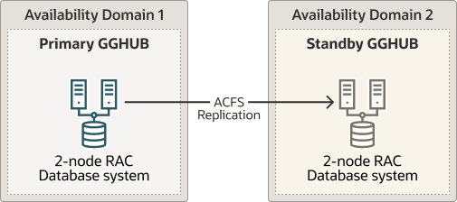

## Task 2: Prepare a Primary and Standby Base System for GGHub

Perform the following steps to complete this task:

- Step 2.1 - Deploy Oracle 2-node Cluster System
- Step 2.2 - Download the Required Software
- Step 2.3 - Configure Oracle Linux to use the Oracle Public YUM Repository

Step 2.1 - Deploy a Oracle 2-Node Oracle Grid Infrastructure System

Deploy a minimum of two GGHubs (primary and standby). Each GGHub must be deployed as a 2-node Oracle Grid Infrastructure system as described in [Installing Oracle Grid Infrastructure](../cwlin/installing-oracle-grid-infrastructure.md).

Figure 25-3 Oracle GoldenGate Hub Hardware Architecture

Step 2.2 - Download the Required Software

1.  As the `root` OS user on all GGHub nodes, create the staging and scripts directories:

        [root@gghub_prim1 ~]#
        mkdir -p /u01/oracle/stage
        mkdir /u01/oracle/scripts
        chown -R oracle:oinstall /u01/oracle
        chmod -R g+w /u01/oracle
        chmod -R o+w /u01/oracle/stage

2.  As the `opc` OS user on all GGHub nodes, download the following software in the directory /u01/oracle/stage:

    - Download the latest Oracle GoldenGate 21c (or later release) Microservices software from [My Oracle Support Doc ID 2193391.1](https://support.oracle.com/rs?type=doc&id=2193391.1).
    - Download the Oracle Grid Infrastructure Standalone Agents for Oracle Clusterware 19c, release 10.2 or later, from [Oracle Grid Infrastructure Standalone Agents for Oracle Clusterware](http://www.oracle.com/technetwork/database/database-technologies/clusterware/downloads/xag-agents-downloads-3636484.html).
    - Download the python script (`secureServices.py`) from My Oracle Support [Document 2826001.1](https://support.oracle.com/rs?type=doc&id=2826001.1)
    - Download the Oracle GGHUB Scripts from My Oracle Support [Document 2951572.1](https://support.oracle.com/rs?type=doc&id=2951572.1)

3.  As the `grid` OS user on all GGHub nodes, unzip the GGhub scripts file downloaded from My Oracle Support [Document 2951572.1](https://support.oracle.com/rs?type=doc&id=2951572.1) into the directory `/u01/oracle/scripts`.

    Place the script in the same location on all primary and standby GGhub nodes

        [grid@gghub_prim1 ~]$ unzip
         -q /u01/oracle/stage/gghub_scripts_<YYYYYMMDD>.zip
         -d /u01/oracle/scripts/

Step 2.3 - Configure Oracle Linux to use the Oracle Public YUM Repository

The Oracle Linux yum server hosts software for Oracle Linux and compatible distributions. These instructions help you get started configuring your Linux system for Oracle Linux yum server and installing software through yum.

For example, as the `root` OS user in all GGHub systems, create the file `/etc/yum.repos.d/oracle-public-yum-ol7.repo` with the following contents:

    [opc@gghub_prim1 ~]$ sudo su -
    [root@gghub_prim1 ~]#
    cat > /etc/yum.repos.d/oracle-public-yum-ol7.repo <<EOF
    [ol7_latest]
    name=Oracle Linux $releasever Latest ($basearch)
    baseurl=http://yum.oracle.com/repo/OracleLinux/OL7/latest/\$basearch
    gpgkey=file:///etc/pki/rpm-gpg/RPM-GPG-KEY-oracle
    gpgcheck=1
    enabled=1
    EOF
