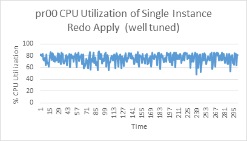
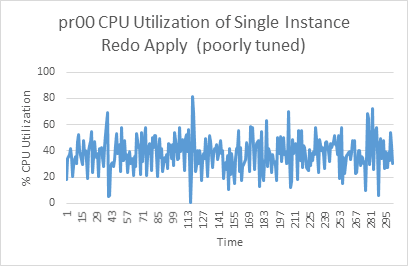
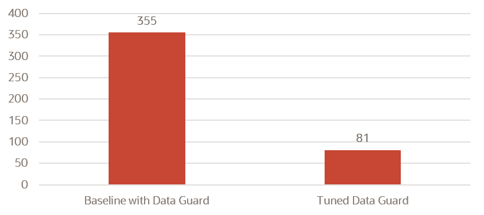
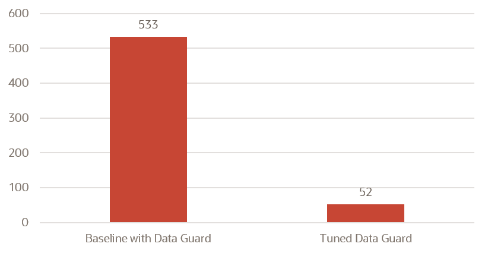
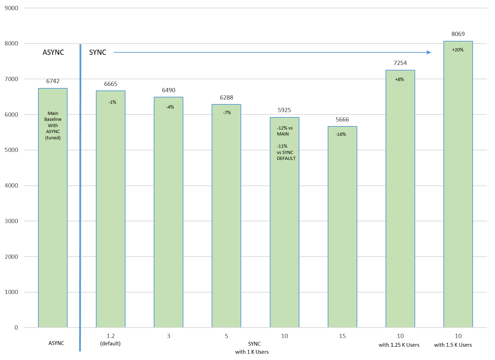
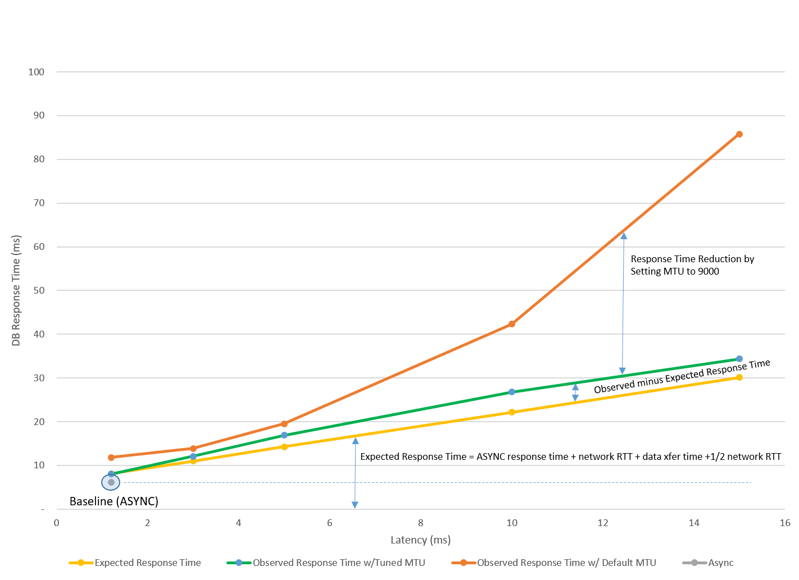

## 16 Tune and Troubleshoot Oracle Data Guard

When redo transport, redo apply, or role transitions are not meeting your expected requirements, use the following guidelines to help you tune and troubleshoot your deployment.

### Overview of Oracle Data Guard Tuning and Troubleshooting

To get the best performance from your Oracle Data Guard configuration, use the following Oracle MAA best practices for monitoring, assessment, and performance tuning.

- Ensure that Oracle Database and Oracle Data Guard configuration best practices are in place.

  The assumption when assessing and tuning is that all of the Oracle Database and Data Guard configuration best practices are already integrated in the environment. Evaluate the adherence to those best practices before doing any tuning.

- Assess and tune redo transport services

  Oracle Data Guard automatically tunes redo transport to optimize performance. However, if you observe performance issues, you can monitor and tune redo transport services.

  Asynchronous redo transport with Maximum Performance data protection mode is the default Oracle Data Guard configuration. Tuning asynchronous redo transport consists mainly of ensuring that the primary, standby, and network resources are sufficient for handling the workload, and that you monitor those resources for bottlenecks.

  Synchronous redo transport does sacrifice some performance for zero data loss; however, using sound MAA recommended methods, you can monitor and assess the impact and distribute resources appropriately.

- Assess and tune redo apply

  In most cases, the default Oracle settings result in satisfactory performance for media recovery when the standby is always up to date. However, as applications and databases increase in size and throughput, media recovery operations can benefit from additional tuning to further optimize recovery time or redo apply throughput on a standby database

- Assess and tune role transitions

  With proper planning and implementation, Oracle Data Guard and Active Data Guard role transitions can effectively minimize downtime and ensure that the database environment is restored with minimal impact on the business. Performance tests using a physical standby database and Oracle Maximum Availability Architecture (MAA) best practices have shown that switchover and failover can be reduced to seconds.

### Redo Transport Troubleshooting and Tuning

Oracle Data Guard redo transport performance is directly dependent on the performance of the primary and standby systems, the network that connects them, and the I/O subsystem.

For most Oracle Data Guard configurations, you should be able to achieve zero or minimal data loss by troubleshooting and tuning redo transport.

The guidance presented here assumes that the MAA configuration best practices are followed. As a prerequisite, ensure that the [Oracle Data Guard Configuration Best Practices](configure-and-deploy-oracle-data-guard.md) are implemented.

To improve transport holistically, leverage the data gathering and troubleshooting methodology described in the topics below, which guide you through gathering the necessary data to assess whether there is indeed a redo transport problem and what can be tuned to optimize redo transport throughput.

- Gather Topology Information
- Verify Transport Lag and Understand Redo Transport Configuration
- Gather Information to Troubleshoot Transport Lag
- Compare Redo Generation Rate History on the Primary
- Evaluate the Transport Network and Tune
- Gather and Monitor System Resources
- Advanced Troubleshooting: Determining Network Time with Asynchronous Redo Transport
- Tuning and Troubleshooting Synchronous Redo Transport

#### Gather Topology Information

Understanding the topology of the Oracle Data Guard configuration, and its relevance to Data Guard performance, helps eliminate infrastructure weaknesses that are often incorrectly attributed to the Data Guard architecture.

Oracle recommends that you outline the following high-level architecture information.

- Describe the primary and standby database system (number of nodes in Oracle RAC cluster, CPUs and memory per database node, storage I/O system)
- Describe network topology connecting the primary and standby systems
  - Network components/devices in between primary and standby
  - Network bandwidth and latency

For standby databases with symmetric hardware and configuration, and with a good tuned network configuration, the transport lag should be less than 10 seconds and in most cases less than 1 second.

#### Verify Transport Lag and Understand Redo Transport Configuration

To determine if there is any lag on the standby database, and if this is a transport or apply lag, query the `V$DATAGUARD_STATS` view.

`SQL> select name,value,time_computed,datum_time from v$dataguard_stats where name=’%lag’;`

The `DATUM_TIME` column is the local time on the standby database when the datum used to compute the metric was received. The lag metrics are computed based on data that is periodically received from the primary database. An unchanging value in this column across multiple queries indicates that the standby database is not receiving data from the primary database. The potential data loss in this scenario would be from the last datum time from `V$DATAGUARD_STATS` to the current time on the standby.

To obtain a histogram that shows the history of transport or apply lag values since the standby instance was last started, query the `V$STANDBY_EVENT_HISTOGRAM` view.

`SQL> select * from v$standby_event_histogram where name like '%lag' and count >0;`

To evaluate the transport or apply lag over a time period, take a snapshot of `V$STANDBY_EVENT_HISTOGRAM` at the beginning of the time period and compare that snapshot with one taken at the end of the time period.

    SQL> col NAME format a10
    SQL> select NAME,TIME,UNIT,COUNT,LAST_TIME_UPDATED from V$STANDBY_EVENT_HISTOGRAM where
     name like '%lag' and count >0 order by LAST_TIME_UPDATED;

    NAME             TIME UNIT                  COUNT LAST_TIME_UPDATED

    ---------- ---------- ---------------- ---------- --------------------

    transport lag      41 seconds                   3      01/05/2022 16:30:59

    transport lag     245 seconds                   1      01/05/2022 16:31:02

    transport lag     365 seconds                   2      01/05/2022 16:31:03

    transport lag     451 seconds                   2      01/05/2022 16:31:04

If you observe a high redo transport lag, continue this redo transport investigation with Gather Information to Troubleshoot Transport Lag. If you see no transport lag but a high redo apply lag, address the apply lag using the methodology in Redo Apply Troubleshooting and Tuning.

#### Gather Information to Troubleshoot Transport Lag

Gather the following information and investigate the questions when an unacceptable redo transport lag is observed:

- When did the transport lag occur? Record the `V$DATAGUARD_STATS` and` V$STANDBY_EVENT_HISTOGRAM` data to show when the lag started and how the lag is changing over time.
- Does the transport lag occur during certain time period, such as daily at 12 midnight for daily batch operations, monthly during large batch operation, or quarterly during quarter end?
- Check the `LOG_ARCHIVE_DEST` setting for any enabled Oracle Data Guard transport, and verify whether redo [COMPRESSION](../sbydb/LOG_ARCHIVE_DEST_n-parameter-attributes.md) or [ENCRYPTION](../sbydb/LOG_ARCHIVE_DEST_n-parameter-attributes.md) is enabled. Overall redo transport throughput can be negatively impacted because redo must be compressed or encrypted before sending, and then uncompressed or unencrypted upon receiving it on the standby. Verify if that change was recent, and if you can test disabling these setting attributes.
- Check the Oracle Net settings to evaluate if Oracle Net encryption is enabled. If Oracle Net encryption is enabled, when was it enabled and at what level? Oracle Net encryption can slow down redo throughput significantly because redo is encrypted before sending and unencrypted upon receiving the redo on the standby. Optionally, disable or reduce encryption levels to see if the redo transport lag reduces.

#### Compare Redo Generation Rate History on the Primary

There are cases where the primary database redo generation rate is exceptionally high for a short period of time, such as during large batch jobs, data loads, data pump operations, create table as select, PDML operations, or end of month, quarter, or year batch updates.

Obtain the redo generation history from the primary database and compare that to when the redo transport or redo apply lag started. Check if the redo generation rate is exceptionally high because of additional workloads, such as adding new pluggable databases or new application services. By doing so, additional tuning may be required to accommodate this additional load.

As part of troubleshooting, gather the following information or address the following questions:

- Gather daily history of primary database's redo generation rate using this query.

      SQL> select trunc(completion_time) as "DATE", count(*) as "LOG SWITCHES", round(sum(blocks*block_size)/1024/1024) as "REDO PER DAY (MB)"
      from v$archived_log
      where dest_id=1
      group by trunc(completion_time) order by 1;

- Gather per log redo generation rate starting 6 hours prior to start any redo or transport lag.

      SQL> alter session set nls_date_format='YYYY/MM/DD HH24:MI:SS';
      SQL> select thread#,sequence#,blocks*block_size/1024/1024 MB,(next_time-first_time)*86400 sec, blocks*block_size/1024/1024)/((next_time-first_time)*86400) "MB/s" from v$archived_log
      where ((next_time-first_time)*86400<>0)
      and first_time between to_date('2015/01/15 08:00:00','YYYY/MM/DD HH24:MI:SS')
      and to_date('2015/01/15 11:00:00','YYYY/MM/DD HH24:MI:SS')
      and dest_id=1 order by first_time;

- Gather hourly snapshots of the redo generation rate from the Automatic Workload Repository (AWR) report 6 hours before the start of any redo or transport lag.

  By default, Oracle Database automatically generates snapshots once every hour; however, you may want to manually create snapshots to capture statistics at times different from those of the automatically generated snapshots. To view information about an existing snapshot, use the `DBA_HIST_SNAPSHOT` view.

  See [Creating Snapshots](../tgdba/gathering-database-statistics.md) in the Oracle Database Performance Tuning Guide for complete information about AWR and generating snapshots and AWR reports.

- Is this primary redo generation rate exceptionally high compared to prior history?

- If possible, determine the workload that corresponds to the high redo generation rate and evaluate whether it's transient or if it can be tuned.

  For example, for large purge operations, consider truncate or drop partition operations to reduce the redo generation volumes.

#### Evaluate the Transport Network and Tune

Redo transport consists of the primary database instance background process sending redo to the standby database background process. You can evaluate if the network is optimized for Oracle Data Guard redo transport.

If asynchronous redo transport is configured, redo data is streamed to the standby in large packets asynchronously. To tune asynchronous redo transport over the network, you need to optimize a single process network transfer.

If synchronous redo transport is configured, each redo write must be acknowledged by the primary and standby databases before proceeding to the next redo write. You can optimize standby synchronous transport by using the `FASTSYNC` attribute as part of the `LOG_ARCHIVE_DEST` setting, but higher network latency (for example \> 5 ms) impacts overall redo transport throughput.

Before you continue, see [Assessing and Optimizing Network Performance](plan-oracle-data-guard-deployment.md) first to:

- Assess whether you have sufficient network bandwidth to support the primary's redo generation rate

- Determine optimal TCP socket buffer sizes to tune redo transport

- Tune operating system limits on socket buffer sizes to tune redo transport

- Determine optimal MTU setting for redo write size

- Tune MTU to increase network throughput for redo transport

If network configuration is tuned, evaluate if the transport lag (refer to Verify Transport Lag and Understand Redo Transport Configuration) is reducing to acceptable levels. If that's the case, you have met your goals and you can stop. Otherwise continue with the rest of the rest of tuning and troubleshooting section.

#### Gather and Monitor System Resources

Gather Oracle Linux OSwatcher or Oracle Exadata Exawatcher data to analyze system resources.

OSWatcher (oswbb) is a collection of UNIX shell scripts intended to collect and archive operating system and network metrics to aid support in diagnosing performance issues. As a best practice, you should install and run OSWatcher on every node that has a running Oracle instance. In the case of a performance issue, Oracle support can use this data to help diagnose performance problems which may outside the database.

You can download OSWatcher from [OSWatcher (Doc ID 301137.1)](https://support.oracle.com/rs?type=doc&id=301137.1).

ExaWatcher is a utility that collects performance data on the storage servers and database servers on an Exadata system. The data collected includes operating system statistics, such as iostat, cell statistics (cellsrvstat), and network statistics.

See [Using ExaWatcher Charts to Monitor Exadata Database Machine Performance](https://docs.oracle.com/pls/topic/lookup?ctx=en/database/oracle/oracle-database/19/haovw&id=DBMMN-GUID-5AEB3139-333D-453F-91D6-8EB09CB6E6EB) in the Oracle Exadata Database Machine Maintenance Guide for more information.

#### Tune to Meet Data Guard Resource Requirements

Redo transport can be impacted if:

- Primary or standby database is completely CPU bound
- Primary or standby database I/O system is saturated
- Network topology can't support the redo generation rates

Evaluate whether the primary database system has:

- Sufficient CPU utilization for Log Writer Process (LGWR) to post foregrounds efficiently
- Sufficient I/O bandwidth so local log writes maintain low I/O latency during peak rates
- Network interfaces that can handle peak redo rate volumes combined with any other network activity across the same interface
- Automatic Workload Repository (AWR), Active Session History (ASH), and OSwatcher or Exawatcher data gathered from the primary database for tuning and troubleshooting

Evaluate whether the standby database system has:

- Sufficient CPU utilization for the remote file server (RFS), the Oracle Data Guard process that receives redo at the standby database, to efficiently write to standby redo logs

- Sufficient I/O bandwidth to enable local log writes to maintain low I/O latency during peak rates

- A network interface that can receive the peak redo rate volumes combined with any other network activity across the same interface

- AWR, ASH, and OSwatcher or Exawatcher data gathered from the standby database for tuning and troubleshooting

**Note:**

The top issue encountered with the standby database is poor standby log write latency because of insufficient I/O bandwidth. This problem can be mitigated by using Data Guard Fast Sync.

If system configuration is tuned and the above resource constraints are removed, evaluate if the transport lag (refer to Verify Transport Lag and Understand Redo Transport Configuration) is reducing to acceptable levels. If that's the case, you have met your goals.

#### Advanced Troubleshooting: Determining Network Time with Asynchronous Redo Transport

Before you proceed, first see [Assessing and Optimizing Network Performance](plan-oracle-data-guard-deployment.md).

Given enough resources, especially network bandwidth, asynchronous redo transport can maintain pace with very high workloads. In cases where resources are constrained, asynchronous redo transport can begin to fall behind resulting in a growing transport lag on the standby database.

Asynchronous redo transport (ASYNC) transmits redo data asynchronously with respect to transaction commitment. A transaction can commit without waiting for an acknowledgment that the redo generated by that transaction was successfully transmitted to a remote standby database. With ASYNC, the primary database Log Writer Process (LGWR) continues to acknowledge commit success even if limited bandwidth prevents the redo of previous transactions from being sent to the standby database immediately (picture a sink filling with water faster than it can drain).

ASYNC uses a TT00 process to transmit redo directly from the log buffer of the primary database. If the TT00 process is unable to keep pace, and the log buffer is recycled before the redo can be transmitted to the standby database, then the TT00 process automatically transitions to reading and sending from the online redo log file (ORL) on disk. Once TT00 transmission has caught up with current redo generation, it automatically transitions back to reading and sending directly from the log buffer.

In cases in which there are two or more log switches before the TT00 has completed sending the original ORL, the TT00 will still transition back to reading the contents of the current online log file. Any ORLs that were archived in between the original ORL and the current ORL are automatically transmitted using Oracle Data Guard’s redo gap resolution process.

Sufficient resources, such as network bandwidth, CPU, memory, and log file I/O on both the primary and standby databases are critical to the performance of an asynchronous Data Guard configuration.

To determine which resource is constraining asynchronous transport, use krsb stats which can be enabled by setting event 16421 on both the primary and standby databases:

    alter session set events ‘16421 trace name context forever, level 3’;

This event is very lightweight and won't affect performance of the primary or standby database.

This dynamic event should be set on all primary and standby instances, and it will write statistics into the TT00 or remote file server (RFS) trace file when shipping for a given sequence has completed. Looking in the trace file, you will see the krsb_end stats at the beginning and end of the file. The stats at the end of the file will provide insight into where asynchronous shipping was spending time. For example:

    krsb_end: Begin stats dump for T-1.S-593
      max number of buffers in use             10
      Operation elapsed time (micro seconds)   474051333
      File transfer time (micro seconds)       474051326
      Network Statistics
       LOG_ARCHIVE_DEST_2 : OCI REQUEST
        Total count  : OCI REQUEST             2748
        Total time   : OCI REQUEST             81374
        Average time : OCI REQUEST             29
       LOG_ARCHIVE_DEST_2 : NETWORK SEND
        Total count  : NETWORK SEND            2748
        Total time   : NETWORK SEND            286554724
        Average time : NETWORK SEND            104277
        Total data buffers queued              9644
        Total data buffers completed           9644
        Total bytes written                    9885272064
        Total bytes completed synchronously    9885272064
        Average network send size (blocks)     7025
        Average network send buffers           3.51
        Average buffer turnaround time         240889
        Throughput (MB/s)                      19.89
       Total network layer time                286636098
       Percentage of time in network           60.47
      Disk Statistics
        Total count  : DISK READ               11531
        Total time   : DISK READ               12335132
        Average time : DISK READ               1069
        Read-ahead blocks                      14151680
        Log buffer blocks                      266915
        Disk stall blocks                      4888576
        Total count  : BUFFER RELEASE          9643
        Total time   : BUFFER RELEASE          7229
        Average time : BUFFER RELEASE          0
       Total disk layer time                   12342361
       Percentage of time in disk layer        2.60
      Data Guard Processing Statistics
        Total count  : SLEEP                   198
        Total time   : SLEEP                   172351312
        Average time : SLEEP                   870461
       Total DG layer time                     175072867
       Percentage of time in DG layer          36.93
      Remote Server-Side Network Statistics
       LOG_ARCHIVE_DEST_2 : NETWORK GET
        Total count  : NETWORK GET             8242
        Total bytes  : NETWORK GET             9885272064
        Total time   : NETWORK GET             453233790
        Average time : NETWORK GET             54990
       Total server-side network layer time    453233790
       Percentage of time in network           95.61
      Remote Server-Side Disk Statistics
       LOG_ARCHIVE_DEST_2 : DISK WRITE
        Total count  : DISK WRITE              9644
        Total time   : DISK WRITE              8731303
        Average time : DISK WRITE              905
       LOG_ARCHIVE_DEST_2 : DISK NOSTALL REAP
        Total count  : DISK NOSTALL REAP       9644
        Total time   : DISK NOSTALL REAP       579066
        Average time : DISK NOSTALL REAP       60
       LOG_ARCHIVE_DEST_2 : BUFFER GET
        Total count  : BUFFER GET              9644
        Total time   : BUFFER GET              3607
        Average time : BUFFER GET              0
       Total server-side disk layer time       9313976
       Percentage of time in disk layer        1.96
      Remote Server-Side Data Guard Processing Statistics
       LOG_ARCHIVE_DEST_2 : PUBLISH RTA BOUNDARY
        Total count  : PUBLISH RTA BOUNDARY    8948
        Total time   : PUBLISH RTA BOUNDARY    3665841
        Average time : PUBLISH RTA BOUNDARY    409
       LOG_ARCHIVE_DEST_2 : VALIDATE BUFFER
        Total count  : VALIDATE BUFFER         9644
        Total time   : VALIDATE BUFFER         1403088
        Average time : VALIDATE BUFFER         145
       Total Server-Side DG layer time         11503560
       Percentage of time in DG layer          2.43
    krsb_end: End stats dump

The above output comes from a test run where a transport lag is just beginning to occur. You can observe a lag due to network congestion increase, and the time waiting on the network layer increases above 50%. If a transport lag is the result of either compression or encryption, the percentage of time spent in the Data Guard layer would become the majority.

To disable krsb stats set event 16421 to level 1:

    alter session set events ‘16421 trace name context forever, level 1’;

#### Tuning and Troubleshooting Synchronous Redo Transport

Before you proceed, first see [Assessing and Optimizing Network Performance](plan-oracle-data-guard-deployment.md).

The following topics describe how to assess synchronous redo transport.

- Understanding How Synchronous Transport Ensures Data Integrity
- Assessing Performance in a Synchronous Redo Transport Environment
- Why the Log File Sync Wait Event is Misleading
- Understanding What Causes Outliers
- Effects of Synchronous Redo Transport Remote Writes
- Example of Synchronous Redo Transport Performance Troubleshooting

##### Understanding How Synchronous Transport Ensures Data Integrity

The following algorithms ensure data consistency in an Oracle Data Guard synchronous redo transport configuration.

- Log Writer Process (LGWR) redo write on the primary database online redo log and the Data Guard Network Services Server (NSS) redo write to standby redo log are identical.

- The Data Guard Managed Recovery Process (MRP) at the standby database cannot apply redo unless the redo has been written to the primary database online redo log, with the only exception being during a Data Guard failover operation (when the primary is gone).

  In addition to shipping redo synchronously, NSS and LGWR exchange information regarding the safe redo block boundary that standby recovery can apply up to from its standby redo logs (SRLs). This prevents the standby from applying redo it may have received, but which the primary has not yet acknowledged as committed to its own online redo logs.

The possible failure scenarios include:

- If primary database LGWR cannot write to online redo log, then LGWR and the instance crash. Instance or crash recovery will recover to the last committed transaction in the online redo log and roll back any uncommitted transactions. The current log will be completed and archived.

- On the standby, the partial standby redo log completes with the correct value for the size to match the corresponding online redo log. If any redo blocks are missing from the standby redo log, those are shipped over (without reshipping the entire redo log).

- If the primary database crashes resulting in an automatic or manual zero data loss failover, then part of the Data Guard failover operation will do "terminal recovery" and read and recover the current standby redo log.

  Once recovery finishes applying all of the redo in the standby redo logs, the new primary database comes up and archives the newly completed log group. All new and existing standby databases discard any redo in the online redo logs, flashback to a consistent system change number (SCN), and only apply the archives coming from the new primary database. Once again the Data Guard environment is in sync with the (new) primary database.

##### Assessing Performance in a Synchronous Redo Transport Environment

When assessing performance in an Oracle Data Guard synchronous redo transport environment (SYNC) it is important that you know how the different wait events relate to each other. The impact of enabling synchronous redo transport varies between applications.

To understand why, consider the following description of work the Log Writer Process (LGWR) performs when a commit is issued.

1.  Foreground process posts LGWR for commit ("log file sync" starts). If there are concurrent commit requests queued, LGWR will batch all outstanding commit requests together resulting in a continuous strand of redo.
2.  LGWR waits for CPU.
3.  LGWR starts redo write ("redo write time" starts).
4.  For Oracle RAC database, LGWR broadcasts the current write to other instances.
5.  After preprocessing, if there is a SYNC standby, LGWR starts the remote write (“SYNC remote write” starts).
6.  LGWR issues local write ("log file parallel write").
7.  If there is a SYNC standby, LGWR waits for the remote write to complete.
8.  After checking the I/O status, LGWR ends "redo write time / SYNC remote write".
9.  For Oracle RAC database, LGWR waits for the broadcast ack.
10. LGWR updates the on-disk SCN.
11. LGWR posts the foregrounds.
12. Foregrounds wait for CPU.
13. Foregrounds ends "log file sync".

Use the following approaches to assess performance.

- For batch loads, the most important factor is to monitor the elapsed time, because most of these processes must be completed in a fixed period of time. The database workloads for these operations are very different than the normal OLTP workloads. For example, the size of the writes can be significantly larger, so using log file sync averages does not give you an accurate view or comparison.

- For OLTP workloads, monitor the volume of transactions per second (from Automatic Workload Repository (AWR)) and the redo rate (redo size per second) from the AWR report. This information gives you a clear picture of the application throughput and how it is impacted by enabling synchronous redo transport.

##### Why the Log File Sync Wait Event is Misleading

Typically, the "log file sync" wait event on the primary database is the first place administrators look when they want to assess the impact of enabling synchronous redo transport (SYNC).

If the average log file sync wait before enabling SYNC was 3ms, and after enabling SYNC was 6ms, then the assumption is that SYNC impacted performance by one hundred percent. Oracle does not recommend using log file sync wait times to measure the impact of SYNC because the averages can be very deceiving, and the actual impact of SYNC on response time and throughput may be much lower than the event indicates.

When a user session commits, the Log Writer Process (LGWR) will go through the process of getting on the CPU, submitting the I/O, waiting for the I/O to complete, and then getting back on the CPU to post foreground processes that the commit has completed. This whole time period is covered by the log file sync wait event. While LGWR is performing its work there are, in most cases, other sessions committing that must wait for LGWR to finish before processing their commits. The size and number of sessions waiting are determined by how many sessions an application has, and how frequently those sessions commit. This batching up of commits is generally referred to as application concurrency.

For example, assume that it normally takes 0.5ms to perform log writes (log file parallel write), 1ms to service commits (log file sync), and on average you are servicing 100 sessions for each commit. If there was an anomaly in the storage tier, and the log write I/O for one commit took 20ms to complete, then you could have up to 2,000 sessions waiting on log file sync, while there would only be 1 long wait attributed to log file parallel write. Having a large number of sessions waiting on one long outlier can greatly skew the log file sync averages.

The output from `V$EVENT_HISTOGRAM` for the log file sync wait event for a particular period in time is shown in the following table.

Table 16-1 V\$EVENT_HISTOGRAM Output for the Log File Sync Wait Event

| Milliseconds | Number of Waits | Percent of Total Waits |
|:-------------|:----------------|:-----------------------|
| 1            | 17610           | 21.83%                 |
| 2            | 43670           | 54.14%                 |
| 4            | 8394            | 10.41%                 |
| 8            | 4072            | 5.05%                  |
| 16           | 4344            | 5.39%                  |
| 32           | 2109            | 2.61%                  |
| 64           | 460             | 0.57%                  |
| 128          | 6               | 0.01%                  |

The output shows that 92% of the log file sync wait times are less than 8ms, with the vast majority less than 4ms (86%). Waits over 8ms are outliers and only make up 8% of wait times overall, but because of the number of sessions waiting on those outliers (because of batching of commits) the averages get skewed. The skewed averages are misleading when log file sync average waits times are used as a metric for assessing the impact of SYNC.

##### Understanding What Causes Outliers

Any disruption to the I/O on the primary or standby databases, or spikes in network latency, can cause high log file sync outliers with synchronous redo transport. You can see this effect when the standby system's I/O subsytem is inferior to that of the primary system.

Often administrators host multiple databases such as dev and test on standby systems, which can impair I/O response. It is important to monitor I/O using iostat to determine if the disks reach maximum IOPS, because this affects the performance of SYNC writes.

Frequent log switches are significant cause of outliers. Consider what occurs on the standby when a log switch on the primary occurs, as follows.

1.  Remote file server (RFS) process on the standby must finish updates to the standby redo log header.

2.  RFS then switches into a new standby redo log with additional header updates.

3.  Switching logs forces a full checkpoint on the standby.

    This causes all dirty buffers in the buffer cache to be written to disk, causing a spike in write I/O. In a non-symmetric configuration where the standby storage subsystem does not have the same performance as the primary database, this results in higher I/O latency.

4.  The previous standby redo log must be archived, increasing both read and write I/O.

##### Effects of Synchronous Redo Transport Remote Writes

When you enable synchronous redo transport (SYNC), you introduce a remote write (remote file server (RFS) write to a standby redo log) in addition to the normal local write for commit processing.

This remote write, depending on network latency and remote I/O bandwidth, can make commit processing time increase. Because commit processing takes longer, you observe more sessions waiting on the Log Writer Process (LGWR) to finish its work and begin work on the commit request, that is, application concurrency has increased. You can observe increased application concurrency by analyzing database statistics and wait events.

Consider the example in the following table.

Table 16-2 Affect of Sync Transport Increasing Application Concurrency

| SYNC   | Redo Rate | Network Latency | TPS from AWR | log file sync average (ms) | log file parallel write average (ms) | RFS random I/O | SYNC remote write average (ms) | Redo write size (KB) | Redo writes |
|:-------|:----------|:----------------|:-------------|:---------------------------|:-------------------------------------|:---------------|:-------------------------------|:---------------------|:------------|
| Defer  | 25MB      | 0               | 5,514.94     | 0.74                       | 0.47                                 | NA             | NA                             | 10.58                | 2,246,356   |
| Yes    | 25MB      | 0               | 5,280.20     | 2.6                        | .51                                  | .65            | .95                            | 20.50                | 989,791     |
| Impact | 0         | \-              | -4%          | +251%                      | +8.5%                                | NA             | NA                             | +93.8%               | -55.9%      |

In the above example, enabling SYNC reduced the number of redo writes, but increased the size of each redo write. Because the size of the redo write increased, you can expect the time spent doing the I/O (both local and remote) to increase. The log file sync wait time is higher because there is more work per wait.

However, at the application level, the impact on the transaction rate or the transaction response time might change very little as more sessions are serviced for each commit. This is why it is important to measure the impact of SYNC at the application level, and not depend entirely on database wait events. It is also a perfect example of why log file sync wait event is a misleading indicator of the actual impact SYNC has on the application.

##### Example of Synchronous Redo Transport Performance Troubleshooting

To look at synchronous redo transport performance, calculate the time spent for local redo writes latency, average redo write size for each write, and overall redo write latency, as shown here.

Use the following wait events to do the calculations.

- local redo write latency = 'log file parallel write'

- remote write latency = ‘SYNC remote write’

- average redo write size per write = ‘redo size’ / ‘redo writes’

- average commit latency seen by foregrounds = 'log file sync'

Statistics from an Automatic Work Repository (AWR) report on an Oracle database are provided in the following table. Synchronous redo transport (SYNC) was enabled to a local standby with a 1ms network latency to compare the performance impact to a baseline with SYNC disabled.

Table 16-3 Assessing Synchronous Redo Transport Performance with Oracle Database

| Metric                               | Baseline (No SYNC) | SYNC    | Impact    |
|:-------------------------------------|:-------------------|:--------|:----------|
| redo rate (MB/s)                     | 25                 | 25      | no change |
| log file sync                        | 0.68               | 4.60    | +576%     |
| log file parallel write average (ms) | 0.57               | 0.62    | +8.8%     |
| TPS                                  | 7,814.92           | 6224.03 | -20.3%    |
| RFS random I/O                       | NA                 | 2.89    | NA        |
| SYNC remote write average (ms)       | NA                 | 3.45    | NA        |
| redo writes                          | 2,312,366          | 897,751 | -61,2%    |
| redo write size (KB)                 | 10.58              | 20.50   | +93.8%    |

In the above example observe that log file sync waits averages increased dramatically after enabling SYNC. While the local writes remained fairly constant, the biggest factor in increasing log file sync was the addition of the SYNC remote write. Of the SYNC remote write the network latency is zero, so focusing on the remote write into the standby redo log shows an average time of 2.89ms. This is an immediate red flag given that the primary and standby were using the same hardware, and the SYNC remote write average time should be similar to the primary's log file parallel write average time.

In the above example, the standby redo logs have multiple members, and they are placed in a slower performing disk group. After reducing the standby redo logs to a single member, and placing them in a fast disk group, you can see results such as those shown in the following table.

Table 16-4 SYNC Performance After Reducing Standby Redo Logs to a Single Member and Placing on a Fast Disk Group

| Metric                         | Baseline (No SYNC) | SYNC    | Impact    |
|:-------------------------------|:-------------------|:--------|:----------|
| redo rate (MB/s)               | 25                 | 25      | no change |
| log file sync                  | 0.67               | 1.60    | +139%     |
| log file parallel write        | 0.51               | 0.63    | +23.5%    |
| TPS                            | 7714.36            | 7458.08 | -3.3%     |
| RFS random I/O                 | NA                 | .89     | NA        |
| SYNC remote write average (ms) | NA                 | 1.45    | NA        |
| redo writes                    | 2,364,388          | 996,532 | -57.9%    |
| redo write size (KB)           | 10.61              | 20.32   | +91.5%    |

### Redo Apply Troubleshooting and Tuning

Most Oracle Data Guard configurations should be able to minimize apply lag by troubleshooting and tuning redo apply. Redo apply performance is directly dependent on the performance of the standby systems.

The guidance presented here assumes that the MAA configuration best practices are followed. As a prerequisites, ensure that the [Oracle Data Guard Configuration Best Practices](configure-and-deploy-oracle-data-guard.md) are implemented.

To improve apply performance holistically, leverage the data gathering and troubleshooting methodology described in the topics below.

#### Understanding Redo Apply and Redo Apply Performance Expectations

Standby database recovery is the process of replaying all DML and DDL operations. The high level process is:

1.  Redo is received from the primary database and written into standby redo logs (SRLs). When the database is an Oracle RAC database, each thread (instance) is stored in it's assigned SRLs.
2.  The log merger process, sometimes known as the recovery coordinator, merges the threads of redo and places the resulting change vectors into memory buffers.
3.  Recovery worker processes identify which data blocks are required and read them into the buffer cache if they are not already present. Then the worker processes apply the change vectors to the blocks in the buffer cache.
4.  At checkpoint time, database writer processes write the validated buffer changes to data files, advancing the database's checkpoint time stamp, called the System Commit Number (SCN). Checkpoint can be the most extensive I/O load in the recovery process.

##### Redo Apply Performance Expectations

Performance, and the resulting apply rate, mainly depend on the type of workload that is being recovered and the system resources allocated to and available for recovery.

Oracle recommends that the primary and standby database systems are symmetric, including equivalent I/O subsystems, memory, and CPU resources. The primary reason for this recommendation is so that the application performs at the same level, no matter which database is the primary database; however, redo apply performance also benefits greatly from symmetric primary and standby databases. Features such as data protection (`DB_BLOCK_CHECKING`, `DB_BLOCK_CHECKSUM`, `DB_LOST_WRITE_PROTECT`) require CPU and I/O resources, as does reporting on the standby database using Oracle Active Data Guard.

For the most part, redo apply performance should keep up with the redo generation rates, resulting in near zero apply lag with system resources are symmetric. During peak workloads, there may be a slight redo apply gap which should naturally reduce to near zero once workloads return to normal levels.

OLTP Workloads

Recovering Online Transaction Processing (OLTP) workloads can be very I/O intensive because an OLTP workload performs small changes to many different blocks. This results in large numbers of small random block reads into the buffer cache during recovery. Subsequently, the database writers run large batches of write I/Os to maintain the buffer cache and to checkpoint the database periodically. Therefore, recovery of OLTP workloads requires the storage subsystem to handle a high number of I/Os Per Second (IOPS) in order to achieve optimal rates. This is another reason for recommending that the primary and standby database systems are symmetric.

Recovery testing of OLTP workloads, generated by swingbench on Oracle Exadata Database Machine quarter rack systems with no resource bottlenecks, achieved approximately 150 MB/sec apply rates. Rates of 200+ MB/s with single instance redo apply have been observed by customers on larger Exadata systems. These rates are more challenging to achieve in non-Exadata systems since the I/O and network throughput are lower.

Batch Workloads

In contrast to OLTP workload recovery, recovering batch workloads is more efficient because batch workloads consist of large sequential reads and writes. A lot more redo changes are occurring while reading and modifying significantly fewer data blocks, resulting in much faster redo apply rates than OLTP workloads. In addition, batch direct load operation recovery optimizations result in greater efficiency and even higher recovery rates.

Using batch load or parallel DML (PDML) workloads with no impeding system resource bottleneck, internal redo apply testing on small Exadata Database Machine quarter rack systems resulted in approximately 200-300 MB/sec apply rates. Customers have observed 600+ MB/sec apply rates with single instance redo apply for their batch workloads for larger Exadata systems. These rates can be achieved by non-Exadata systems, but system resource capacity and scalable network and I/O subsystems are required to handle these demanding workloads.

Mixed Workloads

The difference between OLTP and batch recovery performance profiles and different system shapes explains why applications with variation in their mixtures of OLTP and batch workloads can have different recovery rates at a standby database, even if the primary database redo generation rates are similar. Customers have achieved 100-1100 MB/sec redo apply rates with various mixed workloads for various Exadata systems. These rates can be achieved by non-Exadata systems, but system resource capacity and scalable database compute, network, and I/O subsystems are required to handle these demanding workloads. These extreme redo apply rates are rarely achieved on non-Exadata systems.

##### Catch Up Redo Apply Performance Expectations

Compared to real-time redo apply, redo apply during a "catch up" period may require even more system resources. If there is a large redo gap, see Addressing a Very Large Redo Apply Gap for recommendations.

#### Verify Apply Lag

Recovery performance can vary with the workload type and the redo generation rate of the primary database. A lower apply rate does not necessarily indicate a recovery performance issue. However, a persistent or increasing apply lag, without an accompanying transport lag, is the best indication of a recovery performance bottleneck.

To identify and quantify apply lags and transport lags, query the `V$DATAGUARD_STATS` view in the standby database.

    SQL> select name, value, time_computed, datum_time from v$dataguard_stats where name=’%lag’;

The `DATUM_TIME` column is the local time on the standby database when the datum used to compute the metric was received. The lag metrics are computed based on data that is periodically received from the primary database. An unchanging value in this column across multiple queries indicates that the standby database is not receiving data from the primary database. The potential data loss in this scenario would be from the last datum time from `V$DATAGUARD_STATS` to the current time on the standby.

To obtain a histogram that shows the history of transport or apply lag values since the standby instance was last started, query the `V$STANDBY_EVENT_HISTOGRAM` view.

     SQL> select * from v$standby_event_histogram where name like '%lag' and count >0;

To evaluate the transport or apply lag over a time period, take a snapshot of `V$STANDBY_EVENT_HISTOGRAM` in the standby database at the beginning of the time period, and compare that snapshot with one taken at the end of the time period.

    SQL> col NAME format a10
    SQL> select NAME,TIME,UNIT,COUNT,LAST_TIME_UPDATED from V$STANDBY_EVENT_HISTOGRAM
     where name like '%lag' and count >0 order by LAST_TIME_UPDATED;

Example output:

    NAME       TIME   UNIT       COUNT LAST_TIME_UPDATED

    ---------- ------ ---------- ----- -------------------
    apply lag      23 seconds    3     02/05/2022 16:30:59
    apply lag     135 seconds    1     02/05/2022 16:31:02
    apply lag     173 seconds    2     02/05/2022 16:32:03
    apply lag     295 seconds    2     02/05/2022 16:34:04

A transport lag can cause an apply lag. If a high apply lag is observed with a near zero transport lag, continue with this redo apply investigation in Gather Information.

If a high transport lag is observed, first address the transport lag, using the methodology in Redo Transport Troubleshooting and Tuning.

#### Gather Information

Gather the following information when an unacceptable apply lag is occurring:

- When did the apply lag occur?

  Record the V\$DATAGUARD_STATS and V\$STANDBY_EVENT_HISTOGRAM data every 15 to 30 minutes to identify when the lag started and how lag changed over time in the last 24 hours.

      SQL>select name, value, time_computed, datum_time from v$dataguard_stats where name=’%lag’;

      SQL>select * from v$standby_event_histogram where name like '%lag' and count >0;

- Does the apply lag occur at certain time period, such as daily at 12 midnight for daily batch operations, monthly during large batch operation, quarterly during quarter end?

- Gather data from the standby Automatic Work Repository (AWR) report V\$RECOVERY_PROGRESS, and take multiple standby AWR snapshots at 30 minute intervals before and during the apply lag.

  See [How to Generate AWRs in Active Data Guard Standby Databases (Doc ID 2409808.1)](https://support.oracle.com/rs?type=doc&id=2409808.1).

  For example:

      SQL> set lines 120 pages 99
      SQL> alter session set nls_date_format='YYYY/MM/DD HH24:MI:SS';
      SQL> select START_TIME, ITEM, SOFAR, UNITS from gv$recovery_progress;

  Sample output:

      START_TIME          ITEM                                  SOFAR UNITS
      ------------------- -------------------------------- ---------- ---------
      2022/02/28 23:02:36 Log Files                                 8 Files
      2022/02/28 23:02:36 Active Apply Rate                     54385 KB/sec
      2022/02/28 23:02:36 Average Apply Rate                    12753 KB/sec
      2022/02/28 23:02:36 Maximum Apply Rate                    65977 KB/sec
      2022/02/28 23:02:36 Redo Applied                           2092 Megabytes
      2022/02/28 23:02:36 Last Applied Redo                         0 SCN+Time
      2022/02/28 23:02:36 Active Time                              41 Seconds
      2022/02/28 23:02:36 Apply Time per Log                        1 Seconds
      2022/02/28 23:02:36 Checkpoint Time per Log                   0 Seconds
      2022/02/28 23:02:36 Elapsed Time                            168 Seconds
      2022/02/28 23:02:36 Standby Apply Lag                         2 Seconds

The simplest way to determine application throughput in terms of redo volume is to collect Automatic Workload Repository (AWR) reports on the primary database during normal and peak workloads, and determine the number of bytes per second of redo data the production database is producing. Then compare the speed at which redo is being generated with the Active Apply Rate columns in the V\$RECOVERY_PROGRESS view to determine if the standby database is able to maintain the pace.

If the apply lag is above your expectations, then evaluate redo apply performance by querying the V\$RECOVERY_PROGRESS view. This view contains the columns described in the following table.

The most useful statistic is the Active Apply rate because the Average Apply Rate includes idle time spent waiting for redo to arrive making it less indicative of apply performance.

Table 16-5 V\$RECOVERY_PROGRESS View Columns

| Column                  | Description                                                                                                                                                                                        |
|:------------------------|:---------------------------------------------------------------------------------------------------------------------------------------------------------------------------------------------------|
| Average Apply Rate      | Redo Applied / Elapsed Time includes time spent actively applying redo and time spent waiting for redo to arrive                                                                                   |
| Active Apply Rate       | Redo Applied / Active Time is a moving average over the last 3 minutes, and the rate does not include time spent waiting for redo to arrive                                                        |
| Maximum Apply Rate      | Redo Applied / Active Time is peak measured throughput or maximum rate achieved over a moving average over last 3 minutes; rate does not include time spent waiting for redo to arrive             |
| Redo Applied            | Total amount of data in bytes that has been applied                                                                                                                                                |
| Last Applied Redo       | System change number (SCN) and time stamp of last redo applied. This is the time as stored in the redo stream, so it can be used to compare where the standby database is relative to the primary. |
| Apply Time per Log      | Average time spent actively applying redo in a log file.                                                                                                                                           |
| Checkpoint Time per Log | Average time spent for a log boundary checkpoint.                                                                                                                                                  |
| Active Time             | Total duration applying the redo, but not waiting for redo                                                                                                                                         |
| Elapsed Time            | Total duration applying the redo, including waiting for redo                                                                                                                                       |
| Standby Apply Lag       | Number of seconds that redo apply has not been applied for. Possible standby is behind the primary.                                                                                                |
| Log Files               | Number of log files applied so far.                                                                                                                                                                |

##### Active Session History

In cases where standby AWR is not available, or the standby database is not in open read-only mode, the top waits can be gathered using the V\$ACTIVE_SESSION_HISTORY view. Standby AWR is strongly recommended due to the additional information and detail provided but these queries are useful in some cases.

To select to top 10 waits over the last 30 minutes (replace 30 with some other number of minutes ago from current time):

    select * from (
    select a.event_id, e.name, sum(a.time_waited) total_time_waited
    from v$active_session_history a, v$event_name e
    where a.event_id = e.event_id and a.SAMPLE_TIME>=(sysdate-30/(24*60))
    group by a.event_id, e.name order by 3 desc)
    where rownum < 11;

To select the waits between two timestamps (example shows a 3 hour period between 2021/01/01 00:00:00 and 2021/01/01 03:00:00) :

    select * from (
    select a.event_id, e.name, sum(a.time_waited) total_time_waited
    from v$active_session_history a, v$event_name e
    where a.event_id = e.event_id
    and a.SAMPLE_TIME
    between to_date('2021/01/01 00:00:00','YYYY/MM/DD HH24:MI:SS') and to_date('2021/01/01 03:00:00','YYYY/MM/DD HH24:MI:SS')
    group by a.event_id, e.name
    order by 3 desc)
    where rownum < 11
    /

#### Compare Redo Generation Rate History on the Primary

There are cases where the primary database's redo generation rate is exceptionally high for a small period of time, such as during large batch jobs, data loads, data pump operations, create table as select or PDML operations or end of month, quarter or year batch updates.

Obtain the redo generation history from the primary database and compare that to when the redo transport or redo apply lag started. Check if the redo generation rate is exceptionally high due to additional workloads, such as adding new pluggable databases (PDBs) or new application services. Additional tuning may be required to accommodate this additional load.

As part of troubleshooting, gather the following information or address the following questions:

- Gather daily history of the primary database's redo generation rate using this query.

      SQL> select trunc(completion_time) as "DATE", count(*) as "LOG SWITCHES", round(sum(blocks*block_size)/1024/1024) as "REDO PER DAY (MB)"
      from v$archived_log
      where dest_id=1
      group by trunc(completion_time) order by 1;

- Gather the per log redo generation rate, starting 6 hours before the start of any redo or transport lag.

      SQL> alter session set nls_date_format='YYYY/MM/DD HH24:MI:SS';
      SQL> select thread#,sequence#,blocks*block_size/1024/1024 MB,(next_time-first_time)*86400 sec, blocks*block_size/1024/1024)/((next_time-first_time)*86400) "MB/s" from v$archived_log
      where ((next_time-first_time)*86400<>0)
      and first_time between to_date('2015/01/15 08:00:00','YYYY/MM/DD HH24:MI:SS')
      and to_date('2015/01/15 11:00:00','YYYY/MM/DD HH24:MI:SS')
      and dest_id=1 order by first_time;

- Is this primary redo generation rate exceptionally high compared to prior history?

- If possible, determine the workload that corresponds to the high redo generation rate, and evaluate if it's transient or if it can be tuned.

  For example, for large purge operations, consider truncate or drop partition operations to reduce the redo generation volumes.

#### Tune Single Instance Redo Apply

Single instance redo apply (SIRA) tuning is an iterative process and a mandatory prerequisite before even evaluating multi-instance redo apply (MIRA). The iterative process consists of

1.  Evaluating and addressing system resource bottlenecks

2.  Tuning based on top standby database wait events

##### Evaluate System Resource Bottlenecks

First, evaluate system resources such as CPU utilization and I/O subsystem. Use utilities such as `top` and `iostat` or statistics from OSwatcher or ExaWatcher to determine if there is contention for those resources. Addressing any resource bottlenecks to free up resources required for redo apply can improve apply performance.

Redo apply can be impacted if:

- The managed recovery node is completely CPU bound

- The standby database's I/O system is saturated

- The standby database SGA, specifically the buffer cache, is not at least the same size (or larger) than that on the primary database

For optimal recovery performance the standby database system requires:

- Sufficient CPU utilization for Recovery Coordinator (PR00) and recovery workers (PRnn)

- Sufficient I/O bandwidth to maintain low I/O latency during peak rates

- A network interface that can receive the peak redo rate volumes, in addition to any other network activity across the same interface

- Sufficient memory to accommodate a symmetric SGA and buffer cache; the size of the log buffer and buffer cache generally have the biggest impact on redo apply performance

What to gather and how?

- Gather standby Automatic Work Repository (AWR) reports with intervals of 30 minutes or less.

  See [Managing Automatic Workload Repository in Active Data Guard Standby Databases](../tgdba/gathering-database-statistics.md) in Oracle Database Performance Tuning Guide

- Gather Active Session History (ASH) data for more real time granular waits.

  See [Generating Active Session History Reports](../tgdba/analyzing-sampled-data.md) in Oracle Database Performance Tuning Guide

- Gather Oracle Linux OSwatcher or Oracle Exadata ExaWatcher data to analyze system resources.

  For Exadata systems, see [Using ExaWatcher Charts to Monitor Exadata Database Machine Performance](https://docs.oracle.com/pls/topic/lookup?ctx=en/database/oracle/oracle-database/19/haovw&id=DBMMN-GUID-5AEB3139-333D-453F-91D6-8EB09CB6E6EB) in Oracle Exadata Database Machine Maintenance Guide

- Gather `top` process information to check if the recovery coordinator (PR00) is CPU bound by using `top` or `ps` commands.

Some common indicators and causes of resource bottlenecks include:

- Low CPU idle time may indicate the system is CPU bound

- Long disk or flash service times or high IOPS may indicate I/O contention or saturation

- Undersized systems and shared systems with many active databases may cause contention for these resources

- Reporting workloads in an Active Data Guard standby can also cause contention

##### Tune Redo Apply by Evaluating Database Wait Events

Once you have verified that there are no system resource bottlenecks, it is time to assess standby database wait events by looking at the standby Automatic Work Repository (AWR) reports.

Before assessing database wait events, it is important to understand where the waits occur during the process flow involved in recovery.

1.  Redo is received on the standby by the Remote File Server (RFS) process.

    The RFS process writes newly received redo for each thread into the current standby redo log for that thread. The RFS write operation is tracked by the rfs random I/O wait event.

2.  Once redo has been written, the recovery coordinator process (pr00) reads the redo from the standby redo logs (or archived logs) for each thread.

    This read I/O is tracked by the log file sequential read wait event.

3.  The recovery coordinator then merges redo from all threads together and places the redo into memory buffers for the recovery workers.

    The wait events for writing and reading into recovery memory buffers is tracked by the parallel recovery read buffer free and parallel recovery change buffer free wait events.

4.  The recovery processes retrieve redo or change vectors from the memory buffers and begin the process of applying the changes to data blocks.

    First the recovery workers determine which data blocks need to be recovered and reads those into the buffer cache if it’s not already present.

    This read I/O by the recovery workers is tracked by the recovery read wait event.

5.  When a log is switched on the primary for any thread, the standby coordinates a switch of the standby redo log for that thread at the same time.

    In earlier versions a log switch on a standby forces a full checkpoint, which results in flushing all dirty buffers from the buffer cache out to the data files on the standby. Starting with Oracle Database 18c, checkpoints also occur at regular time intervals, thus amortizing checkpoint I/O across all phases.

    During checkpoint, multiple database writer processes (DBWR) write the data file blocks down to the data files, with its write time tracked by the db file parallel write wait event. The total time for the checkpoint to complete is covered by the checkpoint complete wait event.

During the apply phase it is normal to observe that the recovery coordinator process (pr00) has high utilization on a single CPU, while during the checkpoint phase there is an increase in DB writer processes (dbwn) CPU utilization indicating increased write I/O to the data files.

The following table provides a description as well as tuning advice for wait events involved in the recovery process.

Table 16-6 Recovery Process Wait Events

| Column                                                            | Description                                                                                                                                                                                                                                                                                                                                                                     | Tuning Recommendations                                                                                                                                                                                                                                                                                                                                                                                                                                                                                                                                                                    |
|:------------------------------------------------------------------|:--------------------------------------------------------------------------------------------------------------------------------------------------------------------------------------------------------------------------------------------------------------------------------------------------------------------------------------------------------------------------------|:------------------------------------------------------------------------------------------------------------------------------------------------------------------------------------------------------------------------------------------------------------------------------------------------------------------------------------------------------------------------------------------------------------------------------------------------------------------------------------------------------------------------------------------------------------------------------------------|
| Logfile sequential read                                           | The parallel recovery coordinator is waiting on I/O from the online redo log, standby redo log, or the archived redo log.                                                                                                                                                                                                                                                       | Tune or increase the I/O bandwidth for the ASM disk group or storage subsystem where the archive logs, standby redo logs, or online redo logs reside.                                                                                                                                                                                                                                                                                                                                                                                                                                     |
| Parallel recovery read buffer free                                | This event indicates that all read buffers are being used by workers, and usually indicates that the recovery workers lag behind the coordinator.                                                                                                                                                                                                                               | Increase `_log_read_buffers` to max 256                                                                                                                                                                                                                                                                                                                                                                                                                                                                                                                                                   |
| Parallel recovery change buffer free                              | The parallel recovery coordinator is waiting for a buffer to be released by a recovery worker. Again, this is a sign the recovery workers are behind the coordinator.                                                                                                                                                                                                           | Tune or increase the I/O bandwidth for the ASM disk group or storage subsystem where data files reside.                                                                                                                                                                                                                                                                                                                                                                                                                                                                                   |
| Data file init write                                              | The parallel recovery coordinator is waiting for a file resize to finish, as would occur with file auto extend.                                                                                                                                                                                                                                                                 | This is a non-tunable event, but evaluate your primary database workload to discover why there are so many data file resize operations. Optionally, use a larger NEXT size when AUTOEXTEND is enabled                                                                                                                                                                                                                                                                                                                                                                                     |
| Parallel recovery control message reply                           | The parallel recovery coordinator is waiting for all recovery workers to respond to a synchronous control message.                                                                                                                                                                                                                                                              | N/A. This is an idle event.                                                                                                                                                                                                                                                                                                                                                                                                                                                                                                                                                               |
| Parallel recovery slave next change                               | The parallel recovery worker is waiting for a change to be shipped from the coordinator. This is in essence an idle event for the recovery worker. To determine the amount of CPU a recovery worker is using, divide the time spent in this event by the number of workers started, and subtract that value from the total elapsed time.                                        | N/A. This is an idle event.                                                                                                                                                                                                                                                                                                                                                                                                                                                                                                                                                               |
| DB File Sequential Read                                           | A parallel recovery worker (or serial recovery process) is waiting for a batch of synchronous data block reads to complete.                                                                                                                                                                                                                                                     | Tune or increase the I/O bandwidth for the ASM disk group or storage subsystem where data files reside.                                                                                                                                                                                                                                                                                                                                                                                                                                                                                   |
| Checkpoint completed                                              | Recovery is waiting for checkpoint to complete, and redo apply is not applying any changes currently.                                                                                                                                                                                                                                                                           | Tune or increase the I/O bandwidth for the ASM disk group or storage subsystem where data files reside. Also, increase the number of `db_writer_processes` until the checkpoint completed wait event is lower than the db file parallel write wait event. Also consider increasing the online log file size on the primary and standby to decrease the number of full checkpoints at log switch boundaries.                                                                                                                                                                         |
| Recovery read                                                     | A parallel recovery worker is waiting for a batched data block I/O.                                                                                                                                                                                                                                                                                                             | Tune or increase the I/O bandwidth for the ASM disk group where data files reside.                                                                                                                                                                                                                                                                                                                                                                                                                                                                                                        |
| Recovery apply pending and/or recovery receive buffer free (MIRA) | Recovery apply pending = the time the logmerger process waited (in centiseconds) for apply workers to apply all pending changes up to a certain SCN. Recovery receive buffer free = the time (in centiseconds) spent by the receiver process on the instance waiting for apply workers to apply changes from received buffers so that they can be freed for the next change. | Increase `_mira_num_local_buffers` and `_mira_num_receive_buffers` Note that these parameters use space from the shared pool equal to (`_mira_num_local_buffers` \* 2) + (`_mira_num_receive_buffers` \* instances-1) in each instance of the standby database. For example: In a 2-node RAC standby database when `_mira_num_local_buffers` = 100 and `_mira_num_receive_buffers` = 100 the total SGA space used by these parameters is (100\*2)+(100\*1)=300MB of the SGA. **Note:** The default for `_mira_num_local_buffers` and `_mira_num_receive_buffers` is 25. |

See [How to Generate AWRs in Active Data Guard Standby Databases (Doc ID 2409808.1)](https://support.oracle.com/rs?type=doc&id=2409808.1) for more information about generating AWRs on the standby database.

#### Enable Multi-Instance Redo Apply if Required

Multi-instance redo apply (MIRA) has the potential to improve redo apply by running multiple recovery coordinators and redo apply (worker) processes across Oracle RAC database instances of the standby database. MIRA is optimized for later Oracle Database releases, and the redo apply benefits vary based on workloads.

##### Prerequisites for Considering MIRA

- Single-instance redo apply (SIRA) has been completely tuned and is not I/O bound.

- Recovery coordinator (PR00) is CPU bound.

  Examine the CPU utilization of the recovery coordinator/log merger process ora_pr00\_\<SID\> over a period of an hour. If the coordinator process has a CPU utilization % of over 70% for a majority of that time, this may be the bottleneck, and MIRA may improve recovery performance.

  Shown here are two examples of output from the `top` command showing the CPU utilization of the pr00.

  
  [Description of the illustration sira_well_tuned.png](img_text/sira_well_tuned.md)
  [Description of the illustration sira_poorly_tuned.png](img_text/sira_poorly_tuned.md)

  If the recovery coordinator CPU utilization is largely below 70% with only a few short spikes, it is not CPU bound, and there is likely a resource issue or some additional tuning that will improve performance. If the recovery coordinator is not CPU bound, return to tuning SIRA.

- Most MIRA optimizations are implemented in Oracle Database 19c and are not available in earlier database releases. In fact, Oracle recommends the database release be no earlier than Oracle Database 19.13 because it includes some important fixes, including 29924147, 31290017, 31047740, 31326320, 30559129, 31538891, 29785544, 29715220, 29845691, 30421009, 30412188, 30361070, 32486528, 33821145 and 28389153.

- All Oracle Exadata Database Machine systems based either on InfiniBand network fabric or on RDMA over Converged Ethernet (RoCE) network fabric require an additional step on the primary database, as shown in this table.

  Table 16-7 Oracle Exadata Database Machine prerequisites to enable MIRA

  | Exadata System                                      | Database Release | Steps                                                                                                                |
  |:----------------------------------------------------|:-----------------|:---------------------------------------------------------------------------------------------------------------------|
  | Exadata Storage cells with persistent memory (PMEM) | 19.13 and higher | No additional steps                                                                                                  |
  | Without PMEM                                        | 19.13 and higher | Set dynamic parameter on all instances `_cache_fusion_pipelined_updates_enable=FALSE`                                |
  | Any Exadata System                                  | 19.12 and lower  | 1\. Apply Patch 31962730 2. Set dynamic parameter on all instances `_cache_fusion_pipelined_updates_enable=FALSE` |

**Note:**

Only redo generated with the dynamic parameter `_cache_fusion_pipelined_updates_enable` or static parameter `_cache_fusion_pipelined_updates` set to FALSE can be recovered with MIRA.

##### Enable Multi-instance Redo Apply and Tune

1.  Enable multi-instance redo apply (MIRA) by indicating the number of apply instances.

    Leave all previous single-instance redo apply (SIRA) tuning changes in place. The MAA recommendation for MIRA is to use all standby database instances for apply.

2.  It is recommended that you start with increased buffer sizes for MIRA.

    These parameters provide additional buffer space to pass blocks between instances.

    - `"_mira_local_buffers"=100` (default 25)

    - `"_mira_num_receive_buffers"=100` (default 25)

    - `“_mira_rcv_max_buffers”=10000` (default 500) - does not increase SGA usage, simply sets a cap.

    These values will increase SGA usage of MIRA. Ensure that there is sufficient available SGA memory for these new settings.

    The additional memory requirements (in MB) for each participating MIRA Oracle RAC instance = ((`_mira_local_buffers`\*2)+(`_mira_num_receive_buffers`\*\[#instances-1\])) MB

    For example: In a 4-node Oracle RAC system, if `_mira_num_local_buffers=100` and `_mira_num_receive_buffers=100`, then (100\*2)+(100\*3)=500MB from the SGA.

    **Note:**

    For these parameter to take effect, the standby database must be restarted (A RAC rolling restart is allowed).

3.  Enable MIRA using one of these methods.

    - Set an Oracle Data Guard Broker property

      `‘ApplyInstances’=<#|ALL>`

    - Or run

      `SQL> ALTER DATABASE RECOVER MANAGED STANDBY DATABASE DISCONNECT FROM SESSION INSTANCES ALL;`

4.  Check for system resource contention after tuning MIRA.

    Follow the same practices described in Evaluate System Resource Bottlenecks.

5.  Tune MIRA based on wait events described here.

    Follow the methodology in Tune Redo Apply by Evaluating Database Wait Events.

    If "recovery apply pending" or "recovery receive buffer free" are among the top wait events, increase `_mira_num_receive_buffers` and `_mira_num_local_buffers` incrementally by 100 to reduce this wait event.

    These parameters provide additional buffer space to pass blocks between instances. Evaluate whether there is sufficient memory in the SGA to accommodate the additional buffer space.

6.  Finding the right values for buffers can be in iterative process.

    Monitor the apply rate and Standby AWR reports for a period of time that is representative of the normal workload, including peak workload time periods. If "recovery apply pending" and/or "recovery receive buffer free" are still among the top waits, and are of a significant percentage of the waits, increase the buffer parameters further and repeat.

#### Addressing a Very Large Redo Apply Gap

If the apply lag is larger than 24 hours, consider using a standby roll forward method to skip over the gap rather than apply all of the redo. See [How to Roll Forward a Standby Database Using Recover Database From Service (12.2 and higher) (Doc ID 2850185.1)](https://support.oracle.com/rs?type=doc&id=2850185.1)

This approach pulls changed Oracle data blocks directly from the primary database, and can potentially mitigate a large redo gap in half the time required to apply all of the redo.

The disadvantages of this approach are:

- Logical corruption and lost write detection checks and balances that are inherent to redo apply and standby databases are skipped
- Manual intervention is required to issue these commands and restart redo apply once it's completed.

Data blocks are still verified for physical corruptions.

#### Improving Redo Apply Rates by Sacrificing Data Protection

There are extremely rare conditions where redo apply cannot be tuned to achieve even higher redo apply rates to stay current with the primary. In these cases it may be necessary to turn off recommended data protection settings to help improve redo apply performance.

The following table describes some potential interim changes and their potential gains and trade offs.

| Change                                                                                                                                                                                                                     | Potential Gain                                                                                                                                                                 | Potential Trade-offs                                                                                                                                                                                       |
|:---------------------------------------------------------------------------------------------------------------------------------------------------------------------------------------------------------------------------|:-------------------------------------------------------------------------------------------------------------------------------------------------------------------------------|:-----------------------------------------------------------------------------------------------------------------------------------------------------------------------------------------------------------|
| Stop redo apply and use recover from service See [How to Roll Forward a Standby Database Using Recover Database From Service (12.2 and higher) (Doc ID 2850185.1)](https://support.oracle.com/rs?type=doc&id=2850185.1) | Optimized approach to recover from a large redo transport or redo apply gap, such as when the gap exceeds 24 hours                                                             | No logical block or lost writes data protection checks No redo block checksum verification                                                                                                              |
| Mount standby instead of Active Data Guard                                                                                                                                                                                 | Potential 5-10% redo apply performance gain, but mostly for batch workloads                                                                                                    | No real-time auto block repair of physical corruptions No real-time query on the standby Neither of the above trade-offs may be as relevant when the standby is lagging beyond application threshold |
| Disable or reduce `DB_BLOCK_CHECKING` on the standby                                                                                                                                                                       | Reduces CPU utilization during redo apply If CPU resources are limited, this change can improve redo apply by 10-40%                                                        | Potential "rare" logical block corruptions may not be detected and can be propagated to the standby                                                                                                        |
| Disable Flashback Database                                                                                                                                                                                                 | Eliminates flashback IOPS requirement on RECO If storage IOPS is the constraining resource, then this change can help redo apply performance                                | Lose the ability to quickly rewind the standby                                                                                                                                                             |
| Disable `DB_LOST_WRITE_PROTECT` on the primary and standby                                                                                                                                                                 | Eliminates additional read IOPS on the standby due to block read redo generated on the primary to detect lost writes This change is an option if IOPS capacity is saturated | Lost writes are not detected early on either primary or standby databases                                                                                                                                  |

### Role Transition, Assessment, and Tuning

With thorough planning, configuration, and tuning, Oracle Data Guard role transitions can effectively minimize downtime and ensure that the database environment is restored with minimal impact on the business.

Using a physical standby database, Oracle MAA testing has determined that switchover and failover times with Oracle Data Guard have been reduced to seconds. This section describes best practices for both switchover and failover. While following best practices, switchover times of approximately 30 seconds for Oracle RAC and less 10 seconds for a single instance database have been observed. Detection time is separate.

#### Prerequisite Data Guard Health Check Before Role Transition

Complete the following prerequisites before performing a switchover operation.

##### Every Quarter

Perform the following steps every quarter.

1.  Ensure that your Oracle Data Guard configuration is MAA compliant.

    1.  Refer to [Oracle Database Configuration Best Practices](oracle-database-configuration-best-practices.md) and [Oracle Data Guard Configuration Best Practices](configure-and-deploy-oracle-data-guard.md) to ensure that all recommended Data Guard configuration practices are in place.

    2.  Refer to [Overview of Oracle Multitenant Best Practices](overview-multitenant-best-practices.md) for PDB service recommendations.

2.  Run a simple application test, which includes:

    1.  Convert existing the standby database to a snapshot standby.

    2.  Validate the application connection to the read-write test database as if this was a disaster recovery test. See [Configuring Continuous Availability for Applications](Chunk964113041.md) for configuration guidance.

3.  Test your end-to-end application failover after a Data Guard role transition.

    1.  Issue a Data Guard switchover.

    2.  Orchestrate the entire application failover.

    3.  Switch back is optional.

##### One Month Before Switchover

One month before performing a switchover operation, consult the MOS note “Oracle Database 19c Important Recommended One-off Patches (Doc ID 555.1)” to identify any critical issues that might affect your release.

Also consider suspending or shutting down long running reporting or jobs including monitoring, auditing, and database backups that create persistent connections during the target planned maintenance window that contains the Data Guard switchover operation.

Common configuration issues that impact application service availability while performing a Data Guard role transition with Oracle Multitenant database are:

- PDB saved state or triggers are used and fail during Data Guard role transition

- PDB default service is leveraged instead of using Oracle clusterware-managed distinct services for each PDB for your application service

- Wallet/security settings are not the same on the standby

To ensure application service and application failover readiness:

1.  Never use PDB default services, nor `SAVED STATE` (except during relocate operations), nor database triggers to manage role-based services.

2.  Use clusterware-managed distinct services on each PDB for your application service, and leverage that application service to connect to the database.

3.  When defining a clusterware-managed application service, define which PDB and services will be started, and in which Oracle RAC instance and database role.

4.  For Data Guard, always use role-based services by assigning a role to each clusterware-managed service.

Validate Database Switchover and Failover Readiness

You can use the `VALIDATE` command to perform a comprehensive set of database checks before performing a role change. The command checks the following items:

- Whether there is missing redo data on a standby database
- Whether flashback is enabled
- The number of temporary tablespace files configured
- Whether an online data file move is in progress
- Whether online redo logs are cleared for a physical standby database
- Whether standby redo logs are cleared for a primary database
- The online log file configuration
- The standby log file configuration
- Apply-related property settings
- Transport-related property settings
- Whether there are any errors in the Automatic Diagnostic Repository (for example, control file corruptions, system data file problems, user data file problems)

The three main `VALIDATE` commands that should be issued prior to switchover are:

1.  `VALIDATE DATABASE VERBOSE ``standby` - The `VALIDATE DATABASE` command shows a brief summary of the database, and reports any errors or warnings that were detected. `VALIDATE DATABASE VERBOSE` shows everything in the brief summary plus all items that were validated.
2.  `VALIDATE DATABASE ``standby`` SPFILE` - The `VALIDATE DATABASE SPFILE` command reports any parameter differences between primary and the specified standby databases.
3.  `VALIDATE NETWORK CONFIGURATION FOR ALL` - The `VALIDATE NETWORK CONFIGURATION` command performs network connectivity checks between members of a configuration.

To summarize how to evaluate Role Transition readiness, review the following:

- `PRIMARY DATABASE` Section:

  - DGMGRL> VALIDATE DATABASE VERBOSE 'Primary_DBName';

  - Check if there are PDB saved states in the primary database.

    - SELECT * FROM dba_pdb_saved_states;

  - Evaluate health with `exachk` or `orachk`.

- For each `STANDBY DATABASE ``STANDBY_DB_UNIQUE_NAME` Section:

  - DGMGRL> VALIDATE DATABASE VERBOSE 'Standby_DBName';

  - DGMGRL> VALIDATE DATABASE 'Standby_DBName' SPFILE;

  - Evaluate health with `exachk` or `orachk`.

  - Evaluate if the standby cluster and database are symmetric with the primary cluster and database. This ensures identical or similar performance after role transition.

  - Evaluate whether the cluster shape and system resources are the same, spfile memory settings are the same, and number of databases sharing the cluster resources are the same. If not, highlight the differences and evaluate if system resources are available by reviewing `exawatcher` or `oswatcher` graphs.

- Network Section:

  - DGMGRL> VALIDATE NETWORK CONFIGURATION FOR ALL;

<!-- -->

- Redo Rate History Section:

  - SQL> SELECT thread#,sequence#,blocks*block_size/1024/1024 MB,(next_time-first_time)*86400 sec,
         blocks*block_size/1024/1024)/((next_time-first_time)*86400) "MB/s"
         FROM v$archived_log
         WHERE ((next_time-first_time)*86400<>0) and first_time
         between to_date('2015/01/15 08:00:00','YYYY/MM/DD HH24:MI:SS')
         and to_date('2015/01/15 11:00:00','YYYY/MM/DD HH24:MI:SS') and dest_id=1
         order by first_time;

Example:

The Oracle Data Guard broker `VALIDATE DATABASE` command gathers information related to switchover and failover readiness.

The validation verifies that the standby and primary database are reachable and the apply lag is less than `ApplyLagThreshold` for the target database. If these data points are favorable, the command output displays "Ready for Failover: Yes" as shown below. In addition, if redo transport is running, the command output displays "Ready for Switchover: Yes".

    DGMGRL> validate database [verbose] database_name

    Database Role: Physical standby database
     Primary Database: standby_db_unique_name

    Ready for Switchover: Yes
     Ready for Failover: Yes (Primary Running)

`VALIDATE DATABASE` checks additional information that can impact switchover time and database performance, such as whether the online redo logs have been cleared, number of temporary tablespaces, parameter mismatches between primary and standby, and the status of flashback databases.

In most failover cases the primary database has crashed or become unavailable. The Ready for Failover output indicates if the primary database is running when `VALIDATE DATABASE` was issued. This state does not prevent a failover, but it is recommended that you stop the primary database before issuing a failover to avoid a split-brain scenario where the configuration has two primary databases. The broker only guarantees split-brain avoidance on failover when Fast-Start Failover is used.

You should also run `VALIDATE DATABASE VERBOSE ``standby`, `VALIDATE DATABASE ``standby`` SPFILE`, and `VALIDATE NETWORK CONFIGURATION FOR ALL` periodically as a configuration monitoring tool.

##### Days Before Switchover

Perform the following steps days before performing a Data Guard switchover.

1.  Set the Data Guard broker trace level.

    The Data Guard broker `TraceLevel` configuration property is used to control the amount of tracing performed by the broker for every member in the configuration. Setting the property to `USER` limits the tracing to completed operations and to any warning or error messages resulting from an operation or health check. Setting the property to `SUPPORT` increases the amount of tracing to include lower-level information needed to troubleshoot any issues.

        DGMGRL> SET TRACE_LEVEL SUPPORT;

2.  Enable role transition metrics.

    The Time Management Interface (TMI) event is a low overhead event which adds a line to the alert log whenever certain calls are executed in Oracle.

    These entries in the alert log, or tags, delineate the beginning and end of a call. The tables in the topics below depict the delineation of key switchover and failover operations. This method is the most accurate for determining where time is being spent.

    Set the database level event 16453 trace name context forever, level 15 on all databases. There are two methods of enabling this trace, either using the `EVENT` database parameter or setting the `EVENTS` at the system level. The difference is that the `EVENT` parameter is not dynamic but is persistent across restarts. `SET EVENTS` is dynamic but NOT persistent across database restarts. See the following examples.

        ALTER SYSTEM SET EVENT=‘16453 trace name contextforever, level 15’ scope=spfile sid=’*’;

        ALTER SYSTEM SET EVENTS ‘16453 trace name context forever, level 15’;

#### Data Guard Role Transition

Always use Oracle Data Guard broker or any Oracle UI or utility that ultimately calls the Data Guard broker command.

Suspend or shut down any long running reports or batch jobs including monitoring, auditing, and database backups that have persistent connections.

Use the Oracle Data Guard broker `SWITCHOVER` command to initiate switchover, and the `FAILOVER` command to initiate failover.

As part of a switchover or failover operation the broker does the following.

- Configures redo transport from the new primary database
- Starts redo apply on the new standby database
- Ensures that other standby databases in the broker configuration are viable and receiving redo from the new primary
- Integrates Oracle Clusterware and Global Data Services to ensure that the role-based services are started

Before issuing the Data Guard switchover, suspend or shut down long running reporting or jobs including monitoring, auditing, and database backups that create persistent connections.

To configure broker to initiate switchover, log in as SYS or SYSDBA and issue:

    DGMGRL> SWITCHOVER TO database_name;

To configure broker to initiate failover, run:

    DGMGRL> FAILOVER TO database_name [IMMEDIATE];

By default `FAILOVER` applies all redo that was received before failing over. The `IMMEDIATE` clause skips the pending redo and fails over immediately.

The `SWITCHOVER` and `FAILOVER` commands are idempotent and can be re-issued in the unlikely event of a failed transition.

#### Monitor Data Guard Role Transitions

Refer to the Data Guard Broker messages while the Data Guard role transition is happening. To extract detailed role transition status, refer to the primary and standby alert logs and broker logs for Data Guard switchover and failover messages and tags.

##### Key Switchover Operations and Alert Log Tags

Switchover is broken down into four main steps as follows.

1.  `Convert to Standby` - terminate any existing production sessions, convert the control file into a standby control file, and send a message to the standby to continue the switchover.

    The `Convert to Standby` - these steps are found in the alert log of the original primary. All remaining steps are found in the original standby alert log.

2.  `Cancel Recovery` - apply remaining redo and stop recovery.

3.  `Convert to Primary` - a two-step close (to the mounted state) of instances (one instance, then all others), clear online redo logs, convert control file to primary control file, and data Guard Broker bookkeeping.

4.  `Open New Primary` - parallel open of all instances.

Table 16-8 Alert Log Tags Defining the Steps with Time Management Interface Event Enabled

| Step                                   | Stage | Time Management Interface Event Enabled                                                     |
|:---------------------------------------|:------|:--------------------------------------------------------------------------------------------|
| Convert To Standby(primary alert log)  | BEGIN | TMI: dbsdrv switchover to target BEGIN \<DATE\> \<TIMESTAMP\>                               |
| Convert To Standby(primary alert log)  | END   | TMI: kcv_switchover_to_target send 'switchover to primary' msg BEGIN \<DATE\> \<TIMESTAMP\> |
| Cancel Recovery(standby alert log)     | BEGIN | TMI: kcv_commit_to_so_to_primary wait for MRP to die BEGIN \<DATE\> \<TIMESTAMP\>           |
| Cancel Recovery(standby alert log)     | END   | TMI: kcv_commit_to_so_to_primary wait for MRP to die END \<DATE\> \<TIMESTAMP\>             |
| Convert to Primary (standby alert log) | BEGIN | TMI: kcv_commit_to_so_to_primary BEGIN CTSO to primary \<DATE\> \<TIMESTAMP\>               |
| Convert to Primary (standby alert log) | END   | TMI: adbdrv BEGIN 10 \<DATE\> \<TIMESTAMP\>                                                 |
| Open Primary(standby alert log)        | BEGIN | TMI: adbdrv BEGIN 10 \<DATE\> \<TIMESTAMP\>                                                 |
| Open Primary(standby alert log)        | END   | TMI: adbdrv END 10 \<DATE\> \<TIMESTAMP\>                                                   |

##### Key Failover Operations and Alert Log Tags

All failover steps are documented in the alert log of the target standby where the failover was performed.

1.  Cancel Recovery - Stop recovery and close all instances (to mounted) in parallel.

2.  Terminal Recovery - Archive standby redo logs and recover any unapplied redo.

3.  Convert to Primary - Clear online redo logs and convert control file to standby control file.

4.  Open Primary - Open all instances in parallel.

Table 16-9 Failover Alert Log Tags Defining the Steps with Time Management Interface Event Enabled

| Step               | Stage | Time Management Interface Event Enabled                                       |
|:-------------------|:------|:------------------------------------------------------------------------------|
| Cancel Recovery    | BEGIN | TMI: adbdrv termRecovery BEGIN \<DATE\> \<TIMESTAMP\>                         |
| Cancel Recovery    | END   | TMI: adbdrv termRecovery END \<DATE\> \<TIMESTAMP\>                           |
| Terminal Recovery  | BEGIN | TMI: krdsmr full BEGIN Starting media recovery \<DATE\> \<TIMESTAMP\>         |
| Terminal Recovery  | END   | TMI: krdemr full END end media recovery \<DATE\> \<TIMESTAMP\>                |
| Convert to Primary | BEGIN | TMI: kcv_commit_to_so_to_primary BEGIN CTSO to primary \<DATE\> \<TIMESTAMP\> |
| Convert to Primary | END   | TMI: adbdrv BEGIN 10 \<DATE\> \<TIMESTAMP\>                                   |
| Open Primary       | BEGIN | TMI: adbdrv BEGIN 10 \<DATE\> \<TIMESTAMP\>                                   |
| Open Primary       | END   | TMI: adbdrv END 10 \<DATE\> \<TIMESTAMP\>                                     |

#### Post Role Transition Validation

Use the `SHOW CONFIGURATION VERBOSE` command to verify that the switchover or failover and standby reinstate was successful.

    DGMGRL> SHOW CONFIGURATION VERBOSE;
    Configuration - DRSolution   
    Protection Mode: MaxAvailability 
    Members:   
             South_Sales  - Primary database     
             North_Sales - Physical standby database
             Fast-Start Failover: DISABLED
             Configuration Status:
              SUCCESS

#### Troubleshooting Problems During a Switchover Operation

The most important goal after a failed Data Guard switchover or failover operation is to resume database and application availability as soon as possible.

##### Sources of Diagnostic Information

The Oracle Data Guard broker provides information about its activities in several forms.

- Database status information - You can use the `SHOW DATABASE VERBOSE ``db_unique_name` command to get a brief description of the database (name, role, and so on), database status, and information about any health check problems.

      DGMGRL> SHOW DATABASE VERBOSE db_unique_name

- Oracle alert log files - The broker records key information in the alert log file for each instance of each database in a broker configuration. You can check the alert log files for such information when troubleshooting Oracle Data Guard.

- Oracle Data Guard "broker log files" - For each instance of each database in a broker configuration, the broker DMON process records important behavior and status information in a broker log file, useful in diagnosing Oracle Data Guard failures. The `TraceLevel` configuration property is used to specify the level of diagnostic information reported in the broker log files. The broker log file is created in the same directory as the alert log and is named `drc<``$ORACLE_SID``>.log`.

##### Retry Switchover After Correcting the Initial Problem

If the reported problems can be corrected quickly, you can retry the switchover operation.

If the reported problems cannot be corrected or the switchover operation fails even after correcting the reported problems, then you can choose another database for the switchover or restore the configuration to its pre-switchover state and then retry the switchover or refer to Rolling Back After Unsuccessful Switchover to Maximize Uptime.

    DGMGRL> SWITCHOVER TO database_name;

##### Rolling Back After Unsuccessful Switchover to Maximize Uptime

For physical standby databases in situations where an error occurred, and it is not possible to continue with the switchover in a timely fashion, revert the new physical standby database back to the primary role to minimize database downtime.

Take the following steps.

1.  Shut down and mount the new standby database (old primary).

2.  Start Redo Apply on the new standby database.

3.  Verify that the new standby database is ready to be switched back to the primary role.

    Query the `SWITCHOVER_STATUS` column of the `V$DATABASE` view on the new standby database. A value of `TO PRIMARY` or `SESSIONS ACTIVE` indicates that the new standby database is ready to be switched to the primary role. Continue to query this column until the value returned is either `TO PRIMARY` or `SESSIONS ACTIVE`.

4.  Issue the following statement to convert the new standby database back to the primary role:

         SQL> ALTER DATABASE SWITCHOVER TO target_db_name;

    If step 4 fails, see [Roll Back After Unsuccessful Switchover and Start Over](../sbydb/troubleshooting-oracle-data-guard.md) in

### Data Guard Performance Observations

#### Data Guard Role Transition Duration

Oracle Data Guard and Oracle MAA Gold reference architectures provide disaster recovery and high availability solutions when the primary database, cluster, or site fails or is inaccessible.

Each Data Guard environment is different and the time to perform role transitions can vary significantly. Variables including, but not limited to, SGA size, number of Oracle RAC instances, number of PDBs, data files, and connections to the database at the time of role transition impact the length of a given role transition.

Generally, Data Guard switchover (planned maintenance) is slightly longer than Data Guard failover (unplanned outages).

The following information is meant to educate you about ways to optimize role transitions.

Data Guard Switchover Duration

When attempting to minimize application downtime for planned maintenance:

- Before planned maintenance windows, avoid or defer batch jobs or long running reports. Peak processing windows should also be avoided.

- Because Data Guard switchover is graceful, which entails a shutdown of the source primary database, any application drain timeout is respected. See [Enabling Continuous Service for Applications](enabling-continuous-service-applications.md) for Oracle Clusterware service drain attributes and settings.

- Data Guard switchover operations on a single instance (non-RAC) can be less than 30 seconds.

- Data Guard switchover operations on Real Application Cluster vary, but can be from 30 seconds to 7 minutes. The duration may increase with more PDBs (for example, \> 25 PDBs), more application services (for example, 200 services), and if the database has a large number of data files (for example, 1000s of data files).

The following graph and table show one example of how much switchover operation duration can decrease when MAA tuning recommendations are implemented. Results will vary.

Figure 16-1 Planned maintenance: DR switch duration in seconds

[Description of "Figure 16-1 Planned maintenance: DR switch duration in seconds"](img_text/dg-planned-switchover.md)

| Planned DR Switch (Switchover)    | Initial Configuration      | Tuned MAA Configuration |
|:----------------------------------|:---------------------------|:------------------------|
| Convert Primary to Standby        | 26 secs                    | 21 sec                  |
| Convert Standby to Primary (C2P)  | 47 secs                    | 7 secs                  |
| Open new Primary (OnP)            | 152 secs                   | 14 secs                 |
| Open PDB and Start Service (OPDB) | 130 secs                   | 39 secs                 |
| Total App Downtime                | 355 secs or 5 mins 55 secs | 81 secs (78% drop)      |

The "Tuned" timings were achieved by implementing the following MAA recommended practices:

- [Use Bigfile Tablespace](oracle-database-configuration-best-practices.md)

- [Oracle Data Guard Configuration Best Practices](configure-and-deploy-oracle-data-guard.md)

- Role Transition, Assessment, and Tuning

Data Guard Failover Duration

When attempting to minimize application downtime for DR scenarios:

- To limit Recovery Time Objective (RTO or database down time) and Recovery Point Objective (RPO or data loss), automatic detection and fail over is required. See [Fast-Start Failover](../dgbkr/using-data-guard-broker-to-manage-switchovers-failovers.md) in Oracle Data Guard Broker.

- The database administrator can determine the appropriate "detection time" before initiating an automatic failover by setting `FastStartFailoverThreshold`. See [Enabling Fast-Start Failover Task 4: Set the FastStartFailoverThreshold Configuration Property](../dgbkr/using-data-guard-broker-to-manage-switchovers-failovers.md) in Oracle Data Guard Broker.

  The MAA recommended setting is between 5 seconds and 60 seconds for a reliable network. Oracle RAC restart may also recover from a transient error on the primary. Setting this threshold higher gives the restart a chance to complete and avoid failover, which can be intrusive in some environments. The trade off is that application downtime increases in the event an actual failover is required.

- Data Guard failover operations on a single instance (non-RAC) can be less than 20 seconds.

- Data Guard failover operations on a Real Application Cluster vary but can be from 20 seconds to 7 minutes. The duration may increase with more PDBs (for example, \> 25 PDBs), more application services (for example, 200 services) and if the database has a large number of data files (for example, 1000s of data files).

The following graph and table show one example how much failover operation duration can decrease when MAA tuning recommendations are implemented. Results will vary.

Figure 16-2 Unplanned DR failover duration in seconds

[Description of "Figure 16-2 Unplanned DR failover duration in seconds"](img_text/dg-unplanned-failover.md)

| Unplanned Outage/DR (Failover)    | Initial Configuration    | Tuned MAA Configuration |
|:----------------------------------|:-------------------------|:------------------------|
| Close to Mount (C2M)              | 21 secs                  | 1 sec                   |
| Terminal Recovery (TR)            | 154 secs                 | 2 secs                  |
| Convert to Primary (C2P)          | 114 secs                 | 5 secs                  |
| Open new Primary (OnP)            | 98 secs                  | 28 secs                 |
| Open PDB and Start Service (OPDB) | 146 secs                 | 16 secs                 |
| Total App Downtime                | 533 secs or 8min 53 secs | 52 secs (90% drop)      |

The "Tuned" timings were achieved by implementing the following MAA recommended practices:

- Evaluate Data Guard [Fast-Start Failover](../dgbkr/using-data-guard-broker-to-manage-switchovers-failovers.md) and test with different `FastStartFailoverThreshold` settings

- [Use Bigfile Tablespace](oracle-database-configuration-best-practices.md)

- [Oracle Data Guard Configuration Best Practices](configure-and-deploy-oracle-data-guard.md)

- Role Transition, Assessment, and Tuning

Customer Examples

Real-world Data Guard role transition duration observations from Oracle customers are shown in the following table.

| Primary and Data Guard Configuration                                                                                                                           | Observed RTO                                   |
|:---------------------------------------------------------------------------------------------------------------------------------------------------------------|:-----------------------------------------------|
| Single instance database failover in Database Cloud (DBCS) with heavy OLTP workload. Data Guard threshold is 5 seconds.                                        | 20 secs                                        |
| Large Commercial Bank POC Results with 4 node RAC with heavy OLTP workload                                                                                     | 51 secs (unplanned DR) 82 secs (planned DR) |
| ExaDB-D 2-node RAC MAA testing with heavy OLTP workload                                                                                                        | 78 secs                                        |
| ADB-D 2-node RAC MAA testing (25 PDBs, 250 services) with heavy OLTP workload                                                                                  | 104 secs                                       |
| ADB-D 2-node RAC MAA testing (50 PDBs, 600 services) with heavy OLTP workload                                                                                  | 180 secs                                       |
| ADB-D 2-node RAC MAA testing (4 CDBs, 100 PDBs total, 500 services) with heavy OLTP workload                                                                   | 164 secs                                       |
| Oracle SaaS Fleet (thousands) of 12-node RAC, 400 GB SGA, 4000+ data files (note: reducing number of data files to hundreds can reduce downtime by minutes) | \< 6 mins                                      |
| Third Party SaaS Fleet (thousands) of 7-12 node RACs with quarterly site switch                                                                                | \< 5 mins                                      |

#### Application Throughput and Response Time Impact with Data Guard

Application throughput and response time impact is near zero when you enable Data Guard Max Performance protection mode or ASYNC transport. Throughput and application response time is typically not impacted at all in those cases.

With Data Guard Max Availability or Max Protection mode or SYNC transport, the application performance impact varies, which is why application performance testing is always recommended before you enable SYNC transport. With a tuned network and low round-trip latency (RTT), the impact can also be negligible, even though every log commit has to be acknowledged to every available SYNC standby database in parallel to preserve a zero data loss solution.

Here's an example of the application throughput impact but application impact varies based on workload:

Figure 16-3 Application impact with MTU=9000

[Description of "Figure 16-3 Application impact with MTU=9000"](img_text/dg-app-impact-mtu.md)

Notice the lower network RTT latency (x axis), the application (TPS or y axis) throughput reduces.

Note that in this network environment we observed that increasing MTU from 1500 (default) to 9000 (for example, jumbo frames) helped significantly since log message size increased significantly with SYNC. With the larger MTU size, the number of network packets per redo send request are reduced.

See [Assessing and Optimizing Network Performance](plan-oracle-data-guard-deployment.md) for details about tuning the network including the socket buffer size and MTU.

Even when throughput decreases significantly with higher RTT latency, you can increase TPS if your application can increase the concurrency. In the above chart, the last 2 columns increased the workload concurrency by adding more users.

Application response time with SYNC transport can also increase, but will vary based on each application workload and network tuning. With SYNC transport, all log writes have to wait for standby SYNC acknowledgment. This additional wait result in more foregrounds waiting for commit acknowledgment. Because commits have to be acknowledged by the standby database and more foregrounds are waiting for commits, the average log write size increases which affects the redo/data transfer time, as shown in the following chart.

Figure 16-4 Database response time (ms) vs latency (ms) for tuned and default MTU

[Description of "Figure 16-4 Database response time (ms) vs latency (ms) for tuned and default MTU"](img_text/db-imapct-onek-users.md)

In this example, we observed from AWR reports that average redo write size increased significantly, and tuning MTU reduced the response time impact. See [Assessing and Optimizing Network Performance](plan-oracle-data-guard-deployment.md) on tuning network including the socket buffer size and MTU.

After tuning the network, the response time impact was very predictable and low. Note that response impact varies per application workload.

To get the best application performance with Data Guard, use the following practices:

- Tune the application without Data Guard first and you should observe similar performance for ASYNC transport

- Implement [Oracle Data Guard Configuration Best Practices](configure-and-deploy-oracle-data-guard.md)

- Use Redo Transport Troubleshooting and Tuning methods

- Tune the network to improve application performance with SYNC. See [Assessing and Optimizing Network Performance](plan-oracle-data-guard-deployment.md)

- Application workload specific changes that can help increase throughput for SYNC Transport are:

  - Evaluate adding more concurrency or users to increase throughput.

  - For non-critical workloads within certain sessions that do not require zero data loss, evaluate advanced `COMMIT_WRITE` attribute to `NOWAIT`.

    In this case, you can commit before receiving the acknowledgment. Redo is still sent to persistent redo logs but is done asynchronously. Recovery is guaranteed for all persistent committed transactions in the redo that is applied. See [COMMIT_WRITE](../refrn/COMMIT_WRITE.md) in Oracle Database Reference.
