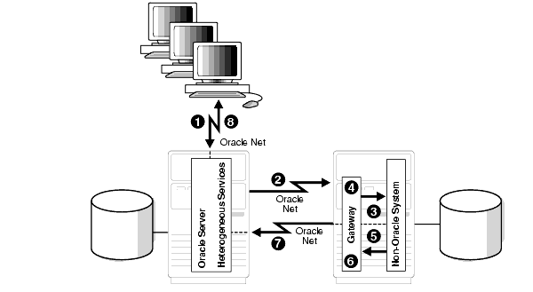

There are a sequence of events that occur when a client application queries the non-Oracle database system through the gateway.

Figure 2-3 shows a typical gateway process flow.

Figure 2-3 Gateway Process Flow

[Description of "Figure 2-3 Gateway Process Flow"](img_text/heter010.md)

1.  The client application sends a query using Oracle Net to Oracle Database.

2.  Heterogeneous Services and the gateway convert the SQL statement into a SQL statement understood by the non-Oracle system.

3.  Oracle Database sends the query to the gateway using Oracle Net.

4.  For the first transaction in a session, the gateway logs in to the non-Oracle system using a user name and password that is valid in the non-Oracle system.

5.  The gateway retrieves data using SQL statements understood by the non-Oracle system.

6.  The gateway converts retrieved data into a format compatible with Oracle Database.

7.  The gateway returns query results to Oracle Database, again using Oracle Net Services.

8.  Oracle Database passes the query results to the client application using Oracle Net Services. The database link remains open until the gateway session finished, or the client explicitly closes the database link.

**Parent topic:** [The Role of the Heterogeneous Services Component](heterogeneous-services-role.md)
