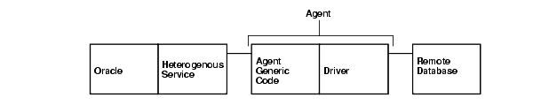

The Heterogeneous Services component in Oracle Database communicates with a Heterogeneous Services agent process which, in turn, communicates with the non-Oracle system.

Figure 2-1 presents the structure of the process architecture for Oracle heterogeneous connectivity.

Figure 2-1 Oracle Heterogeneous Connectivity Process Architecture

[Description of "Figure 2-1 Oracle Heterogeneous Connectivity Process Architecture"](img_text/heter006.md)

The code can be conceptually divided into three parts:

- The Heterogeneous Services component in Oracle Database

  This module performs most of the processing related to heterogeneous connectivity.

- Agent generic code

  This is code in the agent that is generic to all Heterogeneous Services products. This code communicates with the database and provides multithreading support.

- The driver

  This module communicates with the non-Oracle system. It is used to map calls from the Heterogeneous Services to the native application programming interface (API) of the non-Oracle system, and it is not specific to Oracle systems.

**Parent topic:** [The Role of the Heterogeneous Services Component](heterogeneous-services-role.md)
