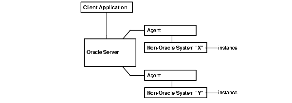

The agent uploads configuration information to the Heterogeneous Services component immediately after establishing a connection.

The configuration information is stored in Heterogeneous Services data dictionary tables. No further uploading occurs until something at the agent changes (for example, if a patch is applied or if the agent is upgraded to a new version).

- Classes and Instances
  Using Heterogeneous Services, you can access several non-Oracle systems from a single Oracle database.
- Data Dictionary Views
  The Heterogeneous Services data dictionary views contain information that can be accessed using fixed views.

**Parent topic:** [The Role of the Heterogeneous Services Component](heterogeneous-services-role.md)

### Classes and Instances

Using Heterogeneous Services, you can access several non-Oracle systems from a single Oracle database.

This is illustrated in Figure 2-2, which shows two non-Oracle systems being accessed.

Figure 2-2 Accessing Multiple Non-Oracle Instances

[Description of "Figure 2-2 Accessing Multiple Non-Oracle Instances"](img_text/accessing-multiple-non-oracle-instances.md)

Both agents upload configuration information, which is stored as part of the Heterogeneous Services data dictionary information on Oracle Database.

Although it is possible to store data dictionary information at one level of granularity by having completely separate definitions in the Heterogeneous Services data dictionary for each individual instance, this can lead to an unnecessarily large amount of redundant data dictionary information. To avoid this, Oracle organizes the Heterogeneous Services data dictionary by two levels of granularity, called class and instance.

A class pertains to a specific type of non-Oracle system. For example, you may want to access the class of Sybase database systems with Oracle Database. An instance defines specializations within a class. For example, you may want to access several separate instances within a Sybase database system. Each class definition (one level of granularity) is shared by all the particular instances (a second level of granularity) under that class. Further, instance information takes precedence over class information, and class information takes precedence over server-supplied defaults.

For example, suppose that Oracle Database accesses three instances of Sybase and two instances of Ingres II. Sybase and Ingres II each have their own code, requiring separate class definitions for Oracle Database to access them. The Heterogeneous Services data dictionary therefore would contain two class definitions, one for Sybase and one for Ingres II, with five instance definitions, one for each instance being accessed by Oracle Database.

Instance-level capability and data dictionary information are session-specific and are not stored in the Heterogeneous Services data dictionary of Oracle Database. However, instance-level initialization parameters can be stored in the database.

**Parent topic:** Heterogeneous Services Data Dictionary

### Data Dictionary Views

The Heterogeneous Services data dictionary views contain information that can be accessed using fixed views.

The Heterogeneous Services data dictionary views contain the following types of information:

- Names of instances and classes uploaded into the Oracle data dictionary

- Capabilities, including SQL translations, defined for each class or instance

- Data Dictionary translations defined for each class or instance

- Initialization parameters defined for each class or instance

You can access information from the Oracle data dictionary by using fixed views. The views are categorized into three main types:

- General views

- Views used for the transaction service

- Views used for the SQL service

**Parent topic:** Heterogeneous Services Data Dictionary
