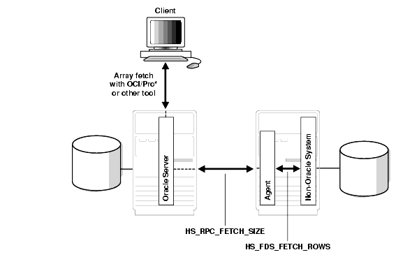

You can optimize data transfers using bulk fetch.

When an application fetches data from a non-Oracle system using Heterogeneous Services, data is transferred as follows:

- From the non-Oracle system to the agent process

- From the agent process to Oracle Database

- From Oracle Database to the application

Oracle Database optimizes all three data transfers, as illustrated in Figure 4-1.

Figure 4-1 Optimizing Data Transfers

[Description of "Figure 4-1 Optimizing Data Transfers"](img_text/heter009.md)

- Using OCI, an Oracle Precompiler, or Another Tool for Array Fetches
  You can optimize data transfers between your application and Oracle Database by using array fetches.
- Controlling the Array Fetch Between Oracle Database and the Agent
  When Oracle Database retrieves data from a non-Oracle system, the Heterogeneous Services initialization parameter, `HS_RPC_FETCH_SIZE`, defines the number of bytes sent for each fetch between the agent and Oracle Database.
- Controlling the Array Fetch Between the Agent and the Non-Oracle System
  The initialization parameter, `HS_FDS_FETCH_ROWS`, determines the number of rows to be retrieved from a non-Oracle system.
- Controlling the Reblocking of Array Fetches
  By default, an agent fetches data from the non-Oracle system until it has retrieved enough data to send back to the system. It continues until the number of bytes fetched from the non-Oracle system is equal to or higher than the value of `HS_RPC_FETCH_SIZE` initialization parameter. The agent reblocks the data between the agent and Oracle Database in sizes defined by the value of the `HS_RPC_FETCH_SIZE` initialization parameter.

**Parent topic:** [Using Heterogeneous Services Agents](using-heterogeneous-services-agents.md)

### Using OCI, an Oracle Precompiler, or Another Tool for Array Fetches

You can optimize data transfers between your application and Oracle Database by using array fetches.

See your application development tool documentation for information about array fetching and how to specify the amount of data to be sent for each network round-trip.

**Parent topic:** Optimizing Data Transfers Using Bulk Fetch

### Controlling the Array Fetch Between Oracle Database and the Agent

When Oracle Database retrieves data from a non-Oracle system, the Heterogeneous Services initialization parameter, `HS_RPC_FETCH_SIZE`, defines the number of bytes sent for each fetch between the agent and Oracle Database.

The agent fetches data from the non-Oracle system until one of the following occurs:

- It has accumulated the specified number of bytes to send back to Oracle Database.

- The last row of the result set is fetched from the non-Oracle system.

**Parent topic:** Optimizing Data Transfers Using Bulk Fetch

### Controlling the Array Fetch Between the Agent and the Non-Oracle System

The initialization parameter, `HS_FDS_FETCH_ROWS`, determines the number of rows to be retrieved from a non-Oracle system.

Note that the array fetch must be supported by the agent. See your agent-specific documentation to ensure that your agent supports array fetching.

**Parent topic:** Optimizing Data Transfers Using Bulk Fetch

### Controlling the Reblocking of Array Fetches

By default, an agent fetches data from the non-Oracle system until it has retrieved enough data to send back to the system. It continues until the number of bytes fetched from the non-Oracle system is equal to or higher than the value of `HS_RPC_FETCH_SIZE` initialization parameter. The agent reblocks the data between the agent and Oracle Database in sizes defined by the value of the `HS_RPC_FETCH_SIZE` initialization parameter.

When the non-Oracle system supports array fetches, you can immediately send the data fetched from the non-Oracle system by the array fetch to Oracle Database without waiting until the exact value of the `HS_RPC_FETCH_SIZE` initialization parameter is reached. You can stream the data from the non-Oracle system to Oracle Database and disable reblocking by setting the value of the `HS_RPC_FETCH_REBLOCKING` initialization parameter to `OFF`.

For example, assume that you set `HS_RPC_FETCH_SIZE` to 64 kilobytes (KB) and `HS_FDS_FETCH_ROWS` to 100 rows. Also assume that each row is approximately 600 bytes in size, so that the 100 rows are approximately 60 KB. When the `HS_RPC_FETCH_REBLOCKING` initialization parameter is set to `ON`, the agent starts fetching 100 rows from the non-Oracle system.

Because there is only 60 KB of data in the agent, the agent does not send the data back to Oracle Database. Instead, the agent fetches the next 100 rows from the non-Oracle system. Because there is now 120 KB of data in the agent, the first 64 KB can be sent back to Oracle Database.

Now there is 56 KB of data left in the agent. The agent fetches another 100 rows from the non-Oracle system before sending the next 64 KB of data to Oracle Database. By setting the `HS_RPC_FETCH_REBLOCKING` initialization parameter to `OFF`, the first 100 rows are immediately sent back to the Oracle database server.

**Parent topic:** Optimizing Data Transfers Using Bulk Fetch
