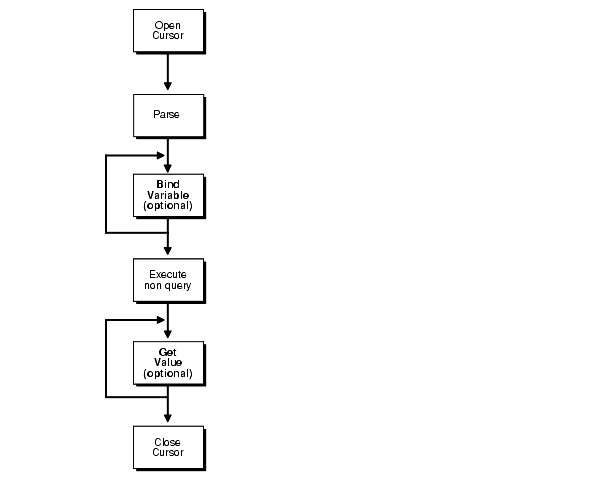
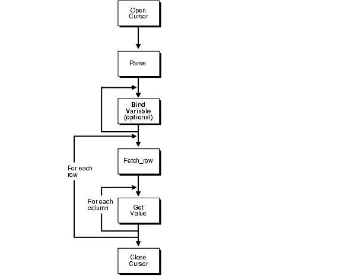

The passthrough SQL feature enables you to send a statement directly to a non-Oracle system without first being interpreted by Oracle Database.

This feature can be useful if the non-Oracle system allows for operations in statements for which there is no equivalent in Oracle.

- DBMS_HS_PASSTHROUGH Package
  You can execute passthrough SQL statements directly on the non-Oracle system using the PL/SQL package `DBMS_HS_PASSTHROUGH`.
- Implications of Using Passthrough SQL
  When you execute a passthrough SQL statement that implicitly commits or rolls back a transaction in a non-Oracle system, the transaction is affected.
- Executing Passthrough SQL Statements
  This section describes the functions and procedures provided by the `DBMS_HS_PASSTHROUGH` package that enable you to execute passthrough SQL statements.

**Parent topic:** [Features of Oracle Database Gateways](oracle-database-gateways-features.md)

### DBMS_HS_PASSTHROUGH Package

You can execute passthrough SQL statements directly on the non-Oracle system using the PL/SQL package `DBMS_HS_PASSTHROUGH`.

Any statement executed with this package is executed in the same transaction as standard SQL statements.

The `DBMS_HS_PASSTHROUGH` package is a virtual package. It conceptually resides on the non-Oracle system. In reality, however, calls to this package are intercepted by Heterogeneous Services and are mapped to one or more Heterogeneous Services calls. The driver then maps these Heterogeneous Services calls to the API of the non-Oracle system. The client application invokes the procedures in the package through a database link in the same way as it would invoke a non-Oracle system stored procedure. The special processing done by Heterogeneous Services is transparent to the user.

**See Also:**

[Oracle Database PL/SQL Packages and Types Reference ](../arpls/DBMS_HS_PASSTHROUGH.md)for more information about this package

**Parent topic:** Passthrough SQL

### Implications of Using Passthrough SQL

When you execute a passthrough SQL statement that implicitly commits or rolls back a transaction in a non-Oracle system, the transaction is affected.

For example, some systems implicitly commit the transaction containing a data definition language (DDL) statement. Because Oracle Database is bypassed, Oracle Database is unaware that a transaction was committed in the non-Oracle system. Consequently, the data at the non-Oracle system can be committed, while the transaction in Oracle Database is not.

If the transaction in Oracle Database is rolled back, data inconsistencies between Oracle Database and the non-Oracle system can occur. This situation results in global data inconsistency.

Note that if the application executes a typical `COMMIT` statement, Oracle Database can coordinate the distributed transaction with the non-Oracle system. The statement executed with the passthrough facility is part of the distributed transaction.

**Parent topic:** Passthrough SQL

### Executing Passthrough SQL Statements

This section describes the functions and procedures provided by the `DBMS_HS_PASSTHROUGH` package that enable you to execute passthrough SQL statements.

Table 3-1 DBMS_HS_PASSTHROUGH Functions and Procedures

| Procedure/Function    | Description                                                                        |
|:----------------------|:-----------------------------------------------------------------------------------|
| `OPEN_CURSOR`         | Opens a cursor.                                                                    |
| `CLOSE_CURSOR`        | Closes a cursor.                                                                   |
| `PARSE`               | Parses the statement.                                                              |
| `BIND_VARIABLE`       | Binds `IN` variables.                                                              |
| `BIND_OUT_VARIABLE`   | Binds `OUT` variables.                                                             |
| `BIND_INOUT_VARIABLE` | Binds `IN OUT` variables.                                                          |
| `EXECUTE_NON_QUERY`   | Executes a nonquery statement.                                                     |
| `EXECUTE_IMMEDIATE`   | Executes a nonquery statement without bind variables.                              |
| `FETCH_ROW`           | Fetches rows from query.                                                           |
| `GET_VALUE`           | Retrieves column value from `SELECT` statement or retrieves `OUT` bind parameters. |

- Executing Nonqueries
  Nonqueries include the statements `INSERT`, `UPDATE`, and `DELETE` and other DDL types of statements.
- Executing Queries
  Use passthrough SQL to execute queries.

**Parent topic:** Passthrough SQL

#### Executing Nonqueries

Nonqueries include the statements `INSERT`, `UPDATE`, and `DELETE` and other DDL types of statements.

To execute nonquery statements, use the `EXECUTE_IMMEDIATE` function. For example, to execute a DDL statement on a non-Oracle system that you can access using the database link `salesdb`, enter the following:

    DECLARE
      num_rows INTEGER;

    BEGIN
      num_rows := DBMS_HS_PASSTHROUGH.EXECUTE_IMMEDIATE@salesdb
                ('CREATE TABLE dept1 (n SMALLINT, loc CHARACTER(10))');
    END;

The variable `num_rows` is assigned the number of rows affected by the statements that were executed. For DDL statements, zero is returned. Note that you cannot execute a query with `EXECUTE_IMMEDIATE` function and you cannot use bind variables.

- Overview of Bind Variables
  Bind variables let you use the same SQL statement multiple times with different values, reducing the number of times a SQL statement needs to be parsed.
- IN Bind Variables
  The syntax of the non-Oracle system determines how a statement specifies a `IN` bind variable.
- OUT Bind Variables
  The non-Oracle system can support `OUT` bind variables.
- IN OUT Bind Variables
  A bind variable can be both an `IN` and an `OUT` variable.

**Parent topic:** Executing Passthrough SQL Statements

##### Overview of Bind Variables

Bind variables let you use the same SQL statement multiple times with different values, reducing the number of times a SQL statement needs to be parsed.

For example, when you insert four rows in a table, you can parse the SQL statement once, and bind and execute the SQL statement for each row. One SQL statement can have zero or more bind variables.

To execute passthrough SQL statements with bind variables, you must:

1.  Open a cursor.

2.  Parse the SQL statement on the non-Oracle system.

3.  Bind the variables.

4.  Execute the SQL statement on the non-Oracle system.

5.  Close the cursor.

Figure 3-1 shows the flow diagram for executing nonqueries with bind variables.

Figure 3-1 Flow Diagram for Nonquery Passthrough SQL

[Description of "Figure 3-1 Flow Diagram for Nonquery Passthrough SQL"](img_text/heter007.md)

**Parent topic:** Executing Nonqueries

##### IN Bind Variables

The syntax of the non-Oracle system determines how a statement specifies a `IN` bind variable.

For example, on an Oracle system you define bind variables with a preceding colon. For example:

    ...
    UPDATE emp
    SET sal=sal*1.1
    WHERE ename=:ename;
    ...

In this statement`,` `ename` is the bind variable. On non-Oracle systems, you may need to specify bind variables with a question mark. For example:

    ...
    UPDATE emp
    SET sal=sal*1.1
    WHERE ename= ?;
    ...

In the bind variable step, you must positionally associate host program variables (in this case, PL/SQL) with each of these bind variables. For example, to execute the preceding statement, use the following PL/SQL program:

    DECLARE
      c INTEGER;
      nr INTEGER;
    BEGIN
      c := DBMS_HS_PASSTHROUGH.OPEN_CURSOR@salesdb;
      DBMS_HS_PASSTHROUGH.PARSE@salesdb(c,
            'UPDATE emp SET SAL=SAL*1.1 WHERE ename=?');
      DBMS_HS_PASSTHROUGH.BIND_VARIABLE@salesdb(c,1,'JONES');
      nr:=DBMS_HS_PASSTHROUGH.EXECUTE_NON_QUERY@salesdb(c);
      DBMS_OUTPUT.PUT_LINE(nr||' rows updated');
      DBMS_HS_PASSTHROUGH.CLOSE_CURSOR@salesdb(c);
    END;

**Parent topic:** Executing Nonqueries

##### OUT Bind Variables

The non-Oracle system can support `OUT` bind variables.

With `OUT` bind variables, the value of the bind variable is not known until after the execution of the SQL statement.

Although `OUT` bind variables are populated after executing the SQL statement, the non-Oracle system must know that the particular bind variable is an `OUT` bind variable before the SQL statement is executed. You must use the `BIND_OUT_VARIABLE` procedure to specify that the bind variable is an `OUT` bind variable.

After executing the SQL statement, you can retrieve the value of the `OUT` bind variable using the `GET_VALUE` procedure.

**Parent topic:** Executing Nonqueries

##### IN OUT Bind Variables

A bind variable can be both an `IN` and an `OUT` variable.

This means that the value of the bind variable must be known before executing the SQL statement, but you can change the value after the SQL statement is executed.

For `IN OUT` bind variables, you must use the `BIND_INOUT_VARIABLE` procedure to provide a value before executing the SQL statement. After executing the SQL statement, you must use the `GET_VALUE` procedure to retrieve the new value of the bind variable.

**Parent topic:** Executing Nonqueries

#### Executing Queries

Use passthrough SQL to execute queries.

The difference between queries and nonqueries is that queries retrieve a result set from a `SELECT` statement. The result set is retrieved by using a cursor.

Figure 3-2 illustrates the steps in a passthrough SQL query. After the system parses the `SELECT` statement, each row of the result set can be retrieved with the `FETCH_ROW` procedure. After the row is retrieved, use the `GET_VALUE` procedure to retrieve the selected list of items into program variables. After all rows are retrieved, you can close the cursor.

Figure 3-2 Passthrough SQL for Queries

[Description of "Figure 3-2 Passthrough SQL for Queries"](img_text/heter008.md)

You do not have to retrieve all the rows. You can close the cursor at any time after opening the cursor.

**Note:**

Although you are retrieving one row at a time, Heterogeneous Services optimizes the round-trips between Oracle Database and the non-Oracle system by buffering multiple rows and fetching from the non-Oracle data system in one round-trip.

The following example executes a query:

    DECLARE
       val  VARCHAR2(100);
       c    INTEGER;
       nr   INTEGER;
    BEGIN
      c := DBMS_HS_PASSTHROUGH.OPEN_CURSOR@salesdb;
      DBMS_HS_PASSTHROUGH.PARSE@salesdb(c,
        'select ENAME
         from   EMP
         where  DEPTNO=10');
      LOOP
        nr := DBMS_HS_PASSTHROUGH.FETCH_ROW@salesdb(c);
        EXIT WHEN nr = 0;
        DBMS_HS_PASSTHROUGH.GET_VALUE@salesdb(c, 1, val);
        DBMS_OUTPUT.PUT_LINE(val);
      END LOOP;
      DBMS_HS_PASSTHROUGH.CLOSE_CURSOR@salesdb(c);
    END;

After the `SELECT` statement has been parsed, the rows are fetched and printed in a loop until the `FETCH_ROW` function returns the value `0`.

**Parent topic:** Executing Passthrough SQL Statements
