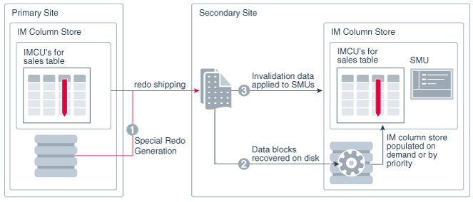

This chapter explains how Database In-Memory feature works in an Oracle Active Data Guard environment.

### 13.1 About Database In-Memory and Active Data Guard

Starting in Oracle Database 12c Release 2 (12.2.0.1), Oracle Database In-Memory is supported in an Oracle Active Data Guard environment using Oracle Engineered Systems or Oracle Cloud Platform as a Service.

**See Also:**

[Oracle Data Guard Concepts and Administration](../sbydb/introduction-to-oracle-data-guard-concepts.md) for an introduction to Oracle Active Data Guard

#### 13.1.1 Purpose of IM Column Stores in Oracle Active Data Guard

You can configure an IM column store only on the primary database, only on a standby database, or on both the primary and standby databases.

If you configure an IM column store for both databases, then you can populate the same or a different set of objects on the two instances. This technique effectively increases the IM column store size.

##### 13.1.1.1 Identical IM Column Stores in Primary and Standby Databases

In the simplest scenario, the primary and standby databases both contain an IM column store with the same size (which is not required). The IM column stores contain the same objects.

The advantage of this scenario is that analytic queries can access the IM column store on either database. Therefore, you can direct analytic queries to the standby database and not consume resources on the primary database. As a result, the primary database can support the transactional workload, while the standby database supports the analytic workload.

The primary tasks are as follows:

- Set the `INMEMORY_SIZE` initialization parameter on both the primary and standby database instances.

- Ensure that the `INMEMORY_ADG_ENABLED` initialization parameter is set to `TRUE` (default) on the standby database instance.

- Set the `INMEMORY` attribute on all objects to be populated in the two IM column stores.

If you change the `INMEMORY` attributes of an object, then the primary database propagates the change to the standby database. For example, if you set the `NO INMEMORY` attribute on the `sales` table, then both IM column stores evict `sales`.

On the primary database, you can enable a subset of columns of a table for population into the IM column store. You can also specify different compression levels for different columns. Enabling specific columns involves a dictionary change. DDL on the primary database is propagated to the Oracle Active Data Guard database.

**See Also:**

- "[Enabling the IM Column Store for a Database](enabling-the-im-column-store.md)"

- [Oracle Database SQL Language Reference](../sqlrf/CREATE-TABLE.md) for information about the `CREATE TABLE` statement

- [Oracle Database Reference](../refrn/INMEMORY_SIZE.md) for more information about the `INMEMORY_SIZE` and `INMEMORY_ADG_ENABLED` initialization parameters

##### 13.1.1.2 IM Column Store in Standby Database Only

In this scenario, an IM column store exists in the standby database, but not in the primary database.

In this scenario, the primary database can function as a pure OLTP database. No extra memory is required in the primary database for an IM column store. You can direct analytic reporting applications to the standby database without sacrificing performance or consuming resources on the primary database.

The primary tasks are as follows:

- Set the `INMEMORY_SIZE` initialization parameter to a non-zero value in the standby database instance, and set it to `0` in the primary database instance.

- Ensure that the `INMEMORY_ADG_ENABLED` initialization parameter is set to `TRUE` (default) on the standby database instance.

- Set the `INMEMORY` attribute with the `DISTRIBUTE FOR SERVICE` clause on all objects to be populated in the IM column store in the standby database.

  For example, if you log in to the primary database, and if you set the `INMEMORY` attribute on the `sh.sales` table, then this table will not be populated in the IM column store on the primary database—because no IM column store exists on this database. However, the standby database will inherit the `INMEMORY` attribute on the `sh.sales` table. The table will be populated in the IM column store in the standby database.

##### 13.1.1.3 Different Objects in the Primary and Standby IM Column Stores

The most flexible scenario is separately configuring the IM column stores for primary and standby databases.

The advantage of this scenario is that you can run different workloads in each database. For example, an HR application runs reports in the primary database, while a sales history application runs reports in the standby database. Thus, neither database bears the full burden of analytic reporting.

The primary tasks are as follows:

- Set the `INMEMORY_SIZE` initialization parameter to a non-zero value on the standby and primary database instance. The values do not need to be identical.

- Ensure that the `INMEMORY_ADG_ENABLED` initialization parameter is set to `TRUE` (default) on the standby database instance.

- Set the `INMEMORY ... DISTRIBUTE FOR SERVICE` clause on all objects to be populated in the two IM column stores. The [service](glossary.md) specifies the instance into which the object is populated.

##### Three-Service Configuration

In a typical configuration, you create three services: standby-only, primary-only, and primary-and-standby. For example, you may want the latest month of `sales` fact table data in the primary instance, but the previous `sales` data in the standby instance. You want the dimension tables populated in both instances. For each `sales` partition, you use `INMEMORY ... DISTRIBUTE FOR SERVICE` to specify either the standby or primary service. For each dimension table, you specify the service that includes both primary and standby database instances.

**Note:**

As long as the service name is defined for both the primary and standby instances, you can specify the same service name in `DISTRIBUTE FOR SERVICE` to populate the same tables in the primary and standby databases.

##### Oracle RAC and Oracle Active Data Guard

In Oracle RAC, you can combine the `FOR SERVICE` clause, which specifies the instance for population, with the `DISTRIBUTE AUTO` or `DISTRIBUTE BY` clause, which controls the distribution of IMCUs. However, in Oracle Active Data Guard, the `FOR SERVICE` clause specifies the primary or standby instances in which to populate the specified object: you cannot use `DISTRIBUTE AUTO` or `DISTRIBUTE BY` to distribute IMCUs between the primary and standby instances. For example, you cannot divide the population of the `sales` table between the primary instance and standby instance, so that half the IMCUs are in the primary instance and half the IMCUs are in the standby instance.

**See Also:**

- "[Object-Level Service Controls](deploying-in-memory-in-oracle-rac.md)"

- [Oracle Database SQL Language Reference](../sqlrf/CREATE-TABLE.md) to learn more about the `DISTRIBUTE FOR SERVICE` subclause

#### 13.1.2 How IM Column Stores Work in Oracle Active Data Guard

In an Oracle Active Data Guard environment, the object-level `PRIORITY` attribute governs population. An object is only populated in the database instances on which the service is active.

Population is either on-demand or priority-based, depending on the `PRIORITY` value. When a role change or switchover occurs, the database repopulates the tables according to the set of database instances to which the service is newly mapped.

The following graphic illustrates the internal mechanism for updating a standby database with redo from the primary database.

Figure 13-1 Updating a Standby Database

[Description of "Figure 13-1 Updating a Standby Database"](img_text/inmem_3v_019.md)

The process is as follows:

1.  The primary database generates redo, and then transfers the redo to the standby database.

    The redo generated on the primary database for all DML statements includes metadata indicating whether the change is to an `INMEMORY` object.

2.  The standby database applies the redo to the data blocks stored in disk.

    As the standby database applies redo generated from ongoing operations on the primary database, the standby database keeps them transactionally consistent.

3.  If an `INMEMORY` object is modified, then the standby database invalidates the modified rows just as it does on the primary database, using the [transaction journal](glossary.md) and [Snapshot Metadata Unit (SMU)](glossary.md) to track the changes.

The [repopulation](glossary.md) mechanism works the same way in a standby database as it does in a primary database. When sufficient DML occurs on an object to reach an internal threshold, the standby database repopulates the object in the IM column store.

**See Also:**

- "[About Repopulation of the IM Column Store](repopulation-and-dml.md)"

- "[About Join Groups](optimizing-queries-with-join-groups.md)"

- [Oracle Data Guard Concepts and Administration](../sbydb/configuring-data-guard-standby-databases-in-oracle-RAC.md) to learn more about multi-instance redo apply

#### 13.1.3 In-Memory Restrictions in Active Data Guard

Most In-Memory features are supported in Active Data Guard.

Standby databases do not support the following In-Memory features:

- IM FastStart

- Join groups

- IM expression capture

- Heat Map (which reflects the primary database only)

Data Guard Multi-Instance Redo Apply is supported for the IM column store on an Active Data Guard standby database, but only when the initialization parameter `ENABLE_IMC_WITH_MIRA` is set to `TRUE`. By default, `ENABLE_IMC_WITH_MIRA` is `FALSE`.

**See Also:**

[Oracle Database Reference](../refrn/ENABLE_IMC_WITH_MIRA.md) to learn more about `ENABLE_IMC_WITH_MIRA`

### 13.2 Configuring IM Column Stores in an Oracle Active Data Guard Environment

Configuring IM column stores in Oracle Active Data Guard requires setting `INMEMORY_SIZE`, and setting the `INMEMORY` attribute appropriately for the objects to be populated.

This task assumes knowledge of Oracle Active Data Guard concepts and procedures.

#### Prerequisites

You must meet the following requirements:

- The standby database must run on an Oracle Engineered System or in Oracle Cloud Platform as a Service.

- The `COMPATIBLE` initialization parameter must be `12.2.0` or greater.

- To populate different objects in each database, configure the appropriate services.

#### To configure IM column stores in an Oracle Active Data Guard environment:

1.  Set the `INMEMORY_SIZE` initialization parameter on the database instances that will contain an IM column store.

    Follow these guidelines:

    - To configure IM column stores on the primary and standby databases, set `INMEMORY_SIZE` on both database instances.

    - To configure IM column stores on the standby database only, set `INMEMORY_SIZE` on the standby database instance.

2.  Ensure that the `INMEMORY_ADG_ENABLED` initialization parameter is set to `TRUE` (default) on the standby database instance.

3.  Optionally, if you want to enable Multi-Instance Redo Apply with the IM column store, set the `ENABLE_IMC_WITH_MIRA` initialization parameter to `TRUE`.

4.  On the primary database, execute DDL statements with the `INMEMORY` attribute.

    The task depends on where the IM column stores exist, and in which IM column stores you want the objects to be populated:

    - To populate an object on the standby database only, then set the `INMEMORY` attribute with a `DISTRIBUTE FOR SERVICE` clause that specifies a valid service running only on the standby database.

      During redo transfer, the standby database receives this DDL statement from the primary database. Population occurs on the standby database in the normal way. For example, if `sales` has the `INMEMORY` attribute and priority `NONE`, then the table must undergo a full scan for population to occur.

    - To populate an object on the primary database only, then set the `INMEMORY` attribute with a `DISTRIBUTE FOR SERVICE` clause that specifies a valid service running only on the primary database.

    - To populate an object on both primary and standby databases, then perform one of the following actions:

      - Do not set the `DISTRIBUTE FOR SERVICE` clause.

      - Set `DISTRIBUTE FOR SERVICE ``servicename`, where `servicename` is a service that is running on both the primary and standby databases.

      - Set `DISTRIBUTE FOR SERVICE DEFAULT` so that the object is eligible for population on all instances specified with the `PARALLEL_INSTANCE_GROUP` initialization parameter.

      - Set `DISTRIBUTE FOR SERVICE ALL` so that the object is eligible for population on all instances, regardless of the setting of the `PARALLEL_INSTANCE_GROUP` initialization parameter.

      Population of an object occurs on the primary or standby database according to the priority setting. For example, if `sales` on the standby database has priority `NONE`, then a query of the standby database that triggers a full scan of `sales` populates this table in the standby IM column store.

      **Note:**

      A full scan of `sales` on the standby database does not populate this table in the IM column store in the primary database.

**See Also:**

- "[Prioritization of In-Memory Population](populating-objects-in-memory.md)"

- [Oracle Data Guard Concepts and Administration](../sbydb/managing-oracle-data-guard-physical-standby-databases.md)

- [Oracle Database SQL Language Reference](../sqlrf/CREATE-TABLE.md) to learn more about the `DISTRIBUTE FOR SERVICE` subclause

- [Oracle Database Reference](../refrn/INMEMORY_SIZE.md) for more information about the `INMEMORY_SIZE`, `INMEMORY_ADG_ENABLED`, and `ENABLE_IMC_WITH_MIRA` initialization parameters
