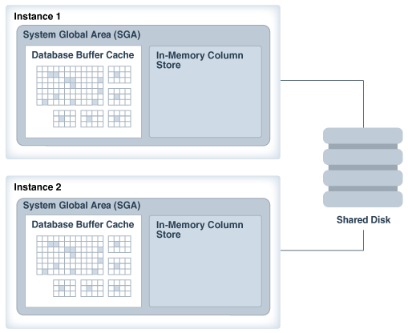
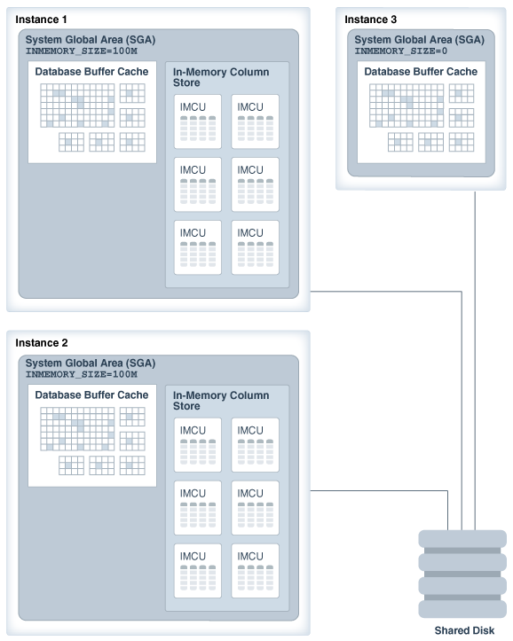
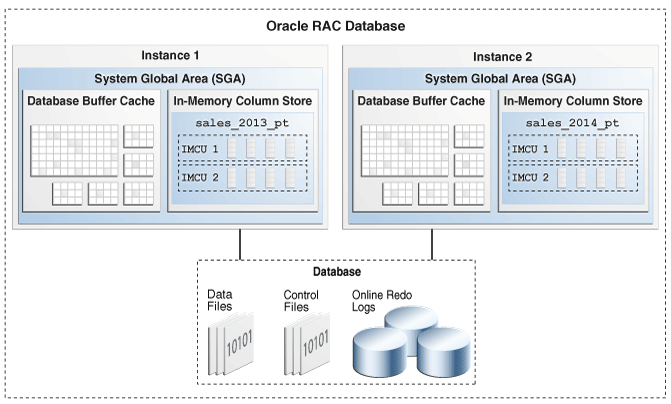
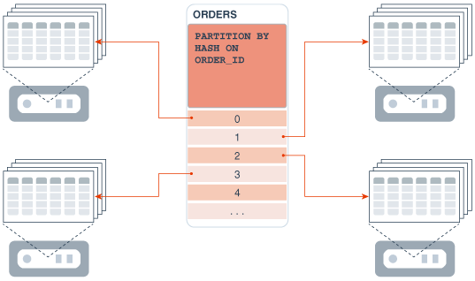
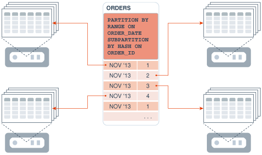
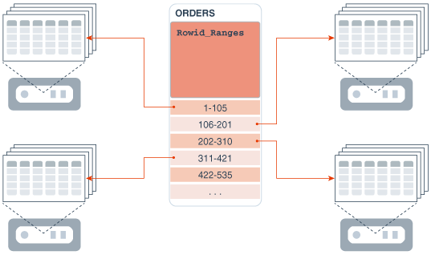
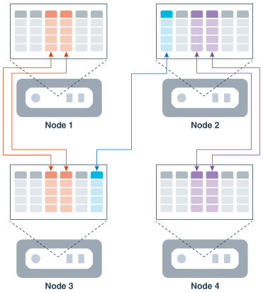
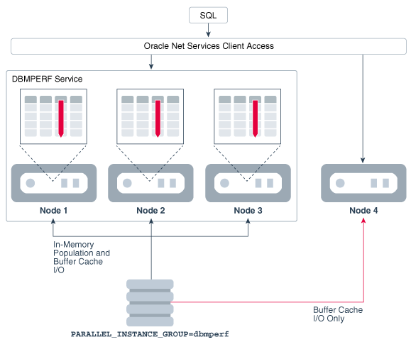

This chapter explains how to enable IM column stores in an Oracle Real Application Clusters (Oracle RAC) environment, and configure objects for population.

This section contains the following topics:

### 12.1 Overview of Database In-Memory and Oracle RAC

Every Oracle RAC node has its own In-Memory (IM) column store. By default, populated objects are distributed across all IM column stores in the cluster.

Oracle recommends that you size the IM column stores equally on every Oracle RAC node. If an Oracle RAC node does not require an IM column store, then set the `INMEMORY_SIZE` parameter to `0`.

It is possible to have completely different objects populated on every node, or to have larger objects distributed across all of the IM column stores in the cluster. On Oracle Engineered Systems, it is also possible for the same objects to appear in the IM column store on every node. The distribution of objects across the IM column stores in a cluster is controlled by two subclauses to the `INMEMORY` attribute: `DISTRIBUTE` and `DUPLICATE`.

In an Oracle RAC environment, an object that only has the `INMEMORY` attribute specified is automatically distributed across the IM column stores in the cluster. You can use the `DISTRIBUTE` clause to specify how an object is distributed across the cluster. By default, the type of partitioning used (if any) determines how the object is distributed. If the object is not partitioned, then it is distributed by rowid range. Alternatively, you can specify the `DISTRIBUTE` clause to override the default behavior.

On an Oracle Engineered System, you can duplicate or mirror populated objects across the IM column stores in the cluster. This technique provides the highest level of redundancy. The `DUPLICATE` clause controls how an object is duplicated. If you specify only `DUPLICATE`, then one mirrored copy of the data is distributed across the IM column stores in the cluster. To duplicate the entire object in each IM column store, specify `DUPLICATE ALL`.

**Note:**

When you deploy Oracle RAC on a non-Engineered System, the `DUPLICATE` clause is treated as `NO DUPLICATE`.

#### 12.1.1 Multiple IM Column Stores

In Oracle RAC, each database instance has its own IM column store.

Conceptually, the IM column store in Oracle RAC environment uses a shared-nothing architecture. On each database instance, you size and manage the IM column stores separately. The database instances do not use Cache Fusion to transfer IMCUs back and forth.

Figure 12-1 IM Column Stores in an Oracle RAC Database

This figure shows a two-node Oracle RAC cluster. Each instance has a separately configured IM column store.

[Description of "Figure 12-1 IM Column Stores in an Oracle RAC Database"](img_text/inmem_3v_030.md)

Oracle recommends that you set the size of the IM column stores on every Oracle RAC node to an equal value. For example, you might assign every IM column store 100 GB of memory. For any node that does not require an IM column store, set the `INMEMORY_SIZE` initialization parameter on this node to 0.

Figure 12-2 Three-Node Oracle RAC Database with Two IM Column Stores

In this example, instance 1 and instance 2 both have IM column stores. Instance 3 does not require an IM column store, so the `INMEMORY_SIZE` initialization parameter on this node is set to 0.

[Description of "Figure 12-2 Three-Node Oracle RAC Database with Two IM Column Stores"](img_text/inmem_3v_026.md)

**See Also:**

- "[Enabling the IM Column Store for a Database](enabling-the-im-column-store.md)"

- [Oracle Database Reference](../refrn/INMEMORY_SIZE.md) for more information about the `INMEMORY_SIZE` initialization parameter

- [Oracle Real Application Clusters Administration and Deployment Guide](../racad/introduction-to-oracle-rac.md) for an introduction to Oracle RAC

#### 12.1.2 Distribution and Duplication of Columnar Data in Oracle RAC

When `INMEMORY` is specified, the `DISTRIBUTE` and `DUPLICATE` keywords control the distribution of objects.

Oracle RAC provides multiple distribution options. You can have different objects populated on each node, or have larger objects distributed across all IM column stores in the Oracle RAC cluster. You can also have the same objects populated in the IM column store on every node (Oracle Engineered Systems only).

**Note:**

If a table is currently populated in the IM column store, and if you change any `INMEMORY` attribute of the table other than `PRIORITY`, then the database evicts the table from the IM column store. The repopulation behavior depends on the `PRIORITY` setting.

This section contains the following topics:

##### 12.1.2.1 Distribution of Columnar Data in Oracle RAC

The `DISTRIBUTE` clause of `INMEMORY` controls how table data in the IM column store is distributed across Oracle RAC instances.

When the default option of `AUTO` is set, the Oracle RAC instances distribute data automatically. While populating a segment, Space Management Slave Processes (Wnnn) processes attempt to put an equal amount of data on each instance. Distribution depends on access patterns and object size. Alternatively, you can manually specify how the database must distribute partitions, subpartitions, or rowid ranges across instances.

Equal data distribution is important for performance. The goal is for parallel query processes to work on equal data set sizes so that they all finish in the minimum amount of time. If data distribution is skewed, then a long-running process delays the completion of the query.

If an Oracle RAC instance fails, then the IMCUs on the failed instance are unavailable. Consequently, a query that needs data stored in the inaccessible IMCUs must read it from somewhere else: the database buffer cache, flash storage, disk, or mirrored IMCUs in other IM column stores.

The `DBA_TABLES.INMEMORY_DISTRIBUTE` column indicates how IMCUs are distributed. When the `AUTO` option is set, the column value is `AUTO-DISTRIBUTE`.

Example 12-1 Default Distribution

This example shows the database distributing a `sales` table that contains only partitions: `sales_2013_pt` and `sales_2014_pt`. The database automatically places the `sales_2013_pt` partition in Instance 1, and `sales_2014_pt` in Instance 2.

Figure 12-3 Automatic In-Memory Distribution in Oracle RAC

[Description of "Figure 12-3 Automatic In-Memory Distribution in Oracle RAC"](img_text/cncpt_vm_387.md)

This section contains the following topics:

**See Also:**

- "[Space Management Worker Processes (Wnnn)](in-memory-column-store-architecture.md)"

- [Oracle Real Application Clusters Administration and Deployment Guide](../racad/introduction-to-oracle-rac.md) to learn how to manage the IM column store on Oracle RAC

- [Oracle Database SQL Language Reference](../sqlrf/CREATE-TABLE.md) to learn more about the `DISTRIBUTE` clause

- [Oracle Database Reference](../refrn/background-processes.md) to learn about the Wnnn background processes

###### 12.1.2.1.1 Distribution by Partition

You can use the `DISTRIBUTE BY PARTITION` clause to distribute data in partitions to different Oracle RAC instances.

This technique is ideal for hash partitions. For example, to distribute partitions in the `orders` table equally, you could partition by hash on the `order_id` column. As shown in the following figure, Oracle Database distributes partitions among four instances by hashing on the `order_id` column.

Figure 12-4 Distributing Partitions by Hash

[Description of "Figure 12-4 Distributing Partitions by Hash"](img_text/inmem_3v_028.md)

This technique is suitable for other partitioning schemes when the partitions are uniformly accessed. The `DISTRIBUTE BY PARTITION` clause also supports partition-wise joins.

**Note:**

If your partitioned strategy results in a large data skew, that is, one partition is much larger than the others, then Oracle recommends that you override the default distribution (`BY PARTITION`) by manually specifying `DISTRIBUTE BY ROWID RANGE`.

**See Also:**

- [Oracle Database SQL Language Reference](../sqlrf/CREATE-TABLE.md) to learn more about the `DISTRIBUTE BY PARTITION` subclause

- [Oracle Database VLDB and Partitioning Guide](../vldbg/partition-intro.md) for an introduction to partitioned tables

###### 12.1.2.1.2 Distribution by Subpartition

In tables with a composite partitioning scheme, you can use the `DISTRIBUTE BY SUBPARTITION` clause to distribute data in subpartitions to different instances.

This technique is ideal for hash subpartitions. For example, to distribute partitions in the `orders` table equally, you could partition by range on the `order_date` column and by hash on the `order_id` column.

Figure 12-5 Distributing Partitions by Range and Subpartitions by Hash

[Description of "Figure 12-5 Distributing Partitions by Range and Subpartitions by Hash"](img_text/inmem_3v_027.md)

This technique is suitable for other partitioning schemes when the subpartitions are uniformly accessed. The `DISTRIBUTE BY PARTITION ... SUBPARTITION` clause also supports partition-wise joins.

**See Also:**

- [Oracle Database VLDB and Partitioning Guide](../vldbg/partition-concepts.md) to learn more about composite partitioning

- [Oracle Database SQL Language Reference](../sqlrf/CREATE-TABLE.md) to learn more about the `DISTRIBUTE BY PARTITION ... SUBPARTITION` subclause

###### 12.1.2.1.3 Distribution by Rowid Range

You can use the `DISTRIBUTE BY ROWID RANGE` clause to distribute data in specific ranges of rowids to different Oracle RAC instances.

This technique distributes IMCUs by uniform hash on the first rowid. For example, Oracle Database might distribute rows 1-105 in the `orders` table to one database instance, rows 106-121 to a different instance, and so on.

Figure 12-6 Distribution by Rowid Range

[Description of "Figure 12-6 Distribution by Rowid Range"](img_text/inmem_3v_029.md)

The rowid distribution technique is most useful for nonpartitioned tables. However, if your partitioned strategy results in a large data skew, for example, one partition is much larger than the others, then Oracle recommends overriding the default distribution (`BY PARTITION`) by manually specifying `DISTRIBUTE BY ROWID RANGE`.

**See Also:**

[Oracle Database SQL Language Reference](../sqlrf/CREATE-TABLE.md) to learn more about the `DISTRIBUTE BY ROWID RANGE` subclause

##### 12.1.2.2 Duplication of Columnar Data in Oracle RAC

The `DUPLICATE` clause controls how an Oracle RAC database duplicates columnar data across Oracle RAC instances.

**Note:**

The `DUPLICATE` clause is only available with Oracle RAC on an Oracle Engineered System. When Oracle RAC does not run on an Oracle Engineered System, the `DUPLICATE` clause is functionally equivalent to `NO DUPLICATE`.

To provide IM column store fault tolerance, you may choose to mirror the IMCUs. With [IMCU mirroring](glossary.md), the same IMCU resides in multiple IM column stores. This technique is analogous to storage mirroring.

Figure 12-7 Duplication of IMCUs in Oracle RAC

[Description of "Figure 12-7 Duplication of IMCUs in Oracle RAC"](img_text/inmem_3v_025.md)

Using the `DUPLICATE` clause to mirror data at the tablespace or object (table, partition, or subpartition) level provides the following benefits:

- Provides fault tolerance because if one node fails, then the mirrored columnar data is accessible from a different node

- Improves performance because queries can access data locally, thus avoiding buffer cache or disk access

  For example, in a star query, the fact table might be partitioned, whereas the dimension tables use `DUPLICATE ALL`. In this scenario, all joins take place fully on the local nodes.

- Enhances manageability because you can duplicate a subset of objects

  For example, you can duplicate this year’s partitions while leaving others partitions from the same table not duplicated.

A disadvantage of IMCU mirroring is that when an object is duplicated n times, its memory requirements increase by a factor of n. For example, a 500 MB table that is duplicated in 4 instances occupies a total of 2000 MB of memory.

This section contains the following topics:

**See Also:**

[Oracle Database SQL Language Reference](../sqlrf/CREATE-TABLE.md) to learn more about the `DUPLICATE` clause

###### 12.1.2.2.1 DUPLICATE Clause in Oracle RAC

The `DUPLICATE` clause specifies that the database maintain a copy of every IMCU in a second database instance. Thus, the same segment is populated in exactly two Oracle RAC instances.

For each object, one IMCU is primary. A secondary IMCU resides on a different database instance. The database can use either copy to satisfy a query. If the database instance with the primary copy of the IMCU fails, then the database can use the surviving IMCU to satisfy the query.

For example, you might specify `DUPLICATE` for the partition `sales_q1_2014`. The IM column stores in instance 1 and instance 2 both have an identical copy of the data. If instance 1 terminates, then the IM column store on instance 2 can satisfy requests for `sales_q1_2014`.

**See Also:**

- "[In-Memory Compression Units (IMCUs)](in-memory-column-store-architecture.md)"

- [Oracle Database SQL Language Reference](../sqlrf/CREATE-TABLE.md) to learn more about the `DUPLICATE` clause

###### 12.1.2.2.2 DUPLICATE ALL Clause in Oracle RAC

The `DUPLICATE ALL` clause specifies that every In-Memory object is mirrored on every database instance.

This setting provides the highest level of redundancy and provides linear scalability because queries can execute completely within a single node. For example, every IMCU for the `sales` table is populated in the IM column store in instance 1, instance 2, and instance 3. Thus, any database instance can retrieve the data requested by a query of `sales`.

A consequence of the `DUPLICATE ALL` clause is that the `DISTRIBUTE` subclause has no application because all IMCUs for the object are distributed. You specify duplication at the object level, which means that not all objects in the IM column store required the `DUPLICATE ALL` clause.

The primary advantages of the `DUPLICATE ALL` technique are:

- High availability

  When you use `DUPLICATE ALL` clause for all In-Memory objects, an Oracle RAC database with n instances can sustain n-1 Oracle RAC instance failures. If you need take one database instance out of service for maintenance, then critical data is available in at least one IM column store. The only scenario in which all data is inaccessible is a failure of all database instances in the cluster.

- Performance of star queries

  If queries join smaller dimension tables to a large partitioned fact table, then you can use `DUPLICATE ALL` to mirror dimension tables in every Oracle RAC instance. The fact table is distributed by partition or subpartition. In this strategy, the IM column store in every database instance has the data necessary for a star join. This technique is analogous to a partition-wise join because the entire dimension table is populated in every IM column store.

**See Also:**

[Oracle Database SQL Language Reference](../sqlrf/CREATE-TABLE.md) to learn more about the `DUPLICATE ALL` clause

###### 12.1.2.2.3 NO DUPLICATE Clause in Oracle RAC

The default `NO DUPLICATE` clause specifies that the database maintain only one copy of an object.

For example, a three-node Oracle RAC database might store the 2012 partition of a sales table in instance 1, the 2013 partition in instance 2, and the 2014 partition in instance 3. Each table partition resides in exactly one database instance.

If an Oracle RAC node does not duplicate the columnar data, then the columnar data on the failed node is not available in the IM column store on the cluster. Queries issued against missing data do not fail. Instead, queries access the data either from the database buffer cache or permanent storage, which may negatively affect performance. If the node remains down for some time, and if space exists in the surviving IM column stores, then Oracle RAC populates the missing objects or pieces of the objects on the remaining nodes in the cluster.

**See Also:**

[Oracle Database SQL Language Reference](../sqlrf/CREATE-TABLE.md) to learn more about the `NO DUPLICATE` clause

#### 12.1.3 Parallelism in Oracle RAC

A database instance must access the IMCUs in the IM column store in which they reside. Population and access of IM column stores in Oracle RAC must occur in parallel so that all IM column stores are accessible from any instance.

##### 12.1.3.1 Serial and Parallel Queries in Oracle RAC

Database In-Memory in Oracle RAC is a shared-nothing architecture. Unless at least one parallel server process runs on every active instance, a query is not guaranteed to access all necessary data from the IM column stores.

##### Serial Queries

A serial query that runs on one node in an Oracle RAC database cannot access IMCUs in the other IM column stores. For example, a serial query running on instance 1 requests a full scan of `sales`. Some `sales` partitions are populated in the IM column store in instance 1, whereas the others are populated in the IM column store in instance 2. The query can only access the IMCUs in the IM column store on instance 1: the remaining data must come from on-disk storage.

##### Parallel Queries

When parallel execution is enabled, but the `PARALLEL_DEGREE_POLICY` initialization parameter is not set to `AUTO`, the situation is similar to the serial query case. The query coordinator runs on the database instance where the query executes. The PQ processes send data to the coordinator. In this case, the database starts multiple PQ processes. However, unless the DOP is greater than or equal to the number of IM column stores containing IMCUs populated for objects referenced in the query, not all data is accessible from the IM column store. When Auto DOP is not enabled, ensure that the DOP is at least as great as the IM column stores with IMCUs for the populated objects in the query.

##### In-Memory Dynamic Scans

Both serial and parallel queries can perform an In-Memory Dynamic Scan ([IM dynamic scan](glossary.md)) and use the [lightweight thread](glossary.md) infrastructure. The parallel execution infrastructure co-exists with the new thread infrastructure, which is dynamically managed by Oracle Database Resource Manager (the Resource Manager). The Resource Manager is enabled by default when `INMEMORY_SIZE` is greater than `0`.

A [table scan process](glossary.md) can be either a foreground process in a serial query or a parallel server process in a parallel query. When a parallel query performs an IM dynamic scan, every table scan process can own a pool of threads.

**See Also:**

- "[In-Memory Dynamic Scans](in-memory-column-store-architecture.md)"

- [Oracle Database Administrator’s Guide](../admin/managing-resources-with-oracle-database-resource-manager.md) to learn more about the Resource Manager

- [Oracle Database VLDB and Partitioning Guide](../vldbg/parallel-exec-intro.md) to learn more about parallel queries in Oracle RAC

- [Oracle Database Reference](../refrn/PARALLEL_DEGREE_POLICY.md) to learn more about the `PARALLEL_DEGREE_POLICY` initialization parameter

##### 12.1.3.2 Auto DOP in Oracle RAC

With Automatic Degree of Parallelism (Auto DOP), the optimizer performs a cost-based calculation to determine the degree of parallelism for a SQL statement.

Enable Auto DOP by setting the `PARALLEL_DEGREE_POLICY` initialization parameter to `AUTO`. When the optimizer parses a SQL statement, it estimates the execution time. It checks this estimate against the setting of the `PARALLEL_MIN_TIME_THRESHOLD` initialization parameter, which is automatically set when the IM column store is enabled. The optimizer then makes the following cost-based decision:

- If the estimated time is less than `PARALLEL_MIN_TIME_THRESHOLD`, then the statement executes serially.

- If the estimated time is greater than `PARALLEL_MIN_TIME_THRESHOLD`, then the statement executes in parallel.

  The optimizer calculates the degree of parallelism based on resource requirements. The calculation is limited by the `PARALLEL_DEGREE_LIMIT` initialization parameter and, if configured, the Database Resource Manager.

When using IM column stores in an Oracle RAC environment, the goal is to avoid disk or buffer cache access. To this end, you must guarantee that at least one parallel server process runs on every active database instance. Auto DOP is the recommended way to achieve this goal.

**Note:**

If you do not use Auto DOP, then you must ensure that the DOP is greater than or equal to the number of IM column stores containing the IMCUs required by the query.

Auto DOP guarantees an adequate distribution of processes because every shared pool stores metadata that indicates where all the IMCUs are located, how large they are, and so on. The same map is in every shared pool. No matter where the query originates in the cluster, the parallel query coordinator is aware of the [home location](glossary.md) (instance of residence) of the IMCUs.

For example, the PQ coordinator knows that the sales partitions for 2016 are in instance 1, whereas the partitions for 2015 are in instance 2. If a query running on instance 1 requests both 2015 and 2016 partitions, then the query coordinator uses the home location to determine which IM column stores to access. If the DOP has been set sufficiently high, then the coordinator automatically starts PQ processes on both instances, and the processes send the requested data back to the query coordinator.

**See Also:**

[Oracle Database VLDB and Partitioning Guide](../vldbg/inmemory-parallel-exec.md) to learn about Auto DOP

#### 12.1.4 FastStart Area in Oracle RAC

The FastStart area is shared across all Oracle RAC nodes. This feature enables maximum sharing and reusability across the cluster.

Only one copy of an IMCU resides in the FastStart area. For example, if `DUPLICATE ALL` is specified for an object in a four-node cluster, then four copies of the object exist in the IM column stores. However, the database saves only one copy to the FastStart area.

Any database instance in an Oracle RAC cluster can use an IMCU in the FastStart area. This feature improves performance of instance restarts in an Oracle RAC environment.

For example, the `sales` table might have three partitions: `sales_2014`, `sales_2015`, and `sales_2016`, with each partition populated in a different instance. An instance failure occurs, with one instance unable to restart. If sufficient space is available in the IM column stores, then the surviving instances can read the IMCUs that were previously populated in the inaccessible instance. Thus, all three `sales` table partitions are available to applications.

**See Also:**

- "FastStart Area in Oracle RAC"

- [Oracle Database SQL Language Reference](../sqlrf/CREATE-TABLE.md) to learn more about the `DUPLICATE ALL` clause

### 12.2 Configuring In-Memory Services in Oracle RAC

A service represents a set of instances. In Oracle RAC, you can use services to direct connections or applications to a subset of nodes in the cluster.

**See Also:**

[Oracle Real Application Clusters Administration and Deployment Guide](../racad/workload-management-with-dynamic-database-services.md) to learn more about services in Oracle RAC

#### 12.2.1 Instance-Level Service Controls

In Oracle RAC, the population and access of IM column stores must occur in parallel so that all IM column stores are accessible from any database instance.

The `PARALLEL_INSTANCE_GROUP` initialization parameter restricts parallel query operations to the specified service. For example, if three out of four database instances in a cluster have an IM column store, then you might create a service named `dbmperf` and use `PARALLEL_INSTANCE_GROUP` to assign these three instances to this service. You can then restrict all client connections to the `dbmperf` service. Parallel operations spawn parallel execution processes only on the instances defined in the service.

Figure 12-8 Assigning a Subset of Instances to a Service

[Description of "Figure 12-8 Assigning a Subset of Instances to a Service"](img_text/inmem_3v_018.md)

**See Also:**

[Oracle Database Reference](../refrn/PARALLEL_INSTANCE_GROUP.md) to learn more about the `PARALLEL_INSTANCE_GROUP` initialization parameter

#### 12.2.2 Object-Level Service Controls

For an individual object, the `INMEMORY ... DISTRIBUTE` clause has a `FOR SERVICE` subclause that limits population to the database instance where this service can run.

The `PARALLEL_INSTANCE_GROUP` initialization parameter controls segments at the service level, where a service represents one or more instances. In contrast, `INMEMORY ... DISTRIBUTE FOR SERVICE` controls distribution at the segment level. For example, you can configure an `INMEMORY` object to be populated in the IM column store on instance 1 only, or on instance 2 only, or in both instances.

The `DISTRIBUTE FOR SERVICE` options are:

- `DEFAULT` - If `PARALLEL_INSTANCE_GROUP` is set, then the object is populated in all database instances that have an IM column store specified in `PARALLEL_INSTANCE_GROUP`. If `PARALLEL_INSTANCE_GROUP` is not set, then the object is populated in all instances that have an IM column store.

  Specifying `FOR SERVICE` is equivalent to specifying `FOR SERVICE DEFAULT`.

- `ALL` - The database populates the object in all instances that have an IM column store.

  **Note:**

  If `PARALLEL_INSTANCE_GROUP` is not set, then `DEFAULT` and `ALL` are functionally equivalent.

- service_name - As part of its duties, IMCO triggers the removal of the object from the database instances assigned to the previous service, and populates it into the instances assigned to the new service.

  When redistributing segments, the database does the minimum work necessary. For example, service `dbmperf` is assigned to instance 1 and instance 2. The `sales` partitions are evenly distributed between instance 1 and instance 2. You add instance 3 to this service. The database only populates IMCUs in instance 3 and then removes them from instance 1 or instance 2 when necessary for even distribution. Some IMCUs remain in their original location.

- `NONE` - IMCO removes the object from the IM column stores of the currently specified services.

If the object has a `PRIORITY` value other than `NONE`, then Wnnn processes populate the object during the next IMCO cycle after the DDL executes or the service starts. If the object has `PRIORITY` set to `NONE`, however, then the object is only populated during a full table scan. The scan triggers In-Memory population on all database instances on which the specified service for the table is active and not blocked. Note that this service can be different from the scan of the issuing service.

If a service used for In-Memory population stops, then the database removes the segment from the IM column stores represented by this service. In this respect, stopping the service is like shutting down the instances. The `INMEMORY` attributes of this object do not change. If the service starts again, then the database populates the object according to its `INMEMORY` attributes. To remove an object from the IM column store, specify `NO INMEMORY` in a DDL statement.

You can combine `DUPLICATE` with `DISTRIBUTE FOR SERVICE`. For example, you might specify that an object use `DUPLICATE ALL` for service `dbmperf`, which is assigned to three nodes out of four. In this case, the IM column store on each of these three nodes has a copy of the object.

**See Also:**

- "[Prioritization of In-Memory Population](populating-objects-in-memory.md)"

- [Oracle Database SQL Language Reference](../sqlrf/CREATE-TABLE.md) to learn more about the `DISTRIBUTE FOR SERVICE` subclause

#### 12.2.3 Benefits of Services for Database In-Memory in Oracle RAC

The combination of services and `DUPLICATE` enables you to control node access and In-Memory population.

Benefits of services include the following:

- Rolling patches and upgrades

  Suppose you set up an Oracle RAC service to direct client queries to the instances that contain an IM column store. If you use the `DUPLICATE` clause, then you can selectively remove an instance without affecting query response time. This approach assumes that sufficient resources exist on the other instances in the service to handle the workload of the removed instance.

  For example, in a four-node cluster, you could remove each node in turn, patch it, and then make it available again. The IMCUs for the temporarily inaccessible node are available on at least one other node, depending on whether you use the `DUPLICATE` or `DUPLICATE ALL` clause. Thus, application access to columnar data remains uninterrupted.

- Application affinity

  You can restrict application access to a single node based on service name. For example, service `dbmperf1` is restricted to node 1, service `dbmperf2` is restricted to node 2, and so on. When an application connects to a specific service and submits a parallel query, the query uses processes on the nodes belonging to the same service. For example, an application that connects to service `dbmperf1` only uses processes on node 1.

  Applications can coexist in an Oracle RAC database independently and access columnar data. Completely different objects can be populated in each node. For example, you could direct an HR application to service `dbmperf1`, and direct a sales history application to service `dbmperf2`.

**See Also:**

- "[About Manually Enabling Objects for In-Memory Population](populating-objects-in-memory.md)"

- [Oracle Database SQL Language Reference](../sqlrf/CREATE-TABLE.md) for `DUPLICATE` semantics

#### 12.2.4 Configuring an In-Memory Service for a Subset of Nodes: Example

This task explains how to assign an In-Memory service to a subset of nodes in an Oracle RAC database.

The goal is the following:

- Create IM column stores on a subset of nodes in a RAC database

- Define a service to allow access to only the nodes that have an IM column store

##### Assumptions

This task assumes the following:

- The Oracle RAC database named `dbmm` has four instances: `dbm1`, `dbm2`, `dbm3`, and `dbm4`. See "Figure 12-8".

- All instances except `dbm4` have `INMEMORY_SIZE` set to a nonzero value.

- You want to add a service named `dbmperf` and assign it to the three nodes that have an IM column store.

- You want to populate the `sales` table in the IM column stores attached to the service.

##### To configure an In-Memory service for a subset of nodes:

1.  Create a service that represents the three nodes running IM column stores.

    On the operating system command line, use the `srvctl` command using the following form:

        srvctl add service -db db_name –s service_name
          -preferred "instance_names"

    For example, enter the following command:

        srvctl add service –db dbmm –s dbmperf –preferred "dbm1, dbm2, dbm3"

2.  Start the service.

    For example, to start the `dbmperf` service, use the following command:

        srvctl start service -db dbmm -service "dbmperf"

3.  Create a net service name for a connection to the service.

    For example, update the `tnsnames.ora` file as follows:

        DBMPERF =
          (DESCRIPTION =
             (ADDRESS =
               (PROTOCOL = TCP)
               (HOST = host_name)
               (PORT = listener_port))
             (CONNECT_DATA =
               (SERVER = DEDICATED)
               (SERVICE_NAME = DBMPERF)
             )
          )

4.  Assign the `INMEMORY` attribute to the tables that you intend to populate, using the `DISTRIBUTE FOR SERVICE` subclause.

    For example, alter `sales` as follows:

        ALTER TABLE sales INMEMORY DISTRIBUTE FOR SERVICE "dbmperf";

    The preceding statement uses the default `PRIORITY` setting of `NONE` for the `sales` table. Therefore, population of this table occurs on demand rather than automatically.

5.  To populate the `sales` table, connect to the `dbmperf` service, and then initiate a full scan of the table.

    For example, force a full scan by querying `sales` as follows:

        SELECT /*+ FULL(s) */ COUNT(*) FROM sales s;

**See Also:**

- [Oracle Database SQL Language Reference](../sqlrf/CREATE-TABLE.md) to learn more about the `INMEMORY DISTRIBUTE FOR SERVICE` clause of `ALTER TABLE`

- [Oracle Database Administrator’s Guide](../admin/configuring-automatic-restart-of-an-oracle-database.md) to learn more about the `srvctl` utility

- [Oracle Database Net Services Administrator's Guide](../netag/introducing-oracle-net-services.md) to learn more about net service names
