The In-Memory Column Store (IM column store) stores tables and partitions in memory using a columnar format optimized for rapid scans. Oracle Database uses a sophisticated architecture to manage data in columnar and row formats simultaneously.

### 2.1 Dual-Format: Column and Row

When you enable an IM column store, the SGA manages data in separate locations: the In-Memory Area and the database buffer cache.

The IM column store encodes data in a columnar format: each column is a separate structure. The columns are stored contiguously, which optimizes them for analytic queries. The database buffer cache can modify objects that are also populated in the IM column store. However, the buffer cache stores data in the traditional row format. Data blocks store the rows contiguously, optimizing them for transactions.

The following figure illustrates the difference between row-based storage and columnar storage.

Figure 2-1 Columnar and Row-Based Storage

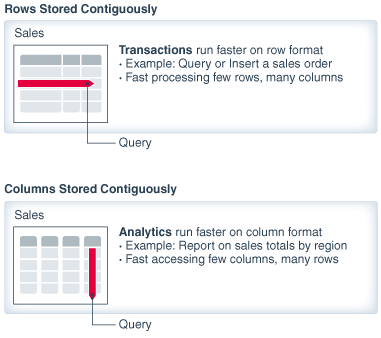
[Description of "Figure 2-1 Columnar and Row-Based Storage"](img_text/inmem_3v_012.md)

#### 2.1.1 Columnar Data in the In-Memory Area

The **In-Memory Area** is an optional SGA component that contains the IM column store.

##### 2.1.1.1 Size of the In-Memory Area

The In-Memory Area is controlled by the `INMEMORY_SIZE` initialization parameter. By default, the size of the In-Memory Area is 0, which means the IM column store is disabled.

To enable the IM column store, set the In-Memory Area to at least 100 MB. The size is shown in `V$SGA`.

##### The In-Memory Area and SGA_TARGET

The In-Memory Area is subtracted from the `SGA_TARGET` initialization parameter setting. For example, if you set `SGA_TARGET` to 10 GB, and if you set the `INMEMORY_SIZE` to 4 GB, then 40% of the `SGA_TARGET` setting is allocated to the In-Memory Area. The following graphic illustrates the relationship.

Figure 2-2 INMEMORY_SIZE and SGA_TARGET

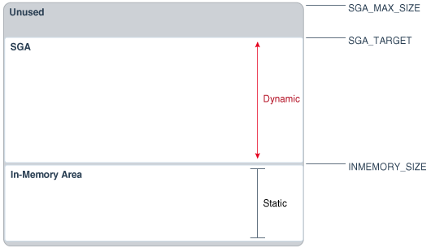
[Description of "Figure 2-2 INMEMORY_SIZE and SGA_TARGET"](img_text/inmem_3v_017.md)

Unlike the other components of the SGA, including the buffer cache and the shared pool, the In-Memory Area size is not controlled by automatic memory management. The database does not automatically shrink the In-Memory Area when the buffer cache or shared pool requires more memory, or increase the In-Memory Area when it runs out of space.

##### Dynamic Resizing of the In-Memory Area

Starting in Oracle Database 12c Release 2 (12.2), you can dynamically increase `INMEMORY_SIZE` by using the `ALTER SYSTEM` statement. The database allocates increased memory when the following conditions are met:

- Free memory is available in the SGA.

- The new size for `INMEMORY_SIZE` is at least 128 MB greater than the current setting.

  **Note:**

  You cannot use `ALTER SYSTEM` to reduce `INMEMORY_SIZE`.

The `V$INMEMORY_AREA` and `V$SGA` views immediately reflect the change.

##### The In-Memory Area in a Multitenant Environment

In a CDB, the size of the IM column store is set by the `INMEMORY_SIZE` parameter in the CDB root. By default, the IM column store is shared among the PDBs. Consequently, a PDB can "starve" other PDBs by consuming the available memory.

Within a PDB, you can limit memory consumption by using `ALTER SYSTEM SET INMEMORY_SIZE`. For example, at the CDB level, you might set `INMEMORY_SIZE` to `20G`, and then configure the PDBs as follows:

- In `hrpdb`, set `INMEMORY_SIZE` to `0`

- In `salespdb`, set `INMEMORY_SIZE` to `10G`

- In `oepdb`, set `INMEMORY_SIZE` to `11G`

In the preceding example, the `INMEMORY_SIZE` settings at the PDB level add up to `21G`, even though `INMEMORY_SIZE` at the CDB level is only `20G`. Oversubscription ensures that valuable space in the IM column store is not wasted if a PDB is shut down or unplugged.

**See Also:**

- "[Increasing the Size of the IM Column Store Dynamically](enabling-the-im-column-store.md)"

- [Oracle Database Administrator’s Guide](../admin/managing-memory.md) to learn more about automatic memory management

- Oracle Database Reference to learn about [`INMEMORY_SIZE`](../refrn/INMEMORY_SIZE.md), [`V$INMEMORY_AREA`](../refrn/V-INMEMORY_AREA.md), and [`V$SGA`](../refrn/V-SGA.md)

##### 2.1.1.2 Memory Pools in the In-Memory Area

The In-Memory Area is divided into subpools for columnar data and metadata.

The In-Memory area is subdivided into the following subpools:

- The [columnar data pool](glossary.md)

  This subpool stores the IMCUs, which contain the columnar data. The `V$INMEMORY_AREA.POOL` column identifies this subpool as `1MB POOL`, as shown in Example 2-1.

- The [metadata pool](glossary.md)

  This subpool stores metadata about the objects that reside in the IM column store. The `V$INMEMORY_AREA.POOL` column identifies this subpool as `64KB POOL`, as shown in Example 2-1.

Figure 2-3 Subpools in the In-Memory Area

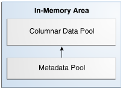
[Description of "Figure 2-3 Subpools in the In-Memory Area"](img_text/cncpt_vm_380.md)

The database determines the relative size of the two subpools using internal heuristics. The database allocates the majority of space in the In-Memory Area to the columnar data pool (1 MB pool).

**Note:**

Oracle Database automatically determines the subpool sizes. You cannot change the space allocations.

Example 2-1 V\$INMEMORY_AREA View

This example queries the `V$INMEMORY_AREA` view to determine the amount of available memory in each subpool (sample output included):

    COL POOL FORMAT a9
    COL POPULATE_STATUS FORMAT a15
    SSELECT POOL, TRUNC(ALLOC_BYTES/(1024*1024*1024),2) "ALLOC_GB",
            TRUNC(USED_BYTES/(1024*1024*1024),2) "USED_GB",
            POPULATE_STATUS
    FROM    V$INMEMORY_AREA;

    POOL      ALLOC_GB   USED_GB    POPULATE_STATUS
    --------- ---------- ---------- ---------------
    1MB POOL  7.99       0          DONE
    64KB POOL 1.98       0          DONE

The current size of the In-Memory area is visible in `V$SGA`:

    SELECT NAME, VALUE/(1024*1024*1024) "SIZE_IN_GB"
    FROM   V$SGA
    WHERE  NAME LIKE '%Mem%';

    NAME                 SIZE_IN_GB
    -------------------- ----------
    In-Memory Area       10

In this example, the memory allocated to the subpools is 9.97 GB, whereas the size of the In-Memory Area is 10 GB. The database uses a small percentage of memory for internal management structures.

**See Also:**

[Oracle Database Reference](../refrn/V-INMEMORY_AREA.md) to learn about `V$INMEMORY_AREA`

#### 2.1.2 Row Data in the Database Buffer Cache

The database buffer cache stores and processes data blocks in the same way whether the IM column store is enabled or disabled. Buffer I/O and buffer pools function the same.

The IM column store enables data to be simultaneously populated in the SGA in both the traditional row format (the buffer cache) and the columnar format. The database transparently sends OLTP queries (such as primary key lookups) to the buffer cache, and analytic and reporting queries to the IM column store. When fetching data, Oracle Database can also read data from both memory areas within the same query.

**Note:**

In the execution plan, the operation `TABLE ACCESS IN MEMORY FULL` indicates that some or all data is accessed in the IM column store.

The dual-format architecture does not double memory requirements. The buffer cache is optimized to run with a much smaller size than the size of the database.

The following figure shows a sample IM column store. The database stores the `sh.sales` table on disk in traditional row format. The SGA stores the data in columnar format in the IM column store, and in row format in the database buffer cache.

Figure 2-4 IM Column Store

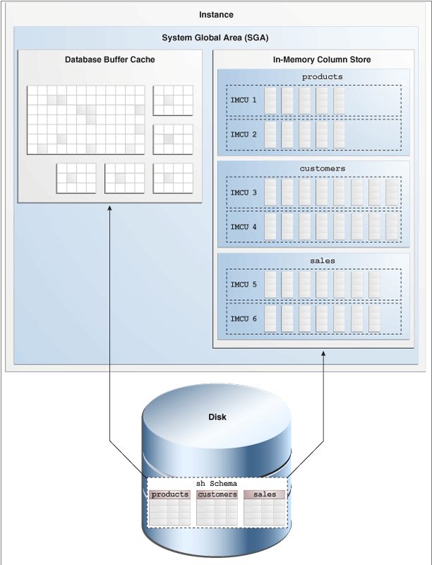
[Description of "Figure 2-4 IM Column Store"](img_text/cncpt_vm_379.md)

Every on-disk data format for permanent, heap-organized tables is supported by the IM column store. The columnar format does not affect the format of data stored in data files or in the buffer cache, nor does it affect undo data and online redo logging.

The database processes DML modifications in the same way, regardless of whether the IM column store is enabled, by updating the buffer cache, online redo log, and undo tablespace. However, the database uses an internal mechanism to track changes and ensure that the IM column store is consistent with the rest of the database. For example, if the `sales` table is populated in the IM column store, and if an application updates a row in `sales`, then the database automatically keeps the copy of the `sales` table in the IM column store transactionally consistent. A query that accesses the IM column store always returns the same results for a query that accesses the buffer cache.

**See Also:**

[Oracle Database Concepts](../cncpt/memory-architecture.md) to learn more about the database buffer cache

### 2.2 In-Memory Storage Units

The IM column store manages both data and metadata in optimized storage units, not in traditional Oracle data blocks.

Oracle Database maintains the storage units in the In-Memory Area. The following graphic gives an overview of the In-Memory Area and the database processes that interact with it. The remaining chapter describes the various memory components.

Figure 2-5 IM Column Store: Memory and Process Architecture

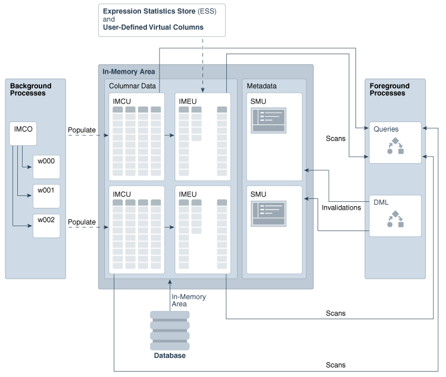
[Description of "Figure 2-5 IM Column Store: Memory and Process Architecture"](img_text/inmem_3v_013.md)

#### 2.2.1 In-Memory Compression Units (IMCUs)

An **In-Memory Compression Unit (IMCU)** is a compressed, read-only storage unit that contains data for one or more columns.

An IMCU is analogous to a tablespace extent. An IMCU has two parts: a set of Column Compression Units (CUs), and a header that contains metadata such as the [IM storage index](glossary.md).

##### 2.2.1.1 IMCUs and Schema Objects

The IM column store stores data for a single object (table, partition, materialized view) in a set of IMCUs. An IMCU stores columnar data for one and only one object.

###### 2.2.1.1.1 IMCUs and INMEMORY Columns

For an object specified as `INMEMORY`, every column listed in the `INMEMORY` clause is included in every IMCU.

For example, the `sh.sales` table has 7 columns. The following DDL statement specifies the table as `INMEMORY`, which means that every IMCU for `sales` includes columnar data for these 7 columns:

    ALTER TABLE sh.sales INMEMORY MEMCOMPRESS FOR QUERY LOW;

##### NO INMEMORY Columns in INMEMORY Objects

You can specify that some but not all columns in an `INMEMORY` table have the `INMEMORY` attribute. For example, the `sh.customers` table has 23 columns. The following DDL statement specifies that 15 columns in `sh.customers` have the `NO INMEMORY` attribute, which means that the other 8 columns in the table have the `INMEMORY` attribute:

    ALTER TABLE sh.customers INMEMORY
      MEMCOMPRESS FOR QUERY LOW
      NO INMEMORY ( cust_gender, cust_year_of_birth, cust_marital_status,
                    cust_postal_code, cust_city, cust_state_province,
                    cust_main_phone_number, cust_income_level, cust_credit_limit,
                    cust_email, cust_total, cust_total_id, cust_eff_from,
                    cust_eff_to, cust_valid );

The following query shows the compression levels of the columns in `sh.customers`, indicating which columns are `NO INMEMORY`:

    SET LINESIZE 200
    COL TABLE_NAME FORMAT a25
    COL SEG_COL_ID FORMAT 999
    COL COLUMN_NAME FORMAT a25
    COL INMEMORY_COMPRESSION FORMAT a11
    SELECT SEGMENT_COLUMN_ID AS "SEG_COL_ID", COLUMN_NAME, INMEMORY_COMPRESSION
    FROM   V$IM_COLUMN_LEVEL WHERE TABLE_NAME = 'CUSTOMERS'
    ORDER BY SEG_COL_ID;

    SEG_COL_ID COLUMN_NAME               INMEMORY_CO
    ---------- ------------------------- -----------
             1 CUST_ID                   DEFAULT
             2 CUST_FIRST_NAME           DEFAULT
             3 CUST_LAST_NAME            DEFAULT
             4 CUST_GENDER               NO INMEMORY
             5 CUST_YEAR_OF_BIRTH        NO INMEMORY
             6 CUST_MARITAL_STATUS       NO INMEMORY
             7 CUST_STREET_ADDRESS       DEFAULT
             8 CUST_POSTAL_CODE          NO INMEMORY
             9 CUST_CITY                 NO INMEMORY
            10 CUST_CITY_ID              DEFAULT
            11 CUST_STATE_PROVINCE       NO INMEMORY
            12 CUST_STATE_PROVINCE_ID    DEFAULT
            13 COUNTRY_ID                DEFAULT
            14 CUST_MAIN_PHONE_NUMBER    NO INMEMORY
            15 CUST_INCOME_LEVEL         NO INMEMORY
            16 CUST_CREDIT_LIMIT         NO INMEMORY
            17 CUST_EMAIL                NO INMEMORY
            18 CUST_TOTAL                NO INMEMORY
            19 CUST_TOTAL_ID             NO INMEMORY
            20 CUST_SRC_ID               DEFAULT
            21 CUST_EFF_FROM             NO INMEMORY
            22 CUST_EFF_TO               NO INMEMORY
            23 CUST_VALID                NO INMEMORY

The following graphic represents three tables from the `sh` schema populated in the IM column store: `customers`, `products`, and `sales`. In this example, each table has a different number of columns specified `INMEMORY`. The IMCUs for each table include only data for the `INMEMORY` columns.

Figure 2-6 Columns and IMCUs

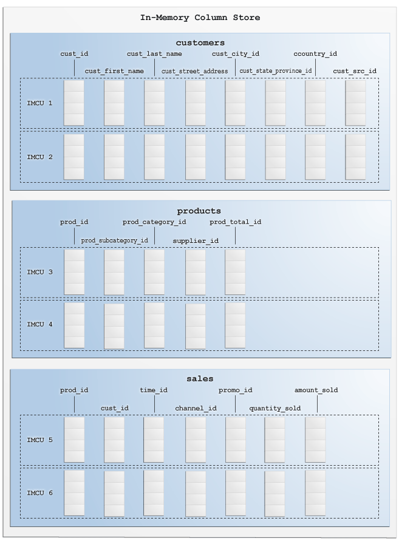
[Description of "Figure 2-6 Columns and IMCUs"](img_text/cncpt_vm_378.md)

##### Queries That Reference NO INMEMORY Columns

When a query references a `NO INMEMORY` column, the table scan retrieves data from the row store rather than the IMCUs in the IM column store. Row store access occurs even if all other columns referenced in the query are populated `INMEMORY` columns.

For example, assume that the `customers` table is populated into the IM column store. The `cust_id` and `cust_last_name` columns are specified `INMEMORY`, but the `cust_postal_code` column is specified as `NO INMEMORY`. You issue the following query:

    SELECT cust_id, cust_last_name, cust_postal_code
    FROM   customers
    WHERE  cust_id < 5001
    ORDER BY cust_id;

In this case, the database accesses the row store, not the IM column store, even though `cust_postal_code` is the only `NO INMEMORY` column referenced in the query. The following query, which has `cust_postal_code` in the predicate but not the `SELECT` list, must also access the row store:

    SELECT cust_id, cust_last_name
    FROM   customers
    WHERE  cust_postal_code = 77501
    ORDER BY cust_id;

**See Also:**

- "[About Enabling INMEMORY Columns](populating-objects-in-memory.md)"

- <https://blogs.oracle.com/in-memory/what-happens-if-a-column-is-not-populated> for a blog entry on accessing columns that are not populated in the IM column store

- [Oracle Database SQL Language Reference](../sqlrf/ALTER-TABLE.md) to learn about the `ALTER TABLE` statement

###### 2.2.1.1.2 In-Memory Compression

The IM column store uses special compression formats optimized for access speed rather than storage reduction. The columnar format enables queries to execute directly against the compressed columns.

Compression enables scanning and filtering operations to process a much smaller amount of data, which optimizes query performance. Oracle Database only decompresses data when it is required for the result set.

The compression applied in the IM column store is closely related to Hybrid Columnar Compression. Both technologies process column vectors. The primary difference is that the column vectors for the IM column store are optimized for SIMD vector processing, whereas the column vectors for Hybrid Columnar Compression are optimized for disk storage.

When you enable an object for population into the IM column store, you specify the type of compression in the `INMEMORY` clause: `FOR DML`, `FOR QUERY` (`LOW` or `HIGH`), `FOR CAPACITY` (`LOW` or `HIGH`), or `NONE`.

**See Also:**

- "[Controls for In-Memory Objects](populating-objects-in-memory.md)"

- [Oracle Database Concepts](../cncpt/tables-and-table-clusters.md) to learn more about Hybrid Columnar Compression

###### 2.2.1.1.3 IMCUs and Rows

Each IMCU contains all column values (including nulls) for a subset of rows in a table segment. A subset of rows is called a granule.

All IMCUs for a given segment contain approximately the same number of rows. Oracle Database determines the size of a granule automatically depending on data type, data format, and compression type. A higher compression level results in more rows in the IMCU.

A one-to-many mapping exists between an IMCU and a set of database blocks. As illustrated in Example 2-2, each IMCU stores the values for columns for a different set of blocks.

The columns in an IMCU are not sorted. Oracle Database populates them in the order that they are read from disk.

The number of rows in an IMCU dictates the amount of space an IMCU consumes. If the target number of rows causes an IMCU to grow beyond the amount of contiguous 1 MB extents available in the 1 MB pool, then the IMCU creates additional extents (pieces) to hold the remaining column CUs. An IMCU always allocates space in 1 MB increments.

Example 2-2 IMCUs and Row Subsets

In this simplified example, only the following 4 columns of the `customers` table have the `INMEMORY` attribute: `cust_id`, `cust_first_name`, `cust_last_name`, and `cust_gender`. Only 5 rows exist in the table, stored in 2 data blocks. Conceptually, the first data block stores its rows as follows:

    82,Madeline,Li,F;37004,Abel,Embrey,M;1714,Hardy,Gentle,M

The second data block stores rows as follows:

    100439,Uma,Campbell,F;3047,Lucia,Downey,F

Assume IMCU 1 stores the data for the first data block. In this case, the `cust_id` column values for the 3 rows in this data block stores are stored “vertically” within a CU as follows:

    82
    37004
    1714

IMCU 2 stores the data from the second data block. The `cust_id` column values for these 2 rows are stored within a CU as follows:

    100439
    3047

Because the `cust_id` value is the first value for each row in the data block, the `cust_id` column is in the first position within the IMCU. Columns always occupy the same position, so Oracle Database can reconstruct the rows by reading the IMCUs for a segment.

**Related Topics**

- [Controls for In-Memory Objects](populating-objects-in-memory.md)

##### 2.2.1.2 Column Compression Units (CUs)

A Column Compression Unit (CU) is contiguous storage for a single column in an IMCU. Every IMCU has one or more CUs.

###### 2.2.1.2.1 Structure of a CU

A CU is divided into a body and a header.

The body of every CU stores the column values for the range of rows included in the IMCU. The header contains metadata about the values stored in the CU body, for example, the minimum and maximum value within the CU. It may also contain a [local dictionary](glossary.md), which is a sorted list of the distinct values in that column and their corresponding dictionary codes.

The following figure shows an IMCU with 4 CUs for the `sales` table: `prod_id`, `cust_id`, `time_id`, and `channel_id`. Each CU stores the column values for the range of rows included in the IMCU.

Figure 2-7 CUs in an IMCU

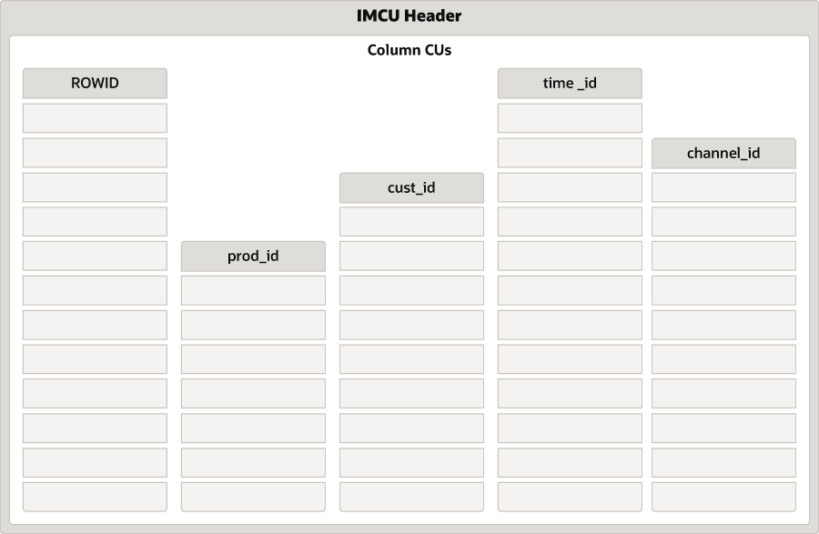
[Description of "Figure 2-7 CUs in an IMCU"](img_text/cus_and_imcu.md)

The CUs store values in rowid order. For this reason, the database can answer queries by “stitching” the rows back together. For example, an application issues the following query:

    SELECT cust_id, time_id, channel_id
    FROM   sales
    WHERE  prod_id =5;

The database begins by scanning the `prod_id` column for entries with the value `5`. Assume that the database finds `5` in position two in the `prod_id` column. The database now must find the corresponding `cust_id`, `time_id`, and `channel_id` for this row. Because the CUs store data in rowid order, the database can find the corresponding `cust_id`, `time_id`, and `channel_id` values in position 2 in those columns. Thus, to answer the query, the database must extract the values from position 2 in the `cust_id`, `time_id`, and `channel_id` columns, and then stitch the row back together to return it to the end user.

###### 2.2.1.2.2 Local Dictionary

In a CU, the local dictionary has a list of distinct values and their corresponding dictionary codes.

The local dictionary stores the symbol contained in the column. The following figure illustrates how a CU stores a `name` column in a `vehicles` table.

Figure 2-8 Local Dictionary

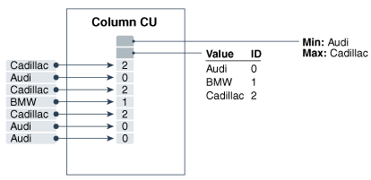
[Description of "Figure 2-8 Local Dictionary"](img_text/inmem_3v_006.md)

In the preceding figure, the CU contains only 7 rows. Every distinct value in this CU, such as `Cadillac` or `Audi`, is assigned a different dictionary code, such as `2` for `Cadillac` and `0` for `Audi`. The CU stores the dictionary code rather than the original value.

**Note:**

When the database uses a [common dictionary](glossary.md) for a [join group](glossary.md), the local dictionary contains references to the common dictionary rather than the symbols. For example, rather than storing the values `Audi`, `BWM`, and `Cadillac` for the `vehicles.name` column, the local dictionary stores dictionary codes such as `101`, `220`, and `66`.

The CU header contains the minimum and maximum values for the column. In this example, the minimum value is `Audi` and the maximum value is `Cadillac`. The local dictionary stores the list of distinct values: `Audi`, `BMW`, and `Cadillac`. Their corresponding dictionary codes (`0`, `1`, and `2`) are implicit. The local dictionary for a CU in each IMCU is independent of the local dictionaries in other IMCUs.

If a query filters on Audi automobiles, then the database scans this IMCU for only `0` codes.

**Related Topics**

- [How a Join Group Uses a Common Dictionary](optimizing-queries-with-join-groups.md)

**See Also:**

"[How a Join Group Uses a Common Dictionary](optimizing-queries-with-join-groups.md)"

##### 2.2.1.3 In-Memory Storage Indexes

Every IMCU header automatically creates and manages In-Memory Storage Indexes (IM storage indexes) for its CUs. An IM storage index stores the minimum and maximum for all columns within the IMCU.

For example, `sales` is populated in the IM column store. Every IMCU for this table has all columns. The `sales.prod_id` column is stored in a separate CU within every IMCU. The IMCU header has the minimum and maximum values of each `prod_id` CU (and every other CU).

To eliminate unnecessary scans, the database can perform [IMCU pruning](glossary.md) based on SQL filter predicates. The database scans only the IMCUs that satisfy the query predicate, as shown in the `WHERE prod_id > 14 AND prod_id < 29` example in the following graphic.

Figure 2-9 Storage Index for Columnar Data

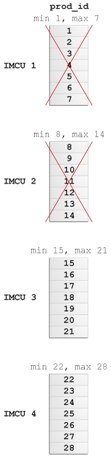
[Description of "Figure 2-9 Storage Index for Columnar Data"](img_text/inmem_3v_016.md)

#### 2.2.2 Snapshot Metadata Units (SMUs)

A Snapshot Metadata Unit (SMU) contains metadata and transactional information for an associated IMCU.

##### 2.2.2.1 IMCUs and SMUs

The columnar pool of the In-Memory Area stores the actual data: IMCUs and IMEUs. The metadata pool in the In-Memory Area stores the SMUs.

Figure 2-10 IMCUs and SMUs

This figure shows IMCUs in the data pool, and SMUs in the metadata pool.

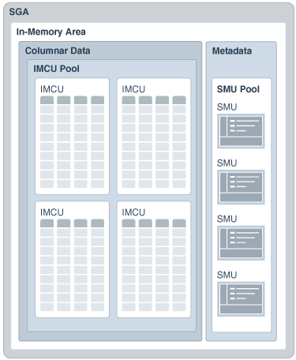
[Description of "Figure 2-10 IMCUs and SMUs"](img_text/inmem_3v_014.md)

Every IMCU maps to a separate SMU. Thus, if the columnar data pool contains 100 IMCUs, then the metadata pool contains 100 SMUs. The SMUs store several types of metadata for their associated IMCUs, including the following:

- Object numbers

- Column numbers

- Mapping information for rows

##### 2.2.2.2 Transaction Journal

Every SMU contains a transaction journal. The database uses the transaction journal to keep the IMCU transactionally consistent.

The database uses the buffer cache to process DML, just as when the IM column store is not enabled. For example, an `UPDATE` statement might modify a row in an IMCU. In this case, the database adds the rowid for the modified row to the transaction journal and marks it stale as of the SCN of the DML statement. If a query needs to access the new version of the row, then the database obtains the row from the database buffer cache.

Figure 2-11 Transaction Journal

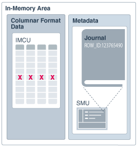
[Description of "Figure 2-11 Transaction Journal"](img_text/inmem_3v_020.md)

The database achieves read consistency by merging the contents of the column, transaction journal, and buffer cache. When the IMCU is refreshed during [repopulation](glossary.md), queries can access the up-to-date row directly from the IMCU.

**See Also:**

"[Optimizing Repopulation of the IM Column Store](repopulation-and-dml.md)" for an in-depth discussion of how the IM column store maintains transactional consistency

#### 2.2.3 In-Memory Expression Units (IMEUs)

An In-Memory Expression Unit (IMEU) is a storage container for materialized In-Memory Expressions (IM expressions) and user-defined virtual columns.

The database treats materialized expressions just like other columns in the IMCU. Conceptually, an IMEU is a logical extension of its parent IMCU. Just as an IMCU can contain multiple columns, an IMEU can contain multiple virtual columns.

Every IMEU maps to exactly one IMCU, mapping to the same row set. The IMEU contains expression results for the data contained in its associated IMCU. When the IMCU is populated, the associated IMEU is also populated.

A typical IM expression involves one or more columns, possibly with constants, and has a one-to-one mapping with the rows in the table. For example, an IMCU for an `employees` table contains rows 1–1000 for the column `weekly_salary`. For the rows stored in this IMCU, the IMEU calculates the automatically detected IM expression `weekly_salary*52`, and the user-defined virtual column `quarterly_salary` defined as `weekly_salary*12`. The 3rd row down in the IMCU maps to the 3rd row down in the IMEU.

The IMEU is a logical extension of the IMCUs of a particular segment. By default, the IMEU inherits the `INMEMORY` clause properties, including Oracle Real Application Clusters (Oracle RAC) properties such as `DISTRIBUTE` and `DUPLICATE`, from the base segment. You can selectively enable or disable virtual columns for storage in IMEUs. You can also specify compression levels for different columns.

**Related Topics**

- [About Enabling INMEMORY Columns](populating-objects-in-memory.md)
- [In-Memory Views](views-related-to-im-column-store.md)

### 2.3 Expression Statistics Store (ESS)

The **Expression Statistics Store (ESS)** is a repository maintained by the optimizer to store statistics about expression evaluation. The ESS resides in the SGA and persists on disk.

When an IM column store is enabled, the database leverages the ESS for its In-Memory Expressions (IM expressions) feature. However, the ESS is independent of the IM column store. The ESS is a permanent component of the database and cannot be disabled.

The database uses the ESS to determine whether an expression is “hot” (frequently accessed), and thus a candidate for an IM expression. During a hard parse of a query, the ESS looks for active expressions in the `SELECT` list, `WHERE` clause, `GROUP BY` clause, and so on.

For each segment, the ESS maintains expression statistics such as the following:

- Frequency of execution

- Cost of evaluation

- Timestamp evaluation

The optimizer assigns each expression a weighted score based on cost and the number of times it was evaluated. The values are approximate rather than exact. More active expressions have higher scores. The ESS maintains an internal list of the most frequently accessed expressions.

Control the behavior of IM expressions using the `DBMS_INMEMORY_ADMIN` package. For example, the `IME_CAPTURE_EXPRESSIONS` procedure prompts the database to identify and gradually populate the hottest expressions in the database. The `IME_POPULATE_EXPRESSIONS` procedure forces the database to populate the expressions immediately.

ESS information is stored in the data dictionary and exposed in the `DBA_EXPRESSION_STATISTICS` view. This view shows the metadata that the optimizer has collected in the ESS. IM expressions are exposed as system-generated virtual columns, prefixed by the string `SYS_IME`, in the `DBA_IM_EXPRESSIONS` view.

**See Also:**

- "[About IM Expressions](optimizing-in-memory-expressions.md)"

- [Oracle Database SQL Tuning Guide](../tgsql/query-optimizer-concepts.md) to learn more about ESS

- [Oracle Database Reference](../refrn/DBA_EXPRESSION_STATISTICS.md) to learn more about the `DBA_EXPRESSION_STATISTICS` view

- [Oracle Database PL/SQL Packages and Types Reference](../arpls/DBMS_INMEMORY_ADMIN.md) to learn more about the `DBMS_INMEMORY_ADMIN` package

### 2.4 In-Memory Process Architecture

In response to queries and DML, server processes scan columnar data and update SMU metadata. Background processes populate row data from disk into the IM column store.

#### 2.4.1 In-Memory Coordinator Process (IMCO)

The In-Memory Coordinator Process (IMCO) manages many tasks for the IM column store. Its primary task is to initiate background population and repopulation of columnar data.

Population is a streaming mechanism, converting row data into columnar format, and then compressing it. IMCO automatically initiates population of `INMEMORY` objects with any priority other than `NONE`. When objects with priority `NONE` are accessed, IMCO populates them using Space Management Worker Process (Wnnn) processes.

The IMCO background process also initiates [threshold-based repopulation](glossary.md) of IM column store objects when they meet a staleness threshold. IMCO may instigate [trickle repopulation](glossary.md) for any IMCU in the IM column store that has stale entries but does not meet the [staleness threshold](glossary.md).

Trickle repopulation occurs automatically in the background. The steps are as follows:

1.  IMCO wakes up.

2.  IMCO determines whether population tasks need to be performed, including whether any stale entries exist in an IMCU.

3.  If IMCO finds stale entries, then it triggers a Space Management Worker Process to repopulate these entries in the IMCU.

4.  IMCO sleeps for two minutes, and then returns to Step 1.

**See Also:**

- "[Optimizing Repopulation of the IM Column Store](repopulation-and-dml.md)"

- [Oracle Database Reference](../refrn/background-processes.md) to learn more about background processes

#### 2.4.2 Space Management Worker Processes (Wnnn)

Space Management Worker Processes (Wnnn) populate or repopulate data on behalf of IMCO.

During population, Wnnn processes are responsible for creating IMCUs, SMUs, and IMEUs. When creating IMEUs, the worker processes perform the following tasks:

- Identify virtual columns for population

- Create virtual column values

- Compute values for each row, transform the data into columnar format, and compress it

- Register the objects with the space layer

- Associate the IMEUs with their corresponding IMCUs

**Note:**

During IMEU creation, parent IMCUs remain available for queries.

During repopulation, the Wnnn processes create new versions of the IMCUs based on the existing IMCUs and transactions journals, while temporarily retaining the old versions. This mechanism is called [double buffering](glossary.md).

The database can quickly move IM expressions in and out of the IM column store. For example, if an IMCU was created without an IMEU, then the database can add an IMEU later without forcing the IMCU to undergo the full repopulation mechanism.

The `INMEMORY_MAX_POPULATE_SERVERS` initialization parameter controls the maximum number of worker processes that can be started for population. The `INMEMORY_TRICKLE_REPOPULATE_PERCENT` initialization parameter controls the maximum percentage of time that worker processes can perform trickle repopulation.

**See Also:**

- "[About Manually Enabling Objects for In-Memory Population](populating-objects-in-memory.md)"

- "[About Repopulation of the IM Column Store](repopulation-and-dml.md)"

- "[In-Memory Initialization Parameters](init-parameters-for-im-column-store.md)"

- [Oracle Database Reference](../refrn/background-processes.md) to learn more about background processes

#### 2.4.3 In-Memory Dynamic Scans

**In-Memory Dynamic Scans (IM dynamic scans)** use lightweight threads to parallelize In-Memory table scans.

##### 2.4.3.1 Purpose of IM Dynamic Scans

When additional CPU is available, IM dynamic scans accelerate In-Memory table scans that are CPU bound.

IM dynamic scans automatically use idle CPU resources to scan IMCUs in parallel and maximize CPU usage. When CPU resources are available, applications can get even faster analytic query results automatically. Because the scans are dynamic, they enable the use of excess CPU bandwidth without affecting existing workload.

IM dynamic scans are more flexible than traditional Oracle parallel execution, although the two are not mutually exclusive. Dynamic scans use multiple lightweight threads of execution within a process. Typically, the performance overhead for dynamic scans is low.

**See Also:**

[Oracle Database Administrator’s Guide](../admin/managing-resources-with-oracle-database-resource-manager.md) to learn more about Resource Manager

##### 2.4.3.2 How IM Dynamic Scans Work

IM Dynamic Scans attain optimal performance by reading IMCUs in parallel.

###### 2.4.3.2.1 About Lightweight Threads

A **lightweight thread** is an execution entity that helps to parallelize full table scans. It is “lightweight” because it does not incur the higher memory overhead of Oracle processes.

**Note:**

A lightweight thread used by IM dynamic scans is not the same as a regular thread in the multithreaded Oracle Database model.

Lightweight threads share the resources of the parent foreground or PQ process, called the [table scan process](glossary.md), that coordinates the scan of a set of IMCUs. Threads maintain their own independent flow of execution. The database can parallelize scans by prioritizing threads and executing them asynchronously.

For eligible queries, the process allocates a pool of threads. Resource Manager automatically determines the number of threads in the pool based on the CPU count in the database host and the current load on the system. The pool of threads remains available to the session for subsequent queries unless the idle time reaches an internal threshold, at which point the database terminates the threads.

Communication between threads occurs exclusively within a process. For this reason, contention does not occur at the database instance level.

**See Also:**

[Oracle Database Concepts](../cncpt/process-architecture.md) to learn about the multithreaded Oracle Database model

###### 2.4.3.2.2 When the Database Considers IM Dynamic Scans

Lightweight threads are enabled when a CPU resource plan is enabled (for example, `RESOURCE_MANAGER_PLAN=DEFAULT_PLAN`) and CPU utilization of the database is low.

If lightweight threads are enabled, then the database considers an IM dynamic scan when an application queries an object that is currently populated in the IM column store. Typically, a serial or parallel query is a candidate for IM dynamic scans when it has the following characteristics:

- Accesses a high number of IMCUs or columns

- Consumes all rows in the table

- Is CPU-intensive

Oracle Database Resource Manager (the Resource Manager), which is automatically enabled when `INMEMORY_SIZE` is greater than `0`, is required for IM dynamic scans. The Resource Manager decides when and how to use the lightweight threads. Lightweight threads are the lowest priority operation in the database because they are capitalizing on unused resources.

**Note:**

`CPU_COUNT` must be greater than or equal to `24` in order to perform IM dynamic scans.

###### 2.4.3.2.3 How IM Dynamic Scans Work

Resource Manager allocates lightweight threads to parallelize the scan of IMCUs.

When the database determines that a query can benefit from an IM dynamic scan, it typically proceeds as follows:

1.  A table scan process spawns a pool of lightweight threads.

2.  The table scan process creates a separate task for every IMCU that must be scanned, and then adds each task to a task queue.

3.  Resource Manager determines how many threads can participate in the table scan.

4.  Active threads pick up tasks from the task queue, with the table scan process consuming results from completed tasks.

Depending on the database load, Resource Manager continuously adjusts the number of active lightweight threads while the query is running. If CPU resources are not available, then the table scan process performs the scan without using lightweight threads.

The following graphic illustrates an IM dynamic scan of 12 IMCUs in the `sales` table.

Figure 2-12 IM Dynamic Scan

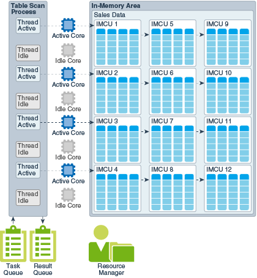
[Description of "Figure 2-12 IM Dynamic Scan"](img_text/inmem_pb_001b.md)

In the preceding graphic, the database host has 8 CPU cores. Based on an internal algorithm, Resource Manager assigns 4 threads to assist the table scan process. In this scenario, 4 CPU cores remain idle for other concurrent database operations to use.

##### 2.4.3.3 Interface for IM Dynamic Scans

IM dynamic scans are transparent, which means that they require no application changes and are automatically controlled by the Resource Manager.

IM dynamic scans require the Resource Manager, which is automatically enabled when `INMEMORY_SIZE` is greater than `0`. No specific resource plan is required.

Several new session statistics track the usage of IM dynamic scans. Each thread writes trace data to a separate trace file.

Execution plans are unchanged. The following figure shows a sample execution plan.

    SQL> SELECT MAX(l_quantity) largest_order FROM lineitem;

    LARGEST_ORDER
    -------------
               50

    Elapsed: 00:00:03.41

    Execution Plan
    ----------------------------------------------------------
    Plan hash value: 1885658499
    -------------------------------------------------------------------------------------------
    |Id| Operation                   | Name     |Rows| Bytes |Cost(%CPU)| Time  |Pstart| Pstop|
    -------------------------------------------------------------------------------------------
    |0| SELECT STATEMENT             |          |    1 |    3| 116K  (4)| 00:00:05 |    |     |
    |1|  SORT AGGREGATE              |          |    1 |    3|          |          |    |     |
    |2|   PARTITION RANGE ALL        |          | 600M |1716M| 116K  (4)| 00:00:05 |  1 |  84 |
    |3|    TABLE ACCESS INMEMORY FULL| LINEITEM | 600M |1716M| 116K  (4)| 00:00:05 |  1 |  84 |
    -------------------------------------------------------------------------------------------

    NAME                                              VALUE
    -------------------------------------------------------
    IM scan CUs memcompress for query low              1147
    IM scan bytes in-memory                      5.1790E+10
    IM scan bytes uncompressed                   7.6722E+10
    IM scan CUs columns accessed                       1147
    IM scan rows                                  600037902
    IM scan rows projected                               29
    IM scan (dynamic) rows                        600037902
    IM scan (dynamic) multi-threaded scans                1
    IM scan (dynamic) tasks processed by thread        1146

Consider the characteristics of the plan:

1.  The execution plan is unchanged.

    Note that the plan does not mention IM dynamic scans in Step 3. However, clicking the binocular icon in a SQL Monitor report would show “Dynamic Scan Tasks on Thread.”

2.  `IM scan (dynamic) multi-threaded scans` is nonzero, which means that the database used an IM dynamic scan.

3.  `IM scan CUs memcompress for query low` indicates that 1147 IMCUs exist in the `lineitem` table.

4.  `IM scan (dynamic) tasks processed by thread` indicates how many IMCUs were processed in parallel.

    The number is 1146, which is less than the total number of 1147 shown in `IM scan CUs memcompress for query low`. The database analyzed the first IMCU without parallelization to determine whether parallelization was worthwhile. Because the answer was yes, the database proceeded to scan the remaining 1146 IMCUs in parallel.

5.  `IM scan (dynamic) rows` and `IM scan rows are equal`, which means that the threads retrieved all rows for the query.

**See Also:**

- [Oracle Database Administrator’s Guide](../admin/managing-resources-with-oracle-database-resource-manager.md) to learn more about the Resource Manager

- [Oracle Database Reference](../refrn/statistics-descriptions-2.md) for descriptions of In-Memory statistics

### 2.5 CPU Architecture: SIMD Vector Processing

For data that is populated in the IM column store, the database uses SIMD (single instruction, multiple data) processing.

A SIMD unit is a processor that enables a single instruction to process data as a unit, called a **vector**, rather than processing data in separate instructions. For example, instead of using a loop to execute four addition operations, SIMD could load the four sets of numbers into vectors and perform one addition operation. SIMD processing is sometimes called **vectorization**.

The IM column store maximizes the number of column entries that the CPU can load into the vector registers and evaluate. Instead of evaluating each entry in the column one at a time, the database evaluates a set of column values in a single CPU instruction. SIMD vector processing enables the database to scan billions of rows per second.

For example, an application issues a query to find the total number of orders in the `sales` table that use the `promo_id` value of `9999`. The `sales` table resides in the IM column store. The query begins by scanning only the `sales.promo_id` column, as shown in the following diagram:

Figure 2-13 SIMD Vector Processing

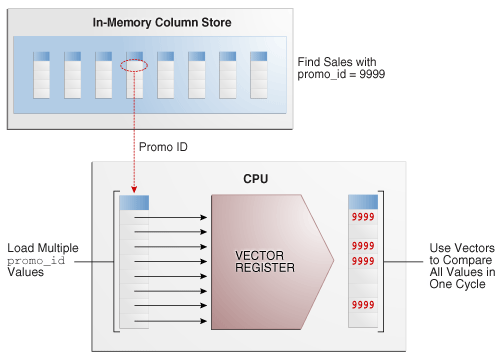
[Description of "Figure 2-13 SIMD Vector Processing"](img_text/cncpt_vm_382.md)

The CPU evaluates the data as follows:

1.  Loads the first 8 values (the number varies depending on data type and compression mode) from the `promo_id` column into the SIMD register, and then compares them with the value `9999` in a single instruction

2.  Discards the entries.

3.  Loads another 8 values into the SIMD register, and then continues in this way until it has evaluated all entries.

#### 2.5.1 SIMD and Oracle LOBs

Oracle Database 18c provides SIMD vector support for queries involving SQL operators on specific LOB columns.

The nature of the support depends on the type of LOB:

- Inline LOBs

  The IM column store provides contiguous storage for inline LOBs, which are LOBs less than 4 KB, within the IMCUs. Columnar storage enables faster query processing by removing the overhead of assembling LOB data from the database buffer cache.

- Out-of-line LOBs

  In this case, the IM column store only stores the LOB locator, which is 40 byes. Out-of-line columns do not benefit from columnar optimization.

There is one exception to the preceding rule. An IMEU can allocate up to 32 KB of contiguous storage for JSON columns defined as a LOB data type. The IMEU stores these columns in the [OSON](glossary.md) format, which can provide faster query performance using SIMD processing.

**See Also:**

[Oracle Database SecureFiles and Large Objects Developer's Guide](../adlob/introduction-to-large-objects.md) to learn more about LOBs

#### 2.5.2 SIMD and Oracle Numbers

For tables compressed with `QUERY LOW`, `NUMBER` columns are encoded using an optimized format that enables native calculations in hardware.

SIMD vector processing enables simple aggregations, `GROUP BY` aggregations, and arithmetic operations to benefit significantly. The performance improvement depends on the amount of time the aggregation spends on arithmetic computation. Some aggregations may benefit by up to a factor of 9.

**See Also:**

- "[Optimizing In-Memory Arithmetic](optimizing-in-memory-aggregation.md)"

- [Oracle Database SQL Language Reference](../sqlrf/Data-Types.md)

#### 2.5.3 SIMD and Exadata Smart Flash Cache

Besides storing data in Hybrid Columnar Compression format, Exadata Smart Flash Cache can store data in pure columnar format.

Exadata Smart Scan supports SIMD predicates. The advantage is that In-Memory performance extends from DRAM storage to secondary storage.

By default, Exadata Smart Flash Cache compresses data using the level `MEMCOMPRESS FOR CAPACITY LOW`. To change the compression level or disable the columnar format altogether, use the `ALTER TABLE ... NO CELLMEMORY` statement.

**See Also:**

- "[In-Memory Support for Exadata Flash Cache](intro-to-in-memory-column-store.md)"

- [Oracle Exadata Database Machine System Overview](https://docs.oracle.com/pls/topic/lookup?ctx=en/database/oracle/oracle-database/19/inmem&id=DBMSO-GUID-D3F05A21-F1A8-48D0-AC3C-88AF3D725DCD)
