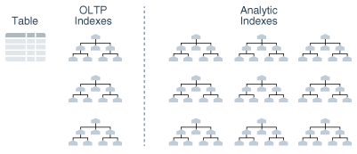
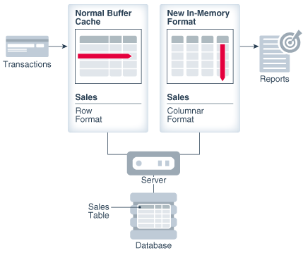

Oracle Database In-Memory (Database In-Memory) is a suite of features that greatly improves performance for real-time analytics and mixed workloads. The In-Memory Column Store (IM column store) is the key feature of Database In-Memory.

**Note:**

Database In-Memory features require the Oracle Database In-Memory option. For the Database In-Memory Base Level, the IM column store size is limited to 16 GB at the CDB level. See [Oracle Database Licensing Information User Manual](../dblic/Licensing-Information.md) for details on which features are supported for different editions and services.

### 1.1 Challenges for Analytic Applications

Traditionally, obtaining good performance for analytic queries meant satisfying several requirements.

In a typical data warehouse or mixed-use database, requirements include the following:

- You must understand user access patterns.

- You must provide good performance, which typically requires creating indexes, materialized views, and OLAP cubes.

For example, if you create 1 to 3 indexes for a table (1 primary key and 2 foreign key indexes) to provide good performance for an OLTP application, then you may need to create additional indexes to provide good performance for analytic queries.

Figure 1-1 Multiple Indexes

[Description of "Figure 1-1 Multiple Indexes"](img_text/inmem_3v_015.md)

Meeting the preceding requirements creates manageability and performance problems. Additional access structures cause performance overhead because you must create, manage, and tune them. For example, inserting a single row into a table requires an update to all indexes on this table, which increases response time.

The demand for real-time analytics means that more analytic queries are being executed in a mixed-workload database. The traditional approach is not sustainable.

### 1.2 The Single-Format Approach

Traditionally, relational databases store data in either row or columnar formats. Memory and disk store data in the same format.

An Oracle database stores rows contiguously in data blocks. For example, in a table with three rows, an Oracle data block stores the first row, and then the second row, and then the third row. Each row contains all column values for the row. Data stored in row format is optimized for transaction processing. For example, updating all columns in a small number of rows may modify only a small number of blocks.

To address the problems relating to analytic queries, some database vendors have introduced a columnar format. A columnar database stores selected columns—not rows—contiguously. For example, in a large sales table, the sales IDs reside in one column, and sales regions reside in a different column.

Analytical workloads access few columns while scanning, but scan the entire data set. For this reason, the columnar format is the most efficient for analytics. Because columns are stored separately, an analytical query can access only required columns, and avoid reading inessential data. For example, a report on sales totals by region can rapidly process many rows while accessing only a few columns.

Database vendors typically force customers to choose between a columnar and row-based format. For example, if the data format is columnar, then the database stores data in columnar format both in memory and on disk. Gaining the advantages of one format means losing the advantages of the alternate format. Applications either achieve rapid analytics or rapid transactions, but not both. The performance problems for mixed-use databases are not solved by storing data in a single format.

### 1.3 The Oracle Database In-Memory Solution

The Oracle Database In-Memory (Database In-Memory) feature set includes the In-Memory Column Store (IM column store), advanced query optimizations, and availability solutions.

The Database In-Memory optimizations enable analytic queries to run orders of magnitude faster on data warehouses and mixed-use databases.

#### 1.3.1 What Is Database In-Memory?

The Database In-Memory feature set includes the IM column store, advanced query optimizations, and availability solutions.

Database In-Memory features combine to accelerate analytic queries by orders of magnitude without sacrificing OLTP performance or availability.

**See Also:**

[Oracle Database Licensing Information User Manual](../dblic/Third-Party-Notices-Licenses.md) to learn about the Database In-Memory option

##### 1.3.1.1 IM Column Store

The **IM column store** maintains copies of tables, partitions, and individual columns in a compressed columnar format that is optimized for rapid scans.

**Video:**

The IM column store resides in the [In-Memory Area](glossary.md), which is an optional portion of the system global area (SGA). The IM column store does not replace row-based storage or the database buffer cache, but supplements it. The database enables data to be in memory in both a row-based and columnar format, providing the best of both worlds. The IM column store provides an additional transaction-consistent copy of table data that is independent of the disk format.

Figure 1-2 Dual-Format Database

[Description of "Figure 1-2 Dual-Format Database"](img_text/inmem_3v_011.md)

**Note:**

Objects populated in the IM column store do not also need to be loaded into the buffer cache.

Use the `INMEMORY` clause in DDL statements to enable the IM column store at any of the following levels:

- Column (nonvirtual or virtual)

- Table (internal or external), materialized view, or partition

  **Note:**

  If you apply the `INMEMORY` attribute to a hybrid partitioned table, then the attribute applies only to the internal partitions.

- Tablespace

If the `INMEMORY` attribute is specified at the tablespace level, then all new tables and materialized views in the tablespace are enabled for the IM column store by default. In the context of Database In-Memory, [population](glossary.md) is the automatic transformation of row-based data on disk into columnar data in the IM column store. You can configure all or a subset of a database object's columns for population in the IM column store. Similarly, for a partitioned table or materialized view, you can configure all or a subset of the partitions for population.

For example, you might configure three tables from the `sh` schema for population into the IM column store: `customers`, `products`, and `sales`. The IM column store stores the data for each table by column rather than by row, and divides each column into separate row subsets. A special container called an [In-Memory Compression Unit (IMCU)](glossary.md) stores all columns for a subset of rows in a table segment.

**See Also:**

- "[In-Memory Column Store Architecture](in-memory-column-store-architecture.md)"

- "[Enabling the IM Column Store for a Database](enabling-the-im-column-store.md)"

- [Oracle Database SQL Language Reference](../sqlrf/CREATE-MATERIALIZED-ZONEMAP.md) for more information about the `INMEMORY` clause

##### 1.3.1.2 Advanced Query Optimizations

Database In-Memory includes several performance optimizations for analytic queries.

Optimizations include:

- An [expression](glossary.md) is a combination of one or more values, operators, and SQL functions (`DETERMINISTIC` only) that resolve to a value. By default, the [In-Memory Expression](glossary.md) (IM expression) optimization enables the `DBMS_INMEMORY_ADMIN.IME_CAPTURE_EXPRESSIONS` procedure to identify and populate “hot” expressions in the IM column store. An IM expression is materialized as a hidden virtual column, but is accessed in the same way as a non-virtual column.

- A [join group](glossary.md) is a user-defined object that specifies a set of columns frequently used to join a set of tables. In certain queries, join groups enable the database to eliminate the performance overhead of decompressing and hashing column values.

- For aggregation queries that join small dimension tables to a large fact table, [In-Memory Aggregation](glossary.md) (IM aggregation) uses the `VECTOR GROUP BY` operation to enhance performance. This optimization aggregates data during the scan of the fact table rather than afterward.

- In the IM column store, [repopulation](glossary.md) is the automatic update of IMCUs after the data within them has been significantly modified. If an IMCU has stale entries but does not meet the staleness threshold, then background processes may instigate [trickle repopulation](glossary.md), which is the gradual repopulation of the IM column store.

**Related Topics**

- [Optimizing In-Memory Queries](advanced-optimizations-for-in-memory-queries.md)

##### 1.3.1.3 High Availability Support

Availability is the degree to which an application, service, or function is accessible on demand.

Database In-Memory supports the following availability features:

- [In-Memory FastStart](glossary.md) (IM FastStart) reduces the time to populate data into the IM column store when a database instance restarts. IM FastStart achieves this by periodically saving a copy of the data currently populated in the IM column store on the disk in its compressed columnar format.

- Each node in an Oracle Real Application Clusters (Oracle RAC) environment has its own IM column store. It is possible to have completely different objects populated on every node, or to have larger objects distributed across all IM column stores in the cluster. In Engineered Systems, it is also possible to have the same objects appear in the IM column store on every node.

- Starting in Oracle Database 12c Release 2 (12.2), an IM column store is supported on a standby database in an Active Data Guard environment.

**Related Topics**

- [High Availability and the IM Column Store](high-availability-and-the-im-column-store.md)

#### 1.3.2 Improved Performance for Analytic Queries

The compressed columnar format enables faster scans, queries, joins, and aggregates.

##### 1.3.2.1 Improved Performance for Data Scans

The columnar format provides fast throughput for scanning large amounts of data.

The IM column store enables you to analyze data in real time, enabling you to explore different possibilities and perform iterations. Specifically, the IM column store can drastically improve performance for queries that do the following:

- Scan many rows and applies filters that use operators such as `<`, `>`, `=`, and `IN`

- Select few columns from a table or a materialized view that has many columns, such as a query that accesses 5 out of 100 columns

- Select LOB columns using SQL operators

**Video:**

Columnar format uses fixed-width columns for most numeric and short string data types. This optimization enables rapid vector processing, which enables the database to answer queries faster.

Scans of the IM column store are faster than scans of row-based data for the following reasons:

- Elimination of buffer cache overhead

  The IM column store stores data in a pure, in-memory columnar format. The data does not persist in the data files (or generate redo), so the database avoids the overhead of reading data from disk into the buffer cache.

- Data pruning

  The database scans only the columns necessary for the query rather than entire rows of data. Furthermore, the database uses storage indexes and an internal dictionary to read only the necessary IMCUs for a specific query. For example, if a query requests all sales for a store with a store ID less than 8, then the database can use [IMCU pruning](glossary.md) to eliminate IMCUs that do not contain this value.

- Compression

  Traditionally, the goal of compression is to save space. In the IM column store, the goal of compression is to accelerate scans. The database automatically compresses columnar data using algorithms that allow `WHERE` clause predicates to be applied against the compressed formats. Depending on the type of compression applied, Oracle Database can scan data in its compressed format without decompressing it first. Therefore, the volume of data that the database must scan in the IM column store is less than the corresponding volume in the database buffer cache.

- Vector processing

  Each CPU core scans local in-memory columns. To process data as an array (set), the scans use SIMD vector instructions. For example, a query can read a set of values in a single CPU instruction rather than read the values one by one. Vector scans by a CPU core are orders of magnitude faster than row scans.

For example, suppose a user executes the following ad hoc query:

    SELECT cust_id, time_id, channel_id
    FROM   sales
    WHERE  prod_id BETWEEN 14 and 29

When using the buffer cache, the database would typically scan an index to find the product IDs, use the rowids to fetch the rows from disk into the buffer cache, and then discard the unwanted column values. Scanning data in row format in the buffer cache requires many CPU instructions, and can result in suboptimal CPU efficiency.

When using the IM column store, the database can scan only the requested `sales` columns, avoiding disk altogether. Scanning data in columnar format pipelines only necessary columns to the CPU, increasing efficiency. Each CPU core scans local in-memory columns using SIMD vector instructions.

**Related Topics**

- [CPU Architecture: SIMD Vector Processing](in-memory-column-store-architecture.md)
- [Dual-Format: Column and Row](in-memory-column-store-architecture.md)
- [Configuring and Populating the IM Column Store](configuring-the-im-column-store.md)

##### 1.3.2.2 Improved Performance for Joins

A Bloom filter is a low-memory data structure that tests membership in a set. The IM column store takes advantage of Bloom filters to improve the performance of joins.

Bloom filters speed up joins by converting predicates on small dimension tables to filters on large fact tables. This optimization is useful when performing a join of multiple dimensions with one large fact table. The dimension keys on fact tables have many repeat values. The scan performance and repeat value optimization speeds up joins by orders of magnitude.

**Related Topics**

- [About In-Memory Joins](optimizing-queries-with-join-groups.md)

**See Also:**

"[About In-Memory Joins](optimizing-queries-with-join-groups.md)"

##### 1.3.2.3 Improved Performance for Aggregation

An important aspect of analytics is to determine patterns and trends by aggregating data. Aggregations and complex SQL queries run faster when data is stored in the IM column store.

In Oracle Database, aggregation typically involves a `GROUP BY` clause. Traditionally, the database used `SORT` and `HASH` operators. Starting in Oracle Database 12c Release 1 (12.1), the database offered `VECTOR GROUP BY` transformations to enable efficient in-memory, array-based aggregation.

During a fact table scan, the database accumulates aggregate values into in-memory arrays, and uses efficient algorithms to perform aggregation. Joins based on the primary key and foreign key relationships are optimized for both star schemas and snowflake schemas.

**See Also:**

- "[Optimizing In-Memory Aggregation with VECTOR GROUP BY](optimizing-in-memory-aggregation.md)"

- [Oracle Database Data Warehousing Guide](../dwhsg/sql-aggregation-data-warehouses.md) to learn more about SQL aggregation

#### 1.3.3 Improved Performance for Mixed Workloads

Although OLTP applications do not benefit from accessing data in the IM column store, the dual-memory format can indirectly improve OLTP performance.

When all data is stored in rows, improving analytic query performance requires creating access structures. The standard approach is to create analytic indexes, materialized views, and OLAP cubes. For example, a table might require 3 indexes to improve the performance of the OLTP application (1 primary key and 2 foreign key indexes) and 10-20 additional indexes to improve the performance of the analytic queries. While this technique can improve analytic query performance, it slows down OLTP performance. Inserting a row into the table requires modifying all indexes on the table. As the number of indexes increases, insertion speed decreases.

When you populate data into the IM column store, you can drop analytic access structures. This technique reduces storage space and processing overhead because fewer indexes, materialized views, and OLAP cubes are required. For example, an insert results in modifying 1-3 indexes instead of 11-23 indexes.

While the IM column store can drastically improve performance for analytic queries in business applications, ad hoc analytic queries, and data warehouse workloads, pure OLTP databases that perform short transactions using index lookups benefit less. The IM column store does not improve performance for the following types of queries:

- A query with complex predicates

- A query that selects many columns

- A query that returns many rows

**See Also:**

[Oracle Database Data Warehousing Guide](../dwhsg/data-warehouse-physical-design.md) to learn more about physical data warehouse design

#### 1.3.4 In-Memory Support for Exadata Flash Cache

Not all objects marked `INMEMORY` may fit in DRAM memory at the same time. If you use Oracle Exadata Storage Server Software, then Exadata Smart Flash Cache can serve as supplemental memory.

When the IM column store is enabled, Exadata Smart Flash Cache reformats data automatically into In-Memory columnar format. In previous Exadata releases, only Hybrid Column Compressed data was eligible for flash storage in IM columnar format. The reformatting occurs for both compressed (including OLTP compression) and uncompressed tables.

**Note:**

If Database In-Memory Base Level is enabled, then Exadata scans and population for `CELLMEMORY` tables are disabled.

With this format, most Database In-Memory performance enhancements are supported in Smart Scan, including joins and aggregation. Also, reformatting uncompressed and OLTP-compressed data blocks into IM columnar format can significantly reduce the amount of flash memory required.

Exadata Smart Flash Cache transforms the data in the following stages:

1.  Oracle Exadata caches data from eligible scans in a legacy columnar format so that the data is available immediately. This format is columnar, but it is not the same format used by the IM column store.

2.  In the background, Oracle Exadata reformats data into the pure IM column store format at a lower priority. The background writes prevent interference with the main workload.

If the database is not running an OLTP workload, then a data warehousing workload can consume 100% of the flash cache. However, an OLTP workload limits the data warehouse workload to no more than 50% of the flash cache. This optimization ensures that OLTP workload performance is not sacrificed for analytic scans.

By default, Exadata Smart Flash Cache compresses data using the level `MEMCOMPRESS FOR CAPACITY LOW`. To change the compression level or disable the columnar format altogether, use the `ALTER TABLE ... NO CELLMEMORY` statement.

**See Also:**

- "[Enabling the IM Column Store for a Database](enabling-the-im-column-store.md)"

- "[CPU Architecture: SIMD Vector Processing](in-memory-column-store-architecture.md)"

- [Oracle Exadata Database Machine System Overview](https://docs.oracle.com/pls/topic/lookup?ctx=en/database/oracle/oracle-database/19/inmem&id=DBMSO-GUID-D3F05A21-F1A8-48D0-AC3C-88AF3D725DCD) to learn more about the `CELLMEMORY` attribute

- [Oracle Database Licensing Information User Manual](../dblic/Licensing-Information.md) for details on which features are supported for different editions and services

#### 1.3.5 High Availability Support

The IM column store is fully integrated into Oracle Database. All High Availability features are supported.

The columnar format does not change the Oracle database on-disk storage format. Thus, buffer cache modifications and redo logging function in the same way. Features such as RMAN, Oracle Data Guard, and Oracle ASM are fully supported.

In an Oracle Real Application Clusters (Oracle RAC) environment, each node has its own IM column store by default. Depending on your requirements, you can populate objects in different ways:

- Different tables are populated on every node. For example, the `sales` fact table is on one node, whereas the `products` dimension table is on a different node.

- A single table is distributed among different nodes. For example, different partitions of the same hash-partitioned table are on different nodes, or different rowid ranges of a single nonpartitioned table are on different nodes.

- Some objects appear in the IM column store on every node. For example, you might populate the `products` dimension table in every node, but distribute partitions of the `sales` fact table across different nodes.

**See Also:**

"[High Availability and the IM Column Store](high-availability-and-the-im-column-store.md)"

#### 1.3.6 Ease of Adoption

Database In-Memory is simple to implement, and requires no application changes.

Key aspects of Database In-Memory adoption include:

- Ease of deployment

  No user-managed data migration is required. The database stores data in row format on disk and automatically converts row data into columnar format when populating the IM column store.

- Compatibility with existing applications

  No application changes are required. The optimizer automatically takes advantage of the columnar format. If your application connects to the database and issues SQL, then it can benefit from Database In-Memory features.

- Full SQL compatibility

  Database In-Memory places no restrictions on SQL. Analytic queries can benefit whether they use Oracle analytic functions or customized PL/SQL code.

- Ease of use

  No complex setup is required. The `INMEMORY_SIZE` initialization parameter specifies the amount of memory reserved for use by the IM column store. The `INMEMORY` clause in DDL statements specifies the objects or columns to be populated into the IM column store. By configuring the IM column store, you can immediately improve the performance of existing analytic workloads and ad hoc queries.

**See Also:**

- "[Enabling and Sizing the IM Column Store](enabling-the-im-column-store.md)" to learn how to enable the IM column store

- [Oracle Database Reference](../refrn/INMEMORY_SIZE.md) to learn about the `INMEMORY_SIZE` and `INMEMORY_FORCE` initialization parameters

### 1.4 Requirements for Database In-Memory

The Oracle Database In-Memory option is required for all Database In-Memory features. The Database In-Memory Base Level is available for an IM column store that is 16 GB or less.

Requirements include:

- To use the Database In-Memory Base Level, the `INMEMORY_FORCE` initialization parameter must be set to `BASE_LEVEL` in the initialization parameter file at the CDB level. You cannot set this parameter dynamically, or set it at the PDB level. The `BASE_LEVEL` setting has the following consequences:

  - All `INMEMORY` objects and columns automatically and transparently use the compression level of `QUERY LOW`.

  - Automatic In-Memory is disabled.

- For the Base Level, the IM column store size must not exceed 16 GB.

- The IM column store requires a minimum of 100 MB of memory. The store size is included in `MEMORY_TARGET`.

- For Oracle RAC databases, the following additional requirements apply:

  - The `DUPLICATE` and `DUPLICATE ALL` options require Oracle Engineered Systems.

  - If the `INMEMORY_FORCE` initialization parameter is set to `BASE_LEVEL`, then the size of each database instance is limited to 16 GB.

No special hardware is required for an IM column store.

**See Also:**

- "[Estimating the Required Size of the IM Column Store](enabling-the-im-column-store.md)"

- "[Deploying IM Column Stores in Oracle RAC](deploying-in-memory-in-oracle-rac.md)"

- [Oracle Database Licensing Information User Manual](../dblic/Licensing-Information.md) for all licensing-related information for Database In-Memory

### 1.5 Principal Tasks for Database In-Memory

For queries to benefit from the IM column store, the only required tasks are sizing the IM column store, and specifying objects for population. Query optimization and availability features require additional configuration.

#### Principal Tasks for Configuring the IM Column Store

The following table lists the principal configuration tasks.

Table 1-1 Configuration Tasks

| Task                                                                                                                                                | Notes                                                                                                                                                                                                                                                                                                                                                                                               | To Learn More                                                                    |
|:----------------------------------------------------------------------------------------------------------------------------------------------------|:----------------------------------------------------------------------------------------------------------------------------------------------------------------------------------------------------------------------------------------------------------------------------------------------------------------------------------------------------------------------------------------------------|:---------------------------------------------------------------------------------|
| Enable the IM column store by specifying its size.                                                                                                  | Set `INMEMORY_SIZE` to a minimum of 100 MB. For the In-Memory Free Tier only, the size must be less than or equal to 16 GB for the non-CDB or CDB. In an Oracle RAC database, the size of each instance must be less than or equal to 16 GB. The `COMPATIBLE` initialization parameter must be set to `12.1.0` or higher.                                                                        | "[Enabling the IM Column Store for a Database](enabling-the-im-column-store.md)" |
| For the Database In-Memory Base Level, perform additional configuration.                                                                            | For the Database In-Memory Base Level only, the `INMEMORY_FORCE` initialization parameter must be set to `BASE_LEVEL` at the CDB level, and `INMEMORY_SIZE` must be less than or equal to 16 GB.                                                                                                                                                                                                    |                                                                                  |
| For the In-Memory Free Tier only, perform additional configuration.                                                                                 | The `INMEMORY_FORCE` initialization parameter must be set to `FREE`.                                                                                                                                                                                                                                                                                                                                | "[Enabling the IM Column Store for a Database](enabling-the-im-column-store.md)" |
| Specify tables (internal or external), columns (nonvirtual or virtual), tablespaces, or materialized views for population into the IM column store. | The `INMEMORY` clause enables an object for the IM column store, but does not immediately populate it.                                                                                                                                                                                                                                                                                              | "[Enabling Objects for In-Memory Population](populating-objects-in-memory.md)"   |
| Optionally, create Automatic Data Optimization (ADO) policies to set `INMEMORY` attributes on objects in the IM column store.                       | For example, a policy can evict the `sales` table from the IM column store after 10 days of no access. In-Memory ADO features require that `HEAT_MAP=ON` is set to `ON` and `INMEMORY_SIZE` is set to a nonzero value.                                                                                                                                                                              | "[Enabling ADO for the IM Column Store](configuring-memory-management.md)"       |
| Optionally, configure Automatic In-Memory to evict cold segments to ensure that the working data set is always populated                            | For example, a populate job only loads half a table partition because the IM column store is almost at maximum capacity, which triggers Automatic In-Memory to evict a cold segment. The next populate job for the new partition completely populates it. In-Memory ADO features require that `AUTOMATIC_INMEMORY_LEVEL` is set to `LOW` or `MEDIUM` and `INMEMORY_SIZE` is set to a nonzero value. | "[Configuring Automatic In-Memory](configuring-memory-management.md)"            |

#### Principal Tasks for Optimizing In-Memory Queries

In-Memory query optimizations are not required for the IM column store to function. The following optimization tasks are optional.

Table 1-2 Query Optimization Tasks

| Task                                                                                                                                                                               | Notes                                                                                                                                                                                                                                                                                                                           | To Learn More                                                         |
|:-----------------------------------------------------------------------------------------------------------------------------------------------------------------------------------|:--------------------------------------------------------------------------------------------------------------------------------------------------------------------------------------------------------------------------------------------------------------------------------------------------------------------------------|:----------------------------------------------------------------------|
| Manage automatic detection of IM expressions in the IM column store by using the `DBMS_INMEMORY_ADMIN` package.                                                                    | For example, invoke the `IME_CAPTURE_EXPRESSIONS` procedure to define the period in which the database can identify “hot” expressions, and then gradually populate them. The `INMEMORY_EXPRESSIONS_USAGE` initialization parameter controls the type of IM expression that the database can populate: static, dynamic, or both. | "[INMEMORY_EXPRESSIONS_USAGE](optimizing-in-memory-expressions.md)"   |
| Define join groups using the `CREATE INMEMORY JOIN GROUP` statement.                                                                                                               | Candidates are columns that are frequently paired in a join predicate, for example, a column joining a fact and dimension table.                                                                                                                                                                                                | "[Creating Join Groups](optimizing-queries-with-join-groups.md)"      |
| If necessary for a query block, specify the `VECTOR_TRANSFORM` hint to enable in-memory aggregation, or `NO_VECTOR_TRANSFORM` to disable it.                                       | In-memory aggregation is an automatically enabled feature that cannot be controlled with initialization parameters or DDL.                                                                                                                                                                                                      | "[Controls for IM Aggregation](optimizing-in-memory-aggregation.md)"  |
| Limit the number of IMCUs updated through trickle repopulation within a two minute interval by setting the initialization parameter `INMEMORY_TRICKLE_REPOPULATE_SERVERS_PERCENT`. | You can disable trickle repopulation by setting this initialization parameter to `0`.                                                                                                                                                                                                                                           | "[Threshold-Based and Trickle Repopulation](repopulation-and-dml.md)" |

#### Principal Tasks for Managing Availability

The principal tasks are shown in the following table.

Table 1-3 Availability Tasks

| Task                                                                                                                                                              | Notes                                                                                                                                                                                                                                                                                   | To Learn More                                                                                   |
|:------------------------------------------------------------------------------------------------------------------------------------------------------------------|:----------------------------------------------------------------------------------------------------------------------------------------------------------------------------------------------------------------------------------------------------------------------------------------|:------------------------------------------------------------------------------------------------|
| Specify an In-Memory FastStart (IM FastStart) tablespace using the `DBMS_INMEMORY_ADMIN.ENABLE_FASTSTART` procedure.                                              | IM FastStart optimizes the population of database objects in the IM column store when the database is restarted. IM FastStart stores information on disk for faster population of the IM column store.                                                                                  | "[Enabling IM FastStart for the IM Column Store](managing-im-faststart-for-im-column-store.md)" |
| For an object or tablespace, specify `INMEMORY` in DDL statement with the `DISTRIBUTE` or `DUPLICATE` keywords to control the distribution of data in Oracle RAC. | By default, each In-Memory object is distributed among the Oracle RAC instances, effectively employing a share-nothing architecture for the IM column store.                                                                                                                            | "[Deploying IM Column Stores in Oracle RAC](deploying-in-memory-in-oracle-rac.md)"              |
| In an Oracle Data Guard environment, you can use the same Database In-Memory initialization parameters and statements on a primary or standby database.           | For example, you can enable the IM column store on both a primary and standby database by setting `INMEMORY_SIZE`. Optionally, use the `INMEMORY DISTRIBUTE FOR SERVICE` clause in DDL to populate a different set of data in the IM column store on the primary and standby databases. | "[About Manually Enabling Objects for In-Memory Population](populating-objects-in-memory.md)"   |

### 1.6 Tools for the IM Column Store

No special tools or utilities are required to manage the IM column store or other Database In-Memory features. Administrative tools such as SQL\*Plus, SQL Developer, and Oracle Enterprise Manager (Enterprise Manager) are fully supported.

This section describes tools that have specific Database In-Memory feature support.

#### 1.6.1 In-Memory Eligibility Test

The In-Memory Eligibility Test helps you to determine whether or not a database workload will benefit from use of the Database In-Memory feature.

Many workloads benefit from Database In-Memory, however some may not. The In-Memory Eligibility Test determines if a given workload would benefit or not benefit from Database In-Memory and assesses its eligibility for use of this feature. Eligibility is gauged by the percentage of analytical activity in the workload. If you are planning to implement Database In-Memory, you can use this tool to quickly identify and filter out databases that are ineligible -- those where analytic activity is low and where you would see no substantive gain from the use of Database In-Memory. You can then focus your Database In-Memory deployment on databases whose workload includes more intense analytic activity and could therefore benefit substantially. The higher the percentage of analytical activity in the workload, the more benefit you gain from Database In-Memory.

The In-Memory Eligibility Test is the `IS_INMEMORY_ELIGIBLE` procedure within the PL/SQL package `DBMS_INMEMORY_ADVISE`. This package is built into Oracle Database. You do not need to download and install it.

Running the In-Memory Eligibility Test is a preliminary step you should perform before you run In-Memory Advisor on any database where you are considering enabling Database In-Memory. This can save time, because the In-Memory Eligibility Test does a quick analysis that tells you up front, before you run In-Memory Advisor (which takes longer), whether or not Database In-Memory is appropriate for the given workload. You should skip running In-Memory Advisor on workloads where the In-Memory Eligibility Test tells you that the level of analytic activity is insufficient to warrant the use of Database In-Memory.

If you are considering whether or not to enable Database In-Memory on your databases, do the following:

1.  Run the In-Memory Eligibility Test on candidate database workloads to find out which workloads can or cannot effectively use Database In-Memory.
2.  Run the In-Memory Advisor on any workload, except those that the In-Memory Eligibility Test has determined are ineligible.

**See Also:**

- The Database PL/SQL Packages and Types Reference documents the [DBMS_INMEMORY_ADVISE](../arpls/dbms_inmemory_advise1.md) package, including the `IS_INMEMORY_ELIGIBLE` procedure for testing eligibility for Database In-Memory.
- The [Exporting AWR Data](../tgdba/gathering-database-statistics.md) in the Database Performance Tuning Guide explains how to export AWR snapshot data.
- In-Memory Advisor explains how to download and use the In-Memory Advisor.

#### 1.6.2 In-Memory Advisor

The **In-Memory Advisor** is a downloadable PL/SQL package that analyzes the analytical processing workload in your database.

The In-Memory Advisor differentiates analytics processing from other database activity based on SQL plan cardinality, Active Session History (ASH), parallel query usage, and other statistics. The In-Memory Advisor estimates the size of objects in the IM column store based on statistics and heuristic compression factors.

The advisor estimates analytic processing performance improvement factors based on the following:

- Elimination of wait events such as user I/O waits, cluster transfer waits, and buffer cache latch waits

- Query processing advantages related to specific compression types

- Decompression cost heuristics for specific compression types

- SQL plan cardinality, number of columns in the result set, and so on

The output is a report that recommends a size for the IM column store and a list of objects that would benefit from In-Memory population. The advisor also generates a SQL\*Plus script that alters the recommended objects with the `INMEMORY` clause.

The In-Memory Advisor is not included in the stored PL/SQL packages. You must download the package from Oracle Support.

**See Also:**

[My Oracle Support note 1965343.1](https://support.oracle.com/CSP/main/article?cmd=show&type=NOT&id=1965343.1) to learn more about the In-Memory Advisor

#### 1.6.3 Cloud Control Pages for the IM Column Store

Enterprise Manager Cloud Control (Cloud Control) provides the In-Memory Column Store Central Home page. This page gives a dashboard interface to the IM column store.

Use this page to monitor in-memory support for database objects such as tables, indexes, partitions and tablespaces. You can view In-Memory functionality for objects and monitor their In-Memory usage statistics. Unless otherwise stated, this manual describes the command-line interface to Database In-Memory features.

**Related Topics**

- [Using IM Column Store in Cloud Control](using-im-column-store-in-enterprise-manager.md)

**See Also:**

"[Using IM Column Store in Cloud Control](using-im-column-store-in-enterprise-manager.md)" explains how to use Cloud Control to manage the IM column store.

#### 1.6.4 Oracle Compression Advisor

Oracle Compression Advisor estimates the compression ratio that you can realize using the `MEMCOMPRESS` clause. The advisor uses the `DBMS_COMPRESSION` interface.

**See Also:**

- "[Oracle Compression Advisor](populating-objects-in-memory.md)"

- [Oracle Database PL/SQL Packages and Types Reference](../arpls/DBMS_COMPRESSION.md) to learn more about `DBMS_COMPRESSION`

#### 1.6.5 Oracle Data Pump and the IM Column Store

You can import database objects that are enabled for the IM column store using the `TRANSFORM=INMEMORY:y` option of the `impdp` command.

With this option, Oracle Data Pump keeps the IM column store clause for all objects that have one. When the `TRANSFORM=INMEMORY:n` option is specified, Data Pump drops the IM column store clause from all objects that have one.

You can also use the `TRANSFORM=INMEMORY_CLAUSE:``string` option to override the IM column store clause for a database object in the dump file during import. For example, you can use this option to change the IM column store compression for an imported database object.

**Video:**

**See Also:**

[Oracle Database Utilities](../sutil/datapump-import-utility.md) for more information about the `TRANSFORM impdb` parameter
