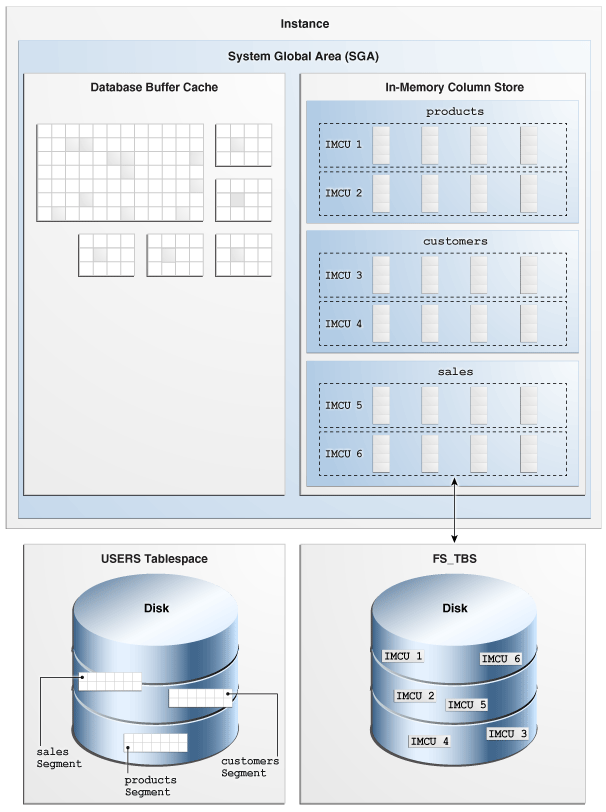

When the IM column store is enabled, In-Memory FastStart (IM FastStart) enables the database to open faster by storing columnar data on disk.

This chapter contains the following topics:

### 11.1 About IM FastStart

IM FastStart optimizes the population of database objects in the IM column store by storing IMCUs directly on disk.

The database can read from the IM FastStart area after instance failure and recovery, or during duplication to a different Oracle RAC instance.

**Note:**

IM FastStart is not supported in a standby database, which is read-only.

This section contains the following topics:

#### 11.1.1 Purpose of IM FastStart

The IM column store is populated whenever a database instance restarts, which can be a slow operation that is I/O-intensive and CPU-intensive.

When IM FastStart is enabled, the database periodically saves a copy of columnar data to disk for faster repopulation during instance restarts. If the database re-opens after being closed, then the database reads columnar data from the FastStart area, and then populates it into the IM column store, ensuring that all transactional consistencies are maintained.

An IM FastStart tablespace requires intermittent I/O while the database is open and operational. The performance gain occurs when the database re-opens because the database avoids the CPU-intensive compression and formatting of data.

#### 11.1.2 How IM FastStart Works

A FastStart area is a designated tablespace where IM FastStart stores and manages data for `INMEMORY` objects. Oracle Database manages the FastStart tablespace without DBA intervention.

Only one FastStart area, and one designated FastStart tablespace, is allowed for each PDB. You cannot alter or drop the tablespace while it is the designated IM FastStart tablespace. In an Oracle RAC database, all nodes share the FastStart data.

Enable a FastStart tablespace using the `DBMS_INMEMORY_ADMIN.FASTSTART_ENABLE` procedure. The Space Management Worker Processes (Wnnn) creates an empty SecureFiles LOB named `SYSDB``instance_name``_LOBSEG$`.

**Note:**

Enabling the IM FastStart area is not sufficient to create the FastStart area. Data [population](glossary.md) or [repopulation](glossary.md) is required.

**See Also:**

- "[Space Management Worker Processes (Wnnn)](in-memory-column-store-architecture.md)"

- "[About Repopulation of the IM Column Store](repopulation-and-dml.md)"

- [Oracle Database PL/SQL Packages and Types Reference](../arpls/DBMS_INMEMORY_ADMIN.md) to learn about the `DBMS_INMEMORY_ADMIN.FASTSTART_ENABLE` procedure

##### 11.1.2.1 How the Database Manages the FastStart Area

During the first population or repopulation after the FastStart area is enabled, the database creates the FastStart area.

The database manages the FastStart area automatically as follows:

- Whenever population or repopulation of an object occurs, the database writes its columnar data to the FastStart area.

  **Note:**

  The database writes segments from encrypted tablespaces to the FastStart area only if the FastStart tablespace is also encrypted.

  The Space Management Worker Processes (Wnnn) write IMCUs (not IMEUs or SMUs) to the SecureFiles LOB named `SYSDB``instance_name``_LOBSEG$`. The database writes FastStart metadata to the `SYSAUX` tablespace, which must be online.

  Depending on how much DML activity occurs for a CU, a lag can exist between the CUs in the FastStart area and the CUs in the IM column store. The “hotter” a CU is, the less frequently the database populates it in the IM column store and writes it to the FastStart area. If the database crashes, then some CUs that were populated in the IM column store may not exist in the FastStart area.

  **Note:**

  If the FastStart area becomes temporarily inaccessible, then In-Memory population is unaffected.

- If you define an [ADO policy](glossary.md) on a segment, then the database manages the segment in the FastStart area based on the rule in the policy. For example, if ADO specifies that an object changes its attribute to `NO INMEMORY` based on a policy, then the IM column store removes its data from the FastStart area.

- If the attribute of a populated object is changed to `NOINMEMORY`, then the database automatically removes its IMCUs from the FastStart area.

- If the FastStart tablespace runs out of space, then the database uses an internal algorithm to drop the oldest segments, and continues writing to the FastStart area. If no space remains, then the database stops writing to the FastStart area.

The following figure shows `products`, `customers`, and `sales` populated in the IM column store.

Figure 11-1 FastStart Area

[Description of "Figure 11-1 FastStart Area"](img_text/cncpt_vm_385.md)

When the FastStart area is enabled, the database also writes the IMCUs for these segments to the FastStart area in `fs_tbs`. If the database re-opens or if the instance restarts, then the database can validate the IMCUs for modifications to ensure the transactional consistency, and reuse the IMCUs. Regardless of whether the FastStart area is enabled, the database stores data blocks and segments on disk in the `users` tablespace.

**Note:**

You cannot manually force the IM column store to write data to the FastStart tablespace.

**See Also:**

- "[Enabling ADO for the IM Column Store](configuring-memory-management.md)"

- "[FastStart Area in Oracle RAC](deploying-in-memory-in-oracle-rac.md)"

- "[About Repopulation of the IM Column Store](repopulation-and-dml.md)"

- [Oracle Database VLDB and Partitioning Guide](../vldbg/ilm-strategy-heatmap-ado.md) to learn more about ADO

##### 11.1.2.2 How the Database Reads from the FastStart Area

The FastStart area defines what data is loaded when the database reopens, but not when it is loaded. Population is controlled by the priority settings.

When the database reopens, the standard `PRIORITY` rules determine population. For example, the database populates objects with `PRIORITY NONE` on demand. Objects with priority `CRITICAL` are higher in the automatic population queue than objects with priority `LOW`.

For example, in a single-instance database, the `sales`, `customers`, and `product` tables are populated with `PRIORITY NONE` in the IM column store. At every repopulation, the database saves the IMCUs for these tables to the FastStart area. Assume that the instance unexpectedly terminates. When you reopen the database, the IM column store is empty. If a query scans the `sales`, `customers`, or `product` table, then the database loads the IMCUs for this table from the FastStart area into the IM column store.

In most cases, the FastStart area increases the speed of population. However, if any CU stored in the FastStart area reaches an internal threshold of DML activity, then the database populates the row data from data files instead of from the FastStart area.

**See Also:**

- "[Prioritization of In-Memory Population](populating-objects-in-memory.md)"

- "[FastStart Area in Oracle RAC](deploying-in-memory-in-oracle-rac.md)"

- [Oracle Database SQL Language Reference](../sqlrf/CREATE-TABLE.md) for `INMEMORY` clause semantics

### 11.2 Enabling IM FastStart for the IM Column Store

Specify a tablespace for the FastStart area using the `DBMS_INMEMORY_ADMIN.FASTSTART_ENABLE` procedure.

Optionally, set the logging mode of the LOB created for the FastStart area. If the `nologging` parameter is set to `TRUE` (default), then the database creates the LOB with the `NOLOGGING` option. If `nologging` is set to `FALSE`, then the database creates the FastStart LOB with the `LOGGING` option.

#### Prerequisites

To create a FastStart area, you must meet the following prerequisites:

- The tablespace that will be designated as the FastStart area must exist.

- This tablespace must have enough space to store data for the IM column store, and it must not contain any other data before you designate it as the FastStart area. Oracle recommends that you create the FastStart tablespace with twice the size of the `INMEMORY_SIZE` setting.

- You must have administrator privileges.

#### To create the IM FastStart area:

1.  In SQL\*Plus or SQL Developer, log in to the database as a user with the necessary privileges.

2.  Use the `DBMS_INMEMORY_ADMIN.FASTSTART_ENABLE` procedure.

Example 11-1 Designating an IM FastStart Area

This example creates a tablespace and designates it as the FastStart area.

1.  In SQL\*Plus or SQL Developer, log in to the database as a user with administrative privileges.

2.  Create a tablespace named `fs_tbs`:

        CREATE TABLESPACE fs_tbs
          DATAFILE 'fs_tbs.dbf' SIZE 500M REUSE
          AUTOEXTEND ON NEXT 500K MAXSIZE 1G;

3.  Enable IM FastStart, and designate the `fs_tbs` tablespace as the FastStart area, using the default `NOLOGGING` option for the FastStart LOB:

        EXEC DBMS_INMEMORY_ADMIN.FASTSTART_ENABLE('fs_tbs');

4.  Query the status and size of the FastStart area:

        COL TABLESPACE_NAME FORMAT a15

        SELECT TABLESPACE_NAME, STATUS,
               ( (ALLOCATED_SIZE/1024) / 1024 ) AS ALLOC_MB,
               ( (USED_SIZE/1024) / 1024 ) AS USED_MB
        FROM   V$INMEMORY_FASTSTART_AREA;

        TABLESPACE_NAME STATUS                 ALLOC_MB    USED_MB
        --------------- -------------------- ---------- ----------
        FS_TBS          ENABLE                      500      .0625

    At this stage, no user data is in the FastStart area.

5.  Query the logging mode of the FastStart LOB:

        COL SEGMENT_NAME FORMAT a20
        SELECT SEGMENT_NAME, LOGGING
        FROM   DBA_LOBS
        WHERE  TABLESPACE_NAME = 'FS_TBS';

        SEGMENT_NAME         LOGGING
        -------------------- -------
        SYSDBIMFS_LOBSEG$    NO

6.  Force the IM column store to repopulate any currently populated objects.

    The following queries force the repopulation of the `sales`, `products`, and `customers` tables:

        SELECT /*+ FULL(s) NO_PARALLEL(s) */ COUNT(*) FROM sh.sales s;
        SELECT /*+ FULL(p) NO_PARALLEL(p) */ COUNT(*) FROM sh.products p;
        SELECT /*+ FULL(c) NO_PARALLEL(c) */ COUNT(*) FROM sh.customers c;

7.  Query the size of the FastStart area:

        COL TABLESPACE_NAME FORMAT a15

        SELECT TABLESPACE_NAME, STATUS,
               ( (ALLOCATED_SIZE/1024) / 1024 ) AS ALLOC_MB,
               ( (USED_SIZE/1024) / 1024 ) AS USED_MB
        FROM   V$INMEMORY_FASTSTART_AREA;

        TABLESPACE_NAME STATUS                 ALLOC_MB    USED_MB
        --------------- -------------------- ---------- ----------
        FS_TBS          ENABLE                      500       2.25

    Now the same query shows that 2.25 MB of the FastStart area has been filled.

**See Also:**

[Oracle Database PL/SQL Packages and Types Reference](../arpls/DBMS_INMEMORY_ADMIN.md) to learn about the `DBMS_INMEMORY_ADMIN` package

### 11.3 Retrieving the Name of the Current IM FastStart Tablespace

Obtain the name of the tablespace that is currently designated as the FastStart area by querying `V$INMEMORY_FASTSTART_AREA` view.

If no FastStart tablespace is enabled, then the `STATUS` column shows `NOT ENABLED`; otherwise, the column shows the tablespace name.

#### Prerequisites

To retrieve the name of the FastStart tablespace, you must have administrator privileges.

#### To retrieve the name of the FastStart tablespace:

1.  In SQL\*Plus or SQL Developer, log in to the database as a user with the necessary privileges.

2.  Query the `V$INMEMORY_FASTSTART_AREA` view.

Example 11-2 Getting the Name of the Current IM FastStart Tablespace

This example queries the name and status of the FastStart tablespace (sample output included):

    COL TABLESPACE_NAME FORMAT a20

    SELECT TABLESPACE_NAME, STATUS
    FROM   V$INMEMORY_FASTSTART_AREA;

    TABLESPACE_NAME      STATUS
    -------------------- ----------
    FS_TBS               ENABLE

**See Also:**

[Oracle Database Reference](../refrn/V-INMEMORY_FASTSTART_AREA.md) to learn about the `V$INMEMORY_FASTSTART_AREA` view

### 11.4 Migrating the FastStart Area to a Different Tablespace

You can migrate the FastStart area to a different tablespace by running the `FASTSTART_MIGRATE_STORAGE` procedure in the `DBMS_INMEMORY_ADMIN` package.

In a non-CDB or PDB, you can designate only one tablespace at a time as the FastStart area.

#### Prerequisites

To migrate a FastStart area, you must meet the following prerequisites:

- The tablespace that will be designated as the new FastStart area must exist.

- This tablespace must have enough space to store data for the IM column store, and it must not contain any other data before it is designated as the FastStart area.

- You must have administrator privileges.

#### To migrate the IM FastStart area:

1.  In SQL\*Plus or SQL Developer, log in to the database as a user with the necessary privileges.

2.  Run the `DBMS_INMEMORY_ADMIN.FASTSTART_MIGRATE_STORAGE` procedure.

Example 11-3 Migrating the FastStart Area to a Different Tablespace

This example migrates the IM FastStart area to the `new_fs_tbs` tablespace.

1.  In SQL\*Plus or SQL Developer, log in to the database as a user with administrative privileges.

2.  Query the name of the current FastStart tablespace:

        COL TABLESPACE_NAME FORMAT a15

        SELECT TABLESPACE_NAME, STATUS
        FROM   V$INMEMORY_FASTSTART_AREA;

        TABLESPACE_NAME STATUS
        --------------- -----------
        FS_TBS          ENABLE

3.  Create a tablespace named `new_fs_tbs`:

        CREATE TABLESPACE new_fs_tbs
          DATAFILE 'new_fs_tbs.dbf' SIZE 500M REUSE
          AUTOEXTEND ON NEXT 500K MAXSIZE 1G;

4.  Migrate the FastStart area to the new tablespace:

        EXEC DBMS_INMEMORY_ADMIN.FASTSTART_MIGRATE_STORAGE('new_fs_tbs');

5.  Query the name of the current FastStart tablespace:

        TABLESPACE_NAME      STATUS
        -------------------- --------------------
        NEW_FS_TBS           ENABLE

**See Also:**

[Oracle Database PL/SQL Packages and Types Reference](../arpls/DBMS_INMEMORY_ADMIN.md) to learn about the `FASTSTART_MIGRATE_STORAGE` procedure

### 11.5 Disabling IM FastStart for the IM Column Store

When you disable IM FastStart, the database no longer maintains the FastStart area. The database does not use IM FastStart to populate the IM column store when the database reopens.

#### Prerequisites

To disable the FastStart area, the following conditions must be true:

- The FastStart area must be enabled.

- You must have administrator privileges.

#### To disable the FastStart tablespace:

1.  In SQL\*Plus or SQL Developer, log in to the database as a user with the necessary privileges.

2.  Query `V$INMEMORY_FASTSTART_AREA` to confirm that the IM FastStart area is enabled.

3.  Execute the `DBMS_INMEMORY_ADMIN.FASTSTART_DISABLE` procedure.

4.  Optionally, drop the FastStart tablespace.

Example 11-4 Disabling IM FastStart

This example disables the IM FastStart area, and then drops the `fs_tbs` tablespace.

1.  In SQL\*Plus or SQL Developer, log in to the database as a user with administrative privileges.

2.  Query the status of the FastStart area:

        COL TABLESPACE_NAME FORMAT a15

        SELECT TABLESPACE_NAME, STATUS
        FROM   V$INMEMORY_FASTSTART_AREA;

        TABLESPACE_NAME STATUS
        --------------- -----------
        FS_TBS          ENABLE

3.  Disable the FastStart area:

        EXEC DBMS_INMEMORY_ADMIN.FASTSTART_DISABLE;

4.  Query the status of the FastStart area:

        SELECT TABLESPACE_NAME, STATUS
        FROM   V$INMEMORY_FASTSTART_AREA;

        TABLESPACE_NAME      STATUS
        -------------------- --------------------
        INVALID_TABLESPACE   DISABLE

    When IM FastStart is not enabled, the value of `TABLESPACE_NAME` is `INVALID_TABLESPACE` and the value of `STATUS` is `DISABLE`.

5.  Drop the former FastStart tablespace:

        DROP TABLESPACE fs_tbs INCLUDING CONTENTS AND DATAFILES;

**See Also:**

[Oracle Database PL/SQL Packages and Types Reference](../arpls/DBMS_INMEMORY_ADMIN.md) to learn about the `FASTSTART_DISABLE` procedure
