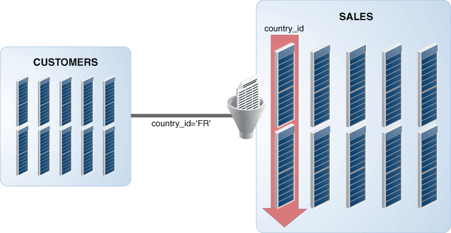
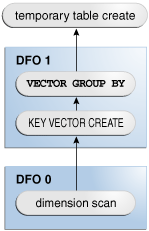
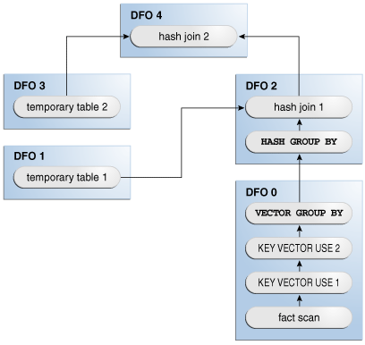

Database In-Memory provides optimizations to speed up aggregation and arithmetic.

### 9.1 Optimizing In-Memory Aggregation with VECTOR GROUP BY

Starting with Oracle Database 12c Release 1 (12.1.0.2), **In-Memory Aggregation (IM aggregation)** enables queries to aggregate while scanning.

#### 9.1.1 About IM Aggregation

IM aggregation optimizes query blocks involving aggregation and joins from a large table to multiple small tables.

The `KEY VECTOR` and `VECTOR GROUP BY` operations use efficient arrays for joins and aggregation. The optimizer chooses `VECTOR GROUP BY` for `GROUP BY` operations based on cost. The optimizer does not choose `VECTOR GROUP BY` aggregations for `GROUP BY ROLLUP`, `GROUPING SETS`, or `CUBE` operations.

**Note:**

IM aggregation is also called vector aggregation and `VECTOR GROUP BY` aggregation.

IM aggregation requires `INMEMORY_SIZE` to be set to a nonzero value. However, IM aggregation does not require that the referenced tables be populated in the IM column store.

**See Also:**

- "[Enabling the IM Column Store for a Database](enabling-the-im-column-store.md)"

- [Oracle Database Data Warehousing Guide](../dwhsg/sql-aggregation-data-warehouses.md) to learn more about SQL aggregation

#### 9.1.2 Purpose of IM Aggregation

IM aggregation preprocesses the small tables to accelerate the per-row work performed on the large table.

A typical analytic query aggregates from a fact table, and joins it to dimension tables. This type of query scans a large volume of data, with optional filtering, and performs a `GROUP BY` of between 1 and 40 columns. The first aggregation on the fact table processes the most rows.

Before Oracle Database 12c, the only `GROUP BY` operations were `HASH` and `SORT`. The `VECTOR GROUP BY` is an additional cost-based transformation that transforms a join between a dimension and fact table into a filter. The database can apply this filter during the fact table scan. The joins use key vectors, which are similar to Bloom filters, and the aggregation uses a `VECTOR GROUP BY`.

**Note:**

Although vector transformations are independent of the IM column store, they can be applied very efficiently to In-Memory data through SIMD vector processing.

IM aggregation enables vector joins and `GROUP BY` operations to occur simultaneously with the scan of the large table. Thus, these operations aggregate as they scan, and do not need to wait for table scans and join operations to complete. IM aggregation optimizes CPU usage, especially the CPU cache.

IM aggregation can greatly improve query performance. The database can create a report outline dynamically, and then fill in report details during the scan of the fact table.

**See Also:**

- "[CPU Architecture: SIMD Vector Processing](in-memory-column-store-architecture.md)"

- [Oracle Database SQL Tuning Guide](../tgsql/query-transformations.md) to learn more about query transformations

##### 9.1.2.1 When IM Aggregation Is Useful

IM aggregation improves performance of queries that join relatively small tables to a relatively large fact table, and aggregate data in the fact table. This typically occurs in a star or snowflake query.

Both row-store tables and tables in the IM column store can benefit from IM aggregation.

Example 9-1 VECTOR GROUP BY

Consider the following query, which performs a join of the `customers` dimension table with the `sales` fact table:

    SELECT c.customer_id, s.quantity_sold, s.amount_sold
    FROM   customers c, sales s
    WHERE  c.customer_id = s.customer_id
    AND    c.country_id = 'FR';

When both tables are populated in the IM column store, the database can use SIMD vector processing to scan the row sets and apply filters. The following figure shows how the query uses vector joins. The optimizer converts the predicate on the `customers` table, `c.country_id='FR'` into a filter on the `sales` fact table. The filter is `country_id='FR'`. Because `sales` is stored in columnar format, the query only needs to scan one column to determine the result.

Figure 9-1 Vector Joins Using In-Memory Column Store

[Description of "Figure 9-1 Vector Joins Using In-Memory Column Store"](img_text/in_mem_joins.md)

##### 9.1.2.2 When IM Aggregation Is Not Beneficial

IM aggregation benefits certain star queries when sufficient system resources exist. Other queries may receive little or no benefit.

##### Situations Where VECTOR GROUP BY Aggregation Is Not Advantageous

Specifically, `VECTOR GROUP BY` aggregation does not benefit performance in the following scenarios:

- Joins are performed between two very large tables.

  By default, the optimizer chooses a `VECTOR GROUP BY` transformation only if a relatively small table is joined to a relatively large table.

- Dimensions contain more than 2 billion rows.

  The `VECTOR GROUP BY` transformation is not used if a dimension contains more than 2 billion rows.

- The system does not have sufficient memory.

  Most databases that use the IM column store benefit from IM aggregation.

#### 9.1.3 How IM Aggregation Works

A typical analytic query distributes rows among processing stages.

The stages are as follows:

1.  Filtering tables and producing row sets

2.  Joining row sets

3.  Aggregating rows

The `VECTOR GROUP BY` transformation combines the work in the different stages, converting joins to filters and aggregating while scanning the fact table.

The unit of work between stages is called a [data flow operator (DFO)](glossary.md). `VECTOR GROUP BY` aggregation uses a DFO for each dimension to create a key vector structure and temporary table. When aggregating measure columns from the fact table, the database uses this key vector to translate a fact join key to its dense grouping key. The late materialization step joins on the dense grouping keys to the temporary tables.

##### 9.1.3.1 When the Optimizer Chooses IM Aggregation

The optimizer decides whether to use vector transformation based on the size of the key vector (that is, the distinct join keys), the number of distinct grouping keys, and other factors.

The optimizer tends to choose this transformation when dimension join keys have low cardinality. Oracle Database uses `VECTOR GROUP BY` aggregation to perform data aggregation when the following conditions are met:

- The queries or subqueries aggregate data from a fact table and join the fact table to one or more dimensions.

  Multiple fact tables joined to the same dimensions are also supported assuming that these fact tables are connected only through joins to the dimension. In this case, `VECTOR GROUP BY` aggregates fact table separately and then joins the results on the grouping keys.

- The dimensions and fact table are connected to each other only through join columns.

  Specifically, the query must not have any other predicates that refer to columns across multiple dimensions or from both a dimension and the fact table. If a query performs a join between two or more tables and then joins the result to the fact, then `VECTOR GROUP BY` aggregation treats the multiple dimensions as a single dimension.

**Note:**

You can direct the database to use `VECTOR GROUP BY` aggregation for a query by using query block hints or table hints.

`VECTOR GROUP BY` aggregation does not support the following:

- Semi-joins and anti-joins across multiple dimensions or between a dimension and the fact table

- Equijoins across multiple dimensions

- Aggregations performed using the `DISTINCT` function

**Note:**

Bloom filters and `VECTOR GROUP BY` aggregation are mutually exclusive. Therefore, if a query uses Bloom filters to join row sets, then `VECTOR GROUP BY` aggregation is not applicable to the processing of this query.

**See Also:**

[Oracle Database Data Warehousing Guide](../dwhsg/sql-aggregation-data-warehouses.md) to learn more about SQL aggregation

##### 9.1.3.2 Key Vector

A **key vector** is a data structure that maps between dense join keys and dense grouping keys.

A [dense key](glossary.md) is a numeric key that is stored as a native integer and has a range of values. A [dense join key](glossary.md) represents all join keys whose join columns come from a particular fact table or dimension. A [dense grouping key](glossary.md) represents all grouping keys whose grouping columns come from a particular fact table or dimension. A key vector enables fast lookups.

Example 9-2 Key Vector

Assume that the `hr.locations` table has values for `country_id` as shown (only the first few results are shown):

    SQL> SELECT country_id FROM locations;

    CO
    --
    IT
    IT
    JP
    JP
    US
    US
    US
    US
    CA
    CA
    CN

A complex analytic query applies the filter `WHERE country_id='US'` to the `locations` table. A key vector for this filter might look like the following one-dimensional array:

    0
    0
    0
    0
    1
    1
    1
    1
    0
    0
    0

In the preceding array, `1` is the dense grouping key for `country_id='US'`. The `0` values indicate rows in `locations` that do not match this filter. If a query uses the filter `WHERE country_id IN ('US','JP')`, then the array might look as follows, where `2` is the dense grouping key for `JP` and `1` is the dense grouping key for `US`:

    0
    0
    2
    2
    1
    1
    1
    1
    0
    0
    0

##### 9.1.3.3 Two Phases of IM Aggregation

Typically, `VECTOR GROUP BY` aggregation processes each dimension in sequence, and then processes the fact table.

When performing IM aggregation, the database proceeds as follows:

1.  Process each dimension sequentially as follows:

    1.  Find the unique dense grouping keys.

    2.  Create a key vector.

    3.  Create a temporary table (`CURSOR DURATION MEMORY`).

    The following figure illustrates the steps in this phase, beginning with the scan of the dimension table in DFO 0, and ending with the creation of a temporary table. In the simplest form of parallel `GROUP BY` or join processing, the database processes each join or `GROUP BY` in its own DFO.

    Figure 9-2 Phase 1 of In-Memory Aggregation

    
    [Description of "Figure 9-2 Phase 1 of In-Memory Aggregation"](img_text/tgsql_vm_079.md)

2.  Process the fact table.

    1.  Process all the joins and aggregations using the key vectors created in the preceding phase.

    2.  Join back the results to each temporary table.

    Figure 9-3 illustrates phase 2 in a join of the fact table with two dimensions. In DFO 0, the database performs a full scan of the fact table, and then uses the key vectors for each dimension to filter out nonmatching rows. DFO 2 joins the results of DFO 0 with DFO 1. DFO 4 joins the result of DFO 2 with DFO 3.

    Figure 9-3 Phase 2 of In-Memory Aggregation

    
    [Description of "Figure 9-3 Phase 2 of In-Memory Aggregation"](img_text/tgsql_vm_078.md)

##### 9.1.3.4 IM Aggregation: Scenario

This section gives a conceptual example of how `VECTOR` `GROUP BY` aggregation works.

**Note:**

The scenario does not use the sample schema tables or show an actual execution plan.

###### 9.1.3.4.1 Sample Analytic Query of a Star Schema

This sample star schema in this scenario contains the `sales_online` fact table and two dimension tables: `geography` and `products`.

Each row in `geography` is uniquely identified by the `geog_id` column. Each row in `products` is uniquely identified by the `prod_id` column. Each row in `sales_online` is uniquely identified by the `geog_id`, `prod_id`, and amount sold.

Table 9-1 Sample Rows in geography Table

| country | state | city    | geog_id |
|:--------|:------|:--------|:--------|
| USA     | WA    | seattle | 2       |
| USA     | WA    | spokane | 3       |
| USA     | CA    | SF      | 7       |
| USA     | CA    | LA      | 8       |

Table 9-2 Sample Rows in products Table

| manuf | category | subcategory | prod_id |
|:------|:---------|:------------|:--------|
| Acme  | sport    | bike        | 4       |
| Acme  | sport    | ball        | 3       |
| Acme  | electric | bulb        | 1       |
| Acme  | electric | switch      | 8       |

Table 9-3 Sample Rows in sales_online Table

| prod_id | geog_id | amount |
|:--------|:--------|:-------|
| 8       | 1       | 100    |
| 9       | 1       | 150    |
| 8       | 2       | 100    |
| 4       | 3       | 110    |
| 2       | 30      | 130    |
| 6       | 20      | 400    |
| 3       | 1       | 100    |
| 1       | 7       | 120    |
| 3       | 8       | 130    |
| 4       | 3       | 200    |

A manager asks the business question, "How many Acme products in each subcategory were sold online in Washington, and how many were sold in California?" To answer this question, an analytic query of the `sales_online` fact table joins the `products` and `geography` dimension tables as follows:

    SELECT p.category, p.subcategory, g.country, g.state, SUM(s.amount)
    FROM   sales_online s, products p, geography g
    WHERE  s.geog_id = g.geog_id
    AND    s.prod_id = p.prod_id
    AND    g.state IN ('WA','CA')
    AND    p.manuf = 'ACME'
    GROUP BY category, subcategory, country, state

###### 9.1.3.4.2 Step 1: Key Vector and Temporary Table Creation for geography Dimension

In the first phase of `VECTOR GROUP BY` aggregation for this query, the database creates a dense grouping key for each city/state combination for cities in the states of Washington or California.

In Table 9-6, the `1` is the `USA,WA` grouping key, and the `2` is the `USA,CA` grouping key.

Table 9-4 Dense Grouping Key for geography

| country | state | city    | geog_id | dense_gr_key_geog |
|:--------|:------|:--------|:--------|:------------------|
| USA     | WA    | seattle | 2       | 1                 |
| USA     | WA    | spokane | 3       | 1                 |
| USA     | CA    | SF      | 7       | 2                 |
| USA     | CA    | LA      | 8       | 2                 |

A key vector for the `geography` table looks like the array represented by the final column in Table 9-5. The values are the `geography` dense grouping keys. Thus, the key vector indicates which rows in `sales_online` meet the `geography.state` filter criteria (a sale made in the state of `CA` or `WA`) and which country/state group each row belongs to (either the `USA,WA` group or `USA,CA` group).

Table 9-5 Online Sales

| prod_id | geog_id | amount | key vector for geography |
|:--------|:--------|:-------|:-------------------------|
| 8       | 1       | 100    | 0                        |
| 9       | 1       | 150    | 0                        |
| 8       | 2       | 100    | 1                        |
| 4       | 3       | 110    | 1                        |
| 2       | 30      | 130    | 0                        |
| 6       | 20      | 400    | 0                        |
| 3       | 1       | 100    | 0                        |
| 1       | 7       | 120    | 2                        |
| 3       | 8       | 130    | 2                        |
| 4       | 3       | 200    | 1                        |

Internally, the database creates a temporary table similar to the following:

    CREATE TEMPORARY TABLE tt_geography AS
    SELECT MAX(country), MAX(state), KEY_VECTOR_CREATE(...) dense_gr_key_geog
    FROM   geography
    WHERE  state IN ('WA','CA')
    GROUP BY country, state

Table 9-6 shows rows in the `tt_geography` temporary table. The dense grouping key for the `USA,WA` combination is `1`, and the dense grouping key for the `USA,CA` combination is `2`.

Table 9-6 tt_geography

| country | state | dense_gr_key_geog |
|:--------|:------|:------------------|
| USA     | WA    | 1                 |
| USA     | CA    | 2                 |

###### 9.1.3.4.3 Step 2: Key Vector and Temporary Table Creation for products Dimension

The database creates a dense grouping key for each distinct category/subcategory combination of an Acme product.

For example, in Table 9-7, the `4` is the dense grouping key for an Acme electric switch.

Table 9-7 Sample Rows in products Table

| manuf | category | subcategory | prod_id | dense_gr_key_prod |
|:------|:---------|:------------|:--------|:------------------|
| Acme  | sport    | bike        | 4       | 1                 |
| Acme  | sport    | ball        | 3       | 2                 |
| Acme  | electric | bulb        | 1       | 3                 |
| Acme  | electric | switch      | 8       | 4                 |

A key vector for the `products` table might look like the array represented by the final column in Table 9-8. The values represent the `products` dense grouping key. For example, the `4` represents the online sale of an Acme electric switch. Thus, the key vector indicates which rows in `sales_online` meet the `products` filter criteria (a sale of an Acme product).

Table 9-8 Key Vector

| prod_id | geog_id | amount | key vector for products |
|:--------|:--------|:-------|:------------------------|
| 8       | 1       | 100    | 4                       |
| 9       | 1       | 150    | 0                       |
| 8       | 2       | 100    | 4                       |
| 4       | 3       | 110    | 1                       |
| 2       | 30      | 130    | 0                       |
| 6       | 20      | 400    | 0                       |
| 3       | 1       | 100    | 2                       |
| 1       | 7       | 120    | 3                       |
| 3       | 8       | 130    | 2                       |
| 4       | 3       | 200    | 1                       |

Internally, the database creates a temporary table similar to the following:

    CREATE TEMPORTARY TABLE tt_products AS
    SELECT MAX(category), MAX(subcategory), KEY_VECTOR_CREATE(...) dense_gr_key_prod
    FROM   products
    WHERE  manuf = 'ACME'
    GROUP BY category, subcategory

Table 9-9 shows rows in this temporary table.

Table 9-9 tt_products

| category | subcategory | dense_gr_key_prod |
|:---------|:------------|:------------------|
| sport    | bike        | 1                 |
| sport    | ball        | 2                 |
| electric | bulb        | 3                 |
| electric | switch      | 4                 |

###### 9.1.3.4.4 Step 3: Key Vector Query Transformation

In this phase, the database processes the fact table.

The optimizer transforms the original query into the following equivalent query, which accesses the key vectors:

    SELECT KEY_VECTOR_PROD(prod_id),
           KEY_VECTOR_GEOG(geog_id),
           SUM(amount)
    FROM   sales_online
    WHERE  KEY_VECTOR_PROD_FILTER(prod_id) IS NOT NULL
    AND    KEY_VECTOR_GEOG_FILTER(geog_id) IS NOT NULL
    GROUP BY KEY_VECTOR_PROD(prod_id), KEY_VECTOR_GEOG(geog_id)

The preceding transformation is not an exact rendition of the internal SQL, which is much more complicated, but a conceptual representation designed to illustrate the basic concept.

###### 9.1.3.4.5 Step 4: Row Filtering from Fact Table

This phase obtains the amount sold for each combination of grouping keys.

The database uses the key vectors to filter out unwanted rows from the fact table. In Table 9-10, the first three columns represent the `sales_online` table. The last two columns provide the dense grouping keys for the `geography` and `products` tables.

Table 9-10 Dense Grouping Keys for the sales_online Table

| prod_id | geog_id | amount | dense_gr_key_prod | dense_gr_key_geog |
|:--------|:--------|:-------|:------------------|:------------------|
| 7       | 1       | 100    | 4                 |                   |
| 9       | 1       | 150    |                   |                   |
| 8       | 2       | 100    | 4                 | 1                 |
| 4       | 3       | 110    | 1                 | 1                 |
| 2       | 30      | 130    |                   |                   |
| 6       | 20      | 400    |                   |                   |
| 3       | 1       | 100    | 2                 |                   |
| 1       | 7       | 120    | 3                 | 2                 |
| 3       | 8       | 130    | 2                 | 2                 |
| 4       | 3       | 200    | 1                 | 1                 |

As shown in Table 9-11, the database retrieves only those rows from `sales_online` with non-null values for both dense grouping keys, indicating rows that satisfy all the filtering criteria.

Table 9-11 Filtered Rows from sales_online Table

| geog_id | prod_id | amount | dense_gr_key_prod | dense_gr_key_geog |
|:--------|:--------|:-------|:------------------|:------------------|
| 2       | 8       | 100    | 4                 | 1                 |
| 3       | 4       | 110    | 1                 | 1                 |
| 3       | 4       | 200    | 1                 | 1                 |
| 7       | 1       | 120    | 3                 | 2                 |
| 8       | 3       | 130    | 2                 | 2                 |

###### 9.1.3.4.6 Step 5: Aggregation Using an Array

The database uses a multidimensional array to perform the aggregation.

In Table 9-12, the `geography` grouping keys are horizontal, and the `products` grouping keys are vertical. The database adds the values in the intersection of each dense grouping key combination. For example, for the intersection of the `geography` grouping key `1` and the `products` grouping key `1`, the sum of `110` and `200` is `310`.

Table 9-12 Aggregation Array

| dgkp/dgkg | 1         | 2     |
|:----------|:----------|:------|
| 1         | `110,200` |       |
| 2         |           | `130` |
| 3         |           | `120` |
| 4         | `100`     |       |

###### 9.1.3.4.7 Step 6: Join Back to Temporary Tables

In the final stage of processing, the database uses the dense grouping keys to join back the rows to the temporary tables to obtain the names of the regions and categories.

The results look as follows:

    CATEGORY SUBCATEGORY COUNTRY STATE AMOUNT
    -------- ----------- ------- ----- ------
    electric bulb        USA     CA    120
    electric switch      USA     WA    100
    sport    ball        USA     CA    130
    sport    bike        USA     WA    310

#### 9.1.4 Controls for IM Aggregation

IM aggregation is integrated with the optimizer.

No new SQL or initialization parameters are required. IM aggregation does not need additional indexes, foreign keys, or dimensions.

To control IM aggregation manually, you can use the following pairs of hints:

- Query block hints

  `VECTOR_TRANSFORM` enables the vector transformation on the specified query block, regardless of costing. `NO_VECTOR_TRANSFORM` disables the vector transformation from engaging on the specified query block.

- Table hints

  You can use the following pairs of hints:

  - `VECTOR_TRANSFORM_FACT` includes the specified `FROM` expressions in the fact table generated by the vector transformation. `NO_VECTOR_TRANSFORM_FACT` excludes the specified `FROM` expressions from the fact table generated by the vector transformation.

  - `VECTOR_TRANSFORM_DIMS` includes the specified `FROM` expressions in enabled dimensions generated by the vector transformation. `NO_VECTOR_TRANSFORM_DIMS` excludes the specified `FROM` expressions from enabled dimensions generated by the vector transformation.

**See Also:**

[Oracle Database SQL Language Reference](../sqlrf/Comments.md) to learn more about the `VECTOR_TRANSFORM_FACT` and `VECTOR_TRANSFORM_DIMS` hints

#### 9.1.5 In-Memory Aggregation: Example

In this example, the business question is "How many products were sold in each category in each calendar year?"

You write the following query, which joins the `times`, `products`, and `sales` tables:

    SELECT t.calendar_year, p.prod_category, SUM(quantity_sold)
    FROM   times t, products p, sales s
    WHERE  t.time_id = s.time_id
    AND    p.prod_id = s.prod_id
    GROUP BY t.calendar_year, p.prod_category;

Example 9-3 VECTOR GROUP BY Execution Plan

The following example shows the execution plan contained in the current cursor. Steps 4 and 8 show the creation of the key vectors for the dimension tables `times` and `products`. Steps 17 and 18 show the use of the previously created key vectors. Step 15 shows the `VECTOR GROUP BY` operation.

    ----------------------------------------------------------
    Execution Plan
    ----------------------------------------------------------
    Plan hash value: 2093829546

    ------------------------------------------------------------------------------------------------------------------
    |Id| Operation                               | Name                   |Rows|Bytes|Cost(%CPU)|Time |Pstart| Pstop |
    ------------------------------------------------------------------------------------------------------------------
    |0 |SELECT STATEMENT                         |                        | 18 | 1116|302(90)|0:00:01|       |       |
    |1 | TEMP TABLE TRANSFORMATION               |                        |    |     |       |       |       |       |
    |2 |  LOAD AS SELECT (CURSOR DURATION MEMORY)|SYS_TEMP_0FD9D6608_F6A13|    |     |       |       |       |       |
    |3 |   HASH GROUP BY                         |                        |  5 |  80 | 3 (67)|0:00:01|       |       |
    |4 |    KEY VECTOR CREATE BUFFERED           | :KV0000                |  5 |  80 | 2 (50)|0:00:01|       |       |
    |5 |     TABLE ACCESS INMEMORY FULL          | TIMES                  |1826|21912| 2 (50)|0:00:01|       |       |
    |6 |  LOAD AS SELECT (CURSOR DURATION MEMORY)|SYS_TEMP_0FD9D6607_F6A13|    |     |       |       |       |       |
    |7 |   HASH GROUP BY                         |                        |  5 | 125 | 2 (50)|0:00:01|       |       |
    |8 |    KEY VECTOR CREATE BUFFERED           | :KV0001                |  5 | 125 | 1  (0)|0:00:01|       |       |
    |9 |     TABLE ACCESS INMEMORY FULL          | PRODUCTS               | 72 |1512 | 1  (0)|0:00:01|       |       |
    |10|  HASH GROUP BY                          |                        | 18 |1116 |297(91)|0:00:01|       |       |
    |11|   HASH JOIN                             |                        | 18 |1116 |296(91)|0:00:01|       |       |
    |12|    HASH JOIN                            |                        | 18 | 666 |294(91)|0:00:01|       |       |
    |13|     TABLE ACCESS FULL                   |SYS_TEMP_0FD9D6608_F6A13|  5 |  80 | 2  (0)|0:00:01|       |       |
    |14|     VIEW                                | VW_VT_0737CF93         | 18 | 378 |291(92)|0:00:01|       |       |
    |15|      VECTOR GROUP BY                    |                        | 18 | 414 |291(92)|0:00:01|       |       |
    |16|       HASH GROUP BY                     |                        | 18 | 414 |291(92)|0:00:01|       |       |
    |17|        KEY VECTOR USE                   | :KV0000                |918K| 20M |285(92)|0:00:01|       |       |
    |18|         KEY VECTOR USE                  | :KV0001                |918K| 16M |284(92)|0:00:01|       |       |
    |19|          PARTITION RANGE ITERATOR       |                        |918K| 13M |282(92)|0:00:01|:KV0000|:KV0000|
    |20|           TABLE ACCESS INMEMORY FULL    | SALES                  |918K| 13M |282(92)|0:00:01|:KV0000|:KV0000|
    |21|    TABLE ACCESS FULL                    |SYS_TEMP_0FD9D6607_F6A13|  5 | 125 | 2  (0)|0:00:01|       |       |
    ------------------------------------------------------------------------------------------------------------------

    Predicate Information (identified by operation id):
    ---------------------------------------------------

    11 - access("ITEM_9"=INTERNAL_FUNCTION("C0"))
    12 - access("ITEM_8"=INTERNAL_FUNCTION("C0"))
    20 - inmemory(SYS_OP_KEY_VECTOR_FILTER("S"."PROD_ID",:KV0001) AND SYS_OP_KEY_VECTOR_FILTER("S"."TIME_ID",:KV0000))
           filter(SYS_OP_KEY_VECTOR_FILTER("S"."PROD_ID",:KV0001) AND SYS_OP_KEY_VECTOR_FILTER("S"."TIME_ID",:KV0000))

    Note
    -----
       - vector transformation used for this statement

    Statistics
    ----------------------------------------------------------
             26  recursive calls
             13  db block gets
            124  consistent gets
             67  physical reads
           2200  redo size
           1454  bytes sent via SQL*Net to client
            634  bytes received via SQL*Net from client
              3  SQL*Net roundtrips to/from client
              2  sorts (memory)
              0  sorts (disk)
             20  rows processed

### 9.2 Optimizing In-Memory Arithmetic

In-Memory Optimized Arithmetic uses an optimized `NUMBER` format for fast calculations using SIMD hardware.

#### 9.2.1 About In-Memory Optimized Arithmetic

The In-Memory optimized `NUMBER` format enables fast calculations using SIMD hardware.

For tables compressed with `QUERY LOW`, `NUMBER` columns are encoded using an optimized format that enables native calculations in hardware. SIMD vector processing enables simple aggregations, `GROUP BY` aggregations, and arithmetic operations to benefit significantly. The performance improvement depends on the amount of time the aggregation spends on arithmetic computation. Some aggregations may benefit by up to a factor of 9.

Not all row sources in the query processing engine have support for the In-Memory optimized number format. Therefore, the IM column store must store both the traditional Oracle Database `NUMBER` data type and the In-Memory optimized number type. This dual storage increases space overhead, sometimes up to 15%.

**See Also:**

"[Estimating the Required Size of the IM Column Store](enabling-the-im-column-store.md)"

#### 9.2.2 Enabling and Disabling In-Memory Optimized Arithmetic

Control the feature by setting the initialization parameter `INMEMORY_OPTIMIZED_ARITHMETIC` to `DISABLE` (default) or `ENABLE`.

When set to `ENABLE`, Oracle Database uses an In-Memory optimized encoding for `NUMBER` columns in tables that use `FOR QUERY LOW` compression. When set to `DISABLE`, the database does not use the optimized encoding.

Switching from `ENABLE` to `DISABLE` does not drop the optimized number encoding for existing IMCUs immediately. Instead, as the IM column store repopulates IMCUs, the new IMCUs do not use the optimized encoding.

##### To enable and disable In-Memory Optimized Arithmetic:

1.  In SQL\*Plus or SQL Developer, log in to the database as a user with the necessary privileges.

2.  Specify `INMEMORY_OPTIMIZED_ARITHMETIC` using the `ALTER SYSTEM` statement.

    The following example enables In-Memory Optimized Arithmetic:

        ALTER SYSTEM SET INMEMORY_OPTIMIZED_ARITHMETIC = 'ENABLE' SCOPE=BOTH;

**See Also:**

[Oracle Database Reference](../refrn/INMEMORY_OPTIMIZED_ARITHMETIC.md) to learn more about the `INMEMORY_OPTIMIZED_ARITHMETIC` initialization parameter
