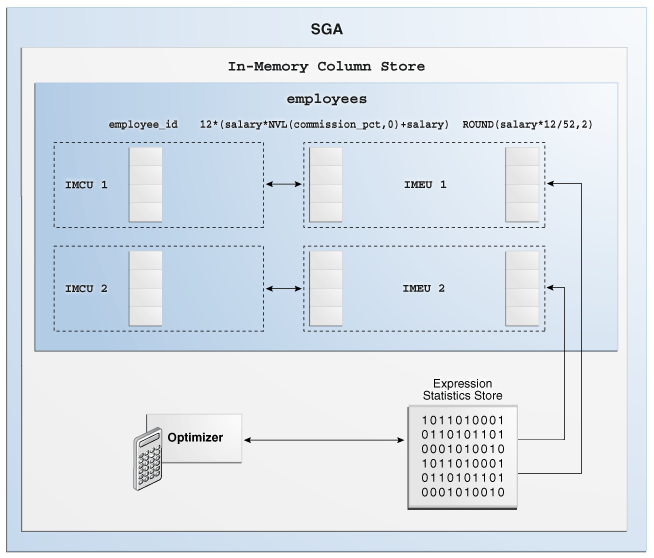

In the context of the IM column store, an expression is a combination of one or more values, operators, and SQL or PL/SQL functions (`DETERMINISTIC` only) that resolve to a value.

The [Expression Statistics Store (ESS)](glossary.md) automatically tracks the results of frequently evaluated (“hot”) expressions. You can use the `DBMS_INMEMORY_ADMIN` package to capture hot expressions and populate them as hidden virtual columns, or drop some or all of them.

### 7.1 About IM Expressions

By default, the `DBMS_INMEMORY_ADMIN.IME_CAPTURE_EXPRESSIONS` procedure identifies and populates “hot” expressions, called **In-Memory Expressions (IM expressions)**.

An IM expression is materialized as a hidden [virtual column](glossary.md) in a heap-organized table, but is accessed in the same way as a non-virtual column. To store the materialized expressions, the IM column store uses special compression formats such as fixed-width vectors and dictionary encoding with fixed-width codes.

**Note:**

IM expressions are not supported for external tables.

Oracle Database automatically identifies the expressions that are candidates for population in the IM column store. In `DBA_IM_EXPRESSIONS.COLUMN_NAME`, IM expression columns have the prefix `SYS_IME`. You cannot create `SYS_IME` columns directly. For example, consider the following query, which specifies two expressions, aliased `weekly_sal` and `ann_comp`:

    SELECT employee_id, last_name, salary, commission_pct,
           ROUND(salary*12/52,2) as "weekly_sal",
           12*(salary*NVL(commission_pct,0)+salary) as "ann_comp"
    FROM   employees
    ORDER BY ann_comp;

The arithmetical expressions `ROUND(salary*12/52,2)` and `12*(salary*NVL(commission_pct,0)+salary)` are computationally intensive and frequently accessed, which makes them candidates for hidden IM expression columns.

The `DBMS_INMEMORY_ADMIN` package is the primary interface for managing IM expressions:

- To induce the database to identify IM expressions and add them to their respective tables during the next [repopulation](glossary.md), use `IME_CAPTURE_EXPRESSIONS`.

- To force immediate population of IM expressions, use `IME_POPULATE_EXPRESSIONS`.

- To drop `SYS_IME` columns, use `DBMS_INMEMORY_ADMIN.IME_DROP_ALL_EXPRESSIONS` or `DBMS_INMEMORY.IME_DROP_EXPRESSIONS`.

**See Also:**

- "[In-Memory External Tables](populating-objects-in-memory.md)"

- [Oracle Database SQL Language Reference](../sqlrf/Expressions.md) to learn more about expressions

- [Oracle Database PL/SQL Packages and Types Reference](../arpls/DBMS_INMEMORY_ADMIN.md) to learn more about `DBMS_INMEMORY_ADMIN`

- [Oracle Database Reference](../refrn/DBA_IM_EXPRESSIONS.md) to learn more about the `DBA_IM_EXPRESSIONS` view

#### 7.1.1 Purpose of IM Expressions

IM expressions speed queries of large data sets by precomputing computationally intensive expressions.

IM expressions especially benefit frequently executed table joins, projections, and predicate evaluations. The primary advantages of IM expressions are as follows:

- A query does not need to recalculate the expressions every time. If the IM column store does not populate the expression results, then the database must compute them for every row, which can be resource intensive. The database incurs the CPU overhead during the population.

- The materialization of IM expressions enables the database to take advantage of performance-enhancing features such as SIMD vector processing and [IMCU pruning](glossary.md).

- The database, rather than the user, tracks which expressions are most active within a user-specified expression capture window.

IM expressions and materialized views address the same problem: how to avoid repeatedly evaluating expressions. However, IM expressions have advantages over materialized views:

- IM expressions can capture data that is not persistently stored.

  For example, the IM column store can automatically cache internal computations based on expressions in the query.

- To be used effectively, a materialized view must have all columns listed in the query, or the query must join the view and the base tables. In contrast, any query containing an IM expression can benefit.

- The database identifies and creates IM expressions automatically, unlike materialized views, which are user-created objects.

**See Also:**

- "[In-Memory Storage Indexes](in-memory-column-store-architecture.md)"

- "[Expression Statistics Store (ESS)](in-memory-column-store-architecture.md)"

- [Oracle Database Data Warehousing Guide](../dwhsg/basic-materialized-views.md) to learn more about materialized views

#### 7.1.2 How IM Expressions Work

To identify expressions as candidates for IM expressions, the database queries the ESS. The optimizer uses the ESS to maintain statistics about expression evaluation for a heap-organized table.

##### 7.1.2.1 IM Expressions Infrastructure

The IM expressions infrastructure is responsible for computing and populating the results of IM expressions, IM virtual columns, and any other useful internal computations in the IM column store. These optimizations primarily benefit analytic queries.

Populated results can include function evaluations on columns used in project, scan, or join expressions. The IM column store can automatically cache internal computations based on the expressions evaluated by the SQL runtime engine during query evaluation.

##### Virtual Columns

Besides populating an IM expression, the IM column store can populate an [In-Memory virtual column](glossary.md). The underlying mechanism is the same: an IM expression is a virtual column. However, IM virtual columns are user-created and exposed, whereas IM expressions are database-created and hidden.

**See Also:**

"[Enabling and Disabling Columns for In-Memory Tables](populating-objects-in-memory.md)"

##### Static Expressions: Binary JSON Columns

The IM expressions infrastructure supports both dynamic expressions (IM expressions and virtual columns) and static expressions.

Starting in Oracle Database 12c Release 2 (12.2), the IM column store supports [OSON](glossary.md), which is a binary JSON format that performs better than row-oriented JSON text storage. Queries access the actual JSON data, but use optimized virtual columns to speed access.

The database uses the IM expression infrastructure to load an efficient binary representation of JSON text columns as virtual columns. If the `MAX_STRING_SIZE` initialization parameter is set to `EXTENDED` for the `VARCHAR2` data type, then the IM column store can store OSON virtual columns up to 32 KB.

Oracle Database supports multiple JSON functions: `JSON_TABLE`, `JSON_VALUE`, and `JSON_EXISTS`. The `INMEMORY_EXPRESSIONS_USAGE` initialization parameter controls the behavior of both dynamic expressions and static expressions.

**See Also:**

- [Oracle Database JSON Developer’s Guide](../adjsn/in-memory-json-data.md) to learn more about using JSON with Database In-Memory

- Oracle Database Reference to learn about [`INMEMORY_EXPRESSIONS_USAGE`](../refrn/INMEMORY_EXPRESSIONS_USAGE.md) , [`ALL_JSON_COLUMNS`](../refrn/ALL_JSON_COLUMNS.md) , and [`MAX_STRING_SIZE`](../refrn/MAX_STRING_SIZE.md)

##### 7.1.2.2 Capture of IM Expressions

When you invoke the `IME_CAPTURE_EXPRESSIONS` procedure, the database queries the ESS, and identifies the 20 most frequently accessed (“hottest”) expressions in the specified time range.

The time range is either a user-specified time window, the past 24 hours, or since database creation. The database only considers expressions on tables that are at least partially populated in the IM column store.

###### 7.1.2.2.1 Expression Capture Interval

The **expression capture interval** is the period in which the database evaluates expressions for possible capture.

Starting in Oracle Database 18c, the `snapshot` parameter of the `DBMS_INMEMORY_ADMIN.IME_CAPTURE_EXPRESSIONS` procedure accepts the following values that define the expression capture interval:

- `CUMULATIVE`

  The database considers all expression statistics since the creation of the database.

- `CURRENT`

  The database considers only expression statistics from the past 24 hours.

- `WINDOW`

  The database adds hidden virtual columns for expressions tracked in the most recent user-specified expression capture window. This window opens with the manual invocation of the `IME_OPEN_CAPTURE_WINDOW` procedure, and then closes with the manual invocation of the `IME_CLOSE_CAPTURE_WINDOW` procedure.

  If the capture window is currently open, then the database considers all expressions tracked in the current window up until this point, and then materializes the hottest expressions. To list the expressions that have been tracked in the current window, query `DBA_EXPRESSION_STATISTICS` with `SNAPSHOT = 'WINDOW'`.

A user-defined time interval (`snapshot='WINDOW'`) is useful for ensuring that only expressions occurring within this window are considered for materialization. This mechanism is especially useful when a short interval is representative of the entire workload. For example, during the trading window, a brokerage firm can gather the set of expressions, and materialize them in the IM column store to speed-up future query processing for the entire workload.

**See Also:**

Oracle Database PL/SQL Packages and Types Reference to learn more about [`IME_OPEN_CAPTURE_WINDOW`](../arpls/DBMS_INMEMORY_ADMIN.md), [`IME_CLOSE_CAPTURE_WINDOW`](../arpls/DBMS_INMEMORY_ADMIN.md), and [`IME_CAPTURE_EXPRESSIONS`](../arpls/DBMS_INMEMORY_ADMIN.md)

###### 7.1.2.2.2 Hidden SYS_IME Virtual Columns

During capture, the database adds the 20 hottest expressions to their respective tables as hidden `SYS_IME` virtual columns and applies the default `INMEMORY` column compression clause.

If `SYS_IME` columns added during a previous invocation no longer appear in the latest expression list, then their attribute changes to `NO INMEMORY`.

Figure 7-1 Defining Hidden SYS_IME Virtual Columns

[Description of "Figure 7-1 Defining Hidden SYS_IME Virtual Columns"](img_text/inmem_3v_031.md)

The maximum number of `SYS_IME` columns for a table is 50, regardless of whether the attribute is `INMEMORY`. After a table reaches the 50-expression limit, the database does not add new `SYS_IME` columns. To permit new expressions, you must drop `SYS_IME` columns with the `DBMS_INMEMORY.IME_DROP_EXPRESSIONS` or `DBMS_INMEMORY_ADMIN.IME_DROP_ALL_EXPRESSIONS` procedures.

Both `SYS_IME` virtual columns and user-defined virtual columns count toward the 1000-column limit for a table. For example, if a table contains 980 non-virtual (on-disk) columns, then you can add only 20 virtual columns.

**See Also:**

[Oracle Database PL/SQL Packages and Types Reference](../arpls/DBMS_INMEMORY_ADMIN.md) to learn more about `DBMS_INMEMORY_ADMIN`

##### 7.1.2.3 How the ESS Works

The ESS is a repository maintained by the optimizer to store statistics about expression evaluation.

For each table, the ESS maintains expression statistics such as frequency of execution and cost of evaluation. When evaluating predicates, Oracle Database tracks and provides run-time feedback on evaluation counts and the dynamic costs of expressions. Based on the ESS statistics, the database may decide that queries would perform better if a specific expression were an IM expression.

**Note:**

Expressions cached in the ESS for a specific table only involve columns of this table. This rule is especially important when Oracle Database identifies deterministic PL/SQL functions as candidates for IM expressions.

Figure 7-2 ESS and IM Expressions

In this graphic, the ESS has determined two commonly used expressions on the `employees` table: `ROUND(salary*12/52,2)` and `12*(salary*NVL(commission_pct,0)+salary)`. When the database populates `employees` in the IM column store, two IMCUs store the columnar data. Each IMCU is associated with its only IMEU, which contains the derived values for the two commonly used expressions for the rows in that IMCU.

[Description of "Figure 7-2 ESS and IM Expressions"](img_text/cncpt_vm_381.md)

Not every expression is a candidate for an IM expression. The database only considers expressions that will be accessed frequently. Because IM expressions are implemented as hidden virtual columns, they must also meet the restrictions for virtual columns.

Although the IM column store is a client of the ESS, the ESS is independent of Database In-Memory features. Other clients can also use ESS statistics, including the optimizer itself.

**See Also:**

- "[Expression Statistics Store (ESS)](in-memory-column-store-architecture.md)"

- [Oracle Database Administrator’s Guide](../admin/managing-tables.md) to learn more about virtual columns

##### 7.1.2.4 How the Database Populates IM Expressions

Under the direction of In-Memory Coordinator Process (IMCO), Space Management Worker Processes (Wnnn) load IM expressions into IMEUs automatically.

The database augments every [In-Memory Compression Unit (IMCU)](glossary.md) population or repopulation task with information about which virtual columns, either user-defined or IM expressions, to populate. The decision depends on the settings of the `INMEMORY_EXPRESSION_USAGE` and `INMEMORY_VIRTUAL_COLUMNS` initialization parameters.

**Note:**

The `DBMS_INMEMORY.IME_CAPTURE_EXPRESSIONS` procedure adds automatically detected expressions as hidden virtual columns.

The Wnnn processes create the IMCUs. To create the IMEUs, the processes perform the following additional steps:

1.  Create the expression values

2.  Convert the values into columnar format, and compress them into In-Memory Expression Units (IMEUs)

3.  Link each IMEU to its associated IMCU

**Note:**

As the number of expressions to store in IMEUs goes up, the worker processes may consume slightly more CPU to compute the expression values. This overhead may increase population time.

**See Also:**

- "[Expression Statistics Store (ESS)](in-memory-column-store-architecture.md)"

- "[Space Management Worker Processes (Wnnn)](in-memory-column-store-architecture.md)"

- "[In-Memory Expression Units (IMEUs)](in-memory-column-store-architecture.md)"

- [Oracle Database PL/SQL Packages and Types Reference](../arpls/DBMS_INMEMORY_ADMIN.md) to learn more about the `DBMS_INMEMORY.IME_CAPTURE_EXPRESSIONS` procedure

##### 7.1.2.5 How IMEUs Relate to IMCUs

For any row, the physical columns reside in the IMCU, and the virtual columns reside in an associated IMEU. The IMEU is read-only and columnar, just like the IMCU.

Because IMEUs are logical extensions of IMCUs created for a particular `INMEMORY` segment, by default they inherit the `INMEMORY` clause, and Oracle Real Applications Cluster (Oracle RAC) properties such as `DISTRIBUTE` and `DUPLICATE`. An IMEU is associated with one and only one IMCU. The database manages IMEUs as separate structures, making them easier to add and drop.

**Note:**

The IMEUs also contain user-created IM virtual columns.

If the source data changes, then the database changes the derived data in the IM expression during [repopulation](glossary.md). For example, if a transaction updates 100 salary values in a table, then the Space Management Worker Processes (Wnnn) automatically update all IM expression values that are derived from these 100 changed values. The database repopulates an IMCU and its associated IMEUs together rather than first repopulating all IMCUs and then repopulating all IMEUs. IMEUs remain available for queries during IMCU repopulation.

#### 7.1.3 User Interfaces for IM Expressions

The `DBMS_INMEMORY_ADMIN` package, `DBMS_INMEMORY` package, and `INMEMORY_EXPRESSIONS_USAGE` initialization parameter control the behavior of IM expressions.

##### 7.1.3.1 INMEMORY_EXPRESSIONS_USAGE

The `INMEMORY_EXPRESSIONS_USAGE` initialization parameter determines which type of IM expression is populated. The `INMEMORY_VIRTUAL_COLUMNS` initialization parameter controls the population of normal (non-hidden) virtual columns.

When the IM column store is enabled (`INMEMORY_SIZE` is nonzero), `INMEMORY_EXPRESSIONS_USAGE` controls the type of IM expression that the database populates. The `INMEMORY_EXPRESSIONS_USAGE` initialization parameter has the following options:

- `ENABLE`

  The database populates both static and dynamic IM expressions into the IM column store. Setting this value increases the In-Memory footprint for some tables. This is the default.

- `STATIC_ONLY`

  A static configuration enables the IM column store to cache OSON (binary JSON) columns, which are marked with an `IS_JSON` check constraint. Internally, an OSON column is a hidden virtual column named `SYS_IME_OSON`.

- `DYNAMIC_ONLY`

  The database only populates frequently used or “hot” expressions that have been added to the table as `SYS_IME` hidden virtual columns. Setting this value increases the In-Memory footprint for some tables.

- `DISABLE`

  The database does not populate any IM expressions, whether static or dynamic, into the IM column store.

Changing the value of `INMEMORY_EXPRESSIONS_USAGE` does not have an immediate effect on the IM expressions currently populated in the IM column store. For example, if you change `INMEMORY_EXPRESSIONS_USAGE` from `DYNAMIC_ONLY` to `DISABLE`, then the database does not immediately remove the stored IM expressions. Rather, the next repopulation excludes the disabled IM expressions, which effectively removes them.

**See Also:**

- [Oracle Database JSON Developer's Guide](../adjsn/in-memory-json-data.md) to learn more about using JSON with Database In-Memory

- Oracle Database Reference to learn about [`INMEMORY_EXPRESSIONS_USAGE`](../refrn/INMEMORY_EXPRESSIONS_USAGE.md) and [`ALL_JSON_COLUMNS`](../refrn/ALL_JSON_COLUMNS.md)

##### 7.1.3.2 DBMS_INMEMORY_ADMIN and DBMS_INMEMORY

To manage IM expressions, use the `DBMS_INMEMORY_ADMIN` and `DBMS_INMEMORY` packages.

##### PL/SQL Procedures for Managing IM Expressions

| Package               | Procedure                  | Description                                                                                                                          |
|:----------------------|:---------------------------|:-------------------------------------------------------------------------------------------------------------------------------------|
| `DBMS_INMEMORY_ADMIN` | `IME_OPEN_CAPTURE_WINDOW`  | This procedure signals the beginning of an expression capture window.                                                                |
| `DBMS_INMEMORY_ADMIN` | `IME_CLOSE_CAPTURE_WINDOW` | This procedure signals the end of the current expression capture window.                                                             |
| `DBMS_INMEMORY_ADMIN` | `IME_GET_CAPTURE_STATE`    | This procedure returns the current capture state of the expression capture window and the timestamp of the most recent modification. |
| `DBMS_INMEMORY_ADMIN` | `IME_CAPTURE_EXPRESSIONS`  | This procedure captures the 20 most frequently accessed (“hottest”) expressions in the database in the specified time range.         |
| `DBMS_INMEMORY_ADMIN` | `IME_POPULATE_EXPRESSIONS` | This procedure forces the population of IM expressions captured in the latest invocation of the `IME_CAPTURE_EXPRESSIONS` procedure. |
| `DBMS_INMEMORY_ADMIN` | `IME_DROP_ALL_EXPRESSIONS` | This procedure drops all `SYS_IME` virtual columns in the database.                                                                  |
| `DBMS_INMEMORY`       | `IME_DROP_EXPRESSIONS`     | This procedure drops a specified set of `SYS_IME` virtual columns from a table.                                                      |

**See Also:**

Oracle Database PL/SQL Packages and Types Reference to learn more about the [`DBMS_INMEMORY`](../arpls/DBMS_INMEMORY.md) and [`DBMS_INMEMORY_ADMIN`](../arpls/DBMS_INMEMORY_ADMIN.md) packages

#### 7.1.4 Basic Tasks for IM Expressions

The default setting of `INMEMORY_EXPRESSIONS_USAGE` enables the database to use both dynamic and static IM expressions. You must use `DBMS_INMEMORY_ADMIN` to populate the expressions in the IM column store.

Typically, you perform IM expression tasks in the following sequence:

1.  Optionally, change the type of IM expression that the database can use.

    See "Configuring IM Expression Usage".

2.  Capture and populate IM expressions.

    See "Capturing and Populating IM Expressions".

3.  Optionally, drop some or all IM expressions.

    See "Dropping IM Expressions".

### 7.2 Configuring IM Expression Usage

Optionally, use `INMEMORY_EXPRESSIONS_USAGE` to choose which types of IM expressions are eligible for population, or to disable population of all IM expressions.

#### Prerequisites

To enable the database to use IM expressions, the following conditions must be true:

- The `INMEMORY_SIZE` initialization parameter is set to a non-zero value.

- The value for the initialization parameter `COMPATIBLE` is set to 12.2.0 or higher.

**Note:**

In an Oracle Real Applications Cluster (RAC) database, the `INMEMORY_EXPRESSIONS_USAGE` initialization parameter does not require the same value on every database instance. Each IMCU independently lists virtual columns. Each IMCU could materialize different expressions based on the initialization parameter value and the virtual columns that existed when the IMCU was populated or repopulated.

#### To configure IM expression usage:

1.  Log in to the database as a user with the appropriate privileges.

2.  To configure IM expression usage, use an `ALTER SYSTEM` statement to set `INMEMORY_EXPRESSIONS_USAGE` to any of the following values:

    - `ENABLE` (default) — Enable dynamic and static IM expressions

    - `STATIC_ONLY` — Enable only static IM expressions

    - `DYNAMIC_ONLY` — Enable only dynamic IM expressions

    - `DISABLE` — Disable all IM expressions

Example 7-1 Disabling IM Expressions

The following statement disables storage of IM expressions in the IM column store:

    ALTER SYSTEM SET INMEMORY_EXPRESSIONS_USAGE='DISABLE' SCOPE=BOTH;

**See Also:**

[Oracle Database Reference](../refrn/INMEMORY_EXPRESSIONS_USAGE.md) to learn more about `INMEMORY_EXPRESSIONS_USAGE`

### 7.3 Capturing and Populating IM Expressions

The `IME_CAPTURE_EXPRESSIONS` procedure captures the 20 most frequently accessed (“hottest”) expressions in the database in the specified time interval. The `IME_POPULATE_EXPRESSIONS` procedure forces the population of expressions captured in the latest invocation of `DBMS_INMEMORY_ADMIN.IME_CAPTURE_EXPRESSIONS`.

Whenever you invoke the `IME_CAPTURE_EXPRESSIONS` procedure, the database queries the Expression Statistics Store (ESS), and considers only expressions on heap-organized tables that are at least partially populated in the IM column store. The database adds the 20 hottest expressions to their respective tables as hidden virtual columns, prefixed with the string `SYS_IME`, and applies the default `INMEMORY` column compression clause. If `SYS_IME` columns added during a previous invocation are no longer in the latest top 20 list, then their attribute changes to `NO INMEMORY`.

If you do not invoke `IME_POPULATE_EXPRESSIONS`, then the database gradually repopulates `SYS_IME` columns when their parent IMCUs are repopulated. If a table is not repopulated, then the database does not repopulate new `SYS_IME` columns captured by the `IME_CAPTURE_EXPRESSIONS` procedure. `IME_POPULATE_EXPRESSIONS` solves this problem by forcing repopulation.

Internally, the `IME_POPULATE_EXPRESSIONS` procedure invokes `DBMS_INMEMORY.REPOPULATE` for all tables that have `SYS_IME` columns with the `INMEMORY` attribute. To populate `SYS_IME` columns in a specified subset of tables, use `DBMS_INMEMORY.REPOPULATE` instead of `DBMS_INMEMORY_ADMIN.IME_POPULATE_EXPRESSIONS`.

#### Prerequisites

To enable the database to capture IM expressions, the following conditions must be true:

- The `INMEMORY_EXPRESSIONS_USAGE` initialization parameter must be set to a value other than `DISABLE`.

- The `INMEMORY_SIZE` initialization parameter is set to a non-zero value.

- The value for the initialization parameter `COMPATIBLE` must be set to 12.2.0 or higher.

- To specify an expression capture window of arbitrary length (rather than the predetermined time span of 24 hours or forever), you must open the window with `DBMS_INMEMORY_ADMIN.IME_OPEN_CAPTURE_WINDOW` and close it with `IME_CLOSE_CAPTURE_WINDOW`. The window is global across all instances in an Oracle RAC database.

#### To capture and populate IM expressions:

1.  In SQL\*Plus or SQL Developer, log in to the database as a user with the necessary privileges.

2.  If you want to specify the length of the window (rather than a predetermined time span), then execute `DBMS_INMEMORY_ADMIN.IME_OPEN_CAPTURE_WINDOW` as follows:

        EXEC DBMS_INMEMORY_ADMIN.IME_OPEN_CAPTURE_WINDOW();

    **Note:**

    To check whether any expression capture windows are currently open, execute `DBMS_INMEMORY_ADMIN.IME_GET_CAPTURE_STATE`.

3.  If you opened a window with `IME_OPEN_CAPTURE_WINDOW` in the preceding step, then close it with `IME_CLOSE_CAPTURE_WINDOW` as follows:

        EXEC DBMS_INMEMORY_ADMIN.IME_CLOSE_CAPTURE_WINDOW();

4.  Execute `DBMS_INMEMORY_ADMIN.IME_CAPTURE_EXPRESSIONS`, setting the `interval` parameter to any of the following values:

    - `CUMULATIVE`

      The database considers all expression statistics since the creation of the database.

    - `CURRENT`

      The database considers only expression statistics from the past 24 hours.

    - `WINDOW`

      The database adds hidden virtual columns for expressions tracked in the most recent user-specified expression capture window. This window opens with the manual invocation of the `IME_OPEN_CAPTURE_WINDOW` procedure, and then closes with the manual invocation of the `IME_CLOSE_CAPTURE_WINDOW` procedure.

      If the capture window is currently open, then the database considers all expressions tracked in the current window up until this point, and then materializes the hottest expressions. To list the expressions that have been tracked in the current window, query `DBA_EXPRESSION_STATISTICS` with `SNAPSHOT = 'WINDOW'`.

5.  Optionally, to force immediate population of all captured IM expressions, execute `DBMS_INMEMORY_ADMIN.IME_POPULATE_EXPRESSIONS` as follows:

        EXEC DBMS_INMEMORY_ADMIN.IME_POPULATE_EXPRESSIONS();

Example 7-2 Capturing Expressions in a User-Defined Window

This example demonstrates use of the `WINDOW` capture mode. Your goal is to open and close an expression capture window, and then capture all expressions that the database tracked during this window. You perform the following steps:

1.  Open an expression capture window, generate expressions, and then close the window:

        EXEC DBMS_INMEMORY_ADMIN.IME_OPEN_CAPTURE_WINDOW();
        -- Generate expressions for the database to track
        EXEC DBMS_INMEMORY_ADMIN.IME_CLOSE_CAPTURE_WINDOW();

2.  Query `DBA_EXPRESSION_STATICS` (sample output included):

        COL OWNER FORMAT A6
        COL TABLE_NAME FORMAT A9
        COL COUNT FORMAT 99999
        COL CREATED FORMAT A10
        COL EXPRESSION_TEXT FORMAT A29

        SELECT OWNER, TABLE_NAME, EVALUATION_COUNT AS COUNT,
               CREATED, EXPRESSION_TEXT
        FROM   DBA_EXPRESSION_STATISTICS
        WHERE  SNAPSHOT = 'WINDOW'
        AND    OWNER = 'SH';

        OWNER  TABLE_NAM  COUNT CREATED    EXPRESSION_TEXT
        ------ --------- ------ ---------- -------------------------
        SH     SALES       4702 09-OCT-17  "QUANTITY_SOLD"
        SH     SALES       4702 09-OCT-17  "QUANTITY_SOLD"*"AMOUNT_SOLD"
        SH     SALES       4702 09-OCT-17  "PROD_ID"
        SH     SALES       4702 09-OCT-17  "CUST_ID"
        SH     SALES       4702 09-OCT-17  "CHANNEL_ID"
        SH     SALES       4702 09-OCT-17  "AMOUNT_SOLD"

    The preceding query shows both the columns tracked in the ESS and the expressions captured during the window for queries in the `sh` schema. During the most recent window, the database captured one expression: `QUANTITY_SOLD*AMOUNT_SOLD`.

3.  Use `IME_CAPTURE_EXPRESSIONS` to make the database consider all expressions in the current window for materialization:

        EXEC DBMS_INMEMORY_ADMIN.IME_CAPTURE_EXPRESSIONS('WINDOW');

4.  Query `DBA_IM_EXPRESSIONS` (sample output included):

        COL OWNER FORMAT a6
        COL TABLE_NAME FORMAT a9
        COL COLUMN_NAME FORMAT a25
        SET LONG 50
        SET LINESIZE 150

        SELECT OWNER, TABLE_NAME, COLUMN_NAME, SQL_EXPRESSION
        FROM   DBA_IM_EXPRESSIONS;

        OWNER  TABLE_NAM COLUMN_NAME               SQL_EXPRESSION
        ------ --------- ------------------------- -----------------------------
        SH     SALES     SYS_IME000100000025201B   "QUANTITY_SOLD"*"AMOUNT_SOLD"

    The preceding output shows all virtual columns that were added to the table and marked `INMEMORY` as part of the latest `IME_CAPTURE_EXPRESSIONS` invocation. The database gradually populates the captured expressions into the IM column store when it repopulates different IMCUs of the table.

5.  Execute the following procedure to explicitly force a population of all captured IM expressions:

        EXEC DBMS_INMEMORY_ADMIN.IME_POPULATE_EXPRESSIONS();

    Note that you can populate IM expressions from a specific table by executing the `DBMS_INMEMORY.REPOPULATE` procedure with the `force` parameter set to `TRUE`.

Example 7-3 Determining the State of an Expression Capture Window

This example opens an expression capture window, and then determines its capture state.

    EXEC DBMS_INMEMORY_ADMIN.IME_OPEN_CAPTURE_WINDOW();

    VARIABLE b_state VARCHAR2(25)
    VARIABLE b_time  VARCHAR2(10)
    EXECUTE DBMS_INMEMORY_ADMIN.IME_GET_CAPTURE_STATE(:b_state, :b_time)
    PRINT b_state b_time

The following sample output indicates that an expression capture window is currently open:

    B_STATE
    --------------------------------------------------
    OPEN

    B_TIME
    --------------------------------------------------
    09-OCT-17

Example 7-4 Capturing the Top 20 IM Expressions in the Past 24 Hours

This example captures IM expressions using only the statistics gathered during the last day, and then forces immediate population:

    EXEC DBMS_INMEMORY_ADMIN.IME_CAPTURE_EXPRESSIONS('CURRENT');
    EXEC DBMS_INMEMORY_ADMIN.IME_POPULATE_EXPRESSIONS();

The following query of `DBA_IM_EXPRESSIONS` shows all IME virtual columns that are marked `INMEMORY` (sample output provided):

    COL OWNER FORMAT a6
    COL TABLE_NAME FORMAT a9
    COL COLUMN_NAME FORMAT a25
    SET LONG 50
    SET LINESIZE 150

    SELECT OWNER, TABLE_NAME,
           COLUMN_NAME, SQL_EXPRESSION
    FROM   DBA_IM_EXPRESSIONS;

    OWNER  TABLE_NAM COLUMN_NAME               SQL_EXPRESSION
    ------ --------- ------------------------- ---------------------------------------------
    HR     EMPLOYEES SYS_IME00010000001746FD   12*("SALARY"*NVL("COMMISSION_PCT",0)+"SALARY")
    HR     EMPLOYEES SYS_IME00010000001746FE   ROUND("SALARY"*12/52,2)

**See Also:**

- Oracle Database PL/SQL Packages and Types Reference to learn more about [`IME_CAPTURE_EXPRESSIONS`](../arpls/DBMS_INMEMORY_ADMIN.md) and [`IME_POPULATE_EXPRESSIONS`](../arpls/DBMS_INMEMORY_ADMIN.md)

- [Oracle Database Reference](../refrn/DBA_IM_EXPRESSIONS.md) to learn more about the `DBA_IM_EXPRESSIONS` view

### 7.4 Dropping IM Expressions

The `DBMS_INMEMORY_ADMIN.IME_DROP_ALL_EXPRESSIONS` procedure drops all `SYS_IME` expression virtual columns in the database. The `DBMS_INMEMORY.IME_DROP_EXPRESSIONS` procedure drops a specified set of `SYS_IME` virtual columns from a table.

Typical reasons for dropping `SYS_IME` columns are space and performance. The maximum number of `SYS_IME` columns for a table, regardless of whether the attribute is `INMEMORY` or `NO INMEMORY`, is 50. After the 50-expression limit is reached for a table, the database will not add new `SYS_IME` columns. To make space for new expressions, you must manually drop `SYS_IME` columns with the `DBMS_INMEMORY.IME_DROP_EXPRESSIONS` or `DBMS_INMEMORY_ADMIN.IME_DROP_ALL_EXPRESSIONS` procedures.

The `IME_DROP_ALL_EXPRESSIONS` procedure drops all `SYS_IME` columns from all tables, regardless of whether they have the `INMEMORY` attribute. In effect, the procedure acts as a database-wide reset button.

Using `IME_DROP_ALL_EXPRESSIONS` triggers a drop of all IMEUs and IMCUs for segments that have `SYS_IME` columns. For example, if 50 populated tables have one `SYS_IME` column each, then `IME_DROP_ALL_EXPRESSIONS` removes all 50 tables from the IM column store. To populate these segments again, you must use the `DBMS_INMEMORY.POPULATE` procedure or perform a full table scan.

#### Prerequisites

To drop IM expressions, the following conditions must be true:

- The `INMEMORY_EXPRESSIONS_USAGE` initialization parameter is set to a value other than `DISABLE`.

- The `INMEMORY_SIZE` initialization parameter is set to a nonzero value.

- The `COMPATIBLE` initialization parameter is set to 12.2.0 or higher.

#### To drop IM expressions:

1.  In SQL\*Plus or SQL Developer, log in to the database as a user with the necessary privileges.

2.  Execute either `DBMS_INMEMORY_ADMIN.IME_DROP_ALL_EXPRESSIONS` or `DBMS_INMEMORY.IME_DROP_EXPRESSIONS`.

    If you execute `IME_DROP_EXPRESSIONS`, then specify the following parameters:

    - `schema_name `— The name of the schema that contains the In-Memory table

    - `table_name` — The name of the In-Memory table

    - `column_name` — The name of the `SYS_IME` column. By default, this value is null, which specifies all `SYS_IME` columns in this table.

Example 7-5 Dropping All IM Expressions in a Table

This example drops all IM expressions in the `hr.employees` table:

    EXEC DBMS_INMEMORY.IME_DROP_EXPRESSIONS('hr', 'employees');

**See Also:**

- [Oracle Database Reference](../refrn/INMEMORY_EXPRESSIONS_USAGE.md) to learn more about the `INMEMORY_EXPRESSIONS_USAGE` initialization parameter

- Oracle Database PL/SQL Packages and Types Reference to learn more about [`DBMS_INMEMORY.IME_DROP_EXPRESSIONS`](../arpls/DBMS_INMEMORY.md) and [`DBMS_INMEMORY_ADMIN.IME_DROP_ALL_EXPRESSIONS`](../arpls/DBMS_INMEMORY_ADMIN.md)

- [Oracle Database Reference](../refrn/DBA_IM_EXPRESSIONS.md) to learn more about the `DBA_IM_EXPRESSIONS` data dictionary view
