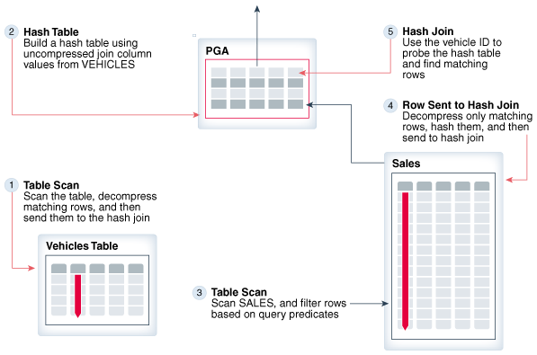
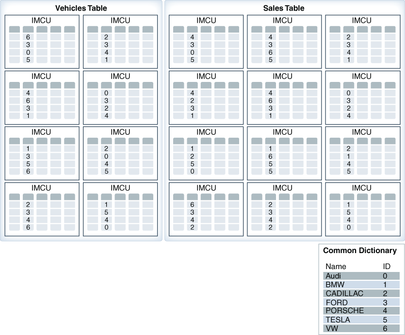
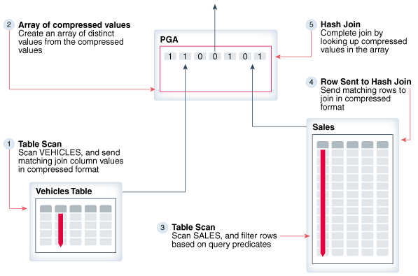
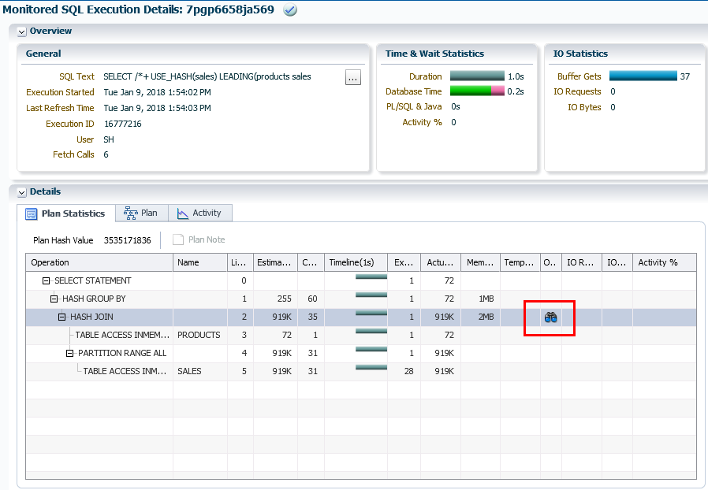
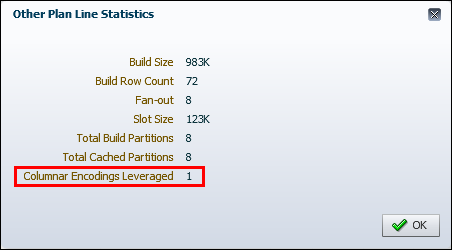

A **join group** is a user-created dictionary object that lists one or more columns that can be meaningfully joined.

This chapter contains the following topics:

### 8.1 About In-Memory Joins

Joins are an integral part of data warehousing workloads. The IM column store enhances the performance of joins when the tables being joined are stored in memory.

Because of faster scan and join processing, complex multitable joins and simple joins that use Bloom filters benefit from the IM column store. In a data warehousing environment, the most frequently-used joins involved a fact table and one or more dimension tables.

The following joins run faster when the tables are populated in the IM column store:

- Joins that are amenable to using Bloom filters

- Joins of multiple small dimension tables with one fact table

- Joins between two tables that have a primary key-foreign key relationship

### 8.2 About Join Groups

When the IM column store is enabled, the database can use join groups to optimize joins of tables populated in the IM column store.

A join group is a set of columns on which a set of tables is frequently joined. The column set contains one or more columns, with a maximum of 255 columns. The table set includes one or more internal tables. External tables are not supported.

The columns in the join group can be in the same or different tables. For example, if the `sales` and `times` tables frequently join on the `time_id` column, then you might create a join group for `(times(time_id), sales(time_id))`. If the `employees` table often joins to itself on the `employee_id` column, then a join group could be `(employees(employee_id))`.

**Note:**

The same column cannot be a member of multiple join groups.

When you create a join group, the database invalidates the current In-Memory contents of the tables referenced in the join group. Subsequent [repopulation](glossary.md) causes the database to re-encode the IMCUs of the tables with the [common dictionary](glossary.md). For this reason, Oracle recommends that you first create the join group, and then populate the tables.

Create join groups using the `CREATE INMEMORY JOIN GROUP` statement. To add columns to or drop columns from a join group, use an `ALTER INMEMORY JOIN GROUP` statement. Drop a join group using the `DROP INMEMORY JOIN GROUP` statement.

**Note:**

In Oracle Active Data Guard, a standby database ignores join group definitions. A standby database does not use common dictionaries, and executes queries as if join groups did not exist.

Example 8-1 Creating a Join Group

This example creates a join group named `deptid_jg` that includes the `department_id` column in the `hr.employees` and `hr.departments` tables.

    CREATE INMEMORY JOIN GROUP deptid_jg (hr.employees(department_id),hr.departments(department_id));

### 8.3 Purpose of Join Groups

In certain queries, join groups eliminate the performance overhead of decompressing and hashing column values.

Without join groups, if the optimizer uses a hash join but cannot use a Bloom filter, or if the Bloom filter does not filter rows effectively, then the database must decompress IMCUs and use an expensive hash join. To illustrate the problem, assume a star schema has a `sales` fact table and a `vehicles` dimension table. The following query joins these tables, but does not filter the output, which means that the database cannot use a Bloom filter:

    SELECT v.year, v.name, s.sales_price
    FROM   vehicles v, sales s
    WHERE  v.name = s.name;

The following figure illustrates how the database joins the two data sets.

Figure 8-1 Hash Join without Join Group

[Description of "Figure 8-1 Hash Join without Join Group"](img_text/inmem_3v_004.md)

The database performs a hash join as follows:

1.  Scans the `vehicles` table, decompresses the rows that satisfy the predicate (in this case, all rows satisfy the predicate because no filters exist), and sends the rows to the hash join

2.  Builds a hash table in the PGA based on the decompressed rows

3.  Scans the `sales` table and applies any filters (in this case, the query does not specify filters)

4.  Processes matching rows from the IMCUs and then sends the rows to the join

    When the hash join can consume row sets from the probe side (in this case, the `sales` table), the row sets sent by the table scan are in compressed form. Depending on whether the local dictionary or join group is leveraged to find matching rows from the build side, the hash join either decompresses the rows or leaves them uncompressed.

5.  Probes the hash table using the join column, which in this case is the vehicle name

If a join group exists on the `v.name` and `s.name` columns, then the database can make the preceding steps more efficient, eliminating the decompression and filtering overhead. The benefits of join groups are:

- The database operates on compressed data.

- The database avoids hashing on the join key and probing the hash table, which requires comparing the join keys of the probe rows and hashed rows.

  When a join group exists, the database stores codes for each join column value in a [common dictionary](glossary.md). The database builds a join group array using dictionary codes. Every array element points to a build-side row stored in the hash area (typically, PGA memory). During the probe, each probe row has a code associated with the join key. The database uses this code to search the array to determine whether a pointer exists in the array element. If a pointer exists, then there is a match; otherwise, there is no match.

- The dictionary codes are dense and have a fixed length, which makes them space efficient.

- Optimizing a query with a join group is sometimes possible when it is not possible to use a Bloom filter.

### 8.4 How Join Groups Work

In a join group, the database compresses all columns in the join group using the same common dictionary.

#### 8.4.1 How a Join Group Uses a Common Dictionary

A **common dictionary** is a table-level, instance-specific set of dictionary codes.

The database automatically creates a common dictionary in the IM column store when a join group is defined on the underlying columns. The common dictionary enables the join columns to share the same dictionary codes.

A common dictionary provides the following benefits:

- Encodes the values in the local dictionaries with codes from the common dictionary, which provides compression and increases the cache efficiency of the IMCU

- Enables joins to use dictionary codes to construct and probe the data structures used during hash joins

- Enables the optimizer to obtain statistics such as cardinality, distribution of column values, and so on

The following figure illustrates a common dictionary that corresponds to a join group created on the `sales.name` and `vehicles.name` columns.

Figure 8-2 Common Dictionary for a Join Group

[Description of "Figure 8-2 Common Dictionary for a Join Group"](img_text/inmem_pb_001a.md)

When the database uses a common dictionary, the local dictionary for each CU does not store the original values: `AUDI`, `BMW`, `CADILLAC`, `FORD`, and so on. Instead, the local dictionary stores references to the values stored in the common dictionary. For example, the local dictionary might store the value `101` for `Audi` and `220` for `BMW`. The common dictionary might store the value `0` for `Audi` and `1` for `BMW`. The `101` (AUDI) in the local dictionary is a pointer to the `0` (AUDI) in the common dictionary.

#### 8.4.2 How a Join Group Optimizes Scans

The key optimization is joining on common dictionary codes instead of column values, thereby avoiding the use of a hash table for the join.

Consider the following query, which uses a join group to join `vehicles` and `sales` on the `name` column:

    SELECT v.year, v.name, s.sales_price
    FROM   vehicles v, sales s
    WHERE  v.name = s.name
    AND    v.name IN ('Audi', 'BMW', 'Porsche', 'VW');

The following figure illustrates how the join benefits from the common dictionary created on the join group.

Figure 8-3 Hash Join with Join Group

[Description of "Figure 8-3 Hash Join with Join Group"](img_text/inmem_3v_005.md)

As illustrated in the preceding diagram, the database performs a hash join on the compressed data as follows:

1.  Scans the `vehicles` table, and sends the dictionary codes (not the original column values) to the hash join: `0` (Audi), `1` (BMW), `2` (Cadillac), and so on

2.  Builds an array of distinct common dictionary codes in the PGA

3.  Scans the `sales` table and applies any filters (in this case, the filter is for German cars only)

4.  Sends matching rows to the join in compressed format

5.  Looks up corresponding values in the array rather than probing a hash table, thus avoiding the need to compute a hash function on the join key columns

In this example, the `vehicles` table has only seven rows. The `vehicles.name` column has the following values:

    Audi
    BMW
    Cadillac
    Ford
    Porsche
    Tesla
    VW

The common dictionary assigns a dictionary code to each distinct value. Conceptually, the common dictionary looks as follows:

    Audi     0
    BMW      1
    Cadillac 2
    Ford     3
    Porsche  4
    Tesla    5
    VW       6

The database scans `vehicles.name`, starting at the first dictionary code in the first IMCU and ending at the last code in the last IMCU. It stores a `1` for every row that matches the filter (German cars only), and `0` for every row that does not match the filter. Conceptually, the array might look as follows:

    array[0]: 1
    array[1]: 1
    array[2]: 0
    array[3]: 0
    array[4]: 1
    array[5]: 0
    array[6]: 1

The database now scans the `sales` fact table. To simplify the example, assume that the `sales` table only has 6 rows. The database scans the rows as follows (the common dictionary code for each value is shown in parentheses):

    Cadillac (2)
    Cadillac (2)
    BMW      (1)
    Ford     (3)
    Audi     (0)
    Tesla    (5)

The database then proceeds through the `vehicles.name` array, looking for matches. If a row matches, then the database sends the matching row with its associated common dictionary code, and retrieves the corresponding column value from the `vehicles.name` and `sales.name` IMCUs:

    2  -> array[2] is 0, so no join
    2  -> array[2] is 0, so no join
    1  -> array[1] is 1, so join
    3  -> array[3] is 0, so no join
    0  -> array[0] is 1, so join
    5  -> array[5] is 0, so no join

### 8.5 When a Hash Join Uses Common Dictionary Encodings

Joins on columns in a join group typically see a performance benefit.

At join group creation, the database does the following:

- Caches the hash of the dictionary values for the join key columns

- Caches the binary representation of the `NUMBER` data for the join key columns

- Encodes columns with the same common dictionary

A join on columns in a join group always uses the first two optimizations to improve performance. For example, if the optimizer chooses a hash join, then the query uses the cached hash values to probe the bloom filter. If the query uses an IM aggregation join, then the query uses the cached binary number to index into the key vector.

A hash join may or may not use dictionary encodings. When dictionary encodings are present in at least one column of the hash join, the query can leverage the encodings in the following ways:

- Join group-aware hash join

  Both columns in the hash join carry common dictionary encoding data during runtime. The execution plan must show either a parallel hash join plan without any distribution involved from both sides of the hash join, or a serial hash join plan.

- Encoding-aware hash join

  One fact table column in the hash join carries dictionary encoding data during runtime. The execution plan must show either a parallel hash join without any distribution from the right side of the hash join, or a serial hash join plan. In some cases, if the common dictionary has good compression ratio, and if a parallel hash join plan cannot leverage a join group-aware hash join (for example, in a parallel broadcast-none plan), then the query can use an encoding-aware hash join for the common dictionary.

In a SQL Monitor report, the following fields show dictionary usage: `Columnar Encodings Observed`, and `Columnar Encodings Leveraged`. The statistics are cumulative. In a parallel hash join, the fields summarize statistics collected from all slave processes involved in executing a row source. In the context of the local dictionary in an IMCU, the statistics show the number of encoding IDs observed from the right child row source and the number of encodings leveraged by the join. If a hash join on a single process leverages the common dictionary, then `Columnar Encodings Leveraged` shows the number of encodings leveraged in the join.

The following table indicates the possible values for `Columnar Encodings Observed` and `Columnar Encodings Leveraged`, and what the combinations mean.

Table 8-1 Join Group Usage in a SQL Monitor Report

| Columnar Encodings Observed | Columnar Encodings Leveraged | Encoding-Aware Hash Join Used? | Join Group-Aware Hash Join Used? |
|:----------------------------|:-----------------------------|:-------------------------------|:---------------------------------|
| Not present                 | Not present                  | No                             | No                               |
| Positive value              | Not present                  | No                             | No                               |
| Positive value              | Positive value               | Yes                            | No                               |
| Not present                 | Positive value               | No                             | Yes                              |

For example, if the report shows that the `Columnar Encodings Leveraged` field is `4` (for example, because the parallel degree is 4) but the `Columnar Encodings Observed` field is absent, then the query leveraged the join group for the hash join. If the `Columnar Encodings Observed` field is `4` but the `Columnar Encodings Leveraged` field is absent, then dictionary encodings existed, but the query did not use them.

Various factors can prevent a query from engaging an encoding-aware hash join. Factors include the following:

- The compression ratio of the common dictionary is suboptimal.

- The query observes too many row sets passed from the table scan without a common dictionary.

- The build-side row length is too large.

- The build-side rows cannot fit into PGA memory.

- The build side has duplicate join keys.

**See Also:**

"Monitoring Join Group Usage"

### 8.6 Creating Join Groups

Define join groups using the `CREATE INMEMORY JOIN GROUP` statement.

Candidates for join groups are columns that are frequently paired in a join predicate. Typical examples include a column joining a fact and dimension table, or a column joining a table to itself.

The `CREATE INMEMORY JOIN GROUP` statement immediately defines a join group, which means that its metadata is visible in the data dictionary. The database does not immediately construct the common dictionary. Rather, the database builds the common dictionary the next time that a table referenced in the join group is populated or repopulated in the IM column store.

#### Guidelines

Creating, modifying, or dropping a join group typically invalidates all the underlying tables referenced in the join group. Thus, Oracle recommends that you create join groups before initially populating the tables.

#### To create a join group:

1.  In SQL\*Plus or SQL Developer, log in to the database as a user with the necessary privileges.

2.  Create a join group by using a statement in the following form:

        CREATE INMEMORY JOIN GROUP join_group_name ( table1(col1), table2(col2) );

    For example, the following statement creates a join group named `sales_products_jg`:

        CREATE INMEMORY JOIN GROUP sales_products_jg (sales(prod_id), products(prod_id));

3.  Optionally, view the join group definition by querying the data dictionary (sample output included):

        COL JOINGROUP_NAME FORMAT a18
        COL TABLE_NAME FORMAT a8
        COL COLUMN_NAME FORMAT a7

        SELECT JOINGROUP_NAME, TABLE_NAME, COLUMN_NAME, GD_ADDRESS
        FROM   DBA_JOINGROUPS;

        JOINGROUP_NAME     TABLE_NA COLUMN_ GD_ADDRESS
        ------------------ -------- ------- ----------------
        SALES_PRODUCTS_JG  SALES    PROD_ID 00000000A142AE50
        SALES_PRODUCTS_JG  PRODUCTS PROD_ID 00000000A142AE50

4.  Populate the tables referenced in the join group, or repopulate them if they are currently populated.

Example 8-2 Optimizing a Query Using a Join Group

In this example, you log in to the database as `SYSTEM`, and then create a join group on the `prod_id` column of `sales` and `products`, which are not yet populated in the IM column store:

    CREATE INMEMORY JOIN GROUP
      sh.sales_products_jg (sh.sales(prod_id), sh.products(prod_id));

You enable the `sh.sales` and `sh.products` tables for population in the IM column store:

    ALTER TABLE sh.sales INMEMORY;
    ALTER TABLE sh.products INMEMORY;

The following query indicates the tables are not yet populated in the IM column store (sample output included):

    COL OWNER FORMAT a3
    COL NAME FORMAT a10
    COL STATUS FORMAT a20

    SELECT OWNER, SEGMENT_NAME NAME,
           POPULATE_STATUS STATUS
    FROM   V$IM_SEGMENTS;

    no rows selected

Query both tables to populate them in the IM column store:

    SELECT /*+ FULL(s) NO_PARALLEL(s) */ COUNT(*) FROM sh.sales s;
    SELECT /*+ FULL(p) NO_PARALLEL(p) */ COUNT(*) FROM sh.products p;

The following query indicates the tables are now populated in the IM column store (sample output included):

    COL OWNER FORMAT a3
    COL NAME FORMAT a10
    COL PARTITION FORMAT a13
    COL STATUS FORMAT a20

    SELECT OWNER, SEGMENT_NAME NAME, PARTITION_NAME PARTITION,
           POPULATE_STATUS STATUS, BYTES_NOT_POPULATED
    FROM   V$IM_SEGMENTS;

    OWN NAME       PARTITION     STATUS               BYTES_NOT_POPULATED
    --- ---------- ------------- -------------------- -------------------
    SH  SALES      SALES_Q3_1998 COMPLETED            0
    SH  SALES      SALES_Q4_2001 COMPLETED            0
    SH  SALES      SALES_Q4_1999 COMPLETED            0
    SH  PRODUCTS                 COMPLETED            0
    SH  SALES      SALES_Q1_2001 COMPLETED            0
    SH  SALES      SALES_Q1_1999 COMPLETED            0
    SH  SALES      SALES_Q2_2000 COMPLETED            0
    SH  SALES      SALES_Q2_1998 COMPLETED            0
    SH  SALES      SALES_Q3_2001 COMPLETED            0
    SH  SALES      SALES_Q3_1999 COMPLETED            0
    SH  SALES      SALES_Q4_2000 COMPLETED            0
    SH  SALES      SALES_Q4_1998 COMPLETED            0
    SH  SALES      SALES_Q1_2000 COMPLETED            0
    SH  SALES      SALES_Q1_1998 COMPLETED            0
    SH  SALES      SALES_Q2_2001 COMPLETED            0
    SH  SALES      SALES_Q2_1999 COMPLETED            0
    SH  SALES      SALES_Q3_2000 COMPLETED            0

Query `DBA_JOINGROUPS` to get information about the join group (sample output included):

    COL JOINGROUP_NAME FORMAT a18
    COL TABLE_NAME FORMAT a8
    COL COLUMN_NAME FORMAT a7

    SELECT JOINGROUP_NAME, TABLE_NAME, COLUMN_NAME, GD_ADDRESS
    FROM   DBA_JOINGROUPS;

    JOINGROUP_NAME     TABLE_NA COLUMN_ GD_ADDRESS
    ------------------ -------- ------- ----------------
    SALES_PRODUCTS_JG  SALES    PROD_ID 00000000A142AE50
    SALES_PRODUCTS_JG  PRODUCTS PROD_ID 00000000A142AE50

The preceding output shows that the join group `sales_products_jg` joins on the same common dictionary address.

**See Also:**

- [Oracle Database SQL Language Reference](../sqlrf/CREATE-INMEMORY-JOIN-GROUP.md) to learn about the `CREATE INMEMORY JOIN GROUP` statement

- [Oracle Database Reference](../refrn/DBA_JOINGROUPS.md) to learn about the `DBA_JOINGROUPS` view

### 8.7 Monitoring Join Group Usage

To determine whether queries are using the join group, you can use either a graphical SQL Monitor report (recommended) or a SQL query that uses the `DBMS_SQLTUNE.REPORT_SQL_MONITOR_XML` function.

"When a Hash Join Uses Common Dictionary Encodings" explains how to interpret the SQL Monitor output.

#### Prerequisites

To monitor join groups, you must meet the following prerequisites:

- A join group must exist.

- The columns referenced by the join group must have been populated after join group creation.

- You must execute a join query that could potentially use the join group.

#### To monitor join group usage:

1.  Log in to the database as a user with the necessary privileges.

2.  Create a SQL\*Plus variable to store the SQL ID as follows:

        VAR b_sqlid VARCHAR2(13)

3.  Execute a query that joins on the columns in the join group.

4.  Use either following techniques:

    - Graphical SQL Monitor Report

      SQL Monitor reports are available in Enterprise Manager. In SQL\*Plus, you can use `DBMS_SQL_MONITOR.REPORT_SQL_MONITOR` to generate a SQL Monitor report as follows:

          SET TRIMSPOOL ON
          SET TRIM ON
          SET PAGES 0
          SET LINESIZE 1000
          SET LONG 1000000
          SET LONGCHUNKSIZE 1000000
          SPOOL /tmp/long_sql.htm
          SELECT DBMS_SQL_MONITOR.REPORT_SQL_MONITOR(
                   sql_id       => :b_sqlid,
                   report_level => 'ALL',
                   TYPE         => 'active')
          FROM   DUAL;
          SPOOL OFF

      Access the report in a browser, and then click the binoculars icon on the hash join to view the join group statistics.

    - Command-Line Query

      Use the `DBMS_SQLTUNE.REPORT_SQL_MONITOR_XML` function in a query, as shown in the following example:

          SELECT
            encoding_hj.rowsource_id row_source_id,
              CASE
                WHEN encoding_hj.encodings_observed IS NULL
                AND encoding_hj.encodings_leveraged IS NOT NULL
                THEN
                  'join group was leveraged on ' || encoding_hj.encodings_leveraged || ' processes'
                ELSE
                  'join group was NOT leveraged'
              END columnar_encoding_usage_info
          FROM
            (SELECT DBMS_SQLTUNE.REPORT_SQL_MONITOR_XML(session_id=>-1,sql_id=>:b_sqlid).
                    EXTRACT(q'#//operation[@name='HASH JOIN' and @parent_id]#') xmldata
             FROM   DUAL) hj_operation_data,
            XMLTABLE('/operation'
              PASSING hj_operation_data.xmldata
              COLUMNS
               "ROWSOURCE_ID"        NUMBER PATH '@id',
               "ENCODINGS_LEVERAGED" NUMBER PATH 'rwsstats/stat[@id="9"]',
               "ENCODINGS_OBSERVED"  NUMBER PATH 'rwsstats/stat[@id="10"]') encoding_hj;

#### 8.7.1 Monitoring Join Groups Using a SQL Monitor Report: Example

Your goal is to use a graphical SQL Monitor report to determine whether a query leveraged a join group.

In this example, you create a join group on the `prod_id` columns of `sh.products` and `sh.sales` tables, and then join these tables on this column. You grant the `sh` account administrative privileges.

Example 8-3 Monitoring a Join Group Using a SQL Monitor Report

1.  In SQL\*Plus, log in to the database as user `sh`.

2.  Create a SQL\*Plus variable to store the SQL ID as follows:

        VAR b_sqlid VARCHAR2(13)

3.  Apply the `INMEMORY` attribute to the `sh.products` and `sh.sales` tables as follows:

        ALTER TABLE sales NO INMEMORY;
        ALTER TABLE products NO INMEMORY;

        ALTER TABLE sales INMEMORY MEMCOMPRESS FOR QUERY;
        ALTER TABLE products INMEMORY MEMCOMPRESS FOR QUERY;

4.  Create a join group on `prod_id`:

        CREATE INMEMORY JOIN GROUP jgrp_products_sales (products(prod_id), sales(prod_id));

5.  Scan the tables to populate them in the IM column store:

        SELECT /*+ FULL(s) */ COUNT(*) FROM sales s;
        SELECT /*+ FULL(p) */ COUNT(*) FROM products p;

6.  Execute a query that joins on the `prod_id` column, and then aggregates product sales:

        SELECT /*+ USE_HASH(sales) LEADING(products sales) MONITOR */ products.prod_id,
               products.prod_category_id, SUM(sales.amount_sold)
        FROM   products, sales
        WHERE  products.prod_id = sales.prod_id
        GROUP BY products.prod_category_id, products.prod_id;

7.  Generate an HTML-based SQL Monitor report by using `DBMS_SQLTUNE.REPORT_SQL_MONITOR`.

    For example, create a SQL script with the following contents, and run it in SQL\*Plus:

        SET TRIMSPOOL ON
        SET TRIM ON
        SET PAGES 0
        SET LINESIZE 1000
        SET LONG 1000000
        SET LONGCHUNKSIZE 1000000
        SPOOL /tmp/jg_report.htm
        SELECT DBMS_SQL_MONITOR.REPORT_SQL_MONITOR(
                 sql_id       => :b_sqlid,
                 report_level => 'ALL',
                 TYPE         => 'active')
        FROM   DUAL;
        SPOOL OFF

8.  Open the HTML report in a browser.

    The following sample report shows the execution plan for the join. The binoculars in the hash join open a window that shows additional statistics.

    Figure 8-4 Monitored SQL Execution Details Page

    
    [Description of "Figure 8-4 Monitored SQL Execution Details Page"](img_text/sql_monitor_jg.md)

9.  Click the binoculars icon to open a window that shows join group statistics.

    The following sample window shows the statistics:

    
    [Description of the illustration other_plan_line_stats.png](img_text/other_plan_line_stats.md)
    Because `Columnar Encodings Leveraged` is a positive value and `Columnar Encodings Observed` is not present, the join group was leveraged.

10. Optionally, clean up after the example:

        DROP INMEMORY JOIN GROUP jgrp_products_sales;
        ALTER TABLE sales NO INMEMORY;
        ALTER TABLE products NO INMEMORY;

**See Also:**

- "When a Hash Join Uses Common Dictionary Encodings"

- [Oracle Database PL/SQL Packages and Types Reference](../arpls/DBMS_SQLTUNE.md) to learn about the `DBMS_SQLTUNE.REPORT_SQL_MONITOR_XML` function

- [Oracle Database Reference](../refrn/V-SESSION.md) to learn about the `V$SESSION` view

#### 8.7.2 Monitoring Join Groups from the Command Line: Example

Your goal is to use command-line tools to determine whether a query leveraged a join group.

In this example, you create a join group on the `prod_id` columns of `sh.products` and `sh.sales` tables, and then join these tables on this column. You grant the `sh` account administrative privileges.

Example 8-4 Monitoring a Join Group from the Command Line

1.  Log in to the database as `sh`.

2.  Create a SQL\*Plus variable to store the SQL ID as follows:

        VAR b_sqlid VARCHAR2(13)

3.  Apply the `INMEMORY` attribute to the `sh.products` and `sh.sales` tables as follows:

        ALTER TABLE sales NO INMEMORY;
        ALTER TABLE products NO INMEMORY;

        ALTER TABLE sales INMEMORY MEMCOMPRESS FOR QUERY;
        ALTER TABLE products INMEMORY MEMCOMPRESS FOR QUERY;

4.  Create a join group on `prod_id`:

        CREATE INMEMORY JOIN GROUP jgrp_products_sales (products(prod_id), sales(prod_id));

5.  Scan the tables to populate them in the IM column store:

        SELECT /*+ FULL(s) */ COUNT(*) FROM sales s;
        SELECT /*+ FULL(p) */ COUNT(*) FROM products p;

6.  Execute a query that joins on the `prod_id` column, and then aggregates product sales:

        SELECT /*+ USE_HASH(sales) LEADING(products sales) MONITOR */ products.prod_id,
               products.prod_category_id, SUM(sales.amount_sold)
        FROM   products, sales
        WHERE  products.prod_id = sales.prod_id
        GROUP BY products.prod_category_id, products.prod_id;

7.  Obtain the SQL ID of the preceding aggregation query:

        BEGIN
          SELECT PREV_SQL_ID
            INTO :b_sqlid
          FROM   V$SESSION
          WHERE  SID=USERENV('SID');
        END;

8.  Use `DBMS_SQLTUNE.REPORT_SQL_MONITOR_XML` to determine whether the database used the join group.

    For example, execute the following query:

        COL row_source_id FORMAT 999
        COL columnar_encoding_usage_info FORMAT A40

        SELECT
          encoding_hj.rowsource_id row_source_id,
            CASE
              WHEN encoding_hj.encodings_observed IS NULL
              AND encoding_hj.encodings_leveraged IS NOT NULL
              THEN
                'join group was leveraged on ' || encoding_hj.encodings_leveraged || ' processes'
              ELSE
                'join group was NOT leveraged'
            END columnar_encoding_usage_info
        FROM
          (SELECT DBMS_SQLTUNE.REPORT_SQL_MONITOR_XML(session_id=>-1,sql_id=>:b_sqlid).
                  EXTRACT(q'#//operation[@name='HASH JOIN' and @parent_id]#') xmldata
           FROM   DUAL
          ) hj_operation_data,
          XMLTABLE('/operation'
            PASSING hj_operation_data.xmldata
            COLUMNS
             "ROWSOURCE_ID"       NUMBER PATH '@id',
             "ENCODINGS_LEVERAGED" NUMBER PATH 'rwsstats/stat[@id="9"]',
             "ENCODINGS_OBSERVED"  NUMBER PATH 'rwsstats/stat[@id="10"]'
             ) encoding_hj;

    The following sample output shows that the join group was leveraged in the query:

        ROW_SOURCE_ID COLUMNAR_ENCODING_USAGE_INFO
        ------------- ----------------------------------------
                    2 join group was leveraged on 1 processes

9.  Optionally, clean up after the example:

        DROP INMEMORY JOIN GROUP jgrp_products_sales;
        ALTER TABLE sales NO INMEMORY;
        ALTER TABLE products NO INMEMORY;

**See Also:**

- "When a Hash Join Uses Common Dictionary Encodings"

- [Oracle Database PL/SQL Packages and Types Reference](../arpls/DBMS_SQLTUNE.md) to learn about the `DBMS_SQLTUNE.REPORT_SQL_MONITOR_XML` function

- [Oracle Database Reference](../refrn/V-SESSION.md) to learn about the `V$SESSION` view
