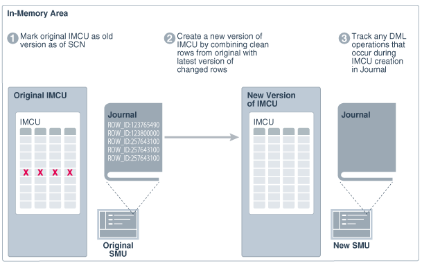
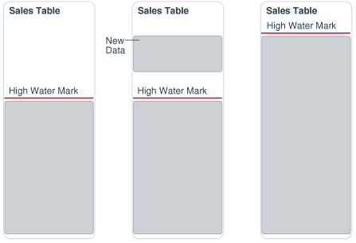
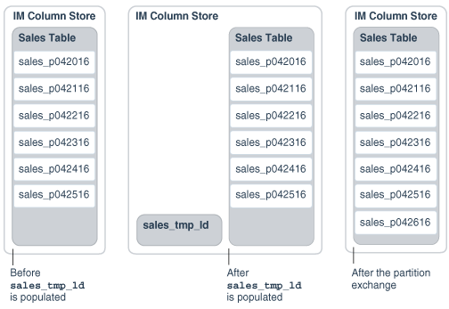
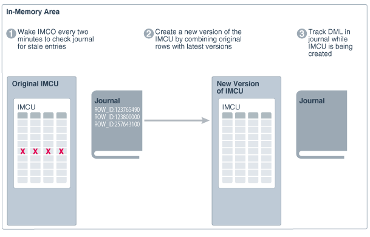

The IM column store periodically refreshes objects that have been modified. You can control this behavior using initialization parameters and the `DBMS_INMEMORY` package.

### 10.1 About Repopulation of the IM Column Store

The automatic refresh of columnar data after significant modifications is called repopulation.

#### 10.1.1 Row Modifications and the Transaction Journal

An In-Memory Compression Unit (IMCU) is a read-only structure that does not modify data in place when DML occurs on an internal table.

The [Snapshot Metadata Unit (SMU)](glossary.md) associated with each IMCU tracks row modifications in a [transaction journal](glossary.md). If a query accesses the data, and discovers modified rows, then it can obtain the corresponding rowids from the transaction journal, and then retrieve the modified rows from the buffer cache.

As the number of modifications increase, so do the size of SMUs, and the amount of data that must be fetched from the transaction journal or database buffer cache. To avoid degrading query performance through journal access, background processes repopulate modified objects.

#### 10.1.2 Automatic Repopulation

When DML occurs for objects in the IM column store, the database repopulates them automatically.

Automatic repopulation takes the following forms:

- [threshold-based repopulation](glossary.md)

  This form depends on the percentage of stale entries in the transaction journal for an IMCU.

- [trickle repopulation](glossary.md)

  This form supplements threshold-based repopulation by periodically refreshing columnar data even when the staleness threshold has not been reached.

During automatic repopulation, traditional access mechanisms are available. Data is always accessible from the buffer cache or disk. Additionally, the IM column store is always transactionally consistent with the data on disk. No matter where the query accesses the data, the database always returns consistent results.

**See Also:**

- "[Transaction Journal](in-memory-column-store-architecture.md)"

- "[In-Memory Process Architecture](in-memory-column-store-architecture.md)"

#### 10.1.3 Manual Repopulation of External Tables

External tables are not eligible for automatic repopulation.

The IM column store manages external tables differently from internal tables. Because external tables are read-only, they are not updated through DML, and thus do not rely on the transaction journal. For this reason, the database does not repopulate external tables automatically. However, you can refresh external tables manually by using `DBMS_INMEMORY.REPOPULATE`. In-Memory scans of external tables are only supported when the tables are completely populated in the IM column store.

**Note:**

Sessions that query In-Memory external tables must have the initialization parameter `QUERY_REWRITE_INTEGRITY` set to `stale_tolerated`.

It is important to keep in mind that if an external table is modified, then the results from the IM column store are undefined. Results are also undefined if a partition is altered (by dropping or adding values). This may lead to differences in results between IM and non-IM based scans. You can run `DBMS_INMEMORY.REPOPULATE` to refresh the IM store so that it is resynchronized with the table data.

**See Also:**

- "[Populating an In-Memory External Table Using DBMS_INMEMORY.POPULATE: Example](populating-the-imcs-manually.md)"

- [Oracle Database Reference](../refrn/QUERY_REWRITE_INTEGRITY.md) to learn more about the `QUERY_REWRITE_INTEGRITY` initialization parameter

### 10.2 How Data Loading Works with the IM Column Store

The IM column store uses different mechanisms depending on the type of data loading: conventional DML, direct path loads, and partition exchange loads.

#### 10.2.1 How Conventional DML Works with the IM Column Store

Conventional DML processes one row or array of rows at a time, and inserts rows below the high water mark. Regardless of whether the IM column store is enabled, the database processes DML using the buffer cache.

IMCUs are read-only. When a statement modifies a row in an IMCU, the IM column store records the rowid in the associated SMU.

A [Column Compression Unit (CU)](glossary.md) entry becomes stale when its value differs from the value in its corresponding journal entry. For example, a transaction may change an employee’s weekly salary from `1000` to `1200`, but the actual value in the IMCU is still `1000`. The transaction journal records the rowid of the stale row and its SCN.

**Note:**

The transaction journal does not record the new value. Rather, it indicates the corresponding row as stale as of a specific SCN.

##### 10.2.1.1 Staleness Threshold

As the number of stale entries in an IMCU increases, the speed of the IMCU scan decreases.

Performance decreases because the database must fetch the modified rows from the buffer cache or disk, rather than from the IM column store. For this reason, Oracle Database repopulates an IMCU when the number of stale entries in an IMCU reaches an internal [staleness threshold](glossary.md).

The database determines the threshold using heuristics that consider the frequency of IMCU access and the number of stale rows. Repopulation is more frequent for IMCUs that are accessed frequently or have a higher percentage of stale rows.

**See Also:**

- "[In-Memory Compression Units (IMCUs)](in-memory-column-store-architecture.md)"

- [Oracle Database Concepts](../cncpt/memory-architecture.md) to learn more about the database buffer cache

##### 10.2.1.2 Double Buffering

In double buffering, background processes create new IMCU versions by combining the original rows with the latest modified rows.

When the database begins either [threshold-based repopulation](glossary.md) or [trickle repopulation](glossary.md), the IM column store uses double buffering. As shown in the following figure, the IM column store maintains two versions of an IMCU simultaneously, with the original stale IMCU remaining accessible to queries.

Figure 10-1 Double Buffering

[Description of "Figure 10-1 Double Buffering"](img_text/inmem_3v_021.md)

The basic steps of double buffering are:

1.  In the original SMU, the database marks the existing IMCU as the original version as of a specific SCN.

2.  Background processes create a new version of the IMCU by combining the original rows with the latest versions of the modified rows.

3.  In the journal of the new SMU, the database tracks DML operations that occur during IMCU creation.

In this way, the original IMCU stays online. The database keeps both old and new IMCUs versions for as long as they are useful, or until the IM column store is under space pressure.

#### 10.2.2 How Direct Path Loads Work with the IM Column Store

A direct path load is an `INSERT /*+APPEND*/` statement or a SQL\*Loader operation in which `DIRECT=true` .

In a direct path load, the database writes formatted data blocks directly to the data files, bypassing the database buffer cache. The database appends the data above the high water mark, which is the boundary between used and unused space in a segment. Direct path loads operate are “all or nothing” operations: the operation either inserts all data or no data.

Figure 10-2 Direct Path Loads and the High Water Mark

[Description of "Figure 10-2 Direct Path Loads and the High Water Mark"](img_text/inmem_3v_024.md)

When the segment is populated in the IM column store, a direct path load works as follows:

1.  You load data using a `CREATE TABLE AS SELECT` or `INSERT /*+APPEND*/` statement. Only the current session is aware of the DML.

2.  You commit the statement.

3.  The high water mark moves to encompass the new data, which alerts the IMCU that data is missing. `V$IM_SEGMENTS.BYTES_NOT_POPULATED` now indicates the size of the newly inserted data.

4.  The IM column store manages repopulation based on the following algorithm:

    - If the affected object has a `PRIORITY` set to a value other than `NONE`, then the database repopulates the data.

    - If the affected object has a `PRIORITY` set to `NONE`, then the database repopulates at the next full scan of the object.

#### 10.2.3 How a Partition Exchange Load Works with the IM Column Store

A partition exchange load is a technique that exchanges a table for a partition. An exchange load is almost instantaneous because it modifies metadata instead of data.

To perform an exchange load, follow these steps:

1.  Create a nonpartitoned table, called a source table.

2.  Load rows into the source table.

3.  Exchange an existing table partition, called the target partition, with the table.

For the target partition to be populated in the IM column store after the exchange, the source table must be populated in the IM column store before the exchange. The following scenarios are possible, depending on the whether the target partition is populated:

- Before the exchange, the target partition is not populated in the IM column store. For example, the partition is empty.

  After the exchange, the source table is no longer populated in the IM column store. The source IMCUs are now associated with the target partition.

- Before the exchange, the target partition is populated in the IM column store.

  After the exchange, the source table remains populated in the IM column store.

Example 10-1 INMEMORY Partition Exchange Load

In this example, the `sales` table, which is partitioned, has the `INMEMORY` attribute set at the table level. All non-empty partitions in this table are currently populated. The `sales_p042616` partition is currently empty. Your goal is to populate the empty partition `sales_p042616` with data contained in text files. The following figure illustrates the before and after scenarios.

Figure 10-3 Partition Exchange

[Description of "Figure 10-3 Partition Exchange"](img_text/inmem_3v_023.md)

To perform the exchange, do the following:

1.  Create an external table `sales_tmp_ext` using the `CREATE TABLE ... ORGANIZATION EXTERNAL` statement.

    The external table does not reside in the database, and can be in any format for which an access driver is provided. The table is read-only.

2.  Create a nonpartitioned table named `sales_tmp_ld` using `CREATE TABLE ... AS SELECT * FROM sales_tmp_ext`.

    The `sales_tmp_ld` table is not external, which means it stores rows in the data files.

3.  Set the `INMEMORY` attribute in `sales_tmp_ld` using an `ALTER TABLE` statement.

    The `sales_tmp_ld` table is now marked as `INMEMORY`, but it is not yet populated into the IM column store.

4.  Populate `sales_tmp_ld` into the IM column store by forcing a full table scan.

    For example, the following query forces a full scan:

        SELECT /*+ FULL(s) NO_PARALLEL(s) */ COUNT(*) FROM sales_tmp_ld s;

5.  Exchange the `sales_p042616` partition with the `sales_tmp_ld` table.

    For example, alter the `sales` table as follows:

        ALTER TABLE sales EXCHANGE PARTITION sales_p042616 WITH TABLE sales_tmp_ld;

After the exchange completes, the `sales_p042616` partition is populated in the IM column store, and the `sales_tmp_ld` is no longer populated.

**See Also:**

[Oracle Database VLDB and Partitioning Guide](../vldbg/partition-warehouse.md) to learn more about partition exchange loads

### 10.3 When the Database Repopulates the IM Column Store

The database repopulates the IM column store automatically according to an internal algorithm. You can manually disable repopulation, and influence its aggressiveness.

**Note:**

This section describes automatic repopulation. You can force repopulation manually by using the `DBMS_INMEMORY.REPOPULATE` procedure.

**See Also:**

[Oracle Database PL/SQL Packages and Types Reference](../arpls/DBMS_INMEMORY.md) to learn about the `DBMS_INMEMORY.REPOPULATE` procedure

#### 10.3.1 Threshold-Based and Trickle Repopulation

Automatic repopulation takes two forms: threshold-based repopulation and trickle repopulation.

Automatic repopulation always checks stale journal entries and uses double buffering. However, repopulation has different triggers:

- Threshold-based repopulation

  The database repopulates IMCUs when the number of changes recorded in the transaction journal reaches an internal [staleness threshold](glossary.md). Threshold-based repopulation occurs automatically when `INMEMORY_MAX_POPULATE_SERVERS` initialization parameter is set to a value other than `0`.

- Trickle repopulation

  The IMCO (In-Memory Coordinator) background process periodically checks whether stale rows exist, and then adds IMCUs to a repopulation queue. This mechanism does not depend on meeting the staleness threshold. The `INMEMORY_TRICKLE_REPOPULATE_SERVERS_PERCENT` initialization parameter limits the number of background processes used for trickle repopulation. Setting this parameter to `0` disables trickle repopulation.

Trickle repopulation is analogous to Java garbage collection. The mechanism works as follows:

1.  IMCO wakes up.

2.  IMCO determines whether any population tasks need to be performed, including whether any stale entries exist in the [transaction journal](glossary.md) associated with an IMCU.

3.  If IMCO finds stale entries, then it triggers a Space Management Worker Process (Wnnn) to create a new version of the IMCU.

    During IMCU creation, the database records the rowids of modified rows in the transaction journal.

4.  IMCO sleeps for two minutes, and then returns to Step 1.

Figure 10-4 Trickle Repopulation

[Description of "Figure 10-4 Trickle Repopulation"](img_text/inmem_3v_022.md)

For example, a database may be busy for 8 hours per day. Most SMUs contain a small number of transaction journal entries (below the staleness threshold). When the database is quiet, IMCO wakes up, checks the journals to determine which IMCUs have stale entries, and then uses trickle repopulation to refresh the IMCUs.

**See Also:**

- "[In-Memory Process Architecture](in-memory-column-store-architecture.md)"

- "[Transaction Journal](in-memory-column-store-architecture.md)"

- [Oracle Database Reference](../refrn/background-processes.md) to learn about In-Memory background processes

#### 10.3.2 Factors Affecting Repopulation

The algorithm that triggers repopulation is internal, and depends on several factors.

The principal factors affecting repopulation are as follows:

- Rate of DML changes

  As the number of modified rows increases, the percentage of stale columnar data increases. The transaction journal grows, increasing the need to use the buffer cache to satisfy queries.

- Type of DML operations

  Typically, inserts have less performance overhead than deletes and updates because inserts often go into a new data block.

- Location of modified rows within a data block

  Changes grouped within the same database block or table partition have less effect then changes distributed across an entire table. Versioning every IMCU has a greater impact than versioning a small number of IMCUs.

- Compression level applied to `INMEMORY` objects

  Because of [double buffering](glossary.md), tables with higher compression levels incur more query and DML overhead during repopulation. For example, `MEMCOMPRESS FOR CAPACITY HIGH` incurs more overhead than `MEMCOMPRESS FOR DML`.

- Number of active worker processes

  As the number of worker processes increases, more work occurs in parallel. Consequently, the rate of repopulation increases.

**See Also:**

- "[IM Column Store Compression Methods](populating-objects-in-memory.md)"

- [Oracle Database Reference](../refrn/INMEMORY_TRICKLE_REPOPULATE_SERVERS_PERCENT.md) to learn about the `INMEMORY_TRICKLE_REPOPULATE_SERVERS_PERCENT` initialization parameter

### 10.4 Controls for Repopulation of the IM Column Store

Repopulation occurs automatically by default, but you can control its aggressiveness, or disable it altogether.

#### Initialization Parameters

The following initialization parameters influence background process behavior:

- `INMEMORY_MAX_POPULATE_SERVERS`

  This parameter limits the maximum number of Wnnn processes available for population and repopulation (threshold-based and trickle). The default value is half the `CPU_COUNT`. This parameter acts as a throttle, preventing these server processes from overloading the rest of the database. Setting this parameter to `0` disables both population and repopulation.

  **Caution:**

  Be careful not to set the value of this parameter too high. If it is set close to the number of cores or higher, then no CPU may be available for the rest of the system to run.

- `INMEMORY_TRICKLE_REPOPULATE_SERVERS_PERCENT`

  This parameter limits the percentage of the total population and repopulation processes that perform trickle repopulation. Its effect is to limit the number of IMCUs repopulated through trickle repopulation within a two-minute interval.

  The value for this parameter is a percentage of the `INMEMORY_MAX_POPULATE_SERVERS` value. For example, if `INMEMORY_TRICKLE_REPOPULATE_SERVERS_PERCENT` is `5` percent, and if `INMEMORY_MAX_POPULATE_SERVERS` is `20`, then the IM column store uses an average of 1 core (.05 \* 20) for trickle repopulation.

  To increase throughput at the expense of increased background CPU, set this parameter to higher values such as `5` or `10`. A value greater than `50` is not allowed, so that at least half of the `INMEMORY_MAX_POPULATE_SERVERS` processes are available for other tasks.

  Setting this parameter to `0` disables trickle population.

**See Also:**

- [Oracle Database Reference](../refrn/INMEMORY_TRICKLE_REPOPULATE_SERVERS_PERCENT.md) to learn about `INMEMORY_TRICKLE_REPOPULATE_SERVERS_PERCENT`

- [Oracle Database Reference](../refrn/INMEMORY_MAX_POPULATE_SERVERS.md) to learn about `INMEMORY_MAX_POPULATE_SERVERS`

#### DBMS_INMEMORY.REPOPULATE Procedure

To manually repopulate a table, partition, or subpartition, use the `DBMS_INMEMORY.REPOPULATE` procedure. Only objects that are currently populated in the IM column store are eligible for repopulation.

The following values are possible for the `force` parameter:

- `FALSE` — The database repopulates only IMCUs containing modified rows. This is the default.

- `TRUE` — The database drops the segment, and then rebuilds it. The database increments the statistics and performs all other tasks related to initial population.

For example, IMCU 1 contains rows 1 to 500,000, and IMCU 2 contains rows 500,001 to 1,000,000. A statement modifies row 600,000. When `force` is `FALSE`, the database only repopulates IMCU 2. When `force` is `TRUE`, the database repopulates both IMCUs.

Consider further that the `INMEMORY_VIRTUAL_COLUMNS` initialization parameter is set to `ENABLE`, and an application creates a new virtual column. When `force` is `FALSE`, the database only repopulates IMCU 2 with the new column. When `force` is `TRUE`, the database repopulates both IMCUs with the new column.

**See Also:**

[Oracle Database PL/SQL Packages and Types Reference](../arpls/DBMS_INMEMORY.md) to learn more about `DBMS_INMEMORY.REPOPULATE`

### 10.5 Optimizing Trickle Repopulation: Tutorial

In this tutorial, you increase the percentage of background processes available for trickle repopulation.

#### Assumptions

This tutorial assumes the following:

- The IM column store is enabled.

- You want to devote more CPU to the Space Management Worker Processes (Wnnn) that perform trickle repopulation.

- The database server has 12 CPU cores.

#### To increase the aggressiveness of repopulation:

1.  In SQL\*Plus or SQL Developer, log in to the database as a user with administrative privileges.

2.  Show the settings for the initialization parameters relating to repopulation (sample output included):

        SHOW PARAMETER POPULATE_SERVERS

        NAME                                        TYPE        VALUE
        ------------------------------------        ----------- -----------
        inmemory_max_populate_servers               integer     12
        inmemory_trickle_repopulate_servers_percent integer     1

    The preceding output indicates that 12 cores are available for population and repopulation tasks. The `INMEMORY_TRICKLE_REPOPULATE_SERVERS_PERCENT` is 1% of the `INMEMORY_MAX_POPULATE_SERVERS` value. Of the server processes available for population and repopulation tasks, the IM column store can use a maximum of .12 CPU cores (.01 \* 12) for trickle repopulation.

3.  Increase the trickle repopulation maximum to 25% of the `INMEMORY_MAX_POPULATE_SERVERS` initialization parameter value.

    For example, use the following statement:

        ALTER SYSTEM
          SET INMEMORY_TRICKLE_REPOPULATE_SERVERS_PERCENT=25
          SCOPE=BOTH;

    As a result, the IM column store now uses a maximum of 3 CPU cores (.25 \* 12) for trickle repopulation, out of a total of 12 that are available for population and repopulation work.

**See Also:**

- [Oracle Database Reference](../refrn/INMEMORY_TRICKLE_REPOPULATE_SERVERS_PERCENT.md) to learn about `INMEMORY_TRICKLE_REPOPULATE_SERVERS_PERCENT`

- [Oracle Database Reference](../refrn/INMEMORY_MAX_POPULATE_SERVERS.md) to learn about `INMEMORY_MAX_POPULATE_SERVERS`
