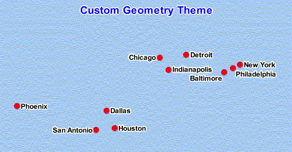

This appendix shows a sample implementation of a spatial data provider, and explains how to register this provider to be used with the map visualization component.

The complete implementation can be found under the map visualization component `web/demo/spatialprovider `directory. The implementation uses then following files:

- `us_bigcities.xml`: sample XML file that the provider parses

- `customSpatialProviderSample.java`: Java implementation of the spatial data provider

- `spatialprovider.jar`: jar file with the compiled version of the customSpatialProviderSample.java source file

The `us_bigcities.xml` file has sections to define the data attributes, the data extents, and the feature information, including the geometry (in GML format) and the attribute values. This file includes the following:

    <?xml version="1.0" standalone="yes"?>
    <spatial_data>

    <data_attributes>
      <attribute name="city" type="string" />
      <attribute name="state_abrv" type="string" />
      <attribute name="pop90" type="double" />
    </data_attributes>

    <data_extents>
       <xmin> -122.49586 </xmin>
       <ymin> 29.45765 </ymin>
       <xmax> -73.943849 </xmax>
       <ymax> 42.3831 </ymax>
    </data_extents>

    <geoFeature>
      <attributes> New York,NY,7322564 </attributes>
      <geometricProperty>
        <Point>
          <coordinates>-73.943849, 40.6698</coordinates>
        </Point>
       </geometricProperty>
     </geoFeature>

    . . .
    </spatial_data>

- Implementing the Spatial Provider Class
  The spatial provider class interface must be implemented.
- Registering the Spatial Provider with the Map Visualization Component
  To register the spatial provider with the map visualization component, add the following in the spatial provider section of the map visualization component configuration file, and then restart the map visualization component.
- Rendering the External Spatial Data
  To enable you to render the sample external spatial data that comes with the map visualization component kit, create a data source pointing to this data.

### B.1 Implementing the Spatial Provider Class

The spatial provider class interface must be implemented.

The provider must implement the class interface shown in [Custom Geometry Themes](map-visualization-concepts.md). Example B-1 contains the partial code for the spatial provider in the supplied demo. Note that this sample code is deliberately simplified; it is not optimized, and the provider does not create any spatial indexing mechanism.

After you have implemented the provider code, compile it and generate a jar file with this compiled class. The file `spatialprovider.jar` in the demo directory contains the compiled version of this sample code, and you can use it directly. Copy this jar file to a directory that is part of the map visualization component's CLASSPATH definition, such as the `web/WB-INF/lib` directory.

Example B-1 Implementing the Spatial Provider Class

    package spatialprovider.samples;

    import java.awt.geom.Point2D;
    import java.awt.geom.Rectangle2D;
    import java.io.File;
    import java.util.ArrayList;
    import java.util.Properties;
    import java.util.StringTokenizer;
    import java.util.Vector;
    import javax.xml.parsers.DocumentBuilder;
    import javax.xml.parsers.DocumentBuilderFactory;
    import oracle.mapviewer.share.Field;
    import oracle.mapviewer.share.ext.SDataProvider;
    import oracle.mapviewer.share.ext.SDataSet;
    import oracle.mapviewer.share.ext.SObject;
    import org.w3c.dom.Document;
    import org.w3c.dom.NamedNodeMap;
    import org.w3c.dom.Node;
    import org.w3c.dom.NodeList;
    import oracle.spatial.geometry.JGeometry;
    import oracle.spatial.util.GML;

    public class CustomSpatialProviderSample implements SDataProvider
    {
     ...

     /**
      * Constructor.
      */
     public CustomSpatialProviderSample()
     {
       ...
     }

     /**
      * Returns the initialization parameters for the provider.
      * The "datadir" parameter should be registered in the map visualization component
      * configuration file and can be used to access the data.
      * @return
      */
     public String[] getInitParameterNames()
     {
       return new String[]{ "datadir" };
     }

     /**
      * Returns runtime parameter names. Runtime parameters are additional parameters
      * that the provider may use when retrieving the data objects.
      * @return
      */
     public String[] getRuntimeParameterNames()
     {
       return new String[]{ "filename" };
     }

     /**
      * Initializes the provider
      * @param params  init properties
      * @return
      */
     public boolean init(Properties params)
     {
       dataDirectory = null;
         if(params == null)
         return true;
         dataDirectory = params.getProperty("datadir");
       if(dataDirectory == null || dataDirectory.trim().length() == 0)
       {
         // try upper case
         dataDirectory = params.getProperty("DATADIR");
         if(dataDirectory == null || dataDirectory.trim().length() == 0)
           System.out.println("FINE: Init properties does not define \"datadir\" parameter.");
       }
           return true;
     }

     /**
      * Returns the data set (geometries plus attributes) that intersects the
      * query window. In this sample the data is parsed just once and
      * there is no spatial index for searching. The search is sequential.
      * @param queryWin  search area
      * @param nonSpatialColumns   attribute columns
      * @param params      runtime properties
      * @return
      */
     public SDataSet buildDataSet(Rectangle2D queryWin,
                                  String []nonSpatialColumns,
                                  Properties params)
     {
       if(!dataParsed)
       {
         dataParsed = parseData(params);
         if(!dataParsed)
           return null;
       }
         if(geometries.size() == 0)
         return null;

       SDataSet dataset = new SDataSet();
         boolean fullExtent = isFullExtent(queryWin);
         if(fullExtent)
       {
         for(int i=0;i<geometries.size();i++)
         {
           JGeometry geom = (JGeometry)geometries.get(i);
           SObject obj = new SObject(geom,getGeometryAttributes(nonSpatialColumns,i));
           dataset.addObject(obj);      }
       }
       else
       {
         for(int i=0;i<geometries.size();i++)
         {
           JGeometry geom = (JGeometry)geometries.get(i);
           double []mbr = geom.getMBR();
           if(mbr == null)
             continue;
           Rectangle2D.Double rect = new Rectangle2D.Double(mbr[0],mbr[1],
                                       mbr[2]-mbr[0],
                                       mbr[3]-mbr[1]);
                 if(rect.getWidth() == 0. && rect.getHeight() == 0.)
           {
             Point2D.Double pt = new Point2D.Double(mbr[0],mbr[1]);
             if(queryWin.contains(pt))
             {
               SObject obj = new SObject(geom,getGeometryAttributes(nonSpatialColumns,i));
               dataset.addObject(obj);                    }
           }
           else if(queryWin.contains(rect) || queryWin.intersects(rect))
           {
             SObject obj = new SObject(geom,getGeometryAttributes(nonSpatialColumns,i));
             dataset.addObject(obj);
           }
         }        }
         if(dataset.getSize() == 0)
         return null;
           return dataset;
     }

     /**
      * Returns the data provider attribute list.
      * @return
      */
     public Field[] getAttributeList(Properties params)
     {
       if(!dataParsed)
       {
         dataParsed = parseData(params);
         if(!dataParsed)
           return null;
       }
         if(attributes.size() == 0)
         return null;

       return (Field[])attributes.toArray(new Field[attributes.size()]);
     }

     /**
      * Returns the data extents.
      * @return
      */
     public Rectangle2D getDataExtents(Properties params)
     {
       if(!dataParsed)
       {
         dataParsed = parseData(params);
         if(!dataParsed)
           return null;
       }
         if(extents == null || extents.length < 4)
         return null;
       else
         return new Rectangle2D.Double(extents[0],extents[1],
                                       extents[2]-extents[0],
                                       extents[3]-extents[1]);
     }

     /**
      * Builds a spatial index for the data. In this sample there is no
      * spatial index. The data is loaded into memory when data is parsed.
      * @return
      */
     public boolean buildSpatialIndex(Properties params)
     {
       return true;
     }

    }

**Parent topic:** Creating and Registering a Custom Spatial Data Provider

### B.2 Registering the Spatial Provider with the Map Visualization Component

To register the spatial provider with the map visualization component, add the following in the spatial provider section of the map visualization component configuration file, and then restart the map visualization component.

    <s_data_provider
      id="xmlProvider"
      class="spatialprovider.samples.CustomSpatialProviderSample"
      >
      <parameters>
        <parameter name="datadir" value="/temp/data" />
      </parameters>
    </s_data_provider>

When you restart the map visualization component, you should see a console message that the spatial provider has been registered. For example:

    2007-10-01 14:30:31.109 NOTIFICATION Spatial Provider xmlProvider has been registered.

**Parent topic:** Creating and Registering a Custom Spatial Data Provider

### B.3 Rendering the External Spatial Data

To enable you to render the sample external spatial data that comes with the map visualization component kit, create a data source pointing to this data.

Example B-2 is an XML request that contains a dynamic custom geometry theme.

Example B-2 Map Request to Render External Spatial Data

    <?xml version="1.0" standalone="yes"?>
    <map_request
     title="Custom Geometry Theme"
     datasource="mvdemo"
     width="500"
     height="400"
     bgcolor="#a6caf0"
     antialiase="true"
     format="PNG_STREAM"
    >
     

       <geoFeature>
         <geometricProperty typeName="center">
           <Point>
             <coordinates>-90,32</coordinates>
           </Point>
         </geometricProperty>
       </geoFeature>
     

     <themes>
       <theme name="custom_theme" >
          <custom_geom_theme
            provider_id="xmlProvider"
            srid="8307"
            render_style="M.CIRCLE"
            label_column="city"
            label_style="T.CITY NAME"
            datasource="mvdemo">
          <parameters>
           <parameter name="filename" value="/lbs/demo/spatialprovider/us_bigcities.xml"/>
          </parameters>
         </custom_geom_theme>
       </theme>
     </themes>
    </map_request>

In Example B-2, the file name in the `<parameter>` element points to `/lbs/demo/spatialprovider/us_bigcities.xml`. If the file path is not accessible to the map visualization component, the map request may generate error messages in the log file, such as the following:

    07/09/28 10:26:47 ParseData: Can not access file: /lbs/demo/spatialprovider/us_bigcities.xml
    07/09/28 10:26:47 ParseData: File to be parsed: /temp/data\us_bigcities.xml
    07/09/28 10:26:47 ParseData: File can not be accessed on provider data directory. Copy files there.

When the map visualization component searches for the file, it first tries to access the file using the original theme definition parameter; and if that fails, it tries the data directory defined in the map visualization component configuration file (`/temp/data` in the preceding example error messages). Therefore, if the original theme definition data path is not accessible to the map visualization component, copy the data files to the directory defined in the configuration file before you issue the map request.

If the map visualization component can find the data file, the map request inExample B-2 should generate an image like the one in Figure B-1.

Figure B-1 Map Image Using Custom Geometry Theme and External Spatial Data

[Description of "Figure B-1 Map Image Using Custom Geometry Theme and External Spatial Data"](img_text/custom_theme.md)

**Parent topic:** Creating and Registering a Custom Spatial Data Provider
