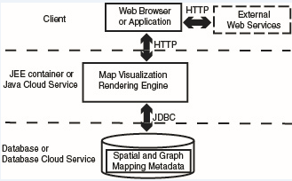
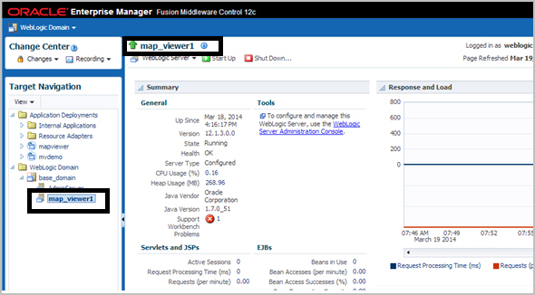
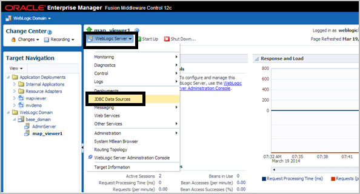
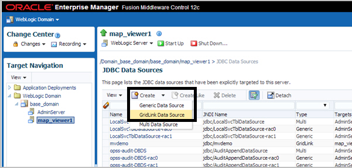
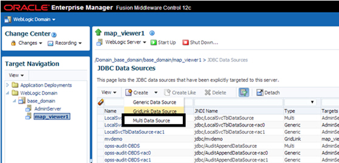

The Oracle Spatial and Graph map visualization component (sometimes referred to the visualization component) is a programmable tool for rendering maps using spatial data managed by Oracle Spatial and Graph.

The map visualization component provides tools that hide the complexity of spatial data queries and cartographic rendering, while providing customizable options for more advanced users. These tools can be deployed in a platform-independent manner and are designed to integrate with map-rendering applications.

- Overview of the Map Visualization Component
  The map visualization component enables developers to incorporate highly interactive maps and spatial analysis into business applications.
- Getting Started with the Map Visualization Component
  You can get started with the map visualization component 19.3, by performing the following tasks.
- Prerequisite Software for the Map Visualization Component
  This section explains the prerequisites required for installing the map visualization component 19.3.
- Deploying MapViewer-Based Applications with the Map Visualization Component
  If you have any MapViewer-based applications, you can deploy them with the map visualization component.
- Administering the Map Visualization Component
  This topic introduces the map visualization component Administration page and some administrative and configuration tasks that you can perform, such as adding new data sources, managing map tile layers used by Oracle Maps, and setting logging levels.
- Oracle Real Application Clusters and the Map Visualization Component
  When the database is an Oracle Real Application Cluster (Oracle RAC), you can connect to the Oracle RAC database using either of the following options.
- High Availability and the Map Visualization Component (WebLogic Server Only)
  Users can benefit from the high availability features of Oracle WebLogic Server.
- Secure Map Rendering
  You can implement secure map rendering based on a web user's identity.
- Downloading Sample Data for Map Visualization Component
  A separate archive file, mvdemo.zip, contains sample data for use by the map visualization component, and is available along with the map visualization component downloads.

### 1.1 Overview of the Map Visualization Component

The map visualization component enables developers to incorporate highly interactive maps and spatial analysis into business applications.

Application content can be combined with maps and data from a variety of web services and data formats such as GeoJSON. It is deployed in a Java EE container or in the Oracle Java Cloud Service.

The map visualization component includes the following:

- A map rendering engine to expose cartographic render functions to web applications.

- A suite of application programming interfaces (APIs) that allow programmable access to visualization features. These APIs include XML, Java, and an HTML5-based JavaScript API.

- A graphical map builder tool that enables you to create map symbols, define spatial data rendering rules, and create and edit map visualization component objects.

- Oracle Maps, which includes map cache and FOI (feature of interest) servers that facilitate the development of interactive geospatial web applications.

- Packaged content for admin areas (countries, states, counties, and so on) as JSON files.

The core rendering engine connects to the Oracle database through Java Database Connectivity (JDBC). It also reads the map metadata (such as map definitions, styling rules, and symbology created through the Map Builder tool) from the database, and applies the metadata to the retrieved spatial data during rendering operations.

The JavaScript API enables you to create highly interactive web applications that use the Oracle Maps feature of the map visualization component.

The Map Builder tool simplifies the process of creating and managing map, theme, and symbology metadata in a spatial database. For information about this tool, see [Oracle Map Builder Tool](oracle-map-builder-tool.md).

Oracle Maps, built on core map visualization component features, uses a map tile server that caches map image tiles, and a feature of interest (FOI) server that streams live data out of a database to be displayed as interactive features on a map. You can use the HTML5-based JavaScript API with Oracle Maps to provide sophisticated mapping solutions. Oracle Maps also allows for advanced customization and querying capabilities.

The map visualization component supports two-dimensional vector geometries stored in Oracle Spatial and Graph, as well as GeoRaster data and data in the Oracle Spatial and Graph topology and network data models. The map visualization component is also an Open Geospatial Consortium (OGC)-compliant web map service (WMS) and web map tile service (WMTS) server.

The

- Map Visualization Component Architecture

**Parent topic:** Introduction to the Map Visualization Component 19.3

#### 1.1.1 Map Visualization Component Architecture

The following figure illustrates the architecture of the map visualization component.

Figure 1-1 Map Visualization Component Architecture

[Description of "Figure 1-1 Map Visualization Component Architecture"](img_text/architecture.md)

As shown in the preceding figure:

- The map visualization component can communicate with a client web browser or application or external web services using the HTTP protocol.

- With a client web browser or application, it communicates using HTTP protocol with the map visualization rendering engine in a JEE container or the Java cloud service.

- It performs spatial data access (reading and writing Oracle Spatial and Graph data) through JDBC calls to the database or the database cloud service.

- The database or database cloud service includes Oracle Spatial and Graph, as well as mapping metadata.

**Parent topic:** Overview of the Map Visualization Component

### 1.2 Getting Started with the Map Visualization Component

You can get started with the map visualization component 19.3, by performing the following tasks.

1.  Either before or after you install and deploy the map visualization component, read [Map Visualization Concepts](map-visualization-concepts.md) to be sure you understand important terms and concepts.
2.  Ensure that you have the prerequisite software (see Prerequisite Software for the Map Visualization Component).
3.  Install (if necessary) the map visualization component from [Oracle Spatial & Graph Map Visualization Component Downloads](https://www.oracle.com/database/technologies/spatial-studio/spatial-graph-map-vis-downloads.html) page. Deployment of the `mapviewer_19.3.0.0.0.ear` file enables you to get started with the map visualization component.
4.  Use the map visualization component for some basic tasks. For example, create an Oracle Maps application (see [Oracle Maps](oracle-maps.md)).
5.  Optionally, use the Map Builder tool (described in [Oracle Map Builder Tool](oracle-map-builder-tool.md)) to familiarize yourself with styles, themes, and maps, and the options for each, and optionally to preview spatial data.

**Parent topic:** Introduction to the Map Visualization Component 19.3

### 1.3 Prerequisite Software for the Map Visualization Component

This section explains the prerequisites required for installing the map visualization component 19.3.

To use the map visualization component, you must have the following software.

- Oracle Database 12.1 or later
- A supported JEE server (see [Supported JEE servers for the map visualization component](https://www.oracle.com/database/technologies/supported-jee-servers-spatial-map-visualization.html))
- Java SDK (JDK) 1.8 or later

The map visualization component also supports the headless AWT mechanism in J2SE SDK, which enables the visualization component to run on Linux or UNIX systems without setting any `X11 DISPLAY` variable. To enable AWT headless mode on Linux or UNIX systems, specify the following in the command line to start the map visualization component:

    -Djava.awt.headless=true

**Parent topic:** Introduction to the Map Visualization Component 19.3

### 1.4 Deploying MapViewer-Based Applications with the Map Visualization Component

If you have any MapViewer-based applications, you can deploy them with the map visualization component.

If you want to continue to use your existing MapViewer configuration, follow the instructions in this section.

Applications written using the MapViewer V2 API will work with the map visualization component.

(You can also use an existing MapViewer configuration in WebLogic Server on Oracle Fusion Middleware Release 12.2.1.x.0 and later.)

**Parent topic:** Introduction to the Map Visualization Component 19.3

### 1.5 Administering the Map Visualization Component

This topic introduces the map visualization component Administration page and some administrative and configuration tasks that you can perform, such as adding new data sources, managing map tile layers used by Oracle Maps, and setting logging levels.

- Logging in to the Map Visualization Component Administration Page
- Configuring the Map Visualization Component
- Performing Map Visualization Component Administrative Tasks

**Parent topic:** Introduction to the Map Visualization Component 19.3

#### 1.5.1 Logging in to the Map Visualization Component Administration Page

After you have verified that the map visualization component is running properly, it is suggested that you log in to the map visualization component Administration page. To do this, go first to the map visualization component Welcome page, which is typically `http://``<host>:<port>`/`mapviewer`, where `<host>` and `<port>` should be replaced by the correct value for your installation.

Click the Admin link at the top right to display the map visualization component Administration page.

You can use this administration page to perform administrative tasks, such as clearing cached data, creating tile layers, managing tile layers, and restarting the server (use the Monitoring link to restart).

**Parent topic:** Administering the Map Visualization Component

#### 1.5.2 Configuring the Map Visualization Component

If the default configuration settings for running the map visualization component are not adequate, you can configure the map visualization component by editing the visualization component configuration file, `mapViewerConfig.xml`, which is located in the `$MAPVIEWER_HOME``/WEB-INF/conf` directory. To modify this file, you can use a text editor, or you can use the map visualization component Administration page.

After you modify this file, you must restart the container to have the changes take effect; however, you can instead use the map visualization component Administration page to restart only the map visualization component servlet (instead of the entire Java EE instance, which may have other applications deployed and running) if you installed the map visualization component with a standalone Glassfish instance.

The map visualization component configuration file defines the following information in XML format:

- Logging information, defined either through container-controlled logging (recommended) or in the `<logging>` element (see Specifying Logging Information)

- Map image file information, defined in the `<save_images_at>` element (see Specifying Map File Storage and Life Cycle Information)

- Web proxy information for accessing external information across a firewall, defined in the `<web_proxy>` element (see Specifying a Web Proxy)

- Global map "look and feel" configuration, defined in the `<global_map_config>` element (see Specifying Global Map Configuration Options)

- Internal spatial data cache settings, defined in the `<spatial_data_cache>` element (see Customizing the Spatial Data Cache)

- Permanent map data sources, defined in the `<map_data_source>` element (see Defining Permanent Map Data Sources)

- Security configurations, defined in the `<security_config>` element

- WMS services configurations, defined in the `<wms_config>` element

- External attribute data provider registration, defined in `<ns_data_provider>` elements

- Map tile server configurations, defined in the `<map_tile_server>` element

- UTF grid lifecycle parameters, defined in the `<utfgrid_life_cycle>` element

- External spatial data provider registration, defined in the `<s_data_provider>` element

- Map data sources, defined in the `<map_data_source>` element

- Map data server stream parameters, defined in the `<mds_config>` element

- OAM logout parameters, defined in the `<oam_logout>` element

All path names in the `mapViewerConfig.xml` file are relative to the directory in which the file is stored, unless otherwise specified.

Example 1-1 Sample Map Visualization Component Configuration File

Example 1-1 shows a sample `mapViewerConfig.xml` file.

    <?xml version="1.0" ?>
    <!-- This is the configuration file for the map visualization component. -->
    <!-- Note: All paths are resolved relative to this directory (where
               this config file is located), unless specified as an absolute
               path name.
     -->

    <MapperConfig>

      <!-- ****************************************************************** -->
      <!-- ************************ Logging Settings ************************ -->
      <!-- ****************************************************************** -->

      <!-- Uncomment the following to modify logging. Possible values are:
           log_level = "fatal"|"error"|"warn"|"info"|"debug"|"finest"
                     default: info) ;
           log_thread_name = "true" | "false" ;
           log_time = "true" | "false" ;
           one or more log_output elements.
      -->
      <!--
        <logging log_level="info" log_thread_name="false"
                 log_time="true">
           <log_output name="System.err" />
           <log_output name="../log/mapviewer.log" />
        </logging>
      -->

      <!-- ****************************************************************** -->
      <!-- ********************** Map Image Settings ************************ -->
      <!-- ****************************************************************** -->

      <!-- Uncomment the following only if you want generated images to
           be stored in a different directory, or if you want to customize
           the life cycle of generated image files.

           By default, all maps are generated under
           $ORACLE_HOME/lbs/mapviewer/web/images.

           Images location-related attributes:
           file_prefix: image file prefix, default value is "omsmap"
           url:  the URL at which images can be accessed. It must match the 'path'
                 attribute below. Its default value is "%HOST_URL%/mapviewer/images"
           path: the corresponding path in the server where the images are
                 saved; default value is "%ORACLE_HOME%/lbs/mapviewer/web/images"

           Images life cycle-related attributes:
           life: the life period of generated images, specified in minutes.
                 If not specified or if the value is 0, images saved on disk will
                 never be deleted.
           recycle_interval:  this attribute specifies how often the recycling
                 of generated map images will be performed. The unit is minute.
                 The default interval (when not specified or if the value is 0)
                 is 8*60, or 8 hours.

       -->
      <!--
       <save_images_at  file_prefix="omsmap"
                       url="http://mypc.mycorp.com:8888/mapviewer/images"
                       path="../web/images"
       />
      -->

      <!-- ****************************************************************** -->
      <!-- ********************* IP Monitoring Settings ********************* -->
      <!-- ****************************************************************** -->

      <!-- Uncomment the following to enable IP filtering for administrative
            requests.
        Note:
        - Use <ips> and <ip_range> to specify which IPs (and ranges) are allowed.
          Wildcard form such as 20.* is also accepted. Use a comma-delimited
          list in <ips>.

        - Use <ips_exclude> and <ip_range_exclude> for IPs and IP ranges
          prohibited from accessing eLocation.

        - If an IP falls into both "allowed" and "prohibited" categories, it is
          prohibited.

        - If you put  "*" in an <ips> element, then all IPs are allowed, except
          those specified in <ips_exclude> and <ip_range_exclude>.
          On the other hand, if you put "*" in an <ips_exclude> element, no one
          will be able to access the map visualization component (regardless of whether an IP is in
          <ips> or <ip_range>).

        - You can have multiple <ips>, <ip_range>, <ips_exclude>, and
          <ip_range_exclude> elements under <ip_monitor>.

        - If no <ip_monitor> element is present in the XML configuration
          file, then no IP filtering will be performed (all allowed).

        - The way the map visualization component determines if an IP is allowed is:

              if(IP filtering is not enabled) then allow;
              if(IP is in exclude-list) then not allow;
              else if(IP is in allow-list) then allow;
              else not allow;
       -->

      <!--
         <ip_monitor>
              <ips> 138.1.17.9, 138.1.17.21, 138.3.*, 20.* </ips>
              <ip_range> 24.17.1.3 - 24.17.1.20 </ip_range>
              <ips_exclude> 138.3.29.* </ips_exclude>
              <ip_range_exclude>20.22.34.1 - 20.22.34.255</ip_range_exclude>
         </ip_monitor>
       -->

      <!-- ****************************************************************** -->
      <!-- ********************** Web Proxy Setting  ************************ -->
      <!-- ****************************************************************** -->
      <!-- Uncomment and modify the following to specify the web proxy setting.
           This is only needed for passing background image URLs to
           the map visualization component in map requests or for setting a logo image URL, if
           such URLs cannot be accessed without the proxy.
       -->

      <!--
        <web_proxy host="www-proxy.my_corp.com"  port="80" />
      -->

      <!-- ****************************************************************** -->
      <!-- *********************** Security Configuration ******************* -->
      <!-- ****************************************************************** -->
      <!-- Here you can set various security related configurations of the map visualization component.
      -->

      <security_config>
        <disable_direct_info_request> false </disable_direct_info_request>
      </security_config>

      <!-- ****************************************************************** -->
      <!-- *********************** Global Map Configuration ***************** -->
      <!-- ****************************************************************** -->
      <!-- Uncomment and modify the following to specify systemwide parameters
           for generated maps. You can specify your copyright note, map title, and
           an image to be used as a custom logo shown on maps. The logo image must
           be accessible to this map visualization component and in either GIF or JPEG format.
           Notes:
             -  To disable a global note or title, specify an empty string ("") for
                the text attribute of <note> and <title> element.
             - position specifies a relative position on the map where the
                      logo, note, or title  will be displayed. Possible values are
                      NORTH, EAST, SOUTH, WEST, NORTH_EAST, SOUTH_EAST,
                      SOUTH_WEST, NORTH_WEST, and CENTER.
             - image_path specifies a file path or a URL (starts with "http://")
                        for the image.

           <rendering> element attributes:
           - Local geodetic data adjustment: If allow_local_adjustment="true",
             The map visualization component automatically performs local data
             "flattening" with geodetic data if the data window is less than
             3 decimal degrees. Specifically, the map visualization component performs a simple
             mathematical transformation of the coordinates using a tangential
             plane at the current map request center.
             If allow_local_adjustment="false" (default), no adjustment is
             performed.
           - Automatically applies a globular map projection (geodetic data only):
             If use_globular_projection="true", The map visualization component will
             apply a globular projection on the fly to geometries being displayed.
             If use_globular_projection="false" (the default), The map visualization component does no map
             projection to geodetic geometries. This option has no effect on
             non-geodetic data.
       -->

      <!--
        <global_map_config>
            <note text="Copyright 2009, Oracle Corporation"
                  font="sans serif"
                  position="SOUTH_EAST"/>
            <title  text="MapViewer Demo"
                    font="Serif"
                    position="NORTH" />
            <logo image_path="C:\\images\\a.gif"
                  position="SOUTH_WEST" />

            <rendering allow_local_adjustment="false"
                       use_globular_projection="false" />
        </global_map_config>
      -->

      <!-- ****************************************************************** -->
      <!-- ****************** Spatial Data Cache Setting  ******************* -->
      <!-- ****************************************************************** -->
      <!-- Uncomment and modify the following to customize the spatial data cache
           used by the map visualization component. The default is 64 MB for in-memory cache.

           To disable the cache, set max_cache_size to 0.

           max_cache_size:  Maximum size of in-memory spatial cache of the map visualization component.
                            Size must be specified in megabytes (MB).
           report_stats:    If you would like to see periodic output of cache
                            statistics, set this attribute to true. The default
                            is false.
       -->

      <!--
        <spatial_data_cache   max_cache_size="64"
                              report_stats="false"
        />
      -->

      <!-- ****************************************************************** -->
      <!-- ****************** Custom WMS Capabilities Info ****************** -->
      <!-- ****************************************************************** -->
      <!-- Uncomment and modify the following tag if you want the map visualization component to
           use the following information in its getCapabilities response.
           Note: all attributes and elements of <wms_config> are optional.
      -->
      <!--
      <wms_config host="www.my_corp.com" port="80">
        <title>
            WMS 1.1 interface for Oracle Map visualization component
        </title>
        <abstract>
            This WMS service is provided through the map visualization component.
        </abstract>
        <keyword_list>
           <keyword>bird</keyword>
           <keyword>roadrunner</keyword>
           <keyword>ambush</keyword>
        </keyword_list>
        <sdo_epsg_mapfile>
          ../config/epsg_srids.properties
        </sdo_epsg_mapfile>
      </wms_config>
      -->

      <!-- ****************************************************************** -->
      <!-- **************** Custom Non-Spatial Data Provider **************** -->
      <!-- ****************************************************************** -->
      <!-- Uncomment and add as many custom non-spatial data provider as
           needed here, each in its own <ns_data_provider> element.
           You must provide the id and full class name here. Optionally you
           can also specify any number of global parameters, which the map visualization component
           will pass to the data provider implementation during initialization.
           The name and value of each parameter is interpreted only by the
           implementation.
      -->

      <!-- this is the default data provider that comes with the map visualization component;
           refer to the documentation on how to use it.

      <ns_data_provider
        id="defaultNSDP"
        class="oracle.sdovis.NSDataProviderDefault"
      />
      -->

      <!-- this is a sample NS data provider with prameters:
      <ns_data_provider
        id="myProvider1" class="com.mycorp.bi.NSDataProviderImpl" >

        <parameters>
          <parameter name="myparam1" value="value1" />
          <parameter name="p2"       value="v2"     />
        </parameters>

      </ns_data_provider>
      -->

      <!-- ****************************************************************** -->
      <!-- *******************  Map Tile Server Setting  ******************* -->
      <!-- ****************************************************************** -->
      <!-- Uncomment and modify the following to customize the map tile server.

           <tile_storage> specifies the default root directory under which the
           cached tile images are to be stored if the cache instance configuration
           does not specify the root directory for the cache instance. If the
           default root directory is not set or not valid, the default root
           direcotry will be set to be $MAPVIEWER_HOME/web/tilecache

              default_root_path:  The default root directory under which the cached
                                  tile images are stored.
      -->

      <!--
         <map_tile_server>
           <tile_storage default_root_path="/scratch/tilecachetest/"/>
        </map_tile_server>
      -->

      <!-- ****************************************************************** -->
      <!-- ******************** Predefined Data Sources  ******************** -->
      <!-- ****************************************************************** -->
      <!-- Uncomment and modify the following to predefine one or more data
           sources.
           Note: You must precede the jdbc_password value with a '!'
                 (exclamation point), so that when the map visualization component starts the next
                 time, it will encrypt and replace the clear text password.
      -->

      <!--
      <map_data_source name="mvdemo"
                       jdbc_host="elocation.example.com"
                       jdbc_sid="orcl"
                       jdbc_port="1521"
                       jdbc_user="scott"
                       jdbc_password="!password"
                       jdbc_mode="thin"
                       number_of_mappers="3"
       />
       -->

    </MapperConfig>

This map visualization component configuration topic includes the following subtopics.

- Specifying Logging Information
- Specifying Map File Storage and Life Cycle Information
- Specifying a Web Proxy
- Specifying Global Map Configuration Options
- Customizing the Spatial Data Cache
- Specifying the Security Configuration
- Registering a Custom Spatial Provider
- Registering Custom Nonspatial Data Providers
- Customizing SRS Mapping
- Customizing WMS GetCapabilities Responses
- Customizing WMTS GetCapabilities Responses
- Configuring the Map Tile Server for Oracle Maps
- Defining Permanent Map Data Sources
- Configuring and Securing the Map Data Server for the HTML5 API

**Parent topic:** Administering the Map Visualization Component

##### 1.5.2.1 Specifying Logging Information

The map visualization component provides a flexible logging mechanism to record runtime information and events. You can configure the granularity, volume, format, and destination of the log output. You can also configure the maximum size of log files as well as automatic log file rotation.

There are two ways to configure the map visualization component's logging: container-controlled logging, and using the `<logging>` element in the configuration file.

##### Container-Controlled Logging

If the `<logging>` element in the `mapViewerConfig.xml` file is commented out or missing, the map visualization component uses container-controlled logging, specifically using the following loggers:

- `oracle.mapviewer.ws` for all web server (maps, tiles, features) messages

- `oracle.mapviewer.access` for all user access

- `oracle.mapviewer.sdovis` for all rendering (maps, themes, features) messages

- `oracle.mapviewer.webconsole` for all administrative console log messages

##### Using the \<logging\> Element

If the `<logging>` element in the `mapViewerConfig.xml` file is in use (that is, if the `<logging>` element is not commented out or missing), The map visualization component uses that information instead of using container-controlled logging. The `<logging>` element can have the following attributes and subelements:

- The `console_log_level` attribute controls the levels of information that are recorded in the log, which in turn affect the log output volume. Set the `console_log_level` attribute value to one of the following, listed from most restrictive logging to least restrictive logging: `FATAL`, `ERROR`, `WARN`, `INFO`, `DEBUG`, and `FINEST`. The `FATAL` level outputs the least log information (only unrecoverable events are logged), and the other levels are progressively more inclusive, with the `FINEST` level causing the most information to be logged. For production work, a level of `WARN` or more restrictive (`ERROR` or `FATAL`) is recommended; however, for debugging you may want to set a less restrictive level.

- The `file_limit` attribute controls the maximum file size of a log file. The unit is Mb and the default value is 50 (that is, by the default value for the maximum log file size is 50Mb).

- The `file_count` attribute determines the number of log files created. The files are rotated (that is, when the last log file reaches its maximum size, the first log file is reused). The default value is 10.

- The `<logger>` subelement specifies the log level for a particular logger.

- The `<log_output>` subelement identifies output for the logging information. By default, log records are written to the system error console. You can change this to the system output console or to one or more files, or some combination. If you specify more than one device through multiple `<log_output>` subelements, the logging records are sent to all devices, using the same logging level and attributes.

**Parent topic:** Configuring the Map Visualization Component

##### 1.5.2.2 Specifying Map File Storage and Life Cycle Information

Map image file information is specified in the `<save_images_at>` element. By default, images are stored in the `$ORACLE_HOME` `/lbs/mapviewer/web/images` directory. You do not need to modify the `<save_images_at>` element unless you want to specify a different directory for storing images.

A mapping client can request that the map visualization component send back the URL for an image file instead of the actual map image data, by setting the `format` attribute of the `<map_request>` element to `GIF_URL` or `PNG_URL`. In this case, the map visualization component saves the requested map image as a file on the host system where the map visualization component is running and sends a response containing the URL of the image file back to the map client.

You can specify the following map image file information as attributes of the `<save_images_at>` element:

- The `file_prefix` attribute identifies the map image file prefix. A map image file name will be a fixed file prefix followed by a serial number and the image type suffix. For example, if the map image file prefix is `omsmap`, a possible GIF map image file could be `omsmap1.gif`.

  Default value: `file_prefix=omsmap`

- The `url` attribute identifies the map image base URL, which points to the directory under which all map image files are saved on the map visualization component host. The map image URL sent to the mapping client is the map image base URL plus the map image file name. For example, if the map image base URL is `http://dev04.example.com:1521/mapviewer/images`, the map image URL for `omsmap1.gif `will be `http://dev04.example.com:1521/mapviewer/images/omsmap1.gif`.

  Default value: `url=``$HOST_URL``/mapviewer/images`

- The `path` attribute identifies the path of the directory where all map image files are saved on the map visualization component host system. This directory must be accessible by HTTP and must match the map image URL. Map image files saved in the directory specified by the `path` attribute should be accessible from the URL specified by the `url` attribute.

  However, if you are deploying the map visualization component to WebLogic Server, the default value for the `path` attribute (`../web/images`) is not correct. The path attribute value in this case should be `../../images,` because the physical "images" directory is `mapviewer_19.3.0.0.0.ear/web.war/images`; so using relative path, the value should be `../../images` for the `path` attribute to resolve to the physical directory.

- The `life` attribute specifies the number of minutes that a generated map image is guaranteed to stay on the file system before the image is deleted. If the `life` attribute is specified, the `recycle_interval` attribute controls how frequently the map visualization component checks for possible files to delete.

  Default: The map visualization component never deletes the generated map images.

- The `recycle_interval` attribute specifies the number of minutes between times when the map visualization component checks to see if it can delete any image files that have been on the file system longer than the number of minutes for the `life` attribute value.

  Default value: `480` (8 hours)

**Parent topic:** Configuring the Map Visualization Component

##### 1.5.2.3 Specifying a Web Proxy

Sometimes the map visualization component server needs to make HTTP connections to external web servers, such as to obtain a background image through a URL or to contact an external WMS server to fetch its map images. In such cases, if there is a firewall between the map visualization component server and the target web server, you may need to specify the HTTP proxy information to the map visualization component so that it will not be blocked by the firewall. The following example specifies web proxy information:

    <web_proxy host="www-proxy.mycorp.com" port="80" />

If the web proxy requires authentication, you can specify the `user` and `password` attributes. If the password value is preceded by the exclamation mark (`!`) character, the password value will be encrypted on the first loading of the configuration file. For example:

    <web_proxy host="www-proxy.mycorp.com" port="80" user="uservalue" password="!pwdvalue" />

**Parent topic:** Configuring the Map Visualization Component

##### 1.5.2.4 Specifying Global Map Configuration Options

You can specify the following global "look and feel" options for the display of each map generated by the map visualization component:

- Title

- Note (such as a copyright statement or a footnote)

- Logo (custom symbol or corporate logo)

- Local geodetic data adjustment

- Splitting geometries along the 180 meridian

To specify any of these options, use the `<global_map_config>` element. For example:

    <global_map_config>
        <note text="Copyright (c) 2009, Example Corporation"
                  font="sans serif"
                  position="SOUTH_EAST"/>
        <title  text="Map Courtesy of Example Corp."
                  font="Serif"
                  position="NORTH"/>
        <logo image_path="C:\\images\\a.gif"
                  position="SOUTH_WEST"/>

        <rendering allow_local_adjustment="false"
                   use_globular_projection="false"/>
    </global_map_config>

Set the map title through the `<title>` element of the `<global_map_config>` element. You can also set the map title in an individual map request by specifying the `title` attribute with the `<map_request>` element, and in this case, the title in the map request is used instead of the global title in the map visualization component configuration file. Note the following information about the attributes of the `<title>` element:

- The `text` attribute specifies the title string.

- The `font` attribute specifies a font. The font must exist on the system where the map visualization component is running.

- The `position` attribute provides a positioning hint to the map visualization component when determining where the map title will be drawn on a map. Possible values are: `NORTH`, `EAST`, `SOUTH`, `WEST`, `NORTH_EAST`, `SOUTH_EAST`, `SOUTH_WEST`, `NORTH_WEST`, and `CENTER`.

  Default value: `NORTH`

Set the map note through the `<note>` element of the `<global_map_config>` element. Note the following information about the attributes of the `<note>` element:

- The `text` attribute specifies the note string.

- The `font` attribute specifies a font. The font must exist on the system where the map visualization component is running.

- The `position` attribute provides a positioning hint to the map visualization component when determining where the map note will be drawn on a map. Possible values are: `NORTH`, `EAST`, `SOUTH`, `WEST`, `NORTH_EAST`, `SOUTH_EAST`, `SOUTH_WEST`, `NORTH_WEST`, and `CENTER`.

  Default value: `SOUTH_EAST`

Set the map logo through the `<logo>` element of the `<global_map_config>` element. The map logo image must be in either JPEG or GIF format. The image can be stored in a local file system where the map visualization component instance will have access to it, or it can be obtained from the web by specifying its URL. To specify a map logo, uncomment the `<map_logo>` element in the map visualization component configuration file and edit its attributes as needed.

Note the following information about the attributes of the `<logo>` element:

- The `image_path` attribute must specify a valid file path name, or a URL starting with `http://`.

- The `position` attribute provides a positioning hint to the map visualization component when determining where the map logo will be drawn on a map. Possible values are: `NORTH`, `EAST`, `SOUTH`, `WEST`, `NORTH_EAST`, `SOUTH_EAST`, `SOUTH_WEST`, `NORTH_WEST`, and `CENTER`.

  Default value: `SOUTH_WEST`

If the logo image is obtained through a URL that is outside your firewall, you may need to set the web proxy in order for the map visualization component to retrieve the logo image. For information about specifying a web proxy, see Specifying a Web Proxy.

If you also specify a map legend, be sure that its position is not the same as any position for a map title, note, or logo. (Map legends are explained in [Map Legend](map-visualization-concepts.md). The default position for a map legend is `SOUTH_WEST`.)

To have the map visualization component automatically project geodetic data to a local non-geodetic coordinate system before displaying it if the map data window is less than 3 decimal degrees, specify `allow_local_adjustment="true"` in the `<rendering>` element.

To have the map visualization component automatically apply a globular map projection (that is, a map projection suitable for viewing the world, and specifically the azimuthal equidistant projection for the map visualization component), specify `use_globular_projection="true"` in the `<rendering>` element. This option applies to geodetic data only.

**Parent topic:** Configuring the Map Visualization Component

##### 1.5.2.5 Customizing the Spatial Data Cache

You can customize the in-memory cache that the map visualization component uses for spatial data by using the `<spatial_data_cache>` element. For example:

    <spatial_data_cache   max_cache_size="64"
                          report_stats="true"
    />

You can specify the following information as attributes of the `<spatial_data_cache>` element:

- The `max_cache_size` attribute specifies the maximum number of megabytes (MB) of in-memory cache.

  Default value: `64`

- The `report_stats` attribute, if set to `true`, instructs the map visualization component server to periodically (every 5 minutes) output cache statistics, such as the number of objects cached, the total size of cache objects, and data relating to the efficiency of the internal cache structure. The statistics are provided for each data source and for each predefined theme. They can help you to determine the optimal setting of the in-memory cache. For example, if you want to pin all geometry data for certain themes in the memory cache, you need to specify a `max_cache_size` value that is large enough to accommodate these themes.

  Default value: `false`

The spatial data cache is always enabled by default, even if the element is commented out in the configuration file. To completely disable the caching of spatial data, you must specify the `max_cache_size` attribute value as `0` (zero).

**Note:**

The disk-based spatial cache, which was supported in the previous release, is no longer supported, because performance tests have shown that disk-based spatial caching was often less efficient than fetching spatial objects directly from the database when needed (that is, in cases where the cached objects frequently did not need to be retrieved again after caching).

For detailed information about the caching of predefined themes, see [Caching of Predefined Themes](map-visualization-concepts.md).

**Parent topic:** Configuring the Map Visualization Component

##### 1.5.2.6 Specifying the Security Configuration

You can use the `<security_config>` element to specify whether the map visualization component should reject `<info_request>` elements in requests. An `<info_request>` element is a type of request from a client that asks the map visualization component to execute a simple SQL statement and return the result rows in plain text or XML format. This request is often used by the map visualization component applications to identify features displayed on a map, or to run simple spatial search queries.

However, if the map visualization component data source information is exposed, malicious attackers might be able to abuse this capability and obtain sensitive information. To prevent this from happening, you can make sure the map visualization component always connects to a database schema that has very limited access rights and hosts only non-sensitive information, and you can also reject all `<info_request>` requests by specifying the `<security_config>` element as follows:

    <security_config>
      <disable_direct_info_request> true </disable_direct_info_request>
    </security_config>

Note, however, that this setting affects some map visualization component features. For example, the `identify()` method of the map visualization component Java API will no longer work, and applications will need to implement their own `identify()` method through other means.

You can also define remote URLs that the map visualization component built-in proxy servlet is allowed to communicate with. Use commas to separate such URLs. You can end a URL with the \* (asterisk) wildcard character to allow multiple URLs that start with a path. The following example specifies one remote URL:

    <security-config>
        …
        <proxy_enabled_hosts>
          foo.com:8080/mapviewer
        </proxy_enabled_hosts>
        …
    </security-config>

To facilitate the map visualization component's HTTPS (SSL) connection with external web sites that use self-signed certificates, you may register those certificates here. Use one entry for each server that requires an HTTPS connection. The following example shows an excerpt specifying one entry:

    <security_config>
        …
        <certificates>
            <entry>
               <host_name>fooserver.com</host_name>
               <keystore_file>/scratch/fooserver.jks</keystore_file>
               <key>123456</key>
            </entry>
        </certificates>
        …
    </security_config>

The subelements for each certificate's `<entry>` element are the following.

The `host_name` attribute specifies the IP address or domain name of the server that requires an HTTPS connection.

The `keystore_file` attribute specifies the file containing a single self-signed certificate. After you obtain the certificate (typically a `.pem` file) from the server site, you can create a key store by using the Java `keytool` command. For example:

    keytool -import -file fooserver.pem -alias fooserver -keystore fooserver.jks

The `key` attribute specifies the password that you provided when creating the key store file. (It is used to ensure the integrity of the key store file itself.)

**Parent topic:** Configuring the Map Visualization Component

##### 1.5.2.7  Registering a Custom Spatial Provider

The map visualization component can render spatial data that is in an external (non-Oracle Spatial and Graph) native format, such as shapefile, if there is a spatial provider implementation registered for the format. For information about implementing an external spatial data provider (in connection with custom geometry themes), see [Custom Geometry Themes](map-visualization-concepts.md).

To register an external spatial data provider, use the `<s_data_provider>` element, as shown in the following example:

    <s_data_provider
      id="shapefileSDP"
      class="oracle.sdovis.ShapefileDataProvider"
      >
      <parameters>
        <parameter name="datadir" value="/temp/data" />
      </parameters>
    </s_data_provider>

The `class` attribute specifies the name of the class that implements the external spatial data provider.

The `<parameters>` element specifies a set of initialization parameters that are used by the data provider during its initialization process. In this example, the shapefile provider has a data directory (`"datadir``"`) parameter that points to directory where the map visualization component can look for the data.

**Parent topic:** Configuring the Map Visualization Component

##### 1.5.2.8 Registering Custom Nonspatial Data Providers

When generating thematic map layers, the map visualization component can dynamically join nonspatial attribute data (such as sales for each region) that originates from an external source with the base geometries (boundaries of all the regions) that are stored in the database. For information about thematic mapping using external attribute data from nonspatial data providers, see [Thematic Mapping Using External Attribute Data](map-visualization-concepts.md).

To register a nonspatial data provider, use the `<ns_data_provider>` element, as shown in the following example:

    <ns_data_provider id="testProvider"
                      class="com.mycorp.GetSalesData" >
      <parameters>
        <parameter name="bi_database" value="stadb32.mycorp.com" />
        <parameter name="sid" value="bidata"  />
      </parameters>
    </ns_data_provider>

The `id` attribute uniquely identifies a nonspatial data provider. Use this `id` value in any map request that involves the provider.

The `class` attribute specifies the name of the class that implements the nonspatial data provider.

The `<parameters>` element specifies a set of initialization parameters that are used by the nonspatial data provider during its initialization process.

**Parent topic:** Configuring the Map Visualization Component

##### 1.5.2.9 Customizing SRS Mapping

You can use the `<srs_mapping>` element to specify an SDO to EPSG SRID mapping file, which define mappings between Oracle Spatial and Graph SDO_SRID values and EPSG codes. As explained in [SDO to EPSG SRID Mapping File](ogc-wms-support-map-visualzation-component.md), each line in the specified mapping file must contain an SDO_SRID value and the corresponding EPSG code. The `<srs_mapping>` element can be used with WMS and WFS themes.

The following example uses the `<srs_mapping>` element to specify an SDO to EPSG SRID mapping file:

    <srs_mapping>
      <sdo_epsg_mapfile>
        ../config/epsg_srids.properties
      </sdo_epsg_mapfile>
    </srs_mapping>

**Parent topic:** Configuring the Map Visualization Component

##### 1.5.2.10 Customizing WMS GetCapabilities Responses

The map visualization component can be used as an Open Geospatial Consortium WMS (Web Map Server) 1.1.1 compliant server. As such, a WMS client can send the map visualization component the `GetCapabilities` request. In response, the map visualization component will send back the list of themes that it hosts and other important information, such as the data provider's name and a list of keywords that might of interest to the requesting client.

**Note:**

There is a separate WMS configuration file (`wmsConfig.xml`) that contains more information than is in the `<wms_config>` element in the map visualization component configuration file. It is recommended that you define any custom WMS configuration parameters in this separate WMS configuration file; any settings there will override any conflicting settings in the `<wms_config>` element in the map visualization component configuration file.

For more information about the wmsXonfig.xml file, see [Customizing GetCapabilities Responses: Additional Options](ogc-wms-support-map-visualzation-component.md).

You can use the `<wms_config>` element to customize the descriptive information sent back to the client as part of the `GetCapabilities` response, as shown in the following example:

    <wms_config host="www.my_corp.com" port="80"
                protocol="http" default_datasource="dsrc1"
                public_datasources="dsrc1,dsrc2">
      <title>
        WMS 1.1 interface for Oracle Application Server 10g MapViewer
      </title>
      <abstract>
        This WMS service is provided through Oracle MapViewer.
      </abstract>
      <keyword_list>
        <keyword>bird</keyword>
        <keyword>roadrunner</keyword>
        <keyword>ambush</keyword>
      </keyword_list>
      <sdo_epsg_mapfile>
        ../config/epsg_srids.properties
      </sdo_epsg_mapfile>
    </wms_config>

The `host` attribute specifies the host part of the service request URL that the client should use for future WMS requests made to this map visualization component server.

The `port` attribute specifies the port part of the service request URL that the client should use for future WMS requests made to this map visualization component server.

The `protocol` attribute specifies the protocol part of the service request URL that the client should use for future WMS requests made to this map visualization component server.

The `default_datasource` attribute specifies the base data source used to retrieve the capabilities response. If this attribute is not defined, the data source `WMS` is used, and that data source must exist in this map visualization component server.

The `public_datasources` attribute specifies which data source contents are to be listed in the GetCapabilities response. If this attribute is not defined, all data source contents will be listed.

The `<title>` element specifies the service title to be included as part of the response.

The `<abstract>` element specifies the abstract to be included as part of the response.

The `<keyword_list>` element specifies a list of keywords that best describe the types of layers served by this map visualization component server.

The `<sdo_epsg_mapfile>` element specifies a text file that defines mappings from Oracle Spatial and Graph (SDO) SRID values to the corresponding EPSG SRID values that are typically used in most WMS requests and responses. For information about this mapping file, see [SDO to EPSG SRID Mapping File](ogc-wms-support-map-visualzation-component.md).

**Parent topic:** Configuring the Map Visualization Component

##### 1.5.2.11 Customizing WMTS GetCapabilities Responses

The map visualization component can be used as an Open Geospatial Consortium WMTS (Web Map Tile Service) 1.0.0 compliant server, enabling tile layers defined in the USER_SDO_CACHED_MAPS metadata view to be retrieved through WMTS requests. A WMTS client can send to the map visualization component the `GetCapabilities` request. In response, the map visualization component will send back the list of tile layers that it hosts and other important information, such as the data provider's name and a list of keywords that might of interest to the requesting client. You can edit the WMTS configuration file, which is stored in the same folder as that for `mapViewerConfig.xml` with a name of `wmtsConfig.xml`, to provide such customized information.

In the `wmtsConfig.xml` file, you can use the `<wmts_config>` element to customize the descriptive information sent back to the client as part of the `GetCapabilities` response, as shown in the following example:

    <wmts_config>
         <public_datasources>
            <public_datasource name="MVDEMO" include_all_tile_layers="true"/>
            <public_datasource name="ELOCATION">
              <tile_layers>
                <tile_layer name="WORLD_MAP"/>
              </tile_layers>
            </public_datasource>
        </public_datasources>
        <sdo_epsg_mapfile>
          ../config/epsg_srid.properties
        </sdo_epsg_mapfile>
       <ServiceAttributes>
        <ServiceIdentification>
            <Title>Web Map Tile Service by myCorp</Title>
            <Abstract> U.S. maps for state and county boundaries and big cities</Abstract>
            <Keywords>
               <Keyword>Maps,U.S. State Boundaries,Cities</Keyword>
            </Keywords>
        </ServiceIdentification>
        <ServiceProvider>
          <ProviderName>provider's name</ProviderName>
            <ProviderSite url="http://www.myCorp.com/mySite"/>
        </ServiceProvider>
      </ServiceAttributes>
    </wmts_config>

The `<public_datasources>` element can contain `<public_datasource`\> subelements, which specify which data sources' tile layers to list in the WMTS GetCapabilities response. If this `<public_datasources>` element is not defined, all data sources' tile layers will be listed; if this element is defined but contains no `<public_datasource>` subelement, then no tile layers from any data source will be listed in the response.

The `<public_datasource>` element must contain a `name` attribute, which indicates the name of the data source.

The `include_all_tile_layers` attribute is optional, and the default is `false`. When set to `true`, it indicates that all tile layers in that data source are to be listed in the response.

The `<tile_layer>` element must contain a `name` attribute, which indicates the name of the tile layer to be included in the response from the data source defined in its parent element.

The `<sdo_epsg_mapfile>` element specifies a text file that defines mappings from Oracle Spatial and Graph (SDO) SRID values to the corresponding EPSG SRID values that are typically used in most WMTS requests and responses. For information about this mapping file, see [SDO to EPSG SRID Mapping File](ogc-wms-support-map-visualzation-component.md).

The `<Title>` element specifies the service title to be included as part of the response.

The `<Abstract>` element specifies the abstract to be included as part of the response.

The `<Keywords>` element specifies a collection of keywords (from its `<Keyword>` subelements) that best describe the types of layers served by this map visualization component server.

More information can be found in the comments in the `wmtsConfig.xml` file.

**Parent topic:** Configuring the Map Visualization Component

##### 1.5.2.12 Configuring the Map Tile Server for Oracle Maps

The Oracle Maps feature of the map visualization component can pre-generate base map image tiles and cache them through the map tile server. You can use the \<map_tile_server\> element to provide configuration information to the map tile server, such as default location for map tile file storage, and logging information, as shown in the following example:

    <map_tile_server>
       <tile_storage default_root_path="/scratch/tilecache/" />
       <logging log_level="finest" log_thread_name="false" log_time="true">
          <log_output name="System.err"/>
       </logging>
    </map_tile_server>

The `<tile_storage>` element specifies the default root directory where all map image tiles generated by this map visualization component server will be stored.

The `<logging>` element specifies logging information specific to the map tile server.

**Parent topic:** Configuring the Map Visualization Component

##### 1.5.2.13 Defining Permanent Map Data Sources

Every map request must have a data source attribute that specifies a map data source, which is a database user with geospatial data. You can predefine available map data sources by using the `<map_data_source>` element. For example:

    <map_data_source name="mvdemo"
                     jdbc_host="mapsrus.example.com"
                     jdbc_sid="orcl"
                     jdbc_port="1521"
                     jdbc_user="scott"
                     jdbc_password="!password"
                     jdbc_mode="thin"
                     number_of_mappers="5"
                     allow_jdbc_theme_based_foi="true"
                     plsql_package="web_user_info"
    />

You can specify the following information as attributes of the `<map_data_source>` element:

- The `name` attribute specifies a unique data source name to the map visualization component. You must specify the data source name in all map requests that identify a data source.

- You must specify all necessary connection information, or a container data source name, or a net service name (TNS name). That is, you must specify only one of the following, which are described in this section: `jdbc_host`, `jdbc_sid`, `jdbc_port`, and `jdbc_user`; or `container_ds`; or `jdbc_tns_name`.

  If the database on which you defined a data source on is restarted, and if the data source is created from `jdbc_host`/`jdbc_sid`/`jdbc_port` or `jdbc_tns_name` attributes, The map visualization component will resume normal operation (for example responding to map requests with properly created maps) as soon as the database is back online.

- The `jdbc_host`, `jdbc_sid`, `jdbc_port`, and `jdbc_user` attributes specify the database connection information and the database user name. (As an alternative to specifying these attributes and the `jdbc_password` and `jdbc_mode` attributes, you can specify the `container_ds` attribute, described later in this section.)

- The `jdbc_password` attribute specifies the database user's login password. It must be prefixed with an exclamation point (!) when you specify the password for the first time. When the map visualization component next restarts, it will automatically obfuscate and replace the clear text password.

  The map visualization component does not change this password string in any way; no conversion to upper or lower case is performed. If the database uses case-sensitive passwords, the specified password must exactly match the password in the database.

- The `jdbc_mode` attribute tells the map visualization component which Oracle JDBC driver to use when connecting to the database. The default is `thin` (for the "thin" driver). The other possible value is `oci8`, which requires that you also have the Oracle Database client installed on the same host on which the map visualization component is running.

- The `container_ds` attribute lets you specify the Java EE container name (JNDI name) instead of specifying the `jdbc_host`, `jdbc_sid`, `jdbc_port`, `jdbc_user`, `jdbc_password`, and `jdbc_mode` attributes. For example, assume you created a JDBC data source and gave it a JNDI name of `jdbc/OracleDS`. You can then define the permanent map visualization component data source as follows:

      <map_data_source name="mvdemo"
                       container_ds="jdbc/OracleDS"
                       number_of_mappers="5"
      />

  If you use the `container_ds` attribute, and if you want the map visualization component to resume normal operation (for example, responding to map requests with properly created maps) automatically after the database on which you defined a data source is restarted, you must instruct the container data source to always validate a connection before it can be returned to the application.

- The `jdbc_tns_name` attribute identifies a net service name that is defined in the `tnsnames.ora` file.

- The `number_of_mappers` attribute identifies the maximum number of map renderers available (and thus the maximum number of map requests that the map visualization component can process in parallel for the data source) for this data source. Any unprocessed map requests are queued and eventually processed. For example, if the value is 3, the map visualization component will be able to process at most three mapping requests concurrently. If a fourth map request comes while three requests are being processed, it will wait until the map visualization component has finished processing one of the current requests.

  Specifying a large `number_of_mappers` value (such as 50 or 100) can improve the overall throughput, but it will also increase runtime memory and CPU usage at times of peak loads, since the map visualization component will attempt to process more concurrent map requests. It will also increase the number of active database sessions. Therefore, be sure that you do not set too large a number for this attribute.

  **Note:**

  The obsolete `max_connections` attribute no longer affects rendering and is ignored. The `number_of_mappers` attribute value affects the actual maximum number of database connections or sessions open for the data source at any given time.

- The `allow_jdbc_theme_based_foi` attribute lets you specify whether to allow JDBC theme-based FOI requests to be performed against this data source. A JDBC theme-based FOI request is based on a dynamic SQL query constructed by the JavaScript client application.

  By default, such FOI requests are not allowed unless you set this attribute to `true`. Due to the potential security threat, JDBC theme-based FOI requests should be used with caution. You should only allow JDBC theme-based FOI requests on database connections that are granted very low privilege and contain only data that you want to expose.

- The `plsql_package` attribute lets you specify a PL/SQL package to be used for secure map rendering, as explained in Secure Map Rendering.

- The `web_user_type` attribute (not shown in the example in this section) lets you specify the source for the authenticated user's name. It is especially useful for getting the authenticated user's name from a cookie, in conjunction with specifying a PL/SQL package to be used for secure map rendering. For more information about the `web_user_type` attribute and an example of its use, see Getting the User Name from a Cookie.

**Parent topic:** Configuring the Map Visualization Component

##### 1.5.2.14 Configuring and Securing the Map Data Server for the HTML5 API

Themes can be streamed by default, and the only way to protect them is by adding authentication, that is, by adding a security constraint in the map visualization component `web.xml` file and by configuring the `<mds_config>` element in the configuration file to authorize access to various themes.

The Map Data Server (MDS) server component facilitates the streaming of geospatial data in vector format to the Oracle Maps API (described in [Oracle Maps JavaScript API](oracle-maps.md)). The MDS provides a RESTful API for browser clients to request the vector data of any predefined or dynamic (JDBC) theme from a map visualization component server instance. The only way to secure or protect the access to this service is by adding a security constraint in the map visualization component `web.xml` deployment file, as in the following example:

    <security-constraint>
    <web-resource-collection>
    . . .
    <url-pattern>/dataserver/*</url-pattern>
    </web-resource-collection>
    <auth-constraint>
    <role-name>map_admin_role</role-name>
    </auth-constraint>
    </security-constraint>

The preceding example adds a security constraint to any incoming URL with the relative path `/dataserver/` in it. Because the MDS servlet responds only to URLs with `/dataserver` in its path, this constraint effectively protects all access to the MDS. This means that any application or web client accessing the Map Data Server will require proper authentication, and only those users with the role `map_admin_role` will be granted access. (For more information on how to secure a Java EE servlet such as MDS, check the Java EE and WebLogic Server documentation.)

Access to any predefined or dynamic (JDBC) theme's vector data is blocked by default, regardless of whether you added a security constraint on the MDS URL patterns. In other words, for example, even if the `/dataserver/*` URLs are protected and an HTML5 application has passed authentication, it still cannot access a theme's data without proper authorization. When an Oracle Maps HTML5 application attempts to load or display a theme without proper authorization, the error message typically contains a statement like "This data source does not allow streaming access."

To grant access to a data source's themes, you must explicitly configure the `<mds_config>` element in the configuration file.

Example 1-2 Configuring the mds.xml File

Example 1-2 shows an `<mds_config>` element in which two map visualization component data sources, `mvdemo` and `my-data`, are configured such that certain themes of theirs can be streamed to clients.

    <mds_config>

    <data_source name="mvdemo">
    <allow_predefined_themes>true</allow_predefined_themes>
    <deny>my_secret_theme</deny>
    <allow_dynamic_themes>true</allow_dynamic_themes>
    </data_source>

    <data_source name="my-data">
    <allow_predefined_themes>false</allow_predefined_themes>
    <allow>
    <theme>public_points_theme</theme>
    <theme>office_locations*</theme>
    </allow>
    <allow_dynamic_themes>false</allow_dynamic_themes>
    </data_source>

    </mds_config>

In Example 1-2:

- Each data source authorizes its themes in its own `<data_source>` element. With this element, the two tags `<allow_predefined_themes>` and `<allow_dynamic_themes>` provide the overall or default access control on these two types of themes. Note that for dynamic/JDBC themes, you can also disable them in the data source definition (in the main `mapViewerConfig.xml` file). If a dynamic theme is disabled in the data source definition, then that setting always has precedence (regardless of how it is set in the `<mds_config>` element.).

- The `mvdemo` data source grants all clients with access to both predefined and dynamic (JDBC) theme vector data by default; this is a reasonable choice given the nature of the data (data from publicly available samples). An exception is added, however, for the `my_secret_theme` theme, through the use of the `<deny>` tag.

- For the `my-data` data source, access to both types of themes is blocked by default. In this case exceptions (to open certain themes to streaming) are added through the `<allow>` tag. In both `<allow>` and `<deny>` tags, the theme names or patterns are case insensitive, and the wild card character \* (asterisk) can be used to match multiple themes. The example uses the `<allow>` tag to open the theme `public_points_theme` and all the themes whose name starts with `office_locations` to streaming, while all other themes are blocked. No dynamic/SQL theme is allowed on this data source.

If you modify the `<mds_config>` element, you must restart the deployed map visualization component instance for the modifications to take effect.

**Parent topic:** Configuring the Map Visualization Component

#### 1.5.3 Performing Map Visualization Component Administrative Tasks

Besides knowing how to configure the map visualization component, you should also know how to perform other important administrative tasks using the map visualization component administration page. To log in to this page, see the instructions in Logging in to the Map Visualization Component Administration Page.

The tasks you can do as a map visualization component administrator include the following:

- Editing the configuration file

  Click Configuration.

- Refreshing the list of data sources

  Click Admin to refresh the list automatically, or click Refresh to perform a manual refresh.

- Clearing cached definitions of map visualization component styles, themes, and base maps

  Click Admin, select the data source, then click Purge Cached Metadata.

- Clearing cached geometry data for predefined themes

  Click Admin, then Geometry Cache, then Purge for a selected theme or all themes.

- Creating map tile layers for Oracle Maps

  Click Admin, then Create Tile Layer, select the tile layer type, and click Next.

  Internal map source: Enter the map cache name, then select the data source and base map. Also define parameters for cache storage (where tiles will be stored), zoom levels, minimum and maximum scale, spatial reference ID (SRID), data bounding box (MBR), and tile size and format. Click Next and Submit to create the map tile layer. You can also define the map cache properties in XML by clicking XML.

  External map source: Enter the map cache name, then select the data source. To provide access to the external source, define parameters such as the map service URL, the request method (GET or POST), the proxy information (if needed), the java adapter class name and its location on the server, and additional adapter properties. Also define parameters for cache storage (where tiles will be stored), zoom levels, minimum and maximum scale, spatial reference ID (SRID), data bounding box (MBR), and tile size and format. Click Next and Submit to create the map tile layer. You can also define the map cache properties in XML by clicking XML.

  For other types of tile layers (Oracle Maps, Here, Google, TomTom), follow similar steps.

- Managing map tile layers for Oracle Maps

  Click Admin, then Manage Tile Layers. Then do any of the following:

  To manually refresh the tile layer list, click Refresh.

  To edit a map tile layer, select the row for that layer and click Edit/View Details.

  To view and manage map tile layer, select the row for that layer and click View Map/Manage Tiles.

**Parent topic:** Administering the Map Visualization Component

### 1.6 Oracle Real Application Clusters and the Map Visualization Component

When the database is an Oracle Real Application Cluster (Oracle RAC), you can connect to the Oracle RAC database using either of the following options.

- Let the map visualization component connect to the database through the data source of the Java EE container, such as WebLogic Server 12c.

  Create a JDBC data source that connects to the Oracle RAC database, as explained in Creating a Container Oracle RAC Data Source for the Map Visualization Component Server. The data source can then be used by the map visualization component and other applications through JNDI lookup.

  This option is often used at sites where administrators create and monitor these kinds of connections, and/or where connections are used by multiple applications. This option also hides the database connection details (such as database user name and password) from the applications.

- Enable the map visualization component to connect to the database service directly.

  Define a map visualization component data source directly using the Oracle RAC service name (not the database SID), as explained in Creating a Map Visualization Component Data Source Using the Oracle RAC Service Name.

  This option is simpler to implement than the preceding option.

After doing either of the these options, restart the map visualization component, as explained in Restarting the Map Visualization Component.

- Creating a Container Oracle RAC Data Source for the Map Visualization Component Server
- Creating a Map Visualization Component Data Source Using the Oracle RAC Service Name
- Restarting the Map Visualization Component

**Parent topic:** Introduction to the Map Visualization Component 19.3

#### 1.6.1 Creating a Container Oracle RAC Data Source for the Map Visualization Component Server

You can create a JDBC data source in the map visualization component for Oracle RAC, and then use that container data source in the map visualization component configuration file, as follows:

1.  Create a Container Oracle RAC Data Source.

2.  Create a Map Visualization Component Data Source Using a Container Data Source.

- Create a Container Oracle RAC Data Source
- Create a Map Visualization Component Data Source Using a Container Data Source

**Parent topic:** Oracle Real Application Clusters and the Map Visualization Component

##### 1.6.1.1 Create a Container Oracle RAC Data Source

You can use Oracle Enterprise Manager 12c or later to create a data source that connects to the Oracle RAC database.

The following steps show how to create GridLink data source. (These are followed by steps showing how to create a Multi data source.)

1.  Log in to Enterprise Manager and in the Target Navigation pane, click the server instance that contains the map visualization component server.

    In Figure 1-2, clicking map_viewer1 under WebLogic Domain causes the `map_viewer1` server information to appear in the main area of the window.

    Figure 1-2 Selecting the Server Instance

    
    [Description of "Figure 1-2 Selecting the Server Instance"](img_text/mv_serv_instance.md)

2.  Click WebLogic Server and select JDBC Data Sources, as shown in Figure 1-3.

    Figure 1-3 Displaying JDBC Data Sources

    
    [Description of "Figure 1-3 Displaying JDBC Data Sources"](img_text/display_jdbc_ds.md)

3.  Under JDBC Data Sources, click Create and select GridLink Data Source, as shown in Figure 1-4.

    Figure 1-4 Creating a GridLink Data Source

    
    [Description of "Figure 1-4 Creating a GridLink Data Source"](img_text/create_gridlink_ds.md)

4.  Enter any necessary information in the Creating New JDBC Data Source wizard. For example, to create a container data source named `jdbc/mvdemo`:

    1.  Data Source Properties: Specify Data Source Name as `mvdemo`, Driver Service Name as `Oracle Driver (Thin XA) for GridLink Connections Versions: Any`, and JNDI Name as `jdbc/mvdemo`.

    2.  Connection Properties: Generate the URL for database user `mvdemo` on the appropriate host.

    3.  Transaction Properties: Accept the displayed transaction properties.

    4.  ONS Properties: Accept the displayed transaction properties, or make any changes as needed.

    5.  Select Targets: Select (check) `map_viewer1` under Name to deploy the JDBC data source on the desired server.

    6.  Review: Review the properties for the new data source to be created. If you need to make any changes, go back and make them and then return to this page.

To create a Multi data source instead of a GridLink data source as in the preceding instructions, adapt the steps as appropriate. For example:

1.  Log in to Enterprise Manager and in the Target Navigation pane, click the server instance that contains the map visualization component server.

    In Figure 1-5, clicking map_viewer1 under WebLogic Domain causes the `map_viewer1` server information to appear in the main area of the window.

    Figure 1-5 Selecting the Server Instance

    
    [Description of "Figure 1-5 Selecting the Server Instance"](img_text/mv_serv_instance.md)

2.  Click WebLogic Server and select JDBC Data Sources, as shown in Figure 1-6.

    Figure 1-6 Displaying JDBC Data Sources

    
    [Description of "Figure 1-6 Displaying JDBC Data Sources"](img_text/display_jdbc_ds.md)

3.  Under JDBC Data Sources, click Create and select Multi Data Source, as shown in Figure 1-7.

    Figure 1-7 Creating a Multi Data Source

    
    [Description of "Figure 1-7 Creating a Multi Data Source"](img_text/create_multi_ds.md)

4.  Enter any necessary information. For example:

    1.  Data Source Properties: Specify Data Source Name as `mvdemo`, JNDI Name as `jdbc/mvdemo`, and Algorithm Type as `Failover`.

    2.  Select Targets: Select (check) `map_viewer1` under Name .

    3.  Select Data Source Type: Accept the default values (`non-XA Driver`).

    4.  Click Create New Data Source.

    5.  Specify properties for the first data source node, such as: Name: `mvdemo-rac0`, JNDI Name: `jdbc/mvdemo-rac0`, Database Type: `Oracle`.

    6.  For Database Driver, select `Oracle's Driver (Thin) for Oracle RAC Service-Instance connections: Versions: Any`.

    7.  Accept the default values (`Supports Global Transactions` and `One-Phase Commit`).

    8.  Define the connection properties for Node 1. Provide values for Service Name, Database Name, Host Name, Port, Database User Name, Password, and Protocol.

    9.  Verify the properties and click Test Configuration. If it succeeds, click Next.

    10. Select (check) the server in which the map visualization component is deployed (`map_viewer1`), and click Finish.

    11. On the next page, click Create a New Data Source to create and configure the second node.

    12. Specify properties for the second data source node, such as: Name: `mvdemo-rac1`, JNDI Name: `jdbc/mvdemo-rac1`, Database Type: `Oracle`.

    13. For Database Driver, select `Oracle's Driver (Thin) for Oracle RAC Service-Instance connections: Versions: Any`.

    14. Accept the default values (`Supports Global Transactions` and `One-Phase Commit`).

    15. Define the connection properties for Node 2. Provide values for Service Name, Database Name, Host Name, Port, Database User Name, Password, and Protocol.

    16. Verify the properties and click Test Configuration. If it succeeds, click Next.

    17. Select (check) the server in which the map visualization component is deployed (`map_viewer1`), and click Finish.

    18. If you need to add more nodes, click Create a New Data Source and create each in the same way as before.

**Parent topic:** Creating a Container Oracle RAC Data Source for the Map Visualization Component Server

##### 1.6.1.2 Create a Map Visualization Component Data Source Using a Container Data Source

After creating a container data source in the map visualization component container (explained in Create a Container Oracle RAC Data Source), create a new map visualization component data source that enables it to connect to the Oracle RAC database by adding the `container_ds` attribute in the map visualization component data source. For example:

    <map_data_source  name="mvdemo"
                      container_ds="jdbc/mvdemo"
                      number_of_mappers="7" />

In the preceding example:

- The `name` attribute specifies the map visualization component data source name, which is required for map requests.

- The value for the `container_ds` attribute must match the JNDI Name that you specified on the Data Source Properties page of the Creating New JDBC Data Source wizard.

- The `number_of_mappers` attribute specifies the maximum number of supported concurrent map requests that can target this data source.

For more information about these attributes, see Defining Permanent Map Data Sources.

**Parent topic:** Creating a Container Oracle RAC Data Source for the Map Visualization Component Server

#### 1.6.2 Creating a Map Visualization Component Data Source Using the Oracle RAC Service Name

As an alternative to creating a JDBC container data source for use with the `container_ds` attribute in the map visualization component configuration file (as explained in Creating a Container Oracle RAC Data Source for the Map Visualization Component Server), you can create a map visualization component data source directly in the map visualization component configuration file by specifying the connection parameters to the Oracle RAC data service. (This type of connection works only with Oracle Database Release 11.2 and later.) For example:

        <map_data_source name="mvdemo"
             jdbc_host="rac.mycompany.com"
             jdbc_sid="//srv.mycompany.com"
             jdbc_port="1521"
             jdbc_user="mvdemo"
             jdbc_password="!mypassword"
             jdbc_mode="thin"
             number_of_mappers="8"
             allow_jdbc_theme_based_foi="true"
             editable="false"
        />

In the preceding example:

- The `jdbc_host` attribute must be the Oracle RAC SCAN IP address or host name.

- The `jdbc_sid` attribute (note the leading `//` characters in j`dbc_sid="//srv.mycompany.com"`) specifies the Oracle RAC database service name, not the SID value.

For more information about the attributes in this example, see Defining Permanent Map Data Sources.

**Parent topic:** Oracle Real Application Clusters and the Map Visualization Component

#### 1.6.3 Restarting the Map Visualization Component

After performing the instructions in Creating a Container Oracle RAC Data Source for the Map Visualization Component Server or Creating a Map Visualization Component Data Source Using the Oracle RAC Service Name, you must restart the map visualization component to have the newly created data source take effect.

After you have restarted the map visualization component, whenever you request a map from the data source, the map visualization component obtains the necessary database connections (from the container if you chose the option in Creating a Container Oracle RAC Data Source for the Map Visualization Component Server, or directly from the connection parameters if you chose the option in Creating a Map Visualization Component Data Source Using the Oracle RAC Service Name).

**Parent topic:** Oracle Real Application Clusters and the Map Visualization Component

### 1.7 High Availability and the Map Visualization Component (WebLogic Server Only)

Users can benefit from the high availability features of Oracle WebLogic Server.

**Note:**

This section is intended for advanced users who want to take full advantage of high availability features with the map visualization component. You must have a strong understanding of high availability features, which are described in [Oracle Fusion Middleware High Availability Guide](https://docs.oracle.com/pls/topic/lookup?ctx=en/database/oracle/oracle-database/19/jimpv&id=ASHIA).

- Deploying the Map Visualization Component on a Middle-Tier Cluster

**Parent topic:** Introduction to the Map Visualization Component 19.3

#### 1.7.1 Deploying the Map Visualization Component on a Middle-Tier Cluster

The map visualization component can be deployed to a WebLogic Server cluster. You must take care, however, about how the generated image files on each host are named and referenced through URLs by client applications.

Consider the following sample scenario. When a map request is sent to the front web server, it reaches the map visualization component server running on host A. map visualization component on host A then sends back the URL for the generated map image, and the client then sends a second request to fetch the actual image. This second request might be received by WebLogic Server running on host B, which has no such image (or which will send back an incorrect image with the same name).

There is no single best solution for this problem in all environments. One option is to have the hosts share common networked storage, so that the map images are deposited in the same virtual (networked) file system by different map visualization component servers running on different hosts. You must configure the map file storage information (see Specifying Map File Storage and Life Cycle Information) for each map visualization component instance so that the images are deposited in different subdirectories or so that they have different file prefixes. Otherwise, the image files generated by the multiple map visualization component servers might overwrite each other on the disk. By properly configuring the map file storage information, you ensure that each URL sent back to the client uniquely identifies the correct map on the network drive.

If you cannot use networked drives, consider using a load balancer. You may first need to configure the map file storage information for each map visualization component instance (as explained in the preceding paragraph), so that each map visualization component instance names its generated images using an appropriate scheme to ensure uniqueness. You can then specify rules in the load balancer to have it redirect image requests to a certain host if the URL matches a certain pattern, such as containing a specified map image file prefix.

**Parent topic:** High Availability and the Map Visualization Component (WebLogic Server Only)

### 1.8 Secure Map Rendering

You can implement secure map rendering based on a web user's identity.

Users with different roles or permissions will see different feature sets when viewing the same theme. The basic idea is that the map visualization component will always invoke a specified PL/SQL package to set the web user's identity in the database whenever accessing the database for any themes. This user information can be used by the database to enforce data access control.

**Note:**

In this section, the terms user and authenticated user refer to the application or web user that logs into Oracle Fusion Middleware or Oracle Single Sign-On (SSO). It is not the same as the database user. that the map visualization component itself will connect directly to a database schema that stores all the geospatial data.

The map visualization component will connect directly to a database schema that stores all the geospatial data. To enforce access control for the map visualization component on the data in this schema, you must perform the following steps:

1.  Create a PL/SQL package in the database schema. The package must have at least two named procedures: `set_user(username)` and `clear_user()`.

2.  Create views, set access rights on database objects, and perform other tasks, based on the user identity stored in the PL/SQL package (which is set by the map visualization component through the set_user procedure for each database session).

3.  Create a map visualization component data source to the schema, providing the name of the PL/SQL package as part of the data source definition. This is considered a secured data source.

4.  Create map visualization component themes that are based on the views created in step 2.

5.  Establish web authentication for users accessing your map visualization component application page or pages, so that when a map request reaches the map visualization component servlet, the web session object should contain an authenticated user's identity.

6.  Issue map and FOI (feature of interest) requests that view the themes defined in step 4, either directly or through the use of base maps and Oracle Maps.

    The map visualization component will automatically pass the user identity to the database using the PL/SQL package before it executes any query for these themes. Only those rows that are visible to the identified user will be returned from the database and rendered by the map visualization component.

How Secure Map Rendering Works explains how secure map rendering works and provides implementation details and examples. Options for Authenticating Users describes some options for authenticating users.

- How Secure Map Rendering Works
- Getting the User Name from a Cookie
- Options for Authenticating Users

**Parent topic:** Introduction to the Map Visualization Component 19.3

#### 1.8.1 How Secure Map Rendering Works

The map visualization component, as a Java EE application, can obtain the identity of a web user that has been authenticated to Oracle Fusion Middleware or Oracle Single Sign-On (SSO). This user information can then be preserved and propagated to the database, where secure access to map layers and tables can be set up based on the user identity. For example, a database administrator (DBA) can create a view of a base table that selects only those spatial features visible to a specific user.

To pass the web user identity from Oracle Fusion Middleware or Oracle Single Sign-On (SSO) to the database, use a secure PL/SQL package that sets the user identity in the database. This PL/SQL package is created by a DBA or application developer and installed in the data source schema. Such a package can have any number of procedures and functions, but it must contain at least the following two procedures:

- `set_user(username)`

- `clear_user()`

Whenever a theme is requested from a secured data source, The map visualization component invokes the `set_user` procedure in the associated PL/SQL package before it executes any data query for the theme, and it invokes the `clear_user` procedure when the querying process is complete for the theme.

After you have installed the PL/SQL package, you can pass the name of this package to the map visualization component as part of the definition of a data source by using the `plsql_package` attribute, as shown in Example 1-5.

When you specify a PL/SQL package name in a data source definition, the map visualization component flags the data source as a secure data source, and it automatically invokes the package's `set_user` and `clear_user` procedures whenever performing any theme queries on the data source.

Example 1-3 PL/SQL Package for Secure Map Rendering

Example 1-3 shows a PL/SQL package that you can use for secure map rendering. You can create this package in the example MVDEMO schema.

In Example 1-3, set_user and clear_user are two required methods, and get_user is a convenience function that can be used in creating views or for other data access control purposes

After you create the package (which essentially contains the user identity for the current database session), you can set up an elaborate virtual private database that uses this user information (see [Oracle Database Security Guide](../dbseg/using-oracle-vpd-to-control-data-access.md) for information about using Oracle Virtual Private Database, or VPD). For simplicity, however, this section does not discuss VPD creation, but shows that you can create views that use this user information to enforce data access control.

For example, in the example MVDEMO schema you can add a column named ACCOUNT_MGR to the existing CUSTOMERS table, and assign an account manager to each customer stored in this table. You can then create a view that returns only customer rows for a specific account manager, as shown in Example 1-4.

    CREATE OR REPLACE PACKAGE web_user_info
    AS
        PROCEDURE set_user (p_name IN VARCHAR2);
        PROCEDURE clear_user;
        FUNCTION  get_user
            RETURN VARCHAR2;
    END;
    CREATE OR REPLACE PACKAGE BODY web_user_info
    AS
        w_name VARCHAR2 (32767);

      PROCEDURE set_user (p_name IN VARCHAR2)
      AS
      BEGIN
         w_name := LOWER (p_name);
      END;

      PROCEDURE clear_user
      AS
      BEGIN
          w_name := null;
      END;

      FUNCTION get_user
        RETURN VARCHAR2
      AS
      BEGIN
        RETURN w_name;
      END;
    END;
    /

Example 1-4 View for Secure Map Rendering

    CREATE OR REPLACE VIEW customers_view
    AS
      SELECT * FROM customers
      WHERE account_mgr = web_user_info.get_user;

You can now define a map visualization component theme based on this view, so that whenever account managers log in and want to view customer data on a map, each will only see his or her own customers.

Example 1-5 Data Source Definition for Secure Map Rendering

    <map_data_source name="mvdemo"
                     jdbc_host="system32.example.com"
                     jdbc_sid="mv"
                     jdbc_port="15214"
                     jdbc_user="mvdemo"
                     jdbc_password="password"
                     jdbc_mode="thin"
                     number_of_mappers="3"
                     allow_jdbc_theme_based_foi="true"
                     plsql_package="web_user_info"
       />

**Parent topic:** Secure Map Rendering

#### 1.8.2 Getting the User Name from a Cookie

Sometimes the authenticated user's name is not passed to the map visualization component through a Java EE or OSSO session. such as when you integrate the map visualization component within Application Express (APEX), where authentication is carried out by APEX and the user name is not available through a Java EE or OSSO session. To enable you to work around this issue, The map visualization component also supports getting the user name from a cookie. It is your responsibility to set up the cookie within APEX to hold the authenticated user name.

To ensure that the map visualization component picks up the user name from a named cookie, you must specify the `web_user_type` attribute in the data source definition (in addition to the mandatory `plsql_package` attribute). For example, if you want the map visualization component to pick up the user name from a cookie named MON_USER, your secure data source definition should look like Example 1-6.

Example 1-6 Data Source Definition Specifying Cookie Name

    <map_data_source name="mvdemo"
                      jdbc_host="system32.example.com"
                      jdbc_sid="mv"
                      jdbc_port="25650"
                      jdbc_user="mvdemo"
                      jdbc_password="LfCDQ6NH59nuV7zbeY5QY06sqN7XhiUQ"
                      jdbc_mode="thin"
                      number_of_mappers="3"
                      allow_jdbc_theme_based_foi="true"
                      plsql_package="web_user_info"
                      web_user_type="MON_USER"
      />

The possible values for the `web_user_type` attribute are:

- `J2EE_USER`: tells the map visualization component to get the authenticated user name from a Java EE session

- `OSSO_USER`: tells the map visualization component to get the authenticated user from an OSSO session.

- `<cookie-name>`: tells the map visualization component to get the authenticated user from a cookie with the specified name. The cookie name is not case sensitive.

If `web_user_type` is not specified, the map visualization component first looks for the user name in the Java EE session; and if none is found, it looks for the user name in the OSSO session (if present).

**Parent topic:** Secure Map Rendering

#### 1.8.3 Options for Authenticating Users

How, when, and where users are authenticated depend on the requirements of your application and the setup of your installation. For example, your options include the following:

- Deploy the map visualization component as part of an enterprise portal site, so that end users always first log onto the portal before performing any mapping functions through the map visualization component.

- Deploy the map visualization component on a separate system, and have users authenticate to a central Oracle SSO server.

As long as the HTTP requests reaching the map visualization component contain the authenticated user information, the map visualization component will be able to pass the requests on to the database, and the secure data access approach will work as expected.

**Parent topic:** Secure Map Rendering

### 1.9 Downloading Sample Data for Map Visualization Component

A separate archive file, mvdemo.zip, contains sample data for use by the map visualization component, and is available along with the map visualization component downloads.

You can download `mvdemo.zip` from [Map Visualization Component Downloads](https://www.oracle.com/database/technologies/spatial-studio/spatial-graph-map-vis-downloads.html).

**Parent topic:** Introduction to the Map Visualization Component 19.3
