This chapter explains concepts that you should be familiar with before using the map visualization component.

Some fundamental concepts include style, theme, base map, mapping metadata, and map.

- Styles define rendering properties for features that are associated with styles. For example, a text style determines how such a feature is labeled on a map, while a line style determines the rendition of a linear feature such as a road.

- A theme is a collection of features (entities with spatial and nonspatial attributes) that are associated with styles through the use of styling rules.

- A base map consists of one or more themes. (A base map should not have the same name as any theme.)

- Mapping metadata consists of a repository of styles, themes, and base maps stored in a database.

- A map is one of the components that the map visualization component creates in response to a map request. The map can be an image file, the object representation of an image file, or a URL referring to an image file.

<!-- -->

- Overview of the Map Visualization Component
  When an application uses the map visualization component, it applies specific styles (such as colors and patterns) to specific themes (that is, collections of spatial features, such as cities, rivers, and highways) to render a map (such as a GIF image for display on a web page).
- Styles
  A style is a visual attribute that can be used to represent a spatial feature.
- Themes
  Theme is perhaps the most important concept in the map visualization component. A theme is a visual representation of a particular data layer.
- Maps
  A map can consist of a combination of elements and attributes.
- Data Sources
  A data source corresponds to a database schema or user.
- How a Map Is Generated
  When a map request arrives at the map visualization component server, the server picks a free renderer associated with the master data source in the request.
- Cross-Schema Map Requests
  A database user can issue a map request specifying a theme that uses data associated with another database user, to select data from tables that the other data source user is authorized to access.
- Workspace Manager Support in the Map Visualization Component
  Workspace Manager is an Oracle Database feature that lets you version-enable one or more tables in the database.
- Map Visualization Component Metadata Views
  The mapping metadata describing base maps, themes, and styles is stored in the global tables SDO_MAPS_TABLE, SDO_THEMES_TABLE, and SDO_STYLES_TABLE, which are owned by MDSYS.
- Oracle Maps
  Oracle Maps is the name for a suite of technologies for developing high-performance interactive web-based mapping applications. It consists of components from both the server side and the client side.

### 2.1 Overview of the Map Visualization Component

When an application uses the map visualization component, it applies specific styles (such as colors and patterns) to specific themes (that is, collections of spatial features, such as cities, rivers, and highways) to render a map (such as a GIF image for display on a web page).

For example, the application might display a map in which state parks appear in green and restaurants are marked by red stars. A map typically has several themes representing political or physical entities, or both. For example, a map might show national and state boundaries, cities, mountain ranges, rivers, and historic sites. When the map is rendered, each theme represents a layer in the complete image.

The map visualization component lets you define styles, themes, and base maps, including the rules for applying one or more styles to each theme. These styles, themes, base maps, and associated rules are stored in the database in map definition tables under the MDSYS schema, and they are visible to you through metadata views. All styles in a database instance are shared by all users. The mapping metadata (the set of styles, themes, and base maps) that you can access is determined by the map visualization component metadata views described in Map Visualization Component Metadata Views (for example, USER_SDO_STYLES, USER_SDO_THEMES, and USER_SDO_MAPS). The set of map definition objects that a given user can access is sometimes called that user's mapping profile. You can manage styles, themes, and base maps with the standalone Map Builder tool, described in [Oracle Map Builder Tool](oracle-map-builder-tool.md).

**Parent topic:** Map Visualization Concepts

### 2.2 Styles

A style is a visual attribute that can be used to represent a spatial feature.

The basic map symbols and labels for representing point, line, and area features are defined and stored as individual styles. Each style has a unique name and defines one or more graphical elements in an XML syntax.

Each style is of one of the following types:

- Color: a color for the fill or the stroke (border), or both.

- Marker: a shape with a specified fill and stroke color, or an image. Markers are often icons for representing point features, such as airports, ski resorts, and historical attractions.

  When a marker style is specified for a line feature, the rendering engine selects a suitable point on the line and applies the marker style (for example, a shield marker for a U.S. interstate highway) to that point.

- Line: a line style (width, color, end style, join style) and optionally a center line, edges, and hash mark. Lines are often used for linear features such as highways, rivers, pipelines, and electrical transmission lines. You can also use cased line styles, which are useful for drawing streets and highways.

- Area: a color or texture, and optionally a stroke color. Areas are often used for polygonal features such as counties and census tracts.

- Text: a font specification (size and family) and optionally highlighting (bold, italic) and a foreground color. Text is often used for annotation and labeling (such as names of cities and rivers).

- Advanced: a composite used primarily for thematic mapping, which is described in Thematic Mapping. The key advanced style is `BucketStyle`, which defines the relationship between a set of simple rendering (and optionally labeling) styles and a set of buckets. For each feature to be plotted, a designated value or set of values from that feature is used to determine which bucket the feature falls into, and then the style associated with that bucket is used to plot the feature. Bucket styles are described in [Bucket Styles](xml-formats-map-visualizer.md).

  Two special types of bucket styles are also provided: color scheme (described in [Color Scheme Styles](xml-formats-map-visualizer.md)) and variable (graduated) marker (described in [Variable Marker Styles](xml-formats-map-visualizer.md)). Other advanced styles are dot density (described in [Dot Density Marker Styles](xml-formats-map-visualizer.md)), bar chart (described in [Bar Chart Marker Styles](xml-formats-map-visualizer.md)), collection (described in [Collection Styles](xml-formats-map-visualizer.md)), variable pie chart (described in [Variable Pie Chart Styles](xml-formats-map-visualizer.md)), and heat map (described in [Heat Map Styles](xml-formats-map-visualizer.md)).

Table 2-1 lists the applicable geometry types for each type of style.

Table 2-1 Style Types and Applicable Geometry Types

| Style Type | Applicable Geometry Types |
|:-----------|:--------------------------|
| Color      | (any type)                |
| Marker     | point, line               |
| Line       | line                      |
| Area       | polygon                   |
| Text       | (any type)                |
| Advanced   | (any type)                |

All styles for a database user are stored in that user's USER_SDO_STYLES view, which is described in Map Visualization Component Metadata Views and xxx_SDO_STYLES Views.

You can also create dynamically defined styles (that is, temporary styles) of any style type as part of a map request. To create them, use the Oracle Maps JavaScript API, using classes and methods to create all types of styles dynamically.

What you are actually creating is the XML definition of the styles; it is the map visualization component server that actually creates such dynamically defined styles from the definitions when it processes the map request, and it discards the dynamically created styles when the request is completed.

- Scaling the Size of a Style (Scalable Styles)
- Specifying a Label Style for a Bucket
- Orienting Text Labels and Markers
- Making a Text Style Sticky
- Getting a Sample Image of Any Style
- Allowing a Text Style to Overlap or Be Overlapped

**Parent topic:** Map Visualization Concepts

#### 2.2.1 Scaling the Size of a Style (Scalable Styles)

If you specify a unit other than the default of pixels (`px`) in a style definition, the style becomes scalable: that is, the size of features associated with the style is scaled as users zoom in or out on a map. For example, if you specify a marker style's width and height as `100m`, the marker is displayed as a square 100 meters on each side according to the map scale at the current zoom level.

The following are style types and the attributes that can have an associated size unit:

- Marker styles: marker size (height and width) and text attributes (font size, label offsets)

- Line styles: overall line width, center line width and dash pattern, wing line width and dash pattern, hash mark, and marker pattern (size, offset, interval)

- Text styles: font size, halo width

- Bar chart styles: bar width and height

- Dot density styles: dot width and height

- Pie chart styles: pit radius

Example 2-1 Scalable Marker Style

Example 2-1 defines a star-shaped marker within a bounding box 15 kilometers (`15.0km`) on each size. This definition might be useful for identifying capital cities of states on a map showing all or a large part of a country; however, it would not be useful for a display zoomed in on a specific city and its local surrounding area.

    

Example 2-2 Scalable Line Style

Example 2-2 defines a line style with an overall line width of 10 meters (`10.0m`) and a border line width of 1 meter (`1.0m`). This definition might be useful for identifying capital cities of primary highways.

    

When the map visualization component renders or labels styles that have size units other than pixel, it first transforms the size units into screen pixels based on the current map area and display area, and it then renders the or labels the style. The size of a scalable style changes as users zoom in or out on a map. If zooming out results in an overall style size less than or equal to zero, the style is not rendered or labeled.

Size units can be used only with data associated with a known spatial reference system (SRS). If the data has no SRS or an unknown SRS, pixels are used for all size values. Note also that pixel values are used instead of any specified size unit in legends and in previews rendered by the Map Builder utility. (Legends are explained in Map Legend.)

**Parent topic:** Styles

#### 2.2.2 Specifying a Label Style for a Bucket

For collection-based bucket styles and individual range-based bucket styles (described in [Bucket Styles](xml-formats-map-visualizer.md) and [Color Scheme Styles](xml-formats-map-visualizer.md), respectively), you can specify a labeling style by using the `label_style` attribute in each bucket element. Example 2-3 creates an advanced style named `V.COUNTY_POP_DENSITY` in which each bucket is assigned a text label style (using the `label_style` attribute), with some styles being used for several buckets.

Example 2-3 Advanced Style with Text Label Style for Each Bucket

    <?xml version="1.0" ?>
    <AdvancedStyle>
         <BucketStyle>
            <Buckets>
                <RangedBucket seq="0" label="&lt;150k"
                  low="-Infinity" high="150000"
                  style="C.CB_QUAL_8_CLASS_DARK2_1"
                  label_style="T.BLUE_SERIF_12"/>
                <RangedBucket seq="1" label="150k - 350k"
                  low="150000" high="350000"
                  style="C.CB_QUAL_8_CLASS_DARK2_2"
                  label_style="T.BLUE_SERIF_12"/>
                <RangedBucket seq="2" label="350k - 600k"
                  low="350000" high="600000"
                  style="C.CB_QUAL_8_CLASS_DARK2_3"
                  label_style="T.BROWN_SERIF_12"/>
                <RangedBucket seq="3" label="600k - 1000k"
                  low="600000" high="1000000"
                  style="C.CB_QUAL_8_CLASS_DARK2_4"
                  label_style="T.BROWN_SERIF_12"/>
                <RangedBucket seq="4" label="1000k - 1500k"
                  low="1000000" high="1500000"
                  style="C.CB_QUAL_8_CLASS_DARK2_5"
                  label_style="T.GREY_SERIF_12"/>
                <RangedBucket seq="5" label="1500k - 2500k"
                  low="1500000" high="2500000"
                  style="C.CB_QUAL_8_CLASS_DARK2_6"
                  label_style="T.GREY_SERIF_12"/>
                <RangedBucket seq="6" label="2500k - 5000k"
                  low="2500000" high="5000000"
                  style="C.CB_QUAL_8_CLASS_DARK2_7"
                  label_style="T.GREEN_SERIF_12"/>
                <RangedBucket seq="7" label="&gt;=5000k"
                  low="5000000" high="Infinity"
                  style="C.CB_QUAL_8_CLASS_DARK2_8"
                  label_style="T.GREEN_SERIF_12"/>
        </Buckets>
       </BucketStyle>
    </AdvancedStyle>

For individual range-based buckets, the lower-bound value is inclusive, while the upper-bound value is exclusive (except for the range that has values greater than any value in the other ranges; its upper-bound value is inclusive). No range is allowed to have a range of values that overlaps values in other ranges.

If the `V.COUNTY_POP_DENSITY` style in Example 2-3 is used in a map request, it displays a map that might look like the display in Figure 2-1, where the county names are shown with labels that reflect various text styles (in this case depending on the county's total population).

Figure 2-1 Varying Label Styles for Different Buckets

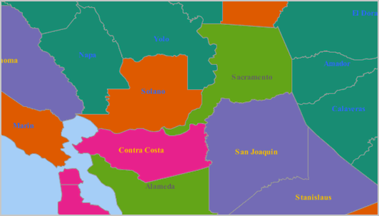
[Description of "Figure 2-1 Varying Label Styles for Different Buckets"](img_text/thematic_map_display.md)

In Example 2-3, all buckets except the last one specify a label style. For any features that fall into a bucket that has no specified label style, the label style (if any) applied to the feature depends on the following:

- If the `<label>` element of the theme's styling rules specifies a label style other than the advanced style itself, the specified label style is used to label the feature. In the following example, because the `<label>` element's style specification (`T.STATE_NAME`) is different from the `<features>` element's style specification (`V.COUNTY_POP_DENSITY`), features that fall into a bucket with no specified label style are labeled using the `T.STATE_NAME `style:

      <?xml version="1.0" standalone="yes"?>
      <styling_rules>
        <rule column="TOTPOP">
          <features style="V.COUNTY_POP_DENSITY">
          </features>
          <label column="county" style="T.STATE NAME">
              1
          </label>
        </rule>
      </styling_rules>

- If the `<label>` element of the theme's styling rules specifies the advanced style as its label style, the feature is not labeled. (This is why some counties in Figure 2-1 are not labeled.) In the following example, because the `<features>` and `<label>` elements both specify the advanced style `V.COUNTY_POP_DENSITY`, features that fall into a bucket with no specified label style are not labeled:

      <?xml version="1.0" standalone="yes"?>
      <styling_rules>
        <rule column="TOTPOP">
          <features style="V.COUNTY_POP_DENSITY">
          </features>
          <label column="county" style="V.COUNTY_POP_DENSITY">
              1
          </label>
        </rule>
      </styling_rules>

**Parent topic:** Styles

#### 2.2.3 Orienting Text Labels and Markers

You can control the orientation of text labels and markers on a map by using oriented points. The oriented point is a special type of point geometry in Oracle Spatial and Graph. In an oriented point, the coordinates represent both the location of the point and a virtual end point, to indicate an orientation vector. The text is aligned or the marker symbol is rotated according to the orientation vector, which is explained and illustrated in Controlling Marker Orientation. For more information about oriented points, see [Oracle Spatial and Graph Developer's Guide](../spatl/spatial-datatypes-metadata.md).

- Controlling Text Style Orientation
- Controlling Marker Orientation

**Parent topic:** Styles

##### 2.2.3.1 Controlling Text Style Orientation

To orient the text label of a point in the direction of an orientation vector, you can specify the point as an Oracle Spatial and Graph oriented point in the map request. When the map visualization component labels an oriented point, it automatically centers the text label on the point position, and aligns the label so that it points in the direction of the orientation vector.

For each feature to be so labeled, you must specify its location as an oriented point. You can group these oriented points in a single table and create a spatial index on the column containing the point geometries. You can then create a theme based on the table, specifying a desired text style as the labeling, and specifying transparent color style as the rendering style so that the points themselves are not displayed on the map.

Example 2-4 is a map request that labels a single oriented point with coordinates (12,14, 0.3,0.2), where (12,14) represents the X and Y coordinates of the point and (0.3,0.2) represents the orientation vector. It renders the point using a dynamically defined transparent color style (named `transparent_color`) to ensure that the text is displayed but the underlying point is not displayed.

Example 2-4 Labeling an Oriented Point

    <map_request
      title="Labeling Oriented Points"
      datasource="my_datasource"   width="400"  height="300"
      antialiase="true"
      format="PNG_STREAM">

      <themes>
        <theme name="theme1">
           <jdbc_query
             spatial_column="geom"  jdbc_srid="8265"
             render_style="transparent_color"
             label_column="label" label_style="t.street name"
             datasource="tilsmenv">
             SELECT SDO_GEOMETRY(2001, 8265, NULL,
                          SDO_ELEM_INFO_ARRAY(1, 1, 1, 3, 1, 0),
                          SDO_ORDINATE_ARRAY(12, 14, .3, .2))
             geom, 'Oriented Point' label FROM dual
           </jdbc_query>
         </theme>
      </themes>

      <styles>
        
      </styles>
    </map_request>

Figure 2-2 shows part of the map generated by the request in Example 2-4. (The label is the phrase Oriented Point.)

Figure 2-2 Map Display of the Label for an Oriented Point

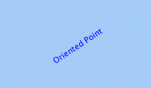
[Description of "Figure 2-2 Map Display of the Label for an Oriented Point"](img_text/mv_oriented_pt_label.md)

**Parent topic:** Orienting Text Labels and Markers

##### 2.2.3.2 Controlling Marker Orientation

When a marker style is applied to an oriented point, the map visualization component automatically rotates the marker style so that it points to the orientation vector. Any necessary rotation of the marker style is around the center of the marker.

Figure 2-3 shows how you can use an oriented point to control the orientation of marker styles. In this figure, the original marker style is first shown without any rotation. However, when the marker is applied to the same oriented point shown in Example 2-4 in Controlling Text Style Orientation, the marker style is rotated accordingly (in this case about 34 degrees counterclockwise) to reflect the orientation vector.

Figure 2-3 Oriented Marker

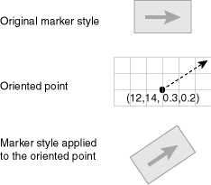
[Description of "Figure 2-3 Oriented Marker"](img_text/oriented_marker.md)

**Parent topic:** Orienting Text Labels and Markers

#### 2.2.4 Making a Text Style Sticky

You can specify that a text style is "sticky," which means that any feature that uses it as a label style will always have its text label drawn on a map. Example 2-5 shows an XML definition of a style with the `sticky` attribute set to `true`.

Example 2-5 Text Style with Sticky Attribute

    <?xml version="1.0" standalone="yes"?>
    <svg width="1in" height="1in">
    <desc></desc>
     <g class="text" sticky="true" style = "font-style:plain;font-family:Serif;font-size:11pt;font-weight:bold;fill:#000000">
        Hello World!
    </g>
    </svg>

**Parent topic:** Styles

#### 2.2.5 Getting a Sample Image of Any Style

To get a sample image for any pre-defined style stored in a database, you can issue a simple HTTP request to the map visualization component server. This request can specify the size of the sample image, the background color, and the format of the returned image. Such requests are useful if you want to display a visual list of styles on a web page, to build a custom map legend, or just to see how various styles will appear.

The HTTP request has the following parameters, all of which are optional except for `sty`:

- `sty` (required) specifies the name of the style.

- `ds` specifies the data source where the style can be accessed. By default, the default map visualization component data source is used.

- `w` specifies the width of the sample image in pixels. The default value is 20.

- `h` specifies the height of the sample image in pixels. The default value is 20.

- `f` specifies the format of the sample image. Possible values are `png` for direct PNG image stream, `png_url` for the URL of a PNG image, `gif` for direct GIF image stream, or `gif_url` for the URL of a GIF image. The default value is `png`, which means the map visualization component server will directly stream the generated PNG image data back to the client without first saving it to the server disk.

- `bg` specifies the background color of the sample image. The format must be a hexadecimal string in the form of `0x``rrggbb`, such as 0x808080 for a gray color. The default value is 0xffffff (white).

  For a transparent background, specify `bg` as an extended hexadecimal string to include the alpha values, in the format of `0x``aarrggbb`. For example, 0x00ffffff will make the style image's background completely transparent, while 0x55ffffff is a white background with a transparency value of 0x55 (decimal value 80). The alpha value can range from 0x00 (completely transparent) to 0xff (completely opaque).

- `aa` specifies whether the sample image should be rendered in antialiasing mode. The default value is the string `true`. Specify the string `false` if you do not want to use antialiasing.

The following example generates an antialiased PNG image with a gray background with the default size of 20x20 pixels, displaying the marker style named `M.STAR` from the map visualization component default data source:

    http://www.mycorp.com/mapviewer/omserver?sty=m.star&bg=808080

The preceding request generates a display similar to that in Figure 2-4.

Figure 2-4 Sample Image of a Specified Marker Style

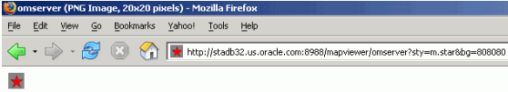
[Description of "Figure 2-4 Sample Image of a Specified Marker Style"](img_text/sample_image_1.md)

The following example generates an antialiased GIF image with the default white background, a width of 60 pixels, and a height of 25 pixels, displaying the line style named `L.PH` from the map visualization component data source named `mvdemo`:

    http://www.mycorp.com/mapviewer/omserver?sty=l.ph&ds=mvdemo&f=gif&w=60&h=25&aa=true

The preceding request generates a display similar to that in Figure 2-5.

Figure 2-5 Sample Image of a Specified Line Style

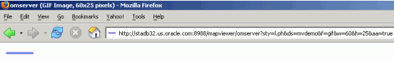
[Description of "Figure 2-5 Sample Image of a Specified Line Style"](img_text/sample_image_2.md)

**Parent topic:** Styles

#### 2.2.6 Allowing a Text Style to Overlap or Be Overlapped

You can specify that a text style `allow-overlap`, which means that any area feature, such as a polygon that uses it as a label style, will allow its text label be overlapped on a map. The following example shows an XML definition of a style with the `allow-overlap` attribute set to `true`.

    <?xml version="1.0" standalone="yes"?>
    <svg width="1in" height="1in">
    <desc></desc>
     <g class="text" allow-overlap="true" style = "font-style:plain;font-family:Serif;font-size:11pt;font-weight:bold;fill:#000000">
        Hello World!
    </g>
    </svg>

For example, if a country's name is used as a label text, and if its style has the attribute value `allow-overlap="true"`, then other features' labels (such as state names) are allowed to overlap with it. The following figure shows part of a rendered map in which the country label "United States" overlaps slightly with the state labels "Colorado" and "Kansas".

Figure 2-6 Text Style with allow-overlap="true"

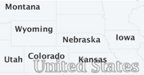
[Description of "Figure 2-6 Text Style with allow-overlap="true""](img_text/allow_overlap.md)

**Parent topic:** Styles

### 2.3 Themes

Theme is perhaps the most important concept in the map visualization component. A theme is a visual representation of a particular data layer.

Conceptually, a theme is a collection of geographic features that share similar attributes, plus the rendering and labeling rules that tell the map visualization component what styles to use to render and label the features. To be more exact, when you define a theme, you are actually providing the map visualization component with the following information: where and how to get the data, and how to render and label the data.

Depending on how a theme is created, it can also be categorized as either a predefined theme or a dynamic (JDBC) theme. For a predefined theme, the theme's definition is created in the standalone Map Builder tool and stored in the database. For a dynamic theme, the theme's definition (XML) is created in real time by an application. Dynamic themes typically employee a custom SQL query constructed by the application to get its data.

Typically, the data for a theme comes from a spatially enabled table, that is, a database table or view with a column of type SDO_GEOMETRY. For example, a theme named `US_STATES` might be based on a STATES table that has a column named GEOMETRY, plus any other nonspatial attribute columns. This type of theme is often called a geometry theme. Besides geometric data, other types of database-managed geographic data can be associated with corresponding types of themes; for example:

- Georeferenced images stored in BLOBs (image themes)

- Oracle Spatial and Graph GeoRaster data (GeoRaster themes)

- Oracle Spatial and Graph network data model (network themes)

- Oracle Spatial and Graph topology data model (topology themes)

- Cartographic annotation text (annotation themes)

Map visualization component themes can be used to render not only geographic data stored in a database, but also data originating from other sources, such as web services (WFS, WMS, and WMTS) or the local file system (through the custom spatial data provider interface).

Regardless of what type of data is associated with a theme (except for WMS and WMTS themes, which represent externally rendered map layers), the map visualization component styling rules still need to be defined for each theme, and the styles referenced by the styling rules must exist and be stored in the database as part of the mapping metadata.

- Predefined Themes
- JDBC Themes
- Image Themes
- GeoRaster Themes
- Network Themes
- Topology Themes
- WFS Themes
- WMTS Themes
- Custom Geometry Themes
- Annotation Text Themes
- LRS (Linear Referencing System) Themes
- Thematic Mapping
- Attributes Affecting Theme Appearance

**Parent topic:** Map Visualization Concepts

#### 2.3.1 Predefined Themes

A predefined theme is a theme whose definition is stored in a user's database schema. All predefined themes for a database user are stored in that user's USER_SDO_THEMES view (described in Map Visualization Component Metadata Views, especially xxx_SDO_THEMES Views). When you include a predefined theme in a map request, you need to specify only the theme name. The map visualization component automatically finds the theme's definition, constructs a query based on it, retrieves the relevant spatial and attribute data, and renders the data according to the styling rules for the theme.

Each predefined theme must have an associated base table or view. If you base a theme on a view, you must insert a row in the view owner's USER_SDO_GEOM_METADATA view (described in [Oracle Spatial and Graph Developer's Guide](../spatl/spatial-datatypes-metadata.md)) specifying the view and its spatial column. If the view is a join view (that is, if it is based on multiple tables), you must specify the `key_column` attribute (described in [Themes: Styling Rules](xml-formats-map-visualizer.md)) in the theme's styling rules. The reason for this requirement is that the map visualization component by default caches geometries for a predefined theme based on the rowid in the base table; however, for a join view there is no ROWID pseudocolumn, so you must specify a key column.

For most types of predefined themes (but not WMS themes), you can use the Map Builder tool to create and preview themes. For information about the Map Builder tool, see [Oracle Map Builder Tool](oracle-map-builder-tool.md).

- Styling Rules in Predefined Spatial Geometry Themes
- How the Map Visualization Component Formulates a SQL Query for a Styling Rule
- Styling Rules with Binding Parameters
- Applying Multiple Rendering Styles in a Single Styling Rule
- Using Multiple Rendering Styles with Scale Ranges
- Caching of Predefined Themes
- Feature Labels and Internationalization
- Primary and Secondary Labels for Linear Features

**Parent topic:** Themes

##### 2.3.1.1 Styling Rules in Predefined Spatial Geometry Themes

Each predefined theme is always associated with one or more styling rules, specifications in XML format that control aspects of how the theme is displayed. This section describes styling rules for predefined spatial geometry themes, such as the airport theme shown in Example 2-6. Other types of themes, such as image, GeoRaster, network, and topology themes, have their own distinct styling rules requirements, and these are discussed in sections that explain these themes. However, the styling rules for all types of themes are grouped under the `<styling_rules>` element in an XML document, which is stored in the STYLING_RULES column for each predefined theme in the USER_SDO_THEMES view. (The `<styling_rules>` DTD is described in [Themes: Styling Rules](xml-formats-map-visualizer.md).)

**Note:**

The following naming conventions are used for prefixes in style names in the examples in this chapter: `v.` indicates variable (advanced style), `m.` indicates marker, `c.` indicates color, `l.` indicates line, and `t.` indicates text. (If the style is not under the current user's schema, you must specify the owner's schema name followed by a colon. For example: `mdsys:c.red`.)

In the content (character data) of an XML document, `&lt;` and `&gt;` must be used to represent `<` and `>`, respectively. Otherwise, `<` or `>`, such as in `WHERE CATEGORY > 'B'`, will be interpreted by the XML parser as part of an XML tag.

Example 2-6 XML Definition of Styling Rules for an Airport Theme

    <?xml version="1.0" standalone="yes"?>
    <styling_rules>
      <rule>
        <features style="c.black gray">
        runway_number &gt; 1
        </features>
        <label column="name" style="t.airport name">
          1
        </label>
      </rule>
      <rule>
        <features style="m.airplane">
        runway_number = 1
        </features>
      </rule>
    </styling_rules>

Each styling rule has a required `<features>` element and an optional `<label>` element. The `<features>` element specifies which row or rows (features) in the table or view will be selected based on the user-defined predicate and on the style to be used for the selected features. You can specify any valid SQL predicate as the value of this element. The `<label>` element specifies whether or not to annotate the selected features, and if so, which column in the table or view to use for text labels.

In Example 2-6, there are two styling rules associated with the `Airport` theme:

- The first rule specifies that only those rows that satisfy the condition `runway_number &gt; 1` (that is, runway number greater than 1) will be selected, and these will be rendered using the style named `c.black gray`. If no value is supplied, no WHERE clause condition is applied. For example, assume that the definition had been the following (that is, omitting the `runway_number &gt; 1` condition):

      <?xml version="1.0" standalone="yes"?>
      <styling_rules>
        <rule>
          <features style="c.black gray"/>
          <label column="name" style="t.airport name">
            1
          </label>
        </rule>
      </styling_rules>

  In this case, all airport features would be selected and would be rendered using the color style named `c.black gray`.

  The first rule also has a `<label>` element, which specifies that the NAME column in the table or view will be used to annotate each airport, using the text style `t.airport name`. The value of the `<label>` element, which can be any SQL expression that evaluates to a numeric value, is used to determine whether or not a feature will be annotated. If the numeric value is greater than zero, the feature will be annotated. In this case, because the value is the constant 1, all features specified by the `<features>` element will be annotated, using the values in the NAME column. If the value is less than or equal to zero for a feature, that feature will not be annotated.

- The second rule, which applies to those airports with only one runway, does not have a `<label>` element, thus preventing all such airports from being annotated. In addition, the features that satisfy the second rule will be rendered using a different style (`m.airplane`), as specified in its `<features>` element.

You can think of each styling rule as a filter into the base table or view of the theme, because it selects only a subset of the rows and applies the rendering and labeling styles of that rule. In fact, the map visualization component formulates a complete SQL query for each styling rule. This query string follows a fixed format, as described in How the Map Visualization Component Formulates a SQL Query for a Styling Rule.

**Parent topic:** Predefined Themes

##### 2.3.1.2 How the Map Visualization Component Formulates a SQL Query for a Styling Rule

To see how the map visualization component formulates a SQL query for a styling rule, consider the first styling rule from the airport theme example (Example 2-6 in Styling Rules in Predefined Spatial Geometry Themes):

    <styling_rules>
      <rule>
        <features style="c.black gray">
        runway_number &gt; 1
        </features>
        <label column="name" style="t.airport name">
          1
        </label>
      </rule>
      . . .
    </styling_rules>

When the map visualization component processes this theme, it formulates a query string for this styling rule that looks like this:

    SELECT ROWID, GEOMETRY, 'C.BLACK GRAY', NAME, 'T.AIRPORT NAME', 1, 'rule#0'
      FROM AIRPORT_POINT
      WHERE MDSYS.SDO_FILTER(GEOMETRY,
        MDSYS.SDO_GEOMETRY(2003, 8265, NULL, MDSYS.SDO_ELEM_INFO_ARRAY(1, 1003, 3),
        MDSYS.SDO_ORDINATE_ARRAY(:mvqboxxl, :mvqboxyl, :mvqboxxh, :mvqboxyh)),
        'querytype=WINDOW') = 'TRUE'

In the preceding query string:

- The base table name of the theme, `AIRPORT_POINT`, appears in the FROM clause

- The SELECT list includes ROWID as the first column. ROWID is the default key_column attribute of a predefined theme.

- The next column in the SELECT list is GEOMETRY. This is the geometry column of this theme.

- The next column in the SELECT list is the literal string `'C.BLACK GRAY'`, which is the rendering style name for this rule.

- The next column in the SELECT list is the column NAME, which will provide the label text. It is specified in the `<label>` element of this styling rule.

- The next column in the SELECT list is the literal string `'T.AIRPORT NAME'`, which is the labeling style name specified in the `<label>` element.

- The next column in the SELECT list is the literal value `1`, which is the value of the `<label>` element itself.

- The next column in the SELECT list is the literal string `'rule#0'`. This is used internally by the map visualization component only.

- The large WHERE clause is essentially an Oracle Spatial and Graph filtering operator, SDO_FILTER. This WHERE clause is automatically added by the map visualization component (and is not something you need to specify when defining a theme). It ensures that only those geographic features that are in contact with the current map viewing window will be fetched from the base table. The four binding variables, `mvqboxxl`, `mvqboxyl`, `mvqboxxh` and `mvqboxyh`, will be automatically filled in with the coordinates for the current map viewing window.

The map visualization component always uses the preceding format when constructing SQL queries for the styling rules of a predefined geometry theme's styling rules. It uses different formats for the queries for other types of themes, such as a topology or GeoRaster theme. The formats for these other queries are not described here; however, if you are interested, you can set the logging level of your map visualization component instance to `FINEST`, submit a map request containing a particular type of theme, and check the map visualization component log file to see the exact query that the map visualization component constructs.

Each row (or feature) in the query's result set now contains all the information the map visualization component needs: the spatial data, the rendering and labeling style names, the label text, and the labeling conditions. The map visualization component then constructs an in-memory feature object for each row and sends them to the rendering pipeline to be displayed on the map.

If two or more styling rules are specified for a theme, a UNION ALL operation is performed on the SQL queries for the rules (from first to last) to fetch the qualified features from the table or view.

If an advanced style is specified in a rule, the SELECT list of the query for that rule will include the additional attribute column or columns that are required by the advanced style.

**Parent topic:** Predefined Themes

##### 2.3.1.3 Styling Rules with Binding Parameters

As explained in How the Map Visualization Component Formulates a SQL Query for a Styling Rule, the `<features>` element of a styling rule can define a query condition to select features from the base table or view. This query condition typically contains hard-coded SQL expressions, such as `runway_num > 1` in the airport theme. However, you can instead include binding variables in the query predicate. Such a theme is often called a templated theme, because it is essentially defining a template for how to display certain features, and the exact set of features is determined at runtime by providing a binding value to the query predicate.

The concept of templated theme allows you to define a single theme and to have the binding values change between map requests. For example, consider the following styling rule:

    <?xml version="1.0" standalone="yes"?>
    <styling_rules>
      <rule>
        <features style="C.RED"> (state_abrv=:1) </features>
        <label column="STATE" style="T.STATE NAME"> 1 </label>
      </rule>
    </styling_rules>

The preceding styling rule defines a `<features>` element with a query condition based on the value of the `state_abrv` attribute, which the application must supply. In map visualization component requests, the binding parameter must be defined on the theme section, and each binding parameter is defined by a value and by a SQL type. In the following theme definition on a map request, the state abbreviation value is `ME` and the variable SQL type is `String`. The value `ME` will be used with the predefined theme styling rule.

    <theme name="THEME_US_DYN_STATES" >
       <binding_parameters>
          <parameter value="ME" type="String"/>
       </binding_parameters>
    </theme>

**Parent topic:** Predefined Themes

##### 2.3.1.4 Applying Multiple Rendering Styles in a Single Styling Rule

The `<feature>` element of a styling rule allows you to specify only one rendering style using the `style` attribute. If you want to apply multiple rendering styles to a feature without using multiple themes, you cannot specify multiple styling rules, because each rule selects a different subset of features. To apply multiple rendering styles to a feature without using multiple themes, you must use the `<rendering>` element instead of the `style` attribute of the `<features>` element.

The `<rendering>` element has the format shown in the following example:

    <rendering>
     
    </rendering>

In the `<rendering>` element, the `
       </rendering>
     </rule>
    </styling_rules>

The `<rendering>` element can also be used with dynamic themes, geometry themes, and topology themes.

**Parent topic:** Predefined Themes

##### 2.3.1.5 Using Multiple Rendering Styles with Scale Ranges

The `<rendering>` element (see Applying Multiple Rendering Styles in a Single Styling Rule) can have multiple `<style>` elements defined. You can also assign scale ranges for each `<style>` element. By using multiple stacked styles with scale ranges, you can define a single theme with different representations for different scales.

Example 2-8 shows the theme styling rules with stacked styles. Each style has a scale range defined.

Example 2-8 Theme Styling Rules with Stacked Styles

    <?xml version="1.0" standalone="yes"?>
    <styling_rules>
      <rule>
        <features> </features>
        <label column="STATE" style="T.S02_STATE_ABBREVS"> 1 </label>
        <rendering>
         <style name="C.COUNTIES" max_scale="5.0E7" scale_mode="RATIO"/>
         <style name="C.RB13_1" min_scale="5.0E7" max_scale="1.0E7" scale_mode="RATIO"/>
         <style name="L.DPH" min_scale="1.0E7" scale_mode="RATIO"/>
        </rendering>
      </rule>
    </styling_rules>

**Parent topic:** Predefined Themes

##### 2.3.1.6 Caching of Predefined Themes

By default, the map visualization component automatically caches the spatial data for a predefined theme when it is fetched from the database for processing by the map visualization component rendering engine. By contrast, data for dynamic (JDBC) themes is never cached in the map visualization component. If you do not want any data for a predefined theme to be cached (such as for a theme whose underlying base table is constantly being updated), you can set the `caching` attribute to `NONE` in the `<styling_rules>` element for the theme. (The `<styling_rules>` element, including the `caching` attribute, is described in [Themes: Styling Rules](xml-formats-map-visualizer.md).)

For frequently used themes whose base data is static or read-only, specify `caching ALL` for the best performance. This causes the map visualization component, when it first accesses the theme definition, to fetch all the features (including spatial data, attribute data, and styling information associated with them) and cache them in the map visualization component memory, creating an in-memory R-tree for the theme's spatial data. All subsequent requests requiring that theme occur locally instead of going to the database.

If the `caching` attribute value is `NORMAL` (the default), each time a map involving that theme is requested, the map visualization component queries the database to get the spatial data and any associated attribute data. However, if any of the spatial geometry data, as referenced by rowid or a user-specified key column, has already been cached, the unpickling process (the conversion from the raw database geometry format to a Java geometry object) is skipped. Still, if memory is not an issue and if a frequently used theme can completely fit in the cache, you should specify `caching ALL`, to eliminate virtually all database access for that theme after the initial loading.

Because the map visualization component spatial data cache is global, all predefined themes that are accessed by the map visualization component compete for a global fixed-sized memory cache. The cache resides completely in memory, and you can specify the maximum size of the cache as explained in [Customizing the Spatial Data Cache](introduction-to-map-visualization-component.md). When the cache limit is reached, older cached data is removed from the cache to make room for the most recently accessed data, except that data for themes specified with `caching ALL` is not removed from the cache, and the map visualization component does not requery the database for these themes.

Caching is currently disabled for predefined annotation and custom geometry themes. For custom geometry themes, you can implement a caching mechanism in your provider implementation. However, for each request, a new instance of your provider is created; and if you implement a local caching mechanism, it will be lost.

**Parent topic:** Predefined Themes

##### 2.3.1.7 Feature Labels and Internationalization

The map visualization component includes support for translated theme labels. Typically with a predefined map visualization component theme, you can specify a label column that will provide all the text strings for labeling each feature of the theme. These text strings are string values stored in the database table column, in a specific language (such as English). However, you can also supply different translations of these stored string values by using a resource bundle. When such translated text strings are available, you can instruct the map visualization component to label the features of a theme using a specific language or locale.

**Note:**

Only predefined geometry themes support resource bundles at this time.

The steps for supplying translations and instructing the map visualization component to label a theme using a specific user language are as follows:

1.  Prepare the translations.

    A typical map visualization component predefined geometry theme gets all the underlying data from a table. You can specify one of the (string type) columns as the labeling column for this theme. This is called the label column. When a label column needs to be translated into different languages, you extract all the values from the table, and store them in a properties file, such as `StringResources.properties`. (Note that the file name `StringResources.properties` assumes that the extracted texts are all in English. If they are not, then the properties file name needs to follow a convention where the language code, and an optional region or country code, is a suffix in the file name. For example, `StringResources_fr.properties` will contain French translations only, while `StringResources_zh_CN.properties` is for simplified Chinese.)

    A properties file is a plain text file that follows a very simple format. For example, a simple `StringResources.properties` file might contain the following:

        # This is the English version of the strings.
        California = California
        Nevada = Nevada
        Montana = Montana

    The first line is a comment, and starts with the `#` character. Each subsequent line contains one pair of key (first string) and value (second string). The keys come directly from the label column, whereas the values are corresponding translations. Because this particular file contains the default English text strings, the key and the value (translation) are the same in each case. Note that the keys should always be in English.

    From this default properties file, your translation specialists should create a set of property files, one file for each translation. Using the preceding simple example, the translated file for simplified Chinese (`StringResources_zh_CN.properties`) should look like the following, in which the value of each key has been replaced by the Chinese translation of the key, encoded as a Unicode string:

        # This is the Chinese version of the strings.
        California =  \u6CA1\u6709\u8981\u5448\u73B0\u7684\u4E3B\u9898\u3002
        Nevada = \u65E0\u6CD5\u52A0\u8F7D\u4E3B\u9898\u3002
        Montana = \u65E0\u6CD5\u52A0\u8F7D\u6837\u5F0F\u3002

    The default properties file, `StringResouces.properties`, plus all the language specific files that share the same file name (except for the language and region suffixes) collectively form what is called a resource bundle. In this case the resource bundle is named `StringResources`. You can name your resource bundles with any name you like, but different bundles (containing different set of keys) should always use different base names.

    For more information about Java resource bundles and properties files, see the Java language documentation.

2.  Supply the translated text strings as a Java Resource Bundle, which can be based on either Java resource classes or plain properties files.

    After all the label text strings have been translated, you must place all the files (the resource bundle) in the map visualization component CLASSPATH so that the map visualization component can find these files at runtime. Typically, you can use the map visualization component `WEB-INF/classes` folder: copy all the files including the base `StringResources.properties` and language-specific files (such as `StringResources_fr.properties` and `StringResources_zh_CN.properties`) into this folder.

    If you place all the files of a resource bundle into a subfolder under `WEB-INF/classes`, then the name of the resource bundle (as known to the map visualization component) will need to be prefixed with this subfolder name. This is similar to how one places a Java class in a directory structure that follows the package names. For example, if you put all the `StringResources*.properties` files in `WEB-INF/classes/i18n/`, then later when you register the resource bundle with the map visualization component, the actual name of your resource bundle should be `i18n.StringResources`.

3.  Specify the name of the resource bundle in the theme definition by registering the resource bundle with the map visualization component.

    For the map visualization component to find your translated classes, you must specify the complete name of your resource bundle in the theme definition. The easiest way to do this is with the Map Builder utility, specifying the resource bundle name as the Translation Class in the Advanced Parameters pane of the theme editor. Figure 2-7 shows `StringResources` being specified for the Translation Class.

    Figure 2-7 Specifying a Resource Bundle for a Theme

    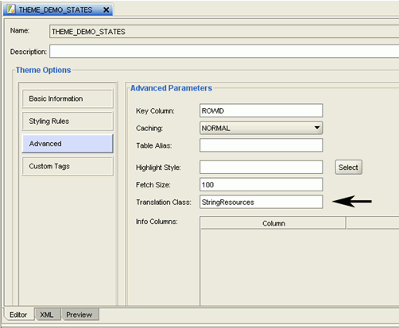
    [Description of "Figure 2-7 Specifying a Resource Bundle for a Theme"](img_text/translation_class.md)
    As mentioned in the preceding step, if your resource bundle files are located in a subfolder of , then the subfolder name must the base name of your resource bundle, separated by a period, as if the resource bundle files were Java classes in a package.

4.  Specify a language parameter when requesting a map or theme.

    Specify the preferred language for each map request the Oracle Maps JavaScript API (described in [Oracle Maps JavaScript API](oracle-maps.md)) or the XML map request API (described in [Map Visualization Servers](map-visualization-servers.md)).

    - In JavaScript code, specify the label language code in the call to the MVThemeBasedFOI class. The following example causes the FOI theme to display its labels in simplified Chinese:

          themebasedfoi = new MVThemeBasedFOI('themebasedfoi1','mvdemo.theme_demo_states');
          themebasedfoi.setLabelLanguageCode("zh-cn");
          themebasedfoi.enableLabels(true);

      With the `setLabelLanguageCode(lang_code)` method, you can specify a language code so that the map visualization component labels the features using the text strings for the specified language, which must be a 2 letter language code (such as `zh`), followed optionally a hyphen (-) and a 2-letter country code (such as `zh-cn`). The language codes are defined by the ISO 639 standards and are listed at several websites, such as [`http://www.loc.gov/standards/iso639-2/php/English_list.php`](http://www.loc.gov/standards/iso639-2/php/English_list.php). If no translated text strings for the specified language code are found, the English text strings (or whatever the default strings are for the theme) will be used for labeling.

    - In an XML map request, specify the language in the `lang` attribute. The following example causes the labels to be displayed in simplified Chinese:

          <map_request title="Oracle LBS MAP"
          basemap="demo_map"
          datasource = "mvdemo"
          width="640" height="480"
          lang="zh-CN"
          format="PNG_STREAM">

          

          <geoFeature> <geometricProperty typeName="center">
            <Point> <coordinates>-122.2615, 37.5266</coordinates>
            </Point> </geometricProperty>
          </geoFeature>
          

          </map_request>

      Only language codes and country codes specified by the ISO 639 standards can be used as possible `lang` values. If an optional country code is used, it must be connected to the language code by a hyphen (-). Country codes and language codes are not case sensitive.

      If the `lang` attribute is specified as part of the XML map request, every theme rendered to the result map it checked to see if it has an associated resource bundle. If a theme does not have an associated resource bundle, or the translated text strings for the specified language cannot be found, the default values (those stored in the table column) are used.

      If the `lang` attribute is not specified as part of the XML map request, the default text string values (those stored in the table column) are always used, regardless of which locale in effect for the map visualization component itself (or rather, its containing JVM).

**Parent topic:** Predefined Themes

##### 2.3.1.8 Primary and Secondary Labels for Linear Features

The map visualization component includes support for labeling a linear feature with a primary and a secondary label. For example, a street name can be labeled with its English name as the primary label and with its local (native) language as the secondary label (or vice versa). When labeling a linear feature, the primary and secondary labels are labeled alternately along the feature when applicable.

When you specify a label column for a map visualization component theme, that column will provide both the primary and secondary text strings, delimited by "\|\|\|" (three vertical lines). For example, a text string of "Garden St\|\|\|Rua Jardim" contains the primary text string of "Garden St" (English) and secondary text string of "Rua Jardim" (Portuguese). In practice, that label column may be a concatenation of two existing columns, and database triggers can be employed to maintain its consistency with its two base columns.

**Parent topic:** Predefined Themes

#### 2.3.2 JDBC Themes

A JDBC theme is a theme that is dynamically defined with a map request. JDBC themes are not stored permanently in the database, as is done with predefined themes.

For a JDBC theme, you must specify a valid SQL query that retrieves all the necessary spatial data (geometries or other types of data, such as image, GeoRaster, network, or topology). If attribute data is needed, such as for thematic mapping or spatial data analysis, the query must also select it. In other words, you must provide a correct and complete query for a JDBC theme. In addition to the query, you can also specify the rendering and labeling styles to be used for the theme.

For a JDBC theme based on spatial geometries, the map visualization component processed the columns specified in the query according to the following rules:

- The column of type SDO_GEOMETRY is treated as the spatial data column.

- Any column whose name or alias matches that specified in the JDBC theme's `label_column` attribute is treated as the labeling column, whose values are used as text for labels.

- Any other columns are treated as attribute data columns, which may or may not be used by the map visualization component. For example, if the rendering style is an advanced style, any attribute columns are processed by that style in the order in which they appear in the SELECT list in the query. Thus, if you are performing thematic mapping and using an advanced style, you must specify all attribute columns that are needed for the thematic mapping, in addition to the geometry column and optional labeling column. (A labeling column can also be an attribute column, in which case you do not need to specify that column in the SELECT list.)

Example 2-9 is a map request that includes a JDBC theme.

Example 2-9 JDBC Theme in a Map Request

    <?xml version="1.0" standalone="yes"?>
    <map_request title="My MAP" datasource = "mvdemo">

      <themes>
        <theme name="jdbc_theme_1">
           <jdbc_query
                datasource="mvdemo"
                jdbc_srid="41052"
                spatial_column="geometry"
                render_style="C.RED">
              SELECT geometry from states where name='MA'
           </jdbc_query>
         </theme>
      </themes>

    </map_request>

The full query that the map visualization component executes for the JDBC theme in Example 2-9 is:

    SELECT geometry FROM states WHERE name='MA';

For this request, the map visualization component generates a map that contains only the selected geometry as a result of executing this JDBC theme's query. In a more typical case, however, the map request will need to use several JDBC themes to plot additional dynamic data on top of the base map. Furthermore, the map request may have a query window associated with it; that is, the user may want to see only a portion of the area included in the whole base map. In this case, the SQL queries in the JDBC themes will be subjected to a spatial window query, to eliminate any unwanted results.

- Defining a Point JDBC Theme Based on Two Columns
- Storing Complex JDBC Themes in the Database

**Parent topic:** Themes

##### 2.3.2.1 Defining a Point JDBC Theme Based on Two Columns

If a database table uses two columns (such as longitude and latitude) to represent a point coordinate, you can define a JDBC theme based on the two columns to render points. The table does not need to have a spatial geometry column, but it can have one; however, if the theme request defines the point columns and also the geometry column, the map visualization component will try to render the points using the two columns, not the geometry column.

Example 2-10 is a JDBC theme that renders points from two columns, named LONG_LOC and LAT_LOC, of a table named POI. The x_column and y_column attributes specify the columns containing the point coordinate values. In this example, the points are rendered using the C.RED style, and the table values from the NAME column are rendered using the T.POI_NAME style.

Example 2-10 JDBC Theme Based on Columns

    <map_request>
      . . .
      

       . . .
      

      <themes>
        <theme name="theme1" >
           <jdbc_query
             datasource="mvdemo"
             jdbc_srid="8265"
             x_column="long_loc"
             y_column="lat_loc"
             render_style="C.RED"
             label_column="name"
             label_style="T.POI_NAME"
             >SELECT long_loc, lat_loc,name FROM poi
           </jdbc_query>
         </theme>
      </themes>
    </map_request>

If the request specifies a valid query window (that is, not the full extent), a WHERE expression based on the size of the request window is automatically added to the query.

Example 2-11 JDBC Theme Based on Columns, with Query Window

If the table has a geometry column, you can specify SQL code to use the geometry column as a filter. Example 2-11 is similar to Example 2-10, but it adds the use of the SDO_FILTER operator to specify a query window based on the geometry in the column named GEOMETRY. In Example 2-11, the question mark (?) characters indicate that the lower-left and upper-right coordinates of the query window rectangle are taken from values supplied at runtime (not shown in this example).

    <map_request>
      . . .
      

       . . .
      

      <themes>
        <theme name="theme1" >
           <jdbc_query
             datasource="mvdemo"
             jdbc_srid="8265"
             x_column="long_loc"
             y_column="lat_loc"
             render_style="C.RED"
             label_column="name"
             label_style="T.POI_NAME"
             >SELECT long_loc, lat_loc FROM poi WHERE
               SDO_FILTER(geometry,MDSYS.SDO_GEOMETRY(2003, 8265, NULL,
               MDSYS.SDO_ELEM_INFO_ARRAY(1, 1003, 3),
               MDSYS.SDO_ORDINATE_ARRAY(?,?,?,?)),
               'querytype=WINDOW') = 'TRUE'
           </jdbc_query>
         </theme>
      </themes>
    </map_request>

**Parent topic:** JDBC Themes

##### 2.3.2.2 Storing Complex JDBC Themes in the Database

Sometimes the SQL query for a JDBC theme is so complex that you may want to save the query. In such cases, you can define a predefined theme (whose definition is stored in the database's USER_SDO_THEMES view), and then include the full SQL query as the content of the `<features>` element in the styling rules for that theme.

The feature style specified in the `<features>` element is then used to render the geometries retrieved using the full query. The base table as defined for such a theme is ignored because the full SQL query already includes a FROM clause. The geometry column defined in the USER_SDO_THEMES view is still needed, and it must be the same as the geometry column selected in the user-supplied SQL query. If you have a `<label>` element for a styling rule, the label style specified is used to label the geometries, as long as the query selects a column that contains label text.

Example 2-12 is a sample `<styling_rules>` element of a predefined theme with a complex SQL query.

Example 2-12 Complex Query in a Predefined Theme

    <?xml version="1.0" standalone="yes"?>
     <styling_rules>
       <rule>
         <features style="L.POOR_ROADS" asis="true">
            select sdo_lrs.clip_geom_segment(geometry,start_measure,end_measure)
                  geometry
            from (select /*+ no_merge use_hash(a b) */
                    a.street_id, name, start_measure, end_measure, geometry
                 from (select /*+ no_merge */ a.street_id, name, geometry
                       from philly_roads a
                       where sdo_filter(geometry,sdo_geometry(2002,41124,null,
                        sdo_elem_info_array(1,2,1),
                                           sdo_ordinate_array(?,?,?,?)),
                                     'querytype=window')='TRUE') a,
                       philly_road_conditions b
                 where condition='POOR' and a.street_id = b.street_id)
         </features>
       </rule>
     </styling_rules>

Even though Example 2-12 is defined as a predefined theme, the map visualization component still treats it as a JDBC theme at runtime when a user requests a map that includes this theme. As with a normal JDBC theme, the map visualization component by default imposes a window filtering process (if a query window was included in the map request) on top of the SQL query. To override this default behavior and have the supplied query string executed without any modification, specify `asis="true"` in the `<features>` element, as shown in Example 2-12.

**Parent topic:** JDBC Themes

#### 2.3.3 Image Themes

An image theme is a special kind of map visualization component theme useful for visualizing geographically referenced imagery (raster) data, such as from remote sensing and aerial photography.

You can define an image theme dynamically or permanently (as a predefined theme) in the database. You can use image themes with vector (nonimage) themes in a map. Figure 2-8 shows a map in which an image theme (showing an aerial photograph of part of the city of Boston) is overlaid with themes showing several kinds of roadways in the city.

Figure 2-8 Image Theme and Other Themes Showing Boston Roadways

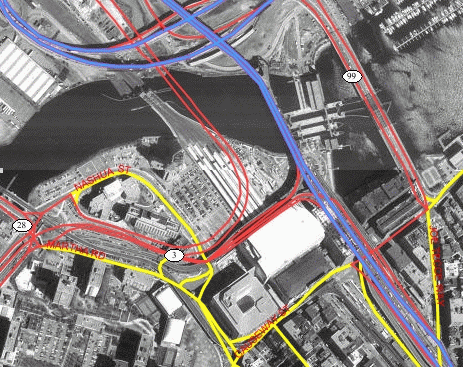
[Description of "Figure 2-8 Image Theme and Other Themes Showing Boston Roadways"](img_text/img_boston.md)

Before you can define an image theme, you must follow these rules in organizing your image data:

- Store image data in its original format (such as JPEG) in a BLOB column in a database table, or as an Oracle Multimedia object (ORDSYS.ORDImage) that points to the original image file.

- Add a geometry (SDO_GEOMETRY) column to the same table, and store the minimum bounding rectangle (MBR) for each image in that column.

  Each geometry in the MBR column contains the geographic bounds for an image, not its size in the pixel space. For example, if an orthophoto image is 2000 by 2000 pixels in size, but covers a ground rectangle starting at the corner of (936000, 248000) and having a width and height of 8000 meters, the MBR for the geometry column should be populated with (936000, 248000, 944000, 256000).

- Insert an entry for the geometry column in the USER_SDO_GEOM_METADATA view.

- Create a spatial index on the geometry column.

To predefine an image theme, follow the guidelines in Creating Predefined Image Themes. To define a dynamic image theme in a map request, follow the guidelines for defining a JDBC theme, as explained in JDBC Themes, but note the following additional considerations with dynamic image themes:

- You must provide the original image resolution information when defining an image theme.

- The map visualization component by default automatically scales the image data when generating a map with an image theme, so that it fits the current query window. To disable this automatic scaling, specify `imagescaling="false"` in the map request.

For any image theme definition, the map visualization component supports only GIF, JPEG, PNG, and TIFF image formats.

- Creating Predefined Image Themes

**Parent topic:** Themes

##### 2.3.3.1 Creating Predefined Image Themes

To create a predefined image theme, you must store the definition of the image theme in the database by inserting a row into the USER_SDO_THEMES view (described in xxx_SDO_THEMES Views). Example 2-13 stores the definition of an image theme.

- `theme_type` must be `image` in order for this theme to be recognized as an image theme.

- `image_column` specifies the column in the base table or view that stores the actual image data.

- `image_format` is a string identifying the format of the image data. If you specify `GIF` or `JPEG`, the map visualization component can always render the image data.

- `image_resolution` is an optional attribute that identifies the original image resolution (number of `image_unit` units for each pixel).

- `image_unit` is an optional attribute, except it is required if you specify the `image_resolution` attribute. The `image_unit` attribute specifies the unit of the resolution, such as `M` for meter. The value for this attribute must be one of the values in the SDO_UNIT column of the MDSYS.SDO_DIST_UNITS table. In Example 2-13, the image resolution is 2 meters per pixel.

The DTD for the `<styling_rules>` element is presented in [Themes: Styling Rules](xml-formats-map-visualizer.md).

Example 2-13 Creating a Predefined Image Theme

    INSERT INTO user_sdo_themes  VALUES (
       'IMAGE_LEVEL_2',
       'Orthophotos at pyramid level 2',
       'IMAGES',
       'IMAGE_MBR',
       '<?xml version="1.0" standalone="yes"?>
        <styling_rules theme_type="image" image_column="image"
                       image_format="JPEG" image_resolution="2"
                       image_unit="M">
          <rule >
            <features style="C.RED"> plevel=2 </features>
          </rule>
        </styling_rules>' );

Example 2-13 creates an image theme named `IMAGE_LEVEL_2`. The base table (where all image data and associated MBRs are stored) is named IMAGES, and the minimum bounding rectangles (MBRs) for the images are stored in the column named IMAGE_MBR. In the STYLING_RULES column of the USER_SDO_THEMES view, an XML document with one `<styling_rules>` element is inserted.

The `<styling_rules>` element for an image theme has the following attributes:

**Parent topic:** Image Themes

#### 2.3.4 GeoRaster Themes

A GeoRaster theme is a special kind of map visualization component theme useful for visualizing GeoRaster objects. GeoRaster is a feature of Oracle Spatial and Graph that lets you store, index, query, analyze, and deliver raster image and gridded data and its associated metadata. GeoRaster objects are defined using the SDO_GEORASTER data type. For detailed information about GeoRaster, see [Oracle Spatial and Graph GeoRaster Developer's Guide](../geors/georaster-overview-and-concepts.md).

Before you can use the map visualization component with GeoRaster themes, you must ensure that the Java Advanced Imaging (JAI) library files (`jai_core.jar` and `jai_codec.jar`) are in the map visualization component library path. You must also perform the following actions with the GeoRaster data:

1.  Georeference the GeoRaster data to establish the relationship between cell coordinates of the GeoRaster data and real-world ground coordinates (or some other local coordinates).

    If you are using Oracle Database Release 10.1, you must also set the spatial resolution values.

2.  Generate or define the spatial extent (footprint) associated with the raster data.

3.  Optionally, generate pyramid levels that represent the raster image or data at different sizes and degrees of resolution.

4.  Insert a row into the USER_SDO_GEOM_METADATA view that specifies the name of the GeoRaster table and the SPATIALEXTENT attribute of the GeoRaster column (that is, the column of type SDO_GEORASTER). The following example inserts a row for a table named GEOR_TABLE with a GeoRaster column named GEOR_COLUMN:

        INSERT INTO USER_SDO_GEOM_METADATA VALUES
        ( 'geor_table',
          'geor_column.spatialextent',
          SDO_DIM_ARRAY(
            SDO_DIM_ELEMENT('X', 496602.844, 695562.844, 0.000005),
            SDO_DIM_ELEMENT('Y',8788409.499,8973749.499, 0.000005)
          ),
          82279   -- SRID
        );

5.  Create a spatial index on the spatial extent of the GeoRaster table. The following example creates a spatial index named GEOR_IDX on the spatial extent of the table named GEOR_TABLE:

        CREATE INDEX geor_idx ON geor_table(geor_column.spatialextent)
          INDEXTYPE IS MDSYS.SPATIAL_INDEX;

Example 2-17 in Creating Predefined GeoRaster Themes prepares GeoRaster data for use and stores a GeoRaster theme in the database.

The map visualization component supports two types of map requests with objects from a GeoRaster table:

- A request containing a SQL statement to select one or more GeoRaster objects

- A request specifying a single GeoRaster object by the combination of its raster data table name and its `rasterID` attribute value in the SDO_GEORASTER object. (The `rasterID` attribute value in the SDO_GEORASTER object is distinct from and unrelated to any primary key or ID column in the GeoRaster table.)

The following elements and attributes apply to the definition of a GeoRaster theme:

- `<jdbc_georaster_query>` element: Specifies that this is a dynamically defined GeoRaster theme. For a theme that uses a SQL statement to select one or more GeoRaster objects, this element contains the SQL query statement (without a terminating semicolon).

- `georaster_table` attribute: Specifies the name of the GeoRaster table.

- `georaster_column` attribute: Specifies the name of the column of type SDO_GEORASTER in the GeoRaster table.

- `polygon_mask` attribute (optional): Specifies a set of two-dimensional coordinates representing a polygon, to be used as a mask to make transparent the part of the GeoRaster image that is outside the polygon mask. The coordinates are defined as x1,y1,x2,y2, . . . . The mask coordinates must be in the data coordinate space.

- `raster_bands` attribute (optional): Specifies the band composition to be assigned to the red, green, and blue channels. If you specify only one value, the resulting image uses one band (gray levels for monochromatic images). If you specify two values, they are used for the red and green channels, and the default blue band stored in the GeoRaster metadata is used for the blue channel. If you do not specify this attribute, the map visualization component uses the default values stored in the GeoRaster metadata.

- `raster_pyramid` attribute (optional): Specifies the pyramid level (level of resolution). If you do not specify this attribute, the map visualization component calculates the best pyramid level for the current window query and device area.

- `raster_id` attribute (only if the definition does not include a SQL statement): Specifies the `rasterID` attribute value in the SDO_GEORASTER object definition of the single GeoRaster object for the map request.

- `raster_table` attribute (optional, and only if the definition does not include a SQL statement): Specifies the raster data table associated with the single GeoRaster object for the map request.

- `transparent_nodata` attribute (optional): Specifies if any GeoRaster NODATA value is to be rendered as transparent. The default value is "`false`".

Example 2-14 defines a GeoRaster theme that contains a SQL statement that selects a single GeoRaster object. The theme assigns band 1 to the red channel, band 2 to the green channel, and band 3 to the blue channel. Because the `raster_pyramid` attribute is not specified, the map visualization component calculates the best pyramid level by using the spatial resolution values set during or after the georeferencing process. (In Example 2-14, `georid=1` in the WHERE clause refers to a column named GEORID in the GeoRaster table named PCI_IMAGE.)

Example 2-15 defines a GeoRaster theme that specifies the single GeoRaster object whose `rasterID` attribute value in the SDO_GEORASTER object is 1 (`raster_id="1"`) and associated with the raster data table named RDT_PCI. The theme specifies 2 as the pyramid level.

Subtopics:

- Creating Predefined GeoRaster Themes

- Using Bitmap Masks with GeoRaster Themes

- Reprojection of GeoRaster Themes

- Virtual Mosaic Themes

Example 2-14 GeoRaster Theme Containing a SQL Statement

    <theme name="georaster_theme">
      <jdbc_georaster_query
        georaster_table="pci_image"
        georaster_column="georaster"
        raster_bands="1,2,3"
        jdbc_srid="82301"
        datasource="mvdemo"
        asis="false"> SELECT georaster FROM pci_image WHERE georid =1
      </jdbc_georaster_query>
    </theme>

Example 2-15 GeoRaster Theme Specifying a Raster ID and Raster Data Table

    <theme name="georaster_theme">
      <jdbc_georaster_query
        georaster_table="pci_image"
        georaster_column="georaster"
        raster_id="1"
        raster_table="rdt_pci"
        raster_pyramid="2"
        raster_bands="1,2,3"
        jdbc_srid="82301"
        datasource="mvdemo"
        asis="false">
      </jdbc_georaster_query>
    </theme>

- Creating Predefined GeoRaster Themes
- Using Bitmap Masks with GeoRaster Themes
- Reprojection of GeoRaster Themes
- Virtual Mosaic Themes

**Parent topic:** Themes

##### 2.3.4.1 Creating Predefined GeoRaster Themes

To create a predefined GeoRaster theme, you must store the definition of the GeoRaster theme in the database by inserting a row into the USER_SDO_THEMES view (described in xxx_SDO_THEMES Views). Example 2-16 stores the definition of a GeoRaster theme.

Example 2-16 creates a GeoRaster theme named `GEOR_BANDS_012`, in which band 0 is assigned to the red channel, band 1 to the green channel, and band 2 to the blue channel. The GeoRaster table name (GEOR_TABLE in this example) is inserted in the BASE_TABLE column of the USER_SDO_THEMES view, the GeoRaster column name (GEOR_COLUMN in this example) is inserted in the GEOMETRY_COLUMN column, and an XML document with one `<styling_rules>` element is inserted in the STYLING_RULES column.

In the `<styling_rules>` element for a GeoRaster theme, `theme_type` must be `georaster` in order for this theme to be recognized as a GeoRaster theme.

The `<styling_rules>` element for a GeoRaster theme can contain the attributes described in GeoRaster Themes, including `raster_bands`, `raster_pyramid`, `raster_id`, and `raster_table`, as shown in Example 2-16. Alternatively, the `<styling_rules>` element for a GeoRaster theme can be a rule definition. For example, to create a GeoRaster theme that selects a GeoRaster object from the GeoRaster table satisfying the WHERE clause condition `georid=1`, replace the `<styling_rules>` element in Example 2-16 with the following:

    <styling_rules theme_type="georaster">
      <rule>
        <features> georid=1
        </features>
      </rule>
    </styling_rules>

The `<styling_rules>` element for a GeoRaster theme can also specify one or more bitmap masks, as explained in Using Bitmap Masks with GeoRaster Themes.

The DTD for the `<styling_rules>` element is presented in [Themes: Styling Rules](xml-formats-map-visualizer.md).

Example 2-17 prepares GeoRaster data for use with a GeoRaster theme that is stored in the database. Comments in the code example briefly describe the main steps. For detailed information about requirements and steps for using GeoRaster data, see [Oracle Spatial and Graph GeoRaster Developer's Guide](../geors/georaster-database-creation-management.md).

Example 2-16 Creating a Predefined GeoRaster Theme

    INSERT INTO user_sdo_themes  VALUES (
       'GEOR_BANDS_012',
       'Band 0 for red, 1 for green, 2 for blue',
       'GEOR_TABLE',
       'GEOR_COLUMN',
       '<?xml version="1.0" standalone="yes"?>
        <styling_rules theme_type="georaster" raster_table="RDT_PCI"
                       raster_id="1" raster_bands="0,1,2">
        </styling_rules>' );

Example 2-17 Preparing GeoRaster Data for Use with a GeoRaster Theme

    connect scott
    Enter password: password

    SET ECHO ON
    SET FEEDBACK 1
    SET NUMWIDTH 10
    SET LINESIZE 100
    SET PAGESIZE 10000
    SET SERVEROUTPUT ON SIZE 5000
    SET LONG 20000
    SET TIMING ON
    call dbms_java.set_output(5000);

    -------------------------------------------------------------------
    -- Create a GeoRaster table (a table that has a
    -- column of SDO_GEORASTER object type).
    -------------------------------------------------------------------

    create table georaster_table
        (georid     number primary key,
         type       varchar2(32),
         georaster  sdo_georaster);

    -------------------------------------------------------------------
    -- Create the GeoRaster DML trigger on the GeoRaster table, if
    -- the Oracle Database release is before 11.1. (In Release 11.1 and later
    -- this trigger is created automatically, so you do not need to create
    -- it manually.)
    -------------------------------------------------------------------

    call sdo_geor_utl.createDMLTrigger('georaster_table', 'georaster');

    -------------------------------------------------------------------
    -- Create a raster data table (RDT).
    --
    -- It is used to store cell data of GeoRaster objects.
    -- This step is not a requirement. If the RDT table does not
    -- exist, the GeoRaster procedures or functions will generate it
    -- automatically whenever needed.
    -- However, for huge GeoRaster objects, some tuning and setup on those
    -- tables can improve the scalability and performance significantly.
    -- In those cases, it is better for users to create the RDTs.
    -- The primary key must be added to the RDT if you create it.
    -------------------------------------------------------------------

    create table rdt_geor of sdo_raster
      (primary key (rasterId, pyramidLevel, bandBlockNumber,
                    rowBlockNumber, columnBlockNumber))
      lob(rasterblock) store as (nocache nologging);

    commit;

    ----------------
    -- Import the image.
    ----------------

    connect system;
    Enter password: password

    call dbms_java.grant_permission('MDSYS','SYS:java.io.FilePermission',
      'lbs/demo/images/l7_ms.tif', 'read' );

    call dbms_java.grant_permission('SCOTT','SYS:java.io.FilePermission',
      'lbs/demo/images/l7_ms.tif', 'read' );

    connect scott;
    Enter password: password

     declare
      geor SDO_GEORASTER;
    begin
      delete from georaster_table where georid = 1;
     insert into georaster_table
        values( 1, 'TIFF', sdo_geor.init('rdt_geor', 1) );
     select georaster into geor
        from georaster_table where georid = 1 for update;
      sdo_geor.importFrom(geor, '', 'TIFF', 'file',
        'lbs/demo/images/l7_ms.tif');
      update georaster_table set georaster = geor where georid = 1;
      commit;
    end;/

    connect system;
    Enter password: password

    call dbms_java.revoke_permission('MDSYS','SYS:java.io.FilePermission',
           'lbs/demo/images/l7_ms.tif', 'read' );

    call dbms_java.revoke_permission('SCOTT','SYS:java.io.FilePermission',
           'lbs/demo/images/l7_ms.tif', 'read' );

    connect scott;
    Enter password: password

    --------------------------
    -- Change the GeoRaster format, if needed.
    -- To do this, you can call SDO_GEOR.changeFormatCopy.
    -- The following operations for pyramiding, spatial resolution setup, and
    -- spatial extent generation can also be combined into one PLSQL block.
    --------------------------

    declare
      gr1 sdo_georaster;
    begin
      --
      -- Using changeFormat with a GeoRaster object:
      --

      -- 1. Select the source GeoRaster object.
      select georaster into gr1
        from georaster_table where georid = 1;

      -- 2. Make changes. (Interleaving is application-dependent. For TIFF images,
      --    the default interleaving is BSQ.)
      sdo_geor.changeFormat(gr1, 'blocksize=(512,512,3) interleaving=BIP');

      -- 3. Update the GeoRaster object in the GeoRaster table.
      update georaster_table set georaster = gr1 where georid = 1;

      commit;
    end;/

    ---------------------------
    -- Generate pyramid levels (strongly recommended, but optional).
    ---------------------------

    declare
      gr sdo_georaster;
    begin

      -- 1. Select the source GeoRaster object.
      select georaster into gr
        from georaster_table where georid = 1 for update;

      -- 2. Generate pyramids.
      sdo_geor.generatePyramid(gr, 'resampling=NN');

      -- 3. Update the original GeoRaster object.
      update georaster_table set georaster = gr where georid = 1;

      commit;
    end;/

    -----------------------------
    -- Georeference the GeoRaster object.
    -----------------------------

    DECLARE
      gr sdo_georaster;
    BEGIN
      SELECT georaster INTO gr FROM georaster_table WHERE georid = 1 FOR UPDATE;
      sdo_geor.georeference(gr, 82216, 1,
                            sdo_number_array(30, 0, 410000.000000),
                            sdo_number_array(0, -30,3759000.000000));
      UPDATE georaster_table SET georaster = gr WHERE georid = 1;
      COMMIT;
    END;/

    -----------------------------
    -- Set the spatial resolutions (required for 10gR1 only)
    -----------------------------
    -- If you are using Oracle Database Release 10.1, set spatial resolutions. (Not
    -- required if you are using Release 10.2.) The spatial resolution values of
    -- (30, 30) are from the ESRI world file or from the georeferencing information;
    -- however, you may have to compute these values if they are not part of
    -- the original georeferencing metadata.
    DECLARE
      gr sdo_georaster;
    BEGIN
      SELECT georaster INTO gr FROM georaster_table WHERE georid = 1 FOR UPDATE;
      sdo_geor.setSpatialResolutions(gr, sdo_number_array(30, 30));
      UPDATE georaster_table SET georaster = gr WHERE georid = 1;
      COMMIT;
    END;
    /

    ------------------------
    -- Update the spatial extent.
    ------------------------

    DECLARE
      sptext sdo_geometry;
    BEGIN
      SELECT sdo_geor.generateSpatialExtent(a.georaster) INTO sptext
              FROM georaster_table a WHERE a.georid=1 FOR UPDATE;
      UPDATE georaster_table a SET a.georaster.spatialextent = sptext WHERE a.georid=1;
      COMMIT;
    END;/

    commit;

    ------------------------------------------------------------------
    -- Create metadata information for the GeoRaster spatial extent column.
    ------------------------------------------------------------------

    INSERT INTO USER_SDO_GEOM_METADATA
      VALUES (
      'GEORASTER_TABLE',
      'georaster.spatialextent',
      SDO_DIM_ARRAY(
        SDO_DIM_ELEMENT('X', 410000.0, 470000.0, 0.000005),
        SDO_DIM_ELEMENT('Y', 3699000.0,3759000., 0.000005)
         ),
      82216   -- SRID
    );

    ------------------------
    -- Create a spatial index on the spatial extent.
    ------------------------

    CREATE INDEX georaster_idx ON georaster_table(georaster.spatialextent)
    INDEXTYPE IS MDSYS.SPATIAL_INDEX;

    ---------------------------------------------------------------------------
    -- Create a predefined GeoRaster theme for the map visualization component.
    ---------------------------------------------------------------------------

    INSERT INTO user_sdo_themes  VALUES (
       'GEORASTER_TABLE',
       'GeoTiff image',
       'GEORASTER_TABLE',
       'GEORASTER',
       '<?xml version="1.0" standalone="yes"?>
        <styling_rules theme_type="georaster" raster_table="RDT_GEOR"
                       raster_id="1" raster_bands="0,1,2">
        </styling_rules>' );

    commit;

**Parent topic:** GeoRaster Themes

##### 2.3.4.2 Using Bitmap Masks with GeoRaster Themes

In Oracle Spatial and Graph GeoRaster, bitmap masks can be assigned to GeoRaster layers stored in the database. A bitmap mask is a special one-bit deep rectangular raster grid with each pixel having either the value of 0 or 1. It is used to define an irregularly shaped region inside another image. The 1-bits define the interior of the region, and the 0-bits define the exterior of the region. For more information about bitmap masks, see [Oracle Spatial and Graph GeoRaster Developer's Guide](../geors/georaster-overview-and-concepts.md).

To specify a bitmap mask with a GeoRaster theme, use the `<bitmap_masks>` element in the `<styling_rules>` element for the predefined theme, as shown in Example 2-18.

The `<bitmap_masks>` element contains one or more `<mask>` elements, each with a mask definition for a specific GeoRaster object. In Example 2-18, a mask is defined for layers 1 and 2 of the GeoRaster object with the raster ID of 1 in the RDT_MASS_COLOR_MOSAIC table. The `<mask>` element has the following attributes:

- `raster_id` specifies the raster ID value of the GeoRaster object.

- `raster_table` specifies the raster data table (RDT).

- `layers` specifies the layer numbers in the GeoRaster object to be used for the mask.

- `zeromapping` specifies the transparency value to be applied during rendering on bitmap pixels with a value of 0 (zero). The attribute value can be from 0 (completely transparent) to 255 (completely opaque).

- `onemapping` specifies the transparency value to be applied during rendering on bitmap pixels with a value of 1. The attribute value can be from 0 (completely transparent) to 255 (completely opaque).

Example 2-18 Bitmap Mask in Predefined GeoRaster Theme

    <styling_rules theme_type="georaster" raster_id="1"
      raster_table="RDT_MASS_COLOR_MOSAIC">
        <bitmap_masks>
          <mask layers="1,2" zeromapping="0" onemapping="255"/>
        </bitmap_masks>
    </styling_rules>

**Parent topic:** GeoRaster Themes

##### 2.3.4.3 Reprojection of GeoRaster Themes

Effective with Oracle Spatial and Graph GeoRaster for Release 11.2.0.1, GeoRaster objects can be reprojected into a different SRID. It is recommended that you apply Oracle Database patch 10259201, to avoid black boundaries for adjacent reprojected GeoRaster objects when the objects are rendered in the map visualization component. For more information, see My Oracle Support document ID 1272931.1, Black Lines After Reprojection Of Georaster Data Via Wms In Oracle Mapviewer.

In the map visualization component, a GeoRaster theme will be reprojected if its SRID is different from the map request SRID. The reprojection is just for rendering, with no changes made to the original GeoRaster object. For older databases without reprojection support, the GeoRaster object will not be reprojected.

The reprojection modes available are BILINEAR (used as default), NN, CUBIC, AVERAGE4, AVERAGE16. For more information about reprojection, see [Oracle Spatial and Graph GeoRaster Developer's Guide](../geors/image-processing-virtual-mosaic.md).

To specify a reprojection mode with a GeoRaster theme, use the `reproj_mode` keyword in the `<styling_rules>` element for the predefined theme, as shown in Example 2-19.

Example 2-19 Reprojection Mode in Predefined GeoRaster Theme

    <styling_rules theme_type="georaster" reproj_mode="CUBIC">
    </styling_rules>

**Parent topic:** GeoRaster Themes

##### 2.3.4.4 Virtual Mosaic Themes

In Oracle Spatial and Graph GeoRaster, a virtual mosaic is defined as any large collection of georeferenced GeoRaster objects, rectified or unrectified, from one or more GeoRaster tables or views that is treated as if it is a single GeoRaster object.

The virtual mosaic can be defined in different ways, like using a single or multiple GeoRaster tables (or views with a GeoRaster column), and using a full SQL query statement that results in a collection of GeoRaster objects.

The map visualization component supports the creation of the following types of predefined GeoRaster virtual mosaic themes:

- A theme based on table with a GeoRaster column and possibly containing a query condition. A list of tables with GeoRaster column can also be defined. The following XML definition defines a virtual mosaic theme based table LANDSAT5_IMAGES and GeoRaster column IMAGE:

      <?xml version="1.0" standalone="yes"?>
      <styling_rules theme_type="georaster" virtual_mosaic="true">
          <virtual_mosaic srid="32617" nodata_cell="true">
              <tables>
                  <table name="LANDSAT5_IMAGES" georaster_column="IMAGE"/>
          </tables>
        </virtual_mosaic>
      </styling_rules>

- A theme based on a full SQL query. The following XML definition specifies a virtual mosaic theme based on a SQL query:

      <?xml version="1.0" standalone="yes"?>
      <styling_rules theme_type="georaster" virtual_mosaic="true">
          <virtual_mosaic srid="32617" nodata_cell="true">
              <sql>select image from landsat5_images</sql>
        </virtual_mosaic>
      </styling_rules>

The following parameters can be defined for a virtual mosaic theme.

`srid`: The spatial reference system (coordinate system) value.

`nodata_cell`: Specifies whether or not to consider NODATA (NODATA value or NODATA bitmap mask) when handling the overlap area. `TRUE` causes any cell with NODATA values to be considered as a NODATA cell, and the cell value is not involved in the overlap area calculation; `FALSE` causes any cell with NODATA values to be considered as normal cell, and the cell value is involved in the overlap area calculation.The default value is `FALSE`. If the value is `TRUE` and the resampling method is `BILINEAR`, `BIQUADRATIC`, `CUBIC`, `AVERAGE4`, or `AVERAGE16`, whenever a cell value involved in the resampling calculation is a NODATA value, the result of the resampling is also a NODATA value. The resulting NODATA value is the minimum NODATA value associated with the current raster layer, if multiple NODATA values or value ranges exist.

`common_point_rule`: The method for getting the cell value at the overlapping area. Can have one of the following values:

- `OLDEST`: The value from the GeoRaster object that has the oldest `EndDataTime` in the metadata is used.

- `END`: The value from the last encountered GeoRaster object is used.

- `LATEST`: The value from the GeoRaster object that has the most recent `EndDataTime` in the metadata is used.

- `OLDEST`: The value from the GeoRaster object that has the oldest `EndDataTime` in the metadata is used.

- `CTC`: The value from the GeoRaster object that is closest to the center of the output window is used.

- `HIGH`: The maximum cell value of all the overlapping GeoRaster objects is used.

- `LOW`: The minimum cell value of all the overlapping GeoRaster objects is used

- `AVERAGE`: The average of all cell values from the overlapping GeoRaster objects is used.

- `HISHRES`: The value from the GeoRaster object that has the highest spatial resolution is used.

`resampling_mode`: Specifies the resampling method (if resampling is involved or rectification is needed) to be used during the mosaic operation. Can have one of the following values: `NN`, `BILINEAR`, `BIQUADRATIC`, `CUBIC`, `AVERAGE4`, or `AVERAGE16`.

`resampling_tolerance`: Specifies the tolerance for not doing resampling when the source GeoRaster objects are not perfectly aligned. The value should be between 0 and 0.5, where the unit is pixel or cell (for example, 0.5 meaning one-half pixel or cell). If not specified, 0.5 is used, which means no resampling will occur.

`color_balance`: Specifies the method for color balancing. Can have one of the following values: `NONE`, `LINEARSTRETCHING`, `NORMALIZATION`.

`min_stretch_value`: Ignored if `color_balance` is not `LINEARSTRETCHING`; otherwise, specifies the lowest value in the range of the linear stretching method. Defaults to 0.

`max_stretch_value`: Ignored if `color_balance` is not `LINEARSTRETCHING`; otherwise, specifies the highest value in the range of the linear stretching method. Defaults to 255.

`mean`: Ignored if `color_balance` is not `NORMALIZATION`; otherwise, specifies the reference mean for the normalization method.

`standard_deviation`: Ignored if `color_balance` is not `NORMALIZATION`; otherwise, specifies the reference standard deviation for the normalization method.

**Parent topic:** GeoRaster Themes

#### 2.3.5 Network Themes

A network theme is a special kind of map visualization component theme useful for visualizing networks defined using the Oracle Spatial and Graph network data model. A network consists of a set of nodes and links. A network can be directed or undirected, although links and paths typically have direction. A network can be organized into different levels of abstraction, called a network hierarchy. The map visualization component assumes that network spatial tables in a network use the same coordinate system, and that these tables are indexed and registered as described in [Oracle Spatial and Graph Topology Data Model and Network Data Model Graph Developer's Guide](../topol/network-data-model-graph-overview.md).

Network node, link, and path tables store geometries of type SDO_GEOMETRY. You can create JDBC themes that use these geometries. In addition, you can define dynamic themes that consider aspects of the network, such as the direction of links for a directed network.

The following elements and attributes apply to the definition of a network theme:

- `<jdbc_network_query>` element: Specifies that this is a dynamically defined network theme.

- `network_name` attribute: Specifies the name of the network.

- `network_level` attribute (optional): Specifies the network hierarchy level to which this theme applies. (For a nonhierarchical network, specify 1, which is the default value.)

- `link_style` attribute (optional): Specifies the style name to be used for links.

- `direction_style` attribute (optional): Specifies the style name to be used for a link direction marker (for example, a directional arrow image).

- `bidirection_style` attribute (optional): Specifies the style name to be used for a bidirected link.

- `direction_position` attribute (optional): Specifies the position of the direction marker relative to the link start, as a number between 0 and 1. For example, 0.85 indicates 85 percent of the way between the link start and end points.

- `direction_markersize` attribute (optional): Specifies the size (number of pixels) of the direction marker.

- `direction_multimarker` attribute (optional): Specifies if the direction marker should be repeated over the link: `true` repeats the marker at a specified start position and each subsequent interval of that distance; `false` (the default) does not repeat the marker.

- `link_labelstyle` attribute (optional): Specifies the style name to be used for link labels in the column specified in the `link_labelcolumn` attribute.

- `link_labelcolumn` attribute (optional): Specifies the name of the column containing link labels to be rendered using the style specified in the `link_labelstyle` attribute.

- `node_style` attribute (optional): Specifies the style name to be used for nodes.

- `node_markersize` attribute (optional): Specifies the size (number of pixels) of the node marker.

- `node_labelstyle` attribute (optional): Specifies the style name to be used for node labels in the column specified in the `node_labelcolumn` attribute.

- `node_labelcolumn` attribute (optional): Specifies the name of the column containing node labels to be rendered using the style specified in the `node_labelstyle` attribute.

- `path_ids` attribute (optional): Specifies one or more path ID values of stored paths to be rendered. For more than one path, use commas to delimit the path ID values. For example, `path_ids="1,3,4"` specifies that the paths with path ID values 1, 3, and 4 are to be rendered.

- `path_styles` attribute (optional): Specifies one or more style names associated with the paths specified in the `path_ids` attribute. For example, `path_styles="C.RED,C.GREEN,C.BLUE"` specifies styles to be used to render the first, second, and third paths (respectively) specified in the `path_ids` attribute.

- `path_labelstyle` attribute (optional): Specifies the style name to be used for path labels in the column specified in the `path_labelcolumn` attribute.

- `path_labelcolumn` attribute (optional): Specifies the name of the column containing path labels to be rendered using the style specified in the `path_labelstyle` attribute.

Additional network theme attributes related to network analysis are described in Using the Map Visualization Component for Network Analysis.

A network theme can combine attributes for links, nodes, and paths, or any combination. In such cases, the map visualization component first renders the links, then the paths, and then the nodes.

Example 2-20 defines a network theme that specifies attributes for the display of links and nodes in the network named `NYC_NET`.

Example 2-20 Network Theme

    <theme name="net_theme" user_clickable="false">
      <jdbc_network_query
        network_name="NYC_NET"
        network_level="1"
        jdbc_srid="8307"
        datasource="mvdemo"
        link_style="C.RED"
        direction_style="M.IMAGE105_BW"
        direction_position="0.85"
        direction_markersize="8"
        node_style="M.STAR"
        node_markersize="5"
        asis="false">
      </jdbc_network_query>
    </theme>

- Creating Predefined Network Themes
- Using the Map Visualization Component for Network Analysis

**Parent topic:** Themes

##### 2.3.5.1 Creating Predefined Network Themes

To create a predefined network theme, you must store the definition of the network theme in the database by inserting a row into the USER_SDO_THEMES view (described in xxx_SDO_THEMES Views). Example 2-21 stores the definition of a network theme.

Example 2-21 Creating a Predefined Network Theme

    INSERT INTO user_sdo_themes  VALUES (
       'NYC_NET_1',
       'New York City network',
       'NYC_NET_LINK_TABLE',
       'GEOMETRY',
       '<?xml version="1.0" standalone="yes"?>
        <styling_rules
                  theme_type="network"
                  network_name="NYC_NET"
                  network_level="1">
          <rule>
             <features>
               <link
                  style="C.RED"
                  direction_style="M.IMAGE105_BW"
                  direction_position="0.85"
                  direction_markersize="8">
               </link>
               <path
                  ids="1,3"
                  styles="C.BLUE,C.GREEN">
               </path>
               <node
                  style="M.CIRCLE"
                  markersize="5">
               </node>
             </features>
             <label>
               <link column="LINK_ID" style="T.STREET NAME"> 1 </link>
             </label>
          </rule>
        </styling_rules>' );

Example 2-21 creates a network theme named `NYC_NET_1` for level 1 of the network named `NYC_NET`. The network table name (NYC_NET_LINK_TABLE in this example) is inserted in the BASE_TABLE column of the USER_SDO_THEMES view, the link geometry column name (GEOMETRY in this example) is inserted in the GEOMETRY_COLUMN column, and an XML document with one `<styling_rules>` element is inserted in the STYLING_RULES column.

In the `<styling_rules>` element for a network theme, `theme_type` must be `network` in order for this theme to be recognized as a network theme. Elements for links, paths, and nodes can be specified in the same `<features>` element, as is done in Example 2-21:

- The link feature rule specifies the style `C.RED` and direction marker attributes for all links.

- The path feature rule specifies the style `C.BLUE` for paths with the path ID value 1, and the style `C.GREEN` for paths with the path ID value 3.

- The node feature rule specifies the style `M.CIRCLE` and a marker size of 5.

Example 2-21 also contains a `<label>` element for links, specifying the link column `LINK_ID` and the label style `T.STREET NAME`.

The DTD for the `<styling_rules>` element is presented in [Themes: Styling Rules](xml-formats-map-visualizer.md).

**Parent topic:** Network Themes

##### 2.3.5.2 Using the Map Visualization Component for Network Analysis

The network model Java API provides several network analysis capabilities. You can define map visualization component network themes that support the shortest-path and within-cost analysis capabilities. Some attributes apply to both capabilities, and some attributes apply only to the relevant associated capability.

For all network analysis capabilities, the `<jdbc_network_query>` element and the network-related attributes described in Network Themes apply to the definition of the network theme.

For shortest-path analysis, the following attributes apply to the definition of the network theme:

- `analysis_algorithm` attribute: Specifies the shortest-path analysis algorithm to use. Must be either `DIJKSTRA` or `ASEARCH`.

- `shortestpath_style` attribute: Specifies the style name to be used for the shortest path.

- `shortestpath_startnode` attribute: Specifies the start node to be used for the analysis.

- `shortestpath_endnode` attribute: Specifies the end node to be used for the analysis.

- `shortestpath_startstyle` attribute (optional): Specifies the style name to be used for the start node.

- `shortestpath_endstyle` attribute (optional): Specifies the style name to be used for the end node.

Example 2-22 defines a network theme that can be used for shortest-path analysis.

For within-cost analysis, the following attributes apply to the definition of the network theme:

- `analysis_algorithm` attribute: Must be `WITHINCOST`.

- `withincost_startnode` attribute: Specifies the start node to be used for the analysis.

- `withincost_cost` attribute: Specifies the cost cutoff value for nodes to be included. All nodes that can be reached from the start node at a cost less than or equal to the specified value are included in the resulting display. Nodes that cannot be reached from the start node or that can be reached only at a cost greater than the specified value are not included.

- `withincost_startstyle` attribute (optional): Specifies the style name to be used for the start node.

- `withincost_style` attribute: Specifies the style name to be used for links in the displayed paths between the start node and each node that is within the specified cost cutoff value.

Example 2-23 defines a network theme that can be used for within-cost analysis.

Example 2-22 Network Theme for Shortest-Path Analysis

    <theme name="shortest_path_theme" user_clickable="false">
      <jdbc_network_query
        network_name="BI_TEST"
        network_level="1"
        jdbc_srid="0"
        datasource="mvdemo"
        analysis_algorithm="DIJKSTRA"
        shortestpath_style="L.PH"
        shortestpath_startnode="20"
        shortestpath_endnode="101"
        shortestpath_startstyle="M.STAR"
        shortestpath_endstyle="M.CIRCLE"
        asis="false">
      </jdbc_network_query>
    </theme>

Example 2-23 Network Theme for Within-Cost Analysis

    <theme name="within_cost_theme" user_clickable="false">
      <jdbc_network_query
        network_name="BI_TEST"
        network_level="1"
        jdbc_srid="0"
        datasource="mvdemo"
        analysis_algorithm="WITHINCOST"
        withincost_startnode="20"
        withincost_style="L.PH"
        withincost_cost="1"
        withincost_startstyle="M.STAR"
        asis="false">
      </jdbc_network_query>
    </theme>

**Parent topic:** Network Themes

#### 2.3.6 Topology Themes

A topology theme is a special kind of map visualization component theme useful for visualizing topologies defined using the Oracle Spatial and Graph topology data model. The topology data model lets you work with data about nodes, edges, and faces in a topology. The spatial representations of nodes, edges, and faces are spatial geometries of type SDO_GEOMETRY. For nodes and edges, the geometries are explicitly stored; for faces, the initial lines (exterior and interior) are stored, allowing the face geometry to be generated.

In addition to the spatial representation of nodes, edges, and faces, a topology can have features. A feature (also called a topology geometry) is a spatial representation of a real-world object. Each feature is defined as an object of type SDO_TOPO_GEOMETRY, which identifies the topology geometry type, topology geometry ID, topology geometry layer ID, and topology ID. For detailed information, see [Oracle Spatial and Graph Topology Data Model and Network Data Model Graph Developer's Guide](../topol/topology-data-model-overview.md).

The map visualization component can render topology features. It can also render a theme in debug mode (explained later in this section) to show the nodes, edges, and faces of a topology. For each topology theme, the map visualization component uses the topology metadata information stored in the USER_SDO_TOPO_METADATA view.

The following elements and attributes apply to the definition of a topology theme:

- `<jdbc_topology_query>` element: Specifies that this is a dynamically defined topology theme. The element can specify a SQL query statement (without a terminating semicolon).

- `topology_name` attribute: Specifies the name of the topology.

- `feature_table` attribute: Specifies the name of the feature table.

- `spatial_column` attribute: Specifies the name of the spatial feature column of type SDO_TOPO_GEOMETRY.

- `label_column` attribute: Specifies the column in the feature table that contains the text label to be used with each feature.

- `label_style` attribute: Specifies the name of the text style to be used to render the labels in the label column.

- `render_style` attribute: Specifies the name of the style to be used to render the topology.

Example 2-24 defines a topology theme that specifies attributes for the display of features and labels from the LAND_PARCELS table in the CITY_DATA topology. The SQL statement specifies the spatial feature column and the label column, and it includes all rows in the feature table.

The map visualization component also supports a debug mode that renders the nodes, edges, and faces of a topology. To specify debug mode, include the `mode="debug"` attribute in the `<theme>` element. In addition to the `<jdbc_topology_query>` attributes mentioned earlier in this section, the following attributes can be used in debug mode:

- `edge_style` attribute: Specifies the name of the style to be used to render edges.

- `edge_label_style` attribute: Specifies the name of the text style to be used to render edge labels.

- `edge_marker_style` attribute: Specifies the name of the marker style to be used for edge markers.

- `edge_marker_size` attribute: Specifies the size (number of pixels) of for edge markers.

- `node_style` attribute: Specifies the name of the style to be used to render nodes.

- `node_label_style` attribute: Specifies the name of the text style to be used to render node labels.

- `face_style` attribute: Specifies the name of the style to be used to render faces.

- `face_label_style` attribute: Specifies the name of the text style to be used to render face labels.

Example 2-25 defines a debug-mode topology theme for rendering features, edges, nodes, and faces from all feature tables in the CITY_DATA topology.

Example 2-24 Topology Theme

    <theme name="topo_theme" user_clickable="false">
      <jdbc_topology_query
        topology_name="CITY_DATA"
        feature_table="LAND_PARCELS"
        label_column="FEATURE_NAME"
        spatial_column="FEATURE"
        label_style="T.CITY NAME"
        render_style="C.COUNTIES"
        jdbc_srid="0"
        datasource="topology"
        asis="false">select feature, feature_name from land_parcels
      </jdbc_topology_query>
    </theme>

Example 2-25 Topology Theme Using Debug Mode

    <theme name="topo_theme" mode="debug" user_clickable="false">
      <jdbc_topology_query
        topology_name="CITY_DATA"
        edge_style="C.RED"
        edge_marker_style="M.IMAGE105_BW"
        edge_marker_size="8"
        edge_label_style="T.EDGE"
        node_style="M.CIRCLE"
        node_label_style="T.NODE"
        face_style="C.BLUE"
        face_label_style="T.FACE"
        jdbc_srid="0"
        datasource="topology"
        asis="false">
      </jdbc_topology_query>
    </theme>

- Creating Predefined Topology Themes

**Parent topic:** Themes

##### 2.3.6.1 Creating Predefined Topology Themes

To create a predefined topology theme, you must store the definition of the topology theme in the database by inserting a row into the USER_SDO_THEMES view (described in xxx_SDO_THEMES Views). Example 2-26 stores the definition of a topology theme.

Example 2-26 creates a topology theme named `LANDPARCELS` for the topology named `CITY_DATA`. The feature table name (LAND_PARCELS in this example) is inserted in the BASE_TABLE column of the USER_SDO_THEMES view, the feature column name (FEATURE in this example) is inserted in the GEOMETRY_COLUMN column, and an XML document with one `<styling_rules>` element is inserted in the STYLING_RULES column.

In the `<styling_rules>` element for a topology theme, `theme_type` must be `topology` in order for this theme to be recognized as a topology theme. The theme in Example 2-26 defines one styling rule that renders all land parcel features from the `CITY_DATA` topology using the `C.RED` style and using the `T.TEXT STYLE` label style for values in the FEATURE_NAME column of the feature table.

The DTD for the `<styling_rules>` element is presented in [Themes: Styling Rules](xml-formats-map-visualizer.md).

Example 2-26 Creating a Predefined Topology Theme

    INSERT INTO user_sdo_themes  VALUES (
       'LANDPARCELS',
       'Topology theme for land parcels',
       'LAND_PARCELS',
       'FEATURE',
       '<?xml version="1.0" standalone="yes"?>
        <styling_rules theme_type="topology" topology_name="CITY_DATA">
          <rule>
            <features style="C.RED"></features>
            <label column="FEATURE_NAME" style="T.TEXT STYLE"> </label>
          </rule>
        </styling_rules>' );

**Parent topic:** Topology Themes

#### 2.3.7 WFS Themes

A WFS theme is a special kind of map visualization component theme that supports the rendering of data delivered using the Open GIS Consortium (OGC) Web Feature Service (WFS) protocol, specifically the WFS 1.0.0 implementation specification.

WFS theme are conceptually similar to geometry themes, and users are able to render and label features. The WFS operations `GetCapabilities`, `DescribeFeatureType`, and `GetFeature` are used when rendering a WFS theme. When a WFS service is accessed, the map visualization component caches the information about capabilities and feature types.

- `GetCapabilities` retrieves the server general information, including the URL addresses to issue requests and the features available. In general, a WFS capability request has the form:

      http://localhost:1979/geoserver/wfs/GetCapabilities?SERVICE=WFS&VERSION=1.0.0&REQUEST=GetCapabilities

  The result includes a \<Capabilities\> element with the URL addresses for the WFS requests. For example, the following includes the GetCapabilities URLs for HTTP `GET` and `POST` requests.

      <Capability>
       <Request>
        <GetCapabilities>
         <DCPType>
          <HTTP>
           <Get onlineResource="http://localhost:1979/geoserver/wfs/GetCapabilities?" />
          </HTTP>
         </DCPType>
         <DCPType>
          <HTTP>
           <Post onlineResource="http://localhost:1979/geoserver/wfs/GetCapabilities?" />
          </HTTP>
          </DCPType>
        </GetCapabilities>
      . . .
      </Capability>

- `DescribeFeatureType` retrieves the feature information, including attributes and types.

- `GetFeature` retrieves the feature geometries and attributes. The output format for `GetFeature` requests is GML2.

The following attributes apply to the definition of a WFS theme:

- `datasource` attribute: Specifies the map visualization component data source from which styles will be loaded.

- `feature_attributes` attribute: Specifies feature attributes (besides geometry and label columns) that can be used with advanced styles.

- `feature_ids` attribute: Specifies the WFS feature IDs to be retrieved. Feature IDs are represented with the `fid` name in the WFS responses. If feature IDs are specified, spatial filter and query conditions are not used in the WFS request.

- `feature_name` attribute: Specifies the WFS feature name.

- `key_column` attribute: Specifies the attribute to be used as a key column. Applies to predefined themes, and can be used in Oracle Maps applications. If `key_column` is not specified, `fid` is used as the key column.

- `label_column` attribute: Specifies the column in the feature table that contains the text label to be used with each WFS feature.

- `label_style` attribute: Specifies the name of the text style to be used to render the labels in the label column.

- `query_condition` attribute: Specifies a `WHERE` clause condition to be applied to the WFS theme. Cannot be a complex condition with a hierarchy of expressions defined using multiple parentheses. Each string in the query must be separated by a blank space. If the condition cannot be parsed, it is ignored on the WFS request. Any query conditions are ignored if you specify the `feature_ids` attribute. The following are examples of valid expressions:

      state_name = 'New Hampshire' or state_name = 'New York'
      (state_name = 'New Hampshire' or state_name = 'New York') and top_pop > 700000
      (state_name = 'New Hampshire' or state_name = 'New York') and (top_pop > 700000)

- `render_style` attribute: Specifies the name of the style to be used to render the geometry.

- `service_url` attribute: Corresponds to the capabilities address for HTTP `GET` requests. The service_url parameter for the map visualization component must be the online resource address for HTTP `GET` in the `<GetCapabilities>` element. In the preceding example, the value to be used is: `http://localhost:1979/geoserver/wfs/GetCapabilities?`

  Do not include the Capabilities parameters `SERVICE`, `VERSION`, and `REQUEST`; use just the URL from the capabilities information.

- `spatial_column` attribute: Specifies the name of the spatial feature column of type SDO_TOPO_GEOMETRY.

- `srs` attribute: Specifies the spatial reference system (coordinate system) name for the WFS feature, in EPSG or Oracle Spatial and Graph format. For example, `EPSG:4325`, `SDO:8307`, and `8307` (the Spatial and Graph SRID value) specify the same SRS. If an EPSG SRS value is specified, the map visualization component tries to identify an equivalent Spatial and Graph (SDO) SRID; and if no matching SRID is found, the SRID for the theme is assumed to be zero (0). The map visualization component looks for matching SRID values as follows:

  1.  Use any custom mapping specified in an SDO to EPSG SRID mapping file specified map visualization component configuration file, as explained in[Customizing SRS Mapping](introduction-to-map-visualization-component.md).

  2.  Use the Spatial and Graph function SDO_CS.MAP_EPSG_SRID_TO_ORACLE to get the equivalent SDO code (if this function is available in the version of Oracle Database used to store the data).

  3.  Use the EPSG code that is in the MDSYS.CS_SRS table, if a match can be found.

- `user` and `password` attributes can be defined to access a secured WFS server that uses basic authentication.

  If the WFS server is deployed in WebLogic Application Server, the parameter `-DUseSunHttpHandler=true` must be added to the startup script of WebLogic server.

Example 2-27 shows a request with a dynamic WFS theme. The WFS service is `geoserver`, and it is installed on the local system.

Example 2-27 WFS Request with a Dynamic WFS Theme

    <?xml version="1.0" standalone="yes"?>
    <map_request
                 title="WFS MAP"
                 datasource = "mvdemo"
                 width="640"
                 height="480"
                 bgcolor="#a6cae0"
                 antialiase="true"
                 mapfilename="wfs_map"
                 format="PNG_URL">
      

         <geoFeature  >
             <geometricProperty typeName="center">
                 <Point>
                     <coordinates>-70., 44.</coordinates>
                 </Point>
             </geometricProperty>
         </geoFeature>
      

      <themes>
       <theme name="wfs" >
         <wfs_feature_request
             service_url="http://localhost:1979/geoserver/wfs/GetCapabilities?"
             srs="EPSG:4326"
             feature_name="states"
             spatial_column="the_geom"
             render_style="C.COUNTIES"
             label_column="STATE_NAME"
             label_style="T.STATE NAME"
             datasource="mvdemo" />
        </theme>
      </themes>

    </map_request>

- Creating Predefined WFS Themes

**Parent topic:** Themes

##### 2.3.7.1 Creating Predefined WFS Themes

To create a predefined WFS theme, you must store the definition of the WFS theme in the database by inserting a row into the USER_SDO_THEMES view (described in xxx_SDO_THEMES Views). Example 2-28 stores the definition of a WFS theme.

In Example 2-28, the WFS feature `POI` is used as the base table, and the attribute `THE_GEOM` is the spatial column. The styling rule information contains the `service_url` and `srs` information; and although not shown inExample 2-28, it can also specify a `key_column` value. The `<features>` and `<label>` elements of the styling rules are similar to the rules used in geometry themes. Hidden information (`<hidden_info>` element) can also be defined and used in Oracle Maps applications.

Example 2-29 shows a map request that uses the predefined theme created in Example 2-28.

In some cases, proxy information may affect the access to WFS servers. If this occurs, specify the appropriate proxy parameters in the map visualization component configuration file.

Example 2-28 Creating a Predefined WFS Theme

    INSERT INTO user_sdo_themes  VALUES (
       'WFS_THEME1',
       'WFS',
       'POI',
       'THE_GEOM',
    '<?xml version="1.0" standalone="yes"?>
    <styling_rules theme_type="wfs" service_url="http://localhost:1979/geoserver/wfs/GetCapabilities?" srs="EPSG:4326">
        <hidden_info>
            <field column="NAME" name="name"/>
            <field column="MAINPAGE" name="mainpage"/>
      </hidden_info>
        <rule>
            <features style="M.STAR"> </features>
            <label column="NAME" style="T.STREET NAME"> 1 </label>
      </rule>
    </styling_rules>' );

Example 2-29 Map Request with Predefined WFS Theme

    <?xml version="1.0" standalone="yes"?>
    <map_request
                 title="Predefined WFS MAP"
                 datasource = "mvdemo"
                 width="640"
                 height="480"
                 bgcolor="#a6cae0"
                 antialiase="true"
                 format="PNG_STREAM">

      <themes>
       <theme name="wfs_theme1" />
      </themes>

    </map_request>

**Parent topic:** WFS Themes

#### 2.3.8 WMTS Themes

A WMTS theme supports the rendering of data delivered using the Open GIS Consortium (OGC) Web Map Tile Service (WMTS) standard, specifically the WMTS 1.0.0 implementation standard.

A WMTS theme fetches tile images from a WMTS-enabled server over the Internet and renders the images. The tile images on a WMTS-enabled server are spatially referenced with predefined content, extent, and resolution.

The WMTS operations `GetCapabilities`, `GetTile`, and `GetFeatureInfo` are used when rendering a WMTS theme. When a WMTS service is accessed by the map visualization component, it caches the capabilities information of that WMTS service. You may need to specify a proxy server in Map Builder when creating a WMTS theme and to edit the map visualization component configuration file (`MapViewerConfig.xml`) when a WMTS theme is being used.

- A `GetCapabilities` operation retrieves the server's general information, including the URL addresses to issue requests and the features available. In general, a WMTS capability request has the form:

      http://maps.opengeo.org/geowebcache/service/wmts?service=WMTS&version=1.0.0&request=GetCapabilities

  The result includes a `<Capabilities>` element with the URL addresses for the WMTS requests. For example, the following includes the `GetCapabilities` URLs for HTTP GET or POST requests:

      <?xml version="1.0" encoding="UTF-8"?>
      <Capabilities xmlns="http://www.opengis.net/wmts/1.0"
      xmlns:ows="http://www.opengis.net/ows/1.1"
      xmlns:xlink="http://www.w3.org/1999/xlink"
      xmlns:xsi="http://www.w3.org/2001/XMLSchema-instance"
      xmlns:gml="http://www.opengis.net/gml" xsi:schemaLocation="http://www.opengis.net/wmts/1.0 http://schemas.opengis.net/wmts/1.0/wmtsGetCapabilities_response.xsd"
      version="1.0.0">
      <ows:ServiceIdentification>
        <ows:Title>Web Map Tile Service - GeoWebCache</ows:Title>
        <ows:ServiceType>OGC WMTS</ows:ServiceType>
        <ows:ServiceTypeVersion>1.0.0</ows:ServiceTypeVersion>
      </ows:ServiceIdentification>
      <ows:ServiceProvider>
        <ows:ProviderName>http://maps.opengeo.org/geowebcache/service/wmts</ows:ProviderName>
        <ows:ProviderSite xlink:href="http://maps.opengeo.org/geowebcache/service/wmts" />
        <ows:ServiceContact>
          <ows:IndividualName>GeoWebCache User</ows:IndividualName>
        </ows:ServiceContact>
      </ows:ServiceProvider>
      <ows:OperationsMetadata>
        <ows:Operation name="GetCapabilities">
          <ows:DCP>
            <ows:HTTP>
              <ows:Get xlink:href="http://maps.opengeo.org/geowebcache/service/wmts?">
                <ows:Constraint name="GetEncoding">
                  <ows:AllowedValues>
                    <ows:Value>KVP</ows:Value>
                  </ows:AllowedValues>
                </ows:Constraint>
              </ows:Get>
            </ows:HTTP>
          </ows:DCP>
        </ows:Operation>
        <ows:Operation name="GetTile">
          <ows:DCP>
            <ows:HTTP>
              <ows:Get xlink:href="http://maps.opengeo.org/geowebcache/service/wmts?">
                <ows:Constraint name="GetEncoding">
                  <ows:AllowedValues>
                    <ows:Value>KVP</ows:Value>
                  </ows:AllowedValues>
                </ows:Constraint>
              </ows:Get>
            </ows:HTTP>
          </ows:DCP>
        </ows:Operation>
        <ows:Operation name="GetFeatureInfo">
          <ows:DCP>
            <ows:HTTP>
              <ows:Get xlink:href="http://maps.opengeo.org/geowebcache/service/wmts?">
                <ows:Constraint name="GetEncoding">
                  <ows:AllowedValues>
                    <ows:Value>KVP</ows:Value>
                  </ows:AllowedValues>
                </ows:Constraint>
              </ows:Get>
            </ows:HTTP>
          </ows:DCP>
        </ows:Operation>
      </ows:OperationsMetadata>
      <Contents>
        <Layer>
          <ows:Title>bluemarble</ows:Title>
          <ows:WGS84BoundingBox>
            <ows:LowerCorner>-180.0 -90.0</ows:LowerCorner>
            <ows:UpperCorner>180.0 90.0</ows:UpperCorner>
          </ows:WGS84BoundingBox>
          <ows:Identifier>bluemarble</ows:Identifier>
          
          <Format>image/png</Format>
          <Format>image/jpeg</Format>
          <TileMatrixSetLink>
            <TileMatrixSet>EPSG:4326</TileMatrixSet>
          </TileMatrixSetLink>
          <TileMatrixSetLink>
            <TileMatrixSet>EPSG:900913</TileMatrixSet>
          </TileMatrixSetLink>
        </Layer>
        ...
        <TileMatrixSet>
          <ows:Identifier>EPSG:4326</ows:Identifier>
          <ows:SupportedCRS>urn:ogc:def:crs:EPSG::4326</ows:SupportedCRS>
          <TileMatrix>
            <ows:Identifier>EPSG:4326:0</ows:Identifier>
            <ScaleDenominator>2.795411320143589E8</ScaleDenominator>
            <TopLeftCorner>90.0 -180.0</TopLeftCorner>
            <TileWidth>256</TileWidth>
            <TileHeight>256</TileHeight>
            <MatrixWidth>2</MatrixWidth>
            <MatrixHeight>1</MatrixHeight>
          </TileMatrix>
         ...
        </TileMatrixSet>
        ...
      </Contents>
      <ServiceMetadataURL xlink:href="http://maps.opengeo.org/geowebcache/service/wmts?REQUEST=getcapabilities&amp;VERSION=1.0.0"/>
      </Capabilities>

- A `GetTile` operation retrieves a tile image from a WMTS server. A request to the server contains parameters of key-value pairs (KVP) that define the tile image.

- A `GetFeatureInfo` operation allows WMTS clients to request information at a specific position of a specific tile for a specific query layer.

Detailed descriptions of these operations can be found at [`http://www.opengeospatial.org/standards/wmts`](http://www.opengeospatial.org/standards/wmts).

The following attributes apply to the definition of a WMTS theme:

- `current_threads` attribute (optional): an integer (int) variable; the default is 8. It is the number of concurrent threads for retrieving tile images from a WMTS server. In general, a larger number of concurrent threads allows more threads to retrieve image tiles in parallel from a map server. Other constraining factors may prevent you from using a number in the hundreds, but you may try to set it 16, 32, or a slightly larger value for faster processing.

- `format` attribute: Specifies the tile image formats stored in the WMTS server. The tif, jpeg, png, and png8 formats are supported in the map visualization component.

- `layer` attribute: Specifies the layer name for which the tile images are to be fetched.

- `matrix_set_id` attribute: Specifies the ID of the matrix set from which the tile images are to be fetched.

- `service_url` attribute: Corresponds to the capabilities address for HTTP GET requests. The `service_url` parameter for the map visualization component must be the online resource address for HTTP GET in the `<GetCapabilities>` element. In the preceding example, the value to be used is: `http://maps.opengeo.org/geowebcache/service/wmts?`

- `snap_to_tile_scale` attribute (optional): a Boolean value (`true` or `false`); the default is `false`.

  When `snap_to_tile_scale` is set to `true`, a request scale (derived from a device-window size and a request-data-window size) is snapped to a closest tile scale; the map scale will be in the tile scale. For example, if there are tiles in scale series of …, 1:4000, 1:2000, 1.1000, 1:500, …., a request scale of 1:1600 will be snapped to the 1:2000 tile scale, and the map will be using the same 1:2000 scale, as shown in Figure 2-9.

  Figure 2-9 snap_to_tile_scale Attribute

  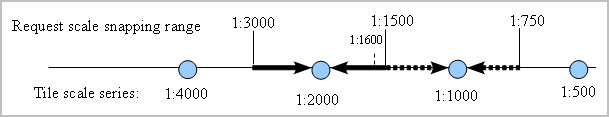
  [Description of "Figure 2-9 snap_to_tile_scale Attribute"](img_text/snap_to_tile_scale.md)
  If a map request has more than one WMTS theme that specifies `snap_to_tile_scale` as `true`, then only the first WMTS `snap_to_tile_scale` specification is set to `true` and all others are reset to `false`. This is the logical behavior. For example, if two such themes both have the attribute set to `true`, but the two WMTS tile scale series are different from each other (the two map servers may be from different institutions using different scale series), the first theme will then use its closest tile scale to retrieve tile data and for the final request scale; at the same time, the second theme has to reset its `snap_to_tile_scale` to `false`, then has to find its own tile scale according to its `tile_resizing_option`, then retrieve tiles, and finally resize the tiles to match the first theme's tile scale.

- `style` attribute: Currently not used in the map visualization component; the default is the string `default`.

- `tile_resizing_option` attribute (optional): the string `unbiased`, `expand_biased`, or `contract_biased`; the default is `unbiased`. If `snap_to_tile_scale` is set to `true`, `tile_resizing_option` is ignored.

  For more information, see How the tile_resizing_option Attribute Works.

- `timeout` attribute (optional): an integer specifying a request's timeout period in milliseconds; the default is 0, (that is, no limit for a request to wait for a response).

  Specifying this attribute ensures that a map request is terminated when the map server does not respond within the specified time period, and thus frees the resources. You might try a value of 30000 (30,000 milliseconds, or 30 seconds).

- `top_left_corner_x` attribute (optional): the x coordinate value of the top left corner of the whole tile images' extent that is served by a WMTS server. If not specified, the value retrieved from the WMTS server is used. If you specify this attribute, also specify the `top_left_corner_y` attribute.

- `top_left_corner_y` attribute (optional): the y coordinate value of the top left corner of the whole tile images' extent that is served by a WMTS server. If not specified, the value retrieved from the WMTS server is used. If you specify this attribute, also specify the `top_left_corner_x` attribute.

- `version` attribute: the version of the WMTS specification implemented by the WMTS server.

<!-- -->

- How the tile_resizing_option Attribute Works
- snap_to_tile_scale and tile_resizing_option Attribute Usage Guidelines
- Creating Predefined WMTS Themes

**See Also:**

[OGC WMTS Support in the Map Visualization Component](ogc-wmts-support-map-visualzation-component.md) for information about the WMTS service for map visualization component, WMTS Operations, and preparing the WMTS service for the map visualization component.

**Parent topic:** Themes

##### 2.3.8.1 How the tile_resizing_option Attribute Works

If a WMTS theme's `snap_to_tile_scale` attribute is false (the default) or omitted, a request scale is always honored and the `tile_resizing_option` attribute value (specified or defaulted) is used when choosing a proper tile scale. However, if snap_to_tile_scale is true, the `tile_resizing_option` attribute value is ignored.

The `tile_resizing_option` attribute value can be one of the following string values: string `unbiased` (the default), `expand_biased`, or `contract_biased`.

- `unbiased` (the default): The closest tile scale level is chosen, and then the tile images are expanded or contracted to generate a map in the request scale. For example, in Figure 2-10 the tile scale 1:2000 is used to generate any request scale map if a request scale falls within a scale range of 1:3000 and 1:1500.

  Figure 2-10 unbiased tile_resizing_option Value

  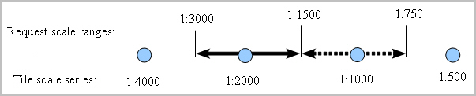
  [Description of "Figure 2-10 unbiased tile_resizing_option Value"](img_text/unbiased_option.md)

- `expand_biased`: When identifying a proper tile scale to generate a map in a request scale, a preference for expanding tile images to render a request map is used. In other words, you prefer to use a smaller tile scale to generate a map for a request scale. An 8:2 preference ratio for expanding is currently implemented. For example, in Figure 2-11 the tile scale 1:2000 is used for generating a request map if its scale is in the range of 1:2400 to 1:1200.

  Figure 2-11 expand_biased tile_resizing_option Value

  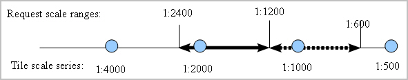
  [Description of "Figure 2-11 expand_biased tile_resizing_option Value"](img_text/expand_biased_option.md)

- `contract_biased`: When identifying a proper tile scale to generate a map in request scale, a preference for contracting tiles to render a request map is used. In other words, you prefer to use a larger tile scale to generate a map for a request scale. An 8:2 preference ratio for contracting is currently implemented. For example, in Figure 2-12 the tile scale 1:2000 is used for generating a request map if its scale is in the range of 1:3600 to 1:1800.

  Figure 2-12 contract_biased tile_resizing_option Value

  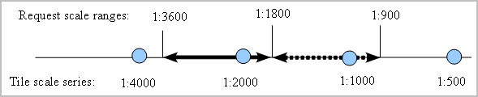
  [Description of "Figure 2-12 contract_biased tile_resizing_option Value"](img_text/contract_biased_option.md)

See also snap_to_tile_scale and tile_resizing_option Attribute Usage Guidelines.

**Parent topic:** WMTS Themes

##### 2.3.8.2 snap_to_tile_scale and tile_resizing_option Attribute Usage Guidelines

This section presents general guidelines for using the `snap_to_tile_scale` and `tile_resizing_option` attributes to generate better quality maps. Because mapping has a wide variety of applications, you may also use your domain knowledge to set attribute values that best meet your needs.

Whenever possible, set `snap_to_tile_scale` to `true` to use a closest tile scale instead of a request scale, because original tile maps have the best map quality.

However, if you must honor a request scale, consider the following when setting the attributes:

- If you set a `tile_resizing_option` value, omit the `snap_to_tile_scale` attribute or set it to `false` (the default). If `snap_to_tile_scale` is set to `true`, a request scale will not be honored, and instead the closest tile scale will be used.

- If a map is a topographic map with annotations and thin linear features, you may want to use the `expand_biased` option.

- If a map is a thematic map, such as a land cover map, you may want to use the `contract_biased` option.

- If a map is a satellite image, you may want to use the `unbiased` or `contract_biased` option.

Regarding the tile_resizing_option possible values:

- In general, a `contract_biased` option may generate maps with more details, but these maps may need more tiles than maps from an `expand_biased` option, and retrieving more tiles takes more time.

- If a request scale is honored (when the `snap_to_tile_scale` attribute is set to `false`), when a request scale is close enough to a tile scale, then the same operation will be employed (either expanding or contracting), regardless of the specified `tile_resizing_option`. For example, if a request scale is 1:1900 in the figures in How the tile_resizing_option Attribute Works, tile maps in 1:2000 will be retrieved and expanded to render the request map in a map scale of 1:1900, regardless of whether the `unbiased`, `expand_biased`, or `contract_biased` option is specified; similarly, if a request scale is 1:2100, then tile maps in 1:2000 will also be retrieved and then contracted to render the requested map in a scale of 1:2100.

Example 2-30 shows a request with a dynamic WMTS theme, in which `snap_to_tile_scale="true"` is specified.

Example 2-30 Request with a Dynamic WMTS Theme

    <?xml version="1.0" standalone="yes"?>
    <map_request title="OpenGeo wmts theme (bluemarble)"
      datasource="mvdemo"
      width="1024"
      height="900"
      mapfilename="Bluemarble"
      format="PNG_STREAM">
      

        <geoFeature>
          <geometricProperty typeName="center">
            <Point>
              <coordinates>-112, 42.0</coordinates>
            </Point>
          </geometricProperty>
        </geoFeature>
      

    <themes>
      <theme name="wmtstheme: Earth" timeout="10000" snap_to_tile_scale="true">
        <wmts_gettile_request>
          <service_url> http://maps.opengeo.org/geowebcache/service/wmts </service_url>
          <version> 1.0.0 </version>
          <layer> bluemarble </layer>
          <matrix_set_id> EPSG:4326 </matrix_set_id>
          <format> image/png </format>
          
          <top_left_corner_x> -180.0 </top_left_corner_x>
          <top_left_corner_y> 90.0 </top_left_corner_y>
        </wmts_gettile_request>
      </theme></themes>
    </map_request>

**Parent topic:** WMTS Themes

##### 2.3.8.3 Creating Predefined WMTS Themes

To create a predefined WMTS theme, you must store the definition of the WMTS theme in the database by inserting a row into the USER_SDO_THEMES view (described in xxx_SDO_THEMES Views). Example 2-31 stores the definition of a WMTS theme.

In Example 2-31, `earth_image` is the name of the WMTS theme, and `table_spaceholder` and `geom_col_spaceholder` are dummy values to fill the BASE_TABLE and GEOMETRY_COLUMN columns in the USER_SDO_THEMES view. The styling rule information contains the `service_url`, `layer`, `matrix_set_id`, `format`, and `style` information. The `top_left_corner_x` and `top_left_corner_y` attributes are not specified, so by default the values retrieved from the WMTS server are used.

Example 2-32 shows a map request that uses the predefined theme created in Example 2-31.

Example 2-31 Creating a Predefined WMTS Theme

    INSERT INTO user_sdo_themes  VALUES (
    'earth_image',
    'Opengeo.org demo',
    'table_spaceholder',
    'geom_col_spaceholder',
    '<?xml version="1.0" standalone="yes"?>
    <styling_rules theme_type="wmts">
        <version> 1.0.0 </version>
        <service_url> http://maps.opengeo.org/geowebcache/service/wmts </service_url>
        <layer> bluemarble </layer>
        <matrix_set_id> EPSG:4326 </matrix_set_id>
        <format> image/png </format>
        
    </styling_rules>');

Example 2-32 Map Request with Predefined WMTS Theme

    <?xml version="1.0" standalone="yes"?>
    <map_request
      title="OpenGeo predefined wmts theme"
      datasource="mvdemo"
      width="1024"
      height="768"   mapfilename="Bluemarle: Earth"
      format="PNG_STREAM">
      

        <geoFeature>
          <geometricProperty typeName="center">
            <Point>
              <coordinates>-75.0,42.0</coordinates>
            </Point>
          </geometricProperty>
        </geoFeature>
      

    <themes>
      <theme name="earth_image" />
    </themes>
    </map_request>

**Parent topic:** WMTS Themes

#### 2.3.9 Custom Geometry Themes

Custom geometry themes are associated with external spatial data (spatial data in a native format other than Oracle Spatial and Graph, such as shapefile). A custom geometry theme uses a spatial provider class to retrieve the native data, and the external provider must use the spatial data provider plug-in mechanism. The map visualization component provides a spatial provider interface class that the external provider must implement. The interface implementation has the following methods (some of them mainly provide information that can be used in user interfaces of applications like Map Builder):

    public interface SDataProvider
    {
      /**
       * Returns the initialization parameters for the provider.
       * @return String[] - array with initialization parameter names
       */
      public String[] getInitParameterNames();

      /**
       * Returns runtime parameter names. Runtime parameters are additional parameters
       * that the provider may use when retrieving the data objects.
       * @return String[] - array with runtime parameter names
       */
      public String[] getRuntimeParameterNames();

      /**
       * Returns a value that gives a hint for the runtime parameter value.
       * This hin can be used as a tooltip in user intefaces.
       * @param runtimeParam
       * @return   a String representing the hint value, or null if no hint is available
       */
      public String getRuntimeParameterHintValue(String runtimeParam);

      /**
       * This method is used to set the initialization parameters for the specific
       * data provider.
       * @param params - parameters to be used by the initialization method.
       * @return boolean - true if success; false otherwise
       */
      public boolean init(Properties params);

      /**
       * This method creates and returns an instance of SDataSet which contains
       * all the Spatial data produced by this provider, based on
       * the given parameters for a specific incoming map request.
       *  
       * The map visualization component calls this method on the custom theme producer implementation.
       *
       * @param queryWin the search area to retrieve spatial objects. The window is
       * assumed to be already on data provider spatial reference system.
       * @param nonSpatialColumns - the list of attributes that will return with objects.
       * @param queryCondition - query condition expression (may have binding parameters).
       * @param bindingParameters - binding variables for query condition with binding parameters.
       * @param params  - parameters that the provider may use to retrieve the data.
       * @return SDataObject - an instance of SDataSet class; null if failed.
       */
      public SDataSet buildDataSet(Rectangle2D queryWin,String []nonSpatialColumns,
                                   String queryCondition,Object[] bindingParameters,
                                    Properties params);

      /**
       * Returns the list of existing attributes for this data provider.
       * @param params  parameters that the provider may use to get the attribute list.
       * @return Field[] - array of attributes for this provider.
       */
      public Field[] getAttributeList(Properties params);

      /**
       * Returns the data set spatial extent MBR.
       * @param params  parameters that the provider may use to get the data extents
       * @return Rectangle2D - data spatial extent for this provider.
       */
      public Rectangle2D getDataExtents(Properties params);

     /**
       * Returns if provider can build spatial indexes.
       * If true, means that buildSpatialIndex method can be called.
       * @return
       */
      public boolean canBuildSpatialIndex();

      /**
       * Builds a spatial index on the data set.
       * @param params  parameters that the provider may use to build the spatial index.
       * @return boolean - true if saptial index creation is successful.
       */
      public boolean buildSpatialIndex(Properties params);

      /**
       * Clears provider internal caches (if provider implement caches).
       */
      public void clearCache();

      /**
       * Returns the parameter names that can be used to query for spatial tables.
       * Can be used more as information for user interfaces.
       * @return
       */
      public String[] getParametersToQuerySpatialMetadata();

      /**
       * Returns the spatial tables and spatial columns.
       * @param params must define the parameters returned from
       * getParametersToQuerySpatialMetadata.
       * @return  an array list defining the table name(index [0])
       *          and spatial column (index[1])
       */
      public String[][] getSpatialTables(Properties params);
    }

The `init` and `buildDataSet` methods must be implemented. The other method implementations can be empty; however applications (such as the Oracle Map Builder Tool) can make use of these methods to handle the information about spatial data providers. A provider can implement its own spatial indexing mechanism; the map visualization component offers an implementation for the shapefile provider, and the `buildSpatialIndex` method creates an indexing file with the `.oix` extension in the `shapefile` directory. [Creating and Registering a Custom Spatial Data Provider](creating-registering-custom-spatial-data-provider.md) contains an example of how to implement and register a sample spatial provider with the map visualization component.

To render native data in the map visualization component with custom geometry themes, follow these steps:

1.  Implement a spatial provider class based on the plug-in interface, and generate a jar file with the provider implementation. Copy the jar file to a directory that is part of the map visualization component CLASSPATH definition.
2.  Register the provider in the map visualization component configuration. The map visualization component ships with a shapefile provider to access ESRI shapefiles, a GDAL-OGR provider to access data formats supported by OGR, and a Teradata provider to access data stored in a Teradata database. (See the GDAL-OGR and Teradata documentation for detailed information about handling spatial data in these environments.) The GDAL-OGR library `gdal.jar`, and Teradata libraries `terajdbc4.jar` and `tdgssconfig.jar`, must be on server classpath. The registration section in the map visualization component configuration file looks like this:
        <s_data_provider
          id="shapefileSDP"
          class="oracle.sdovis.ShapefileDataProvider"
          >
          <parameters>
            <parameter name="datadir" value="/temp/data" />
          </parameters>
        </s_data_provider>

    Each provider must have `id` and `class` names defined: `id` is a unique name that identifies the provider, and `class` corresponds to the Java class implementation. The `<parameters>` element defines the initialization parameters of the provider.

    For the shapefile provider, the initialization parameter `datadir` defines where the map visualization component will look for the data files, and thus it should be a directory that is accessible to the map visualization component. The map visualization component first looks for data files based on the theme definition information; and if the data path defined in the theme definition is not accessible, the map visualization component looks for the data path defined in the configuration file.
3.  Create custom geometry themes associated with the external spatial data provider.

Example 2-33 Defining a Dynamic Custom Geometry Theme

    <theme name="custom_geom_theme_1" >
       <custom_geom_theme
         provider_id="shapefileSDP"
         srid="26986"
         render_style="C.RED"
         label_column="parcel_id"
         label_style="T.CITY NAME"
         datasource="mvdemo">
       <parameters>
        <parameter name="filename" value="/lbs/demo/shapefile/parcel.shp"/>
       </parameters>
      </custom_geom_theme>
    </theme>

Example 2-34 Storing a Predefined Custom Geometry Theme

    insert into user_sdo_themes values (
    'SHAPE_THEME',
    'Shapefile theme',
    'CUSTOM_TABLE',
    'GEOMETRY',
    '<?xml version="1.0" standalone="yes"?>
    <styling_rules theme_type="geom_custom" srid="26986" provider_id="shapefileSDP">
      <rule>
        <features style="C.RED"> </features>
        <label column="PARCEL_ID" style="T.CITY NAME"> 1 </label>
      </rule>
      <parameters>
        <parameter name="filename" value="/lbs/demo/shapefile/parcel.shp"/>
      </parameters>
    </styling_rules>'
    );

Although the external spatial data is outside the Oracle database, you still need to have a database connection to render this data. The database is used to store the metadata information related with the theme, as well as the styling information used to render and to label the data.

Example 2-33 shows the definition for a dynamic custom geometry theme. The XML element `<custom_geom_theme>` identifies a custom geometry theme. The `<parameters>` element defines the runtime parameters to be used by the provider. In this case `"filename"` is a runtime parameter, and `"/lbs/demo/shapefile/parcel.shp"` defines the file path. The map visualization component first attempts to use this file path definition; but if it is not accessible, it uses the data directory value defined in the configuration file for the shapefile spatial provider.

The runtime parameters for the available spatial providers are as follows (note that Map Builder provides the option to encrypt parameter values):

- For a shapefile provider:

  - `filename`: full path to the shapefile (.shp) on disk

- For GDAL-OGR:

  - `datasource`: a full OGR data source string. Depending on the data source format, this string can vary.(see the GDAL-OGR documentation for detailed information about connecting to different formats supported by GDAL-OGR.)

    For file formats, this parameter's value is usually the full path to the archive.

    For database connections, enter the full connection string to access the spatial table and spatial column. For example, for a Postgis table name STATES with one spatial column, the value might be:

        datasource = PG:dbname='template_postgis' host='localhost' port='5432' user='postgres' password='manager' tables=states

- For a Teradata provider:

  - `jdbcurl`: the JDBC connection to Teradata database. The string format is:

        jdbc:teradata://<host_address>/DATABASE=<db_name>,DBS_PORT=<db_port>,TMODE=ANSI,CHARSET=UTF8

  - `user`: database user.

  - `password`: database password.

  - `containerds`: Optional. Name of Teradata container data source defined on the application server (WebLogic, for example). If defined, this will be used first in the map visualization component, instead of the `jdbcurl` value.

  - `basetable`: name of the spatial table.

  - `geomcolumn`: name of the spatial column.

  - `fetchsize`: Optional. Number of rows to be prefetched.

The available attributes for a dynamic custom geometry theme are:

- `provider_id` specifies the spatial provider.

- `datasource` specifies the Oracle database connection. This connection is used to retrieve the styles to render the spatial data.

- `srid` specifies the spatial reference system (Oracle Spatial and Graph coordinate system).

- `render_style` specifies the style to be used when rendering the features.

- `label_column` specifies the name of the column containing label text to be used with the theme.

- `label_style` specifies the style to be used when labeling the features.

- `feature_attributes` specifies additional attributes that can be used with advanced styles.

- `key_column` specifies a key attribute that can be used in Oracle Maps applications.

- `query_condition` specifies the WHERE clause to filter feature selection. Shapefile providers do not support a query condition; however an OGR provider can be used to render shapefiles with a query condition. The query condition expression can define binding parameters (for example, `attr = :1`).

Example 2-34 shows how to store a predefined custom geometry theme definition. Use GEOMETRY as the geometry column name, and you can specify any name for the base table name. The `"theme_type=geom_custom"` attribute identifies the theme as a custom theme. The `<rule>` element has the same function as for an Oracle Spatial and Graph geometry theme. The `<parameters>` element defines the runtime parameters that the provider accepts. For the shapefile provider, the runtime `parameter` filename defines the path to the shapefile data.

You can override the runtime parameters section of a predefined custom geometry theme by the specifying the parameters in a map_request. For example, you can include the following in a `<map_request>` element:

    <theme name="CUSTOM_THEME" >
      <parameters>
        <parameter name="filename" value="/lbs/demo/shapefile/counties.shp"/>
      </parameters>
    </theme>

**Parent topic:** Themes

#### 2.3.10 Annotation Text Themes

Oracle Spatial and Graph supports annotation text as specified in the OpenGIS Implementation Specification for Geographic information - Simple feature access - Part 1: Common architecture, which defines annotation text as "simply placed text that can carry either geographically-related or ad-hoc data and process-related information as displayable text. This text may be used for display in editors or in simpler maps. It is usually lacking in full cartographic quality, but may act as an approximation to such text as needed by any application."

Oracle Spatial and Graph provides the ST_ANNOTATION_TEXT object type for storing annotation text, and the USER_ANNOTATION_TEXT_METADATA and ALL_ANNOTATION_TEXT_METADATA views for storing metadata related to annotation text. For more information about annotation text support, see [Oracle Spatial and Graph Developer's Guide](../spatl/sql-multimedia-type-support.md).

Each annotation text object may have one or more elements, and each element is defined by the following:

- Value: Text associated with element. If the value is null, the text is derived from the first non-null preceding element value. If all preceding elements have null values, the text is a text expression value derived from the metadata.

- Location: Spatial location associated with the annotation text object.

- Leader line: Linear feature associated with the annotation text object.

- Attributes: Graphic attributes used to display the text. If the value is null, graphic attributes are derived from the attributes value in the metadata.

The text expression in the metadata views can be any of the following:

- A column name.

- A function applied to a column name. For example: `substr(my_col,1,3)`

- The concatenation of two or more column names. For example: `column_1 || column_2 || column_3`

- A text value that is unrelated to a column name. In this case, it is treated as a simple text string that is used for any text element that has a null value.

Annotation text themes in the map visualization component are associated with database tables that have a column of type ST_ANNOTATION_TEXT. For each annotation text element, the map visualization component will render:

- The value (if not null) of the annotation text element as a string, using a text style that is created at real time based on the element attributes.

- The leader line (if not null) associated with the annotation text element. In this case, users can select a map visualization component style to render the leader line.

Each annotation text element has an envelope represented by a geometry, and which is used for spatial indexing. Therefore, you must do the following to use spatial indexing with annotation text tables in the map visualization component:

1.  Insert a row into the USER_ANNOTATION_TEXT_METADATA view that specifies the name of the annotation text table and the PRIVATEENVELOPE attribute of the annotation text column (that is, the column of type ST_ANNOTATION_TEXT).

    The following example inserts a row for a table named ANNOTEXT_TABLE with an annotation text column named TEXTOBJ:

        INSERT INTO USER_SDO_GEOM_METADATA
          VALUES (
          'ANNOTEXT_TABLE',
          'TEXTOBJ.PRIVATEENVELOPE',
          SDO_DIM_ARRAY(
            SDO_DIM_ELEMENT('X', 0.0, 10.0, 0.0005),
            SDO_DIM_ELEMENT('Y', 0.0,10.0, 0.0005)
             ),
          null   -- SRID
        );

2.  Create a spatial index on the annotation text envelope of the annotation text table.

    The following example creates a spatial index named ANNO_TEXT_IDX on the annotation envelope of the table named ANNOTEXT_TABLE:

        CREATE INDEX anno_text_idx ON annotext_table(textobj.privateenvelope)
          INDEXTYPE IS mdsys.spatial_index;

For themes with valid SRID information, if the metadata base map scale is defined, the element text sizes will be scaled as maps zoom in or out.

Example 2-35 defines the styling rules for a predefined annotation text theme in the map visualization component. The structure is similar to other map visualization component themes. Currently, just one styling rule is processed for each annotation theme. In this example, the theme type is `annotation`, the feature style L.`PH` is used to render leader lines, and the query condition `(id = 1 or id = 2)` is appended on the final query.

Example 2-36 shows the theme definition for a dynamic annotation text theme. The parameters defined are:

- `datasource`: the data source name

- `jdbc_srid`: the spatial reference identifier

- `annotation_table`: the annotation text table

- `annotation_column`: the annotation text column

- `leaderline_style`: the leader line style to be used

Example 2-37 is similar to Example 2-36, but it adds the behavior that if the `annotation_column` column contains a null value, then the value in the `textexpr_column` is used for the annotation instead. In Example 2-37, assume that the ANNOTATION_TABLE table contains a column named DEFAULT_ANNOTATION (which is used in Example 2-38). This additional column is specified in the `textexpr_column` attribute and in the SELECT statement.

Example 2-38 creates an annotation text table and prepares it to be used with the map visualization component.

Example 2-35 Styling Rules for a Predefined Annotation Text Theme

    <?xml version="1.0" standalone="yes"?>
    <styling_rules theme_type="annotation">
        <rule>
            <features style="L.PH"> (id = 1 or id = 2) </features>
      </rule>
    </styling_rules>

Example 2-36 Dynamic Annotation Text Theme Definition

    <themes>
      <theme name="theme1" >
         <jdbc_annotation_query
           datasource="tilsmenv"
           jdbc_srid="0"
           annotation_table="ANNOTEXT_TABLE"
           annotation_column="textobj"
           leaderline_style="L.PH"
           >select textobj from annotext_table
         </jdbc_annotation_query>
       </theme>
    </themes>

Example 2-37 Dynamic Annotation Text Theme with Default Annotation Column

    <themes>
      <theme name="theme1" >
         <jdbc_annotation_query
           datasource="tilsmenv"
           jdbc_srid="0"
           annotation_table="ANNOTEXT_TABLE"
           annotation_column="textobj"
           textexpr_column="default_annotation"
           leaderline_style="L.PH"
           >select textobj, default_annotation from annotext_table
         </jdbc_annotation_query>
       </theme>
    </themes>

Example 2-38 Script to Generate Annotation Text Data

    SET ECHO ON
    SET FEEDBACK 1
    SET NUMWIDTH 10
    SET LINESIZE 100
    SET PAGESIZE 10000
    SET SERVEROUTPUT ON SIZE 5000
    SET LONG 20000
    SET TIMING ON
    call dbms_java.set_output(5000);

    ---------------------------------------------------------------------
    -- Create an annotation text table (a table that has a
    -- column of ST_ANNOTATION_TEXT object type), and insert some records.
    ---------------------------------------------------------------------

    create table annotext_table (
      id number,
      default_annotation varchar2(32),
      textobj ST_ANNOTATION_TEXT);

    insert into annotext_table values (1,'Text_1',
    ST_ANNOTATION_TEXT(
       ST_ANNOTATIONTEXTELEMENT_ARRAY(
              ST_ANNOT_TEXTELEMENT_ARRAY(
                    ST_ANNOTATIONTEXTELEMENT('Sample Label 1',
                       SDO_GEOMETRY(2001, null, sdo_point_type(1,1,null),null,null),
                       SDO_GEOMETRY(2002,null,null,
                           SDO_ELEM_INFO_ARRAY(1,2,1),
                           SDO_ORDINATE_ARRAY(0,0, 1,1)), NULL)))));

    insert into annotext_table values (2,'Text_2',
    ST_ANNOTATION_TEXT(
       ST_ANNOTATIONTEXTELEMENT_ARRAY(
              ST_ANNOT_TEXTELEMENT_ARRAY(
                    ST_ANNOTATIONTEXTELEMENT('Sample Label 2',
                       SDO_GEOMETRY(2001,null,sdo_point_type(10,10,null),null,null),
                       SDO_GEOMETRY(2002,null,null,
                           SDO_ELEM_INFO_ARRAY(1,2,1),
                           SDO_ORDINATE_ARRAY(5,10, 10,10)), NULL)))));

    insert into annotext_table values (3, 'Text_3',
    ST_ANNOTATION_TEXT(
       ST_ANNOTATIONTEXTELEMENT_ARRAY(
              ST_ANNOT_TEXTELEMENT_ARRAY(
                    ST_ANNOTATIONTEXTELEMENT(null,
                       SDO_GEOMETRY(2002, null, null,
                           SDO_ELEM_INFO_ARRAY(1,2,1),
                           SDO_ORDINATE_ARRAY(2,5,4,5,6,5)),
                       SDO_GEOMETRY(2002,null,null,
                           SDO_ELEM_INFO_ARRAY(1,2,1),
                           SDO_ORDINATE_ARRAY(4,3, 4,5)),
    '<?xml version="1.0" encoding="UTF-8" ?>
    <textAttributes xmlns:xsi="http://www.w3.org/2001/XMLSchema-instance"
                   xsi:noNamespaceSchemaLocation="../../annotation_text.xsd">
     <textStyle fontFamily="Dialog" fontSize="14" fill="blue"/>
     <textlayout/>
    </textAttributes>'
    )))));

    ---------------------------------------------------------------------
    -- Register the annotation text table in the user metadata view.
    ---------------------------------------------------------------------

    insert into USER_ANNOTATION_TEXT_METADATA values(
      'ANNOTEXT_TABLE', 'TEXTOBJ', null, null, null);

    ---------------------------------------------------------------------
    -- Update the metadata information.
    ---------------------------------------------------------------------

    update user_annotation_text_metadata set
    text_expression='default_annotation',
    text_attributes =
    '<?xml version="1.0" encoding="UTF-8" ?>
    <textAttributes xmlns:xsi="http://www.w3.org/2001/XMLSchema-instance"
                   xsi:noNamespaceSchemaLocation="../../annotation_text.xsd">
     <textStyle fontFamily="Serif" fontSize="14" fill="#ff0000"/>
     <textlayout/>
    </textAttributes>';

    ---------------------------------------------------------------------
    -- Register the annotation text geometry envelope on the user
    -- metadata view of geometries.
    ---------------------------------------------------------------------

    INSERT INTO USER_SDO_GEOM_METADATA
     VALUES (
     'ANNOTEXT_TABLE',
     'TEXTOBJ.PRIVATEENVELOPE',
     SDO_DIM_ARRAY(
       SDO_DIM_ELEMENT('X', 0.0, 10.0, 0.0005),
       SDO_DIM_ELEMENT('Y', 0.0,10.0, 0.0005)
        ),
     null   -- SRID
    );

    ---------------------------------------------------------------------
    -- Create a spatial index on the annotation text envelope.
    ---------------------------------------------------------------------

    create index anno_text_idx on annotext_table(textobj.privateenvelope)
      indextype is mdsys.spatial_index;

    -------------------------------------------------------------------------------
    -- Insert a predefined theme into the map visualization component's theme view.
    -------------------------------------------------------------------------------

    INSERT INTO user_sdo_themes  VALUES (
      'ANNOTEXT_THEME',
      'Annotation text',
      'ANNOTEXT_TABLE',
      'TEXTOBJ',
      '<?xml version="1.0" standalone="yes"?>
       <styling_rules theme_type="annotation">
         <rule >
          <features style="L.PH"> </features>
         </rule>
       </styling_rules>' );

    commit;

**Parent topic:** Themes

#### 2.3.11 LRS (Linear Referencing System) Themes

An LRS theme is a special kind of map visualization component theme useful for visualizing features defined using the linear referencing system (LRS) of Oracle Spatial and Graph, which is explained in [Oracle Spatial and Graph Developer's Guide](../spatl/lrs-linear-referencing-system-concepts.md).

Two tables are needed by an LRS theme: one (the LRS table) has an LRS geometry column, and the other (the join table) has one or two measure columns. Point events must have one measure column in the join table (for example, a road sign located at a measure of m1, and an accident that occurred at a measure of m2); while linear events must have two measure columns, one for a starting measure and one for an end measure (for example, from measure m1 to measure m2 the road pavement condition is poor, and from measure n1 to measure n2 the condition is fair). Each event is stored in one row in the join table.

After an LRS theme is defined, you only need to specify the theme name in a map request when you use the theme. The map visualization component automatically finds the theme's definition and constructs a query that joins these two specified tables; it then generates the geometry data by internally using an LRS function, either SDO_LRS.LOCATE_PT for point events or SDO_LRS.CLIP_GEOM_SEGMENT for linear events. The map visualization component then renders the generated point or linear segment, together with their attribute data, according to the styling rules for the theme.

To create a predefined LRS theme, you must store the definition of the LRS theme in the database by inserting a row into the USER_SDO_THEMES view. Example 2-39 stores the definition of an LRS theme named `LRS_THEME`.

In Example 2-39, the LRS table name (INTERSTATES_LRS, which has three columns, GEOM, HIGHWAY, and ROUTEN) is inserted in the BASE_TABLE column of the USER_SDO_THEMES view, the LRS geometry column (GEOM) is inserted in the GEOMETRY_COLUMN column, and XML document with one `<styling_rules>` element is inserted into the STYLING_RULES column.

In the `<styling_rules>` element for an LRS theme, `theme_type` must be `lrs` in order for this theme to be recognized as an LRS theme.

If the optional `key_column` attribute is omitted, no key column is included when constructing a query string to fetch data from a database. This is different from a predefined geometry theme, in which the ROWID column is the default key column.

The child elements `<rule>`, `<hidden_info>`, `<join_table>`, and `<join_columns>` can be included within the `<styling_rules>` element. The `<join_table>` and `<join_columns>` child elements are specific to LRS themes.

The `<rule>` element for an LRS theme is similar to the definition in a predefined themes, but its child element `<features>` must contain an `asis` attribute with its value set to `true` (`asis="true"`).There can be 0, 1, or more `<rule>` elements within a `<styling_rules>` element.

The `<hidden_info>` element is optional for an LRS theme. It is defined for use in Oracle Maps applications. It specifies a list of attributes from either the LRS table or the join table, or both.

In `<join_table>` element, the `name` attribute (`pavement_condition` in this example) specifies the join table name. In this example, the join table contains columns such as id, seg_id, condition, from_measure, and to_measure. If two measure columns are used to define linear events in the join table, then attributes `start_measure` and `end_measure` (`from_measure` and `to_measure` in this example) must be specified, which indicate column names of measurements in the join table. If the join table contains one measure for point events, then a `measure` attribute is specified in this `<join_table>` element.

In the `<join_columns>` element, the `lrs_table_column` and `join_table_column` attributes must be specified, where `lrs_table_column` defines the column from the LRS table, and `join_table_column` specifies the column from the join table to join these two tables.

Example 2-40 shows a map request that uses the predefined LRS theme from Example 2-39.

**See Also:**

[XML Format for Styles, Themes, Base Maps, and Map Tile Layers](xml-formats-map-visualizer.md) for reference information about elements and attributes specific to LRS themes (such as the `<join_table>` and `<join_columns>` elements).

Example 2-39 Creating an LRS Theme

    INSERT INTO user_sdo_themes (name, description, base_table, geometry_column, styling_rules)
    VALUES (
    'LRS_THEME',
    'LRS theme example with 3 rules, 2 measure columns',
    'INTERSTATES_LRS',
    'GEOM',
    '<?xml version="1.0" standalone="yes"?>
    <styling_rules key_column="id" theme_type="lrs">
      <rule>
        <features  asis="true">
          condition=''good''
        </features>
        <label column="condition" style="T.STREET NAME"/>
        <rendering>
          <style name="L.PTH"/>
        </rendering>
      </rule>
      <rule>
        <features  asis="true">
          condition=''fair''
        </features>
        <label column="condition" style="T.STREET NAME"/>
        <rendering>
          <style name="L.SH"/>
        </rendering>
      </rule>
      <rule>
        <features  asis="true">
          condition=''poor''
        </features>
        <label column="condition" style="T.STREET NAME"/>
        <rendering>
          <style name="L.MAJOR STREET"/>
        </rendering>
      </rule>
      <hidden_info>
        <field column="highway"      name="highway name"/>
        <field column="routen"       name="highway number"/>
        <field column="condition"    name="pavement condition"/>
      </hidden_info>
      <join_table
        name="pavement_condition"
        start_measure="from_measure"
        end_measure="to_measure"
      />
      <join_columns
        lrs_table_column="highway"
        join_table_column="seg_id"
      />
    </styling_rules>'
    );

Example 2-40 Map Request with Predefined LRS Theme

    <?xml version="1.0" standalone="yes"?>
    <map_request
      title="LRS Theme test"
      datasource="mvdemo"
      width="640"
      height="480"
      bgcolor="#a6caf0"
      antialiase="true"
      format="PNG_STREAM">
      

        <geoFeature>
          <geometricProperty typeName="center">
            <Point>
              <coordinates>-95, 35</coordinates>
            </Point>
          </geometricProperty>
        </geoFeature>
      

      <themes>
        <theme name="LRS_THEME"/>
      </themes>
    </map_request>

**Parent topic:** Themes

#### 2.3.12 Thematic Mapping

Thematic mapping refers to the drawing of spatial features based on their attribute values. The map visualization component uses thematic mapping to create maps in which colors or symbols are applied to features to indicate their attributes. For example, a `Counties` theme can be drawn using colors with different hues that map directly to the population density of each county, or an `Earthquakes` theme can be plotted with filled circles whose sizes map to the scale or damage of each earthquake.

To achieve thematic mapping, you must first create an advanced style that is suitable for the type of thematic map, and then create a theme for the features specifying the advanced style as the rendering style. In the styling rules for the theme, you must also specify attribute columns in the table or view whose values will be used to determine exactly how a feature will be rendered thematically by the advanced style.

For example, assume that you wanted to display a map in which the color used for each region reflects the level of sales for a particular product. To do this, create an advanced style that defines a series of individual range-based buckets (see [Individual Range-Based Buckets](xml-formats-map-visualizer.md)), where each bucket contains a predefined range of sales values for a product, and each bucket has an associated rendering style. (Each region will be rendered using the style associated with the range in which that region's sales value falls.) Also specify the name of the column or columns that provide the attribute values to be checked against the ranges. In other words, the advanced style defines how to map regions based on their sales values, and the theme's styling rules tie together the advanced style and the attribute column containing the actual sales values.

Figure 2-13 shows the relationship between an advanced style and a theme, and how the style and the theme relate to the base table. In this figure, the advanced style named `V.SALES` defines the series of buckets. The predefined theme named `SALES_BY_REGION` specified the `V.SALES` style in its styling rules. The theme also identifies the SALES column in the REGIONS table as the column whose value is to be compared with the bucket ranges in the style. (Each bucket could be associated with a labeling style in addition to or instead of a rendering style, as explained in Specifying a Label Style for a Bucket.)

Figure 2-13 Thematic Mapping: Advanced Style and Theme Relationship

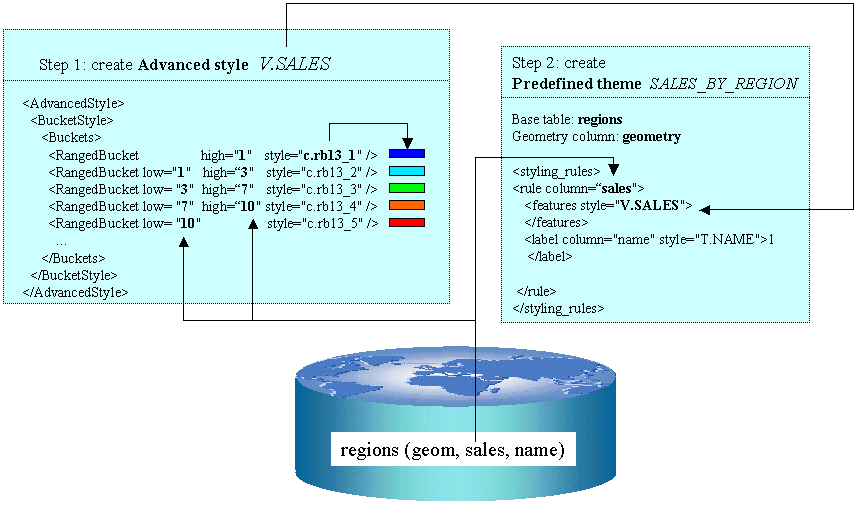
[Description of "Figure 2-13 Thematic Mapping: Advanced Style and Theme Relationship"](img_text/thematic_mapping.md)

In addition to the individual range-based buckets shown in Figure 2-13, the map visualization component supports other bucket styles, as explained in [Bucket Styles](xml-formats-map-visualizer.md). You can also use more than one attribute column for thematic mapping, such as when drawing pie charts.

The rest of this section presents additional examples of thematic mapping.

Example 2-41 is the XML definition for an `Earthquakes` theme.

**Note:**

The `label` attribute value (for example, `label="less than 4"`) is not displayed on the map, but is used only in a label that is compiled for an advanced style.

The `seq` attribute value (for example, `seq="0"`) is ignored by the map visualization component, which determines sequence only by the order in which elements appear in a definition.

Example 2-42 used the `<VariableMarkerStyle>` tag. The following examples use the `<ColorSchemeStyle>` tag in creating thematic maps of census blocks in California. Example 2-43 illustrates the use of a graduated color scale for a thematic mapping of population density. Example 2-44 is a thematic mapping of average household income using a graduated color scale. Example 2-45 is also a thematic mapping of average household income, but it uses a specific color style for each income range rather a graduated scale.

- `m.esso gasstation`, `m.texaco gasstation`, and the other style names have a space between the words in their names.

- The names are not case-sensitive. Therefore, be sure not to use case as a way of differentiating names. For example, `m.esso gasstation` and `M.ESSO GASSTATION` are considered the same name.

- A default collection bucket can be specified by using `#DEFAULT#` as its value. This bucket is used for any column values (gas station names) that are not specified in the other buckets.

A theme (`theme_gasstation`) is then defined that specifies the column (MERK) in the table that contains company names. The styling rules of the theme are shown in Example 2-47.

Table 2-2 Table Used with Gasoline Stations Theme

| Column   | Data Type       |
|:---------|:----------------|
| FID      | NOT NULL NUMBER |
| ID       | NUMBER          |
| NAAM     | VARCHAR2(31)    |
| STRAAT\_ | VARCHAR2(30)    |
| NR       | NUMBER          |
| TV       | VARCHAR2(1)     |
| AAND     | VARCHAR2(2)     |
| PCODE    | VARCHAR2(6)     |
| PLAATS   | VARCHAR2(10)    |
| GEOM     | SDO_GEOMETRY    |
| MERK     | VARCHAR2(40)    |

In this table, the GEOM column contains spatial geometries, and the MERK column contains company names (`Shell`, `Esso`, and so on).

The styling rules for the `theme_gasstation` theme specify that the marker (style `v.gasstations`) at a location specified by the content of the GEOM column is determined by the value of the MERK column for that row. The style `v.gasstations` (see Example 2-46) specifies that if the column value is `Shell`, use the style `m.shell gasstation`; if the column value is `Esso`, use the style `m.esso gasstation`; and so on, including if the column value is any one of `Avia`, `Benzinex`, `Q8`, `Total`, and `Witte Pomp`, use the style `m.generic gasstation;` and if the column value is none of the preceding, use the style `m.default gasstation`.

Example 2-41 XML Definition of Styling Rules for an Earthquakes Theme

    <?xml version="1.0" standalone="yes"?>
    <styling_rules theme_type="nature">
      <rule column="RICHTER_SCALE">
        <features style="v.earthquakes">
        </features>
      </rule>
    </styling_rules>

The theme in Example 2-41 has only one rule. The `<rule>` element includes an attribute named `column` that does not appear in the `Airport` theme in Example 2-6. The `column` attribute specifies one or more columns (comma-delimited) that provide the attribute values needed for thematic mapping. The style specified for the `<features>` element is named `v.earthquakes`, and it is an advanced style.

Another part of the definition of the `Earthquakes` theme specifies the table that contains the data to be rendered. This table must contain a column named RICHTER_SCALE in addition to a column (of type SDO_GEOMETRY) for the spatial data. (The table and the column of type SDO_GEOMETRY must be identified in the BASE_TABLE and GEOMETRY_COLUMN columns, respectively, of the USER_SDO_THEMES view, which is described in xxx_SDO_THEMES Views.) The RICHTER_SCALE column must be of type NUMBER. To understand why, look at the advanced style definition in Example 2-42.

Example 2-42 Advanced Style Definition for an Earthquakes Theme

    <?xml version="1.0" ?>
    <AdvancedStyle>
      <VariableMarkerStyle basemarker="m.circle" startsize="7" increment="4">
         <Buckets>
              <RangedBucket seq="0"  label="less than 4"  high="4"/>
              <RangedBucket seq="1"  label="4 - 5" low="4" high="5"/>
              <RangedBucket seq="2"  label="5 - 6" low="5" high="6"/>
              <RangedBucket seq="3"  label="6 - 7" low="6" high="7"/>
              <RangedBucket seq="4"  label="7 and up" low="7"/>
          </Buckets>
      </VariableMarkerStyle>
    </AdvancedStyle>

This style specifies that the marker named `m.circle` is used to indicate the location of an earthquake. The size of the marker to be rendered for an earthquake depends on the numeric value of the RICHTER_SCALE column for that row. In this example there are five buckets, each covering a predetermined range of values. For example, if an earthquake is of magnitude 5.7 on the Richter scale, the marker size will be 15 pixels (7 + 4 + 4), because the value 5.7 falls in the third bucket (5 - 6) and the starting marker size is 7 pixels (`startsize="7"`) with an increment of 4 for each range (`increment="4"`).

Example 2-43 Mapping Population Density Using a Graduated Color Scheme

    # ca pop density usbg_hhinfo
    <?xml version="1.0" standalone="yes"?>
    <styling_rules theme_type="political">
    <rule column="densitycy">
       <features style="v.CA Pop density">
       </features>
     </rule>
    </styling_rules>

The table named USBG_HHINFO includes a column named DENSITYCY (used in Example 2-43). The definition of the style (`v.CA Pop density`) that corresponds to this population density theme is as follows:

    <?xml version="1.0" ?>
    <AdvancedStyle>
      <ColorSchemeStyle basecolor="#ffff00" strokecolor="#00aaaa">
         <Buckets low="0.0" high="20000.0" nbuckets="10"/>
      </ColorSchemeStyle>
    </AdvancedStyle>

The base color (`basecolor`) and the stroke color (`strokecolor`) are 24-bit RGB (red-green-blue) values specified using a hexadecimal notation. The base color value is used for the first bucket. The color value for each subsequent bucket is obtained by first converting the base color from the RGB to the HSB (hue-saturation-brightness) model and then reducing the brightness by a fixed increment for each bucket. Thus, the first bucket is the brightest and the last is the darkest.

As in Example 2-43, Example 2-44 illustrates the use of a base color and a graduated color scheme, this time to show household income.

Example 2-44 Mapping Average Household Income Using a Graduated Color Scheme

    <?xml version="1.0" standalone="yes"?>
    <!-- # ca hh income theme  table = usbg_hhinfo  -->
    <styling_rules>
    <rule column="avghhicy">
       <features style="v.ca income">
       </features>
     </rule>
    </styling_rules>

The table named USBG_HHINFO includes a column named AVGHHICY (used in Example 2-44 and Example 2-45). The definition of the style (`v.ca income`) that corresponds to this average household income theme is as follows:

    <?xml version="1.0" ?>
    <AdvancedStyle>
      <ColorSchemeStyle basecolor="#ffff00" strokecolor="#00aaaa">
      <!-- # income range with a color gradient -->
         <Buckets>
              <RangedBucket seq="0" label="less than 10k"  high="10000"/>
              <RangedBucket seq="1" label="10-15k" low="10000" high="15000"/>
              <RangedBucket seq="2" label="15-20k" low="15000" high="20000"/>
              <RangedBucket seq="3" label="20-25k" low="20000" high="25000"/>
              <RangedBucket seq="4" label="25-35k" low="25000" high="35000"/>
              <RangedBucket seq="5" label="35-50k" low="35000" high="50000"/>
              <RangedBucket seq="6" label="50-75k" low="50000" high="75000"/>
              <RangedBucket seq="7" label="75-100k" low="75000" high="100000"/>
              <RangedBucket seq="8" label="100-125k" low="100000" high="125000"/>
              <RangedBucket seq="9" label="125-150k" low="125000" high="150000"/>
              <RangedBucket seq="10" label="150-250k" low="150000" high="250000"/>
              <RangedBucket seq="11" label="250-500k" low="250000" high="500000"/>
              <RangedBucket seq="12" label="500k and up"   low="500000"/>
          </Buckets>
      </ColorSchemeStyle>
    </AdvancedStyle>

For individual range-based buckets, the lower-bound value is inclusive, while the upper-bound value is exclusive (except for the range that has values greater than any value in the other ranges; its upper-bound value is inclusive). No range is allowed to have a range of values that overlaps values in other ranges.

Example 2-45 uses specific color styles for each average household income range.

Example 2-45 Mapping Average Household Income Using a Color for Each Income Range

    <?xml version="1.0" standalone="yes"?>
    <!-- # ca hh income theme  table = usbg_hhinfo  -->
    <styling_rules>
    <rule column="avghhicy">
       <features style="v.ca income 2">
       </features>
     </rule>
    </styling_rules>

The definition of the `v.ca income 2` style is as follows:

    <?xml version="1.0" ?>
    <AdvancedStyle>
     <BucketStyle>
      <Buckets>
       <!-- # income ranges with specific colors -->
       <RangedBucket seq="0" label="less than 10k"  high="10000" style="c.rb13_1"/>
       <RangedBucket seq="1" label="10-15k" low="10000" high="15000" style="c.rb13_2"/>
       <RangedBucket seq="2" label="15-20k" low="15000" high="20000" style="c.rb13_3"/>
       <RangedBucket seq="3" label="20-25k" low="20000" high="25000" style="c.rb13_4"/>
       <RangedBucket seq="4" label="25-35k" low="25000" high="35000" style="c.rb13_5"/>
       <RangedBucket seq="5" label="35-50k" low="35000" high="50000" style="c.rb13_6"/>
       <RangedBucket seq="6" label="50-75k" low="50000" high="75000" style="c.rb13_7"/>
       <RangedBucket seq="7" label="75-100k" low="75000" high="100000" style="c.rb13_8"/>
       <RangedBucket seq="8" label="100-125k" low="100000" high="125000" style="c.rb13_9"/>
       <RangedBucket seq="9" label="125-150k" low="125000" high="150000" style="c.rb13_10"/>
       <RangedBucket seq="10" label="150-250k" low="150000" high="250000" style="c.rb13_11"/>
       <RangedBucket seq="11" label="250-350k" low="250000" high="350000" style="c.rb13_12"/>
       <RangedBucket seq="12" label="350k and up"   low="350000" style="c.rb13_13"/>
      </Buckets>
     </BucketStyle>
    </AdvancedStyle>

Each `<RangedBucket>` definition has a specified style.

The following examples create an advanced style to identify gasoline stations operated by different oil companies, and a theme that uses the style. A `<CollectionBucket>` tag is used to associate a column value (`Shell`; `Esso`; `Texaco`; `BP`; any of `Avia`, `Benzinex`, `Q8`, `Total`, `Witte Pomp`; and all others for a default category) with a style appropriate for that company's stations, as shown in Example 2-46.

Example 2-46 Advanced Style Definition for Gasoline Stations Theme

    <?xml version="1.0" ?>
    <AdvancedStyle>
    <BucketStyle>
     <Buckets>
      <CollectionBucket seq="0" label="Shell" style="m.shell gasstation">
       Shell
      </CollectionBucket>
      <CollectionBucket seq="1" label="Esso" style="m.esso gasstation">
       Esso
      </CollectionBucket>
      <CollectionBucket seq="2" label="Texaco"  style="m.texaco gasstation">
       Texaco
     </CollectionBucket>
      <CollectionBucket seq="3" label="BP"  style="m.bp gasstation">
       BP
      </CollectionBucket>
      <CollectionBucket seq="4" label="Other"  style="m.generic gasstation">
       Avia,Benzinex,Q8,Total,Witte Pomp
      </CollectionBucket>
      <CollectionBucket seq="5" label="DEFAULT" style="m.default gasstation">
       #DEFAULT#
      </CollectionBucket>
      </Buckets>
    </BucketStyle>
    </AdvancedStyle>

Notes on Example 2-46:

Example 2-47 Styling Rules of Theme Definition for Gasoline Stations

    <?xml version="1.0" standalone="yes"?>
    <styling_rules>
      <rule column="merk">
        <features style="v.gasstations">
        </features>
        <label column="merk" style="t.SansSerif red 10">
          1
        </label>
      </rule>
    </styling_rules>

This theme depends on a table named NED_GASSTATIONS, which has the columns shown in Table 2-2 (with column names reflecting the fact that the developer's language is Dutch).

- Thematic Mapping Using External Attribute Data

**Parent topic:** Themes

##### 2.3.12.1 Thematic Mapping Using External Attribute Data

Previous discussion of thematic mapping has assumed that both the attribute data (such as population of sales totals) and the geospatial data (geometry objects representing boundaries, locations, and so on) are in the same database. However, the attribute data can come from a source outside the current database; for example, the attribute data might reflect aggregated results of a business intelligence (BI) query performed on a different database, or the attribute data might come from a comma-delimited list of sales values exported from a spreadsheet. Such attribute data, from outside the database that contains the geospatial data, is called external attribute data.

To use external attribute data with the map visualization component, you must use the nonspatial data provider plug-in mechanism, in which a custom data provider is associated with a map visualization component theme (predefined or dynamic) in the same map request. When the map visualization component processes the theme, it calls the nonspatial data provider to join nonspatial attribute data with the spatial data that has been fetched for the theme.

To use a nonspatial data provider, follow these steps:

1.  Implement your Java nonspatial data provider by implementing the map visualization component defined interface `oracle.mapviewer.share.ext.NSDataProvider`.

2.  Register the nonspatial data provider implementation with the map visualization component (in its configuration file). There you can also specify a set of global parameters that your implementation may depend on. Each custom data provider implementation class must have a unique ID that you assign.

3.  Place a library containing the nonspatial data provider implementation classes in the library path of the map visualization component, such as its `web/WEB-INF/lib` directory.

4.  Include the nonspatial data provider implementation in a map request by invoking the following method on the map visualization component Java client API class MapViewer:

        addNSDataProvider(java.lang.String providerId,
                          java.lang.String forTheme,
                          java.lang.String spatialKeyColumn,
                          java.lang.String customRenderingStyle,
                          java.util.Properties params,
                          long timeout)

    For information about the `addNSDataProvider` parameters, see the Javadoc reference information for the map visualization component, available at a URL in the form `http://``host:port``/mapviewer/mapclient`, where host and port indicate where Oracle Fusion Middleware listens for incoming requests. For example: `http://www.mycorp.com:8888/mapviewer/mapclient`

Example 2-48 shows a simple nonspatial data provider implementation. This implementation is also supplied with the map visualization component as a default nonspatial data provider.

Example 2-48 Nonspatial (External) Data Provider Implementation

    import java.io.BufferedReader;
    import java.io.FileReader;
    import java.util.Properties;
    import java.util.Vector;

    import oracle.mapviewer.share.ext.NSDataSet;
    import oracle.mapviewer.share.ext.NSDataProvider;
    import oracle.mapviewer.share.ext.NSRow;
    import oracle.lbs.util.Logger;

    import oracle.mapviewer.share.Field;

    /**
     * A simple implementation of the NSDataProvider interface. When invoked, it supplies tabular attribute data to the map visualization component out
     * of a file or URL. The data in the file must be orgazined as following:  
     * <UL>
     *   <LI> The first line contain a single character which is the delimiter
     *        between columns in the subsequent lines.
     *   <LI> Each line after the first in the file represent one data row
     *   <LI> Each field in the row must be separated by the delimiter char only
     *   <LI> The first field in each line must be a string (key) that serves as the
     *         key; the rest of the fields must be numeric values
     * </UL>
     *
     * When incorporating this data provider in a map request, one of the following
     * two parameters must be specified:
     * <UL>
     *   <LI> file  if the custom data is stored in a local file; this parameter
     *        specifies the full path to that file
     *   <LI> url  if the custom data can be accessed from a web; this parameter
     *        specifeis the full URL to the data file.
     * </UL>
     *
     *
     */
    public class NSDataProviderDefault implements NSDataProvider
    {
      private static Logger log = Logger.getLogger("oracle.sdovis.nsdpDefault");

      public boolean init(Properties params)
      {
        return true;
      }

      public NSDataSet buildDataSet(Properties params)
      {
        String file = params.getProperty("file");
        if(file!=null)
          return readFromFile(file);

        String url = params.getProperty("url");
        if(url!=null)
          return readFromUrl(url);

        log.error("Must supply either file or url for default NS data provider.");
        return null;
      }

      public void destroy()
      {
      }

      protected NSDataSet readFromFile(String file)
      {
        BufferedReader in = null;
        try{
          in   = new BufferedReader(new FileReader(file));
          String line = in.readLine();
          String delimiter = line.substring(0,1);

          Vector rows = new Vector();

          while ( (line=in.readLine()) != null)
          {
            NSRow row = buildRow(line, delimiter);
            if(row!=null)
              rows.add(row);
          }

          NSDataSet res = new NSDataSet(rows);
          return res;
        }catch(Exception ex)
        {
          log.error(ex);
          return null;
        } finally
        {
          try{
            if(in!=null)
              in.close();
          }catch(Exception e){}
        }
      }

      protected NSDataSet readFromUrl(String url)
      {
        log.error("url not supported yet.");
        return null;
      }

      protected NSRow buildRow(String line, String delimiter)
      {
        if(line==null || line.length()<1)
          return null;

        String[] fields = line.split(delimiter);
        if(fields==null || fields.length==0)
          return null;

        Field[] row = new Field[fields.length];

        Field a = new Field(fields[0]);
        a.setKey(true);

        row[0] = a;

        for (int i = 1; i < fields.length; i++)
        {
          try{
            double d = Double.parseDouble(fields[i]);
            a = new Field(d);
            row[i] = a;
          }catch(Exception e)
          {
            log.warn("invalid row field (key="+fields[0]+")");
            return null;
          }
        }

        return new NSRow(row);

      }
    }

**Parent topic:** Thematic Mapping

#### 2.3.13 Attributes Affecting Theme Appearance

Some attributes of the `<theme>` element affect only the appearance of the map display, rather than determining the data to be associated with the theme. These appearance-related attributes control whether and how the theme is processed and rendered when a map is generated. Examples include the following attributes:

- `min_scale` and `max_scale` determine whether or not a theme is displayed at various map scales (levels of resolution). For example, if you are displaying a map of streets, there are certain map scales at which the streets would become too dense for a usable display, such as when viewing an entire state or province. In this case, you should create a theme for streets, and specify minimum and maximum scale values to ensure that individual streets affected by the theme are displayed when the scale is appropriate and otherwise are not displayed.

- `labels_always_on` determines whether or not labels for the theme will be displayed if they would overlap another label. By choosing appropriate `labels_always_on` values and choosing an appropriate order of themes to be processed within a map request, you can control how cluttered the labels might become and which labels have priority in getting displayed.

- `fast_unpickle` determines the unpickling (unstreaming) method to be used, which can involve a trade-off between performance and precision in the display.

- `fixed_svglabel`, `visible_in_svg`, `selectable_in_svg`, `onclick`, `onmousemove`, `onmouseover`, and `onmouseout` affect the appearance of SVG maps.

To specify any appearance-related attributes, use the `<theme>` element (described in \[31.2.20\]) with the XML API.

**Parent topic:** Themes

### 2.4 Maps

A map can consist of a combination of elements and attributes.

These elements and attributres can include the following:

- Background image

- Title

- Legend

- Query window

- Footnote (such as for a copyright notice)

- Base map

- Predefined themes (in addition to any in the base map)

- JDBC themes (with dynamic queries)

- Dynamically defined (temporary) styles

These elements and attributes, when specified in a map request, define the content and appearance of the generated map. [Map Visualization Servers](map-visualization-servers.md) contains detailed information about the available elements and attributes for a map request.

A map can have a base map and a stack of themes rendered on top of each other in a window. A map has an associated coordinate system that all themes in the map must share. For example, if the map coordinate system is 8307 (for Longitude / Latitude (WGS 84), the most common system used for GPS devices), all themes in the map must have geometries defined using that coordinate system.

You can add themes to a map by specifying a base map name or by using the programming interface to add themes. The order in which the themes are added determines the order in which they are rendered, with the last specified theme on top, so be sure you know which themes you want in the background and foreground.

All base map names and definitions for a database user are stored in that user's USER_SDO_MAPS view, which is described in Map Visualization Component Metadata Views and xxx_SDO_MAPS Views. The DEFINITION column in the USER_SDO_MAPS view contains an XML definition of a base map.

Example 2-49 shows a base map definition.

Example 2-49 XML Definition of a Base Map

    <?xml version="1.0" ?>
    <map_definition>
    <theme name="theme_us_states"    min_scale="10"  max_scale="0"/>
    <theme name="theme_us_parks"     min_scale="5"   max_scale="0"/>
    <theme name="theme_us_highways"  min_scale="5"   max_scale="0"/>
    <theme name="theme_us_streets"   min_scale="0.05" max_scale="0"/>
    </map_definition>

Each theme in a base map can be associated with a visible scale range within which it is displayed. In Example 2-49, the theme named `theme_us_streets` is not displayed unless the map request is for a map scale of 0.05 or less and greater than 0 (in this case, a scale showing a great deal of detail). If the `min_scale` and `max_scale` attributes are not specified, the theme is displayed whenever the base map is displayed. (For more information about map scale, see Map Size and Scale.)

The display order of themes in a base map is the same as their order in the base map definition. In Example 2-49, the `theme_us_states` theme is rendered first, then `theme_us_parks`, then `theme_us_highways`, and finally (if the map scale is within all specified ranges) `theme_us_streets`.

- Map Size and Scale
- Map Legend

**Parent topic:** Map Visualization Concepts

#### 2.4.1 Map Size and Scale

Map size is the height of the map in units of the map data space. For example, if the map data is in WGS 84 geographic coordinates, the map center is (-120.5, 36.5), and the size is 2, then the height of the map is 2 decimal degrees, the lower Y (latitude) value is 35.5 degrees, and the upper Y value is 37.5 decimal degrees.

Map scale is expressed as units in the user's data space that are represented by 1 inch on the screen or device. Map scale for the map visualization component is actually the denominator value in a popular method of representing map scale as 1/n, where:

- 1, the numerator, is 1 unit (1 inch for the map visualization component) on the displayed map.

- n, the denominator, is the number of units of measurement (for example, decimal degrees, meters, or miles) represented by 1 unit (1 inch for the map visualization component) on the displayed map.

For example:

- If 1 inch on a computer display represents 0.5 decimal degree of user data, the fraction is 1/0.5. The decimal value of the fraction is 2.0, but the scale value for the map visualization component is 0.5.

- If 1 inch on a computer display represents 2 miles of user data, the fraction is 1/2. The decimal value of the fraction is 0.5, but the scale value for the map visualization component is 2.

- If 1 inch on a computer display represents 10 miles of user data, the fraction is 1/10. The decimal value of the fraction is 0.1, but the scale value for the map visualization component is 10.

The `min_scale` and `max_scale` attributes in a `<theme>` element describe the visible scale range of a theme. These attributes control whether or not a theme is displayed, depending on the current map scale. The default scale value for `min_scale` is positive infinity, and the default value for `max_scale` is negative infinity (or in other words, by default display the theme for all map scales, if possible given the display characteristics).

- `min_scale` is the value to which the display must be zoomed in for the theme to be displayed. For example, if parks have a `min_scale` value of 5 and if the current map scale value is 5 or less but greater than the `max_scale` value, parks will be included in the display; however, if the display is zoomed out so that the map scale value is greater than 5, parks will not be included in the display.

- `max_scale` is the value beyond which the display must be zoomed in for the theme not to be displayed. For example, if counties have a `max_scale` value of 3 and if the current map scale value is 3 or less, counties will not be included in the display; however, if the display is zoomed out so that the map scale value is greater than 3, counties will be included in the display.

A high `min_scale` value is associated with less map detail and a smaller scale in cartographic terms, while a high `max_scale` value is associated with greater map detail and a larger scale in cartographic terms. (Note that the map visualization component meaning of map scale is different from the popular meaning of cartographic map scale.) The `min_scale` value for a theme should be larger than the `max_scale` value. Example 2-49 in Maps includes `min_scale` and `max_scale` values.

You also assign scale values for theme labels, to enable the showing or hiding of labels with values different from the base theme scales, by using the theme label scale parameters `label_min_scale` and `label_max_scale`. These parameters are similar to the `min_scale` and `max_scale` parameters, but the labels are shown if the map scale is in the visible range defined by `label_min_scale` and `label_max_scale`. (The label scale values are ignored if the theme is not in the visible scale range defined by `min_scale` and `max_scale`.) The following is a theme definition with label scale values; the labels will be shown when the map scale is between 5 and 2, but the theme features will be shown when the map scale is between 10 and 0:

    <theme name="theme_us_states" min_scale="10" max_scale="0"
         label_min_scale="5" label_max_scale="2"/>

To determine the current map scale for a map returned by the map visualization component, first find the map size, namely the height (vertical span) of the map in terms of the coordinate system associated with the map data. For example, assume that a map with a height of 10 (miles, meters, decimal degrees, or whatever unit of measurement is associated with the data) is requested, and that the map is drawn on a device with a size of 500 by 350 pixels, where 350 is the height. The map visualization component assumes a typical screen resolution of 96 dpi. Because 96 pixels equals 1 inch, the height of the returned map is 3.646 inches (350/96 = 3.646). In this example, the size of the map is 10, and therefore the map scale is approximately 2.743 (10/3.646 = 2.743).

Alternatively, you can request a map using a map scale value without specifying a unit, such as 50000 for a scale of 1:50000, by specifying the `scale_mode` theme attribute value as `ratio`. (If the `scale_mode` theme attribute value is `screen_inch`, the scale refers to a unit.) To use a scale defined without a unit, request the map specifying the center and ratio scale.

To find the equivalent map visualization component screen inch scale for a ratio scale, follow these steps:

1.  Find the numerical fraction of a meter associated with one screen pixel. For example, if the screen resolution is 96 dpi (dots per inch), the number of meters on the screen for each screen pixel is 0.000265 (that is, 0.0254/96).

2.  Find the map scale for one screen pixel (the `mapdotScale` value), as follows:

    - For projected data (meters), multiply the result of step 1 by the ratio scale. For example, if the ratio scale is 50000 (50 thousand) and the screen resolution is 96 dpi, the result is 13.25 meters for each pixel (50000 \* 0.000265).

    - For geodetic data (degrees), multiply the result of step 1 by the number of meters (on the surface of the Earth) for each degree. (This number will depend on the coordinate system associated with the data.) For example, if one degree = 111195 meters and if the screen resolution is 96 dpi, the result is 29.466675 meters for each pixel (111195 \* 0.000265).

    - For data using any other unit, use the approach for projected data using meters.

3.  Because the map visualization component scale is per screen inch instead of per screen pixel, multiply the result of step 2 by the dpi value. For example, if the result of step 2 is 13.25 meters at 96 dpi, the number of meters for each screen inch is 1272 (13.25 \* 96).

**Parent topic:** Maps

#### 2.4.2 Map Legend

A map legend is an inset illustration drawn on top of the map and describing what various colors, symbols, lines, patterns, and so on represent. You have flexibility in specifying the content and appearance of the legend. You can:

- Customize the background, border style, and font

- Have one or more columns in the legend

- Add space to separate legend entries

- Indent legend entries

- Use any map visualization component style, including advanced styles

Example 2-50 is an excerpt from a request that includes a legend.

Figure 2-14 Map with Legend

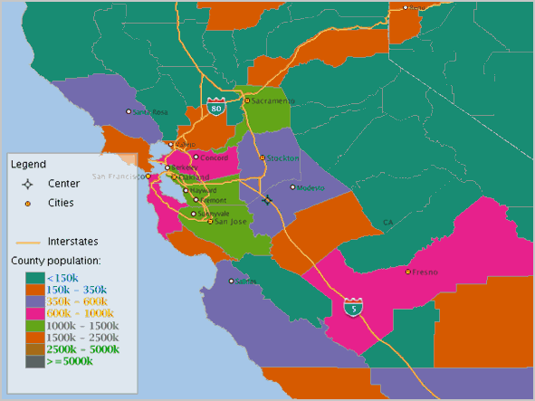
[Description of "Figure 2-14 Map with Legend"](img_text/legend.md)

Notes on Example 2-50 and Figure 2-14:

- This example shows a legend with a single column, although you can create multiple columns in a legend.

- Each entry in the column definition can identify label text and whether the text is the legend title (`is_title="true"`), a style name and associated text, or a separator (`is_separator="true"`) for vertical blank space to be added (after the cities entry in this example).

As an alternative to specifying the legend content in one or more \<column\> elements, you can request an automatic legend based on the map request. With an automatic legend, you specify the legend header, and the map visualization component generates the legend based on the themes that have any interaction with the map area. Themes from the map request and from the base map are considered. (Some legend items might not be visible, though, such as if a theme interacts with the query window but no features of the theme are visible on the map.)

Example 2-51 is a map request that requests an automatic legend (because the `<legend>` element does not include any `<column>` elements).

Example 2-52 requests an automatic legend in which the `<legend>` elements specifies the themes to be used to generate the legend items. In this example, even if the map result shows more themes, the legend items are based on the `THEME_COUNTIES_3397829` and `THEME_US_AIRPORT` themes specified in the `<legend>` element.

You cannot combine an automatic legend with the use of `<column>` elements. If the `<legend>` element contains any `<column>` elements, a column/entry legend is created.

The map visualization component uses the following considerations when it builds automatic legend items:

- Each legend column has a maximum of five entries (an advanced style is considered one entry).

- The legend text for simple rendering styles comes from the theme description if defined, otherwise from the theme name.

- If a rendering style is used in more than one theme, the style is repeated in the legend but with text related to the theme to which it applies.

- Labeling styles are not repeated in the legend. The style text for labeling styles comes from the style description.

- Advanced styles are not repeated in the legend.

If you also specify a map title, note, or logo (or any combination), be sure that the legend and the other features have different positions. (Map titles, notes, and logos are explained in [Specifying Global Map Configuration Options](introduction-to-map-visualization-component.md).) The default position for a legend is `SOUTH_WEST`.

Example 2-50 Legend Included in a Map Request

    <?xml version="1.0" standalone="yes"?>
    <map_request
                 basemap="density_map"
                 datasource = "mvdemo"
                 width="640"
                 height="480"
                 bgcolor="#a6cae0"
                 antialiase="false"
                 format="PNG_STREAM">
      

         <geoFeature render_style="m.image134_bw">
             <geometricProperty typeName="center">
                 <Point srsName="SDO:8307">
                     <coordinates>-121.2615, 37.5266</coordinates>
                 </Point>
             </geometricProperty>
         </geoFeature>
      

      <legend bgstyle="fill:#ffffff;fill-opacity:100;stroke:#a3a3a3" profile="MEDIUM" position="SOUTH_WEST">
              <column>
                <entry text="Legend" is_title="true" />
                <entry style="M.IMAGE134_BW" text="Center" />
                <entry style="M.ALL_CITY_L2" text="Cities" />
                <entry is_separator="true" />
                <entry style="L.S04_ROAD_INTERSTATE" text="Interstates" />
                <entry text="County population:" />
                <entry style="V.COUNTY_POP_DENSITY_8" tab="1" />
              </column>
      </legend>

      <!--
      <themes>

      </themes>
      -->

    </map_request>

Figure 2-14 shows a map with the legend specified in Example 2-50.

Example 2-51 Map Request with Automatic Legend

    <?xml version="1.0" standalone="yes"?>
    <map_request
                 title="Automatic legend"
                 datasource = "mvdemo"
                 width="640"
                 height="480"
                 bgcolor="#a6cae0"
                 antialiase="false"
                 format="PNG_STREAM">
      

         <geoFeature >
             <geometricProperty typeName="center">
                 <Point>
                     <coordinates>-122.2615, 37.5266</coordinates>
                 </Point>
             </geometricProperty>
         </geoFeature>
      

      <themes>
        <theme name="THEME_COUNTIES_3397829" />
        <theme name="THEME_US_ROAD1" />
        <theme name="THEME_US_AIRPORT" />
      </themes>

     <legend bgstyle="fill:#ffffff;fill-opacity:128;stroke:#ff0000;stroke-opacity:128" profile="medium" font="Courier">
      </legend>

    </map_request>

Example 2-52 Automatic Legend with Themes Specified

    <map_request
                 title="Legend with themes defined"
                 datasource = "mvdemo"
                 width="640"
                 height="480"
                 bgcolor="#a6cae0"
                 antialiase="false"
                 format="PNG_STREAM">
      

         <geoFeature >
             <geometricProperty typeName="center">
                 <Point>
                     <coordinates>-122.2615, 37.5266</coordinates>
                 </Point>
             </geometricProperty>
         </geoFeature>
      

      <themes>
        <theme name="THEME_COUNTIES_3397829" />
        <theme name="THEME_US_ROAD1" />
        <theme name="THEME_US_AIRPORT" />
      </themes>

     <legend bgstyle="fill:#ffffff;fill-opacity:128;stroke:#ff0000;stroke-opacity:128" profile="medium" font="Courier">
      <themes>
        <theme name="THEME_COUNTIES_3397829" />
        <theme name="THEME_US_AIRPORT" />
      </themes>
     </legend>

    </map_request>

**Parent topic:** Maps

### 2.5 Data Sources

A data source corresponds to a database schema or user.

Before you can draw any spatial data in a database schema, you must first define (create) a data source for the schema, either permanently or dynamically:

- You can define a data source permanently by specifying its connection information and user login credentials in the map visualization component configuration file (`mapViewerConfig.xml`).

- You can define or modify a data source dynamically using the map visualization component administration (Admin) page.

Each map request must specify a master data source. You can, however, specify a different data source for individual themes added to the map request. This makes it easy to aggregate data stored across different database schemas. If a theme has no specified data source, it is associated with the master data source. A base map (and thus the themes included in it) is always associated with the master data source. When a theme is processed, all of its underlying data, as well as the styles referenced in its definition, must be accessible from the data source or sources associated with the theme.

Each data source has associated renderers (sometimes called mappers or map makers), the number of which is determined by the `number_of_mappers` attribute in the `<map_data_source>` element. This attribute (described in [Defining Permanent Map Data Sources](introduction-to-map-visualization-component.md)) affects the number of database connections created for each data source when map requests are processed. The number of renderers specified in a data source also is the maximum number of concurrent requests that can be processed for that data source. Each additional renderer requires only a small amount of memory, so the main potential disadvantage of specifying a large number of renderers (such as 100) is that the underlying CPU resource might be strained if too many map requests are allowed to come through, thus affecting the performance of the entire map visualization component server.

Each data source has its own internal metadata cache. The metadata cache holds the definitions of all accessed styles, as well as of all predefined themes that originate from the data source. This eliminates the need to query the database repeatedly for the definition of a style or predefined theme whenever it is needed.

- Catalog Data Sources

**Parent topic:** Map Visualization Concepts

#### 2.5.1 Catalog Data Sources

A catalog data source gets all of its data from local files. The local directory where the data files are stored is relative to where the `mapViewerConfig.xml` file is stored. From another perspective, a catalog data source does not need the Oracle database, because all necessary data (the spatial geometry data and its attributes, as well as the metadata for how to rend the spatial data, such as styles and themes) is stored in local files.

The following are the general steps for creating and using a catalog data source:

1.  Export the Necessary Metadata from an Oracle Database

2.  Export the Necessary Spatial Tables

3.  Edit the Map Visualization Component Configuration File to Add the Catalog Data Source

4.  Restart the Map Visualization Component Server

- Export the Necessary Metadata from an Oracle Database
- Export the Necessary Spatial Tables
- Edit the Map Visualization Component Configuration File to Add the Catalog Data Source
- Restart the Map Visualization Component Server

**Parent topic:** Data Sources

##### 2.5.1.1 Export the Necessary Metadata from an Oracle Database

Before creating a catalog data source, you must use the Map Builder utility to export the metadata to `USER_SDO_CACHED_MAPS.xml`, `USER_SDO_THEMES.xml`, and `U``SER_SDO_STYLES.xm`l files. The following considerations apply:

- Only external tile layers are supported in catalog data source. So, the tile layers exported into USER_SDO_CACHED_MAPS.xml must be external tile layers, such as Oracle eLocation map services.

- All styles needed by the themes in USER_SDO_THEMES.xml must be exported in to the USER_SDO_STYLES.xml file.

- You need note all required spatial data tables (themes' base tables from which to fetch spatial data) used by all of the exported themes, so that you can export each base table into a GeoJSON file (explained in Export the Necessary Spatial Tables).

1.  In the Map Builder utility, select Tools, then Export Metadata to XML.

2.  Select a temporary directory to store the metadata.

3.  Accept the default prefix (`USER_SDO_`) for the table names.

4.  Select the tile layers, themes, and styles to export. (If you are not sure which styles are needed for the desired themes, you may export all styles.)

5.  Click OK to perform the export operation.

    The `USER_SDO_CACHED_MAPS.xml`, `USER_SDO_THEMES.xml`, and `U``SER_SDO_STYLES.xm`l files are created in the specified directory.

**Parent topic:** Catalog Data Sources

##### 2.5.1.2 Export the Necessary Spatial Tables

For a catalog data source, the spatial data sets are stored in GeoJSON files. One GeoJSON file corresponds to one spatial table is the database. To export spatial tables, you send requests to the map visualization component server.

For example, if a spatial table called OBIEE_COUNTRY is needed by a catalog data source theme (assume that the theme is also called OBIEE_COUNTRY) in the `USER_SDO_THEMES.xml` file, then this spatial table needs to be exported as a GeoJSON file. As a convention, you may name it with the same name as the name of the spatial table. In this case, it is named as `OBIEE_CONTRY.json`.

1.  Check the themes definition from the `USER_SDO_THEMES.xml` file. For example, if a theme named OBIEE_COUNTRY uses the OBIEE_COUNTRY spatial table, then the spatial table needs to be exported. The table's columns and expected names must be identified, and the column names are the same as the name attributes in the theme definition. In the following example, the ISO_COUNTRY_CODE column is mapped as `Country Code`:

         <theme>
            <name>OBIEE_COUNTRY</name>
            <description><![CDATA[OBIEE Country]]></description>
            <base_table>OBIEE_COUNTRY</base_table>
            <geometry_column>GEOMETRY</geometry_column>
            <styling_rules><![CDATA[<?xml version="1.0" standalone="yes"?><styling_rules>
          <hidden_info>
            <field column="ISO_COUNTRY_CODE" name="Country Code"/>
            <field column="NAME" name="Country Name"/>
            <field column="NAME_INIT" name="Country Name (Init)"/>
          </hidden_info>
          <rule>
            <features style="C.AIRPORTS"> </features>
            <label column="NAME_LABEL" style="T.COUNTRY_NAME_10"> 1 </label>
          </rule>
        </styling_rules>]]></styling_rules>
          </theme>
           . . .

2.  Identify the spatial table columns. In the following example, base table OBIEE_COUNTRY has the spatial geometry column named GEOMETRY:

        SQL> describe obiee_country
         Name                          Null?    Type
         ----------------------------- -------- ----------------------------
         NAME                                   VARCHAR2(255 CHAR)
         NAME_INIT                              VARCHAR2(1020 CHAR)
         OBIEE_LOWER                            VARCHAR2(1020 CHAR)
         ISO_COUNTRY_CODE                       VARCHAR2(5)
         SQKM                                   NUMBER(11)
         NAME_LABEL                             VARCHAR2(255 CHAR)
         GEOMETRY                               MDSYS.SDO_GEOMETRY

3.  Create request strings to the map visualization component data server. For example, if OBIEE_COUNTRY is the base table, and if the map visualization component is running at `localhost:8080`, and if the data source name is `my_ds_name` with spatial data retrieval enabled, you can send a request string like the following:

        http://localhost:8080/ mapviewer/dataserver/my_ds_name?t=obiee_country&sql=select iso_country_code as id, iso_country_code as "country Code", name as "Country Name", name_init as "Country Name (Init)", name_label, geometry from obiee_country&id_col=id&simplify=true&threshold=90&include_label_box=true

    You can save the data set with a name `OBIEE_COUNTRY.json` in this case to the temporary folder where the exported metadata (the `USER_SDO_CACHED_MAPS.xml`, `USER_SDO_THEMES.xml`, and `USER_SDO_STYLES.xml` files) is stored.

**Parent topic:** Catalog Data Sources

##### 2.5.1.3 Edit the Map Visualization Component Configuration File to Add the Catalog Data Source

Edit the `mapViewerConfig.xml` file and add the catalog data source. For example:

    <map_data_source name="catalogds1"
       catalog_dir="../catalogs/datafolder1"
       private="true"
       number_of_mappers="3"
       allow_jdbc_theme_based_foi="true"
       editable="false"/>

For the preceding catalog data source definition, you must create the specified `catalog_dir` folder relative to where the `mapViewerConfig.xml file` is stored, and then copy all data files into the folder: that is, the three exported metadata files (`USER_SDO_CACHED_MAPS.xml`, `USER_SDO_THEMES.xml`, and `USER_SDO_STYLES.xml`) and all exported GeoJSON files, such as `OBIEE_COUNTRY.json` in this example.

**Parent topic:** Catalog Data Sources

##### 2.5.1.4 Restart the Map Visualization Component Server

Restart the map visualization component server.

After the map visualization component server is restarted, all the exported tile layers and themes should be accessible from this catalog data source. For example, you should see a map image if you send a map request like the following:

    http://localhost:8080/mapviewer/omserver?xml_request= <?xml version="1.0" standalone="yes"?> <map_request  datasource = "catalogds1" width="1024" height="768" format="PNG_STREAM"> 
 <geoFeature><geometricProperty typeName="center"> <Point> <coordinates>0, 0</coordinates> </Point> </geometricProperty></geoFeature> 
 <themes> <theme name="OBIEE_COUNTRY"> </theme> </themes> </map_request>

**Parent topic:** Catalog Data Sources

### 2.6 How a Map Is Generated

When a map request arrives at the map visualization component server, the server picks a free renderer associated with the master data source in the request.

This topic describes the process that the map visualization component server follows to generate a map. In brief, the map visualization component performs the following steps:

1.  Parse and process the incoming XML map request.

2.  Prepare the data for each theme (executed in parallel).

3.  Render and label each theme.

4.  Generate final images or files.

Each map generated by the map visualization component results from its receiving a valid XML map request. The XML map request is parsed and its content is validated. The map visualization component then creates any dynamic styles specified in the XML request. It builds a theme list from all themes included in the base map (if a base map is specified), as well as any specified predefined or JDBC themes. All individual features in the request are grouped into a single temporary theme. In other words, after parsing the incoming request, all data that must be shown on the map is presented in a list of themes to the map visualization component rendering engine.

The ordering of the themes in the list is important, because it determines the order in which the themes are rendered. All themes included in the base map (when present) are added to the list first, followed by all specified themes (predefined or JDBC). The theme that contains all the individual features is added as the last theme on the list. Any other requested features of a map (such as legend, map title, or footnote), are created and saved for rendering later.

For each theme in the request, the map visualization component then creates a separate execution thread to prepare its data, so that preparation of the themes takes place in parallel. For a predefined theme, this means formulating a query based on the theme's definition and any other information, such as the current map request window. This query is sent to the database for execution, and the result set is returned. The map visualization component creates individual renderable objects based on the result set.

- For predefined themes that are fully cached, no query is sent to the database, because all renderable objects are readily available.

- For JDBC themes, the query supplied by the user is either executed as is (when the `asis` attribute value is `TRUE` in the JDBC theme definition) or with a spatial filter subquery automatically applied to it. The spatial filter part is used to limit the results of the user's query to those within the current requested window.

- For themes that already have renderable features (such as the one containing all individual features in a request), there is no need to create renderable objects.

After all themes for the map request have been prepared and all necessary data has been collected, the map visualization component starts to render the map. It creates an empty new in-memory image to hold the result map, and paints the empty image with the necessary backgrounds (color or image). It then renders all of the themes in the theme list.

**Note:**

All image or GeoRaster themes are always rendered first, regardless of their position in the theme list. All other themes, however, are rendered in the order in which they appear in the theme list.

For each theme, features are rendered in an order determined internally by the map visualization component. The rendering of each feature involves invoking the drawing methods of its rendering style. After all themes have been rendered, the labeling process starts. For each theme whose features must be labeled with text, the map visualization component invokes algorithms to label each feature, with the specific algorithm depending on the type of feature (such as polygon or line).

After all themes have been rendered and (when needed) labeled, the map visualization component plots any additional map features (such as a legend) on the internal map image. The map visualization component then converts that image into the desired format (such as PNG or GIF) specified in the original map request; however, for SVG maps, instead of using an internal image, the map visualization component initially creates an empty SVG map object, then creates an SVG document as a result of the rendering process, and inserts it into the map object.

**Parent topic:** Map Visualization Concepts

### 2.7 Cross-Schema Map Requests

A database user can issue a map request specifying a theme that uses data associated with another database user, to select data from tables that the other data source user is authorized to access.

For example, assume that user SCOTT wants to issue a map request using data associated with user MVDEMO. In general, user SCOTT must be granted SELECT access on relevant tables owned by user MVDEMO, and the `<theme>` element should generally specify any tables in schema-name.table-name format. In this example scenario:

- For a geometry table, grant the SELECT privilege on the geometry table of MVDEMO to SCOTT (see Example 2-53).

- For a GeoRaster table, grant the SELECT privilege on the GeoRaster table and raster data table or tables of MVDEMO to SCOTT (see Example 2-54).

- For a topology data model table, grant the SELECT privilege on the topology table, topology column index table, and related topology information tables (topology-name\_EDGE\$, topology-name\_NODE\$, topology-name\_FACE\$, topology-name\_RELATION\$) of MVDEMO to SCOTT (see Example 2-55).

- For network data model tables, grant the SELECT privilege on the network link, node, path, and path-link tables of MVDEMO to SCOTT (see Example 2-56).

Example 2-53 shows a dynamic theme that accesses the MVDEMO.STATES geometry table from a data source defined on the SCOTT user.

Example 2-54 shows a dynamic theme that accesses the MVDEMO.GEORASTER_TABLE GeoRaster table and its RDT from a data source defined on the SCOTT user. Specify the base (GeoRaster) table in schema-name.table-name format.

Example 2-55 shows a dynamic theme that accesses the MVDEMO.LAND_PARCELS topology table and information tables for the CITY_DATA topology from a data source defined on the SCOTT user. Specify the feature table and the topology in schema-name.object-name format, if they are owned by a different schema than the one associated with the data source.

In Example 2-55, you must grant SELECT on the topology column index table name (\<topology-column-index-table-name\>) because the spatial index table associated with the feature table topology column is used by the map visualization component in topology queries. You can determine the topology column index table name as follows. Assume the following information:

- Topology feature table owner: MVDEMO

- Topology feature table name: LAND_PARCELS

- Topology feature table topology column name: FEATURE

The following query returns the index table name (in this example, MDTP_14E60\$):

    SQL> select sdo_index_table from all_sdo_index_info
         where table_owner = 'MVDEMO'
         and table_name = 'LAND_PARCELS'
         and column_name = 'FEATURE'

    SDO_INDEX_TABLE
    --------------------------------
    MDTP_14E60$

Then, modify the last GRANT statement in Example 2-55 to specify the \<topology-column-index-table-name\>. In this case:

    SQL> grant select on MDTP_14E60$ to SCOTT;

Example 2-56 shows a dynamic theme that accesses the MVDEMO.BI_TEST network and its link, node, path, and path-link tables. Specify the network name in schema-name.network-name format.

Example 2-53 Cross-Schema Access: Geometry Table

    SQL> grant select on STATES to SCOTT;
    . . .
    <themes>
      <theme name="theme1">
         <jdbc_query
           datasource="scottds"
           spatial_column="geom"
           render_style="MVDEMO:C.COUNTIES"
           jdbc_srid="8265"
           >SELECT geom from MVDEMO.STATES</jdbc_query>
       </theme>
    </themes>

Example 2-54 Cross-Schema Access: GeoRaster Table

    SQL> grant select on GEORASTER_TABLE to SCOTT;
    SQL> grant select on RDT_GEOR1 to SCOTT;
    . . .
    <themes>
      <theme name="georaster_theme">
        <jdbc_georaster_query
           georaster_table="MVDEMO.georaster_table"
           georaster_column="georaster"
           raster_table="rdt_geor1"
           raster_id="1"
           jdbc_srid="8307"
           datasource="scottds"
           asis="false">
         </jdbc_georaster_query>
      </theme>
    </themes>

Example 2-55 Cross-Schema Access: Topology Feature Table

    SQL> grant select on CITY_DATA_FACE$ to SCOTT;
    SQL> grant select on CITY_DATA_EDGE$ to SCOTT;
    SQL> grant select on CITY_DATA_NODE$ to SCOTT;
    SQL> grant select on CITY_DATA_RELATION$ to SCOTT;
    SQL> grant select on LAND_PARCELS to SCOTT;
    SQL> grant select on <topology-column-index-table-name> to SCOTT;
    . . .
    <themes>
      <theme name="topo_theme" >
         <jdbc_topology_query
           topology_name="MVDEMO.CITY_DATA"
           feature_table="MVDEMO.LAND_PARCELS"
           spatial_column="FEATURE"
           render_style="MVDEMO:C.COUNTIES"
           jdbc_srid="0"
           datasource="scottds"
           asis="false">select feature from MVDEMO.land_parcels
         </jdbc_topology_query>
       </theme>
    </themes>

Example 2-56 Cross-Schema Access: Network Tables

    SQL> grant select on BI_TEST_LINK$ to SCOTT;
    SQL> grant select on BI_TEST_NODE$ to SCOTT;
    SQL> grant select on BI_TEST_PATH$ to SCOTT;
    SQL> grant select on BI_TEST_PLINK$ to SCOTT;
    . . .
    <themes>
      <theme name="net_theme" >
         <jdbc_network_query
           network_name="MVDEMO.BI_TEST"
           network_level="1"
           jdbc_srid="0"
           datasource="scottds"
           link_style="MVDEMO:C.RED"
           node_style="MVDEMO:M.CIRCLE"
           node_markersize="5"
           asis="false">
         </jdbc_network_query>
       </theme>
    </themes>

**Parent topic:** Map Visualization Concepts

### 2.8 Workspace Manager Support in the Map Visualization Component

Workspace Manager is an Oracle Database feature that lets you version-enable one or more tables in the database.

After a table is version-enabled, users in a workspace automatically see the correct version of database rows in which they are interested. For detailed information about Workspace Manager, see [Oracle Database Workspace Manager Developer's Guide](../adwsm/workspace-manager-concepts-usage.md).

You can request a map from a specific workspace, at a specific savepoint in a workspace, or at a point close to a specific date in a workspace. The following attributes of the `<theme>` element are related to support for Workspace Manager:

- `workspace_name` attribute: specifies the name of the workspace from which to get the map data.

- `workspace_savepoint` attribute: specifies the name of the savepoint to go to in the specified workspace.

- `workspace_date` attribute: specifies the date to go to (that is, a point at or near the specified date) in the specified workspace.

- `workspace_date_format` attribute: specifies the date format. The default is `mmddyyyyhh24miss`. This attribute applies only if you specified the `workspace_date` attribute.

- `workspace_date_nlsparam` attribute: specifies globalization support options. The options and default are the same as for the `nlsparam` argument to the `TO_CHAR` function for date conversion, which is described in [Oracle Database SQL Language Reference](../sqlrf/TO_CHAR-datetime.md).

- `workspace_date_tswtz` attribute: specifies a Boolean value. `TRUE` means that the input date is in timestamp with time zone format; `FALSE` (the default) means that the input date is a date string.

The `workspace_name` attribute is required for the use of Workspace Manager support in the map visualization component.

If you specify neither the `workspace_savepoint` nor `workspace_date` attribute, the map visualization component goes to the latest version of the workspace defined. If you specify both the `workspace_savepoint` and `workspace_date` attributes, the map visualization component uses the specified date instead of the savepoint name.

Example 2-57 shows the definition of a dynamic theme that uses attributes (shown in bold) related to Workspace Manager support. In this example, the map visualization component will render the data related to workspace `wsp_1` at the savepoint `sp1`.

The following considerations apply to the map visualization component caching of predefined themes (explained in Caching of Predefined Themes) and the use of Workspace Manager-related map visualization component attributes:

- The Workspace Manager-related attributes are ignored for predefined themes if the `caching` attribute is set to `ALL` in the `<styling_rules>` element for the theme.

- No caching data is considered if you specify the `workspace_name` attribute.

Example 2-57 Workspace Manager-Related Attributes in a Map Request

    <?xml version="1.0" standalone="yes"?>
    <map_request
     . . .
      <themes>
        <theme name="wmtheme" user_clickable="false"
           workspace_name="wsp_1" workspace_savepoint="sp1" >
           <jdbc_query
             spatial_column="GEOM"
             render_style="stylename"
             jdbc_srid="8307"
             datasource="mvdemo"
             asis="false"> select GEOM,ATTR from GEOM_TABLE
           </jdbc_query>
         </theme>
      </themes>
     . . .
    </map_request>

**Parent topic:** Map Visualization Concepts

### 2.9 Map Visualization Component Metadata Views

The mapping metadata describing base maps, themes, and styles is stored in the global tables SDO_MAPS_TABLE, SDO_THEMES_TABLE, and SDO_STYLES_TABLE, which are owned by MDSYS.

However, you should never directly update these tables. Each map visualization component user has the following views available in the schema associated with that user:

- USER_SDO_STYLES and ALL_SDO_STYLES contain information about styles. These views are described in xxx_SDO_STYLES Views.

- USER_SDO_THEMES and ALL_SDO_THEMES contain information about themes. These views are described in xxx_SDO_THEMES Views.

- USER_SDO_MAPS and ALL_SDO_MAPS contain information about base maps. These views are described in xxx_SDO_MAPS Views.

- USER_SDO_CACHED_MAPS and ALL_SDO_CACHED_MAPS contain information about configuration settings for map tile layers. These views are described in xxx_SDO_CACHED_MAPS Views.

**Note:**

You can use the Map Builder tool (described in [Oracle Map Builder Tool](oracle-map-builder-tool.md)) to manage most mapping metadata. However, for some features you must use SQL statements to update the map visualization component metadata views.

The USER_SDO_xxx views contain metadata information about mapping elements (styles, themes, base maps, cached maps) owned by the user (schema), and the ALL_SDO_xxx views contain metadata information about mapping elements on which the user has SELECT permission.

The ALL_SDO_xxx views include an OWNER column that identifies the schema of the owner of the object. The USER_SDO_xxx views do not include an OWNER column.

All styles defined in the database can be referenced by any user to define that user's themes, markers with a text style, or advanced styles. However, themes and base maps are not shared among users; so, for example, you cannot reference another user's themes in a base map that you create.

The following rules apply for accessing the mapping metadata:

- If you need to add, delete, or modify any metadata, you must perform the operations using the USER_SDO_xxx views. The ALL_SDO_xxx views are automatically updated to reflect any changes that you make to USER_SDO_xxx views.

- If you need only read access to the metadata for all styles, you should use the ALL_SDO_STYLES view. Both the OWNER and NAME columns make up the primary key; therefore, when you specify a style, be sure to include both the OWNER and NAME.

The preceding map visualization component metadata views are defined in the following file:

    $ORACLE_HOME/lbs/admin/mapdefinition.sql

The map visualization component also uses some other metadata views, which may be defined in other files. You should never modify the contents of these views, which include the following:

- MDSYS.USER_SDO_TILE_ADMIN_TASKS includes information about long tasks related to map tile management. If you stop a long map tile layer task such as prefetching and then restart the task, the map visualization component uses the information in the USER_SDO_TILE_ADMIN_TASKS view to resume the task rather than start over at the beginning.

<!-- -->

- xxx_SDO_STYLES Views
- xxx_SDO_THEMES Views
- xxx_SDO_MAPS Views
- xxx_SDO_CACHED_MAPS Views

**Parent topic:** Map Visualization Concepts

#### 2.9.1 xxx_SDO_STYLES Views

The USER_SDO_STYLES and ALL_SDO_STYLES views have the columns listed in Table 2-3.

Table 2-3 xxx_SDO_STYLES Views

| Column Name | Data Type    | Description                                                                                                                            |
|:------------|:-------------|:---------------------------------------------------------------------------------------------------------------------------------------|
| OWNER       | VARCHAR2     | Schema that owns the style (ALL_SDO_STYLES only)                                                                                       |
| NAME        | VARCHAR2     | Unique name to be associated with the style                                                                                            |
| TYPE        | VARCHAR2     | One of the following values: COLOR, MARKER, LINE, AREA, TEXT, or ADVANCED                                                              |
| DESCRIPTION | VARCHAR2     | Optional descriptive text about the style                                                                                              |
| DEFINITION  | CLOB         | XML definition of the style                                                                                                            |
| IMAGE       | BLOB         | Image content (for example, `airport.gif`) for marker or area styles that use image-based symbols (for markers) or fillers (for areas) |
| GEOMETRY    | SDO_GEOMETRY | (Reserved for future use)                                                                                                              |

Depending on the Oracle Database release, the ALL_SDO_STYLES view may contain sample styles owned by the MDSYS schema. If these styles are defined on your system, you can specify them in theme definitions and map requests, and you can examine the XML definitions for ideas to use in defining your own styles.

To specify a style (or other type of map visualization component object) that is owned by a schema other than the one for the current user, you must specify the schema name, and you must use a colon (:), not a period, between the schema name and the object name. The following excerpt from a `<jdbc_query>` element refers to the style named `C.RED` owned by the MDSYS schema:

    <jdbc_query . . . render_style="MDSYS:C.RED">
    . . .
     </jdbc_query>

Example 2-58 finds the names of all currently defined styles owned by the MDSYS schema, and it displays the type, description, and XML definition of one of the styles. (The example output is reformatted for readability.)

Example 2-58 Finding Styles Owned by the MDSYS Schema

    SELECT owner, name FROM all_sdo_styles
      WHERE owner = 'MDSYS';

    OWNER                            NAME
    -------------------------------- --------------------------------
    MDSYS                            C.BLACK
    MDSYS                            C.BLACK GRAY
    MDSYS                            C.BLUE
    MDSYS                            C.COUNTIES
    MDSYS                            C.FACILITY
    . . .
    MDSYS                            L.MAJOR STREET
    MDSYS                            L.MAJOR TOLL ROAD
    MDSYS                            L.MQ_ROAD2
    MDSYS                            L.PH
    MDSYS                            L.POOR_ROADS
    MDSYS                            L.PTH
    MDSYS                            L.RAILROAD
    MDSYS                            L.RAMP
    MDSYS                            L.SH
    MDSYS                            L.STATE BOUNDARY
    . . .
    MDSYS                            M.REDSQ
    MDSYS                            M.SMALL TRIANGLE
    MDSYS                            M.STAR
    MDSYS                            M.TOWN HALL
    MDSYS                            M.TRIANGLE
    MDSYS                            T.AIRPORT NAME
    MDSYS                            T.CITY NAME
    MDSYS                            T.MAP TITLE
    MDSYS                            T.PARK NAME
    MDSYS                            T.RED STREET
    MDSYS                            T.ROAD NAME
    MDSYS                            T.SHIELD1
    MDSYS                            T.SHIELD2
    MDSYS                            T.STATE NAME
    MDSYS                            T.STREET NAME
    . . .

    -- Display the type, description, and XML definition of one style.
    SET LONG 4000;
    SELECT owner, name, type, description, definition
      FROM all_sdo_styles WHERE name = 'L.PH';

    OWNER   NAME     TYPE       DESCRIPTION
    ------  -----    ------     ------------------
    MDSYS   L.PH     LINE       Primary highways

    DEFINITION
    ---------------------------------------------------------------------------
    <?xml version="1.0" standalone="yes"?>
    <svg width="1in" height="1in">
    <desc></desc>
    <g class="line" style="fill:#33a9ff;stroke-width:4">
    <line class="parallel" style="fill:#aa55cc;stroke-width:1.0"/>
    </g>
    </svg>

**Parent topic:** Map Visualization Component Metadata Views

#### 2.9.2 xxx_SDO_THEMES Views

The USER_SDO_THEMES and ALL_SDO_THEMES views have the columns listed in Table 2-4.

Table 2-4 xxx_SDO_THEMES Views

| Column Name     | Data Type | Description                                                         |
|:----------------|:----------|:--------------------------------------------------------------------|
| OWNER           | VARCHAR2  | Schema that owns the theme (ALL_SDO_THEMES only)                    |
| NAME            | VARCHAR2  | Unique name to be associated with the theme                         |
| DESCRIPTION     | VARCHAR2  | Optional descriptive text about the theme                           |
| BASE_TABLE      | VARCHAR2  | Table or view containing the spatial geometry column                |
| GEOMETRY_COLUMN | VARCHAR2  | Name of the spatial geometry column (of type SDO_GEOMETRY)          |
| STYLING_RULES   | CLOB      | XML definition of the styling rules to be associated with the theme |

**Parent topic:** Map Visualization Component Metadata Views

#### 2.9.3 xxx_SDO_MAPS Views

The USER_SDO_MAPS and ALL_SDO_MAPS views have the columns listed in Table 2-5.

Table 2-5 xxx_SDO_MAPS Views

| Column Name | Data Type | Description                                                                                                     |
|:------------|:----------|:----------------------------------------------------------------------------------------------------------------|
| OWNER       | VARCHAR2  | Schema that owns the base map (ALL_SDO_MAPS only)                                                               |
| NAME        | VARCHAR2  | Unique name to be associated with the base map                                                                  |
| DESCRIPTION | VARCHAR2  | Optional descriptive text about the base map                                                                    |
| DEFINITION  | CLOB      | XML definition of the list of themes and their scale value range information to be associated with the base map |

**Parent topic:** Map Visualization Component Metadata Views

#### 2.9.4 xxx_SDO_CACHED_MAPS Views

The USER_SDO_MAPS and ALL_SDO_MAPS views have the columns listed in Table 2-6.

Table 2-6 xxx_SDO_CACHED_MAPS Views

| Column Name | Data Type | Description                                                                                                                                                                                                                                                                                                                                                                                    |
|:------------|:----------|:-----------------------------------------------------------------------------------------------------------------------------------------------------------------------------------------------------------------------------------------------------------------------------------------------------------------------------------------------------------------------------------------------|
| NAME        | VARCHAR2  | Unique name of the cached map source                                                                                                                                                                                                                                                                                                                                                           |
| DESCRIPTION | VARCHAR2  | Optional descriptive text about the cached map source                                                                                                                                                                                                                                                                                                                                          |
| TILES_TABLE | VARCHAR2  | (Not currently used)                                                                                                                                                                                                                                                                                                                                                                           |
| IS_ONLINE   | VARCHAR2  | `YES` if the map tile layer is online, or `NO` if the map tile layer is offline. When a tile is missing from the cache and the map tile layer is online, the map tile server will fetch the tile and return the fetched tile to the client. When a tile is missing and the map tile layer is offline, the map tile server will not fetch the tile but will return a blank image to the client. |
| IS_INTERNAL | VARCHAR2  | `YES` if the map source is an internal map source, or `NO` if the map source is an external map source                                                                                                                                                                                                                                                                                         |
| DEFINITION  | CLOB      | XML definition of the map tile layer, as described later in this section.                                                                                                                                                                                                                                                                                                                      |
| BASE_MAP    | VARCHAR2  | Name of the cached map visualization component base map, if the map source is an internal map source                                                                                                                                                                                                                                                                                           |
| MAP_ADAPTER | BLOB      | The jar file that contains the adapter Java classes of the external map services provider, as described later in this section.                                                                                                                                                                                                                                                                 |

For detailed information about using the USER_SDO_CACHED_MAPS view, see [Map Tile Server Configuration](map-visualization-servers.md).

**Parent topic:** Map Visualization Component Metadata Views

### 2.10 Oracle Maps

Oracle Maps is the name for a suite of technologies for developing high-performance interactive web-based mapping applications. It consists of components from both the server side and the client side.

- Overview of Oracle Maps
- Architecture for Oracle Maps Applications

**Parent topic:** Map Visualization Concepts

#### 2.10.1 Overview of Oracle Maps

Oracle Maps consists of the following main components:

- A map tile server that caches and serves pregenerated map image tiles upon a map image tile request

- A map server that generates maps form spatial data to the mapping client upon a client map image request

- A map data server that fetches spatial data from a spatial data provider to the mapping client

- An Ajax-based JavaScript mapping client. (Ajax is an acronym for asynchronous JavaScript and XML.) This client provides functions for browsing and interacting with maps, as well as a flexible application programming interface (API).

The map tile server (map image caching engine, described in [Map Tile Server](map-visualization-servers.md)) automatically fetches and caches map image tiles rendered by the Oracle Spatial and Graph map visualization component or other web-enabled map providers. It also serves cached map image tiles to the clients, which are web applications developed using the Oracle Maps client API. The clients can then automatically stitch multiple map image tiles into a seamless large map. Because the map image tiles are normally pregenerated and cached, the application users will experience fast map viewing performance.

The JavaScript mapping client is a browser side map display engine that fetches map content from the servers, and presents it to client applications. It:

- Fetches map images tiles from a map visualization component server, from a third party map service provider, or from its local disk-storage

- Retrieves spatial data from a map visualization component server, from a third party spatial data provider, or from its local disk-storage and then renders the spatial data into map images by itself on the client side

- Provides customizable map-related user interaction controls, such as map dragging and clicking, for the application

- Provides other built-in features and utilities to customize the map contents and map layout design

The JavaScript mapping client can be easily integrated with any web application or portal.

**Parent topic:** Oracle Maps

#### 2.10.2 Architecture for Oracle Maps Applications

Figure 2-15 shows the architecture of web mapping applications that are developed using Oracle Maps.

Figure 2-15 Architecture for Oracle Maps Applications

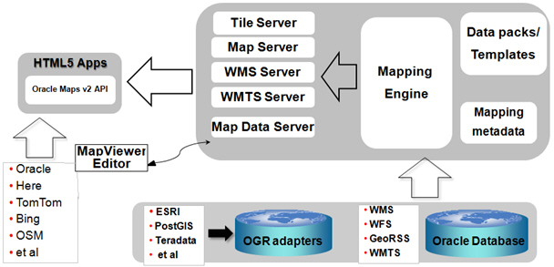
[Description of "Figure 2-15 Architecture for Oracle Maps Applications"](img_text/arch_omaps2.md)

Referring to Figure 2-15, applications interact with the Oracle Maps architecture as follows:

- The application is developed using JavaScript, and it runs inside the JavaScript engine of the web browser.

- The application invokes the JavaScript map client to fetch the map image tiles from the map tile server, and then it displays the map in the web browser.

- The application invokes the JavaScript map client to fetch the map image in other form of map services (such as WMS and WMTS) from the server and then displays the map image.

- The application invokes the JavaScript map client to fetch spatial data from the map data server and then renders the map image to display.

- The JavaScript map client controls map-related user interaction for the application.

- When the map visualization component server receives a map image request, the request can be one of its several supported types: a map image tile request to its map tile server, a map image request to its map server, a WMS map request to its WMS server, or a WMTS map image tile request to its WMTS server. Each request will be handled by the server accordingly.

  Example 1: When the map tile server receives a map image tile request, it first checks to see if the requested tile is already cached. If the tile is already in the cache, the cached tile is then returned to the client. If the tile is not in the cache, then the map tile server fetches the tile into the cache and returns it to the client. Tiles can be fetched either directly from the map visualization component map rendering engine or from an external web map service provider.

  Example 2: When the server receives a map image request (instead of a map tile request) to its map server, the map server renders the image and returns it to the client. Note that in contrast to the map tile server, the map server generates a map according to a specified data bounds and renders the data onto an image with specified dimension, but it does not cache the map image.

- When the map data server receives a map data request, it retrieves the spatial data and returns the spatial data, not map images, to the client.

**Parent topic:** Oracle Maps
