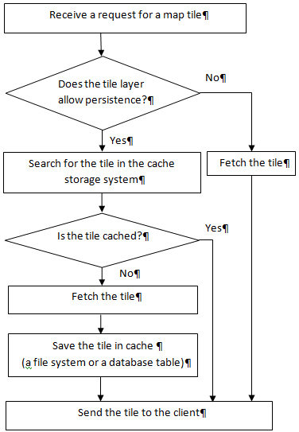
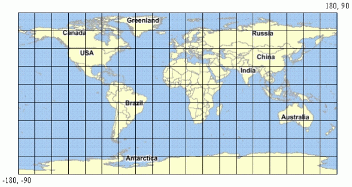
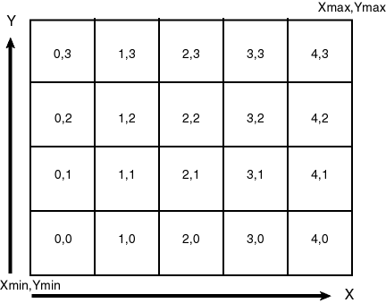
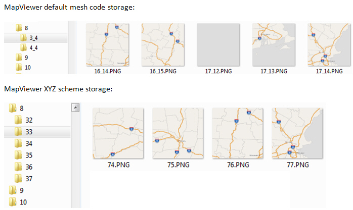
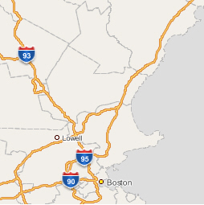

The map visualization component, as a set of Java Enterprise Edition packages, contains a collection of servers to provide mapping services.

These services include a map server, a map data server, a map tile server, a vector tile server, a WMS server (see [OGC WMS Support in the Map Visualization Component](ogc-wms-support-map-visualzation-component.md)), and a WMTS server (see [OGC WMTS Support in the Map Visualization Component](ogc-wmts-support-map-visualzation-component.md)).When you develop Oracle Maps applications, the Oracle Maps API and the map visualization component server will identify the needed service and then issue map service request to the proper server. You normally do not need to send service requests explicitly in your map applications; however, if you are familiar with the map visualization component servers described in this chapter, it can help if you need to debug or optimize the application.

- Map Visualization Component Map Data Server
  The map visualization component map data server provides services for streaming live data from a database server to a client.
- Map Tile Server
  The map tile server is a map image caching engine that fetches, caches, and serves pregenerated, fixed-size map image tiles.

### 3.1 Map Visualization Component Map Data Server

The map visualization component map data server provides services for streaming live data from a database server to a client.

The data can be consumed by the Oracle Maps JavaScript API client, or be edited by the API editing utilities. It is also used as the middle-tier component for handling data synchronization tasks.

At the most basic level, a client sends a request to the map data server, specifying the name of a theme and an optional bounding box. The server then returns the live data (including both geometries and attributes) in compressed GeoJSON format.

- Domains and Map Data Server URL Patterns
- Map Data Server Request Parameters
- Interpreting Data Returned from the Map Data Server
- Map Data Server Error Handling

**Parent topic:** Map Visualization Servers

#### 3.1.1 Domains and Map Data Server URL Patterns

The map data server uses domains, where each domain corresponds to a map visualization component data source. For example, to request data from the `mvdemo` data source, the URL must have the following pattern:

`http://example.com:8080/mapviewer/dataserver/mvdemo?`

In this URL request, `/dataserver` refers to the map data server. `/mvdemo` is the path information, which indicates which domain or data source this request is directed against. There is no need to specify the data source explicitly in the rest of the URL request. This URL pattern provides flexibility in terms of protection. A user or a web administrator can easily set up different levels of protection for different domains using such a URL pattern.

To get a quick help regarding the full list of supported HTTP request parameters, you can issue a request that includes the help parameter. For example:

`http://example:8080/mapviewer/dataserver/mvdemo?help=true`

This example returns a list of supported parameters. (Note that the `/mvdemo` path is still required even for this help request.)

**Parent topic:** Map Visualization Component Map Data Server

#### 3.1.2 Map Data Server Request Parameters

In a map data server request to get data, the URL must include appropriate query parameters. The data could be from a map visualization component predefined geometry theme or JDBC theme.

- Getting Data from a Predefined Geometry Theme
- Getting Data from a JDBC Theme
- Getting Annotation Text from a JDBC Theme
- Getting Topology Data

**Parent topic:** Map Visualization Component Map Data Server

##### 3.1.2.1 Getting Data from a Predefined Geometry Theme

Before getting data from a predefined geometry theme, be sure that the predefined geometry theme is properly defined. If it is not properly defined, modify its definition or create a new predefined geometry theme with the proper definition.

Besides the geometry column of a spatial table, if you also need some attribute columns for an application, then your geometry theme's STYLING_RULES column must have the `<hidden_info>` element for defining needed attributes. For example, if your application needs a geometry theme (such as CUSTOMERS) to represent a spatial table, and if you also need each customer's name, city, and sales amount, then the STYLING_RULES should look similar to the following:

    SQL> select STYLING_RULES from user_sdo_themes where name='CUSTOMERS';

    STYLING_RULES
    --------------------------------------------------------------------------------
    <?xml version="1.0" standalone="yes"?>
    <styling_rules>
      <hidden_info>
        <field column="name" name="Name"/>
        <field column="city" name="City"/>
        <field column="sales" name="Sales"/>
      </hidden_info>
      <rule>
        <features style="M.STOPLIGHT_RED"> </features>
      </rule>
    </styling_rules>

The Map Builder utility is the recommended tool for modifying or creating geometry themes.

For information using styling rules in a predefined geometry theme, see [Styling Rules in Predefined Spatial Geometry Themes](map-visualization-concepts.md).

The following parameters are available for a map data server request to get data from a map visualization component predefined geometry theme. The `t` (theme name) parameter is required; the others are optional.

- `t`: Name of the theme.

- `bbox`: Bounding box. Must be a comma-delimited list of `minx,miny,maxx,maxy`.

- `to_srid`: SRID (spatial reference system) in which to return the data.

- `bbox_srid`: SRID (spatial reference system) of the bounding box, if different from the native SRID of the data.

- `seq`: Sequence ID, to be used when getting data in multipart format.

- `dadp`: Digits after decimal point: the maximum number of digits after the decimal point for the coordinates in the returned data.

- `include_style_info`: Determines whether styling information (rendering/labeling style name and related columns) should be included with each feature. (The default is `true`.)

- `include_label_box`: Determines whether a label box should be included with each polygon feature. (The default is `true`.) A label box is a near maximum rectangle inside the polygon. A label placed inside this rectangle is guaranteed to be completely inside the polygon feature. This parameter is ignored for non-polygon features.

- `simplify`: Determines whether geometries will be simplified. (The default is `false`.)

- `threshold`: If `simplify` is `true`, then `threshold` controls the approximate percentage of vertices from the input geometry to be eliminated during the simplification. (Must be a number between 1 and 99.) For example, if the value is 10, then relatively few (approximately 10%) of the vertices will be eliminated and most (approximately 90%) will be kept; but if the value is 90, then approximately 90% of the vertices will be eliminated (and only approximately 10% will be kept).

The following are some examples.

To get all the data from the CITIES table in the 3857 SRID:

`http://example:8080/mapviewer/dataserver/mvdemo?t=theme_demo_cities&to_srid=3857`

To get all the data from the CITIES table that interacts with a specified bbox in 3857 SRID:

`http://example:8080/mapviewer/dataserver/mvdemo?t=theme_demo_cities&bbox=-122.0,25,-100,45&to_srid=3857`

To get all the data from the CITIES table that interacts with a specified bbox in 3857 SRID, with 3 digits after the decimal points, and without styling information:

`http://example:8080/mapviewer/dataserver/mvdemo?t=theme_demo_cities&bbox=-122.0,25,-100,45&to_srid=3857&dadp=3&include_style_info=no`

To get all data from the COUNTIES table and include label boxes:

`http://example:8080/mapviewer/dataserver/mvdemo?t=theme_demo_counties&include_label_box=yes`

**Parent topic:** Map Data Server Request Parameters

##### 3.1.2.2 Getting Data from a JDBC Theme

The following parameters are available for a map data server request to get data from a map visualization component theme based on a dynamic JDBC theme. The `t` (theme name) and `sql` (SQL query) parameters are required; the others are optional.

- `t`: Name of the theme.

- `sql`: The complete SQL query, properly URL encoded.

- `asis`: Determines whether the query should be executed "as is". The default is `false`, which causes the map visualization component to embed the SQL query as a subquery of its spatial filter query. If the value is `true`, the map visualization component does not attempt to modify the supplied query string.

- `bbox`: Bounding box. Must be a comma-delimited list of `minx,miny,maxx,maxy`.

- `to_srid`: SRID (spatial reference system) in which to return the data.

- `bbox_srid`: SRID (spatial reference system) of the bounding box, if different from the native SRID of the data.

- `seq`: Sequence ID, to be used when getting data in multipart format.

- `dadp`: Digits after decimal point: the maximum number of digits after the decimal point for the coordinates in the returned data.

- `include_style_info`: Determines whether styling information (rendering/labeling style name and related columns) should be included with each feature. (The default is `true`.)

- `include_label_box`: Determines whether a label box should be included with each polygon feature. (The default is `true`.) A label box is a near maximum rectangle inside the polygon. A label placed inside this rectangle is guaranteed to be completely inside the polygon feature. This parameter is ignored for non-polygon features.

The following are some examples.

To get all the data of the CITIES table in SRID 3857:

`http://example:8080/mapviewer/dataserver/mvdemo?t=theme1&sql=select+*+from+cities&to_srid=3857`

To get all the data of the table CITIES within a given bbox in SRID 3857:

`http://example:8080/mapviewer/dataserver/mvdemo?t=theme1&sql=select+*+from+cities&to_srid=3857&bbox=-122.0,25,-100,45`

To run the query as is, without a bbox and return data in SRID 3857:

`http://example:8080/mapviewer/dataserver/mvdemo?t=theme1&sql=select+*+from+cities&to_srid=3857&bbox=-122.0,25,-100,45&asis=t`

**Parent topic:** Map Data Server Request Parameters

##### 3.1.2.3 Getting Annotation Text from a JDBC Theme

A request to retrieve annotation text elements from a JDBC theme is similar to that in Getting Data from a JDBC Theme

The following parameters are available for a map data server request to get data from a map visualization component theme based on a dynamic JDBC theme. The `t` (theme name), `sql` (SQL query, `geom_type`, and `base_table` parameters are required; the others are optional.

- `t`: Name of the theme.

- `sql`: The complete SQL query, properly URL encoded.

- `geom_type`: Must be specified as `annotation` to indicate that the spatial column is on annotation type.

- `base_table`: The database table (for the server to read annotation text metadata information for that table).

- `asis`: Determines whether the query should be executed "as is". The default is `false`, which causes the map visualization component to embed the SQL query as a subquery of its spatial filter query. If the value is `true`, the map visualization component does not attempt to modify the supplied query string.

- `bbox`: Bounding box. Must be a comma-delimited list of `minx,miny,maxx,maxy`.

- `to_srid`: SRID (spatial reference system) in which to return the data.

- `bbox_srid`: SRID (spatial reference system) of the bounding box, if different from the native SRID of the data.

- `seq`: Sequence ID, to be used when getting data in multipart format.

- `dadp`: Digits after decimal point: the maximum number of digits after the decimal point for the coordinates in the returned data.

- `include_style_info`: Determines whether styling information (rendering/labeling style name and related columns) should be included with each feature. (The default is `true`.)

- `include_label_box`: Determines whether a label box should be included with each polygon feature. (The default is `true`.) A label box is a near maximum rectangle inside the polygon. A label placed inside this rectangle is guaranteed to be completely inside the polygon feature. This parameter is ignored for non-polygon features.

The following example retrieves annotation text information:

`http://example:8080/mapviewer/dataserver/tilsmenv?t=theme1&sql=select+*+from+annotext_table&geom_col=textobj&geom_type=annotation&base_table=annotext_table&bbox=0,0,10,10`

A typical response includes the annotation text table metadata information plus the annotation text feature. Each annotation text feature can have one or more text elements. Each text element can be defined by a text value, a location, a leader line, and graphic attributes. Refer to OGC specification of annotation texts for additional information.

The response looks like the following:

    {"type":"AnnotationText",
    "collectionName":"theme1",
    "srs":0,
    "geodetic":false,
    "bbox":[0, 0, 10, 10],
    "attr_names":["ID"],
    "attr_types":["double"],
    "default_text_attributes":{"fontWeight":"Normal","fontStyle":"Normal","textDecoration":"None","letterSpacing":"Normal","wordSpacing":"Normal","fill":"black","fill-opacity":1.0,"stroke":"black","strokeWidth":1.0,"stroke-opacity":1.0,"horizontalAlignment":"start","verticalAlignment":"top","multilineJustification":"left","multilineSpacing":0.0},
    "metadata":{"textExpression":"name","textAttributes":{"fontFamily":"Serif","fontSize":14.0,"fill":"#ff0000"}},
    "features":[
    {"type":"AnnoText", "elements":[{"location":{"type":"Point", "coordinates":[1, 1]},"textValue":"Sample Label 1","leaderLine":{"type":"LineString", "coordinates":[0,0,1,1]}}],"envelope":{"type":"Rectangle", "coordinates":[0,0,1,1]},"properties":{"ID":"1.0"}},
    {"type":"AnnoText", "elements":[{"location":{"type":"LineString", "coordinates":[2,5,4,5,6,5]},"leaderLine":{"type":"LineString", "coordinates":[4,3,4,5]},"textAttributes":{"fontFamily":"Dialog","fontSize":14.0,"fill":"blue"}}],"envelope":{"type":"Rectangle", "coordinates":[2,3,6,5]},"properties":{"ID":"3.0"}},
    {"type":"AnnoText", "elements":[{"location":{"type":"Point", "coordinates":[10, 10]},"textValue":"Sample Label 2","leaderLine":{"type":"LineString", "coordinates":[5,10,10,10]}}],"envelope":{"type":"LineString", "coordinates":[5,10,10,10]},"properties":{"ID":"2.0"}}
    ]}

**Parent topic:** Map Data Server Request Parameters

##### 3.1.2.4 Getting Topology Data

A topology set is defined by a set of topology primitives (faces, edges, and nodes(. Each topology feature can be associated with one or more topology primitives.

A request to retrieve the topology primitives must contain the `topology` parameter, as in the following example:

`http://example:8080/mapviewer/dataserver/tilsmenv?topology=city_data&bbox=10,10,35,35`

The response includes all primitives that interact with input MBR:

    {"type":"TopologyPrimitives",
    "topology":"city_data",
    "srs":0,
    "bbox":[0, 0, 62, 42],
    "face_attr_names":["FACE_ID","BOUNDARY_EDGE_ID","ISLAND_EDGE_ID_LIST","ISLAND_NODE_ID_LIST"],
    "face_attr_types":["integer","integer","array:integer","array:integer"],
    "edge_attr_names":["EDGE_ID","START_NODE_ID","END_NODE_ID","NEXT_LEFT_EDGE_ID","PREV_LEFT_EDGE_ID","NEXT_RIGHT_EDGE_ID","PREV_RIGHT_EDGE_ID","LEFT_FACE_ID","RIGHT_FACE_ID"],
    "edge_attr_types":["integer","integer","integer","integer","integer","integer","integer","integer","integer"],
    "node_attr_names":["NODE_ID","EDGE_ID","FACE_ID"],
    "node_attr_types":["integer","integer","integer"],
    "primitives":[
    {"type":"Face", "mbr_geometry":{"type":"Rectangle", "coordinates":[3,30,15,38]}, "properties":{"FACE_ID":"1", "BOUNDARY_EDGE_ID":"1", "ISLAND_EDGE_ID_LIST":[25]}},
    {"type":"Face", "mbr_geometry":{"type":"Rectangle", "coordinates":[9,14,21,22]}, "properties":{"FACE_ID":"3", "BOUNDARY_EDGE_ID":"19"}},
    {"type":"Face", "mbr_geometry":{"type":"Rectangle", "coordinates":[9,6,21,14]}, "properties":{"FACE_ID":"6", "BOUNDARY_EDGE_ID":"20"}},
    {"type":"Face", "mbr_geometry":{"type":"Rectangle", "coordinates":[17,30,31,40]}, "properties":{"FACE_ID":"2", "BOUNDARY_EDGE_ID":"2", "ISLAND_NODE_ID_LIST":[4]}},
    {"type":"Face", "mbr_geometry":{"type":"Rectangle", "coordinates":[21,6,35,14]}, "properties":{"FACE_ID":"7", "BOUNDARY_EDGE_ID":"10"}},
    {"type":"Face", "mbr_geometry":{"type":"Rectangle", "coordinates":[21,14,35,22]}, "properties":{"FACE_ID":"4", "BOUNDARY_EDGE_ID":"17"}},
    {"type":"Face", "mbr_geometry":{"type":"Rectangle", "coordinates":[35,14,47,22]}, "properties":{"FACE_ID":"5", "BOUNDARY_EDGE_ID":"15"}},
    {"type":"Face", "mbr_geometry":{"type":"Rectangle", "coordinates":[35,6,47,14]}, "properties":{"FACE_ID":"8", "BOUNDARY_EDGE_ID":"16"}},
    {"type":"Edge", "geometry":{"type":"LineString", "coordinates":[8,30,16,30,16,38,3,38,3,30,8,30]}, "properties":{"EDGE_ID":"1", "START_NODE_ID":"1", "END_NODE_ID":"1", "NEXT_LEFT_EDGE_ID":"1", "PREV_LEFT_EDGE_ID":"1", "NEXT_RIGHT_EDGE_ID":"-1", "PREV_RIGHT_EDGE_ID":"-1", "LEFT_FACE_ID":"1", "RIGHT_FACE_ID":"-1"}},
    {"type":"Edge", "geometry":{"type":"LineString", "coordinates":[4,31,7,31,7,34,4,34,4,31]}, "properties":{"EDGE_ID":"26", "START_NODE_ID":"20", "END_NODE_ID":"20", "NEXT_LEFT_EDGE_ID":"26", "PREV_LEFT_EDGE_ID":"26", "NEXT_RIGHT_EDGE_ID":"-26", "PREV_RIGHT_EDGE_ID":"-26", "LEFT_FACE_ID":"9", "RIGHT_FACE_ID":"1"}},
    {"type":"Edge", "geometry":{"type":"LineString", "coordinates":[9,22,21,22]}, "properties":{"EDGE_ID":"6", "START_NODE_ID":"16", "END_NODE_ID":"17", "NEXT_LEFT_EDGE_ID":"7", "PREV_LEFT_EDGE_ID":"21", "NEXT_RIGHT_EDGE_ID":"-21", "PREV_RIGHT_EDGE_ID":"19", "LEFT_FACE_ID":"-1", "RIGHT_FACE_ID":"3"}},
    {"type":"Edge", "geometry":{"type":"LineString", "coordinates":[9,14,9,22]}, "properties":{"EDGE_ID":"21", "START_NODE_ID":"15", "END_NODE_ID":"16", "NEXT_LEFT_EDGE_ID":"6", "PREV_LEFT_EDGE_ID":"22", "NEXT_RIGHT_EDGE_ID":"9", "PREV_RIGHT_EDGE_ID":"-6", "LEFT_FACE_ID":"-1", "RIGHT_FACE_ID":"3"}},
    {"type":"Edge", "geometry":{"type":"LineString", "coordinates":[9,14,21,14]}, "properties":{"EDGE_ID":"9", "START_NODE_ID":"15", "END_NODE_ID":"14", "NEXT_LEFT_EDGE_ID":"19", "PREV_LEFT_EDGE_ID":"-21", "NEXT_RIGHT_EDGE_ID":"-22", "PREV_RIGHT_EDGE_ID":"20", "LEFT_FACE_ID":"3", "RIGHT_FACE_ID":"6"}},
    {"type":"Edge", "geometry":{"type":"LineString", "coordinates":[9,6,21,6]}, "properties":{"EDGE_ID":"12", "START_NODE_ID":"8", "END_NODE_ID":"9", "NEXT_LEFT_EDGE_ID":"20", "PREV_LEFT_EDGE_ID":"-22", "NEXT_RIGHT_EDGE_ID":"22", "PREV_RIGHT_EDGE_ID":"-13", "LEFT_FACE_ID":"6", "RIGHT_FACE_ID":"-1"}},
    {"type":"Edge", "geometry":{"type":"LineString", "coordinates":[9,35,13,35]}, "properties":{"EDGE_ID":"25", "START_NODE_ID":"21", "END_NODE_ID":"22", "NEXT_LEFT_EDGE_ID":"-25", "PREV_LEFT_EDGE_ID":"-25", "NEXT_RIGHT_EDGE_ID":"25", "PREV_RIGHT_EDGE_ID":"25", "LEFT_FACE_ID":"1", "RIGHT_FACE_ID":"1"}},
    {"type":"Edge", "geometry":{"type":"LineString", "coordinates":[9,6,9,14]}, "properties":{"EDGE_ID":"22", "START_NODE_ID":"8", "END_NODE_ID":"15", "NEXT_LEFT_EDGE_ID":"21", "PREV_LEFT_EDGE_ID":"-12", "NEXT_RIGHT_EDGE_ID":"12", "PREV_RIGHT_EDGE_ID":"-9", "LEFT_FACE_ID":"-1", "RIGHT_FACE_ID":"6"}},
    {"type":"Edge", "geometry":{"type":"LineString", "coordinates":[25,30,31,30,31,40,17,40,17,30,25,30]}, "properties":{"EDGE_ID":"2", "START_NODE_ID":"2", "END_NODE_ID":"2", "NEXT_LEFT_EDGE_ID":"3", "PREV_LEFT_EDGE_ID":"-3", "NEXT_RIGHT_EDGE_ID":"-2", "PREV_RIGHT_EDGE_ID":"-2", "LEFT_FACE_ID":"2", "RIGHT_FACE_ID":"-1"}},
    {"type":"Edge", "geometry":{"type":"LineString", "coordinates":[21,6,35,6]}, "properties":{"EDGE_ID":"13", "START_NODE_ID":"9", "END_NODE_ID":"10", "NEXT_LEFT_EDGE_ID":"18", "PREV_LEFT_EDGE_ID":"-20", "NEXT_RIGHT_EDGE_ID":"-12", "PREV_RIGHT_EDGE_ID":"-14", "LEFT_FACE_ID":"7", "RIGHT_FACE_ID":"-1"}},
    {"type":"Edge", "geometry":{"type":"LineString", "coordinates":[21,22,35,22]}, "properties":{"EDGE_ID":"7", "START_NODE_ID":"17", "END_NODE_ID":"18", "NEXT_LEFT_EDGE_ID":"8", "PREV_LEFT_EDGE_ID":"6", "NEXT_RIGHT_EDGE_ID":"-19", "PREV_RIGHT_EDGE_ID":"17", "LEFT_FACE_ID":"-1", "RIGHT_FACE_ID":"4"}},
    {"type":"Edge", "geometry":{"type":"LineString", "coordinates":[21,6,21,14]}, "properties":{"EDGE_ID":"20", "START_NODE_ID":"9", "END_NODE_ID":"14", "NEXT_LEFT_EDGE_ID":"-9", "PREV_LEFT_EDGE_ID":"12", "NEXT_RIGHT_EDGE_ID":"13", "PREV_RIGHT_EDGE_ID":"10", "LEFT_FACE_ID":"6", "RIGHT_FACE_ID":"7"}},
    {"type":"Edge", "geometry":{"type":"LineString", "coordinates":[35,14,21,14]}, "properties":{"EDGE_ID":"10", "START_NODE_ID":"13", "END_NODE_ID":"14", "NEXT_LEFT_EDGE_ID":"-20", "PREV_LEFT_EDGE_ID":"18", "NEXT_RIGHT_EDGE_ID":"17", "PREV_RIGHT_EDGE_ID":"-19", "LEFT_FACE_ID":"7", "RIGHT_FACE_ID":"4"}},
    {"type":"Edge", "geometry":{"type":"LineString", "coordinates":[21,14,21,22]}, "properties":{"EDGE_ID":"19", "START_NODE_ID":"14", "END_NODE_ID":"17", "NEXT_LEFT_EDGE_ID":"-6", "PREV_LEFT_EDGE_ID":"9", "NEXT_RIGHT_EDGE_ID":"-10", "PREV_RIGHT_EDGE_ID":"-7", "LEFT_FACE_ID":"3", "RIGHT_FACE_ID":"4"}},
    {"type":"Edge", "geometry":{"type":"LineString", "coordinates":[25,30,25,35]}, "properties":{"EDGE_ID":"3", "START_NODE_ID":"2", "END_NODE_ID":"3", "NEXT_LEFT_EDGE_ID":"-3", "PREV_LEFT_EDGE_ID":"2", "NEXT_RIGHT_EDGE_ID":"2", "PREV_RIGHT_EDGE_ID":"3", "LEFT_FACE_ID":"2", "RIGHT_FACE_ID":"2"}},
    {"type":"Edge", "geometry":{"type":"LineString", "coordinates":[35,6,47,6]}, "properties":{"EDGE_ID":"14", "START_NODE_ID":"10", "END_NODE_ID":"11", "NEXT_LEFT_EDGE_ID":"16", "PREV_LEFT_EDGE_ID":"-18", "NEXT_RIGHT_EDGE_ID":"-13", "PREV_RIGHT_EDGE_ID":"-16", "LEFT_FACE_ID":"8", "RIGHT_FACE_ID":"-1"}},
    {"type":"Edge", "geometry":{"type":"LineString", "coordinates":[35,14,47,14]}, "properties":{"EDGE_ID":"11", "START_NODE_ID":"13", "END_NODE_ID":"12", "NEXT_LEFT_EDGE_ID":"15", "PREV_LEFT_EDGE_ID":"-17", "NEXT_RIGHT_EDGE_ID":"-18", "PREV_RIGHT_EDGE_ID":"16", "LEFT_FACE_ID":"5", "RIGHT_FACE_ID":"8"}},
    {"type":"Edge", "geometry":{"type":"LineString", "coordinates":[35,6,35,14]}, "properties":{"EDGE_ID":"18", "START_NODE_ID":"10", "END_NODE_ID":"13", "NEXT_LEFT_EDGE_ID":"10", "PREV_LEFT_EDGE_ID":"13", "NEXT_RIGHT_EDGE_ID":"14", "PREV_RIGHT_EDGE_ID":"-11", "LEFT_FACE_ID":"7", "RIGHT_FACE_ID":"8"}},
    {"type":"Edge", "geometry":{"type":"LineString", "coordinates":[35,22,47,22]}, "properties":{"EDGE_ID":"8", "START_NODE_ID":"18", "END_NODE_ID":"19", "NEXT_LEFT_EDGE_ID":"-15", "PREV_LEFT_EDGE_ID":"7", "NEXT_RIGHT_EDGE_ID":"-17", "PREV_RIGHT_EDGE_ID":"15", "LEFT_FACE_ID":"-1", "RIGHT_FACE_ID":"5"}},
    {"type":"Edge", "geometry":{"type":"LineString", "coordinates":[35,14,35,22]}, "properties":{"EDGE_ID":"17", "START_NODE_ID":"13", "END_NODE_ID":"18", "NEXT_LEFT_EDGE_ID":"-7", "PREV_LEFT_EDGE_ID":"-10", "NEXT_RIGHT_EDGE_ID":"11", "PREV_RIGHT_EDGE_ID":"-8", "LEFT_FACE_ID":"4", "RIGHT_FACE_ID":"5"}},
    {"type":"Edge", "geometry":{"type":"LineString", "coordinates":[36,38,38,35,41,34,42,33,45,32,47,28,50,28,52,32,57,33]}, "properties":{"EDGE_ID":"4", "START_NODE_ID":"5", "END_NODE_ID":"6", "NEXT_LEFT_EDGE_ID":"-5", "PREV_LEFT_EDGE_ID":"-4", "NEXT_RIGHT_EDGE_ID":"4", "PREV_RIGHT_EDGE_ID":"5", "LEFT_FACE_ID":"-1", "RIGHT_FACE_ID":"-1"}},
    {"type":"Edge", "geometry":{"type":"LineString", "coordinates":[41,40,45,40,47,42,62,41,61,38,59,39,57,36,57,33]}, "properties":{"EDGE_ID":"5", "START_NODE_ID":"7", "END_NODE_ID":"6", "NEXT_LEFT_EDGE_ID":"-4", "PREV_LEFT_EDGE_ID":"-5", "NEXT_RIGHT_EDGE_ID":"5", "PREV_RIGHT_EDGE_ID":"4", "LEFT_FACE_ID":"-1", "RIGHT_FACE_ID":"-1"}},
    {"type":"Edge", "geometry":{"type":"LineString", "coordinates":[47,14,47,22]}, "properties":{"EDGE_ID":"15", "START_NODE_ID":"12", "END_NODE_ID":"19", "NEXT_LEFT_EDGE_ID":"-8", "PREV_LEFT_EDGE_ID":"11", "NEXT_RIGHT_EDGE_ID":"-16", "PREV_RIGHT_EDGE_ID":"8", "LEFT_FACE_ID":"5", "RIGHT_FACE_ID":"-1"}},
    {"type":"Edge", "geometry":{"type":"LineString", "coordinates":[47,6,47,14]}, "properties":{"EDGE_ID":"16", "START_NODE_ID":"11", "END_NODE_ID":"12", "NEXT_LEFT_EDGE_ID":"-11", "PREV_LEFT_EDGE_ID":"14", "NEXT_RIGHT_EDGE_ID":"-14", "PREV_RIGHT_EDGE_ID":"-15", "LEFT_FACE_ID":"8", "RIGHT_FACE_ID":"-1"}},
    {"type":"Node", "geometry":{"type":"Point", "coordinates":[4, 31]}, "properties":{"NODE_ID":"20", "EDGE_ID":"26", "FACE_ID":"0"}},
    {"type":"Node", "geometry":{"type":"Point", "coordinates":[8, 30]}, "properties":{"NODE_ID":"1", "EDGE_ID":"1", "FACE_ID":"0"}},
    {"type":"Node", "geometry":{"type":"Point", "coordinates":[9, 6]}, "properties":{"NODE_ID":"8", "EDGE_ID":"12", "FACE_ID":"0"}},
    {"type":"Node", "geometry":{"type":"Point", "coordinates":[9, 35]}, "properties":{"NODE_ID":"21", "EDGE_ID":"25", "FACE_ID":"0"}},
    {"type":"Node", "geometry":{"type":"Point", "coordinates":[9, 14]}, "properties":{"NODE_ID":"15", "EDGE_ID":"21", "FACE_ID":"0"}},
    {"type":"Node", "geometry":{"type":"Point", "coordinates":[9, 22]}, "properties":{"NODE_ID":"16", "EDGE_ID":"6", "FACE_ID":"0"}},
    {"type":"Node", "geometry":{"type":"Point", "coordinates":[13, 35]}, "properties":{"NODE_ID":"22", "EDGE_ID":"-25", "FACE_ID":"0"}},
    {"type":"Node", "geometry":{"type":"Point", "coordinates":[20, 37]}, "properties":{"NODE_ID":"4", "EDGE_ID":"0", "FACE_ID":"2"}},
    {"type":"Node", "geometry":{"type":"Point", "coordinates":[21, 14]}, "properties":{"NODE_ID":"14", "EDGE_ID":"19", "FACE_ID":"0"}},
    {"type":"Node", "geometry":{"type":"Point", "coordinates":[21, 22]}, "properties":{"NODE_ID":"17", "EDGE_ID":"7", "FACE_ID":"0"}},
    {"type":"Node", "geometry":{"type":"Point", "coordinates":[21, 6]}, "properties":{"NODE_ID":"9", "EDGE_ID":"20", "FACE_ID":"0"}},
    {"type":"Node", "geometry":{"type":"Point", "coordinates":[25, 30]}, "properties":{"NODE_ID":"2", "EDGE_ID":"2", "FACE_ID":"0"}},
    {"type":"Node", "geometry":{"type":"Point", "coordinates":[25, 35]}, "properties":{"NODE_ID":"3", "EDGE_ID":"-3", "FACE_ID":"0"}},
    {"type":"Node", "geometry":{"type":"Point", "coordinates":[35, 14]}, "properties":{"NODE_ID":"13", "EDGE_ID":"17", "FACE_ID":"0"}},
    {"type":"Node", "geometry":{"type":"Point", "coordinates":[35, 6]}, "properties":{"NODE_ID":"10", "EDGE_ID":"18", "FACE_ID":"0"}},
    {"type":"Node", "geometry":{"type":"Point", "coordinates":[35, 22]}, "properties":{"NODE_ID":"18", "EDGE_ID":"8", "FACE_ID":"0"}},
    {"type":"Node", "geometry":{"type":"Point", "coordinates":[36, 38]}, "properties":{"NODE_ID":"5", "EDGE_ID":"4", "FACE_ID":"0"}},
    {"type":"Node", "geometry":{"type":"Point", "coordinates":[41, 40]}, "properties":{"NODE_ID":"7", "EDGE_ID":"5", "FACE_ID":"0"}},
    {"type":"Node", "geometry":{"type":"Point", "coordinates":[47, 14]}, "properties":{"NODE_ID":"12", "EDGE_ID":"15", "FACE_ID":"0"}},
    {"type":"Node", "geometry":{"type":"Point", "coordinates":[47, 6]}, "properties":{"NODE_ID":"11", "EDGE_ID":"-14", "FACE_ID":"0"}},
    {"type":"Node", "geometry":{"type":"Point", "coordinates":[47, 22]}, "properties":{"NODE_ID":"19", "EDGE_ID":"-15", "FACE_ID":"0"}},
    {"type":"Node", "geometry":{"type":"Point", "coordinates":[57, 33]}, "properties":{"NODE_ID":"6", "EDGE_ID":"-4", "FACE_ID":"0"}}
    ]}

To retrieve topology features, the following example specifies the `topology`, `base_table`, and `geom_col` parameters (where `grom_col` refers to the topology column):

`http://example:8080/mapviewer/dataserver/tilsmenv?topology=city_data&base_table=land_parcels&geom_col=feature`

The response to this request is similar to the following:

    {"type":"TopologyFeatures",
    "topology":"CITY_DATA",
    "topology_id":5,
    "topology_owner":"TILSZUSER",
    "tolerance":5.0E-5,
    "srs":0,
    "table_schema":"TILSZUSER",
    "table_name":"LAND_PARCELS",
    "topo_column":"FEATURE",
    "layer_id":1,
    "layer_type":"POLYGON",
    "layer_level":0,
    "child_layer":0,
    "node_sequence":"CITY_DATA_NODE_S",
    "edge_sequence":"CITY_DATA_EDGE_S",
    "face_sequence":"CITY_DATA_FACE_S",
    "feature_sequence":"CITY_DATA_TG_S",
    "digits_right_decimal":16,
    "attr_names":["FEATURE_NAME"],
    "attr_types":["string"],
    "features":[
    {"type":"topology", "tg_id":4, "primitives":[{"topo_id":3,"topo_type":3},{"topo_id":6,"topo_type":3}], "properties":{"FEATURE_NAME":"P1"}},
    {"type":"topology", "tg_id":5, "primitives":[{"topo_id":4,"topo_type":3},{"topo_id":7,"topo_type":3}], "properties":{"FEATURE_NAME":"P2"}},
    {"type":"topology", "tg_id":6, "primitives":[{"topo_id":5,"topo_type":3},{"topo_id":8,"topo_type":3}], "properties":{"FEATURE_NAME":"P3"}},
    {"type":"topology", "tg_id":7, "primitives":[{"topo_id":2,"topo_type":3}], "properties":{"FEATURE_NAME":"P4"}},
    {"type":"topology", "tg_id":8, "primitives":[{"topo_id":1,"topo_type":3}], "properties":{"FEATURE_NAME":"P5"}}
    ]}

To specific primitive faces, edges, and nodes, the following example define the primitive identifiers:

`http://example:8080/mapviewer/dataserver/tilsmenv?topology=city_data&face_ids=-1&edge_ids=3,4&node_ids=5`

The response to this request is similar to the following:

    {"type":"TopologyPrimitives",
    "topology":"city_data",
    "srs":0,
    "bbox":[0, 0, 57, 38],
    "face_attr_names":["FACE_ID","BOUNDARY_EDGE_ID","ISLAND_EDGE_ID_LIST","ISLAND_NODE_ID_LIST"],
    "face_attr_types":["integer","integer","array:integer","array:integer"],
    "edge_attr_names":["EDGE_ID","START_NODE_ID","END_NODE_ID","NEXT_LEFT_EDGE_ID","PREV_LEFT_EDGE_ID","NEXT_RIGHT_EDGE_ID","PREV_RIGHT_EDGE_ID","LEFT_FACE_ID","RIGHT_FACE_ID"],
    "edge_attr_types":["integer","integer","integer","integer","integer","integer","integer","integer","integer"],
    "node_attr_names":["NODE_ID","EDGE_ID","FACE_ID"],
    "node_attr_types":["integer","integer","integer"],
    "primitives":[
    {"type":"Face", "properties":{"FACE_ID":"-1", "BOUNDARY_EDGE_ID":"0", "ISLAND_EDGE_ID_LIST":[-1,-2,4,6]}},
    {"type":"Edge", "geometry":{"type":"LineString", "coordinates":[25,30,25,35]}, "properties":{"EDGE_ID":"3", "START_NODE_ID":"2", "END_NODE_ID":"3", "NEXT_LEFT_EDGE_ID":"-3", "PREV_LEFT_EDGE_ID":"2", "NEXT_RIGHT_EDGE_ID":"2", "PREV_RIGHT_EDGE_ID":"3", "LEFT_FACE_ID":"2", "RIGHT_FACE_ID":"2"}},
    {"type":"Edge", "geometry":{"type":"LineString", "coordinates":[36,38,38,35,41,34,42,33,45,32,47,28,50,28,52,32,57,33]}, "properties":{"EDGE_ID":"4", "START_NODE_ID":"5", "END_NODE_ID":"6", "NEXT_LEFT_EDGE_ID":"-5", "PREV_LEFT_EDGE_ID":"-4", "NEXT_RIGHT_EDGE_ID":"4", "PREV_RIGHT_EDGE_ID":"5", "LEFT_FACE_ID":"-1", "RIGHT_FACE_ID":"-1"}},
    {"type":"Node", "geometry":{"type":"Point", "coordinates":[36, 38]}, "properties":{"NODE_ID":"5", "EDGE_ID":"4", "FACE_ID":"0"}}
    ]}

**Parent topic:** Map Data Server Request Parameters

#### 3.1.3 Interpreting Data Returned from the Map Data Server

The map data server returns data in a compressed GeoJSON format. Some minor changes and additions to the standard GeoJSON are made to improve performance and the usefulness of the information.

The following is a sample response:

    {"type":"FeatureCollection",
    "collectionName":"theme1",
    "srs":3857,
    "geodetic":false,
    "bbox":[-17566686.86258, 2414218.89842, -7905675.57465, 8629389.76988],
    "attr_names":["CITY","STATE_ABRV","POP90","RANK90"],
    "attr_types":["string","string","double","double"],
    "features":[
    {"type":"Feature","_id":"AAASQ3AAEAAAAMbAAA","geometry": {"type":"Point", "coordinates":[-119.99823, 38.9052]},"properties":{"CITY":"SOUTH LAKE TAHOE", "SALES":"125.8", "NAME":"FACTORY STORES AT THE Y", "_label_":"FACTORY STORES AT THE Y"},"styles":{"rendering":{"style":"M.SMALL CIRCLE"},"labeling":{"style":"T.RED STREET", "columns":["_label_"]}}},
    {"type":"Feature","_id":"AAASQ3AAEAAAAMbAAB","geometry": {"type":"Point", "coordinates":[-121.95073, 37.53356]},"properties":{"CITY":"FREMONT", "SALES":"186.8", "NAME":"OHLONE VILLAGE", "_label_":"OHLONE VILLAGE"},"styles":{"rendering":{"style":"M.SMALL CIRCLE"},"labeling":{"style":"T.RED STREET", "columns":["_label_"]}}},
    {"type":"Feature","_id":"AAASQ3AAEAAAAMbAAC","geometry": {"type":"Point", "coordinates":[-118.48844, 34.02353]},"properties":{"CITY":"SANTA MONICA", "SALES":"9.1", "NAME":"SANTA MONICA PLACE", "_label_":"SANTA MONICA PLACE"},"styles":{"rendering":{"style":"M.SMALL CIRCLE"},"labeling":{"style":"T.RED STREET", "columns":["_label_"]}}},
    {"type":"Feature","_id":"AAASQ3AAEAAAAMbAAD","geometry": {"type":"Point", "coordinates":[-118.55093, 34.42104]},"properties":{"CITY":"SANTA CLARITA", "SALES":"52.6", "NAME":"VALENCIA TOWN CENTER", "_label_":"VALENCIA TOWN CENTER"},"styles":{"rendering":{"style":"M.SMALL CIRCLE"},"labeling":{"style":"T.RED STREET", "columns":["_label_"]}}},
    {"type":"Feature","_id":"AAASQ3AAEAAAAMbAAE","geometry": {"type":"Point", "coordinates":[-122.56007, 38.08187]},"properties":{"CITY":"NOVATO", "SALES":"119.1", "NAME":"VINTAGE OAKS AT NOVATO", "_label_":"VINTAGE OAKS AT NOVATO"},"styles":{"rendering":{"style":"M.SMALL CIRCLE"},"labeling":{"style":"T.RED STREET", "columns":["_label_"]}}}]}

The response contains a minimal header plus an array of features. The header includes the spatial reference system (`srs`) ID and the minimum bounding box of the result data. The array of features includes attribute names and their types. Possible type names include: `"byte","short","int","long","float","double","char","string","boolean", "date"`

For each feature, the following fields apply:

- `type`: Always `Feature`.

- `_id`: Optional ID or key attribute.

- `geometry`: The actual geometry encoded in the modified GeoJSON format.

- `properties`: An object containing all the properties (name-value pairs) for the feature.

- `styles`: An optional styling information object. Contains two embedded objects, `rendering` and `labeling`, which share the same structure: basically an object containing a `style` field and an optional `columns` array. Currently only predefined themes support including styling information in the response; a dynamic theme's response contains no styling information.

- `label_box`: A 4-element array specifying the `minX`, `minY`, `maxX`, and `maxY` of the label box. Only a polygon can have a label box.

Note that the labeling text is always included as a pseudo-property with the name `_label_` in the property list.

**Parent topic:** Map Visualization Component Map Data Server

#### 3.1.4 Map Data Server Error Handling

If the map data server cannot process a data request, it will send a JSON response containing an error object. This JSON error object may look like the following:

    {"error":
      {"code": "ora-500",
       "message": "Table requested does not exist",
       "details": "maybe a stack trace here..."
      }
    }

In the preceding JSON object, `code` is the error code known only to the map data serve, `message` contains a short message that can be displayed to the end user in a warning dialog, and `details` is an optional field that may contain more details (such as the stack trace if included).

**Parent topic:** Map Visualization Component Map Data Server

### 3.2 Map Tile Server

The map tile server is a map image caching engine that fetches, caches, and serves pregenerated, fixed-size map image tiles.

It is implemented as a Java servlet that is part of the map visualization component server. The map tile server accepts requests that ask for map image tiles specified by tile zoom level and tile location (mesh code), and it sends the requested tiles back to clients.

Figure 3-1 shows the basic workflow of the map tile server.

Figure 3-1 Workflow of the Map Tile Server

[Description of "Figure 3-1 Workflow of the Map Tile Server"](img_text/workflow_omaps.md)

As shown in Figure 3-1, when the map tile server receives a request for a map tile, it searches for the tile in the cache storage system. If the tile is cached, the map tile server sends the tile to the client. If the tile is not cached, the map tile server fetches the tile, saves it in the cache, and sends it to the client.

You can use the map visualization component administration tool to manage the map tile server.

- Map Tile Server Concepts
- Map Tile Server Configuration
- Map Cache Auto-Update
- UTFGrid for Map Tiles: Including Text Information About Features
- External Map Source Adapter

**Parent topic:** Map Visualization Servers

#### 3.2.1 Map Tile Server Concepts

This section explains map tile server concepts that you need to know to be able to use Oracle Maps effectively.

- Map Tile Layers and Map Tile Sources
- Storage of Map Image Tiles
- Coordinate System for Map Tiles
- Tile Mesh Codes
- Map Tile Requests
- Tiling Rules
- Tile Background Color and Out-of-Bounds Color

**Parent topic:** Map Tile Server

##### 3.2.1.1 Map Tile Layers and Map Tile Sources

All map tile layers are managed by the map tile server. The map tile server fetches and stores the map image tiles that belong to the map tile layer and returns map image tiles to the client. The map tile server can manage multiple map tile layers.

Each map tile layer can have multiple predefined zoom levels. Each zoom level is assigned a zoom level number ranging from 0 to n-1, where n is the total number of zoom levels. Zoom level 0 is the most zoomed out level and zoom level n-1 is the most zoomed in level.

The map is evenly divided into same-sized small map image tiles on each zoom level. Clients specify a map tile by its zoom level and tile mesh code.

A map tile layer can come from two different types of sources:

- Internal map visualization component base maps rendered by the map visualization component map rendering engine. A map visualization component base map consists of a set of predefined themes and must be predefined in the database view USER_SDO_MAPS.

- Maps rendered by an external web map services providers. An external web map services provider is a server that renders and serves maps upon client requests over the web. If you properly configure an adapter that can fetch maps from the external map services provider, the map tile server can fetch and cache map tiles generated by the external map services provider. (A map visualization component instance other than the map visualization component inside which the map tile server is running is also considered an external map services provider.)

**Parent topic:** Map Tile Server Concepts

##### 3.2.1.2 Storage of Map Image Tiles

Oracle Maps has three options for handling the storage of map image tiles:

- Store the tiles using the local file system.

  If you use the local file system for caching, you can customize the path that is used for this storage as part of the map tile server configuration settings.

- Store the tiles in a database table.

  If you use a database table for caching, you must create the database table, and set the TILES_TABLE column to that table for the tile layer in the USER_SDO_CACHED_MAPS view.

- Stream the tiles directly without storing them.

  If you do not want to cache any image tiles, you must indicate that in the tile layer's definition.

<!-- -->

- Store the tiles using the local file system
- Store the tiles in a database table
- Stream the tiles directly without storing them

**Parent topic:** Map Tile Server Concepts

###### 3.2.1.2.1 Store the tiles using the local file system

In a file system, each tile layer has its own storage root directory, which is specified by the `<cache_storage>` element's `root_path` attribute in the tile layer definition. If that attribute is not specified, then the default storage location specified in the `mapViewerConfig.xml` file `<tile_storage>` element is used as the root path. For example, if the root path is defined as `/scratch/tilecache/`, and a data source named MVDEMO has a tile layer named DEMO_MAP with 19 zoom levels, after the server is instantiated the folder `/scratch/tilecache/MVDEMO.DEMO_MAP` is created, and it contains 19 subfolders (`/0`, `/1`, …, `/18`), each for storing the image tiles in that zoom level.

Under each zoom level, there are two options to organize its subfolders for map tiles. One is the default option, which uses a mesh code tree structure; the other, called xyz storage scheme, uses the tile's row and column values as subfolder and tile name to store the map tile. Both storage options start from the tile's mesh code value for each zoom level (see Tile Mesh Codes for details about the tile mesh code). Each tile in a zoom level can be represented using its mesh code value pair (`mx, my`), where the `mx` and `my` are integer values in the horizontal and vertical directions respectively. The tile at the lower left corner has a value of (0, 0). A tile can also be located using its tile row and tile column value pair (`tile_column, tile_row`). A tile at the upper left corner has a value of (0, 0).

**Parent topic:** Storage of Map Image Tiles

###### 3.2.1.2.2 Store the tiles in a database table

Image tiles can be stored in a database table, as follows.

1.  Create a table for storing the image tiles. For example:

        CREATE TABLE tile_dbt (
          tile_layer varchar2(64),
          zoom_level number,
          x number,
          y number,
          modified TIMESTAMP,
          data BLOB);
        COMMIT;

2.  Update the TILES_TABLE column in USER_SDO_CACHED_MAPS view for the tile layer. For example, if you have a tile layer DEMP_MAP and you want to use the table created in step 1 to store its map tiles, then update the tile layer's TILES_TABLE column as follows:

        UPDATE user_sdo_cached_maps SET tiles_table='tiles_dbt' WHERE name='DEMP_MAP';

3.  Restart the map visualization component server to make the changes take effect.

Using this example, the map image tiles for tile layer DEMP_MAP will be stored in the database table TILE_DBT.

**Parent topic:** Storage of Map Image Tiles

###### 3.2.1.2.3 Stream the tiles directly without storing them

If the tile contents may change constantly (such as a real-time cloud cover satellite image map) or if you do not want to store the image tiles, you can stream the tiles directly without storing them.

To choose this option, set the `persistent_tiles` attribute to `false` in the `<map_tile_layer>` element in the tile layer's definition. (The default value for the `persistent_tiles` attribute is `true`.). Example 3-1 inserts a tile layer named DEMO_MAP, with the `persistent_tiles` attribute sets to `false` so that no map image tiles will be cached for this tile layer.

Example 3-1 Streaming Tiles Without Storing Them

    INSERT INTO user_sdo_cached_maps values(
    'DEMO_MAP',
    'an example tile layer that does not cache image tiles',
    '',
    'YES',
    'YES',
    '<map_tile_layer name="DEMO_MAP_TREEMESH" image_format="PNG" http_header_expires="168.0" concurrent_fetching_threads="3" persistent_tiles="false">
       <internal_map_source data_source="mvdemo" base_map="DEMO_MAP" bgcolor="#dddddd" out_of_bounds_color="#eeddff"/>
       <tile_storage root_path="/temp" short_path="false" />
       <coordinate_system srid="8307" minX="-180.0" maxX="180.0" minY="-90.0" maxY="90.0"/>
       <tile_image width="256" height="256"/>
       <tile_dpi  value="90.7142857"/>
       <tile_meters_per_unit  value="111319.49079327358"/>
       <zoom_levels levels="19" min_scale="2132.729583849784" max_scale="559082264.0287178"/>
    </map_tile_layer>',
    'DEMO_MAP',
    '');
    COMMIT;

**Parent topic:** Storage of Map Image Tiles

##### 3.2.1.3 Coordinate System for Map Tiles

Map images are cached and managed by the map tile server as small same-size rectangular image tiles. Currently we support tiling on any two-dimensional Cartesian coordinate system. A geodetic coordinate system can also be supported when it is mapped as if it is a Cartesian coordinate system, where longitude and latitude are treated simply as two perpendicular axes, as shown in Figure 3-2.

Figure 3-2 Tiling with a Longitude/Latitude Coordinate System

[Description of "Figure 3-2 Tiling with a Longitude/Latitude Coordinate System"](img_text/coord_sys_omaps.md)

On each zoom level, the map tiles are created by equally dividing the whole map coordinate system along the two dimensions (X and Y, which inFigure 3-2 represent latitude and longitude). The map tile server needs this dimensional information of the map coordinate system in order to create map image tiles, and therefore you must include this information in the map tile layer configuration settings.

The whole map coordinate system can be represented by a rectangle, and its boundary is specified by (Xmin, Ymin) and (Xmax, Ymax), where Xmin is the minimum X value allowed in the coordinate system, Ymin is the minimum Y value allowed, Xmax is the maximum X value allowed and Ymax is the maximum Y value allowed. In Figure 3-2, Xmin is –180, Ymin is –90, Xmax is 180, and Ymax is 90.

You must also specify the spatial referencing ID (SRID) of the coordinate system to enable the map tile server to calculate map scales.

**Parent topic:** Map Tile Server Concepts

##### 3.2.1.4 Tile Mesh Codes

Each map tile is specified by a mesh code, which is defined as a pair of integers (Mx, My), where Mx specifies the X dimension index of the tile and My specifies the Y dimension index of the tile. If the tile is the ith tile on X dimension starting from Xmin, then Mx should be i-1. If the tile is the jth tile on Y dimension starting from Ymin, then My should be j-1. Figure 3-3 shows the mesh codes of the tiles on a map.

Figure 3-3 Tile Mesh Codes

[Description of "Figure 3-3 Tile Mesh Codes"](img_text/mesh_codes.md)

The JavaScript map client automatically calculates which tiles it needs for displaying the map in the web browser, and it sends requests with the mesh codes to the server. Mesh codes are transparent to the application, and application developers do not need to deal with mesh codes directly.

**Parent topic:** Map Tile Server Concepts

##### 3.2.1.5 Map Tile Requests

The map tile server handles map tile requests. A map tile request can be in key/value pair format or REST format:

- Map tile request in key/value pair format

  For example, if data source DS_NAME has a tile layer TL_NAME, then to get a map tile image in PNG format from zoom level 2 and mesh code (3.2), the URL may be formatted as:

      http://localhost:8080/mapviewer/mcserver?request=gettile&format=PNG&zoomlevel=2&mapcache=DS_NAME.TL_NAME&mx=3&my=2

- Map tile request in REST format

  A general format of a request in REST format is:

      http://localhost:8080/mapviewer/mcserver/DS_NAME/TL_NAME/{zoom}/{row}/{column}.png

  For example, to send the same map tile request shown in the preceding key/value pair example but in a REST format, the URL may be:

      http://localhost:8080/mapviewer/mcserver/DS_NAME/TL_NAME/2/1/3.png

The mesh code in the key/value pair format has an origin of the lower-left corner, but the REST format requests a tile's row and column, and thus the origin is at the upper-left corner. Because the two formats have different origins, the `my` value is different from the `row` value, but the `mx` value is the same as the `column` value.

Normally, map tile requests are encapsulated in the map visualization component JavaScript API libraries, so the API handles map tile requests. However, if you are using a third party's JavaScript API to communicate with the map visualization component server, you may need to specify the map tile request format in your application. For example, if you use the Leaflet JavaScript API to get map tiles from a map visualization component server, you may need to set the URL template for its `L.tileLayer` as:

    http://localhost:8080/mapviewer/mcserver/DS_NAME/TL_NAME/{z}/{y}/{x}.png.

**Parent topic:** Map Tile Server Concepts

##### 3.2.1.6 Tiling Rules

You must create tiling rules that determine how the map is divided and how tiles are created. The map tile server uses these tiling rules to divide the map into small map image tiles that are stored in the tile storage system. These rules are also used by the JavaScript map client.

Because all tiles on a given zoom level are the same size, the map tile server needs to know the following information to perform the tile division:

- The map tile image size (width and height), specified in screen pixels. This is the physical size of the tile images.

- The tile size specified according to the map coordinate system. For example, if the map uses a geodetic coordinate system, the tile width and height should be defined in degrees. The size can be specified either explicitly by tile width and height or implicitly by map scale. (Map scale, combined with tile image size, can be used to derive the tile width and height according to the map coordinate system.)

The preceding information constitutes the tiling rule for a given zoom level. Each zoom level must have its own tiling rule. You must define the tiling rules when you specify the configuration settings for the map tile server, as described in Map Tile Server Configuration.

**Parent topic:** Map Tile Server Concepts

##### 3.2.1.7 Tile Background Color and Out-of-Bounds Color

Two attributes in a tile layer metadata definition which affect a tile's color: `bgcolor` (background color) and `out_of_bounds_color` (out-of-bounds color). The `bgcolor` attribute value is used for filling areas within the valid data area of a tile layer (the valid data area is defined by `minX, minY, maxY, maxY`), while the `out_of_bounds_color` attribute value is used for filling areas that are outside the valid data area. Both attributes have the same default values (`Color(192, 192, 192)`).

If a tile-fetching process failed due to an exception on the attempt to generate a tile, then the tile filled with out-of-bounds color is used as its substitute, regardless of whether it is within the valid data area. However, such a substitute tile due to tile-fetching exception is not permanently stored on disk; rather, it is streamed to the client on a temporary basis. The map visualization component will retry the tile generation on subsequent requests, if the temporary tile data in the client browser's cache is purged or if a different client initiates the request.

If `bgcolor` is set to `none`, then the tile becomes transparent; that is, the background color of the HTML page replaces the attribute values for both `bgcolor` and `out_of_bounds_color`.

**Parent topic:** Map Tile Server Concepts

#### 3.2.2 Map Tile Server Configuration

Map tile server configuration settings are stored in local configuration files and in database views. You can customize these settings.

- Global Map Tile Server Configuration
- Map Tile Layer Configuration
- Map Tile Storage Schemes: Internal Mesh Code or XYZ
- Creating a Map Tile Layer Using an External Web Map Source

**Parent topic:** Map Tile Server

##### 3.2.2.1 Global Map Tile Server Configuration

Global map tile server settings, such as logging options and the default cache storage directory, are stored in the map visualization component configuration file `mapViewerConfig.xml`, which is under the directory `$MAPVIEWER_HOME``/web/WEB-INF/conf`.

The map tile server configuration settings are defined in element `<map_tile_server>` inside the top-level `<mapperConfig>` element, as shown in the following example:

    <map_tile_server>
       <tile_storage default_root_path="/scratch/tilecache/"/>
    </map_tile_server>

The `<``tile_storage>` element specifies the map tiles storage settings. The `default_root_path` attribute specifies the default file system directory under which the cached tile images are to be stored. If the default root directory is not set or not valid, the default root directory is `$MAPVIEWER_HOME``/web/tilecache`. A subdirectory under this directory will be created and used for a map tile layer if the map tile layer configuration does not specify the map tiles storage directory for itself. The name of the subdirectory will be the same as the name of the map tile layer.

**Parent topic:** Map Tile Server Configuration

##### 3.2.2.2 Map Tile Layer Configuration

The configuration settings for a map tile layer are stored in the USER_SDO_CACHED_MAPS metadata view, which is described in [xxx_SDO_CACHED_MAPS Views](map-visualization-concepts.md). You should normally not manipulate this view directly, but should instead use the map visualization component administration tool, which uses this view to configure map tile layers.

Each database user (schema) has its own USER_SDO_CACHED_MAPS view. Each entry in this view stores the configuration settings for one map tile layer. If the map tile layer is based on an internal map visualization component base map or themes, the base map or themes associated with the map tile layer must be defined in the same database schema where the map tile layer configuration settings are stored.

The map tile server obtains the map source configuration by querying the USER_SDO_CACHED_MAPS view using the database connections specified by the map visualization component data sources. This happens when the map tile server is started or a new data source is added to the map visualization component as the result of a map visualization component administration request.

For the DEFINITION column in the USER_SDO_CACHED_MAPS view, the map source definition has the following general format:

      <map_tile_layer
         name = "map tile layer name"
         image_format ="tile-image-format">
        <internal_map_source
          data_source="name-of-data-source"
          base_map="name-of-MapViewer-base-map"
          bgcolor="base-map-background-color"
          antialias="whether-to-turn-on-antialiasing"
          />
        </internal_map_source>
        <external_map_source
           url="external-map-service-url"
           adapter_class="name-of-adapter-class"
           proxy_host=" proxy-server-host "
           proxy_port="proxy-server-port"
           timeout="request-timeout"
           request_method="http-request-method: 'GET'|'POST'">
          <properties>
            <property name="property-name" value="property-value"/>
            …
          </properties>
        </external_map_source>
        <tile_storage
           root_path="disk-path-of-cache-root-directory"
        </tile_storage>
        <coordinate_system
           srid="coordinate-system-srid"
           minX="minimum-allowed-X-value"
           maxX="maximum-allowed-X-value"
           minY="minimum-allowed-Y-value"
           maxY="maximum-allowed-Y-value">
        </coordinate_system>
        <tile_image
           width="tile-image-width-in-screen-pixels"
           height="tile-image-height-in-screen-pixels" >
        </tile_image>
        <tile_bound>
           <coordinates> … </coordinates>
        </tile_bound>
        <zoom_levels
           levels="number-of-zoom-levels"
           min_scale="map-scale-at-highest-zoom-level"
           max_scale="map-scale-at-lowest-zoom-level"
           min_tile_width="tile-width-specified-in-map-data-units-at-
                           highest-zoom-level"
           max_tile_width="tile-width-specified-in-map-data-units-at-
                           lowest-zoom-level">
          <zoom_level
             description="zoom-level-description"
             level_name="zoom-level-name"
             scale="map-scale-of-zoom-level"
             tile_width ="tile-width-specified-in-map-data-units"
             tile_height ="tile-height-specified-in-map-data-units">
            <tile_bound>
              <coordinates> … </coordinates>
            </tile_bound>
          </zoom_level>
          …
        </zoom_levels>
      </map_tile_layer>

The DTD of the map tile layer definition XML is listed in [Map Tile Layers](xml-formats-map-visualizer.md).

Example 3-2 shows the XML definition of an internal map tile layer that is based on a base map; Example 3-3 shows the XML definition of an internal map tile layer that is based on themes (not on a base map); and Example 3-4 shows the XML definition of an external map tile layer. Explanations of the `<map_tile_layer>` element and its subelements follow these examples.

Example 3-2 XML Definition of an Internal Map Tile Layer Based on a Base Map

    <?xml version = '1.0'?>
    <!-- XML definition of an internal map tile layer.
    -->
       <map_tile_layer image_format="PNG">
          <internal_map_source base_map="demo_map"/>
          <tile_storage root_path="/scratch/mapcache/"/>
          <coordinate_system
             srid="8307"
             minX="-180" maxX="180"
             minY="-90" maxY="90"/>
          <tile_image width="250" height="250"/>
          <zoom_levels>
             <zoom_level description="continent level" scale="10000000"/>
             <zoom_level description="country level" scale="3000000"/>
             <zoom_level description="state level" scale="1000000"/>
             <zoom_level description="county level" scale="300000"/>
             <zoom_level description="city level" scale="100000"/>
             <zoom_level description="street level" scale="30000"/>
             <zoom_level description="local street level" scale="10000"/>
          </zoom_levels>
       </map_tile_layer>

Example 3-3 XML Definition of an Internal Map Tile Layer Based on Themes

    <?xml version = '1.0' encoding = 'UTF-8'?>
    <map_tile_layer name="TL1" image_format="PNG" http_header_expires="168.0" utfgrid="true" utfgrid_resolution="4" concurrent_fetching_threads="3">
         <internal_map_source data_source="MVDEMO" bgcolor="none" out_of_bounds_color="#ffffff" base_map="" db_tile_table=""/>
         <tile_storage root_path="/temp" xyz_storage_scheme="true"/>
         <coordinate_system srid="3857" minX="-2.0037508E7" minY="-2.0037508E7" maxX="2.0037508E7" maxY="2.0037508E7"/>
         <tile_image width="256" height="256"/>
         <tile_dpi value="90.714"/>
         <tile_meters_per_unit value="1.0"/>
         <zoom_levels levels="19" min_scale="2132.72958384" max_scale="5.59082264028E8" min_tile_width="152.874538064" max_tile_width="4.00751429065E7">
              <zoom_level level="0" name="level0" tile_width="4.00751429065E7" tile_height="4.00751429065E7"/>
              <zoom_level level="1" name="level1" tile_width="2.003757145325E7" tile_height="2.003757145325E7"/>
              <zoom_level level="2" name="level2" tile_width="1.0018785726625258E7" tile_height="1.001878572662E7"/>
              <zoom_level level="3" name="level3" tile_width="5009392.86331" tile_height="5009392.86331"/>
              <zoom_level level="4" name="level4" tile_width="2504696.431656" tile_height="2504696.431656"/>
              <zoom_level level="5" name="level5" tile_width="1252348.215828" tile_height="1252348.215828"/>
              <zoom_level level="6" name="level6" tile_width="626174.1079140786" tile_height="626174.107914"/>
              <zoom_level level="7" name="level7" tile_width="313087.0539570393" tile_height="313087.053957"/>
              <zoom_level level="8" name="level8" tile_width="156543.5269785" tile_height="156543.5269785"/>
              <zoom_level level="9" name="level9" tile_width="78271.763489" tile_height="78271.763489"/>
              <zoom_level level="10" name="level10" tile_width="39135.8817446" tile_height="39135.8817446"/>
              <zoom_level level="11" name="level11" tile_width="19567.9408723" tile_height="19567.9408723"/>
              <zoom_level level="12" name="level12" tile_width="9783.9704361" tile_height="9783.9704361"/>
              <zoom_level level="13" name="level13" tile_width="4891.9852180" tile_height="4891.9852180"/>
              <zoom_level level="14" name="level14" tile_width="2445.9926090" tile_height="2445.99260903"/>
              <zoom_level level="15" name="level15" tile_width="1222.99630451" tile_height="1222.99630451"/>
              <zoom_level level="16" name="level16" tile_width="611.49815225" tile_height="611.49815225"/>
              <zoom_level level="17" name="level17" tile_width="305.74907612" tile_height="305.74907612"/>
              <zoom_level level="18" name="level18" tile_width="152.87453806" tile_height="152.87453806"/>
       </zoom_levels>
         <auto_update finest_level_to_refresh="13" dirty_mbr_batch="100" dirty_mbr_cap="1000">
              <dirty_mbr_table name="TL1MBR"/>
              <logtable name="TL1LOG"/>
       </auto_update>
         <themes>
              <theme name="UTFGRID_THEME_DEMO_STATES" from_level="0" to_level="18"/>
              <theme name="UTFGRID_THEME_DEMO_COUNTIES" from_level="0" to_level="18"/>
              <theme name="UTFGRID_THEME_DEMO_HIGHWAYS" from_level="0" to_level="18"/>
              <theme name="UTFGRID_THEME_DEMO_CITIES" from_level="0" to_level="18"/>
       </themes>
    </map_tile_layer>

Example 3-4 XML Definition of an External Map Tile Layer

    <?xml version = '1.0'?>
    <!-- XML definition of an external map tile layer.-->
    <map_tile_layer name="TILELAYER1" image_format="PNG">
       <external_map_source
         url="http://mycorp.com:7001/mapviewer/wms/"
         request_method="GET"
         adapter_class="oracle.lbs.mapcache.adapter.WMSAdapter"
         adapter_class_path="">
          <properties>
             <property name="datasource" value="mvdemo"/>
             <property name="version" value="1.1.1"/>
             <property name="srs" value="EPSG:4326"/>
             <property name="layers" value="THEME_DEMO_COUNTIES,THEME_DEMO_HIGHWAYS"/>
             <property name="format" value="image/png"/>
             <property name="transparent" value="true"/>
          </properties>
       </external_map_source>
       <tile_storage root_path="/scratch/tmp/"/>
       <coordinate_system srid="8307" minX="-180.0" minY="-90.0" maxX="180.0" maxY="90.0"/>
       <tile_image width="256" height="256"/>
       <!—
             The following <zoom_levels> element does not have any
             <zoom_level> element inside it. But since it has its levels,
             min_scale and max_scale attributes set, map tile server will
             automatically generate the <zoom_level> elements for the 10
             zoom levels.
       -->
       <zoom_levels levels="10" min_scale="1000.0" max_scale="2.5E8">
       </zoom_levels>
    </map_tile_layer>

The top-level element is `<map_tile_layer>`. The `image_format` attribute specifies the tile image format; the currently supported values for this attribute are `PNG`, `GIF`, and `JPG`. PNG and GIF images are generally better for vector base maps, while JPG images are generally better for raster maps, such as satellite imagery, because of a better compression ratio. Currently, only tile images in PNG format can have transparent background.

- The `http_header_expires` attribute specifies the number of hours after which a cached tile layer can be considered stale.

- The `utfgrid` attribute, when set to `true`, indicates that a companion UTFGrid dataset for an image file will be generated. (The default value is `false`.)

- The `utfgrid_resolution` attribute specifies how fine the grid data is compared to the image tile. For example, a value of 4 (the default) indicates that one grid cell represents 4 by 4 pixels in its companion image tile.

- The `concurrent_fetching_threads` attribute defines the maximum number of concurrent tile fetching threads that may be created for fetching image tiles for this tile layer. (The default value is 3.)

- The `fetch_larger_tile` attribute , when `true` (the default), tells the tile server that if the tile is not available in the cache, the tile's adjacent tiles will also be generated. This parameter does bot affect the `getTile` performance when the requested tiles are already available in the cache. The default setting (`true`) is intended to improve server response time.

- The `persistent_tiles` attribute, when `true` (the default), specifies that image tiles will be saved is the server's disk cache. If this attribute is set to false, then each getTile request invokes an image tile rendering process in the map visualization component server, and the newly acquired image tile is not cached for future use. Cases where you may want to specify `false` include (A) a GeoRaster theme is used by a tile layer and you do not want duplicate raster images in the map visualization component's disk cache, or (B) you want the tile server always to provide up-to-date image tiles.

The `<internal_map_source>` element is required only if the map tiles are rendered by the local map visualization component instance.

- The `base_map` attribute is required and specifies the predefined map visualization component base map that is cached by the map tile server; its value should match an entry in the BASE_MAP column in the USER_SDO_CACHED_MAPS view.

- The `bgcolor` attribute is optional and specifies the background color of the map. If the value of this attribute is set to `NONE`, the background will be transparent. (Currently, only tile images in PNG format can have a transparent background.)

- The `out_of_bounds_color` attribute is optional and specifies the color for areas that are outside the data boundaries. The data boundaries are specified by the attributes of the `<coordinate_system>` element.

- The `db_tile_table` attribute is optional, specifies the database table in which to cache the tile layer's image tiles. If the attribute is not specified, the tiles are cached in the map visualization component's disk cache.

The `<external_map_source>` element is required only if the map tiles are rendered by an external map services provider. This element has the following attributes:

- The `url` attribute is required and specifies the map service URL from which the map tiles can be fetched (for example, `http://myhost/mapviewer/omserver`).

- The `adapter_class` attribute is required and specifies the full name of the map adapter class, including the package names (for example, `mcsadapter.MVAdapter`).

- The `proxy_host` and `proxy_port` attributes are needed only if the external map provider server must be accessed through a proxy server; these attributes specify the host name and port number, respectively, of the proxy server. If `proxy_host` is specified as `NONE`, all map tile requests will be sent directly to the remote server without going through any proxy server. If `proxy_host` is omitted or specifies an empty string, the global map visualization component proxy setting defined in the `mapViewerConfig.xml file` will be used when map tile requests are sent.

- The `timeout` attribute is optional and specifies the number of milliseconds for which the map tile server must wait for an external map tile image before giving up the attempt. The default timeout value is 15000.

- The `request_method` attribute is optional and the HTTP request method for sending map tile requests; its value can be `POST` (the default) or `GET`.

For more information about external map tile layers and an example, see Creating a Map Tile Layer Using an External Web Map Source.

The \<properties\> element in the `<external_map_source>` element can include multiple `<property>` elements, each of which specifies a user-defined parameter for use by the map adapter when it fetches map tiles. The same map source adapter can use different set of parameters to fetch different map tile layers. For example, the sample map visualization component adapter `mcsadapter.MVAdapter` shipped with the map visualization component accepts parameters defined as follows:

    <properties>
       <property name="data_source" value="elocation"/>
       <property name="base_map" value="us_base_map"/>
    </properties>

However, by changing the `value` attribute values, you can use this adapter to fetch a different base map from the same data source or a different data source.

The `<tile_storage>` element specifies storage settings for the map tile layer.

- The optional `root_path` attribute specifies the file system directory to be used as the root directory of the tile storage. If this attribute is omitted or invalid, the default root directory defined in the `mapViewerConfig.xml` file is used.

- The optional `xyz_storage_scheme` element controls how the directory structure of map tiles in the disk cache is organized. The default value (`false`) causes the map visualization component internal mesh code storage scheme to be used. The value `true` causes the XYZ storage scheme to be used. For more information, see Map Tile Storage Schemes: Internal Mesh Code or XYZ

The `<coordinate_system>` element specifies the map coordinate system, and it has several required attributes. The `srid` attribute specifies the spatial reference ID of the coordinate system. The `minX` attribute specifies the lower bound of the X dimension; the `minY` attribute specifies the lower bound of the Y dimension; the `maxX` attribute specifies the upper bound of the X dimension; and the `maxY` attribute specifies the upper bound of the Y dimension. For the standard longitude/latitude (WGS 84) coordinate system, the `srid` value is 8307; and the `minX`, `minY`, `maxX`, and `maxY` values are -180, -90, 180, and 90, respectively.

For an internal map tile layer, the map coordinate system can be different from the data coordinate system. If the two are different, the map tile server transforms the map data into the coordinate system defined in the `<coordinate_system>` element and renders map tile images using this coordinate system.

The `<tile_image>` element specifies the tile image size settings, and it has the following required attributes: `width` specifies the width of the tile images in screen pixels, and `height` specifies the height of the tile images in screen pixels.

The optional `<tile_bound>` element specifies the bounding box of the cached map tiles. The map tile server only fetches tiles inside this box, and returns a blank tile if the requested tile is outside this box. The bounding box is specified by a rectangle in the map data coordinate system. The rectangle is specified by a `<coordinates>` element in the following format:

    <coordinates>minX, minY, maxX, maxY</coordinates>

The default cache bounding box is the same bounding box specified in the `<coordinate_system>` element.

The optional `<tile_dpi>` element specifies the map display screen resolution as a "dots per inch" value. If this element is not specified, the value specified in the `mapViewerConfig.xml` file will be assigned to the tile layer. If the map visualization component must comply with OGC standards in exposing the tile layer in its WMTS service, then you must specify this element with the following value: `90.714`

The optional `<tile_meters_per_unit>` element specifies the meters per unit. The unit is defined indirectly by the `srid` attribute in the `<coordinate_system>` element. For example, if the `srid` is 3857, its unit is meters, and thus the value for this attribute must be 1.0; or if the `srid` is 8307, its unit is decimal degrees, and thus the value may be set to 111319.49. If this element is not specified, a map visualization component internal process calculates the value according to the data bounds, and the result is very close to 111319.49. If this tile layer is to be exposed by the map visualization component to provide WMTS services, and if `srid` is 8307, then you must set this element's value to 111319.49 to comply with OGC standards.

The `<zoom_levels>` element specifies the predefined zoom levels. Only image tiles at predefined zoom levels will be cached and served by the map tile server. The `<zoom_levels>` element can have multiple `<zoom_level>` elements, each of which specifies one predefined zoom level. If there are no `<zoom_level>` elements, the map tile server automatically generates the `<zoom_level>` elements by using the following attributes inside the `<zoom_levels>` element. (These attributes can be omitted and will be ignored if any `<zoom_level>` elements exist.)

- `levels` specifies the total number of zoom levels.

- `min_scale` specifies the scale of map images at the highest (zoomed in the most) zoom level.

- `max_scale` specifies the scale of map images at the lowest (zoomed out the most) zoom level.

- `min_tile_width` specifies the width of map tiles at the highest zoom level. The width is specified in map data units.

- `max_tile_width` specifies the width of the map tiles at the lowest zoom level. The width is specified in map data units.

For the map tile server to be able to generate the definitions of individual zoom levels automatically, you must specify either of the following combinations of the preceding attributes:

- `levels`, `min_scale`, and `max_scale`

- `levels`, `min_tile_width`, and `max_tile_width`

When the zoom levels are defined this way, the map tile server automatically derives the definition of all the individual zoom levels and updates the XML definition with the `<zoom_level>` elements generated for the zoom levels. You can then make adjustments to each zoom level if you want.

Each zoom level is assigned a zoom level number by the map tile server based on the order in which the zoom levels are defined. The first zoom level defined in the `<zoom_levels>` element is zoom level 0, the second zoom level is zoom level 1, and so on. These zoom level numbers are used in the tile requests to refer to the predefined zoom levels.

The `<zoom_level>` element specifies a predefined zoom level, and it has several attributes. The `description` attribute is optional and specifies the text description of the zoom level. The `level_name` attribute is optional and specifies the name of the zoom level. The `scale` attribute specifies the map scale of the zoom level; it is required if the attributes `tile_width` and `tile_height` are not defined. The `tile_width` and `tile_height` attributes specify the tile width and height, respectively, in map data units. The `fetch_larger_tiles` attribute is optional and specifies whether to fetch larger map images instead of the small map image tiles; a value of `TRUE` (the default) means that larger map images that may consist multiple map tiles will be fetched and broken into small map image tiles, which might save network round trips between the map tile server and the map services provider.

In the `<zoom_level>` element, you must specify either the `scale` attribute or both the `tile_width` and `tile_height` elements.

The `<tile_bound>` element within the `<zoom_level>` element optionally specifies the bounding box of the cached map tiles for the zoom level. The map tile server only fetches tiles inside this box, and returns a blank tile if the requested tile is outside this box. The bounding box is specified by a rectangle specified in map data coordinate system. The rectangle is specified by a `<coordinates>` element (explained earlier in this topic) If you specify the `<tile_bound>` element within the `<zoom_level>` element, it overrides the overall cache bounding box settings specified by the `<tile_bound>` element that is above it in the XML hierarchy.

The `<auto_update>` element defines how the tile layer's disk cache is to be automatically updated when spatial data in the base table is modified, For details, see Add the \<auto_update\> element to tile layer definition.

The `<themes>` element defines a layer based on themes (as opposed to a layer based on a base map). The themes to be used to render image tiles are listed in its subelements. In each subelement `<theme>`, the `name` attribute is required to specify a predefined theme in the metadata. The other two optional attributes, `from_level` and `to_level`, define the visibility of the that theme. The default values for those two attributes are `from_level` of 0 (which contains the least map detail) and `to_level` of the last level (which contains the most map detail).

**Parent topic:** Map Tile Server Configuration

##### 3.2.2.3 Map Tile Storage Schemes: Internal Mesh Code or XYZ

The `xyz_storage_scheme` attribute of the `<file_storage>` element (described in Map Tile Layer Configuration) controls how the directory structure of map tiles in the disk cache is organized. The default scheme uses the map visualization component's internal mesh codes, but you can instead choose the XYZ storage scheme.

Figure Figure 3-4 shows both storage schemes.

Figure 3-4 Internal Mesh Code and XYZ Map Tile Storage Schemes

[Description of "Figure 3-4 Internal Mesh Code and XYZ Map Tile Storage Schemes"](img_text/tile_storage_schemes.md)

The details of the map visualization component internal mesh code are nor important for users. You need only know that there are two different storage scheme options, and that the XYZ storage scheme is analogous to the scheme used by several map data providers. Therefore, if you want to export tiles from some zoom levels for an offline project (local tile layer), if you find the XYZ storage scheme more intuitive, you can specify it.

In the map visualization component XYZ storage scheme, the naming of subdirectories is in the form `/z/y/x`, where `z` is the zoom level, `y` is the tile's row number, and `x` in the tile's column number. For example, in Figure 3-4, the map visualization component XYX storage scheme shows the images (`74.png`, `75.png`, `76,png`, `77.png`) in the tile columns for tile row 33 for zoom level 8.

**Parent topic:** Map Tile Server Configuration

##### 3.2.2.4 Creating a Map Tile Layer Using an External Web Map Source

You can use an external web map source to create a map tile layer, as follows:

1.  Log in to the map visualization component administrative console.
2.  Click Create Tile Layer.
3.  Select External as this tile layer's map image source, and click Continue.
4.  On the Create a map tile layer for external map source page, enter the appropriate information:
    Name: Tile layer name. Example: `TILELAYER1`

    Data Source: Name of the data source for the tile layer. Example MVDEMO

    Max browser tile cache age (hours): Maximum number of hours in the cache before a tile is refreshed. Example: 168

    Map Service URL: Example: `http://mycorp.com:7001/mapviewer/wms`

    Request Method: `HTTP GET`

    Adapter class: `oracle.lbs.mapcache.adapter.WMSAdapter`

    Jar file location: Example: `adapterlibs/`

    Background: `transparent`

    Adapter properties: (Check it and click Add multiple times as appropriate, entering the values for the following each time.)

    - datasource: Example: `mvdemo`

    - version: `1.1.1`

    - srs: `EPSG:4326`

    - layers: Example: `THEME_DEMO_COUNTIES,THEME_DEMO_HIGHWAYS`

    - format: `image/png`

    - transparent: `true`

    Tile storage: Example: `C:\temp`

    SRID: `8307`

    Min X: -`180.0`

    Max X: `180.0`

    Min Y: `-90.0`

    Max Y: `90.0`

    Tile width (pixels): `256`

    Tile height (pixels): `256`

    File format: `PNG`

    \# Zoom Levels: `10`

    Minimum map scale: `1000`

    Maximum map scale: `250000000`
5.  Click Submit to create the tile layer.
    The message Information: New map tile layer created successfully is displayed.

To verify the created layer, you can click Manage Tile Layers on the left, select the tile layer, and click View map / Manage tiles to preview the map.

**Parent topic:** Map Tile Server Configuration

#### 3.2.3 Map Cache Auto-Update

The map cache auto-update feature periodically updates cached map tiles when they become "dirty". A cached map tile becomes dirty when data in base tables is changed by an update, insert, or delete operation, because such changes may affect the shape, annotation, or choice of rendering style for the already cached map tiles.Updating a dirty tile invokes one of the following operations: a) Refresh: delete the cached dirty tiles and then re-fetch them; or b) Clear: only delete the cached dirty tiles. To enable automatic updating for a tile layer, you perform the following major steps:

1.  Add the \<dirty_tile_auto_update\> element to the mapViewerConfig.xml configuration file.

2.  Add the \<auto_update\> element to tile layer definition.

3.  Create the dirty MBR table, base tables' log table, and triggers.

To test the automatic tile updating, follow the instructions in Start the map visualization component server and test the map cache auto-update feature.

- Add the \<dirty_tile_auto_update\> element to the mapViewerConfig.xml configuration file
- Add the \<auto_update\> element to tile layer definition
- Create the dirty MBR table, base tables' log table, and triggers
- Start the map visualization component server and test the map cache auto-update feature

**Parent topic:** Map Tile Server

##### 3.2.3.1 Add the \<dirty_tile_auto_update\> element to the mapViewerConfig.xml configuration file

Add the `<dirty_tile_auto_update>` element as a child element of the `<map_tile_server>` element. For example:

    <map_tile_server>
       <tile_storage default_root_path="/scratch/tilecache/"/>
       <dirty_tile_auto_update
         auto_update="true"
         auto_update_interval="1"
         recycle_interval="168"/>
    </map_tile_server>

The `auto_update` attribute enables server's automatic update when set to `true` (the default is `false`). If this attribute is set to `true`, all qualified tile layers on the server will be automatically updated. To qualify, a tile layer must have a proper definition (see Add the \<auto_update\> element to tile layer definition).

The `auto_update_interval` attribute sets the recurring interval for checking the base tables' log table and the dirty MBR table. Its value is in minutes, and the default value is 1. The value should not be more than a few minutes, and it should not be very large (even if you update the base tables far less frequently, such as daily or weekly). The base tables' log table and the dirty MBR table should be created before starting the map visualization component server. Sample scripts for creating these two tables and related sequences and triggers are included in Create the dirty MBR table, base tables' log table, and triggers.

The `recycle_interval` attribute specifies how long to keep a processed row in the log table and dirty MBR table. Its value is in hours, and the default value is 168. Processed rows older than that will be deleted.

When the map visualization component starts, it loads the `<dirty_tile_auto_update>` element from `mapViewerConfig.xml` configuration file, and the element is applied to all tile layers of this server. If that element is not found, then the server disables any tile layer's auto-update capability.

**Parent topic:** Map Cache Auto-Update

##### 3.2.3.2 Add the \<auto_update\> element to tile layer definition

Add an `<auto_update>` element after the `<zoom_levels>` element in a tile layer definition. You can add this element manually or using the map visualization component web console. For example:

     <auto_update
          finest_level_to_refresh="15"
          dirty_mbr_batch="100"
          dirty_mbr_cap="1000">
          <dirty_mbr_table name="mbr_mcau"/>
          <logtable name="log_mcau_tl"/>
       </auto_update>

The `finest_level_to_refresh` attribute specifies the finest level to refresh. Levels starting from level 0, level 1, level 2, …, until this specified level will be refreshed, and dirty tiles in the remaining zoom levels will be cleared. If the data modifications in the base tables are often geographically small features (as most data modifications should be), such as changing the name of a restaurant or inserting a newly developed street, the value can be the finest zoom level found in the tile layer definition. For example, if there are 19 zoom levels from 0 to 18, then this attribute can be set to 18.

The `dirty_mbr_batch` attribute specifies the maximum number of rows from the dirty MBR table for an update. The default value is 100. This value prevents the server from getting a very large number of tiles to update at one time. Instead, if a large number of dirty tiles need a refresh or clear operation, these tiles will be processed in many updates, and one interval processes just one batch. To determine an optimal value for this attribute, consider the following factors:

- The `auto_update_interval` value (see Add the \<dirty_tile_auto_update\> element to the mapViewerConfig.xml configuration file)and how many tiles the server is able finish in the interval

- The amount of memory that the server can use

- The number of tile layers that are enabled for map cache auto update and the frequency and magnitude of the changes in their base tables

Because there is no formula for a precise calculation of an optimal `dirty_mbr_batch` value, the best practice is to set up an environment to test different settings. When selecting a value, consider the worst case scenario. Two extreme scenarios to avoid are: a) the value is so small that the server is idling after finishing a refresh operation while the number of dirty MBR rows in the dirty MBR table keeps growing; or b) the value is so large that the server runs out of memory, throws an out-of-memory exception, and shuts down all services.

The `dirty_mbr_cap` attribute specifies the maximum number of dirty tiles for a log table to generate in one interval. This constraint may affect the finest zoom level for refresh operation, and the remaining zoom levels are then set for a clear operation. The accumulation counter for dirty tiles starts from zoom level 0, to level 1, level 2, and so on, until the cap is reached or the finest level to refresh is reached.

When a cap is reached at level n before reaching the specified finest level to refresh, the already counted tiles in level 0, level 1, level 2, …, and level n-1 are for a refresh operation (delete and then re-fetch), and the current zoom level (level n in this example) and all other finer levels are for a clear operation (delete from the map tile cache and no re-fetch). For example, if the cap is given a value of 1000, the dirty tile counter reaches the cap at zoom level 4, then all the counted dirty tiles from level 0 to level 3 are for refresh. After that, each dirty tile in level 3 will be used to define a rectangle (the rectangular area the tile covers on the ground), and this rectangle is taken as an MBR to clear all zoom levels starting from level 4, level 5, and all other finer levels in this tile layer.

The `<dirty_mbr_table>` element specifies the name of the dirty MBR table, where the dirty MBRs are to be stored, retrieved, and updated. You need to manually create this table before starting the map visualization component server (see the example in Create the dirty MBR table, base tables' log table, and triggers).

The `<logtable>` element specifies the name of the base table's log table. If a tile layer depends on more than one base table (as is often the case), then every change in each base table should be inserted into this log table by its trigger; if the schema is accessed by more than one data source defined in `mapViewerConfig.xml`, then one change in a base table should insert one row for each data source.

It is recommended that each tile layer have its own log table and its own dirty MBR table. Both tables should be manually created before starting the server (see the example in Create the dirty MBR table, base tables' log table, and triggers).

**Parent topic:** Map Cache Auto-Update

##### 3.2.3.3 Create the dirty MBR table, base tables' log table, and triggers

This section contains examples that, when taken together, show the actions to create the dirty MBR table, base tables' log table, and triggers. The example segments assume that a base map named DEMO_MAP is already defined and that there is one data source named MVDEMO accessing the schema.

The example code segments include explanatory comments, and they perform the following actions:

1.  Create a tile layer that includes an `<auto_update>` element.

        insert into user_sdo_cached_maps values(
        'MCAU_TL',
        'a test case for map cache auto update',
        '',
        'YES',
        'YES',
        '<map_tile_layer name="MCAU_TL" image_format="PNG" http_header_expires="168.0" concurrent_fetching_threads="3" fetch_larger_tiles="false">
           <internal_map_source data_source="mvdemo" base_map="DEMO_MAP"/>
           <coordinate_system srid="8307" minX="-180.0" maxX="180.0" minY="-90.0" maxY="90.0"/>
           <tile_image width="256" height="256"/>
           <tile_dpi value="90.7142857"/>
           <tile_meters_per_unit value="111319.49079327358"/>
           <zoom_levels levels="19" min_scale="2132.729583849784" max_scale="559082264.0287178">
           </zoom_levels>
           <auto_update
              finest_level_to_refresh="15"
              dirty_mbr_batch="100"
              dirty_mbr_cap="1000">
              <dirty_mbr_table name="mbr_MCAU_TL"/>
              <logtable name="log_MCAU_TL"/>
           </auto_update>
        </map_tile_layer>',
        'DEMO_MAP',
        '');
        commit;

2.  Create a dirty MBR table and its trigger.

    The dirty MBR table stores the dirty MBRs for refresh and clear operations. This table is populated using the geometries from the log table. There is also a sequence and a trigger created for generating unique IDs for this table's ID column.

        -- create the dirty MBR table
        CREATE TABLE mbr_MCAU_TL (     -- dirty MBR table name
          id             number,       -- id, used for tracking the status
          datasource     varchar2(32), -- data source name
          tile_layer     varchar2(32), -- tile layer name
          logtable       varchar2(32), -- basetable's log-table
          refresh_status varchar2(1),  -- n: not refreshed, y: refreshed, p:pending, f: failed
          clear_status   varchar2(1),  -- n: not cleared,   y: cleared,   p:pending, f: failed
          mbr_to_clear   varchar2(1),  -- y/n: use tile's mbr for clearing finer levels
          zoom_level     number,       -- zoom level of this tile
          mx             number,       -- mesh x ordinate
          my             number,       -- mesh Y ordinate
          minx           number,       -- tile's minimum x coordinate
          miny           number,       -- tile's minimum y coordinate
          maxx           number,       -- tile's maximum x coordinate
          maxy           number,       -- tile's maximum y coordinate
          insert_time    Date,         -- when the tile MBR was inserted into this table
          update_time    Date          -- most recent update (refresh/clear) time
          );

        -- create a sequence for mbr_MCAU_TL
        CREATE SEQUENCE mbr_MCAU_TL_seq
          START WITH 1
          INCREMENT BY 1
          CYCLE
          MAXVALUE 9999999999;

        -- create a trigger to get a unique id
        create or replace trigger mbr_MCAU_TL_br
         before insert on mbr_MCAU_TL   -- before inserting the row
         referencing new as new old as old
         for each row  -- for each row
        begin
          select mbr_MCAU_TL_seq.nextval INTO :new.id FROM dual;
        end;
        /

3.  Create a log table.

    The base tables' log table is for recording the rows changed in the base tables of the tile layer. Because each tile layer depends on the data in its base tables when generating a map tile, any change made to the base table (such as modifications of geometries or changes to attributes values) may affect their representation in their corresponding map tile. The change log table records such changes through a trigger created on its base table.

    The following statements create a log table, a sequence, and a trigger on the table using the sequence to generate unique ID values.

        -- create the log table
        create table log_MCAU_TL(
          id number,
          geomO sdo_geometry,  -- the affected geometry or its attributes, original geometry
          geomN sdo_geometry,  -- the affected geometry or its attributes, new geometry
          modified Date,       -- when the modified occurred
          status varchar2(1),  -- y: processed, n: not processed
          datasource varchar2(32), -- data source name, more than one ds may access the same log
          tile_layer varchar2(32), -- tile layer name
          basetable  varchar2(32) -- base table name, more than one base table may insert into this log
        );

        -- create a sequence for log_MCAU_TL
        CREATE SEQUENCE log_MCAU_TL_seq
          START WITH 1
          INCREMENT BY 1
          CYCLE
          MAXVALUE 9999999999;

        -- create a trigger for log_MCAU_TL to create a unique id
        create or replace trigger log_MCAU_TL_br
         before insert on log_MCAU_TL   -- before inserting
         referencing new as new old as old
         for each row                          -- for each row
        begin
          select log_MCAU_TL_seq.nextval INTO :new.id FROM dual;
        end;
        /

4.  Create a trigger on each base table to insert changes into the log table.

    In a base table's trigger, any geometries inserted into the log table are transformed into the same spatial reference system (coordinate system) as the tile layer. If there are multiple data sources defined in the `mapViewerConfig.xml` configuration file accessing the same schema, then one INSERT statement should be used for each of these data sources in each trigger definition.

    The following statements make these assumptions:

    - One data source named MVDEMO is accessing the schema that contains the MCAU_TL tile layer. (Thus, there is only one INSERT statement in each trigger definition.)

    - The tile layer's spatial reference system (SRID) is 8307 (WGS 84 longitude/latitude).

    - There are four base tables to monitor for this tile layer: states, counties, interstates, and cities.

    <!-- -->

        --states trigger
        create or replace trigger states_MCAU_TL_ar
         after insert or update or delete on states   -- any change
         referencing new as new old as old
         for each row
         when (old.geom IS NOT NULL OR new.geom IS NOT NULL)
        declare
          oldGeom SDO_GEOMETRY;
          newGeom SDO_GEOMETRY;
          tileSRID  number;
        begin
           tileSRID := 8307;
           oldGeom  := :old.geom;
           if (:old.geom IS NOT NULL) then
             if (:old.geom.SDO_SRID != tileSRID) then
               select sdo_cs.transform(:old.geom, tileSRID)  into oldGeom from dual;
             end if;
           end if;
           newGeom:=:new.geom;
           if (:new.geom IS NOT NULL) then
             if (:new.geom.SDO_SRID!= tileSRID) then
               select sdo_cs.transform(:new.geom, tileSRID)  into newGeom from dual;
             end if;
           end if;

           insert into log_MCAU_TL (id, geomO, geomN, modified, status, datasource, tile_layer, basetable)
                values(null, oldGeom, newGeom, sysdate, 'n', 'MVDEMO', 'MCAU_TL', 'states');
        end;
        /

        --counties trigger
        create or replace trigger counties_MCAU_TL_ar
         after insert or update or delete on counties
         referencing new as new old as old
         for each row
         when (old.geom IS NOT NULL OR new.geom IS NOT NULL)
        declare
          oldGeom SDO_GEOMETRY;
          newGeom SDO_GEOMETRY;
          tileSRID  number;
        begin
           tileSRID := 8307;
           oldGeom  := :old.geom;
           if (:old.geom IS NOT NULL) then
             if (:old.geom.SDO_SRID!=tileSRID) then
               select sdo_cs.transform(:old.geom, tileSRID)  into oldGeom from dual;
             end if;
           end if;
           newGeom:=:new.geom;
           if (:new.geom IS NOT NULL) then
             if (:new.geom.SDO_SRID!= tileSRID) then
               select sdo_cs.transform(:new.geom, tileSRID)  into newGeom from dual;
             end if;
           end if;
           insert into log_MCAU_TL (id, geomO, geomN, modified, status, datasource, tile_layer, basetable)
                values(null, oldGeom, newGeom, sysdate, 'n', 'MVDEMO', 'MCAU_TL', 'counties');
        end;
        /

        --interstates trigger
        create or replace trigger interstates_MCAU_TL_ar
         after insert or update or delete on interstates
         referencing new as new old as old
         for each row
         when (old.geom IS NOT NULL OR new.geom IS NOT NULL)
        declare
          oldGeom SDO_GEOMETRY;
          newGeom SDO_GEOMETRY;
          tileSRID  number;
        begin
           tileSRID := 8307;
           oldGeom  := :old.geom;
           if (:old.geom IS NOT NULL) then
             if (:old.geom.SDO_SRID!=tileSRID) then
               select sdo_cs.transform(:old.geom, tileSRID)  into oldGeom from dual;
             end if;
           end if;
           newGeom:=:new.geom;
           if (:new.geom IS NOT NULL) then
             if (:new.geom.SDO_SRID!= tileSRID) then
               select sdo_cs.transform(:new.geom, tileSRID)  into newGeom from dual;
             end if;
           end if;

           insert into log_MCAU_TL (id, geomO, geomN, modified, status, datasource, tile_layer, basetable)
                values(null, oldGeom, newGeom, sysdate, 'n', 'MVDEMO', 'MCAU_TL', 'interstates');

        end;
        /

        --cities trigger
        create or replace trigger cities_MCAU_TL_ar
         after insert or update or delete on cities
         referencing new as new old as old
         for each row
         when (old.location IS NOT NULL OR new.location IS NOT NULL)
        declare
          oldGeom SDO_GEOMETRY;
          newGeom SDO_GEOMETRY;
          tileSRID  number;
        begin
           tileSRID := 8307;
           oldGeom  := :old.location;
           if (:old.location IS NOT NULL) then
             if (:old.location.SDO_SRID!=tileSRID) then
               select sdo_cs.transform(:old.location, tileSRID)  into oldGeom from dual;
             end if;
           end if;
           newGeom:=:new.location;
           if (:new.location IS NOT NULL) then
             if (:new.location.SDO_SRID!= tileSRID) then
               select sdo_cs.transform(:new.location, tileSRID)  into newGeom from dual;
             end if;
           end if;

          insert into log_MCAU_TL (id, geomO, geomN, modified, status, datasource, tile_layer, basetable)
              values(null, oldGeom, newGeom, sysdate, 'n', 'MVDEMO', 'MCAU_TL', 'cities');
        end;
        /
        commit;

**Parent topic:** Map Cache Auto-Update

##### 3.2.3.4 Start the map visualization component server and test the map cache auto-update feature

To test the automatic tile updating, start the map visualization component server and then change one or more rows in the base table.

1.  Modify a row in the base table. For example:

        update cities set city='Worcester' where city='Worcester' and state_abrv='MA';

2.  Check the log table. For example:

        select * from log_mcau_tl;

    The result should include a row that was just inserted by the base table's trigger.

3.  Wait for about one interval (one minute in this example), then check the dirty MBR table. For example:

        select count(*) from mbr_mcau_tl;

    The result should include some dirty MBR rows inserted by the server.

You can also look for changes in the `refresh_status` column in the dirty MBR table. When rows are initially inserted, the status is set to `n` for not processed; then it changes to `p` for pending when they are being processed; and after the update is done, it changes to `y` for processed. Meanwhile, on the server you can see that the server has been updating the tiles (the server's logger needs to be set to `finest` level to see the finest logging information).

**Parent topic:** Map Cache Auto-Update

#### 3.2.4 UTFGrid for Map Tiles: Including Text Information About Features

When a tile layer has UTFGrid enabled, a data set named UTFGrid becomes a "companion" of an image tile, containing text information about features in the image tile. This text information can be displayed by the browser when responding to a mouse event, such as mouse click on a map feature.

A UTFGrid data set is stored in JSON format, and has two components: (a) a grid data set that mirrors its companion image tile, and (b) attributes of all grid cells. The value at each grid cell serves as the key to link the image tile cell and its attributes. Each image pixel on a map is associated with a UTFGrid grid cell, and the cell's value indicates where its attributes (as text strings) can be retrieved. For storage efficiency, the value of each grid cell is encoded in a revised UTF-8 encoding scheme.

- Enabling the UTFGrid Option for a Tile Layer
- Encoding a Key and Decoding a Grid Cell's Value
- Building a UTFGrid Test Case

**Parent topic:** Map Tile Server

##### 3.2.4.1 Enabling the UTFGrid Option for a Tile Layer

To enable the UTFGrid option for a map tile layer, then in the USER_ADO_CACHED_MAPS row for the tile layer, specify `utfgrid="true"` in the `<map_tile_layer>` element, and optionally specify the UTFGrid resolution with the `utfgrid_resolution` attribute (the default is 4). For example:

    insert into user_sdo_cached_maps values(
    'UTFGRID_TL',
    'utfgrid enalbled test case ',
    '',
    'YES',
    'YES',
    '<map_tile_layer name="UTFGRID_TL" image_format="PNG" http_header_expires="168.0" concurrent_fetching_threads="3" fetch_larger_tiles="false"
        persistent_tiles="true" utfgrid="true" utfgrid_resolution="4">
       <internal_map_source data_source="mvdemo" base_map="UTFGRID_BASEMAP" bgcolor="#dddddd" out_of_bounds_color="#eeddff"/>
       <tile_storage root_path="/temp" xyz_storage_scheme="true"/>
       <coordinate_system srid="8307" minX="-180.0" maxX="180.0" minY="-90.0" maxY="90.0"/>
       <tile_image width="256" height="256"/>
       <tile_dpi  value="90.7142857"/>
       <tile_meters_per_unit  value="111319.49079327358"/>
       <zoom_levels levels="19" min_scale="2132.729583849784" max_scale="559082264.0287178">
       </zoom_levels>
    </map_tile_layer>',
    'UTFGRID_BASEMAP',
    '');
    commit;

The `utfgrid_resolution` attribute determines how fine the grid cells are in an UTFGrid data set, and the default value of 4 indicates that one grid cell represents 4 by 4 image pixels in its companion image tile. For example, if 256x256 is an image's dimension, then the grid's dimension will be 64x64, and a grid cell at row=10, column=20 represents the pixels in the tile image from row 40 to row 43 and from column 80 to column 83 (note that one grid cell represents 16 image tile pixels). When multiple features in the map image tile fall into one grid cell at the indicated resolution, then the feature with the majority or plurality of the pixels is assigned to the grid cell. The value stored in the grid cell is encoded using UTF-8 encoding.

If a tile layer has UTFGrid enabled, when the map server generates a map image tile, it will also generate an UTFGrid data set stored in JSON format. When a client requests a map image tile, both the image tile and its UTFGrid JSON file will be returned in the response.

In the map visualization component server, the UTFGrid JSON files are stored in the same location with their image tiles. For example, if an image tile is cached at `/mapcache/MVDEMO.UTFGRID_TL/0/1/2.PNG`, you should also see its companion UTFGrid file `/mapcache/MVDEMO.UTFGRID_TL/0/1/2.JSON`.

This UTFGrid option is currently not supported if the image tiles are stored in a database table (see Store the tiles in a database table) when disk cache is disabled for a tile layer (see Stream the tiles directly without storing them).

**Parent topic:** UTFGrid for Map Tiles: Including Text Information About Features

##### 3.2.4.2 Encoding a Key and Decoding a Grid Cell's Value

A tile layer can contain multiple data layers or themes. Each theme will have its own grid data set, and an UTFGrid JSON object may contain multiple grid data sets. In each theme's grid, features shown in its image tile are also "drawn" using styles to render each feature. As for its associated image tile, a feature is drawn using its key, and the key is an ordinal number assigned to each feature. This number is used to assign a UTF-8 encoded value for the cell's value.

When a mouse event is triggered on a feature in an image tile, the image pixel's corresponding grid cell can be located, and the cell's value (an UTF-8 encoded value) can then be retrieved. This UTF-8 encoded value can then be decoded to derive its key, an ordinal number. Using this key, the attribute stored can be obtained. (See the examples near the end of Building a UTFGrid Test Case.)

**Parent topic:** UTFGrid for Map Tiles: Including Text Information About Features

##### 3.2.4.3 Building a UTFGrid Test Case

This test case focuses on the server side. It has two major steps: creating a UTFGrid-enabled tile layer, and sending some hard-coded requests to the server. (In a real application, you need to have a client side map application to make use of the tile layer.)

1.  Create a UTFGrid-enabled tile layer.

    If all the spatial base tables and styles exist in the metadata, the following example creates four themes, a basemap, and an UTFGrid-enabled tile layer. Because the feature attributes stored in an UTFGrid JSON object come from the `<hidden_info>` element of a theme, the `<hidden_info>` element is defined in three of the four themes. (If none of the four themes has the `<hidden_info>` element defined, then enabling this tile layer's UTFGrid option would not make sense, because the UTFGrid object would be empty and creating it would still consume server resources.)

        -- insert  theme 1
        insert into USER_SDO_THEMES (name, description, base_table, geometry_column, styling_rules)
        values (
         'UTFGRID_THEME_DEMO_STATES',
         'for utfgrid testing',
         'STATES',
         'GEOM',
         '<?xml version="1.0" standalone="yes"?>
        <styling_rules>
          <hidden_info>
            <field column="STATE" name="State"/>
            <field column="STATE_ABRV" name="Abrv."/>
            <field column="TOTPOP" name="Population"/>
          </hidden_info>
          <rule>
            <features style="C.S02_COUNTRY_AREA"> </features>
            <label column="STATE_ABRV" style="T.S02_STATE_ABBREVS"> 1 </label>
          </rule>
        </styling_rules>');

        -- insert theme 2
        insert into USER_SDO_THEMES (name, description, base_table, geometry_column, styling_rules)
        values (
         'UTFGRID_THEME_DEMO_COUNTIES',
         'for utfgrid testing',
         'COUNTIES',
         'GEOM',
         '<?xml version="1.0" standalone="yes"?>
        <styling_rules>
          <!--<hidden_info>
            <field column="COUNTY" name="County"/>
            <field column="FIPSSTCO" name="Fips"/>
            <field column="TOTPOP" name="Population"/>
            <field column="STATE_ABRV" name="State"/>
          </hidden_info>-->
          <rule>
            <features style="L.S06_BORDER_STATE"> </features>
          </rule>
        </styling_rules>');

        -- insert theme 3
        insert into USER_SDO_THEMES (name, description, base_table, geometry_column, styling_rules)
        values (
         'UTFGRID_THEME_DEMO_HIGHWAYS',
         'for utfgrid testing',
         'INTERSTATES',
         'GEOM',
         '<?xml version="1.0" standalone="yes"?>
        <styling_rules>
          <hidden_info>
            <field column="HIGHWAY" name="Highway"/>
            <field column="ROUTEN" name="No."/>
          </hidden_info>
          <rule>
            <features style="L.S04_ROAD_INTERSTATE"> </features>
            <label column="routen" style="M.HWY_USA_INTERSTATE_NARROW"> (3-length(routen)) </label>
          </rule>
        </styling_rules>');

        -- insert theme 4
        insert into USER_SDO_THEMES (name, description, base_table, geometry_column, styling_rules)
        values (
         'UTFGRID_THEME_DEMO_CITIES',
         'for utfgrid testing',
         'CITIES',
         'LOCATION',
         '<?xml version="1.0" standalone="yes"?>
        <styling_rules>
          <hidden_info>
            <field column="CITY" name="City"/>
            <field column="POP90" name="Population"/>
          </hidden_info>
          <rule>
            <features style="M.ALL_CITY_L2"> (pop90 between 200000 AND 1000000 ) </features>
            <label column="city" style="T.S07_CITIES_L2"> 1 </label>
          </rule>
          <rule>
            <features style="M.ALL_CITY_L3"> (pop90 between 0 and  200000) </features>
            <label column="city" style="T.S07_CITIES_L3"> 1 </label>
          </rule>
        </styling_rules>');

        -- insert a basemap
        INSERT INTO USER_SDO_MAPS (name, description, definition)
        values (
         'UTFGRID_BASEMAP',
         'for utfgrid testing',
         '<?xml version="1.0" standalone="yes"?>
          <map_definition>
            <theme name="UTFGRID_THEME_DEMO_STATES" min_scale="1.5E8" max_scale="0.0" scale_mode="RATIO"/>
            <theme name="UTFGRID_THEME_DEMO_COUNTIES" min_scale="8500000.0" max_scale="0.0" scale_mode="RATIO"/>
            <theme name="UTFGRID_THEME_DEMO_HIGHWAYS" min_scale="4.5E7" max_scale="0.0" scale_mode="RATIO"/>
            <theme name="UTFGRID_THEME_DEMO_CITIES" min_scale="7500000.0" max_scale="0.0" scale_mode="RATIO"/>
          </map_definition>' );

        -- insert the UTFGrid enabled tile layer
        insert into user_sdo_cached_maps values(
         'UTFGRID_TL',
         'a utfgrid ',
         '',
         'YES',
         'YES',
         '<map_tile_layer name="UTFGRID_TL" image_format="PNG" http_header_expires="168.0" concurrent_fetching_threads="3" fetch_larger_tiles="false"
            persistent_tiles="true" utfgrid="true" utfgrid_resolution="8">
           <internal_map_source data_source="mvdemo" base_map="UTFGRID_BASEMAP" bgcolor="#dddddd" out_of_bounds_color="#eeddff"/>
           <tile_storage root_path="/temp" xyz_storage_scheme="true"/>
           <coordinate_system srid="8307" minX="-180.0" maxX="180.0" minY="-90.0" maxY="90.0"/>
           <tile_image width="256" height="256"/>
           <tile_dpi  value="90.7142857"/>
           <tile_meters_per_unit  value="111319.49079327358"/>
           <zoom_levels levels="19" min_scale="2132.729583849784" max_scale="559082264.0287178">
           </zoom_levels>
        </map_tile_layer>',
         'UTFGRID_BASEMAP',
         '');
        commit;

2.  Request the map image and its UTFGrid object.

    In an actual application, requesting a map image tile and its companion UTFGrid JSON file is handled by the map visualization component HTML5 API; however, for illustration purposes, two substeps with hard-coded requests are shown here.

    1.  Request an image tile from the server. For example:

        `http://localhost:8080/mapviewer/mcserver?request=gettile&format=png&zoomlevel=8&mapcache=MVDEMO.UTFGRID_TL&mx=77&my=94`

        The server's response:

        
        [Description of the illustration utfgrid_example_image_tile.jpg](img_text/utfgrid_example_image_tile.md)

    2.  Request the image tile's companion UTFGrid from the server. For example:

        `http://localhost:8080/mapviewer/mcserver?request=getutfgrid&format=json&zoomlevel=8&mapcache=MVDEMO.UTFGRID_TL&mx=77&my=94`

        The server's response:

            {"UTFGRID_THEME_DEMO_STATES":
            {"keys":["1","2","3"],
            "data":{
            "1":{"State":"New Hampshire","Abrv.":"NH","Population":"1109252"},
            "2":{"State":"Maine","Abrv.":"ME","Population":"1227928"},
            "3":{"State":"Massachusetts","Abrv.":"MA","Population":"6016424"}},
            "grid":[
            "!!!!!!!!!!!!!!!!!###############",
            "!!!!!!!!!!!!!!!!!###############",
            "!!!!!!!!!!!!!!!!!############## ",
            "!!!!!!!!!!!!!!!!!###############",
            "!!!!!!!!!!!!!!!!!############## ",
            "!!!!!!!!!!!!!!!!!#############  ",
            "!!!!!!!!!!!!!!!!!!#########     ",
            "!!!!!!!!!!!!!!!!!!!########     ",
            "!!!!!!!!!!!!!!!!!!!!#######     ",
            "!!!!!!!!!!!!!!!!!!!!######      ",
            "!!!!!!!!!!!!!!!!!!!!######      ",
            "!!!!!!!!!!!!!!!!!!!!!!###       ",
            "!!!!!!!!!!!!!!!!!!!!!!!#        ",
            "!!!!!!!!!!!!!!!!!!!!!!!         ",
            "!!!!!!!!!!!!!!!!!!!!!!          ",
            "!!!!!!!!!!!!!!!!!!!!!!          ",
            "!!!!!!!!!!!!!!!!!$$!!           ",
            "!!!!!!!!!!!!!!!$$$$$$           ",
            "!!!!!!!!!!!!$$$$$$$$$           ",
            "!!!!!!!!!!!$$$$$$$$$$$          ",
            "$$$$$!!!!$$$$$$$$$$$$$$ $$      ",
            "$$$$$$$$$$$$$$$$$$$$$$$$$$      ",
            "$$$$$$$$$$$$$$$$$$$$$$$$$$      ",
            "$$$$$$$$$$$$$$$$$$$$$$$$$       ",
            "$$$$$$$$$$$$$$$$$$$$$           ",
            "$$$$$$$$$$$$$$$$$$$$            ",
            "$$$$$$$$$$$$$$$$$$$             ",
            "$$$$$$$$$$$$$$$$$$              ",
            "$$$$$$$$$$$$$$$$$$              ",
            "$$$$$$$$$$$$$$$$$$$$            ",
            "$$$$$$$$$$$$$$$$$$$$$$          ",
            "$$$$$$$$$$$$$$$$$$$$$$$         "]},
            "UTFGRID_THEME_DEMO_HIGHWAYS":{
            "keys":["1","2","3","4","5","6","7","8","9"],
            "data":{
            "1":{"Highway":"I 93","No.":"93"},
            "2":{"Highway":"I 95","No.":"95"},
            "3":{"Highway":"I 89","No.":"89"},
            "4":{"Highway":"I 293","No.":"293"},
            "5":{"Highway":"I 495","No.":"495"},
            "6":{"Highway":"I 190","No.":"190"},
            "7":{"Highway":"88","No.":"99"},
            "8":{"Highway":"I 290","No.":"290"},
            "9":{"Highway":"I 90","No.":"90"}},
            "grid":[
            "  !                          ## ",
            "  !                        ###  ",
            "  !!                       ##   ",
            "  !!                      ##    ",
            "  !                      ##     ",
            "  !                      ##     ",
            "  !!                    ##      ",
            "   !!                   ##      ",
            "$  !!                   #       ",
            "$$$$!                  ##       ",
            "    !!                ###       ",
            "     !              ###         ",
            "     %!             ##          ",
            "     %!!           ##           ",
            "     %%!           #            ",
            "       !!         ##            ",
            "        !!        ##            ",
            "         !!   &&&&#             ",
            "          !! &&& ##             ",
            "          !! &   #              ",
            "           !&&  ##              ",
            "         &&&!   ##              ",
            "       &&&& !   ##              ",
            "    &&&&    !!  ##              ",
            "'  &&&     ##!###               ",
            "' &&&     #((!!                 ",
            "  &&      #( !!                 ",
            "  &&      (  !!!                ",
            ")))&  *********!                ",
            ")  &***** ##   !                ",
            "*****      ##  !                ",
            "***&&      ##!!!                "]},
            "UTFGRID_THEME_DEMO_CITIES":{
            "keys":["1","2"],
            "data":{
            "1":{"City":"Lowell","Population":"103439"},
            "2":{"City":"Boston","Population":"574283"}},
            "grid":[
            "                                ",
            "                                ",
            "                                ",
            "                                ",
            "                                ",
            "                                ",
            "                                ",
            "                                ",
            "                                ",
            "                                ",
            "                                ",
            "                                ",
            "                                ",
            "                                ",
            "                                ",
            "                                ",
            "                                ",
            "                                ",
            "                                ",
            "                                ",
            "                                ",
            "        !!                      ",
            "                                ",
            "                                ",
            "                                ",
            "                                ",
            "                                ",
            "                                ",
            "               ##               ",
            "                                ",
            "                                ",
            "                                "]},
            "resolution":"8","rows":"32","columns":"32"}

        The preceding response shows a UTFGrid object that contains properties for the themes `UTFGRID_THEME_DEMO_STATES`, `UTFGRID_THEME_DEMO_HIGHWAYS`, and `UTFGRID_THEME_DEMO_CITIES`. (The theme `UTFGRID_THEME_DEMO_COUNTIES` did not define the `<hidden_info>` element, and so nothing about that theme is listed in the response.)

**Parent topic:** UTFGrid for Map Tiles: Including Text Information About Features

#### 3.2.5 External Map Source Adapter

An external map source adapter is the interface between a map tile server and an external map services provider. When a map image tile needs to be fetched from the external map services provider, the map tile server calls the adapter with information about the zoom level, size, and location of the tile. The adapter then constructs a provider-specific request, sends the request to the external map services provider, and return the resulting image tile to the map tile server.

The external map source adapter is a Java class that must extends the abstract Java class `oracle.mapviewer.share.mapcache.MapSourceAdapter`, which is defined as follows:

    public abstract class MapSourceAdapter
    {
       public abstract String getMapTileRequest(TileDefinition tile);
       public byte[] getTileImageBytes(TileDefinition tile) ;
       public Properties getProperties() ;
    }

An adapter that extends this class must implement the following method:

- `public String getMapTileRequest(TileDefinition tile)`

  This method should implement the logic to construct the HTTP request string that can be sent to the map services provider to fetch the map image tile. For example, if the URL of a map tile is `http://myhost/mymapserver?par1=v1&par2=v2&par3=v3`, the HTTP request string returned by this method should be `par1_v1&par2=v2&par3=v3`.

  When the map tile server cannot find a specific map tile, it calls the `getTileImageBytes` method to fetch the binary data of the tile image, and that method calls the `getMapTileRequest` method to construct the map tile request before fetching the tile. The `getMapTileRequest` method takes one parameter: a `TileDefinition` object that specifies the zoom level, bounding box, image size and image format of the requested tile. This method returns the HTTP request string.

The map source adapter also inherits all methods implemented in class `MapSourceAdapter`. Among them, the following methods are more important than the others:

- `public byte[] getTileImageBytes(TileDefinition tile)`

  This method fetches the actual binary map tile image data from the external map service provider. This method is already implemented. It calls the abstract method `getMapTileRequest` to construct the map tile request and sends the request to the external map services provider. If the map tiles cannot be fetched by sending HTTP requests, you can override this method to implement the appropriate logic to fetch an image tile from the map source. This method takes one parameter: a `TileDefinition` object that specifies the zoom level, bounding box, image size, and image format of the requested tile. This method returns the binary tile image data encoded in the image format specified in the map tile layer configuration settings.

- `public Properties getProperties()`

  This method returns the provider-specific parameters defined in the map tile layer configuration settings explained in Map Tile Layer Configuration.

The `MapSourceAdapter` and `TileDefinition` classes are packaged inside `mvclient.jar`, which can be found under the directory `$MAPVIEWER_HOME``/web/WEB/lib`.

Example 3-5 shows an external map source adapter.

Example 3-5 External Map Source Adapter

    /**
     * This is a sample map source adapter that can be used to fetch map
     * tiles from a map visualization component instance.
     */
    package mcsadapter ;

    import java.awt.Dimension;
    import java.net.URL;
    import java.util.Properties;
    import oracle.lbs.mapclient.MapViewer;
    import oracle.lbs.mapcommon.MapResponse;
    import oracle.mapviewer.share.mapcache.*;

    /**
     * The map source adapter must extend class
     * oracle.lbs.mapcache.cache.MapSourceAdapter.
     */

    public class MVAdapter extends MapSourceAdapter
    {
      /**
       * Gets the map tile request string that is to be sent to the map
       * service provider URL.
       * @param tile tile definition
       * @return request string
       */
      public String getMapTileRequest(TileDefinition tile)
      {
        // Get map source specified parameters
        Properties props = this.getProperties() ;
        String dataSource = props.getProperty("data_source") ;
        String baseMap = props.getProperty("base_map") ;
        // Use oracle.lbs.mapclient.MapViewer to construct the request string
        MapViewer mv = new MapViewer(this.getMapServiceURL()) ;
        mv.setDataSourceName(dataSource);
        mv.setBaseMapName(baseMap);
        mv.setDeviceSize(new Dimension(tile.getImageWidth(),
                                       tile.getImageHeight()));
        mv.setCenterAndSize(tile.getBoundingBox().getCenterX(),
                            tile.getBoundingBox().getCenterY(),
                            tile.getBoundingBox().getHeight());
        int format = MapResponse.FORMAT_PNG_STREAM ;
        String req = null ;
        switch(tile.getImageFormat())
        {
          case TileDefinition.FORMAT_GIF:
            mv.setImageFormat(MapResponse.FORMAT_GIF_URL);
            req = mv.getMapRequest().toXMLString().replaceFirst(
                            "format=\"GIF_URL\"", "format=\"GIF_STREAM\"") ;
            break ;
          case TileDefinition.FORMAT_PNG:
            mv.setImageFormat(MapResponse.FORMAT_PNG_URL);
            req = mv.getMapRequest().toXMLString().replaceFirst(
                            "format=\"PNG_URL\"", "format=\"PNG_STREAM\"") ;
            break ;
          case TileDefinition.FORMAT_JPEG:
            mv.setImageFormat(MapResponse.FORMAT_JPEG_URL);
            req = mv.getMapRequest().toXMLString().replaceFirst(
                            "format=\"JPEG_URL\"", "format=\"JPEG_STREAM\"");
            break ;
        }

        byte[] reqStr = null ;
        try
        {
          reqStr = req.getBytes("UTF8") ;
        }
        catch(Exception e)
        {}
        // Return the request string.
        return "xml_request="+ new String(reqStr);
      }
    }

Example 3-6 shows the implementation of the `MapSourceAdapter.getTileImageBytes` method.

Example 3-6 MapSourceAdapter.getTileImageBytes Implementation

    /**
     * Fetches the map image tile from the external map service provider by
     * sending the HTTP map tile request to the map service provider, and
     * return the binary tile image data. You can rewrite this method so that
     * the adapter can fetch the tile from an external map service provider
     * that does not accept HTTP requests at all.
     * @param tile the tile definition
     * @return the binary tile image data.
     * @throws Exception
     */
    public byte[] getTileImageBytes(TileDefinition tile)
      throws Exception
    {
      // construct request string
      String request = getMapTileRequest(tile) ;

      if(request == null)
      {
        throw new Exception("Null map tile request string in map source adapter!") ;
      }

      // set proxy settings
        Proxy proxy = null ;

      /* If the proxyHost is "NONE", the request is sent directly to the
       * external server. If the proxyHost is a valid host, that host will
       * be used as the proxy server. If the proxyHost is empty of omitted,
       * the global proxy setting in mapViewerConfig.xml will be in effect.
       */
      boolean noProxy = "NONE".equalsIgnoreCase(getProxyHost()) ;
      if(getProxyHost()!=null && !noProxy)
      {
        SocketAddress addr = new InetSocketAddress(proxyHost, proxyPort);
        proxy = new Proxy(Proxy.Type.HTTP, addr);
      }

      // send the request and get the tile image binary
      PrintWriter wr = null ;
      BufferedInputStream bis = null;
      try
      {
        String urlStr = mapServiceURL ;
        if("GET".equalsIgnoreCase(httpMethod))
          urlStr = mapServiceURL + "?" + request ;
        log.finest("http "+httpMethod+": "+urlStr);

        URL url = new URL(urlStr);
        // Open a URL connection based on current proxy setting
        URLConnection conn =
          proxy!=null? url.openConnection(proxy):
                       (noProxy? url.openConnection(Proxy.NO_PROXY):
                                 url.openConnection()) ;
        conn.setConnectTimeout(timeOut);
        if("GET".equalsIgnoreCase(getHTTPMethod()))
          conn.connect();
        else
        {
          conn.setDoOutput(true);
          wr = new PrintWriter(conn.getOutputStream());
          wr.print(request);
          wr.flush();
          wr.close();
          wr = null ;
        }
        bis = new BufferedInputStream(conn.getInputStream());
        byte[] result = toBytes(bis) ;
        bis.close();
        bis = null ;
        return result;
      }
      catch(Exception ioe)
      {
        throw new Exception("Failed to fetch external map tile.", ioe);
      }
      finally
      {
        try
        {
          if(bis != null)
          {
            bis.close();
            bis = null;
          }
          if(wr != null)
          {
            wr.close();
            wr = null;
          }
        }
        catch(IOException ioee)
        {
          throw ioee;
        }
      }
    }

**Parent topic:** Map Tile Server
