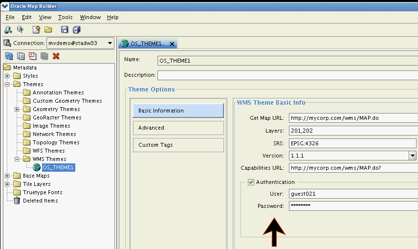

The map visualization component supports the rendering of data delivered using the Open GIS Consortium (OGC) Web Map Service (WMS) protocol, specifically the WMS 1.1.1 and 1.3.0 implementation specifications.

The map visualization component supports the GetMap, GetFeatureInfo, and GetCapabilities requests as defined in the OGC document 01-068r3 and 06-042.

The map visualization component does not currently support the optional Styled Layer Descriptor capability, and map visualization component will not function as a Cascading Map Server in this release.

- Setting Up the WMS Interface for the Map Visualization Component
  The map visualization component is preconfigured to run as a WMS service.
- WMS Specification and Corresponding Map Visualization Component Concepts
  This section describes the association between, or interpretation of, terms and concepts used in the WMS 1.1.1 and 1.3.0 specifications and the map visualization component.
- Adding a WMS Map Theme
  You can add a WMS map theme to the current map request. The WMS map theme is the result of a GetMap request, and it becomes an image layer in the set of layers (themes) rendered by the map visualization component.

### C.1 Setting Up the WMS Interface for the Map Visualization Component

The map visualization component is preconfigured to run as a WMS service.

Internally, the map visualization component translates all incoming WMS requests into proper XML requests to the map visualization component server. For example, the following HTTP request invokes the GetCapabilities service of a the map visualization component server:

    http://localhost:8888/mapviewer/wms?REQUEST=GetCapabilities&SERVICE=WMS&VERSION=1.1.1
    or
    http://localhost:8888/mapviewer/wms?REQUEST=GetCapabilities&SERVICE=WMS&VERSION=1.3.0

As shown in this example, the URL for the map visualization component WMS service is typically `http://``host:port``/mapviewer/wms?`, where `host` and `port` refer to the host and HTTP port of the map visualization component server. The context path `/mapviewer/wms` refers to the WMS interface of map visualization component.

**Note:**

All WMS requests must be on a single line, so ignore any line breaks that might appear in WMS request examples in this chapter.

- Preparing the Data Sources and Editing the wmsConfig.xml File
- Data Source Named wms
- SDO to EPSG SRID Mapping File

**Parent topic:** OGC WMS Support in the Map Visualization Component

#### C.1.1 Preparing the Data Sources and Editing the wmsConfig.xml File

For a data source to provide WMS services, you may first need to define themes and base maps, because they will become the actual service content that the map visualization server will be providing. You can use the [Oracle Map Builder Tool](oracle-map-builder-tool.md) to create the themes and base maps.

After creating themes and base maps, you can edit the `wmsConfig.xml file` in the `WEB-INF/conf/` folder, which is the same folder for the` mapViewerConfig.xml` file. For example, if data sources named `nedata` and `mvdemo` are allowed to provide WMS services, the `wmsConfig.xml` file may contain a section similar to the following:

    <?xml version="1.0" ?>
    <wms_config>
       . . . . . .
      <custom_parameters
                host="localhost" port="80" protocol="http"
                public_datasources="nedata, mvdemo">
        </custom_parameters>
       . . . . . .
    </wms_config>

For changes to the `wmsConfig.xml` file take effect, you must restart the map visualization server.

To test the server, you can send a getCapabilities request. For example:

    http://localhost:8080/mapviewer/wms?REQUEST=GetCapabilities&VERSION=1.3.0

**Parent topic:** Setting Up the WMS Interface for the Map Visualization Component

#### C.1.2 Data Source Named wms

You must define a map visualization component data source named `wms`, unless every incoming WMS request explicitly specifies a `datasource` CGI parameter. All requests that do not specify the `datasource` parameter are by default directed to the data source named `wms`. For example, the `GetCapabilities` request will by default list all the available themes that are in the `wms` data source. (To configure the information returned by a GetCapabilities request, see [Customizing WMS GetCapabilities Responses](introduction-to-map-visualization-component.md).)

**Parent topic:** Setting Up the WMS Interface for the Map Visualization Component

#### C.1.3 SDO to EPSG SRID Mapping File

By default, the map visualization component uses the Oracle Spatial and Graph (SDO) native SRID (spatial reference ID) values when such information is requested in a WMS request such as GetCapabilities. The EPSG SRID values, however, are more widely used in WMS applications. To have the map visualization component use EPSG SRID values when processing WMS requests and generating responses, specify a mapping file. This mapping file is a text file that tells the map visualization component which SDO SRID values map to which EPSG SRID values. (Each pair of matching SRID values refers to the same spatial reference system.)

The mapping file contains lines where each line defines one pair of equivalent SRID values in the following format:

`sdo_srid``=``epsg_srid`

For example, the following lines define SDO SRID 8307 as equivalent to EPSG SRID 4326, and SDO SRID 81922 as equivalent to EPSG SRID 20248:

    8307=4326
    81922=20248

After you have created an SDO to EPSG mapping file, you can save it on the server where the map visualization component is running, and specify its location in the map visualization component configuration file using the `<sdo_epsg_mapfile>` element in the `<wms_config>` element, as explained in [Customizing WMS GetCapabilities Responses](introduction-to-map-visualization-component.md).

**Parent topic:** Setting Up the WMS Interface for the Map Visualization Component

### C.2 WMS Specification and Corresponding Map Visualization Component Concepts

This section describes the association between, or interpretation of, terms and concepts used in the WMS 1.1.1 and 1.3.0 specifications and the map visualization component.

It also includes some parameters that are specific to the map visualization component but that are not in the WMS 1.1.1 and 1.3.0 specifications.

- Supported GetMap Request Parameters
- Supported GetCapabilities Request and Response Features
- Supported GetFeatureInfo Request and Response Features

**Parent topic:** OGC WMS Support in the Map Visualization Component

#### C.2.1 Supported GetMap Request Parameters

This section describes the supported GetMap request parameters and their interpretation by the map visualization component. (Parameters that are specific to the map visualization component and not mentioned in the WMS 1.1.1 and 1.3.0 specifications are labeled Map Visualization Component-Only.) The supported parameters are in alphabetical order, with each in a separate subsection. Example C-1 shows some GetMap requests. (Each URL should be entered as a single string.)

Example C-1 GetMap Requests

    http://localhost:8888/mapviewer/wms?REQUEST=GetMap&VERSION=1.1.1&FORMAT=image/gif&
    SERVICE=WMS&BBOX=-121,37,-119,35&SRS=EPSG:4326&LAYERS=theme_demo_states,theme_
    demo_counties,theme_demo_highways,theme_demo_cities&WIDTH=580&HEIGHT=500

    http://localhost:8888/mapviewer/wms?REQUEST=GetMap&VERSION=1.3.0&FORMAT=image/gif&
    SERVICE=WMS&BBOX=-121,37,-119,35&CRS=EPSG:4326&LAYERS=theme_demo_states,theme_
    demo_counties,theme_demo_highways,theme_demo_cities&WIDTH=580&HEIGHT=500

    http://localhost:8888/mapviewer/wms?request=GetMap&version=1.3.0&crs=none
    &bbox=-122,36,-121,37&width=600&height=400&format=image/png&layers=theme_us_
    states&mvthemes=<themes><theme%20name="theme_us_counties"/><theme%20name="theme_
    us_road1"/></themes>&legend_
    request=<legend%20bgstyle="fill:%23ffffff;stroke:%23ff0000"%20profile="medium"%20p
    osition="SOUTH_EAST"><column><entry%20style="v.rb1"%20tab="1"/></column></legend>&

The default data source for a GetMap request is `WMS`.

The following optional GetMap parameters are not supported in the current release of the map visualization component:

- `TIME` (time dimension)

- `ELEVATION` (elevation dimension)

- `SLD` and `WFS` URLs

The Map Visualization Component-Only parameters must contain valid XML fragments. Because these are supplied in an HTTP GET request, they must be appropriately encoded using a URL encoding mechanism. For example, replace each space ( ) with `%20` and each pound sign (#) with `%23`. The following example shows the use of such encoding:

    http://localhost:8888/mapviewer/wms?request=GetMap&version=1.1.1&srs=none&bbox=-12
    2,36,-121,37&width=600&height=400&format=image/png&layers=theme_us_
    states&mvthemes=<themes><theme%20name="theme_us_counties"/><theme%20name="theme_
    us_road1"/></themes>&legend_
    request=<legend%20bgstyle="fill:%23ffffff;stroke:%23ff0000"%20profile="medium"%20p
    osition="SOUTH_EAST"><column><entry%20style="v.rb1"%20tab="1"/></column></legend>&

- BASEMAP Parameter (Map Visualization Component-Only)
- BBOX Parameter
- BGCOLOR Parameter
- DATASOURCE Parameter (Map Visualization Component-Only)
- DYNAMIC_STYLES Parameter (Map Visualization Component-Only)
- EXCEPTIONS Parameter
- FORMAT Parameter
- HEIGHT Parameter
- LAYERS Parameter
- LEGEND_REQUEST Parameter (Map Visualization Component-Only)
- MVTHEMES Parameter (Map Visualization Component-Only)
- REQUEST Parameter
- SERVICE Parameter
- SRS (1.1.1) or CRS (1.3.0) Parameter
- STYLES Parameter
- TRANSPARENT Parameter
- VERSION Parameter
- WIDTH Parameter

**Parent topic:** WMS Specification and Corresponding Map Visualization Component Concepts

##### C.2.1.1 BASEMAP Parameter (Map Visualization Component-Only)

The `BASEMAP` parameter specifies a named base map for the specified (or default) data source. If you specify both the `BASEMAP` and `LAYERS` parameters, all themes specified in the `LAYERS` parameters are added to the base map. Therefore, if you just want to get a map using a named base map, specify the `BASEMAP` parameter but specify an empty `LAYERS` parameter, as in the following examples:

    REQUEST=GetMap&VERSION=1.1.1&BASEMAP=demo_map&LAYERS=&WIDTH=500&HEIGHT=560&SRS=SDO:8307&BBOX=-122,36,-120,38.5&FORMAT=image/png

    REQUEST=GetMap&VERSION=1.3.0&BASEMAP=demo_map&LAYERS=&WIDTH=500&HEIGHT=560&CRS=SDO:8307&BBOX=-122,36,-120,38.5&FORMAT=image/png

The base map name can also be part of the `LAYERS` parameter. In this case, the `BASEMAP` parameter does not need to be defined in the URL (see LAYERS Parameter for additional details).

**Parent topic:** Supported GetMap Request Parameters

##### C.2.1.2 BBOX Parameter

The `BBOX` parameter specifies the lower-left and upper-right coordinates of the bounding box for the data from the data source to be displayed. It has the format `BBOX=minX,minY,maxX,maxY`. For example: `BBOX=-122,36,-120,38.5`

**Parent topic:** Supported GetMap Request Parameters

##### C.2.1.3 BGCOLOR Parameter

The `BGCOLOR` parameter specifies background color for the map display using the RBG color value. It has the format `0xHHHHHH` (where each `H` is a hexadecimal value from 0 to F). For example: `BGCOLOR=0xF5F5DC` (beige).

**Parent topic:** Supported GetMap Request Parameters

##### C.2.1.4 DATASOURCE Parameter (Map Visualization Component-Only)

The `DATASOURCE` parameter specifies the name of the data source for the GetMap or GetFeatureInfo request. The default value is `WMS`. The specified data source must exist prior to the GetMap or GetFeatureInfo request. That is, it must have been created using the `<add_data_source>` MapViewer administrative request or defined in the map visualization component configuration file (`map visualization componentConfig.xml`).

**Parent topic:** Supported GetMap Request Parameters

##### C.2.1.5 DYNAMIC_STYLES Parameter (Map Visualization Component-Only)

The `DYNAMIC_STYLES` parameter specifies a `<styles>` element as part of the GetMap request..

**Parent topic:** Supported GetMap Request Parameters

##### C.2.1.6 EXCEPTIONS Parameter

For the `EXCEPTIONS` parameter, the only supported value is the default: `EXCEPTIONS=application/vnd.ogc.se_xml` for WMS 1.1.1 and `EXCEPTIONS=XML` for WMS 1.3.0. The exception is reported as an XML document conforming to the Service Exception DTD available at the following URLs:

[`http://schemas.opengis.net/wms/1.1.1/WMS_exception_1_1_1.dtd`](http://schemas.opengis.net/wms/1.1.1/WMS_exception_1_1_1.dtd)

[`http://schemas.opengis.net/wms/1.3.0/exceptions_1_3_0.xsd`](http://schemas.opengis.net/wms/1.3.0/exceptions_1_3_0.xsd)

The `application/vnd.ogc.se_inimage` (image overwritten with Exception message), and `application/vnd.ogc.se_blank` (blank image because Exception occurred) options are not supported.

**Parent topic:** Supported GetMap Request Parameters

##### C.2.1.7 FORMAT Parameter

The `FORMAT` parameter specifies the image format. The supported values are `image/gif`, `image/jpeg`, `image/png`, `image/png8`, and `image/svg+xml`.

The default value is `image/png`.

**Parent topic:** Supported GetMap Request Parameters

##### C.2.1.8 HEIGHT Parameter

The `HEIGHT` parameter specifies the height for the displayed map in pixels.

**Parent topic:** Supported GetMap Request Parameters

##### C.2.1.9 LAYERS Parameter

The `LAYERS` parameter specifies a comma-delimited list of predefined theme names to be used for the display. The specified values are considered to a be a case-sensitive, ordered, comma-delimited list of predefined theme names in a default data source (named `WMS`) or in a named data source specified by the parameter `DATASOURCE=<name>`. For example, `LAYERS=THEME_DEMO_STATES,theme_demo_counties,THEME_demo_HIGHWAYS` translates to the following `<themes>` element in a map visualization component map request:

    <themes>
    <theme name="THEME_DEMO_STATES"/>
    <theme name="theme_demo_counties"/>
    <theme name="THEME_demo_HIGHWAYS"/>
    </themes>

The base map name can also be part of the `LAYERS` list. The following example retrieves the image from a base map named DEMO_MAP:

    http://localhost:7001/mapviewer/wms?VERSION=1.1.1&REQUEST=GetMap&SRS=EPSG:4326&BBOX=-101.19489559164734,27.0,-78.80510440835268,37.0&WIDTH=965&HEIGHT=431&FORMAT=image/gif&BGCOLOR=0xA6CAF0&TRANSPARENT=TRUE&LAYERS=DEMO_MAP&STYLES=&EXCEPTIONS=application/vnd.ogc.se_xml&datasource=mvdemo

See also BASEMAP Parameter (Map Visualization Component-Only).

**Parent topic:** Supported GetMap Request Parameters

##### C.2.1.10 LEGEND_REQUEST Parameter (Map Visualization Component-Only)

The `LEGEND_REQUEST` parameter specifies a `<legend>` element as part of the GetMap request. For information about the `<legend>` element, see [Map Legend](map-visualization-concepts.md).

**Parent topic:** Supported GetMap Request Parameters

##### C.2.1.11 MVTHEMES Parameter (Map Visualization Component-Only)

The `MVTHEMES` parameter specifies a `<themes>` element as part of the GetMap request. The primary purpose for the `MVTHEMES` parameter is to support JDBC themes in a MapViewer request. The `MVTHEMES` parameter is not a substitute or synonym for the `LAYERS` parameter; you still must specify the `LAYERS` parameter.

**Parent topic:** Supported GetMap Request Parameters

##### C.2.1.12 REQUEST Parameter

The `REQUEST` parameter specifies the type of request. The value must be `GetMap`, `GetFeatureInfo`, or `GetCapabilities`.

**Parent topic:** Supported GetMap Request Parameters

##### C.2.1.13 SERVICE Parameter

The `SERVICE` parameter specifies the service name. The value must be `WMS`.

**Parent topic:** Supported GetMap Request Parameters

##### C.2.1.14 SRS (1.1.1) or CRS (1.3.0) Parameter

The `SRS` parameter (WMS 1.1.1) or the `CRS` parameter (WMS 1.3.0) specifies the spatial reference system (coordinate system) for the map visualization component to use. The value must be one of the following: `SDO:srid-value` (where `srid-value` is a numeric Oracle Spatial and Graph SRID value), `EPSG:4326` (equivalent to `SDO:8307`), or `none` (equivalent to `SDO:0`).

Except for `EPSG:4326` (the standard WGS 84 longitude/latitude coordinate system), EPSG numeric identifiers are not supported. The namespace `AUTO` ( WMS 1.1.1) or `AUTO2` (WMS 1.3.0), for projections that have an arbitrary center of projection, is not supported.

**Parent topic:** Supported GetMap Request Parameters

##### C.2.1.15 STYLES Parameter

The `STYLES` parameter is ignored. Instead, use the `LAYERS` parameter to specify predefined themes for the display.

**Parent topic:** Supported GetMap Request Parameters

##### C.2.1.16 TRANSPARENT Parameter

The `TRANSPARENT=TRUE` parameter (for a transparent image) is supported for PNG images, that is, with `FORMAT=image/png`, or `FORMAT=image/png8` for indexed (8-bit) PNG format. the map visualization component does not support transparent GIF (GIF89) images.

**Parent topic:** Supported GetMap Request Parameters

##### C.2.1.17 VERSION Parameter

The `VERSION` parameter specifies the WMS version number. The value must be `1.1.1` or `1.3.0`.

**Parent topic:** Supported GetMap Request Parameters

##### C.2.1.18 WIDTH Parameter

The `WIDTH` parameter specifies the width for the displayed map in pixels.

**Parent topic:** Supported GetMap Request Parameters

#### C.2.2 Supported GetCapabilities Request and Response Features

A WMS GetCapabilities request to the map visualization component should specify only the following parameters:

- `REQUEST=GetCapabilities`

- `VERSION=1.1.1` or `VERSION=1.3.0`

- `SERVICE=WMS`

For example:

    http://localhost:8888/mapviewer/wms?REQUEST=GetCapabilities&VERSION=1.1.1&SERVICE=WMS
    or
    http://localhost:8888/mapviewer/wms?REQUEST=GetCapabilities&VERSION=1.3.0&SERVICE=WMS

The response is an XML document conforming to the WMS Capabilities DTD available at the following, depending on the value of the `VERSION` parameter (1.1.1 or 1.3.0):

[`http://schemas.opengis.net/wms/1.1.1/WMS_MS_Capabilities.dtd`](http://schemas.opengis.net/wms/1.1.1/WMS_MS_Capabilities.dtd)

[`http://schemas.opengis.net/wms/1.3.0/capabilities_1_3_0.xsd`](http://schemas.opengis.net/wms/1.3.0/capabilities_1_3_0.xsd)

However, the current release of the map visualization component returns an XML document containing the `<Service>` and `<Capability>` elements with the following information:

- The `<Service>` element is mostly empty, with just the required value of `OGC:WMS` for the `<Service.Name>` element. Support for more informative service metadata is planned for a future release of the map visualization component.

- The \<`Capability>` element has `<Request>`, `<Exception>`, and `<Layer>` elements.

- The `<Request>` element contains the GetCapabilities and GetMap elements that describe the supported formats and URL for an HTTP GET or POST operation.

- The `<Exception>` element defines the exception format. The Service Exception XML is the only supported format in this release. The `<Exception>` element returns an XML document compliant with the Service Exception DTD, but it does not report exceptions as specified in the implementation specification. The current release simply uses the CDATA section of a `<ServiceException>` element to return the `OMSException` returned by the map visualization component server.

- The `<Layer>` element contains a nested set of `<Layer>` elements. The first (outermost) layer contains a name (`WMS`), a title (`Oracle WebMapServer Layers by data source`), and one `<Layer>` element for each defined data source. Each data source layer contains a `<Layer>` element for each defined base map and one entry for each valid theme (layer) not listed in any base map. Each base map layer contains a `<Layer>` element for each predefined theme in the base map.

  Themes that are defined in the USER_SDO_THEMES view, that have valid entries in the USER_SDO_GEOM_METADATA view for the base table and geometry column, and that are not used in any base map will be listed after the base maps for a data source. These themes will have no `<ScaleHint>` element. They will have their own `<LatLonBoundingBox>` and `<BoundingBox>` elements.

The Content-Type of the response is set to `application/vnd.ogc.wms_xml`, as required by the WMS implementation specification.

Because the list of layers is output by base map, a given layer or theme can appear multiple times in the GetCapabilities response. For example, the theme `THEME_DEMO_STATES`, which is part of the base maps named `DEMO_MAP` and `DENSITY_MAP`, appears twice in Example C-2, which is an excerpt (reformatted for readability) from a GetCapabilities response.

In Example C-2, the innermost layer describes the `IMAGE_LEVEL_2` theme. The `<ScaleHint>` element lists the `min_scale` and `max_scale` values, if any, for that theme in the base map definition. For example, the base map definition for `IMAGE_MAP` is as follows:

    SQL> select definition from user_sdo_maps where name='IMAGE_MAP';

    DEFINITION
    ------------------------------------------------------------------------
    <?xml version="1.0" standalone="yes"?>
    <map_definition>
      <theme name="IMAGE_LEVEL_2" min_scale="1000.0" max_scale="0.0"/>
      <theme name="IMAGE_LEVEL_8" min_scale="5000.0" max_scale="1000.0"/>
      <theme name="MA_ROAD3"/>
      <theme name="MA_ROAD2"/>
      <theme name="MA_ROAD1"/>
      <theme name="MA_ROAD0"/>
    </map_definition>

In the innermost layer, the `<SRS>` and `<BoundingBox>` elements identify the SRID and the DIMINFO information for that theme's base table, as shown in the following Spatial and Graph metadata query:

    SQL> select srid, diminfo from user_sdo_geom_metadata, user_sdo_themes
      2  where name='IMAGE_LEVEL_2' and
      3  base_table=table_name and
      4  geometry_column=column_name ;

          SRID
    ----------
    DIMINFO(SDO_DIMNAME, SDO_LB, SDO_UB, SDO_TOLERANCE)
    --------------------------------------------------------------------------------
         41052
    SDO_DIM_ARRAY(SDO_DIM_ELEMENT('X', 200000, 500000, .5), SDO_DIM_ELEMENT('Y', 750
    000, 950000, .5))

In Example C-2, the `<Layer>` element for a base map has an `<SRS>` element and a `<LatLonBoundingBox>` element. The `<SRS>` element is empty if all layers in the base map definition do not have the same SRID value specified in the USER_SDO_GEOM_METADATA view. If they all have the same SRID value (for example, 41052), the SRS element contains that value (for example, `SDO:41052`). The required `<LatLonBoundingBox>` element currently has default values (`-180,-90,180,90`). When this feature is supported by map visualization component, this element will actually be the bounds specified in the DIMINFO column of the USER_SDO_GEOM_METADATA view for that layer, converted to geodetic coordinates if necessary and possible.

All layers are currently considered to be opaque and queryable. That is, all layers are assumed to be vector layers, and not GeoRaster, logical network, or image layers.

Example C-2 GetCapabilities Response (Excerpt)

    <Title>Oracle WebMapServer Layers by data source</Title>
    <Layer>
     <Name>mvdemo</Name>
     <Title>Datasource mvdemo</Title>
       <Layer>
         <Name>DEMO_MAP</Name>
         <Title>Basemap DEMO_MAP</Title>
         <SRS>SDO:8307</SRS>
         <LatLonBoundingBox>-180,-90,180,90</LatLonBoundingBox>
    . . .
       <Layer>
         <Name>DENSITY_MAP</Name>
         <Title>Basemap DENSITY_MAP</Title>
         <SRS>SDO:8307</SRS>
         <LatLonBoundingBox>-180,-90,180,90</LatLonBoundingBox>
           <Layer>
             <Name>THEME_DEMO_STATES</Name>
             <Title>THEME_DEMO_STATES</Title>
             <SRS>SDO:8307</SRS>
             <BoundingBox SRS="SDO:8307" minx="-180" miny="-90" maxx="180"
                          maxy="90" resx="0.5" resy="0.5"/>
             <ScaleHint min="50.0" max="4.0"/>
           </Layer>
    . . .
       </Layer>
       <Layer>
         <Name>IMAGE_MAP</Name>
         <Title>Basemap IMAGE_MAP</Title>
         <SRS>SDO:41052</SRS>
         <LatLonBoundingBox>-180,-90,180,90</ LatLonBoundingBox>
           <Layer>
             <Name>IMAGE_LEVEL_2</Name>
             <Title>IMAGE_LEVEL_2</Title>
             <SRS>SDO:41052</SRS>
             <BoundingBox SRS="SDO:41052" minx="200000" miny="500000" maxx="750000"
                        maxy="950000" resx="0.5" resy="0.5"/>
             <ScaleHint min="1000.0" max="0.0"/>
           </Layer>
    . . .
       </Layer>

**Parent topic:** WMS Specification and Corresponding Map Visualization Component Concepts

#### C.2.3 Supported GetFeatureInfo Request and Response Features

This section describes the supported GetFeatureInfo request parameters and their interpretation by the map visualization component. Example C-3 shows some GetFeatureInfo requests.

The response is an XML document and the Content-Type of the response is `text/xml`. Example C-4 is a response to a GetFeatureInfo request in Example C-3.

Most of the following sections describe parameters supported for a GetFeatureInfo request. (Parameters that are specific to MapViewer and not mentioned in the WMS 1.1.1 specification are labeled Map Visualization Component-Only.) Specifying Attributes to Be Queried for a GetFeatureInfo Request explains how to query attributes in a GetFeatureInfo request.

Example C-3 GetFeatureInfo Request

    http://localhost:8888/mapviewer/wms?REQUEST=GetFeatureInfo&VERSION=1.1.1&BBOX=0,-0
    .0020,0.0040&SRS=EPSG:4326&LAYERS=cite:Lakes,cite:Forests&WIDTH=200&HEIGHT=100&INF
    O_FORMAT=text/xml&QUERY_LAYERS=cite:Lakes,cite:Forests&X=60&Y=60

    http://localhost:8888/mapviewer/wms?REQUEST=GetFeatureInfo&VERSION=1.3.0
    &BBOX=0,-0.0020,0.0040&CRS=EPSG:4326&LAYERS=cite:Lakes,cite:Forests&WIDTH=200&HEIGHT=100
    &INFO_FORMAT=text/xml&QUERY_LAYERS=cite:Lakes,cite:Forests&I=60&J=60

Example C-4 GetFeatureInfo Response

    <?xml version="1.0" encoding="UTF-8" ?>
    <GetFeatureInfo_Result>
      <ROWSET name="cite:Lakes">
        <ROW num="1">
          <ROWID>AAAK22AAGAAACUiAAA</ROWID>
        </ROW>
      </ROWSET>
      <ROWSET name="cite:Forests">
        <ROW num="1">
          <FEATUREID>109</FEATUREID>
        </ROW>
      </ROWSET>
    </GetFeatureInfo_Result>

- GetMap Parameter Subset for GetFeatureInfo Requests
- EXCEPTIONS Parameter
- FEATURE_COUNT Parameter
- INFO_FORMAT Parameter
- QUERY_LAYERS Parameter
- QUERY_TYPE Parameter (Map Visualization Component-Only)
- RADIUS Parameter (Map Visualization Component-Only)
- UNIT Parameter (Map Visualization Component-Only)
- X and Y or I and J Parameters
- Specifying Attributes to Be Queried for a GetFeatureInfo Request

**Parent topic:** WMS Specification and Corresponding Map Visualization Component Concepts

##### C.2.3.1 GetMap Parameter Subset for GetFeatureInfo Requests

A GetFeatureInfo request contains a subset of a GetMap request (`BBOX`, `SRS `\[1.1.1\] or `CRS` \[1.3.0\], `WIDTH`, `HEIGHT`, and optionally `LAYERS` parameters). These parameters are used to convert the X, Y (1.1.1) or I, J (1.3.0) point from screen coordinates to a point in the coordinate system for the layers being queried. It is assumed all layers are in the same coordinate system, the one specified by the `SRS` parameter.

**Parent topic:** Supported GetFeatureInfo Request and Response Features

##### C.2.3.2 EXCEPTIONS Parameter

The only supported value for the `EXCEPTIONS` parameter is the default: `application/vnd.ogc.se_xml` for WMS 1.1.1 or `xml` for WMS 1.3.0. That is, only Service Exception XML is supported. The exception is reported as an XML document conforming to the Service Exception DTD available at the following, depending on the version (1.1.1 or 1.3.0):

[`http://schemas.opengis.net/wms/1.1.1/WMS_exception_1_1_1.dtd`](http://schemas.opengis.net/wms/1.1.1/WMS_exception_1_1_1.dtd)

[`http://schemas.opengis.net/wms/1.3.0/exceptions_1_3_0.xsd`](http://schemas.opengis.net/wms/1.3.0/exceptions_1_3_0.xsd)

**Parent topic:** Supported GetFeatureInfo Request and Response Features

##### C.2.3.3 FEATURE_COUNT Parameter

The `FEATURE_COUNT` parameter specifies the maximum number of features in the result set. The default value is 1. If more features than the parameter's value interact with the query point (X, Y), then an arbitrary subset (of the size of the parameter's value) of the features is returned in the result set. That is, a GetFeatureInfo call translates into a query of the following general form:

    SELECT <info_columns> FROM <layer_table>
      WHERE SDO_RELATE(<geom_column>,
        <query_point>, 'mask=ANYINTERACT')='TRUE'
      AND ROWNUM <= FEATURE_COUNT;

**Parent topic:** Supported GetFeatureInfo Request and Response Features

##### C.2.3.4 INFO_FORMAT Parameter

The value of the `INFO_FORMAT` parameter is always `text/xml`.

**Parent topic:** Supported GetFeatureInfo Request and Response Features

##### C.2.3.5 QUERY_LAYERS Parameter

The `QUERY_LAYERS` parameter specifies a comma-delimited list of layers to be queried. If the `LAYERS` parameter is specified, the `QUERY_LAYERS` specification must be a subset of the list specified in the `LAYERS` parameter.

If the `QUERY_LAYERS` parameter is specified, any `BASEMAP` parameter value is ignored.

**Parent topic:** Supported GetFeatureInfo Request and Response Features

##### C.2.3.6 QUERY_TYPE Parameter (Map Visualization Component-Only)

The `QUERY_TYPE` parameter limits the result set to a subset of possibly qualifying features by specifying one of the following values:

- `at_point`: returns only the feature at the specified point.

- `nn`: returns only the nearest neighbor features, with the number of results depending on the value of the `FEATURE_COUNT` parameter value (see FEATURE_COUNT Parameter). The result set is not ordered by distance.

- `within_radius` (or `within_distance`, which is a synonym): returns only results within the distance specified by the `RADIUS` parameter value (see RADIUS Parameter (Map Visualization Component-Only)), up to the number matching the value of the `FEATURE_COUNT` parameter value (see FEATURE_COUNT Parameter). The result set is an arbitrary subset of the answer set of potential features within the specified radius. The result set is not ordered by distance.

**Parent topic:** Supported GetFeatureInfo Request and Response Features

##### C.2.3.7 RADIUS Parameter (Map Visualization Component-Only)

The `RADIUS` parameter specifies the radius of the circular search area for a query in which the `QUERY_TYPE` parameter value is `within_radius` (see QUERY_TYPE Parameter (Map Visualization Component-Only)). If you specify the `RADIUS` parameter, you must also specify the `UNIT` parameter (see UNIT Parameter (Map Visualization Component-Only)).

**Parent topic:** Supported GetFeatureInfo Request and Response Features

##### C.2.3.8 UNIT Parameter (Map Visualization Component-Only)

The `UNIT` parameter specifies the unit of measurement for the radius of the circular search area for a query in which the `QUERY_TYPE` parameter value is `within_radius` (see QUERY_TYPE Parameter (Map Visualization Component-Only)). The value must be a valid linear measure value from the SHORT_NAME column of the SDO_UNITS_OF_MEASURE table, for example: `meter`, `km`, or `mile`.

If you specify the `UNIT` parameter, you must also specify the `RADIUS` parameter (see RADIUS Parameter (Map Visualization Component-Only)).

**Parent topic:** Supported GetFeatureInfo Request and Response Features

##### C.2.3.9 X and Y or I and J Parameters

The `X` and `Y` (WMS 1.1.1) or `I` and `J` (WMS 1.3.0) parameters specify the x-axis and y-axis coordinate values (in pixels), respectively, of the query point.

**Parent topic:** Supported GetFeatureInfo Request and Response Features

##### C.2.3.10 Specifying Attributes to Be Queried for a GetFeatureInfo Request

In a GetFeatureInfo request, the styling rule for each queryable layer (theme) must contain a `<hidden_info>` element that specifies which attributes are queried and returned in the XML response. The `<hidden_info>` element is the same as the one used for determining the attributes returned in an SVG map request.

An example of such a styling rule as follows:

    SQL> select styling_rules from user_sdo_themes where name='cite:Forests';

    STYLING_RULES
    --------------------------------------------------------------------------------
    <?xml version="1.0" standalone="yes"?>
    <styling_rules>
      <hidden_info>
              <field column="FID" name="FeatureId"/>
           </hidden_info>
      <rule>
        <features style="C.PARK FOREST">  </features>
        <label column="NAME" style="T.PARK NAME"> 1 </label>
      </rule>
    </styling_rules>

This styling rule specifies that if `cite:Forests` is one of the `QUERY_LAYERS` parameter values in a GetFeatureInfo request, the column named FID is queried, and its tag in the response document will be `<FEATUREID>`. The tag is always in uppercase. If no `<hidden_info>` element is specified in the styling rules for the theme's query layer, then the rowid is returned. In Example C-4, the styling rule for the `cite:Lakes` layer has no `<hidden_info>` element; therefore, the default attribute ROWID is returned in the XML response. The `cite:Forests` layer, however, does have a `<hidden_info>` element, which specifies that the attribute column is FID, and that its tag name, in the response document, should be `<FEATUREID>`.

**Parent topic:** Supported GetFeatureInfo Request and Response Features

### C.3 Adding a WMS Map Theme

You can add a WMS map theme to the current map request. The WMS map theme is the result of a GetMap request, and it becomes an image layer in the set of layers (themes) rendered by the map visualization component.

To add a WMS map theme, use the WMS-specific features of the XML API (see XML API for Adding a WMS Map Theme).

- XML API for Adding a WMS Map Theme
- Predefined WMS Map Theme Definition
- Authentication with WMS Map Themes
- Customizing GetCapabilities Responses: Additional Options

**Parent topic:** OGC WMS Support in the Map Visualization Component

#### C.3.1 XML API for Adding a WMS Map Theme

To add a WMS map theme to the current map request using the map visualization component XML API, use the `<wms_getmap_request>` element in a `<theme>` element.

For better performance, the `<wms_getmap_request>` element should be used only to request a map image from a Web Map Server (WMS) implementation. That is, the `<service_url>` element in a `<wms_getmap_request>` element should specify a WMS implementation, not a map visualization component instance. If you want to specify a map visualization component instance (for example, specifying `<service_url>` with a value of `http://mapviewer.mycorp.com:8888/mapviewer/wms`), consider using a MapViewer predefined theme or a JDBC theme in the `<themes>` element instead of using a `<wms_getmap_request>` element.

The following example shows the general format of the `<wms_getmap_request>` element within a `<theme>` element, and it includes some sample element values and descriptive comments:

    <themes>
      <theme>
         <wms_getmap_request isBackgroundTheme="true">
               <!-- The wms_getmap_request theme is rendered in the order it
                     appears in the theme list unless isBackgroundTheme is "true".
               -->
              <service_url> http://wms.mapsrus.com/mapserver </service_url>
              <version> 1.1.1 </version>
                <!-- version is optional. Default value is "1.1.1".
                -->
              <layers> Administrative+Boundaries,Topography,Hydrography </layers>
               <!— layers is a comma-delimited list of names.
                  If layer names contain spaces, use '+' instead of a space -->
               <!— styles is optional. It is a comma-delimited list, and it must
                  have the same number of  names as the layer list, if specified.
                  If style names contain spaces, use '+' instead of a space -->
              <styles/>
              <srs> EPSG:4326 </srs>
              <format> image/png </format>
              <transparent> true </transparent>
              <bgcolor> 0xffffff </bgcolor>
              <exceptions> application/vnd.ogc.se_inimage </exceptions>
              <vendor_specific_parameters>
                   <!-- one or more <vsp> elements each containing
                         a <name> <value> pair  -->
                   <vsp>
                        <name> datasource </name>
                        <value> mvdemo </value>
                     </vsp>
              <vendor_specific_parameters>
         <wms_getmap_request>
      </theme>
    </themes>

The following attribute and elements are available with the `<wms_getmap_request>` element:

- The `isBackgroundTheme` attribute specifies whether or not this theme should be rendered before the vector layers. The default value is `false`.

- The `<service_url>` element specifies the URL (without the service parameters) for the WMS service. Example: `http://my.webmapserver.com/wms`

- The `<version>` element specifies the WMS version number. The value must be one of the following: `1.0.0`, `1.1.0`, `1.1.1` (the default), or `1.3.0`.

- The `<layers>` element specifies a comma-delimited list of layer names to be included in the map request.

- The `<styles>` element specifies a comma-delimited list of style names to be applied to the layer names in `layers`.

- The `<srs>` element specifies the coordinate system (spatial reference system) name. The default value is `EPSG:4326`.

- The `<format>` element specifies the format for the resulting map image. The default value is `image/png`.

- The `<transparent>` element specifies whether or not the layer or layers being added should be transparent in the resulting map image. The default value is `false`. To make the layer or layers transparent, specify `true`.

- The `<bgcolor>` element specifies the RGB value for the map background color. Use hexadecimal notation for the value, for example, `0xAE75B1`. The default value is `0xFFFFFF` (that is, white).

- The `<exceptions>` element specifies the format for server exceptions. The default value is `application/vnd.ogc.se_inimage`.

- The `<vendor_specific_parameters>` element contains one or more `<vsp>` elements, each of which contains a `<name>` element specifying the parameter name and a `<value>` element specifying the parameter value.

Example C-5 shows the `<wms_getmap_request>` element in a map request.

Example C-5 Adding a WMS Map Theme (XML API)

    <?xml version="1.0" standalone="yes"?>
    <map_request
      title="Raster WMS Theme and Vector Data"
      datasource="mvdemo" srid="0"
      width="500"
      height="375"
      bgcolor="#a6caf0"
      antialiase="true"
      mapfilename="wms_georaster" format="PNG_URL">
      

        <geoFeature>
          <geometricProperty typeName="center">
            <Point>
              <coordinates>596082.0,8881079.0</coordinates>
            </Point>
          </geometricProperty>
        </geoFeature>
      

      <themes>
        <theme name="WMS_TOPOGRAPHY" user_clickable="false"  >
           <wms_getmap_request isBackgroundTheme="true">
             <service_url> http://wms.mapservers.com:8888/mapserver/wms </service_url>
             <layers> TOPOGRAPHY </layers>
             <srs> EPSG:29190 </srs>
             <format> image/png </format>
             <bgcolor> 0xa6caf0 </bgcolor>
             <transparent> true </transparent>
             <vendor_specific_parameters>
               <vsp>
                  <name> ServiceType </name>
                  <value> mapserver </value>
               </vsp>
             </vendor_specific_parameters>
           </wms_getmap_request>
        </theme>
        <theme name="cl_theme" user_clickable="false">
           <jdbc_query  spatial_column="geom" render_style="ltblue"
             jdbc_srid="82279" datasource="mvdemo"
             asis="false">select geom from classes where vegetation_type = 'forests'
           </jdbc_query>
         </theme>
      </themes>
      <styles>
        
      </styles>
    </map_request>

**Parent topic:** Adding a WMS Map Theme

#### C.3.2 Predefined WMS Map Theme Definition

The predefined XML definition for a WMS theme uses the same structure of the parameters in XML API for Adding a WMS Map Theme, and adds the optional `capabilities_url` attribute, which is used by Map Builder when editing a WMS theme. If the `capabilities_url` attribute is defined, Map Builder will issue a `GetCapabilities` request to populate some UI elements in the editor page.

Example C-6 shows how to create a predefined WMS theme in the metadata. The base table and base column names can be any values, and in this example `'WMS'` is used for both.

Example C-6 Creating a Predefined WMS Theme

    INSERT INTO user_sdo_themes  VALUES (
      'PRED_WMS_THEME',
      'WMS data',
      'WMS',
      'WMS',   '<?xml version="1.0" standalone="yes"?>
       <styling_rules theme_type="wms">
         <service_url> http://sampleserver1b.arcgisonline.com/arcgis/services/Specialty/ESRI_StateCityHighway_USA/MapServer/WMSServer </service_url>
         <layers> 0,1,2 </layers>
         <version> 1.3.0 </version>
         <srs> CRS:84 </srs>
         <format> image/png </format>
         <bgcolor> 0xA6CAF0 </bgcolor>
         <transparent> false </transparent>
         <styles> +,+,+ </styles>
         <exceptions> xml </exceptions>
         <capabilities_url> http://sampleserver1.arcgisonline.com/ArcGIS/services/Specialty/ESRI_StateCityHighway_USA/MapServer/WMSServer? </capabilities_url>
       </styling_rules>');

**Parent topic:** Adding a WMS Map Theme

#### C.3.3 Authentication with WMS Map Themes

For a WMS server that requires authentication for access to the WMS data, the following must be included in the theme definition:

- `<user>` element specifying the user name

- `<password>` element specifying the user password

  If you use the Map Builder tool to create a WMS map theme, the password value will be automatically encrypted. Figure C-1 shows the use of the Map Builder tool to create a WMS theme with authentication information. In this figure, the Authentication option is checked (enabled), and User and Password are specified.

  Figure C-1 Using Map Builder to Specify Authentication with a WMS Theme

  
  [Description of "Figure C-1 Using Map Builder to Specify Authentication with a WMS Theme"](img_text/wms_auth.md)

Example C-7 shows how to create a WMS theme that includes authentication information.

Example C-7 WMS Theme with Authentication Specified

    <?xml version="1.0" standalone="yes"?>
    <styling_rules theme_type="wms">
        <service_url> http://localhost:7001/mapviewer/wms </service_url>
        <user> wmsuser </user>
        <password> ******* </password>
        <layers> THEME_DEMO_STATES </layers>
        <version> 1.1.1 </version>
        <srs> EPSG:4326 </srs>
        <format> image/png </format>
        <bgcolor> 0xA6CAF0 </bgcolor>
        <transparent> true </transparent>
        <exceptions> application/vnd.ogc.se_xml </exceptions>
        <vendor_specific_parameters>
            <vsp>
                <name> datasource </name>
                <value> mvdemo </value>
        </vsp>
      </vendor_specific_parameters>
        <capabilities_url> http://localhost:7001/mapviewer/wms? </capabilities_url>
    </styling_rules>

**Parent topic:** Adding a WMS Map Theme

#### C.3.4 Customizing GetCapabilities Responses: Additional Options

The main map visualization component configuration file has a section to customize some information for GetCapabilities responses (see [Customizing WMS GetCapabilities Responses](introduction-to-map-visualization-component.md)). However only a limited number of properties that can be defined in that main map visualization component configuration file, and no customization can be done for several attributes that a layer can have in GetCapabilities response.

Effective with Release 12.1.3, a WMS configuration file (`wmsConfig.xml`) has been added to the map visualization component. Any settings defined in this WMS configuration file will override similar WMS settings defined in the main map visualization component configuration file.

The `wmsConfig.xml` can include the following.

- Custom WMS Capabilities Parameters (\<custom_parameters\> Element)
- Custom WMS Capabilities Service Attributes (\<service_attributes\> Element)
- Custom WMS Layer Attributes (\<layer_attributes\> Element)
- Custom WMS Feature Information (\<get_feature_info\> Element)

**Parent topic:** Adding a WMS Map Theme

##### C.3.4.1 Custom WMS Capabilities Parameters (\<custom_parameters\> Element)

The following attributes are available with the `<custom_parameters>` element:

- The `host` attribute specifies the host part of the service request URL that the client should use for future WMS requests made to this map visualization component server.

- The `port` attribute specifies the port part of the service request URL that the client should use for future WMS requests made to this map visualization component server.

- The `protocol` attribute specifies the protocol part of the service request URL that the client should use for future WMS requests made to this map visualization component server.

- The `default_datasource` attribute specifies the base data source to be used for retrieving the capabilities response. If this attribute is not defined, the data source `WMS` is used, and that data source must exist in this map visualization component server.

- The `public_datasources` attribute specifies which data source contents are to be listed in the getCapabilities response. If this attribute is not defined, all data source contents that exist in server will be listed.

- The `use_text_xml` attribute by default uses standard `text/xml` even for getCapabilities. If this attribute is set to `false`, then the OGC 1.1.1 specification is used (for example, `application/vnd.ogc.wms_xml`).

For example:

    <custom_parameters
            host="www.my_corp.com" port="80" protocol="http"
            default_datasource="mvdemo"
            public_datasources="mvdemo, wms">
    </custom_parameters>

**Parent topic:** Customizing GetCapabilities Responses: Additional Options

##### C.3.4.2 Custom WMS Capabilities Service Attributes (\<service_attributes\> Element)

The \<service attributes\> element overrides any of these values defined in main map visualization component configuration file. For example:

    <service_attributes>
     <title>
         WMS interface provided by OracleFMW MapViewer
     </title>
     <abstract>
         This WMS service is for demonstration.
     </abstract>
     <keyword_list>
        <keyword>Oracle</keyword>
        <keyword>MapViewer</keyword>
        <keyword>Spatial and Graph</keyword>
     </keyword_list>
     <online_resource>
         http://localhost:7001/mapviewer/wms
     </online_resource>
     <contact_information>
        <ContactPersonPrimary>
           <ContactPerson>John Doe</ContactPerson>
           <ContactOrganization>My Corp.</ContactOrganization>
        </ContactPersonPrimary>
        <ContactPosition>Sr. Manager</ContactPosition>
        <ContactAddress>
           <AddressType>US Street</AddressType>
           <Address>1 MyCorp drv</Address>
           <City>Nashua</City>
           <StateOrProvince>NH</StateOrProvince>
           <PostCode>03062</PostCode>
           <Country>USA</Country>
        </ContactAddress>
        <ContactVoiceTelephone>18001122333</ContactVoiceTelephone>
        <ContactFacsimileTelephone></ContactFacsimileTelephone>
        <ContactElectronicMailAddress>jdoe@my_corp.com</ContactElectronicMailAddress>
     </contact_information>
     <Fees>None</Fees>
     <AccessConstraints>None whatsoever</AccessConstraints>
    </service_attributes>

**Parent topic:** Customizing GetCapabilities Responses: Additional Options

##### C.3.4.3 Custom WMS Layer Attributes (\<layer_attributes\> Element)

The WMS OGC specification defines several attributes for Layers. The layer attribute list includes abstract, keyword list, SRS list, style, attribution, and others.

The `<layer_attributes>` element lets you define custom attributes for map visualization component metadata (base maps and themes). WMS Layers are associated with map visualization component themes and base maps. All Layer attributes are optional, and if defined they will complement the GetCapabilities response.

Example C-8 shows a `<layer_attributes>` element with custom parameters for a base map and for a theme. In this example, for the base map DEMO_MAP the custom element `<abstract>` is defined, while for the theme THEME_DEMO_STATES the custom elements `<abstract>`, `<keywordlist>`, `<srs>`, and `
       ...

        </metadata>
      </datasource>
    </layer_attributes>

Example C-9 GetCapabilities Response with Custom Attributes

    <Layer>
      <Name>DEMO_MAP</Name>
      <Title>Basemap DEMO_MAP</Title>
      <Abstract>Collection of US States</Abstract>
      <SRS>EPSG:4326</SRS>
      <LatLonBoundingBox maxy="90.0" maxx="180.0" miny="-90.0" minx="-180.0"/>
      <Layer fixedHeight="400" fixedWidth="500" noSubsets="0" opaque="1" cascaded="0" queryable="1">
        <Name>THEME_DEMO_STATES</Name>
        <Title>THEME_DEMO_STATES</Title>
        <Abstract>US States</Abstract>
        <KeywordList>
          <Keyword>keyword1</Keyword>
          <Keyword>keyword2</Keyword>
          <Keyword>keyword3</Keyword>
        </KeywordList>
        <SRS>EPSG:4326</SRS>
        <SRS>EPSG:4203</SRS>
        <SRS>EPSG:20248</SRS>
        <BoundingBox resy="5.0E-8" resx="5.0E-8" maxy="71.33268128071118" maxx="180.0" miny="-14.605189123107024" minx="-180.0" SRS="EPSG:4326"/>
        <BoundingBox resy="5.0E-8" resx="5.0E-8" maxy="2.06926736125942E7" maxx="5.5812377162013E7" miny="-1.54158038049741E9" minx="-5.74425799715062E8" SRS="EPSG:4203"/>
        <BoundingBox resy="5.0E-8" resx="5.0E-8" maxy="2.06929693795843E7" maxx="6.15958436393193E7" miny="-1.74609707025816E9" minx="-6.32398501646291E8" SRS="EPSG:20248"/>
        
        <ScaleHint max="1.5E8" min="0.0"/>
      </Layer>
    ...
    </Layer>

**Parent topic:** Customizing GetCapabilities Responses: Additional Options

##### C.3.4.4 Custom WMS Feature Information (\<get_feature_info\> Element)

The following attributes, available with the `<get_feature_info>` element, can be used define the default radius (value and unit) for predefined map visualization component themes:

- The `name` attribute specifies the name of the predefined theme.

- The `datasource` attribute specifies map visualization component data source.

- The `radius` attribute specifies the default radius value for theme to be used in `within_radius` GetFeatureInfo requests when the `radius` parameter is not defined.

- The `unit` attribute specifies default radius unit (default is `m` for meters).

For example:

    <get_feature_info>
      <theme name="theme_demo_states" datasource="mvdemo" radius="500" unit="km" />
    </get_feature_info>

**Parent topic:** Customizing GetCapabilities Responses: Additional Options
