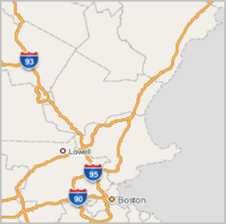
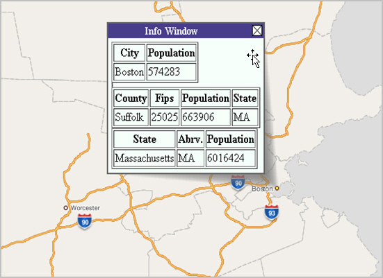
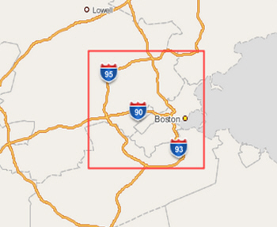

The map visualization component supports the rendering of data delivered using the Open GIS Consortium (OGC) Web Map Tile Service (WMTS) protocol, specifically the WMS 1.0.0 implementation specifications

The map visualization component supports the GetCapabilities, GetTile, and GetFeatureInfo requests as defined in the OGC document 07-057r7.

- WMTS Service for MapViewer
  A Web Map Tile Service (WMTS) service in MapViewer is provided through its WMTS server, which is built on MapViewer's map cache server.
- WMTS Operations
  MapViewer supports the GetCapabilities, GetTile, and GetFeatureInfo operations specified in the OGC WMTS 1.0.0 standard.
- Preparing the WMTS Service for MapViewer
  To prepare for using the WMTS Service for MapViewer, follow these major steps:

### D.1 WMTS Service for MapViewer

A Web Map Tile Service (WMTS) service in MapViewer is provided through its WMTS server, which is built on MapViewer's map cache server.

That is, this WMTS server delegates a client's WMTS request to MapViewer's map cache server. The OGC operations GetCapabilities, GetTile, and GetFeatureInfo are supported. Two kinds of encoding, KVP and REST, are supported for GetCapabilities and GetTile operations, but for GetFeatureInfo operations only KVP encoding is supported. For a GetFeatureInfo request, the response is encoded in one of the three formats (specified with the `infoformat` attribute): text/xml, text/html, and application/json.

In general, all map cache tile layers in MapViewer can be accessed through its WMTS service. You can customize each map cache tile layer's accessibility by editing a WMTS service policy file, `wmtsConfig.xml,` stored in the same folder as the `mapViewerConfig.xml` file. In WMTS service policy file, you can limit MapViewer's WMTS service by only publishing a subset of all map cache tile layers in MapViewer server (see [Customizing WMTS GetCapabilities Responses](introduction-to-map-visualization-component.md) for details).

Example D-1 and Example D-2 show how to publish a tile layer to MapViewer's WMTS server using a policy file. The first example shows the policy file that specifies a tile layer, and the second shows the tile layer definition.

- Example D-1 is a WMTS policy file. In this file, only one map cache tile layer named TEST_TL in data source MVDEMO is published to MapViewer's WMTS service. This policy file may also contain service provider related information.

- Example D-2 is the map tile layer definition for the TEST_TL tile layer in the schema for data source MVDEMO.

Regardless of whether there are additional data sources in the MapViewer server, or additional map cache tile layers in the specified data source, if the policy file is specified as in Example D-1, the only published WMTS layer is map cache tile layer TEST_TL in data source MVDEMO (shown in Example D-2).

Example D-1 WMTS Policy File (wmtConfig.xml)

    <wmts_config>
         <public_datasources>
            <public_datasource name="MVDEMO">
              <tile_layers>
                <tile_layer name="TEST_TL"/>
               </tile_layers>
            </public_datasource>
         </public_datasources>
       <ServiceAttributes>
        <ServiceIdentification>
                <Title>Web Map Tile Service by myCorp</Title>
                <Abstract> U.S. maps for state and county boundaries, highway networks, and big cities.</Abstract>
                <Keywords>
                  <Keyword>Maps</Keyword>
                  <Keyword>U.S. State, County Boundaries</Keyword>
                  <Keyword>U.S. Interstate Highways</Keyword>
                  <Keyword>U.S. Cities</Keyword>
                </Keywords>
                <Fees>none</Fees>
                <AccessConstraints>none</AccessConstraints>
        </ServiceIdentification>
        <ServiceProvider>
          <ProviderName>provider's name</ProviderName>
            <ProviderSite url="http://www.myCorp.com/mySite"/>
            <ServiceContact>
              <IndividualName>my name</IndividualName>
              <PositionName>technical support specialist</PositionName>
              <ContactInfo>
                <Phone>
                  <Voice>+1 800 321 1234</Voice>
                  <Facsimile>+1 800 321 1235</Facsimile>
                </Phone>
                <Address>
                  <DeliveryPoint>123 My Street</DeliveryPoint>
                  <City>Nashua</City>
                  <AdministrativeArea>New Hampshire</AdministrativeArea>
                  <PostalCode>12345-4321</PostalCode>
                  <Country>U.S.</Country>
                  <ElectronicMailAddress>myname@mycompany.com</ElectronicMailAddress>
                </Address>
              </ContactInfo>
          </ServiceContact>
        </ServiceProvider>
      </ServiceAttributes>
    </wmts_config>

Example D-2 Tile Layer Definition in the Data Source

    SQL> select definition from  user_sdo_cached_maps where name='TEST_TL';

    DEFINITION
    --------------------------------------------------------------------------------
    <map_tile_layer name="TEST_TL" image_format="PNG" http_header_expires="168.0" concurrent_fetching_threads="3">
       <internal_map_source base_map="DEMO_MAP" data_source="MVDEMO"/>
       <coordinate_system srid="8307" minX="-180" maxX="180" minY="-90" maxY="90"/>
       <tile_image width="256" height="256"/>
       <tile_dpi value="90.7142857"/>
       <tile_meters_per_unit value="111319.49079327358"/>
       <zoom_levels levels="19" min_scale="2132.729583849784" max_scale="559082264.0287178">
          <zoom_level tile_width="360.0000" tile_height="360.0000" scale="5.590822640287178E8"/>
          <zoom_level tile_width="180.0000" tile_height="180.0000" scale="2.795411320143589E8"/>
          <zoom_level tile_width="90.0000" tile_height="90.00000" scale="1.3977056600717944E8"/>
          <zoom_level tile_width="45.0000" tile_height="45.00000" scale="6.988528300358972E7"/>
          <zoom_level tile_width="22.5000" tile_height="22.50000" scale="3.494264150179486E7"/>
          <zoom_level tile_width="11.2500" tile_height="11.25000" scale="1.747132075089743E7"/>
          <zoom_level tile_width="5.6250" tile_height="5.62500" scale="8735660.375448715"/>
          <zoom_level tile_width="2.8125" tile_height="2.81250" scale="4367830.1877243575"/>
          <zoom_level tile_width="1.40625" tile_height="1.40625" scale="2183915.0938621787"/>
          <zoom_level tile_width="0.703125" tile_height="0.703125" scale="1091957.5469310894"/>
          <zoom_level tile_width="0.3515625" tile_height="0.3515625" scale="545978.7734655447"/>
          <zoom_level tile_width="0.17578125" tile_height="0.17578125" scale="272989.38673277234"/>
          <zoom_level tile_width="0.087890625" tile_height="0.087890625" scale="136494.693366386"/>
          <zoom_level tile_width="0.0439453125" tile_height="0.0439453125" scale="68247.34668319"/>
          <zoom_level tile_width="0.02197265625" tile_height="0.02197265625" scale="34123.6733415"/>
          <zoom_level tile_width="0.010986328126" tile_height="0.010986328126" scale="17061.8366707"/>
          <zoom_level tile_width="0.0054931640633" tile_height="0.0054931640633" scale="8530.91833539"/>
          <zoom_level tile_width="0.00274658203168" tile_height="0.00274658203168" scale="4265.45916769"/>
          <zoom_level tile_width="0.001373291015841" tile_height="0.001373291015841" scale="2132.72958384"/>
       </zoom_levels>
    </map_tile_layer>

**Parent topic:** OGC WMTS Support in the Map Visualization Component

### D.2 WMTS Operations

MapViewer supports the GetCapabilities, GetTile, and GetFeatureInfo operations specified in the OGC WMTS 1.0.0 standard.

It also supports some MapViewer-specific parameters that are not defined in that standard, but which make WMTS operations in MapViewer more flexible.

- GetCapabilities Operation Support
- GetTile Operation Support
- GetFeatureInfo Operation Support

**Parent topic:** OGC WMTS Support in the Map Visualization Component

#### D.2.1 GetCapabilities Operation Support

When the MapViewer server receives a WMTS GetCapabilities request, its WMTS server translates the definition of available map cache tile layers into an XML document according to the OGC WMTS specification. (The accessible cache tile layers are defined by the `wmtsConfig.xml` policy file if it exists; otherwise, all map cache tile layers from all data sources are available to WMTS server are used.) Then the XML document is returned to the client. Within this returned XML document, the information about the service provider, if specified in the `wmtsConfig.xml` policy file, is provided.

This topic includes a GetCapabilities request in KVP encoding and its response, and a GetCapabilities request in REST encoding and its response. Regardless of whether the request is in KVP or REST encoding, the base URL must be in the following format:

    http://<host>:<port>/mapviewer/wmts

where \<host\> and \<port\> refer to the host and HTTP port of the MapViewer server. The context path `/mapviewer/wmts` refers to the WMTS interface of MapViewer.

Example D-3 is the response from the following example GetCapabilities request in KVP coding:

    http://localhost:8088/mapviewer/wmts?REQUEST=GetCapabilities&SERVICE=WMTS&VERSION=1.0.0

Example D-4 is the response from the following example GetCapabilities request in REST coding:

    http://localhost:8088/mapviewer/wmts/1.0.0/WMTSCapabilities.xml

In Example D-3 and Example D-4, bold text for `<ows:Value>` elements shows differences in their responses when requests are in different encodings. (The encoding to use is an application-specific preference.) In these example responses, the GetTile operations are given in the same encoding as that of the GetCapabilities request's encoding;, but the GetFeatureInfo operations are always in KVP encoding.

With the MapViewer WMTS server, there is no significant performance difference between use of the two encodings.

Example D-3 Response from GetCapabilities Request in KVP Encoding

    <?xml version="1.0" encoding="UTF-8"?>
    <Capabilities xmlns="http://www.opengis.net/wmts/1.0"
    xmlns:ows="http://www.opengis.net/ows/1.1"
    xmlns:xlink="http://www.w3.org/1999/xlink"
    xmlns:xsi="http://www.w3.org/2001/XMLSchema-instance"
    xmlns:gml="http://www.opengis.net/gml"
    xsi:schemaLocation="http://www.opengis.net/wmts/1.0 http://schemas.opengis.net/wmts/1.0/wmtsGetCapabilities_response.xsd"
    version="1.0.0">
    <ows:ServiceIdentification>
      <ows:Title>Web Map Tile Service by myCorp</ows:Title>
      <ows:Abstract>U.S. maps for state and county boundaries, highway networks, and big cities.</ows:Abstract>
      <ows:Keywords>
        <ows:Keyword>Maps</ows:Keyword>
        <ows:Keyword>U.S. State and County Boundaries</ows:Keyword>
        <ows:Keyword>U.S. Interstate Highways</ows:Keyword>
        <ows:Keyword>U.S. Cities</ows:Keyword>
      </ows:Keywords>
      <ows:ServiceType>OGC WMTS</ows:ServiceType>
      <ows:ServiceTypeVersion>1.0.0</ows:ServiceTypeVersion>
      <ows:Fees>none</ows:Fees>
      <ows:AccessConstraints>none</ows:AccessConstraints>
    </ows:ServiceIdentification>
    <ows:ServiceProvider>
      <ows:ProviderName>provider's name</ows:ProviderName>
      <ows:ProviderSite xlink:href="http://www.myCorp.com/mySite" />
      <ows:ServiceContact>
        <ows:PositionName>technical support specialist</ows:PositionName>
        <ows:ContactInfo>
          <ows:Phone>
            <ows:Voice>+1 800 321 1234</ows:Voice>
            <ows:Facsimile>+1 800 321 1235</ows:Facsimile>
          </ows:Phone>
          <ows:Address>
            <ows:DeliveryPoint>123 My Street</ows:DeliveryPoint>
            <ows:City>Nashua</ows:City>
            <ows:AdministrativeArea>New Hampshire</ows:AdministrativeArea>
            <ows:PostalCode>12345-4321</ows:PostalCode>
            <ows:Country>U.S.</ows:Country>
            <ows:ElectronicMailAddress>myname@mycompany.com</ows:ElectronicMailAddress>
          </ows:Address>
        </ows:ContactInfo>
      </ows:ServiceContact>
    </ows:ServiceProvider>
    <ows:OperationsMetadata>
      <ows:Operation name="GetCapabilities">
        <ows:DCP>
          <ows:HTTP>
            <ows:Get xlink:href="http://localhost:8088/mapviewer/wmts?">
              <ows:Constraint name="GetEncoding">
                <ows:AllowedValues>
                  <ows:Value>KVP</ows:Value>
                </ows:AllowedValues>
              </ows:Constraint>
            </ows:Get>
          </ows:HTTP>
        </ows:DCP>
      </ows:Operation>
      <ows:Operation name="GetTile">
        <ows:DCP>
          <ows:HTTP>
            <ows:Get xlink:href="http://localhost:8088/mapviewer/wmts?">
              <ows:Constraint name="GetEncoding">
                <ows:AllowedValues>
                  <ows:Value>KVP</ows:Value>
                </ows:AllowedValues>
              </ows:Constraint>
            </ows:Get>
          </ows:HTTP>
        </ows:DCP>
      </ows:Operation>
      <ows:Operation name="GetFeatureInfo">
        <ows:DCP>
          <ows:HTTP>
            <ows:Get xlink:href="http://localhost:8088/mapviewer/wmts?">
              <ows:Constraint name="GetEncoding">
                <ows:AllowedValues>
                  <ows:Value>KVP</ows:Value>
                </ows:AllowedValues>
              </ows:Constraint>
            </ows:Get>
          </ows:HTTP>
        </ows:DCP>
      </ows:Operation>
    </ows:OperationsMetadata>
    <Contents>
      <Layer>
        <ows:Title>TEST_TL</ows:Title>
        <ows:Abstract>datasource:MVDEMO,layer:TEST_TL</ows:Abstract>
        <ows:WGS84BoundingBox>
          <ows:LowerCorner>-180.0 -90.0</ows:LowerCorner>
          <ows:UpperCorner>180.0 90.0</ows:UpperCorner>
        </ows:WGS84BoundingBox>
        <ows:Identifier>MVDEMO:TEST_TL</ows:Identifier>
        
        <Format>image/png</Format>
        <TileMatrixSetLink>
          <TileMatrixSet>MVDEMO:TEST_TL:EPSG:4326</TileMatrixSet>
          <TileMatrixSetLimits>
            <TileMatrixLimits>
            . . . . . .  <!-- omitted to save space  -->
            <TileMatrixLimits>
              <TileMatrix>MVDEMO:TEST_TL:EPSG:4326:8</TileMatrix>
              <MinTileRow>0</MinTileRow>
              <MaxTileRow>128</MaxTileRow>
              <MinTileCol>0</MinTileCol>
              <MaxTileCol>256</MaxTileCol>
            </TileMatrixLimits>
            . . . . . .  <!-- omitted to save space  -->
          </TileMatrixSetLimits>
        </TileMatrixSetLink>
      </Layer>
      <TileMatrixSet>
        <ows:Identifier>MVDEMO:TEST_TL:EPSG:4326</ows:Identifier>
        <ows:SupportedCRS>urn:ogc:def:crs:EPSG:4326</ows:SupportedCRS>
        <TileMatrix>
          <ows:Identifier>MVDEMO:TEST_TL:EPSG:4326:0</ows:Identifier>
          <ScaleDenominator>5.590822641167623E8</ScaleDenominator>
          <TopLeftCorner>-180.0  90.0</TopLeftCorner>
          <TileWidth>256</TileWidth>
          <TileHeight>256</TileHeight>
          <MatrixWidth>2</MatrixWidth>
          <MatrixHeight>2</MatrixHeight>
        </TileMatrix>
        <TileMatrix>
          <ows:Identifier>MVDEMO:TEST_TL:EPSG:4326:1</ows:Identifier>
          <ScaleDenominator>2.7954113205838114E8</ScaleDenominator>
          <TopLeftCorner>-180.0  90.0</TopLeftCorner>
          <TileWidth>256</TileWidth>
          <TileHeight>256</TileHeight>
          <MatrixWidth>3</MatrixWidth>
          <MatrixHeight>2</MatrixHeight>
        </TileMatrix>
        <TileMatrix>
          <ows:Identifier>MVDEMO:TEST_TL:EPSG:4326:2</ows:Identifier>
          <ScaleDenominator>1.3977056602919057E8</ScaleDenominator>
          <TopLeftCorner>-180.0  90.0</TopLeftCorner>
          <TileWidth>256</TileWidth>
          <TileHeight>256</TileHeight>
          <MatrixWidth>5</MatrixWidth>
          <MatrixHeight>3</MatrixHeight>
        </TileMatrix>
        <TileMatrix>
          <ows:Identifier>MVDEMO:TEST_TL:EPSG:4326:3</ows:Identifier>
          <ScaleDenominator>6.988528301459529E7</ScaleDenominator>
          <TopLeftCorner>-180.0  90.0</TopLeftCorner>
          <TileWidth>256</TileWidth>
          <TileHeight>256</TileHeight>
          <MatrixWidth>9</MatrixWidth>
          <MatrixHeight>5</MatrixHeight>
        </TileMatrix>
        <TileMatrix>
          <ows:Identifier>MVDEMO:TEST_TL:EPSG:4326:4</ows:Identifier>
          <ScaleDenominator>3.494264150729764E7</ScaleDenominator>
          <TopLeftCorner>-180.0  90.0</TopLeftCorner>
          <TileWidth>256</TileWidth>
          <TileHeight>256</TileHeight>
          <MatrixWidth>17</MatrixWidth>
          <MatrixHeight>9</MatrixHeight>
        </TileMatrix>
        <TileMatrix>
          <ows:Identifier>MVDEMO:TEST_TL:EPSG:4326:5</ows:Identifier>
          <ScaleDenominator>1.747132075364882E7</ScaleDenominator>
          <TopLeftCorner>-180.0  90.0</TopLeftCorner>
          <TileWidth>256</TileWidth>
          <TileHeight>256</TileHeight>
          <MatrixWidth>33</MatrixWidth>
          <MatrixHeight>17</MatrixHeight>
        </TileMatrix>
        <TileMatrix>
          <ows:Identifier>MVDEMO:TEST_TL:EPSG:4326:6</ows:Identifier>
          <ScaleDenominator>8735660.37682441</ScaleDenominator>
          <TopLeftCorner>-180.0  90.0</TopLeftCorner>
          <TileWidth>256</TileWidth>
          <TileHeight>256</TileHeight>
          <MatrixWidth>65</MatrixWidth>
          <MatrixHeight>33</MatrixHeight>
        </TileMatrix>
        <TileMatrix>
          <ows:Identifier>MVDEMO:TEST_TL:EPSG:4326:7</ows:Identifier>
          <ScaleDenominator>4367830.188412205</ScaleDenominator>
          <TopLeftCorner>-180.0  90.0</TopLeftCorner>
          <TileWidth>256</TileWidth>
          <TileHeight>256</TileHeight>
          <MatrixWidth>129</MatrixWidth>
          <MatrixHeight>65</MatrixHeight>
        </TileMatrix>
        <TileMatrix>
          <ows:Identifier>MVDEMO:TEST_TL:EPSG:4326:8</ows:Identifier>
          <ScaleDenominator>2183915.0942061027</ScaleDenominator>
          <TopLeftCorner>-180.0  90.0</TopLeftCorner>
          <TileWidth>256</TileWidth>
          <TileHeight>256</TileHeight>
          <MatrixWidth>257</MatrixWidth>
          <MatrixHeight>129</MatrixHeight>
        </TileMatrix>
        <TileMatrix>
          <ows:Identifier>MVDEMO:TEST_TL:EPSG:4326:9</ows:Identifier>
          <ScaleDenominator>1091957.5471030513</ScaleDenominator>
          <TopLeftCorner>-180.0  90.0</TopLeftCorner>
          <TileWidth>256</TileWidth>
          <TileHeight>256</TileHeight>
          <MatrixWidth>513</MatrixWidth>
          <MatrixHeight>257</MatrixHeight>
        </TileMatrix>
        <TileMatrix>
          <ows:Identifier>MVDEMO:TEST_TL:EPSG:4326:10</ows:Identifier>
          <ScaleDenominator>545978.7735515257</ScaleDenominator>
          <TopLeftCorner>-180.0  90.0</TopLeftCorner>
          <TileWidth>256</TileWidth>
          <TileHeight>256</TileHeight>
          <MatrixWidth>1025</MatrixWidth>
          <MatrixHeight>513</MatrixHeight>
        </TileMatrix>
        <TileMatrix>
          <ows:Identifier>MVDEMO:TEST_TL:EPSG:4326:11</ows:Identifier>
          <ScaleDenominator>272989.38677576283</ScaleDenominator>
          <TopLeftCorner>-180.0  90.0</TopLeftCorner>
          <TileWidth>256</TileWidth>
          <TileHeight>256</TileHeight>
          <MatrixWidth>2049</MatrixWidth>
          <MatrixHeight>1025</MatrixHeight>
        </TileMatrix>
        <TileMatrix>
          <ows:Identifier>MVDEMO:TEST_TL:EPSG:4326:12</ows:Identifier>
          <ScaleDenominator>136494.69338788142</ScaleDenominator>
          <TopLeftCorner>-180.0  90.0</TopLeftCorner>
          <TileWidth>256</TileWidth>
          <TileHeight>256</TileHeight>
          <MatrixWidth>4097</MatrixWidth>
          <MatrixHeight>2049</MatrixHeight>
        </TileMatrix>
        <TileMatrix>
          <ows:Identifier>MVDEMO:TEST_TL:EPSG:4326:13</ows:Identifier>
          <ScaleDenominator>68247.34669394071</ScaleDenominator>
          <TopLeftCorner>-180.0  90.0</TopLeftCorner>
          <TileWidth>256</TileWidth>
          <TileHeight>256</TileHeight>
          <MatrixWidth>8193</MatrixWidth>
          <MatrixHeight>4097</MatrixHeight>
        </TileMatrix>
        <TileMatrix>
          <ows:Identifier>MVDEMO:TEST_TL:EPSG:4326:14</ows:Identifier>
          <ScaleDenominator>34123.673346970354</ScaleDenominator>
          <TopLeftCorner>-180.0  90.0</TopLeftCorner>
          <TileWidth>256</TileWidth>
          <TileHeight>256</TileHeight>
          <MatrixWidth>16385</MatrixWidth>
          <MatrixHeight>8193</MatrixHeight>
        </TileMatrix>
        <TileMatrix>
          <ows:Identifier>MVDEMO:TEST_TL:EPSG:4326:15</ows:Identifier>
          <ScaleDenominator>17061.836673485177</ScaleDenominator>
          <TopLeftCorner>-180.0  90.0</TopLeftCorner>
          <TileWidth>256</TileWidth>
          <TileHeight>256</TileHeight>
          <MatrixWidth>32769</MatrixWidth>
          <MatrixHeight>16385</MatrixHeight>
        </TileMatrix>
        <TileMatrix>
          <ows:Identifier>MVDEMO:TEST_TL:EPSG:4326:16</ows:Identifier>
          <ScaleDenominator>8530.918336742589</ScaleDenominator>
          <TopLeftCorner>-180.0  90.0</TopLeftCorner>
          <TileWidth>256</TileWidth>
          <TileHeight>256</TileHeight>
          <MatrixWidth>65537</MatrixWidth>
          <MatrixHeight>32769</MatrixHeight>
        </TileMatrix>
        <TileMatrix>
          <ows:Identifier>MVDEMO:TEST_TL:EPSG:4326:17</ows:Identifier>
          <ScaleDenominator>4265.459168371294</ScaleDenominator>
          <TopLeftCorner>-180.0  90.0</TopLeftCorner>
          <TileWidth>256</TileWidth>
          <TileHeight>256</TileHeight>
          <MatrixWidth>131073</MatrixWidth>
          <MatrixHeight>65537</MatrixHeight>
        </TileMatrix>
        <TileMatrix>
          <ows:Identifier>MVDEMO:TEST_TL:EPSG:4326:18</ows:Identifier>
          <ScaleDenominator>2132.729584185647</ScaleDenominator>
          <TopLeftCorner>-180.0  90.0</TopLeftCorner>
          <TileWidth>256</TileWidth>
          <TileHeight>256</TileHeight>
          <MatrixWidth>262145</MatrixWidth>
          <MatrixHeight>131073</MatrixHeight>
        </TileMatrix>
      </TileMatrixSet>
    </Contents>
    <ServiceMetadataURL xlink:href="http://localhost:8088/mapviewer/wmts?SERVICE=WMTS&amp;VERSION=1.0.0&amp;REQUEST=getCapabilities"/>
    </Capabilities>

Example D-4 Response from GetCapabilities Request in REST Encoding

    <?xml version="1.0" encoding="UTF-8"?>
    <Capabilities xmlns="http://www.opengis.net/wmts/1.0"
    xmlns:ows="http://www.opengis.net/ows/1.1"
    xmlns:xlink="http://www.w3.org/1999/xlink"
    xmlns:xsi="http://www.w3.org/2001/XMLSchema-instance"
    xmlns:gml="http://www.opengis.net/gml"
    xsi:schemaLocation="http://www.opengis.net/wmts/1.0 http://schemas.opengis.net/wmts/1.0/wmtsGetCapabilities_response.xsd"
    version="1.0.0">
    <ows:ServiceIdentification>
      <!-- omitted to save space, the same as in KVP encoding -->
    </ows:ServiceIdentification>
    <ows:ServiceProvider>
      <!-- omitted to save space, the same as in KVP encoding -->
    </ows:ServiceProvider>
    <ows:OperationsMetadata>
      <ows:Operation name="GetCapabilities">
        <ows:DCP>
          <ows:HTTP>
            <ows:Get xlink:href="http://localhost:8088/mapviewer/wmts">
              <ows:Constraint name="GetEncoding">
                <ows:AllowedValues>
                  <ows:Value>RESTful</ows:Value>
                </ows:AllowedValues>
              </ows:Constraint>
            </ows:Get>
          </ows:HTTP>
        </ows:DCP>
      </ows:Operation>
      <ows:Operation name="GetTile">
        <ows:DCP>
          <ows:HTTP>
            <ows:Get xlink:href="http://localhost:8088/mapviewer/wmts">
              <ows:Constraint name="GetEncoding">
                <ows:AllowedValues>
                  <ows:Value>RESTful</ows:Value>
                </ows:AllowedValues>
              </ows:Constraint>
            </ows:Get>
          </ows:HTTP>
        </ows:DCP>
      </ows:Operation>
      <ows:Operation name="GetFeatureInfo">
        <ows:DCP>
          <ows:HTTP>
            <ows:Get xlink:href="http://localhost:8088/mapviewer/wmts?">
              <ows:Constraint name="GetEncoding">
                <ows:AllowedValues>
                  <ows:Value>KVP</ows:Value>
                </ows:AllowedValues>
              </ows:Constraint>
            </ows:Get>
          </ows:HTTP>
        </ows:DCP>
      </ows:Operation>
    </ows:OperationsMetadata>
    <Contents>
      <Layer>
        <ows:Title>TEST_TL</ows:Title>
        <ows:Abstract>datasource:MVDEMO,layer:TEST_TL</ows:Abstract>
        <ows:WGS84BoundingBox>
          <ows:LowerCorner>-180.0 -90.0</ows:LowerCorner>
          <ows:UpperCorner>180.0 90.0</ows:UpperCorner>
        </ows:WGS84BoundingBox>
        <ows:Identifier>MVDEMO:TEST_TL</ows:Identifier>
        
        <Format>image/png</Format>
        <TileMatrixSetLink>
          <TileMatrixSet>MVDEMO:TEST_TL:EPSG:4326</TileMatrixSet>
          <TileMatrixSetLimits>
            . . . . . . <!-- omitted to save space  -->
            <TileMatrixLimits>
              <TileMatrix>8</TileMatrix>
              <MinTileRow>0</MinTileRow>
              <MaxTileRow>128</MaxTileRow>
              <MinTileCol>0</MinTileCol>
              <MaxTileCol>256</MaxTileCol>
            </TileMatrixLimits>
            . . . . . . <!-- omitted to save space  -->
          </TileMatrixSetLimits>
        </TileMatrixSetLink>
        <ResourceURL format="image/png" template="http://localhost:8088/mapviewer/wmts/MVDEMO:TEST_TL/{TileMatrixSet}/{TileMatrix}/{TileRow}/{TileCol}.png" resourceType="tile"/>
      </Layer>
      <TileMatrixSet>
        <ows:Identifier>MVDEMO:TEST_TL:EPSG:4326</ows:Identifier>
        <ows:SupportedCRS>urn:ogc:def:crs:EPSG:4326</ows:SupportedCRS>
        <TileMatrix>
          <ows:Identifier>0</ows:Identifier>
          <ScaleDenominator>5.590822641167623E8</ScaleDenominator>
          <TopLeftCorner>-180.0  90.0</TopLeftCorner>
          <TileWidth>256</TileWidth>
          <TileHeight>256</TileHeight>
          <MatrixWidth>2</MatrixWidth>
          <MatrixHeight>2</MatrixHeight>
        </TileMatrix>
        . . . . . . <!-- omitted to save space  -->

      </TileMatrixSet>
    </Contents>
    <ServiceMetadataURL xlink:href="http://localhost:8088/mapviewer/wmts?SERVICE=WMTS&amp;VERSION=1.0.0&amp;REQUEST=getCapabilities"/>
    </Capabilities>

**Parent topic:** WMTS Operations

#### D.2.2 GetTile Operation Support

When the MapViewer server receives a WMTS GetTile request, its WMTS server asks the map cache server for that requested tile. The map cache server first checks the WMTS layer's accessibility; and if the layer is accessible, it translates the requested WMTS tile's tile-row, tile-column, and other parameters into MapViewer map cache tile layer's specification. The map cache server then prepares that tile and returns it to the MapViewer's WMTS server. In other words, a MapViewer WMTS layer published in the WMTS GetCapabilities XML document can be seen as a "virtual" layer physically mapped to the MapViewer map cache tile layer, which is managed by the MapViewer map cache server.

Whenever the WMTS server receives a GetTile request, it requests the MapViewer map cache server to make that tile, and then the WMTS server returns it to the client. When the map cache server receives such requests from the WMTS server, it always generates an image according to the specifications, such as an image's size and bounding box. The map cache server's image generation process can be as easy as getting the needed tiles from cache to "assemble" the requested WMTS tile (by mosaicking and cutting); or if tiles are not available in the cache, the map cache server requests another sever (MapViewer's map server) to generate the tiles.

This topic includes GetTile requests in KVP and REST encodings, and the response.

The following is a GetTile request in KVP coding (note that any WMTS request must be on a single line):

    http://localhost:8088/mapviewer/wmts?SERVICE=WMTS&REQUEST=GetTile&VERSION=1.0.0&LAYER=MVDEMO:TEST_TL&STYLE=_null&format=image/png&TileMatrixSet=MVDEMO:TEST_TL:EPSG:4326&TileMatrix=MVDEMO:TEST_TL:EPSG:4326:8&TileRow=33&TileCol=77

Figure D-1 shows the response tile image for the preceding request.

Figure D-1 Image Tile as Response to GetTile Request

[Description of "Figure D-1 Image Tile as Response to GetTile Request"](img_text/gettile_response.md)

The following is the same basic GetTile request but in REST encoding (note that any WMTS request must be on a single line):

    http://localhost:8088/mapviewer/wmts/MVDEMO:TEST_TL/MVDEMO:TEST_TL:EPSG:4326/8/33/77.png

The response image is the same as shown in Figure D-1.

- Map Tiles in WMTS Layer and in Map Cache Tile Layer

**Parent topic:** WMTS Operations

##### D.2.2.1 Map Tiles in WMTS Layer and in Map Cache Tile Layer

The MapViewer map cache server may cache its tile layer's map tiles, but its WMTS server does not cache any WMTS layer's map tiles. In other words, the WMTS server's map tiles do not physically exist, but rather are mapped to a MapViewer map cache tile layer.

For example, if a map cache tile layer's cache has been emptied before you send the WMTS GetTile request in Map Tiles in WMTS Layer and in Map Cache Tile Layer, then the following will occur:

1.  WMTS server receives the request, then it passes it to the map cache server.

2.  The map cache server converts the request into an internal image map request to generate the tile image (with a spatial dimension defined by the tile's bounding box, and an image dimension defined by the image size, such as 256x256).

3.  The needed map cache tile layer's tiles are identified.

4.  For each map cache tile layer's tile, the map cache server tries to get it from its cache. If the tile is not available from its cache (which is the case in this scenario because you just emptied the cache), a map request is sent to another server, the MapViewer map server, to generate that tile image.

5.  After all the necessary map cache tile layer's map tiles are fetched, the WMTS tile image is then rendered (by mosaicking and cutting if applicable) and returned.

If the client sends a request for the same WMTS tile afterward, the preceding steps will be repeated, and the only difference is in step 4, where the required map cache tile layer's tiles will be available from the cache. Because the most expensive processing in step 4 is avoided, your second request to the same tile should be much faster.

In general, there is no one-to-one match between a tile in the map cache tile layer and a tile in a WMTS layer specified by a GetTile request. This is because a MapViewer map cache tile layer uses a coordinate system with its origin is at the lower left corner (tile_x, tile_y), while WMTS uses a coordinate system that uses the upper left corner as its origin (tile_column, tile_row). For example, a MapViewer's image tile at (tile_x=0, tile_y=0) is the tile at the lower left corner. while the WMTS tile at (tile_column=0, tile_row=0) is located at the upper left corner.

The entire data area is partitioned into tiles starting from its corresponding origin, and the last tile in (tile_x, tile_y) or in (tile_column, tile_row) for each zoom level might not always align exactly with the data's upper bound (for the MapViewer tile coordinate system) or lower bound (for the WMTS tile coordinate system). Therefore, there might be no one-to-one match for tiles between the two systems. However, when the last tile does align exactly with the data boundary, then a one-to-one match does exist.

Using the GetTile request in Map Tiles in WMTS Layer and in Map Cache Tile Layer as an example, if you request a WMTS tile (tile_column=77, tile_row=33) at zoom level 8, that tiles matches exactly with a map cache tile layer's tile at: (tile_x=77, tile_y=94). These two tiles match because:

- The tile layer definition (see Example D-2) ensures that there is a one-to-one match for the WMTS tile and the map cache tile layer's tile because the last tile in either coordinate system aligned with the data boundary exactly.

- WMTS's tile_row 33 complements the map cache server's tile_y 94 to make the total tile rows to be 128 (note that one's origin is the upper-left corner and the other is the lower-left). As shown in Example D-3, the `<MaxTileRow>` element value is 128.

  Note also that the tile_x and tile_column values are the same, because they start from the western boundary and works their way to the right.

When creating a tile layer in MapViewer for the WMTS service, be sure that the `<tile_dpi>` element is given a value of 0.28 mm, which is equivalent in dots per inch (dpi) notation to `<tile_dpi value="90.7142857"/>`. If this element is not provided, then MapViewer's map cache tile layer may use a different value (for example, setting dpi to 96) for the tile layer when generating tiles. This different value may slow the WMTS service and degrade the quality of its map tiles, because WMTS uses a dpi value of 90.7142857.

When creating a tile layer using the WGS84 (longitude/latitude) geodetic reference system in MapViewer for the WMTS service, you need to make sure that the `<tile_meters_per_unit>` element is given this value corresponding to an arc length of 1 degree along the equator: `<tile_meters_per_unit value="111319.49079327358"/>`. If the `<tile_meters_per_unit>` element is not provided, then MapViewer internally calculates a value; however, because the 111319.49079327358 value is commonly used by other WMTS service providers for the WGS84 geodetic reference system, specifying `<tile_meters_per_unit value="111319.49079327358"/>` will ensure that MapViewer's WMTS layer matches others service provider's tile layers.

**Parent topic:** GetTile Operation Support

#### D.2.3 GetFeatureInfo Operation Support

MapViewer supports the following GetFeatureInfo operation options:

- The standard OGC GetFeatureInfo request

- A MapViewer-specific GetFeatureInfo request at point (x,y)

- A MapViewer-specific GetFeatureInfo request within a bounding box

The feature information returned by these operations is based on the MapViewer base map and theme definitions, and on features selected according to the area of interest. The base map may define the visible scale ranges for each theme; and each theme defines its information columns in the `<field>` child element of `<hidden_info>`, which is a child element in the `<styling_rules>` element. If no information columns are specified in a theme's `<styling_rules>` element, then GetFeatureInfo response will not include any information about the features of that theme.

The area of interest is calculated in a GetFeatureInfo process for each option as follows:

- For a standard OGC GetFeatureInfo request, the pixel's column and row and its tile's location at a given zoom level can be translated into a (x,y) point in the map cache tile layer's coordinate system at the pixel's centroid. Centered at that point, a 5 by 5 pixel window at that zoom level defines the area of interest.

- For a MapViewer-specific (x, y) point request, it is also uses a 5 by 5 pixel window at that level centered at the given (x,y) value as the area of interest.

- For a MapViewer-specific bounding box GetFeatureInfo request option, it uses the specified bounding box (min_x, min_y, max_x, max_y) and their corresponding (column, row) values in the image tile at the zoom level as the area of interest.

MapViewer lets you provide an additional MapViewer-specific parameter in a GetFeatureInfo request: a `childLayer` attribute (for example, `childLayer=myTheme1, myTheme2`). When this parameter is provided, MapViewer only includes the features information in the specified themes (in this example, only myTheme1 and myTheme2). If this parameter is not provided, then all themes in the base map definition are considered for a GetFeatureInfo request.

This topic includes the following subtopics:

- OGC GetFeatureInfo Request

- MapViewer GetFeatureInfo Request at an (x,y) Point

- MapViewer GetFeatureInfo Request within a Bounding Box

These subtopics have examples that use the base map and theme definitions in Example D-5 and Example D-6 for a tile layer named TEST_TL.

Example D-5 Base Map Definition for Tile Layer TEST_TL

    <?xml version="1.0" standalone="yes"?>
      <map_definition>
        <theme name="THEME_DEMO_STATES" min_scale="" max_scale="0.0" scale_mode="RATIO"/>
        <theme name="THEME_DEMO_COUNTIES" min_scale="8500000.0" max_scale="0.0" scale_mode="RATIO"/>
        <theme name="THEME_DEMO_HIGHWAYS_LINE" min_scale="1.0E8" max_scale="4.5E7" scale_mode="RATIO"/>
        <theme name="THEME_DEMO_HIGHWAYS" min_scale="4.5E7" max_scale="0.0" scale_mode="RATIO"/>
        <theme name="THEME_DEMO_BIGCITIES" min_scale="" max_scale="0.0" scale_mode="RATIO"/>
        <theme name="THEME_DEMO_CITIES" min_scale="7500000.0" max_scale="0.0" scale_mode="RATIO"/>
      </map_definition>

Example D-6 Theme Names and Styling Rules for Tile Layer TEST_TL

    THEME_DEMO_STATES
    <?xml version="1.0" standalone="yes"?>
    <styling_rules>
      <hidden_info>
        <field column="STATE" name="Name"/>
        <field column="STATE_ABRV" name="Abrv."/>
        <field column="TOTPOP" name="Population"/>
      </hidden_info>
      <rule>
        <features style="C.S02_COUNTRY_AREA"> </features>
        <label column="STATE_ABRV" style="T.S02_STATE_ABBREVS"> 1 </label>
      </rule>
    </styling_rules>

    THEME_DEMO_COUNTIES
    <?xml version="1.0" standalone="yes"?>
    <styling_rules>
      <hidden_info>
        <field column="COUNTY" name="County"/>
        <field column="FIPSSTCO" name="Fips"/>
        <field column="TOTPOP" name="Population"/>
        <field column="STATE_ABRV" name="State"/>
      </hidden_info>
      <rule>
        <features style="L.S06_BORDER_STATE"> </features>
      </rule>
    </styling_rules>

    THEME_DEMO_CITIES
    <?xml version="1.0" standalone="yes"?>
    <styling_rules>
      <hidden_info>
        <field column="CITY" name="City"/>
        <field column="POP90" name="Population"/>
      </hidden_info>
      <rule>
        <features style="M.ALL_CITY_L2"> (pop90 between 200000 AND 1000000 ) </featu
    res>
        <label column="city" style="T.S07_CITIES_L2"> 1 </label>
      </rule>
      <rule>
        <features style="M.ALL_CITY_L3"> (pop90 &lt; 200000) </features>
        <label column="city" style="T.S07_CITIES_L3"> 1 </label>
      </rule>
    </styling_rules>

    THEME_DEMO_HIGHWAYS
    <?xml version="1.0" standalone="yes"?>
    <styling_rules>
      <hidden_info>
        <field column="HIGHWAY" name="Name"/>
        <field column="ROUTEN" name="No."/>
      </hidden_info>
      <rule>
        <features style="L.S04_ROAD_INTERSTATE"> </features>
        <label column="routen" style="M.HWY_USA_INTERSTATE_NARROW"> (3-length(routen
    )) </label>
      </rule>
    </styling_rules>

- OGC GetFeatureInfo Request
- MapViewer GetFeatureInfo Request at an (x,y) Point
- MapViewer GetFeatureInfo Request within a Bounding Box

**Parent topic:** WMTS Operations

##### D.2.3.1 OGC GetFeatureInfo Request

The following is a sample GetFeatureInfo request using the OGC standard (note that any WMTS request must be on a single line):

    http://localhost:8088/mapviewer/wmts?SERVICE=WMTS&REQUEST=GetFeatureInfo&VERSION=1.0.0&LAYER=MVDEMO:TEST_TL&STYLE=_null&format=image/png&TileMatrixSet=MVDEMO:TEST_TL:EPSG:4326&TileMatrix=MVDEMO:TEST_TL:EPSG:4326:8&TileRow=33&TileCol=76&I=238&J=240&InfoFormat=application/gml%2bxml; version=3.1

Example D-7 shows the response from this request.

Example D-7 Response from OGC GetFeatureInfo Request

    <?xml version="1.0" encoding="UTF-8"?>
    <layers>
      <layer name="THEME_DEMO_CITIES">
        <feature id="1">
          <City>Worcester</City>
          <Population>169759</Population>
        </feature>
      </layer>
      <layer name="THEME_DEMO_BIGCITIES">
      </layer>
      <layer name="THEME_DEMO_HIGHWAYS">
      </layer>
      <layer name="THEME_DEMO_HIGHWAYS_LINE">
      </layer>
      <layer name="THEME_DEMO_COUNTIES">
        <feature id="1">
          <County>Worcester</County>
          <Fips>25027</Fips>
          <Population>709705</Population>
          <State>MA</State>
        </feature>
      </layer>
      <layer name="THEME_DEMO_STATES">
        <feature id="1">
          <State>Massachusetts</State>
          <Abrv.>MA</Abrv.>
          <Population>6016424</Population>
        </feature>
      </layer>
    </layers>

**Parent topic:** GetFeatureInfo Operation Support

##### D.2.3.2 MapViewer GetFeatureInfo Request at an (x,y) Point

The following is a sample MapViewer GetFeatureInfo request for information for all themes in text/html format at a point identified by its longitude and latitude (x and y) values, in this case a point in the city of Boston (note that any WMTS request must be on a single line):

    http://localhost:8088/mapviewer/wmts?SERVICE=WMTS&REQUEST=GetFeatureInfo&VERSION=1.0.0&infoformat=text/html&LAYER=MVDEMO:TEST_TL&zoomlevel=8&x=-71.01522133879438&y=42.33731136863662&SRID=8307

In this request, the point's (x,y) coordinates are specified as the parameters. MapViewer translates the point into a 5 by 5 pixel rectangular area at the given zoom level (8 in this example), centered at that point, as an area of interest for getting the feature information. Because there is no `childLayer` parameter in the request, by default all features in the area of interest are considered.

If the (x, y) coordinates are in a different coordinate system (spatial reference system) than that used by the tile layer, then the optional SRID parameter must be specified for converting the coordinates into the tile layer's system. Its default value is the tile layer's SRID value.

Figure D-2 shows the response from this request.

Figure D-2 Response from MapViewer GetFeatureInfo Request at an (x,y) Point

[Description of "Figure D-2 Response from MapViewer GetFeatureInfo Request at an (x,y) Point"](img_text/getfeatureinfo_xy_window.md)

**Parent topic:** GetFeatureInfo Operation Support

##### D.2.3.3 MapViewer GetFeatureInfo Request within a Bounding Box

The following is a sample MapViewer GetFeatureInfo request for information for two themes (THEME_DEMO_CITIES and THEME_DEMO_COUNTIES) within an area of interest defined by a bounding box, in this case a rectangular area including the city of Boston and some surrounding communities (note that any WMTS request must be on a single line):

    http://localhost:8088/mapviewer/wmts?SERVICE=WMTS&REQUEST=GetFeatureInfo&VERSION=1.0.0&infoformat=text/xml&LAYER=MVDEMO:TEST_TL&childLayer=THEME_DEMO_COUNTIES,THEME_DEMO_CITIES&zoomlevel=8&bbox=-71.32151786220001,42.19361670333521,-70.96354167846667,42.52386233762441&SRID=8307

If the (x, y) coordinates are in a different coordinate system (spatial reference system) than that used by the tile layer, then the optional SRID parameter must be specified for converting the bounding box coordinates into the tile layer's system. Its default value is the tile layer's SRID value.

Figure D-2 shows the bounding box for this request.

Figure D-3 Bounding Box for MapViewer GetFeatureInfo Request

[Description of "Figure D-3 Bounding Box for MapViewer GetFeatureInfo Request "](img_text/getfeatureinfo_bounding_box.md)

Example D-8 shows the response in XML format from this request.

Example D-8 Response from MapViewer GetFeatureInfo Request within a Bounding Box

    <layers>
       <layer name="THEME_DEMO_CITIES">
          <feature id="1">
          <City>Boston</City>
          <Population>574283</Population>
          </feature>
       </layer>
       <layer name="THEME_DEMO_COUNTIES">
          <feature id="1">
             <County>Middlesex</County>
             <Fips>25017</Fips>
             <Population>1398468</Population>
             <State>MA</State>
          </feature>
          <feature id="2">
             <County>Norfolk</County>
             <Fips>25021</Fips>
             <Population>616087</Population>
             <State>MA</State>
          </feature>
          <feature id="3">
             <County>Suffolk</County>
             <Fips>25025</Fips>
             <Population>663906</Population>
             <State>MA</State>
          </feature>
          <feature id="4">
             <County>Essex</County>
             <Fips>25009</Fips>
             <Population>670080</Population>
             <State>MA</State>
          </feature>
       </layer>
    </layers>

**Parent topic:** GetFeatureInfo Operation Support

### D.3 Preparing the WMTS Service for MapViewer

To prepare for using the WMTS Service for MapViewer, follow these major steps:

- Prepare Predefined Geometry Themes
- Prepare the Base Map
- Prepare Tile Layers
- Publish Tile Layers in the wmtsConfig.xml Policy File
- Verify the MapViewer WMTS Service

**Parent topic:** OGC WMTS Support in the Map Visualization Component

#### D.3.1 Prepare Predefined Geometry Themes

If the getFeatureInfo service must get feature information from a predefined geometry theme , you must use the `<hidden_info>` element with one or more `<field>` child elements. The `column` attribute in the `<field>` element will be returned in a getFeatureInfo response.

The `<hidden_info>` element must be in the `<styling_rules>` element. For example:

    <?xml version="1.0" standalone="yes"?>
    <styling_rules>
      <hidden_info>
            <field column="NAME" name="name"/>
            <field column="MAINPAGE" name="mainpage"/>
      </hidden_info>
      .
      .
      .
    </styling_rules>

For information using styling rules in a predefined geometry theme, see [Styling Rules in Predefined Spatial Geometry Themes](map-visualization-concepts.md)

**Parent topic:** Preparing the WMTS Service for MapViewer

#### D.3.2 Prepare the Base Map

To prepare a base map (which is just a collection of themes) to use a WMTS theme, add the theme to the base map.

For information about adding themes to a base map, see [Maps](map-visualization-concepts.md).

For information about WMTS themes, see [WMTS Themes](map-visualization-concepts.md).

**Parent topic:** Preparing the WMTS Service for MapViewer

#### D.3.3 Prepare Tile Layers

A MapViewer tile layer becomes a WMTS layer in the MapViewer WMTS server if there are no constraints in the `wmtsConfix.xml` policy file. For example, assume that a base map named DEMO_MAP has been created as in Example D-2, then tile layers can be created using that base map. This topic contains the following examples, each using a well-known scale set found in OGC WMTS 1.0.0 implementation standard Annex E:

- Example D-9

- Example D-10

- Example D-11

- Example D-12

In these examples, the `<tile_dpi>` and `<tile_meters_per_unit>` elements are specified, to comply with the OGC WMTS 1.0.0 implementation standard where pixel size is 0.28mm. If the coordinate (spatial reference) system is WGS84, then 1 degree on the equator equals 111319.49 meters.

Example D-9 Tile Definition of Scale Set GlobalCRS84Scale

    insert into user_sdo_cached_maps values(
    'WMTS_E1',
    'wmts annex e1 scale set for GlobalCRS84Scale',
    '',
    'YES',
    'YES',
    '<map_tile_layer name="WMTS_E1" image_format="PNG" http_header_expires="168.0" concurrent_fetching_threads="3">
       <internal_map_source base_map="DEMO_MAP" data_source="MVDEMO" />
       <coordinate_system srid="8307" minX="-180" maxX="180" minY="-90" maxY="90"/>
       <internal_map_source base_map="DEMO_MAP" data_source="MVDEMO" db_tile_table=""/>
       <cache_storage root_path=""/>
       <coordinate_system srid="8307" minX="-180" maxX="180" minY="-90" maxY="90"/>
       <tile_image width="256" height="256"/>
       <tile_dpi value="90.7142857"/>
       <tile_meters_per_unit value="111319.49079327358"/>
       <zoom_levels levels="21" min_scale="100" max_scale="5.0E8">
          <zoom_level scale="5.0E8" tile_width="321.9561978791382" tile_height="321.9561978791382"/>
          <zoom_level scale="2.5E8" tile_width="160.9780989395691" tile_height="160.9780989395691"/>
          <zoom_level scale="1.0E8" tile_width="64.39123957582764" tile_height="64.39123957582764"/>
          <zoom_level scale="5.0E7" tile_width="32.19561978791382" tile_height="32.19561978791382"/>
          <zoom_level scale="2.5E7" tile_width="16.09780989395691" tile_height="16.09780989395691"/>
          <zoom_level scale="1.0E7" tile_width="6.439123957582764" tile_height="6.439123957582764"/>
          <zoom_level scale="5.0E6" tile_width="3.219561978791382" tile_height="3.219561978791382"/>
          <zoom_level scale="2.5E6" tile_width="1.609780989395691" tile_height="1.609780989395691"/>
          <zoom_level scale="1.0E6" tile_width="0.6439123957582763" tile_height="0.6439123957582763"/>
          <zoom_level scale="5.0E5" tile_width="0.32195619787913815" tile_height="0.32195619787913815"/>
          <zoom_level scale="2.5E5" tile_width="0.16097809893956908" tile_height="0.16097809893956908"/>
          <zoom_level scale="1.0E5" tile_width="0.06439123957582764" tile_height="0.06439123957582764"/>
          <zoom_level scale="5.0E4" tile_width="0.03219561978791382" tile_height="0.03219561978791382"/>
          <zoom_level scale="2.5E4" tile_width="0.01609780989395691" tile_height="0.01609780989395691"/>
          <zoom_level scale="1.0E4" tile_width="0.006439123957582764" tile_height="0.006439123957582764"/>
          <zoom_level scale="5.0E3" tile_width="0.003219561978791382" tile_height="0.003219561978791382"/>
          <zoom_level scale="2.5E3" tile_width="0.001609780989395691" tile_height="0.001609780989395691"/>
          <zoom_level scale="1.0E3" tile_width="6.439123957582763E-4" tile_height="6.439123957582763E-4"/>
          <zoom_level scale="5.0E2" tile_width="3.2195619787913813E-4" tile_height="3.2195619787913813E-4"/>
          <zoom_level scale="2.5E2" tile_width="1.6097809893956906E-4" tile_height="1.6097809893956906E-4"/>
          <zoom_level scale="1.0E2" tile_width="6.439123957582763E-5" tile_height="6.439123957582763E-5"/>
       </zoom_levels>
    </map_tile_layer>',
    'DEMO_MAP','');

Example D-10 Tile Definition of Scale Set GlobalCRS84Pixel

    insert into user_sdo_cached_maps values(
    'WMTS_E2',
    'wmts annex e2 scale GlobalCRS84Pixel',
    '',
    'YES',
    'YES',
    '<map_tile_layer name="WMTS_E2" image_format="PNG" http_header_expires="168.0" concurrent_fetching_threads="3">
       <internal_map_source base_map="DEMO_MAP" data_source="MVDEMO"/>
       <coordinate_system srid="8307" minX="-180" maxX="180" minY="-90" maxY="90"/>
       <tile_image width="256" height="256"/>
       <tile_dpi value="90.7142857"/>
       <tile_meters_per_unit value="111319.49079327358"/>
       <zoom_levels levels="19" min_scale="1104.360027711047" max_scale="795139219.9519541">
          <zoom_level scale="795139219.9519541" tile_width="512.000000" tile_height="512.000000"/>
          <zoom_level scale="397569609.9759771" tile_width="256.000000" tile_height="256.000000"/>
          <zoom_level scale="198784804.9879885" tile_width="128.000000" tile_height="128.000000"/>
          <zoom_level scale="132523203.3253257" tile_width="85.333333" tile_height="85.333333"/>
          <zoom_level scale="66261601.66266284" tile_width="42.666666" tile_height="42.666666"/>
          <zoom_level scale="33130800.83133142" tile_width="21.333333" tile_height="21.333333"/>
          <zoom_level scale="13252320.33253257" tile_width="8.5333333" tile_height="8.5333333"/>
          <zoom_level scale="6626160.166266284" tile_width="4.2666666" tile_height="4.2666666"/>
          <zoom_level scale="3313080.083133142" tile_width="2.1333333" tile_height="2.1333333"/>
          <zoom_level scale="1656540.041566571" tile_width="1.0666666" tile_height="1.0666666"/>
          <zoom_level scale="552180.0138555236" tile_width="0.3555555" tile_height="0.3555555"/>
          <zoom_level scale="331308.0083133142" tile_width="0.2133333" tile_height="0.2133333"/>
          <zoom_level scale="110436.0027711047" tile_width="0.0711111" tile_height="0.0711111"/>
          <zoom_level scale="55218.00138555237" tile_width="0.0355555" tile_height="0.0355555"/>
          <zoom_level scale="33130.80083133142" tile_width="0.0213333" tile_height="0.0213333"/>
          <zoom_level scale="11043.60027711047" tile_width="0.00711111" tile_height="0.00711111"/>
          <zoom_level scale="3313.080083133142" tile_width="0.00213333" tile_height="0.00213333"/>
          <zoom_level scale="1104.360027711047" tile_width="7.111111E-4" tile_height="7.111111E-4"/>
       </zoom_levels>
    </map_tile_layer>',
    'DEMO_MAP',
    '');

Example D-11 Tile Definition of Scale Set GoogleCRS84Quad

    insert into user_sdo_cached_maps values(
    'WMTS_E3',
    'wmts annex e3 scale set GoogleCRS84Quad',
    '',
    'YES',
    'YES',
    '<map_tile_layer name="WMTS_E3" image_format="PNG" http_header_expires="168.0" concurrent_fetching_threads="3">
       <internal_map_source base_map="DEMO_MAP" data_source="MVDEMO"/>
       <coordinate_system srid="8307" minX="-180" maxX="180" minY="-90" maxY="90"/>
       <tile_image width="256" height="256"/>
       <tile_dpi value="90.7142857"/>
       <tile_meters_per_unit value="111319.49079327358"/>
       <zoom_levels levels="19" min_scale="2132.729583849784" max_scale="559082264.0287178">
          <zoom_level tile_width="360.0000" tile_height="360.0000" scale="5.590822640287178E8"/>
          <zoom_level tile_width="180.0000" tile_height="180.0000" scale="2.795411320143589E8"/>
          <zoom_level tile_width="90.0000" tile_height="90.00000" scale="1.3977056600717944E8"/>
          <zoom_level tile_width="45.0000" tile_height="45.00000" scale="6.988528300358972E7"/>
          <zoom_level tile_width="22.5000" tile_height="22.50000" scale="3.494264150179486E7"/>
          <zoom_level tile_width="11.2500" tile_height="11.25000" scale="1.747132075089743E7"/>
          <zoom_level tile_width="5.6250" tile_height="5.62500" scale="8735660.375448715"/>
          <zoom_level tile_width="2.8125" tile_height="2.81250" scale="4367830.1877243575"/>
          <zoom_level tile_width="1.40625" tile_height="1.40625" scale="2183915.0938621787"/>
          <zoom_level tile_width="0.703125" tile_height="0.703125" scale="1091957.5469310894"/>
          <zoom_level tile_width="0.3515625" tile_height="0.3515625" scale="545978.7734655447"/>
          <zoom_level tile_width="0.17578125" tile_height="0.17578125" scale="272989.38673277234"/>
          <zoom_level tile_width="0.087890625" tile_height="0.087890625" scale="136494.693366386"/>
          <zoom_level tile_width="0.0439453125" tile_height="0.0439453125" scale="68247.34668319"/>
          <zoom_level tile_width="0.02197265625" tile_height="0.02197265625" scale="34123.6733415"/>
          <zoom_level tile_width="0.010986328126" tile_height="0.010986328126" scale="17061.8366707"/>
          <zoom_level tile_width="0.0054931640633" tile_height="0.0054931640633" scale="8530.91833539"/>
          <zoom_level tile_width="0.00274658203168" tile_height="0.00274658203168" scale="4265.45916769"/>
          <zoom_level tile_width="0.001373291015841" tile_height="0.001373291015841" scale="2132.72958384"/>
       </zoom_levels>
    </map_tile_layer>',
    'DEMO_MAP',
    '');

Example D-12 Tile Definition of Scale Set GoogleMapsCompatible

    insert into user_sdo_cached_maps values(
    'WMTS_E4',
    'wmts annex e4 scale set',
    '',
    'YES',
    'YES',
    '<map_tile_layer name="WMTS_E4" image_format="PNG" http_header_expires="168.0" concurrent_fetching_threads="3">
       <internal_map_source base_map="DEMO_MAP" data_source="MVDEMO"/>
         <coordinate_system srid="3857" minX="-20037508" maxX="20037508" minY="-20037508" maxY="20037508"/>
           <tile_image width="256" height="256"/>
           <tile_dpi value="90.7142857"/>
           <tile_meters_per_unit value="1"/>
           <zoom_levels levels="19" min_scale="2132.729583849784" max_scale=" 559082264.0287178">
             <zoom_level tile_width="4.0075016692E7" tile_height="4.0075016692E7" scale="5.5908226403E8"/>
             <zoom_level tile_width="2.0037508346E7" tile_height="2.0037508346E7" scale="2.7954113201E8"/>
             <zoom_level tile_width="1.0018754173E7" tile_height="1.0018754173E7" scale="1.3977056601E8"/>
             <zoom_level tile_width="5009377.086486" tile_height="5009377.086486" scale="6.9885283004E7"/>
             <zoom_level tile_width="2504688.543243" tile_height="2504688.543243" scale="3.4942641502E7"/>
             <zoom_level tile_width="1252344.27162" tile_height="1252344.27162" scale="1.747132075089E7"/>
             <zoom_level tile_width="626172.135810" tile_height="626172.135810" scale="8735660.3754487"/>
             <zoom_level tile_width="313086.067905" tile_height="313086.067905" scale="4367830.1877243"/>
             <zoom_level tile_width="156543.033952" tile_height="156543.033952" scale="2183915.0938621"/>
             <zoom_level tile_width="78271.5169763" tile_height="78271.5169763" scale="1091957.5469311"/>
             <zoom_level tile_width="39135.7584882" tile_height="39135.7584882" scale="545978.77346554"/>
             <zoom_level tile_width="19567.8792441" tile_height="19567.8792441" scale="272989.38673277"/>
             <zoom_level tile_width="9783.93962204" tile_height="9783.93962204" scale="136494.69336638"/>
             <zoom_level tile_width="4891.96981102" tile_height="4891.96981102" scale="68247.346683193"/>
             <zoom_level tile_width="2445.98490551" tile_height="2445.98490551" scale="34123.673341596"/>
             <zoom_level tile_width="1222.99245275" tile_height="1222.99245275" scale="17061.836670798"/>
             <zoom_level tile_width="611.496226378" tile_height="611.496226378" scale="8530.9183353991"/>
             <zoom_level tile_width="305.748113189" tile_height="305.748113189" scale="4265.4591676995"/>
             <zoom_level tile_width="152.874056594" tile_height="152.874056594" scale="2132.7295838498"/>
           </zoom_levels>
    </map_tile_layer>',
    'DEMO_MAP',
    '');

**Parent topic:** Preparing the WMTS Service for MapViewer

#### D.3.4 Publish Tile Layers in the wmtsConfig.xml Policy File

To publish tile layers, you can edit and add information in the `<public_datasources>` element in the `wmtsConfig.xml` policy file, which is stored in the same location as `mapViewerConfig.xml`. Example D-13 shows the entries for publishing five tiles in data source MVDEMO (TEST_EL, WMTS_E1, WMTS_E2, WMTS_E3, and WMTS_E4) and all tile layers in data source TILSMENV.

Example D-13 Publishing Tile Layers

    <public_datasources>
      <public_datasource name="MVDEMO">
        <tile_layers>
          <tile_layer name="TEST_TL"/>
          <tile_layer name="WMTS_E1"/>
          <tile_layer name="WMTS_E2"/>
          <tile_layer name="WMTS_E3"/>
          <tile_layer name="WMTS_E4"/>
        </tile_layers>
      </public_datasource>
      <public_datasource name="TILSMENV" include_all_tile_layers="TRUE">
    </public_datasources>

**Parent topic:** Preparing the WMTS Service for MapViewer

#### D.3.5 Verify the MapViewer WMTS Service

To verify that the MapViewer WMTS service is working properly, follow these steps:

1.  Restart the MapViewer server to let MapViewer retrieve the tile layer definitions from the data source and apply the WMTS policy file.

2.  Issue a GetCapabilities request in the following format, to check that the tile layers are published and that all scale sets are shown as expected:

        http://<url>:<port>/mapviewer/wmts?REQUEST=GetCapabilities&SERVICE=WMTS&VERSION=1.0.0

**Parent topic:** Preparing the WMTS Service for MapViewer
